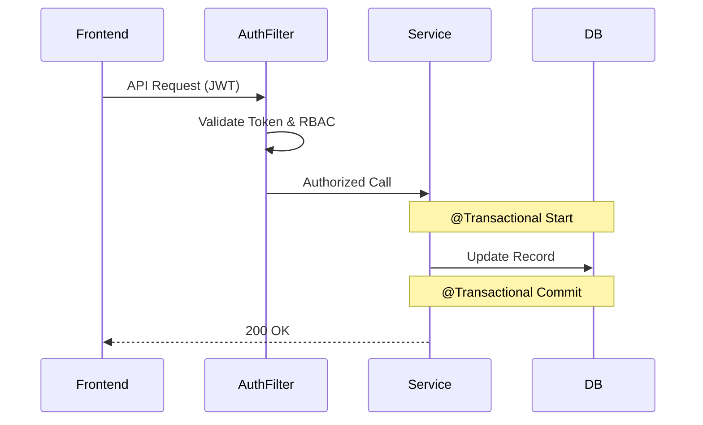

# SD Skill: Professional System Design and Documentation

This skill enables Claude to design robust system architectures and produce high-quality System Design (SD) documents. It translates System Analysis (SA) requirements into technical specifications, following project templates and advanced engineering principles.

## Design Principles

Apply these 4 core thinking models during the design process:

### 1. Sequence Diagram: Defining Boundaries & Responsibilities
- **Beyond Happy Path**: Do not just design the successful flow.
- **Permission Interception**: Identify where Spring Security/Filters intercept JWT. Define if RBAC checks occur at the Gateway or Service layer.
- **Transaction Boundary**: Explicitly mark steps that must execute within the same `@Transactional` block. Define rollback / compensation strategies for external failures (GCS, Resend, payment gateway).
- **Asynchronous Processing**: Side effects (notifications, email) use `@TransactionalEventListener(AFTER_COMMIT)`; scheduled work goes through Cloud Scheduler → `/api/internal/cron/*`. Cloud Run has no reliable long-lived background threads. Distinguish between "Response returned to user" and "Background execution".

### 2. Data Model: Integrity & Traceability
- **Ownership Isolation (BOLA)**: There is no multi-tenancy. Every resource read/write must check ownership against the token identity (`TokenContext.getUserId()`); never accept caller-identity params. Mismatch → 403, not found → 404 (SD-GLOBAL-SPEC §3.4).
- **Audit Trail**: Precisely define which actions write `order_logs` (action type + payload), in the same transaction as the business change (SD-GLOBAL-SPEC §4.3).
- **Performance Pre-evaluation**: Choose appropriate types (e.g., `varchar(255)` vs `text`) and design indexes. Identify potential query hotspots.

### 3. API Design: Standardization & Defensiveness
- **Precise Error Codes**: Throw the module's `application/exception/*Exception`; `GlobalExceptionHandler` maps it to HTTP status + error code (e.g. `409 VERSION_CONFLICT`). Never generic 500.
- **Idempotency**: State-changing POSTs that may be retried accept an `Idempotency-Key` header (`idempotency_keys` table); state machine entities use `@Version`.
- **Pagination & Rate Limiting**: Enforce pagination on GET interfaces. Implement rate limiting for high-concurrency scenarios.

### 4. Shared Design: DRY (Don't Repeat Yourself)
- **Componentization**: Reuse rules in `SD-GLOBAL-SPEC.md` / `SD-FRONTEND-SPEC.md` and existing mechanisms (advisory lock, `@RequirePlan`, GCS storage service, internal cron) rather than reinventing.
- **Configuration-Driven**: Move parameters (timeouts, quotas, TTLs) to `application.yml` properties / env vars (secrets via Secret Manager). SaaS tier limits follow `docs/requirements/sass-level-program.md`. Avoid hard-coding.

## Workflow

### Step 1: Input Analysis
- Read the corresponding SA document (PRD-XXX) and requirements.
- Identify core entities, API endpoints, and external dependencies.

### Step 2: Technical Architecture Design
- Define the sequence of calls between Frontend, Backend, and DB.
- Determine transaction boundaries and permission requirements.
- Select appropriate shared components and templates.

### Step 3: Document Writing
- Use the template located at `docs/sd/_TEMPLATE.md`.
- **Sequence Diagrams**: Use Mermaid syntax. Ensure permission and transaction boundaries are clear.
- **Data Model**: Provide SQL snippets for DDL changes.
- **API Spec**: Detail Request/Response structures, roles, required plan tier, and every error code.

### Step 4: Consistency Check
- Every endpoint: role (`@PreAuthorize`), plan (`@RequirePlan`), ownership check.
- Verify `order_logs` coverage for key order actions.
- Every PRD AC appears in the "AC 對應實作" table.
- Flyway migration number continues the latest `V*` and is compatible with the currently deployed code.

## Document Template
The skill uses the standard template provided in `docs/sd/_TEMPLATE.md`. Always maintain the structure while filling in the technical design details.

## Example Sequence Diagram with Boundary

