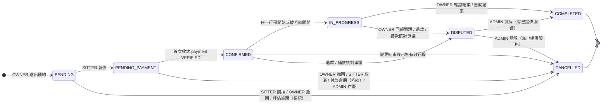
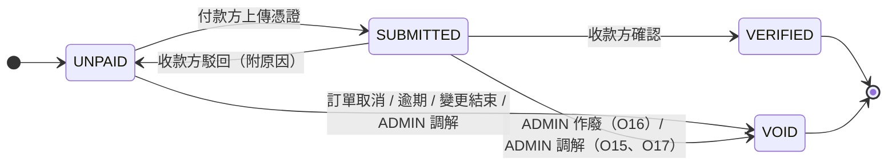
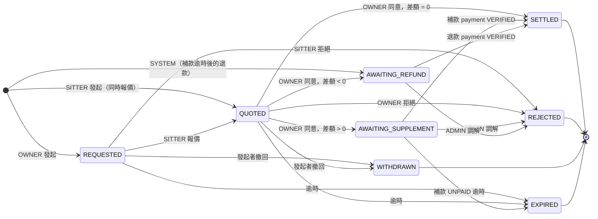

# 領域基準（Domain Baseline）

| 項目 | 內容 |
|------|------|
| 狀態 | Approved |
| 前次核准 | 使用者，第 1 版 2026-11-21；第 2 版 2026-11-22（第 3 版修訂中：依 FULFILL PRD 重寫回饋補充，見 §7 CQ-78~83） |
| 建立日期 | 2026-11-21 |
| 依據 | `docs/requirements/business-requirements.md`（下稱 BR）、`docs/requirements/sass-level-program.md`（下稱 SAAS）、使用者決定（§7） |
| 適用 | 所有 PRD / SD / TS。本文件定義的概念，其他文件只能引用、不得重新定義；要改就改這份並走核准 |

> §7 CQ-1~83 已全部由使用者決定。第 2 版已核准；CQ-78~83 為 FULFILL PRD（008 / 009 / 022 / 028）重寫時發現的缺口，補充後待使用者再次核准。
> 「現況」欄是 2026-11-21 程式碼的實際行為，只當證據，不代表正確。
> 標「提案值」的參數（`URGENT_WINDOW_HOURS` 2h、排程頻率 15 分鐘、CLOSED_BY_SYSTEM 計價）已隨核准確認。

---

## 1. 角色與身分

### 1.1 角色

| 角色 | 定義 | 出處 | 現況 |
|------|------|------|------|
| OWNER（飼主） | 發起預約、管理毛孩、付款、確認收到退款、確認結案、回報問題 | BR §1.2（BR 稱 Client） | `ROLE_OWNER` |
| SITTER（保母） | 提供方案、評估報價、核對收款、上傳退款憑證、執行服務 | BR §1.2 | `ROLE_SITTER` |
| ADMIN（平台管理員） | KYC 審核、停權、信用分數、爭議調解、付款待核對待辦（只能作廢，不能代為確認收款）、手動開通訂閱 | CQ-8 | `ROLE_ADMIN` |
| 匿名訪客 | 只能看保母公開頁與方案 | BR §4.5 | Optional JWT |

- 一個帳號可同時有 OWNER 與 SITTER 兩個 profile，以 `currentRole` 切換；**同一時間只以一個角色操作**（BR §1.2）。ADMIN 不能透過切換取得。
- 呼叫端點時 token 的 `currentRole` 必須是端點要求的角色，否則 403 `ROLE_MISMATCH`；不會自動切換。
- 不可用自己的 OWNER 身分預約自己的 SITTER 頁面：422 `SELF_BOOKING_NOT_ALLOWED`（CQ-25）。
- 程式與文件一律用 `OWNER`，不用 `CLIENT`。

### 1.2 資源歸屬規則

| 資源 | 可讀 | 可寫 |
|------|------|------|
| 訂單 | 該訂單的 owner 與 sitter；ADMIN 唯讀 `DISPUTED` 訂單與有 OPEN 待辦的訂單（CQ-18） | 依 §3 轉移表的觸發者 |
| 毛孩 | owner；與該 owner 有過任何狀態訂單的 sitter | owner（照護備註依 PRD-021 協作規則） |
| 保母方案、問卷、公開檔案 | 公開資訊匿名可讀 | 該 sitter |
| 保母收款帳號 | 該 sitter；收款帳號在 payment 建立時快照，該 payment 的付款方可讀快照（CQ-23）；ADMIN 於可讀訂單範圍內唯讀快照（CQ-66） | 該 sitter |
| 付款 / 退款憑證 | 該 payment 的雙方；ADMIN 於可讀訂單範圍內 | 上傳者 |
| KYC 證件 | 本人與 ADMIN | 本人 |
| 照護日誌與日誌媒體 | 該訂單 sitter；owner 與 ADMIN（可讀訂單範圍內）只能讀已送出的日誌，未送出 → 404 `NOT_FOUND`（CQ-81） | 該訂單 sitter |

- 呼叫者身分一律取自 token。存在但不屬於呼叫者 → **403** `FORBIDDEN`；不存在 → **404** `NOT_FOUND`（SD-GLOBAL-SPEC §3.4）。

---

## 2. SaaS 方案

### 2.1 方案矩陣（唯一定義）

| 能力 | FREE 免費 | BASIC 基礎 $499 | PRO 專業 $899 | ULTIMATE 頂級 $1299 | 出處 | 現況 |
|------|-----------|-----------------|---------------|--------------------|------|------|
| 每月接單上限 | 3 | 20 | 無限 | 無限 | SAAS、CQ-5、CQ-21 | **未實作** |
| 照護回報媒體（每次行程） | 僅文字 | 5 照片 | 10 照片 + 2 影片 | 25 照片 + 5 影片 | SAAS、CQ-4 | 部分；方案層 `maxPhotos` 要移除 |
| 報價手動調價（加價 / 折扣） | ✗ | ✗ | ✓ | ✓ | SAAS | `@RequirePlan(PRO)` |
| 變更協商自訂新總額 | ✗（系統依快照單價計算） | ✗（同左） | ✓（可另加減並附原因） | ✓ | CQ-22 | 未區分 |
| 連假自動加價 | ✗ | ✗ | ✗ | ✓ | SAAS | 未實作（延後） |
| 特定日期才開放預約（方案可預約區間） | ✗ | ✗ | ✓ | ✓ | SAAS、CQ-68 | 已實作；只在當下為 PRO / ULTIMATE 且未鎖定時套用，FREE / BASIC / 鎖定一律常態開放（預約與變更皆同） |
| 黑名單 | ✗ | ✗ | ✓ | ✓ | SAAS | 已實作 |
| 白名單（指定名單才可下單） | ✗ | ✗ | ✗ | ✓ | SAAS | 已實作 |
| 線上刷卡 | ✗ | ✗ | ✓ | ✓ | SAAS | 未實作（SD-BILLING） |
| 媒體保留期限（自訂單結案日起） | 7 天 | 30 天 | 90 天 | 永久 | SAAS、PRD-013 | 已實作 |

### 2.2 方案規則

- 方案判斷以**當下訂閱狀態即時查詢**，不放進 JWT（SD-GLOBAL-SPEC §3.2）。
- **快照**：報價時把單價、方案名稱、媒體額度、保留期限快照到訂單（CQ-20）。之後保母升降級只影響新訂單；例外：升級可展延未刪除的舊媒體保留期限（PRD-013）。
- **每月接單上限**：計數 = 該保母在當月（Asia/Taipei 自然月）內**進入 `CONFIRMED` 的訂單數**，與訂單之後的狀態無關，取消不返還；上限取檢查當下的訂閱等級（CQ-5、CQ-21）。達上限時：公開頁不可預約（422 `MONTHLY_QUOTA_REACHED`）、保母端顯示「本月額度已滿」；已在流程中的訂單照常進行。
- **訂閱逾期 / 停權**：到期日隔天 00:00（Asia/Taipei）未續訂，或被 ADMIN 停權 → 只擋新生意：公開頁預約、報價、方案 / 問卷 / 公開檔案設定一律 403 `SUBSCRIPTION_LOCKED`；**既有訂單的核款、行程、日誌、變更回應照常**，並通知受影響訂單的飼主（CQ-19）。現況：未實作，由 ADMIN 手動開通。

---

## 3. 訂單生命週期

### 3.1 結構

`orders.status` 只表示訂單在生命週期的位置；付款（`payments`）與變更（`modification_requests`）各自是獨立實體與狀態機。變更協商期間訂單主狀態**不變**（CQ-1）。

| 主狀態 | 意義 | 前端分頁（BR §3.1） |
|--------|------|-------------------|
| `PENDING` | 待保母評估 / 報價（含問卷子狀態，見 §3.5） | 評估中 |
| `PENDING_PAYMENT` | 已報價，等首次付款（含憑證已上傳待核對）（CQ-29） | 評估中 |
| `CONFIRMED` | 已付款成立，尚未開始任何行程 | 進行中 |
| `IN_PROGRESS` | 至少一個行程已開始或已被系統關閉 | 進行中 |
| `DISPUTED` | 爭議處理中；付款與變更子流程凍結，只有 ADMIN 可操作（CQ-48） | 進行中 |
| `COMPLETED` | 已結案 | 歷史 |
| `CANCELLED` | 已取消，記錄 `cancelledBy`（OWNER / SITTER / SYSTEM / ADMIN）與原因 | 歷史 |

- **有效行程** = 狀態不是 `CANCELLED` 的行程。下文「所有行程」一律指有效行程。

### 3.2 主狀態轉移表

| # | 從 → 到 | 觸發者 | 前置條件 | 附帶動作 | 不符時 |
|---|---------|-------|---------|---------|-------|
| O1 | → `PENDING` | OWNER | 方案在可預約區間（CQ-68）；最後一個行程日期 ≤ 今天 + 365 天、`base_amount` ≤ 999,999（CQ-74）；非自己的保母頁（CQ-25）；保母未鎖定、未達月上限；首個行程日期 ≥ 今天（Asia/Taipei）；每個日期群組至少綁定 1 隻本人的毛孩（CQ-60）；需填問卷時已全部作答（§3.5） | 建立行程；寫 `review_expires_at`（§5）、`questionnaire_status` 與答案快照（§3.5） | 422 `SELF_BOOKING_NOT_ALLOWED` / `MONTHLY_QUOTA_REACHED` / `INVALID_VISIT_DATE`；403 `SUBSCRIPTION_LOCKED`；模組碼見 PRD-005 §5 |
| O2 | `PENDING` → `PENDING_PAYMENT` | SITTER | `now < review_expires_at`；首個行程日期 ≥ 今天（CQ-45）；`total_amount ≥ 1`（CQ-26）；FREE / BASIC 無調整；保母未鎖定；未達月上限（CQ-62）；已設定收款帳號（CQ-63） | 快照（§2.2）；建立首次收款 payment（UNPAID，寫 `due_at`、`escalate_at`、收款帳號快照）；已過提醒點時隨報價通知一併提醒 | 409 `DEADLINE_PASSED` / `FIRST_VISIT_DATE_PASSED`；422 `INVALID_QUOTE_AMOUNT` / `MONTHLY_QUOTA_REACHED` / `PAYOUT_ACCOUNT_REQUIRED`；403 `PLAN_REQUIRED` / `SUBSCRIPTION_LOCKED` |
| O3 | `PENDING` → `CANCELLED` | SITTER（婉拒，需原因）/ OWNER（撤回） | — | 可附轉介（PRD-010） | — |
| O4 | `PENDING` → `CANCELLED` | SYSTEM | `now ≥ review_expires_at`（CQ-12） | 通知雙方 | — |
| O5 | `PENDING_PAYMENT` → `CONFIRMED` | SITTER（核對收款） | 首次收款 payment `SUBMITTED → VERIFIED`；不檢查日期 | 月額度 +1；關閉相關 ADMIN 待辦；通知雙方「訂單啟動成功」 | 409 `PAYMENT_STATE_CONFLICT` |
| O6 | `PENDING_PAYMENT` → `CANCELLED` | OWNER（撤回） | 首次收款 payment 為 `UNPAID` | payment → VOID | 409 `PAYMENT_ALREADY_SUBMITTED` |
| O7 | `PENDING_PAYMENT` → `CANCELLED` | SITTER（取消，需原因） | 首次收款 payment 為 `UNPAID`；`SUBMITTED` 時只能駁回（CQ-13） | payment → VOID | 409 `PAYMENT_ALREADY_SUBMITTED` |
| O8 | `PENDING_PAYMENT` → `CANCELLED` | SYSTEM | `now ≥ due_at` 且 payment 為 `UNPAID` | payment → VOID；通知雙方 | — |
| O16 | `PENDING_PAYMENT` → `CANCELLED` | ADMIN（作廢） | 首次收款 payment 為 `SUBMITTED` 且有 OPEN 的付款待核對 ADMIN 待辦。**ADMIN 不能代為確認收款**（CQ-43） | payment → VOID；待辦 RESOLVED；通知雙方：款項由雙方自行處理 | 409 `PAYMENT_STATE_CONFLICT`（鎖定後重驗失敗）；待辦已關閉 → 403 `FORBIDDEN` |
| O9 | `CONFIRMED` → `IN_PROGRESS` | SITTER（開始行程）/ SYSTEM（殭屍清理） | 任一行程 `PENDING → IN_PROGRESS` 或 `PENDING → CLOSED_BY_SYSTEM`，同一交易（CQ-28）；因變更而 `CANCELLED` 不觸發（CQ-56） | — | — |
| O10 | `CONFIRMED` → `CANCELLED` | SYSTEM | 變更請求結束（SETTLED；補款 EXPIRED 且不需系統退款；或補款 EXPIRED 後系統退款 SETTLED）後，訂單已無有效行程（CQ-41） | — | — |
| O11 | `IN_PROGRESS` → `COMPLETED` | OWNER（確認結案） | 所有行程為 `DONE`（日誌已送出）或 `CLOSED_BY_SYSTEM`（CQ-27）；無未結束變更 | 通知保母（CQ-82） | 409 `VISITS_NOT_FINISHED` / `MODIFICATION_IN_PROGRESS` |
| O12 | `IN_PROGRESS` → `COMPLETED` | SYSTEM（自動結案） | 所有行程為 `DONE` 或 `CLOSED_BY_SYSTEM`（**不看日誌**，CQ-40）；無未結束變更；`now ≥ completion_basis_at + AUTO_COMPLETE_HOURS` | 通知雙方（CQ-82） | — |
| O13 | `IN_PROGRESS` → `DISPUTED` | OWNER（回報問題） | 同 O12 的行程條件；無未結束變更（CQ-17）；`now < completion_basis_at + DISPUTE_WINDOW_HOURS` | 暫停自動結案；ADMIN 待辦（`type=SERVICE_DISPUTE`，不通知 ADMIN）；通知保母（CQ-82） | 409 `MODIFICATION_IN_PROGRESS` / `VISITS_NOT_FINISHED` / `DEADLINE_PASSED`（`deadline=DISPUTE_WINDOW_ENDS_AT`） |
| O14 | `CONFIRMED` / `IN_PROGRESS` → `DISPUTED` | OWNER / SITTER（款項爭議） | 變更請求為 `AWAITING_REFUND`（CQ-30）；或補款 payment 為 `SUBMITTED` 且自**目前這筆 submission 上傳時間**起超過 `MODIFICATION_TIMEOUT_HOURS` 未核對（CQ-42、CQ-64） | 暫停自動結案；ADMIN 待辦 | 409 `ORDER_STATE_CONFLICT` / `MODIFICATION_STATE_CONFLICT` / `PAYMENT_STATE_CONFLICT`（未滿 72h，payload 帶可申報時間） |
| O15 | `DISPUTED` → `COMPLETED` | ADMIN（調解結案） | 無 `IN_PROGRESS` 行程；有任何 `DONE` / `CLOSED_BY_SYSTEM` 行程（CQ-57） | 剩餘 `PENDING` 行程取消；可登記一筆 `ADMIN_ADJUSTMENT` 退款（≤ 已收淨額，附依據）；未結束變更 → `REJECTED`；未結束 payment → `VOID`（CQ-18、CQ-34、CQ-48） | — |
| O17 | `DISPUTED` → `CANCELLED` | ADMIN（調解結案） | 無 `IN_PROGRESS` 行程；無任何 `DONE` / `CLOSED_BY_SYSTEM` 行程（CQ-57） | 同 O15；`cancelledBy=ADMIN` | — |

- `CONFIRMED` 之後，訂單內容與金額只能透過變更協商（§3.4）改變；付款後不提供撤回（CQ-7）。
- 付款前要改內容 → 撤回重下（CQ-3）。
- **期限一律以時間判斷**：使用者操作時已過對應期限（`review_expires_at`、`due_at`、變更 `expires_at`）→ 409 `DEADLINE_PASSED`（payload 帶期限名稱），即使排程尚未把狀態寫成終態；排程只負責補寫終態（CQ-46）。**例外**：結果本身就是取消的操作（O3 婉拒 / 撤回、O6、O7）在訂單尚未進入終態前仍允許，`cancelledBy` 依實際操作者記錄（CQ-61）。
- **取消的共同附帶動作**：任何轉為 `CANCELLED` 的轉移，同一交易內把剩餘 `PENDING` 行程轉 `CANCELLED`、未結束 payment 轉 `VOID`（CQ-65）。
- **鎖定期間的變更計價**：保母訂閱鎖定 / 停權時，變更新總額一律依 FREE 規則由系統計算（CQ-66）。
- **`DISPUTED` 凍結**：爭議期間 payment 與變更的所有使用者操作 → 409 `ORDER_STATE_CONFLICT`；行程照常執行（CQ-48、CQ-57）。

### 3.3 子流程 A：付款（`payments` + `payment_submissions`）

每一筆應收或應退的款項是一筆 payment；每次上傳憑證是一筆 submission（保留歷史，駁回不清空）。系統**只處理憑證與確認**，匯款帳號以外的溝通（例如退款要匯到哪）由雙方自行聯繫（CQ-54）。

| 欄位 | 說明 |
|------|------|
| `direction` | `CHARGE`（飼主付給保母）/ `REFUND`（保母退給飼主） |
| `purpose` | `INITIAL`（首次付款）/ `SUPPLEMENT`（變更補款）/ `MODIFICATION_REFUND`（變更退款）/ `ADMIN_ADJUSTMENT`（調解退款） |
| `method` | `OFFLINE_TRANSFER` / `ONLINE`（SD-BILLING）/ `ADMIN_ADJUSTMENT` |
| `amount` | 本筆金額（正整數），付款頁與核對畫面都只顯示這個數字 |
| `due_at` | `INITIAL` 與 `SUPPLEMENT` 於建立時寫入（§5），排程只比對此欄；`REFUND` 為 null |
| `escalate_at` | `INITIAL` 於建立時寫入（§5，CQ-44） |
| 收款帳號快照 | `CHARGE` 時快照保母收款帳號（CQ-23）；`REFUND` 不存飼主帳號 |

| 方向 / 方式 | 付款方（上傳憑證） | 收款方（確認 / 駁回） |
|------------|------------------|--------------------|
| `CHARGE` | OWNER | SITTER |
| `REFUND`（`MODIFICATION_REFUND`） | SITTER | OWNER（只能確認；不同意時走 O14 爭議） |
| `REFUND`（`method=ADMIN_ADJUSTMENT`） | — | 建立即 `VERIFIED` |

- submission 狀態：`SUBMITTED` / `ACCEPTED` / `REJECTED`（附駁回原因）。同一 payment 同時最多一筆 `SUBMITTED` submission。
- **`SUBMITTED` 不會因逾期被作廢**：只有 ADMIN（O16 / O15 / O17）能把 `SUBMITTED` 改 `VOID`。ADMIN 作廢一筆已實際匯出的 `SUBMITTED` 退款時，須同時登記等額 `ADMIN_ADJUSTMENT`（CQ-48）。
- **首次付款待核對升級**：`now ≥ escalate_at` 且仍 `SUBMITTED` → 建立 ADMIN 待辦（`admin_tasks`，CQ-55）並通知雙方。之後保母仍可核對（O5，待辦自動關閉）；ADMIN 只能作廢並取消（O16）（CQ-43）。
- 收款帳號快照與即時收款帳號同樣加密存放（NFR-03），金鑰不得有預設值（CQ-72）。
- 線上付款（SD-BILLING）是同一實體的 `method=ONLINE`，金流回呼直接 `UNPAID → VERIFIED`。

### 3.4 子流程 B：訂單變更（`modification_requests`）

| 規則 | 內容 | 出處 |
|------|------|------|
| 變更類型 | `CHANGE`（增減行程）/ `CANCEL_ALL`（整筆取消，新內容 = 取消所有 `PENDING` 行程） | 第 2 輪 #13 |
| 可發起時機 | 訂單為 `CONFIRMED` / `IN_PROGRESS`，至少還有 1 個 `PENDING` 行程（CQ-69），且無其他未結束（非 SETTLED / REJECTED / WITHDRAWN / EXPIRED）變更請求；不符 → 409 `MODIFICATION_NOT_ALLOWED`（無 PENDING 行程）/ `MODIFICATION_IN_PROGRESS` | PRD-016、CQ-17、CQ-69 |
| 報價 | 一律由 SITTER 給新內容與新總額；SITTER 可拒絕任何變更（含整筆取消）（CQ-41）。FREE / BASIC 的新總額 = 快照單價 × 新內容的有效行程，PRO+ 可再加減並附原因；新總額 ≥ 0（CQ-22） | CQ-22、CQ-41 |
| 計價範圍 | `DONE` 與 `CLOSED_BY_SYSTEM` 行程都計價（系統無法判斷是否實際服務；有異議走爭議）（提案值） | 第 2 輪 #14 |
| 新增行程日期 | 報價時須 ≥ 今天 + 1 天（Asia/Taipei），否則 422 `INVALID_VISIT_DATE`；`SETTLED` 時日期已過的仍建立，交殭屍清理（CQ-49） | CQ-49 |
| 差額 | `差額 = 新總額 − 已收淨額`；退款不得超過已收淨額 | §4 |
| 減少的行程 | OWNER 同意時**立即取消**（CQ-32）；同意時若要取消的行程已不是 `PENDING` → 409 `VISIT_ALREADY_STARTED`，需重新報價 | CQ-32、第 2 輪 #11 |
| 新增的行程與新總額 | `SETTLED` 時生效 | CQ-32 |
| 整筆取消 | `CONFIRMED` 訂單結束後已無有效行程 → O10；`IN_PROGRESS` 訂單結清後照常走結案流程，收入 = 已收淨額（CQ-14） | CQ-14、CQ-41 |
| 補款 | 同意時建立 `SUPPLEMENT` payment（`due_at` = 同意時間 + `MODIFICATION_TIMEOUT_HOURS`）。`UNPAID` 逾時 → payment `VOID`、變更 `EXPIRED`：新增部分不生效，已取消的減少行程維持取消；**同交易**把 `total_amount` 改為 `原 total_amount − Σ(已取消行程的快照單價)`（下限 0，原報價的手動加減保留）（CQ-53），若已收淨額 > 新 total_amount，再建立一筆 `initiatedBy=SYSTEM`、不可撤回、狀態 `AWAITING_REFUND` 的變更與對應退款 payment（先結束舊變更再建新列，避免撞唯一約束）。`SUBMITTED` 不逾時，超過 `MODIFICATION_TIMEOUT_HOURS` 未核對 → 可申報 O14（CQ-42） | CQ-15、CQ-32、CQ-42、CQ-53 |
| 退款 | 同意時建立 `MODIFICATION_REFUND` payment；SITTER 上傳退款憑證、OWNER 確認 → `SETTLED`；**無逾時**，任一方可申報 O14；退款帳號由雙方自行溝通（CQ-54） | CQ-30、CQ-54 |
| 逾時 | `REQUESTED` / `QUOTED` 於 `expires_at`（進入狀態時間 + `MODIFICATION_TIMEOUT_HOURS`）、`AWAITING_SUPPLEMENT` 於補款 payment `due_at` 仍 `UNPAID` → `EXPIRED`，通知雙方 | CQ-15 |
| 協商期間 | 行程照常執行；自動結案與 O13 暫停；O14 可用 | CQ-17、CQ-30 |
| 訂閱鎖定 | 鎖定 / 停權不擋變更報價與回應（屬既有訂單）（CQ-19） | 第 2 輪 #15 |

### 3.5 事前問卷

問卷在**送單時**填寫（CQ-58，BR §4.5 Step 2；BR §3.6「送單不填」的寫法不採用）。`questionnaire_status` 在 O1 寫入後不再改變：

| 情境 | `questionnaire_status` | 送單時 |
|------|----------------------|-------|
| 飼主是熟客（與該保母有過 `COMPLETED` 訂單，CQ-6） | `NOT_REQUIRED`，`questionnaire_exempt_reason = REGULAR_OWNER` | 不顯示問卷 |
| 保母沒有啟用中的題目 | `NOT_REQUIRED`，`questionnaire_exempt_reason = NO_ACTIVE_QUESTIONS` | 不顯示問卷 |
| 其他 | `COMPLETED` | 必須作答全部必填題，答案連同題目文字與題型快照到訂單 |

- 沒有「保母事後要求問卷」的流程，也沒有保母自訂的永久免填名單（CQ-59）。
- 之後保母修改題目不影響既有訂單的答案快照。
- 兩種免填同時成立時記 `REGULAR_OWNER`；作答時 `questionnaire_exempt_reason` 為 null（CQ-67）。

### 3.6 轉移規則（所有模組共用）

| 規則 | 內容 |
|------|------|
| 鎖 | 改變訂單主狀態、payment、變更請求、行程狀態的操作，先 `SELECT ... FOR NO KEY UPDATE` 鎖訂單列，`SET LOCAL lock_timeout = '3s'`；逾時 → 409 `ORDER_BUSY` + `Retry-After: 1`（CQ-50）。子實體一律透過鎖父訂單序列化；其他模組（例如 SD-FULFILL 改行程、照護日誌的暫存 / 上傳 / 刪除 / 送出，CQ-81）必須呼叫 SD-ORDER 提供的鎖入口 |
| 版本 | 實體保留 `@Version` 作為最後防線；不接受客戶端傳入 version。畫面過期時以關鍵值比對（例：客戶端帶 `expectedAmount`，與目前值不符 → 409 `PRICE_CHANGED`）（CQ-35） |
| 稽核 | 每次轉移寫一筆 `order_logs`（action、操作者、payload），**與狀態變更同一交易**（不使用 `REQUIRES_NEW`） |
| 通知 | **不可關閉的類別**：付款提醒（含併入報價通知的提醒）、付款逾期取消、憑證駁回、ADMIN 作廢、收款帳號變更（帳號安全）；其餘依 PRD-014 偏好（CQ-73）。outbox = `notifications` 表（歸 SD-NOTIFY）：轉移交易內呼叫 `NotificationService.enqueue()`（`MANDATORY` 交易傳播）寫入站內通知與投遞欄位；Email 由排程搶單寄送，Resend 帶 `Idempotency-Key = notification.id`，最多 5 次指數退避，4xx 直接判失敗（CQ-33、CQ-52） |
| 冪等 | 會被重試的寫入操作帶 `Idempotency-Key`，範圍 = （使用者, HTTP method + 路由樣板, key）。保存 request hash（multipart = 各欄位值 + 檔案 SHA-256）。同 key 同 hash 重送 → 回放第一次的狀態碼與 body（2xx 與 409 / 422 業務錯誤會記錄；5xx 與 `ORDER_BUSY` 不記錄，可重試；body 不含簽名網址等時效性資料）；同 key 不同 hash → 422 `IDEMPOTENCY_KEY_REUSED`；處理中（`locked_until = now + 30s` 未過）→ 409 `IDEMPOTENCY_IN_PROGRESS`，過期可被接手（CQ-51）；有效期 `IDEMPOTENCY_KEY_TTL_HOURS`，以 `expires_at > now()` 判斷 |
| 外部 I/O | GCS 上傳、寄信、第三方呼叫不得在持有訂單鎖的交易內；上傳先於交易，交易失敗時刪除已上傳物件，另有孤兒檔清除排程 |
| 排程 | Cloud Scheduler → `/api/internal/cron/*`；先唯讀查出候選，再逐筆以獨立交易處理（鎖住後重驗條件，`SKIP LOCKED`），一筆失敗不影響其他筆；可重跑 |
| ADMIN 待辦 | `admin_tasks`（歸 SD-ORDER）：`type`、`order_id`、`payment_id`、`status`（OPEN / RESOLVED）、`resolution`、`resolved_by`；`(type, order_id) WHERE status = 'OPEN'` 唯一；建立與關閉都與觸發的轉移同交易（CQ-55） |

### 3.7 跨模組錯誤碼

| HTTP | code | 情境 |
|------|------|------|
| 400 | `VALIDATION_FAILED` | 欄位格式錯誤 |
| 401 | `UNAUTHENTICATED` | 未登入或 token 無身分 |
| 403 | `FORBIDDEN` | 非資源當事人 |
| 403 | `ROLE_MISMATCH` | token 角色與端點要求不符 |
| 403 | `SUBSCRIPTION_LOCKED` | 訂閱逾期或停權，操作屬於新生意 |
| 403 | `PLAN_REQUIRED` | 方案不足 |
| 404 | `NOT_FOUND` | 資源不存在 |
| 409 | `ORDER_STATE_CONFLICT` | 主狀態不允許此操作（含 `DISPUTED` 凍結） |
| 409 | `PAYMENT_STATE_CONFLICT` | payment 狀態不允許 |
| 409 | `MODIFICATION_IN_PROGRESS` | 有未結束變更請求 |
| 409 | `MODIFICATION_STATE_CONFLICT` | 變更請求狀態不允許此操作 |
| 409 | `MODIFICATION_NOT_ALLOWED` | 已無未開始行程，不能發起變更 |
| 409 | `VISITS_NOT_FINISHED` | 行程未全部結束（含 DONE 行程日誌未送出，O11） |
| 409 | `VISIT_STATE_CONFLICT` | 行程狀態不允許此操作（payload `currentVisitStatus`；SD-FULFILL 與照護日誌共用，CQ-80） |
| 409 | `VISIT_ALREADY_STARTED` | 要減少的行程已不是 PENDING |
| 409 | `PAYMENT_ALREADY_SUBMITTED` | 已上傳憑證後撤回 / 取消 |
| 409 | `DEADLINE_PASSED` | 已過期限（payload 帶期限名稱） |
| 409 | `FIRST_VISIT_DATE_PASSED` | 首個行程日期已過仍報價 |
| 409 | `PRICE_CHANGED` | 畫面上的金額已過期 |
| 409 | `ORDER_BUSY` | 訂單鎖等待逾時；`@Version` 衝突（最後防線） |
| 409 | `IDEMPOTENCY_IN_PROGRESS` | 同 key 請求處理中 |
| 422 | `IDEMPOTENCY_KEY_REUSED` | 同 key 不同內容 |
| 422 | `SELF_BOOKING_NOT_ALLOWED` | 預約自己 |
| 422 | `MONTHLY_QUOTA_REACHED` | 保母本月額度已滿 |
| 422 | `INVALID_QUOTE_AMOUNT` | 報價總額 < 1 |
| 422 | `INVALID_VISIT_DATE` | 行程日期不符規則 |
| 422 | `PAYOUT_ACCOUNT_REQUIRED` | 保母未設定收款帳號就報價 |

- 當事人做不屬於自己方向的動作（例：保母上傳 CHARGE 憑證、飼主駁回退款）→ 403 `FORBIDDEN`。
- **判斷順序**（多個錯誤同時成立時回第一個，CQ-70、CQ-76）：
  1. 401 `UNAUTHENTICATED`
  2. 冪等回放（同使用者、同端點、同 key、同內容 → 回放第一次結果）
  3. 403 `ROLE_MISMATCH`
  4. 404 `NOT_FOUND`
  5. 403 `FORBIDDEN`：非資源當事人；或當事人但不是此動作的操作方（非發起者、payment 方向不符）
  6. 400 `VALIDATION_FAILED`（含缺 `Idempotency-Key`）
  7. 422 `IDEMPOTENCY_KEY_REUSED` / 409 `IDEMPOTENCY_IN_PROGRESS`
  8. 409 `ORDER_STATE_CONFLICT`
  9. 409 `MODIFICATION_IN_PROGRESS` → `MODIFICATION_NOT_ALLOWED` → `MODIFICATION_STATE_CONFLICT` / `PAYMENT_STATE_CONFLICT` / `VISIT_STATE_CONFLICT` → `VISITS_NOT_FINISHED`；模組自訂的狀態類 409 碼（例：`CARE_LOG_STATE_CONFLICT`）緊接在本步之後
  10. 409 `DEADLINE_PASSED`
  11. 409 `VISIT_ALREADY_STARTED`、`PRICE_CHANGED`
  12. 422 業務規則（含模組碼）
  13. 403 `PLAN_REQUIRED` / `SUBSCRIPTION_LOCKED`
  - 需要讀取當下資料才能判斷的上限檢查（例：依目前題目判斷答案字數、後端重算後的 `base_amount` / `total_amount` 上限）雖回 400 `VALIDATION_FAILED`，判斷時點歸在第 12 步。
  - 例：保母對 CHARGE 上傳 → 403（第 5 步）；飼主撤回系統建立的退款變更 → 403（非發起者）；`DISPUTED` 訂單送出原因空白 → 400。
- **payload 共通欄位**：`ORDER_STATE_CONFLICT` 帶 `currentStatus`；`DEADLINE_PASSED` 帶 `deadline`（期限名稱：`REVIEW_EXPIRES_AT` / `PAYMENT_DUE_AT` / `MODIFICATION_EXPIRES_AT` / `DISPUTE_WINDOW_ENDS_AT` / `VISIT_ZOMBIE_AT` / `CARE_LOG_EDIT_ENDS_AT`）與 `deadlineAt`（時間值）（CQ-71）；`PRICE_CHANGED` 帶目前值。
- 503 `STORAGE_UNAVAILABLE`：GCS 等檔案儲存暫時無法使用（跨模組共用，只在以上檢查全部通過後的外部呼叫發生）。
- 非業務錯誤：未預期的程式錯誤一律 500 `INTERNAL_ERROR`（不列入判斷順序，回應不含內部細節，帶 `traceId`）。
- 需要 `Idempotency-Key` 的端點缺 key → 400 `VALIDATION_FAILED`（`field=Idempotency-Key`）。

模組專屬錯誤碼（例如媒體額度超過、檔案格式）由各模組 SD 定義，命名不得與本表衝突。

---

## 4. 金額

| 規則 | 內容 | 出處 |
|------|------|------|
| 幣別與精度 | TWD 整數；計算中途 BigDecimal，入庫前四捨五入；不使用 `BigDecimal(18,4)` 欄位 | BR §7、SD-GLOBAL-SPEC §2.2 |
| 預約試算 | `base_amount = Σ(各日期群組天數 × 每日次數 × 方案單價)`，由**後端**重算，不信任前端金額；單筆 ≤ 999,999（CQ-74） | BR §4.5 |
| 報價 | `total_amount = base_amount + surcharge_amount − discount_amount`，≥ 1；調整需附原因；FREE / BASIC 只能原價 | BR §5.1、SAAS、CQ-26 |
| 快照 | 報價時（§2.2） | CQ-20 |
| 已收淨額 | `Σ CHARGE VERIFIED − Σ REFUND VERIFIED`（含 ADMIN_ADJUSTMENT） | CQ-34 |
| 變更差額 | `新總額 − 已收淨額`；> 0 補款、< 0 退款、= 0 無差額 | PRD-016、§3.4 |
| 保母收入 | `COMPLETED` 與 `CANCELLED` 訂單的已收淨額（取消費因此計入）；帳務總覽由 payments 加總，不讀 `total_amount` | BR §6、CQ-14、CQ-41 |

---

## 5. 時間規則

所有時間 UTC 儲存、ISO-8601 傳輸；「日」的邊界與顯示一律 Asia/Taipei。`首日` = 首個行程日期的 00:00（Asia/Taipei）（CQ-9）。

| 參數 / 欄位 | 值 | 計算 / 起算點 | 到期行為 | 出處 | 現況 |
|------|----|-------------|---------|------|------|
| `URGENT_WINDOW_HOURS` | 2（提案值） | 緊急單保留給對方回應的最短時間 | 見下 | CQ-10 | — |
| `orders.review_expires_at` | — | `max(首日, 送單時間 + URGENT_WINDOW_HOURS)`，送單時寫入 | 仍 `PENDING` → O4 | CQ-10、CQ-12 | 未實作 |
| `payments.due_at`（INITIAL） | — | `max(首日 − 24h, 報價時間 + URGENT_WINDOW_HOURS)`，報價時寫入 | `UNPAID` → O8；`SUBMITTED` 不取消 | BR §3.2、CQ-9、CQ-10、CQ-31 | 未實作 |
| `payments.escalate_at`（INITIAL） | — | `max(首日, due_at) + URGENT_WINDOW_HOURS`，報價時寫入 | 仍 `SUBMITTED` → ADMIN 待辦（§3.3） | CQ-44 | 未實作 |
| 付款提醒 | 首日 − 48h | 同首日 | 提醒 OWNER；報價時已過提醒點則隨報價通知一併提醒 | BR §3.2 | 未實作 |
| `MODIFICATION_TIMEOUT_HOURS` | 72 | `modification_requests.expires_at` = 進入 `REQUESTED` / `QUOTED` 的時間 + 72h；補款 `payments.due_at` = 同意時間 + 72h | §3.4 逾時；補款 `SUBMITTED` 超過 72h 未核對 → 可申報 O14 | CQ-15、CQ-42 | 未實作 |
| `VISIT_ZOMBIE_HOURS` | 72 | 行程日期 00:00（Asia/Taipei） | 訂單為 `CONFIRMED` / `IN_PROGRESS` / `DISPUTED` 且仍 `PENDING` 的行程 → `CLOSED_BY_SYSTEM`（同交易觸發 O9）；不處理 `PENDING_PAYMENT` 訂單（CQ-56） | CQ-24 | 已實作（範圍未限） |
| `VISIT_IN_PROGRESS_TIMEOUT_HOURS` | 24 | 行程 `started_at` | 仍 `IN_PROGRESS` → 系統轉 `DONE`（`completed_at` = 處理時刻、完成來源 `SYSTEM`），通知保母；保母仍有 `CARE_LOG_EDIT_HOURS` 可送日誌（CQ-78） | CQ-78 | 未實作 |
| 行程可開始時間 | — | 行程日期 00:00（Asia/Taipei） | 之前開始 → 422 `VISIT_DATE_NOT_REACHED`（SD-FULFILL 模組碼）；超過 `VISIT_ZOMBIE_HOURS` → 409 `DEADLINE_PASSED`（`VISIT_ZOMBIE_AT`）（CQ-79） | CQ-79 | 未實作 |
| `orders.completion_basis_at` | — | `max(各有效行程的結束時間, 最後一筆 SETTLED 變更請求的結束時間)`（拒絕 / 撤回 / 逾時的變更不推遲，CQ-69）；`DONE` 行程的結束時間 = `completed_at + CARE_LOG_EDIT_HOURS`，`CLOSED_BY_SYSTEM` 的結束時間 = 被關閉的時間（CQ-17、CQ-40） | — | CQ-17、CQ-40 | 未實作 |
| `AUTO_COMPLETE_HOURS` | 48 | `completion_basis_at` | O12 | CQ-24 | 已實作 |
| `DISPUTE_WINDOW_HOURS` | 48 | `completion_basis_at` | 視窗內可 O13 | CQ-24 | 已實作 |
| `CARE_LOG_EDIT_HOURS` | 24 | 行程 `completed_at` | 伺服器收到請求時間 `≥ completed_at + 24h` 即鎖定（`deadline=CARE_LOG_EDIT_ENDS_AT`） | PRD-022 | 已實作 |
| `IDEMPOTENCY_KEY_TTL_HOURS` | 24 | key 建立時間 | 失效；同 key 視為新請求 | §3.6 | 已實作，但清除排程在正式站未啟用 |
| 媒體保留 | §2.1 | 訂單結案日 | 刪除實體檔，保留紀錄；付款 / 退款憑證不在此範圍（永久保存） | PRD-013 | 已實作 |

- 排程頻率：所有狀態類排程每 15 分鐘一次（提案值）；每筆以「`now ≥` 到期時間」判斷，不依賴排程頻率。

---

## 6. 名詞

| 名詞 | 定義 |
|------|------|
| 行程（visit） | 一次到府服務；狀態 `PENDING → IN_PROGRESS → DONE`，或 `CLOSED_BY_SYSTEM`、`CANCELLED`。保母按「開始行程」→ `IN_PROGRESS`；按「結束行程」→ `DONE`（寫 `completed_at`），之後 `CARE_LOG_EDIT_HOURS` 內可送出照護日誌；`IN_PROGRESS` 超過 `VISIT_IN_PROGRESS_TIMEOUT_HOURS` 由系統轉 `DONE`（CQ-78）。打勾與日誌都不影響 `DONE` |
| 照護日誌 | 一個行程對應一份，保母填寫並送出給飼主（PRD-022） |
| 熟客 | 與該保母有過 `COMPLETED` 訂單的飼主（CQ-6）；與白名單無關 |
| 首日 | 首個行程日期 00:00 Asia/Taipei |
| 已收淨額 | §4 |
| 有效行程 | 狀態不是 `CANCELLED` 的行程（§3.1） |

---

## 7. 決定紀錄

全部由使用者於 2026-11-21 決定。CQ-58~76 來自訂單 PRD 重寫與審查（PRD-005/006/007/016/023~027）。CQ-1~8 為初稿提出；CQ-9~28、CQ-40~49 來自 prd 審查，CQ-29~36、CQ-50~57 來自 sd 審查（`docs/reviews/00-DOMAIN-BASELINE.{prd,sd}.review.md` 第 1、2 輪）。

| CQ | 問題 | 決定 | 落在 |
|----|------|------|------|
| CQ-1 | 主狀態與付款 / 變更子流程拆開 | 拆開；移除 `PAID` / `MODIFYING` / `REFUND_VERIFY` 主狀態與 `previousStatus` | §3.1 |
| CQ-2 | 付款逾期自動取消 | 這次重建就做 | §5、O8 |
| CQ-3 | 付款前改日期 | 撤回重下 | §3.2 |
| CQ-4 | 媒體額度來源 | 只依訂閱等級，移除方案層 `maxPhotos` | §2.1 |
| CQ-5 | 月接單上限計數 | 進入 `CONFIRMED` 時計數；達上限擋公開頁預約 | §2.2 |
| CQ-6 | 熟客定義 | 有過 `COMPLETED` 訂單 | §3.5、§6 |
| CQ-7 | 付款後撤回 | 一律走變更協商整筆取消 | §3.2 |
| CQ-8 | ADMIN 角色 | 承認，權限限 §1.1 | §1.1 |
| CQ-9 | 付款期限起算點 | 首日 = 首個行程日期 00:00 Asia/Taipei | §5 |
| CQ-10 | 緊急單（兩天內下單） | **允許**（使用者修改建議）；期限取 `max(一般期限, 時間點 + URGENT_WINDOW_HOURS)` | §5 |
| CQ-11 | 期限到時已上傳待核對 | 採 CQ-31：不自動取消 | §3.3 |
| CQ-12 | PENDING 無離開條件 | `review_expires_at` 到期系統取消 | O4、§5 |
| CQ-13 | 付款前保母取消 / 改價 | 不可改價；`UNPAID` 時可取消（需原因） | O7 |
| CQ-14 | 進行中整筆取消 | 只取消未開始行程，照常結案，收入 = 已收淨額 | §3.4 |
| CQ-15 | 變更無逾時 / 撤回 | 可撤回；`REQUESTED` / `QUOTED` / `AWAITING_SUPPLEMENT` 72h 逾時；`AWAITING_REFUND` 依 CQ-30 | §3.4 |
| CQ-16 | 協商期間行程衝突 | 採 CQ-32 | §3.4 |
| CQ-17 | 變更與爭議互斥、起算點 | 互斥（`AWAITING_REFUND` 例外）；結案基準時間 = max(最後行程結束, 最後變更結束) | O13、§5 |
| CQ-18 | ADMIN 調解 | 不改 `total_amount`，登記調解退款；ADMIN 唯讀爭議訂單 | O15、§1.2 |
| CQ-19 | 訂閱逾期範圍 | 只擋新生意，既有訂單照常 | §2.2 |
| CQ-20 | 快照時點 | 報價時 | §2.2 |
| CQ-21 | 月額度返還 | 不返還；上限取檢查當下等級 | §2.2 |
| CQ-22 | FREE / BASIC 變更新總額 | 系統依快照單價計算 | §2.1、§3.4 |
| CQ-23 | 收款帳號快照 | 建立 payment 時快照 | §3.3 |
| CQ-24 | 72 / 48 / 48 | 沿用 | §5 |
| CQ-25 | 預約自己 | 不可 | §1.1 |
| CQ-26 | 0 元報價 | 不可，≥ 1 | O2 |
| CQ-27 | 確認結案時機 | **保母提交（行程 DONE、日誌已送出）後飼主即可確認，不等 24h**（使用者修改建議） | O11 |
| CQ-28 | `CONFIRMED → IN_PROGRESS` | 任一行程離開 PENDING（含系統關閉），同交易 | O9 |
| CQ-29 | 付款前主狀態名 | 沿用 `PENDING_PAYMENT` | §3.1 |
| CQ-30 | 退款等待的出口 | 無逾時；任一方可申報爭議 | §3.4、O14 |
| CQ-31 | 期限實作與首日仍待核對 | `payments.due_at`；首日仍 `SUBMITTED` → ADMIN 待辦 | §3.3、§5 |
| CQ-32 | 協商期間行程處理 | 減少的行程於同意時取消；新增與新總額於 SETTLED 生效 | §3.4 |
| CQ-33 | 通知交付 | 站內通知 outbox 同交易；Email 失敗由排程補送 | §3.6 |
| CQ-34 | 退款資料表示 | `payments.direction=REFUND`；調解 `method=ADMIN_ADJUSTMENT` | §3.3、§4 |
| CQ-35 | `@Version` 範圍 | 保留作防線；移除客戶端 version；`409 PRICE_CHANGED` | §3.6 |
| CQ-36 | 既有交易資料 | 清空交易相關表，不做狀態對映 | 遷移（SD-ORDER） |
| CQ-40 | 行程 DONE 但日誌未送出，結案永遠不成立 | O11 要日誌已送出；O12 / O13 不看日誌，DONE 結束時間 = `completed_at + 24h` | O11–O13、§5 |
| CQ-41 | CONFIRMED 整筆取消等退款的死路、取消費收入、保母能否拒絕 | O14 擴及 CONFIRMED；O10 改為「變更結束後無有效行程」；收入含 CANCELLED 的已收淨額；保母可拒絕 | O10、O14、§3.4、§4 |
| CQ-42 | 補款已上傳遇到逾時 | SUBMITTED 不逾時；72h 未核對可申報 O14 | §3.3、§3.4 |
| CQ-43 | 首次付款待核對的 ADMIN 待辦出口 | **ADMIN 不可代為確認收款**（使用者修改建議）；保母仍可核對；ADMIN 只能作廢並取消（O16） | O16、§3.3 |
| CQ-44 | 待核對升級時點 | `escalate_at = max(首日, due_at) + URGENT_WINDOW_HOURS` | §5 |
| CQ-45 | 首個行程日已過仍可報價 | O2 檢查首個行程日期 ≥ 今天 | O2 |
| CQ-46 | 期限已過、排程未跑的空窗 | 一律以時間判斷拒絕，409 `DEADLINE_PASSED` | §3.2 |
| CQ-47 | 補款逾時重算方式（方案一） | 不採用，改採 CQ-53 | — |
| CQ-48 | DISPUTED 期間子流程 | 凍結，只有 ADMIN 可動；補 `AWAITING_* → REJECTED` | §3.2–§3.4 |
| CQ-49 | 新增行程日期下限 | 報價時 ≥ 明天 | §3.4 |
| CQ-50 | 鎖等待與逾時 | `lock_timeout 3s`，409 `ORDER_BUSY`；補 401 `UNAUTHENTICATED` | §3.6、§3.7 |
| CQ-51 | 冪等處理中殘留與回放範圍 | `locked_until` 30s；2xx / 409 / 422 回放，5xx 不記錄 | §3.6 |
| CQ-52 | outbox 實體 | 用 `notifications`（SD-NOTIFY），Email 最多重試 5 次 | §3.6 |
| CQ-53 | 補款逾時後的生效總額 | **採用**（使用者選定）：原總額 − 已取消行程快照單價，保留原報價加減 | §3.4 |
| CQ-54 | 退款匯款目的地 | **系統只處理憑證，退款帳號由雙方自行溝通**（使用者修改建議）；不建飼主帳號欄位 | §3.3、§3.4 |
| CQ-55 | ADMIN 待辦儲存 | `admin_tasks`，歸 SD-ORDER | §3.6 |
| CQ-56 | O9 與殭屍清理範圍 | 變更取消不觸發 O9；殭屍清理不處理 PENDING_PAYMENT 訂單 | O9、§5 |
| CQ-57 | 爭議期間仍有未執行行程 | 行程照常；ADMIN 結案時取消剩餘行程；有已提供服務 → COMPLETED，否則 CANCELLED（O17） | O15、O17 |
| CQ-58 | 問卷何時填（BR §3.6 與 §4.5 矛盾） | **送單時填**；熟客或保母無題目 → 免填 | §3.5、O1 |
| CQ-59 | 保母永久免填名單（現況 ULTIMATE 門禁規則） | 移除，免填只有熟客一種 | §3.5 |
| CQ-60 | 送單是否綁定毛孩 | 每個日期群組至少 1 隻本人的毛孩；**畫面預設全選**（使用者補充） | O1 |
| CQ-61 | 過期後的取消類操作 | 允許，`cancelledBy` 依實際操作者 | §3.2 |
| CQ-62 | 月額度已滿能否報價 | 不能，O2 檢查；已付款的核對照常 | O2 |
| CQ-63 | 未設收款帳號能否報價 | 不能，422 `PAYOUT_ACCOUNT_REQUIRED` | O2、§3.7 |
| CQ-64 | 補款待核對 72h 起算點 | 目前這筆 submission 的上傳時間；駁回後重傳重新起算 | O14 |
| CQ-65 | 取消時行程與 payment | 同交易轉 `CANCELLED` / `VOID` | §3.2 |
| CQ-67 | 免填原因無從分辨（PRD-006 CQ-10） | 送單時寫入 `questionnaire_exempt_reason` | §3.5 |
| CQ-66 | 鎖定期間變更計價；ADMIN 讀收款帳號快照；O14 / O16 / 方向不符錯誤碼 | 依 FREE 規則計價；ADMIN 可唯讀；錯誤碼見 O14、O16、§3.7 | §1.2、§3.2、§3.7 |
| CQ-68 | 方案可預約區間是否看等級（PRD-016 與 PRD-005 / §2.1 相反） | 只在當下 PRO / ULTIMATE 且未鎖定時套用；預約與變更一致 | §2.1 |
| CQ-69 | 反覆發起再撤回變更可無限延後結案 | 發起變更需至少 1 個 PENDING 行程；只有 SETTLED 變更推遲 `completion_basis_at` | §3.4、§5 |
| CQ-70 | 多錯誤同時成立的判斷順序 | 見 §3.7 判斷順序 | §3.7 |
| CQ-71 | `DEADLINE_PASSED` payload 三卡三種寫法 | `deadline` = 期限名稱，`deadlineAt` = 時間值 | §3.7 |
| CQ-72 | 收款帳號快照未要求加密 | 與即時帳號同樣加密，金鑰無預設值 | §3.3 |
| CQ-73 | 哪些通知不可關閉 | 付款提醒（含併入報價通知的提醒）、**付款**逾期取消、憑證駁回、ADMIN 作廢、收款帳號變更；評估逾期（O4）等其他通知依偏好 | §3.6 |
| CQ-74 | 預約日期與金額上限 | 最遠今天 + 365 天；單筆 ≤ 999,999 | O1、§4 |
| CQ-75 | 修改收款帳號是否重新驗證身分 | MVP 不要求，改後立即發不可關閉的通知 | §3.6（PRD-025） |
| CQ-76 | 判斷順序修正：冪等回放須在認證後；權限類 403 應先於狀態類 409；`MODIFICATION_*` 內部順序與 `VISIT_ALREADY_STARTED` 位置（PRD-016 CQ-11） | 見 §3.7 判斷順序 | §3.7 |
| CQ-77 | 行程全部開始後能否以變更加訂（CQ-69 的副作用） | **不能**（使用者選 A），延長服務一律另開新單 | §3.4 |
| CQ-78 | 行程 `IN_PROGRESS` 的逾時出口 | 開始後 24h 系統轉 `DONE`，通知保母，仍可在 24h 內送日誌 | §5、§6 |
| CQ-79 | 能否在行程日期前開始 | 不能（422 `VISIT_DATE_NOT_REACHED`）；日期已過未滿 72h 可補開始 | §5 |
| CQ-80 | 行程狀態衝突碼與新期限名稱 | `VISIT_STATE_CONFLICT` 提升為跨模組碼；新增 `VISIT_ZOMBIE_AT`、`CARE_LOG_EDIT_ENDS_AT` | §3.7 |
| CQ-81 | 照護日誌的歸屬與鎖 | owner / ADMIN 只能讀已送出的；日誌寫入經訂單鎖 | §1.2、§3.6 |
| CQ-83 | 模組狀態類 409 的判斷位置；`STORAGE_UNAVAILABLE` 歸屬（PRD-022 寫回回饋，技術細節） | 緊接第 9 步之後；`STORAGE_UNAVAILABLE` 提升為跨模組碼 | §3.7 |
| CQ-82 | O11–O13 的通知與 O13 錯誤碼 | O11 通知保母、O12 通知雙方、O13 通知保母（可關閉類別）；O13 錯誤碼與 `SERVICE_DISPUTE` 待辦；`VISITS_NOT_FINISHED` 列入判斷順序第 9 步 | §3.2、§3.7 |

---

## 8. 變更紀錄

| 日期 | 變更 | 原因 |
|------|------|------|
| 2026-11-22 | 使用者核准：狀態 In Review → Approved（第 3 版） | 使用者 2026-11-22 |
| 2026-11-22 | 第 3 版修訂：CQ-78~82（行程逾時出口、開始時間限制、`VISIT_STATE_CONFLICT` 與新期限名稱、照護日誌歸屬與鎖、O11–O13 通知與錯誤碼、§6 行程定義定案）；狀態退回 In Review | FULFILL PRD 重寫回饋 + 使用者決定（全部採建議） |
| 2026-11-22 | §3.7 新增期限名稱 `DISPUTE_WINDOW_ENDS_AT`（O13）；`@Version` 衝突回 `ORDER_BUSY`（核准後修訂，SD-ORDER CQ-2、CQ-5） | 使用者核准 2026-11-22 |
| 2026-11-22 | CQ-77（行程全部開始後不能加訂，另開新單）；第 2 版核准，狀態 Approved | 使用者決定與核准 |
| 2026-11-22 | CQ-76：§3.7 判斷順序改為逐步清單（冪等回放移到 401 後、權限類 403 先於狀態類、補 `MODIFICATION_*` 內部順序與 `VISIT_ALREADY_STARTED`） | PRD-007 / PRD-016 修正回饋（技術細節，主流程決定） |
| 2026-11-21 | CQ-68~75：方案區間看等級、變更發起需有 PENDING 行程且只有 SETTLED 推遲結案、錯誤判斷順序與 payload 共通欄位、快照加密、不可關閉通知、日期與金額上限、收款帳號修改不重驗 | 訂單 PRD 第 1 輪審查 + 使用者決定（全部採建議） |
| 2026-11-21 | 第 2 版修訂：§3.5 改為送單時填問卷；O1 綁定毛孩與問卷；O2 加月額度與收款帳號檢查；O14 / O16 錯誤碼；取消類操作的期限例外；取消共同附帶動作；鎖定期間計價；§3.7 增刪錯誤碼；狀態退回 In Review | 訂單 PRD 重寫回饋 + 使用者決定（CQ-58~66）；CQ-67 免填原因、O10 補款逾時無退款路徑、ADMIN 可讀範圍用詞統一為「OPEN 待辦」 |
| 2026-11-21 | 狀態改 Approved | 使用者核准 |
| 2026-11-21 | 依 CQ-40~57 改寫 §3–§5：新增 O16（ADMIN 作廢）、O17（爭議無服務 → CANCELLED）、O14 擴及 CONFIRMED、有效行程定義、期限以時間判斷、DISPUTED 凍結、補款逾時重算（CQ-53）、`escalate_at` / `completion_basis_at` / `expires_at`、`admin_tasks`、outbox = notifications、錯誤碼補至 24 個；狀態改 In Review | 第 2 輪 prd / sd 審查 + 使用者決定（CQ-43、CQ-54 修改建議，CQ-53 選定，其餘採建議） |
| 2026-11-21 | 依 CQ-9~36 決定改寫 §1–§6：主狀態轉移表 O1–O15、payments / submissions 模型、變更子流程含撤回 / 逾時 / 退款爭議、緊急單期限公式、跨模組錯誤碼表、轉移共用規則（鎖、版本、outbox、冪等細則、排程）；狀態改 In Review | 第 1 輪 prd / sd 審查 + 使用者決定（CQ-10、CQ-27 修改建議，其餘採建議） |
| 2026-11-21 | §7 CQ-1~8 與 §5 付款提醒 / 逾期數值由使用者決定 | 使用者決定 |
| 2026-11-21 | 建立草稿 | 全面重建第 1 步 |
