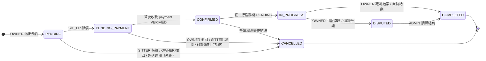
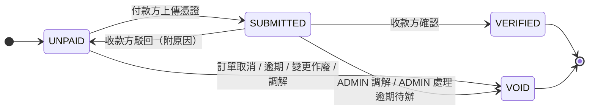
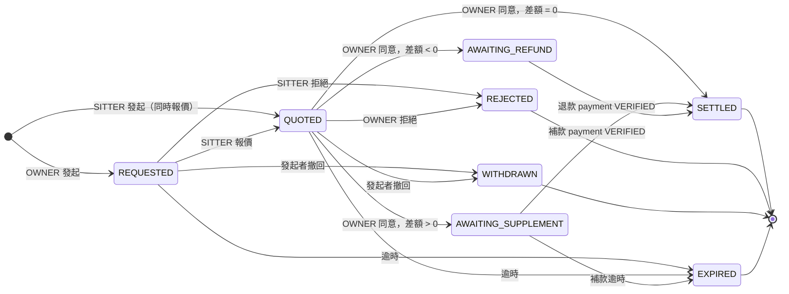

# 領域基準（Domain Baseline）

| 項目 | 內容 |
|------|------|
| 狀態 | In Review |
| 建立日期 | 2026-11-21 |
| 依據 | `docs/requirements/business-requirements.md`（下稱 BR）、`docs/requirements/sass-level-program.md`（下稱 SAAS）、使用者決定（§7） |
| 適用 | 所有 PRD / SD / TS。本文件定義的概念，其他文件只能引用、不得重新定義；要改就改這份並走核准 |

> §7 CQ-1~36 已全部由使用者決定（2026-11-21），正文已依決定改寫；本文件待第 2 輪審查後核准。
> 「現況」欄是 2026-11-21 程式碼的實際行為，只當證據，不代表正確。
> 標「提案值」的參數是撰寫時提出、使用者未逐一確認的數值，核准即視為確認。

---

## 1. 角色與身分

### 1.1 角色

| 角色 | 定義 | 出處 | 現況 |
|------|------|------|------|
| OWNER（飼主） | 發起預約、管理毛孩、付款、確認收到退款、確認結案、回報問題 | BR §1.2（BR 稱 Client） | `ROLE_OWNER` |
| SITTER（保母） | 提供方案、評估報價、核對收款、上傳退款憑證、執行服務 | BR §1.2 | `ROLE_SITTER` |
| ADMIN（平台管理員） | KYC 審核、停權、信用分數、爭議調解、付款逾期待辦、手動開通訂閱 | CQ-8 | `ROLE_ADMIN` |
| 匿名訪客 | 只能看保母公開頁與方案 | BR §4.5 | Optional JWT |

- 一個帳號可同時有 OWNER 與 SITTER 兩個 profile，以 `currentRole` 切換；**同一時間只以一個角色操作**（BR §1.2）。ADMIN 不能透過切換取得。
- 呼叫端點時 token 的 `currentRole` 必須是端點要求的角色，否則 403 `ROLE_MISMATCH`；不會自動切換。
- 不可用自己的 OWNER 身分預約自己的 SITTER 頁面：422 `SELF_BOOKING_NOT_ALLOWED`（CQ-25）。
- 程式與文件一律用 `OWNER`，不用 `CLIENT`。

### 1.2 資源歸屬規則

| 資源 | 可讀 | 可寫 |
|------|------|------|
| 訂單 | 該訂單的 owner 與 sitter；ADMIN 唯讀 `DISPUTED` 訂單與有逾期待辦的訂單（CQ-18） | 依 §3 轉移表的觸發者 |
| 毛孩 | owner；與該 owner 有過任何狀態訂單的 sitter | owner（照護備註依 PRD-021 協作規則） |
| 保母方案、問卷、公開檔案 | 公開資訊匿名可讀 | 該 sitter |
| 保母收款帳號 | 該 sitter；收款帳號在 payment 建立時快照，該 payment 的付款方可讀快照（CQ-23） | 該 sitter |
| 付款 / 退款憑證 | 該 payment 的雙方；ADMIN 於可讀訂單範圍內 | 上傳者 |
| KYC 證件 | 本人與 ADMIN | 本人 |

- 呼叫者身分一律取自 token。存在但不屬於呼叫者 → **403** `FORBIDDEN`；不存在 → **404** `NOT_FOUND`（SD-GLOBAL-SPEC §3.4）。

---

## 2. SaaS 方案

### 2.1 方案矩陣（唯一定義）

| 能力 | FREE 免費 | BASIC 基礎 $499 | PRO 專業 $899 | ULTIMATE 頂級 $1299 | 出處 | 現況 |
|------|-----------|-----------------|---------------|--------------------|------|------|
| 每月接單上限 | 3 | 20 | 無限 | 無限 | SAAS、CQ-5、CQ-21 | **未實作** |
| 照護回報媒體（每次行程） | 僅文字 | 5 照片 | 10 照片 + 2 影片 | 25 照片 + 5 影片 | SAAS、CQ-4 | 部分；方案層 `maxPhotos` 要移除 |
| 報價手動調價（加價 / 折扣） | ✗ | ✗ | ✓ | ✓ | SAAS | `@RequirePlan(PRO)` |
| 變更協商自訂新總額 | ✗（系統依快照單價計算） | ✗（同左） | ✓（可另加減並附原因） | ✓ | CQ-22 | 未區分 |
| 連假自動加價 | ✗ | ✗ | ✗ | ✓ | SAAS | 未實作（延後） |
| 特定日期才開放預約 | ✗ | ✗ | ✓ | ✓ | SAAS | 已實作 |
| 黑名單 | ✗ | ✗ | ✓ | ✓ | SAAS | 已實作 |
| 白名單（指定名單才可下單） | ✗ | ✗ | ✗ | ✓ | SAAS | 已實作 |
| 線上刷卡 | ✗ | ✗ | ✓ | ✓ | SAAS | 未實作（SD-BILLING） |
| 媒體保留期限（自訂單結案日起） | 7 天 | 30 天 | 90 天 | 永久 | SAAS、PRD-013 | 已實作 |

### 2.2 方案規則

- 方案判斷以**當下訂閱狀態即時查詢**，不放進 JWT（SD-GLOBAL-SPEC §3.2）。
- **快照**：報價時把單價、方案名稱、媒體額度、保留期限快照到訂單（CQ-20）。之後保母升降級只影響新訂單；例外：升級可展延未刪除的舊媒體保留期限（PRD-013）。
- **每月接單上限**：計數 = 該保母在當月（Asia/Taipei 自然月）內**進入 `CONFIRMED` 的訂單數**，與訂單之後的狀態無關，取消不返還；上限取檢查當下的訂閱等級（CQ-5、CQ-21）。達上限時：公開頁不可預約（422 `MONTHLY_QUOTA_REACHED`）、保母端顯示「本月額度已滿」；已在流程中的訂單照常進行。
- **訂閱逾期 / 停權**：到期日隔天 00:00（Asia/Taipei）未續訂，或被 ADMIN 停權 → 只擋新生意：公開頁預約、報價、方案 / 問卷 / 公開檔案設定一律 403 `SUBSCRIPTION_LOCKED`；**既有訂單的核款、行程、日誌、變更回應照常**，並通知受影響訂單的飼主（CQ-19）。現況：未實作，由 ADMIN 手動開通。

---

## 3. 訂單生命週期

### 3.1 結構

`orders.status` 只表示訂單在生命週期的位置；付款（`payments`）與變更（`modification_requests`）各自是獨立實體與狀態機。變更協商期間訂單主狀態**不變**（CQ-1）。

| 主狀態 | 意義 | 前端分頁（BR §3.1） |
|--------|------|-------------------|
| `PENDING` | 待保母評估 / 報價（含問卷子狀態，見 §3.5） | 評估中 |
| `PENDING_PAYMENT` | 已報價，等首次付款（含憑證已上傳待核對）（CQ-29） | 評估中 |
| `CONFIRMED` | 已付款成立，尚未開始任何行程 | 進行中 |
| `IN_PROGRESS` | 至少一個行程已開始或已被系統關閉 | 進行中 |
| `DISPUTED` | 爭議處理中，自動結案暫停 | 進行中 |
| `COMPLETED` | 已結案，列入保母收入 | 歷史 |
| `CANCELLED` | 已取消，記錄 `cancelledBy`（OWNER / SITTER / SYSTEM / ADMIN）與原因 | 歷史 |

### 3.2 主狀態轉移表

| # | 從 → 到 | 觸發者 | 前置條件 | 附帶動作 | 不符時 |
|---|---------|-------|---------|---------|-------|
| O1 | → `PENDING` | OWNER | 方案在可預約區間；非自己的保母頁（CQ-25）；保母未鎖定、未達月上限；首個行程日期 ≥ 今天（Asia/Taipei） | 寫 `review_expires_at`（§5） | 422 對應錯誤碼 |
| O2 | `PENDING` → `PENDING_PAYMENT` | SITTER | 問卷已完成或免填；`total_amount ≥ 1`（CQ-26）；FREE / BASIC 無調整 | 快照（§2.2）；建立首次收款 payment（UNPAID，`due_at` 見 §5、收款帳號快照）；已過提醒點時隨報價通知一併提醒 | 409 / 422 |
| O3 | `PENDING` → `CANCELLED` | SITTER（婉拒，需原因）/ OWNER（撤回） | — | 可附轉介（PRD-010） | — |
| O4 | `PENDING` → `CANCELLED` | SYSTEM | `now ≥ review_expires_at`（CQ-12） | 通知雙方 | — |
| O5 | `PENDING_PAYMENT` → `CONFIRMED` | SITTER（核對收款） | 首次收款 payment `SUBMITTED → VERIFIED` | 月額度 +1；通知雙方「訂單啟動成功」 | 409 |
| O6 | `PENDING_PAYMENT` → `CANCELLED` | OWNER（撤回） | 首次收款 payment 為 `UNPAID`（已上傳憑證後不可撤回） | payment → VOID | 409 `PAYMENT_ALREADY_SUBMITTED` |
| O7 | `PENDING_PAYMENT` → `CANCELLED` | SITTER（取消，需原因） | 首次收款 payment 為 `UNPAID`；`SUBMITTED` 時只能駁回（CQ-13） | payment → VOID | 409 |
| O8 | `PENDING_PAYMENT` → `CANCELLED` | SYSTEM | `now ≥ due_at` 且 payment 為 `UNPAID` | payment → VOID；通知雙方 | — |
| O9 | `CONFIRMED` → `IN_PROGRESS` | SITTER（開始行程）/ SYSTEM（行程被系統關閉） | 任一行程離開 `PENDING`，與行程轉移同一交易（CQ-28） | — | — |
| O10 | `CONFIRMED` → `CANCELLED` | SYSTEM（變更結清） | 整筆取消的變更請求 `SETTLED` | 取消所有行程 | — |
| O11 | `IN_PROGRESS` → `COMPLETED` | OWNER（確認結案） | 所有行程為 `DONE`（日誌已送出）或 `CLOSED_BY_SYSTEM`（CQ-27）；無未結束變更 | 計入保母收入 | 409 `VISITS_NOT_FINISHED` / `MODIFICATION_IN_PROGRESS` |
| O12 | `IN_PROGRESS` → `COMPLETED` | SYSTEM（自動結案） | 同 O11，且 `now ≥ 結案基準時間 + AUTO_COMPLETE_HOURS`（§5） | 同上 | — |
| O13 | `IN_PROGRESS` → `DISPUTED` | OWNER（回報問題） | 所有行程已結束；`now < 結案基準時間 + DISPUTE_WINDOW_HOURS`；無未結束變更（CQ-17） | 暫停自動結案；ADMIN 待辦 | 409 |
| O14 | `IN_PROGRESS` → `DISPUTED` | OWNER / SITTER（退款爭議） | 變更請求為 `AWAITING_REFUND`（CQ-30，互斥的例外） | 同上 | 409 |
| O15 | `DISPUTED` → `COMPLETED` | ADMIN（調解結案） | — | 可登記一筆 `ADMIN_ADJUSTMENT` 退款（≤ 已收淨額，附依據）；未結束變更 → `REJECTED`；未結束 payment → `VOID`（CQ-18、CQ-34） | — |

- `CONFIRMED` 之後，訂單內容與金額只能透過變更協商（§3.4）改變；付款後不提供撤回（CQ-7）。
- `CONFIRMED` 時發生爭議：不提供。服務未開始的問題走整筆取消的變更協商。
- 付款前要改內容 → 撤回重下（CQ-3）。

### 3.3 子流程 A：付款（`payments` + `payment_submissions`）

每一筆應收或應退的款項是一筆 payment；每次上傳憑證是一筆 submission（保留歷史，駁回不清空）。

| 欄位 | 說明 |
|------|------|
| `direction` | `CHARGE`（飼主付給保母）/ `REFUND`（保母退給飼主） |
| `purpose` | `INITIAL`（首次付款）/ `SUPPLEMENT`（變更補款）/ `MODIFICATION_REFUND`（變更退款）/ `ADMIN_ADJUSTMENT`（調解退款） |
| `method` | `OFFLINE_TRANSFER` / `ONLINE`（SD-BILLING）/ `ADMIN_ADJUSTMENT` |
| `amount` | 本筆金額（正整數），付款頁與核對畫面都只顯示這個數字 |
| `due_at` | 建立時寫入，排程只比對此欄（CQ-31）；退款與調解為 null |
| 收款帳號快照 | `CHARGE` 時快照保母收款帳號（CQ-23） |

| 方向 | 付款方（上傳憑證） | 收款方（確認 / 駁回） |
|------|------------------|--------------------|
| `CHARGE` | OWNER | SITTER |
| `REFUND` | SITTER | OWNER（只能確認；不同意時走 O14 爭議） |
| `ADMIN_ADJUSTMENT` | — | 建立即 `VERIFIED` |

- submission 狀態：`SUBMITTED` / `ACCEPTED` / `REJECTED`（附駁回原因）。同一 payment 同時最多一筆 `SUBMITTED` submission。
- 期限到時 payment 為 `SUBMITTED`（飼主已匯款、保母未核對）→ **不自動取消**；首個行程日期 00:00 仍為 `SUBMITTED` → 建立 ADMIN 待辦並通知雙方（CQ-31）。
- 線上付款（SD-BILLING）是同一實體的 `method=ONLINE`，金流回呼直接 `UNPAID → VERIFIED`。

### 3.4 子流程 B：訂單變更（`modification_requests`）

| 規則 | 內容 | 出處 |
|------|------|------|
| 可發起時機 | 訂單為 `CONFIRMED` / `IN_PROGRESS`，且無其他未結束（非 SETTLED / REJECTED / WITHDRAWN / EXPIRED）變更請求 | PRD-016、CQ-17 |
| 報價 | 一律由 SITTER 給新內容與新總額；FREE / BASIC 的新總額由系統依快照單價計算，PRO+ 可再加減並附原因；新總額 ≥ 0 | CQ-22 |
| 差額 | `差額 = 新總額 − 已收淨額`；`已收淨額 = Σ CHARGE VERIFIED − Σ REFUND VERIFIED`；退款不得超過已收淨額 | §4 |
| 減少的行程 | OWNER 同意時**立即取消**（只能取消 `PENDING` 行程） | CQ-32 |
| 新增的行程與新總額 | `SETTLED` 時生效 | CQ-32 |
| 整筆取消 | OWNER 同意時取消所有 `PENDING` 行程。`CONFIRMED` 訂單結清後 → 訂單 `CANCELLED`（O10）；`IN_PROGRESS` 訂單結清後照常走結案流程，收入 = 已收淨額（CQ-14） | CQ-14 |
| 補款 | 同意時建立 `SUPPLEMENT` payment（`due_at` = 同意時間 + `MODIFICATION_TIMEOUT_HOURS`）；逾時 → payment `VOID`、變更 `EXPIRED`：新增部分不生效，已取消的減少行程維持取消，依已套用的部分重算差額，若 < 0 另建一筆變更退款（系統建立、狀態直接 `AWAITING_REFUND`） | CQ-15、CQ-32 |
| 退款 | 同意時建立 `MODIFICATION_REFUND` payment；SITTER 上傳退款憑證、OWNER 確認 → `SETTLED`；**無逾時**，任一方可申報爭議 → 訂單 `DISPUTED`（O14） | CQ-30 |
| 逾時 | `REQUESTED` / `QUOTED` / `AWAITING_SUPPLEMENT` 超過 `MODIFICATION_TIMEOUT_HOURS` 無動作 → `EXPIRED`，通知雙方 | CQ-15 |
| 協商期間 | 行程照常執行；自動結案與爭議視窗暫停；`AWAITING_REFUND` 期間可申報退款爭議 | CQ-17、CQ-30 |

### 3.5 PENDING 內的問卷子狀態

`questionnaire_status`：`NOT_REQUIRED`（熟客或保母免填）/ `PENDING_OWNER`（保母要求填寫）/ `COMPLETED`。只有 `NOT_REQUIRED` 或 `COMPLETED` 時可報價（O2）。熟客 = 與該保母有過 `COMPLETED` 訂單的飼主（CQ-6）。

### 3.6 轉移規則（所有模組共用）

| 規則 | 內容 |
|------|------|
| 鎖 | 改變訂單主狀態、payment、變更請求、行程狀態的操作，先 `SELECT ... FOR NO KEY UPDATE` 鎖訂單列（`SET LOCAL lock_timeout`），同交易內檢查前置條件並寫入；子實體一律透過鎖父訂單序列化 |
| 版本 | 實體保留 `@Version` 作為最後防線；不接受客戶端傳入 version。畫面過期時以關鍵值比對（例：客戶端帶 `expectedAmount`，與目前值不符 → 409 `PRICE_CHANGED`）（CQ-35） |
| 稽核 | 每次轉移寫一筆 `order_logs`（action、操作者、payload），**與狀態變更同一交易**（不使用 `REQUIRES_NEW`） |
| 通知 | 站內通知與狀態變更**同交易寫入**（outbox）；Email 於 commit 後送出，失敗由排程補送（CQ-33） |
| 冪等 | 會被重試的寫入操作帶 `Idempotency-Key`，範圍 = （使用者, 端點, key）。同 key 同內容重送 → 回放第一次的狀態碼與 body（body 不含簽名網址等時效性資料）；同 key 不同內容 → 422 `IDEMPOTENCY_KEY_REUSED`；第一次仍在處理 → 409 `IDEMPOTENCY_IN_PROGRESS`；保存 `IDEMPOTENCY_KEY_TTL_HOURS`，查詢以 `expires_at > now()` 判斷 |
| 外部 I/O | GCS 上傳、寄信、第三方呼叫不得在持有訂單鎖的交易內；上傳先於交易，交易失敗時刪除已上傳物件，另有孤兒檔清除排程 |
| 排程 | Cloud Scheduler → `/api/internal/cron/*`；先唯讀查出候選，再逐筆以獨立交易處理（鎖住後重驗條件，`SKIP LOCKED`），一筆失敗不影響其他筆；可重跑 |

### 3.7 跨模組錯誤碼

| HTTP | code | 情境 |
|------|------|------|
| 400 | `VALIDATION_FAILED` | 欄位格式錯誤 |
| 403 | `FORBIDDEN` | 非資源當事人 |
| 403 | `ROLE_MISMATCH` | token 角色與端點要求不符 |
| 403 | `SUBSCRIPTION_LOCKED` | 訂閱逾期或停權，操作屬於新生意 |
| 403 | `PLAN_REQUIRED` | 方案不足 |
| 404 | `NOT_FOUND` | 資源不存在 |
| 409 | `ORDER_STATE_CONFLICT` | 主狀態不允許此操作 |
| 409 | `PAYMENT_STATE_CONFLICT` | payment 狀態不允許 |
| 409 | `MODIFICATION_IN_PROGRESS` | 有未結束變更請求 |
| 409 | `VISITS_NOT_FINISHED` | 行程未全部結束 |
| 409 | `PAYMENT_ALREADY_SUBMITTED` | 已上傳憑證後撤回 |
| 409 | `PRICE_CHANGED` | 畫面上的金額已過期 |
| 409 | `IDEMPOTENCY_IN_PROGRESS` | 同 key 請求處理中 |
| 422 | `IDEMPOTENCY_KEY_REUSED` | 同 key 不同內容 |
| 422 | `SELF_BOOKING_NOT_ALLOWED` | 預約自己 |
| 422 | `MONTHLY_QUOTA_REACHED` | 保母本月額度已滿 |
| 422 | `INVALID_QUOTE_AMOUNT` | 報價總額 < 1 |

模組專屬錯誤碼由各模組 SD 定義，命名不得與本表衝突。

---

## 4. 金額

| 規則 | 內容 | 出處 |
|------|------|------|
| 幣別與精度 | TWD 整數；計算中途 BigDecimal，入庫前四捨五入；不使用 `BigDecimal(18,4)` 欄位 | BR §7、SD-GLOBAL-SPEC §2.2 |
| 預約試算 | `base_amount = Σ(各日期群組天數 × 每日次數 × 方案單價)`，由**後端**重算，不信任前端金額 | BR §4.5 |
| 報價 | `total_amount = base_amount + surcharge_amount − discount_amount`，≥ 1；調整需附原因；FREE / BASIC 只能原價 | BR §5.1、SAAS、CQ-26 |
| 快照 | 報價時（§2.2） | CQ-20 |
| 已收淨額 | `Σ CHARGE VERIFIED − Σ REFUND VERIFIED`（含 ADMIN_ADJUSTMENT） | CQ-34 |
| 變更差額 | `新總額 − 已收淨額`；> 0 補款、< 0 退款、= 0 無差額 | PRD-016、§3.4 |
| 保母收入 | `COMPLETED` 訂單的已收淨額；帳務總覽由 payments 加總，不讀 `total_amount` | BR §6、CQ-14 |

---

## 5. 時間規則

所有時間 UTC 儲存、ISO-8601 傳輸；「日」的邊界與顯示一律 Asia/Taipei。`首日` = 首個行程日期的 00:00（Asia/Taipei）（CQ-9）。

| 參數 | 值 | 計算 / 起算點 | 到期行為 | 出處 | 現況 |
|------|----|-------------|---------|------|------|
| `URGENT_WINDOW_HOURS` | 2（提案值） | 緊急單保留給對方回應的最短時間 | 見下兩列 | 使用者決定允許緊急單（CQ-10） | — |
| 評估期限 `review_expires_at` | — | `max(首日, 送單時間 + URGENT_WINDOW_HOURS)`，送單時寫入 | 仍 `PENDING` → `CANCELLED`（SYSTEM）（O4） | CQ-10、CQ-12 | 未實作 |
| 首次付款期限 `due_at` | — | `max(首日 − 24h, 報價時間 + URGENT_WINDOW_HOURS)`，報價時寫入 | payment `UNPAID` → 訂單 `CANCELLED`（O8）；`SUBMITTED` 不取消（§3.3） | BR §3.2、CQ-9、CQ-10、CQ-31 | 未實作 |
| 付款提醒 | 首日 − 48h | 同首日 | 提醒 OWNER；報價時已過提醒點則隨報價通知一併提醒 | BR §3.2 | 未實作 |
| 付款待核對升級 | 首日 | — | payment 仍 `SUBMITTED` → ADMIN 待辦，通知雙方 | CQ-31 | 未實作 |
| `MODIFICATION_TIMEOUT_HOURS` | 72 | 變更請求進入當前狀態的時間 | `REQUESTED` / `QUOTED` / `AWAITING_SUPPLEMENT` → `EXPIRED` | CQ-15 | 未實作 |
| `VISIT_ZOMBIE_HOURS` | 72 | 行程日期 00:00（Asia/Taipei） | 仍 `PENDING` 的行程 → `CLOSED_BY_SYSTEM`（同交易觸發 O9） | CQ-24 | 已實作 |
| 結案基準時間 | — | `max(最後行程結束時間, 最後一筆變更請求結束時間)` | — | CQ-17 | — |
| `AUTO_COMPLETE_HOURS` | 48 | 結案基準時間 | O12；有未結束變更或 `DISPUTED` 時不觸發 | CQ-24 | 已實作 |
| `DISPUTE_WINDOW_HOURS` | 48 | 結案基準時間 | 視窗內 OWNER 可回報問題（O13） | CQ-24 | 已實作 |
| `CARE_LOG_EDIT_HOURS` | 24 | 行程結束時間 | 照護日誌鎖定；不影響 OWNER 確認結案（O11 只看行程狀態） | PRD-022、CQ-27 | 已實作 |
| `IDEMPOTENCY_KEY_TTL_HOURS` | 24 | key 建立時間 | 失效；同 key 視為新請求 | §3.6 | 已實作，但清除排程在正式站未啟用 |
| 媒體保留 | §2.1 | 訂單結案日 | 刪除實體檔，保留紀錄 | PRD-013 | 已實作 |

- 排程頻率：所有狀態類排程每 15 分鐘一次（提案值）；每筆以「`now ≥` 到期時間」判斷，不依賴排程頻率。

---

## 6. 名詞

| 名詞 | 定義 |
|------|------|
| 行程（visit） | 一次到府服務；狀態 `PENDING → IN_PROGRESS → DONE`，或 `CLOSED_BY_SYSTEM`、`CANCELLED`。`DONE` 的觸發條件由 SD-FULFILL 定義，必須同時滿足 PRD-008 與 PRD-022（目前兩者互為前提，重寫 PRD 時解決） |
| 照護日誌 | 一個行程對應一份，保母填寫並送出給飼主（PRD-022） |
| 熟客 | 與該保母有過 `COMPLETED` 訂單的飼主（CQ-6）；與白名單無關 |
| 首日 | 首個行程日期 00:00 Asia/Taipei |
| 已收淨額 | §4 |

---

## 7. 決定紀錄

全部由使用者於 2026-11-21 決定。CQ-1~8 為初稿提出；CQ-9~28 來自 prd 審查、CQ-29~36 來自 sd 審查（`docs/reviews/00-DOMAIN-BASELINE.{prd,sd}.review.md`）。

| CQ | 問題 | 決定 | 落在 |
|----|------|------|------|
| CQ-1 | 主狀態與付款 / 變更子流程拆開 | 拆開；移除 `PAID` / `MODIFYING` / `REFUND_VERIFY` 主狀態與 `previousStatus` | §3.1 |
| CQ-2 | 付款逾期自動取消 | 這次重建就做 | §5、O8 |
| CQ-3 | 付款前改日期 | 撤回重下 | §3.2 |
| CQ-4 | 媒體額度來源 | 只依訂閱等級，移除方案層 `maxPhotos` | §2.1 |
| CQ-5 | 月接單上限計數 | 進入 `CONFIRMED` 時計數；達上限擋公開頁預約 | §2.2 |
| CQ-6 | 熟客定義 | 有過 `COMPLETED` 訂單 | §3.5、§6 |
| CQ-7 | 付款後撤回 | 一律走變更協商整筆取消 | §3.2 |
| CQ-8 | ADMIN 角色 | 承認，權限限 §1.1 | §1.1 |
| CQ-9 | 付款期限起算點 | 首日 = 首個行程日期 00:00 Asia/Taipei | §5 |
| CQ-10 | 緊急單（兩天內下單） | **允許**（使用者修改建議）；期限取 `max(一般期限, 時間點 + URGENT_WINDOW_HOURS)` | §5 |
| CQ-11 | 期限到時已上傳待核對 | 採 CQ-31：不自動取消 | §3.3 |
| CQ-12 | PENDING 無離開條件 | `review_expires_at` 到期系統取消 | O4、§5 |
| CQ-13 | 付款前保母取消 / 改價 | 不可改價；`UNPAID` 時可取消（需原因） | O7 |
| CQ-14 | 進行中整筆取消 | 只取消未開始行程，照常結案，收入 = 已收淨額 | §3.4 |
| CQ-15 | 變更無逾時 / 撤回 | 可撤回；`REQUESTED` / `QUOTED` / `AWAITING_SUPPLEMENT` 72h 逾時；`AWAITING_REFUND` 依 CQ-30 | §3.4 |
| CQ-16 | 協商期間行程衝突 | 採 CQ-32 | §3.4 |
| CQ-17 | 變更與爭議互斥、起算點 | 互斥（`AWAITING_REFUND` 例外）；結案基準時間 = max(最後行程結束, 最後變更結束) | O13、§5 |
| CQ-18 | ADMIN 調解 | 不改 `total_amount`，登記調解退款；ADMIN 唯讀爭議訂單 | O15、§1.2 |
| CQ-19 | 訂閱逾期範圍 | 只擋新生意，既有訂單照常 | §2.2 |
| CQ-20 | 快照時點 | 報價時 | §2.2 |
| CQ-21 | 月額度返還 | 不返還；上限取檢查當下等級 | §2.2 |
| CQ-22 | FREE / BASIC 變更新總額 | 系統依快照單價計算 | §2.1、§3.4 |
| CQ-23 | 收款帳號快照 | 建立 payment 時快照 | §3.3 |
| CQ-24 | 72 / 48 / 48 | 沿用 | §5 |
| CQ-25 | 預約自己 | 不可 | §1.1 |
| CQ-26 | 0 元報價 | 不可，≥ 1 | O2 |
| CQ-27 | 確認結案時機 | **保母提交（行程 DONE、日誌已送出）後飼主即可確認，不等 24h**（使用者修改建議） | O11 |
| CQ-28 | `CONFIRMED → IN_PROGRESS` | 任一行程離開 PENDING（含系統關閉），同交易 | O9 |
| CQ-29 | 付款前主狀態名 | 沿用 `PENDING_PAYMENT` | §3.1 |
| CQ-30 | 退款等待的出口 | 無逾時；任一方可申報爭議 | §3.4、O14 |
| CQ-31 | 期限實作與首日仍待核對 | `payments.due_at`；首日仍 `SUBMITTED` → ADMIN 待辦 | §3.3、§5 |
| CQ-32 | 協商期間行程處理 | 減少的行程於同意時取消；新增與新總額於 SETTLED 生效 | §3.4 |
| CQ-33 | 通知交付 | 站內通知 outbox 同交易；Email 失敗由排程補送 | §3.6 |
| CQ-34 | 退款資料表示 | `payments.direction=REFUND`；調解 `method=ADMIN_ADJUSTMENT` | §3.3、§4 |
| CQ-35 | `@Version` 範圍 | 保留作防線；移除客戶端 version；`409 PRICE_CHANGED` | §3.6 |
| CQ-36 | 既有交易資料 | 清空交易相關表，不做狀態對映 | 遷移（SD-ORDER） |

---

## 8. 變更紀錄

| 日期 | 變更 | 原因 |
|------|------|------|
| 2026-11-21 | 依 CQ-9~36 決定改寫 §1–§6：主狀態轉移表 O1–O15、payments / submissions 模型、變更子流程含撤回 / 逾時 / 退款爭議、緊急單期限公式、跨模組錯誤碼表、轉移共用規則（鎖、版本、outbox、冪等細則、排程）；狀態改 In Review | 第 1 輪 prd / sd 審查 + 使用者決定（CQ-10、CQ-27 修改建議，其餘採建議） |
| 2026-11-21 | §7 CQ-1~8 與 §5 付款提醒 / 逾期數值由使用者決定 | 使用者決定 |
| 2026-11-21 | 建立草稿 | 全面重建第 1 步 |
