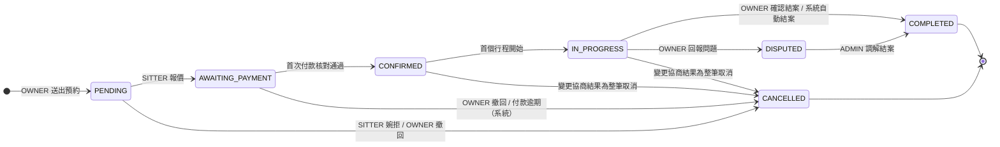
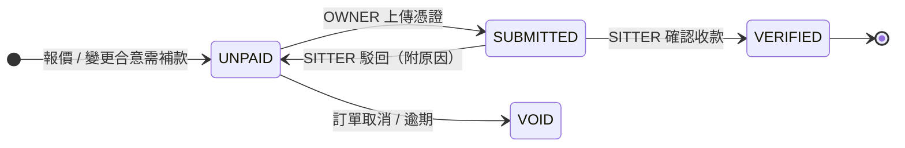
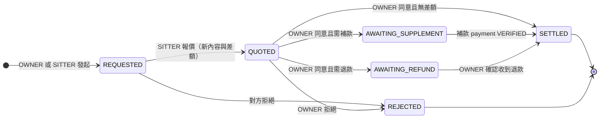

# 領域基準（Domain Baseline）

| 項目 | 內容 |
|------|------|
| 狀態 | In Review |
| 建立日期 | 2026-11-21 |
| 依據 | `docs/requirements/business-requirements.md`（下稱 BR）、`docs/requirements/sass-level-program.md`（下稱 SAAS）、使用者決定 |
| 適用 | 所有 PRD / SD / TS。本文件定義的概念，其他文件只能引用、不得重新定義；要改就改這份並走核准 |

> §7 待釐清事項已於 2026-11-21 由使用者決定（全部採建議值），本文件待審查後核准。
> 「現況」欄是 2026-11-21 程式碼的實際行為，只當證據，不代表正確。

---

## 1. 角色與身分

### 1.1 角色

| 角色 | 定義 | 出處 | 現況 |
|------|------|------|------|
| OWNER（飼主） | 發起預約、管理毛孩、付款、確認結案 | BR §1.2（BR 稱 Client） | `ROLE_OWNER` |
| SITTER（保母） | 提供方案、評估報價、核對收款、執行服務 | BR §1.2 | `ROLE_SITTER` |
| ADMIN（平台管理員） | KYC 審核、停權、信用分數、爭議調解、手動開通訂閱 | BR 未定義；PRD-017 / 020 / 009 與使用者先前決定 | `ROLE_ADMIN` |
| 匿名訪客 | 只能看保母公開頁與方案 | BR §4.5 | Optional JWT |

- 一個帳號可同時有 OWNER 與 SITTER 兩個 profile，以 `currentRole` 切換；**同一時間只以一個角色操作**（BR §1.2）。ADMIN 不能透過切換取得。
- 程式與文件一律用 `OWNER`，不用 `CLIENT`。

### 1.2 資源歸屬規則

| 資源 | 擁有者 | 可讀 | 可寫 |
|------|-------|------|------|
| 訂單 | 該訂單的 owner 與 sitter（雙方） | 雙方 | 依 §3 轉移表的觸發者 |
| 毛孩 | 建立的 owner | owner；有過任何狀態訂單的 sitter | owner（照護備註依 PRD-021 協作規則） |
| 保母方案、問卷、公開檔案 | 該 sitter | 公開資訊匿名可讀 | 該 sitter |
| 保母收款帳號 | 該 sitter | 該 sitter；訂單在待付款 / 付款核對中時該訂單 owner | 該 sitter |
| 付款 / 退款憑證、KYC 證件 | 上傳者與對應當事人 | 訂單雙方（KYC：本人與 ADMIN） | 上傳者 |

- 呼叫者身分一律取自 token。存在但不屬於呼叫者 → **403**；不存在 → **404**（SD-GLOBAL-SPEC §3.4）。

---

## 2. SaaS 方案

### 2.1 方案矩陣（唯一定義）

| 能力 | FREE 免費 | BASIC 基礎 $499 | PRO 專業 $899 | ULTIMATE 頂級 $1299 | 出處 | 現況 |
|------|-----------|-----------------|---------------|--------------------|------|------|
| 每月接單上限（進入 CONFIRMED 的訂單數，自然月，Asia/Taipei） | 3 | 20 | 無限 | 無限 | SAAS 總表、PRD-012 | **未實作** |
| 照護回報媒體（每次行程） | 僅文字 | 5 照片 | 10 照片 + 2 影片 | 25 照片 + 5 影片 | SAAS 總表 | 部分；另有方案層 `maxPhotos` 與之並存（見 CQ-4） |
| 手動調價（加價 / 折扣） | ✗ | ✗ | ✓ | ✓ | SAAS 總表 | `@RequirePlan(PRO)` |
| 連假自動加價 | ✗ | ✗ | ✗ | ✓ | SAAS 總表 | 未實作（延後） |
| 特定日期才開放預約 | ✗ | ✗ | ✓ | ✓ | SAAS 總表 | 已實作 |
| 黑名單 | ✗ | ✗ | ✓ | ✓ | SAAS 總表 | 已實作 |
| 白名單（指定名單才可下單） | ✗ | ✗ | ✗ | ✓ | SAAS 總表 | 已實作 |
| 線上刷卡 | ✗ | ✗ | ✓ | ✓ | SAAS 總表 | 未實作（SD-BILLING） |
| 媒體保留期限（自訂單結案日起） | 7 天 | 30 天 | 90 天 | 永久 | SAAS 總表、PRD-013 | 已實作 |

- 方案判斷以**當下訂閱狀態即時查詢**，不放進 JWT（SD-GLOBAL-SPEC §3.2）。
- 訂單成立時把會影響履約的方案能力（媒體額度、保留期限）**快照**到訂單，之後保母升降級只影響新訂單；保留期限例外：升級可展延未刪除的舊媒體（PRD-013 AC-4）。
- 訂閱逾期：到期日隔天 00:00（Asia/Taipei）未續訂 → 保母端除「我的」外全部鎖定（BR §5.7.2）。現況：未實作，由 ADMIN 手動開通。

---

## 3. 訂單生命週期

### 3.1 結構：一個主狀態 + 兩個子流程

現行設計把付款核對（`PAID`）、變更協商（`MODIFYING`）、退款核對（`REFUND_VERIFY`）都塞進 `orders.status`，協商結束要靠 `previousStatus` 還原。這是過去多次「進行中訂單被退回未開始」「補款後狀態錯」問題的根源。

**決定（CQ-1，2026-11-21）**：`orders.status` 只表示訂單在生命週期的位置；付款與變更各自是獨立實體與狀態機，訂單主狀態在協商期間**不變**。

| 主狀態 | 意義 | 前端分頁（BR §3.1） |
|--------|------|-------------------|
| `PENDING` | 待保母評估 / 報價 | 評估中 |
| `AWAITING_PAYMENT` | 已報價，等首次付款（含憑證已上傳待核對） | 評估中 |
| `CONFIRMED` | 已付款成立，尚未開始服務 | 進行中 |
| `IN_PROGRESS` | 服務期間 | 進行中 |
| `DISPUTED` | 爭議處理中，自動結案暫停 | 進行中 |
| `COMPLETED` | 已結案，列入保母收入 | 歷史 |
| `CANCELLED` | 已取消（記錄 `cancelledBy` 與原因） | 歷史 |

### 3.2 子流程 A：付款（`payments`）

每次應付款（首次付款、變更補款）一筆 payment，不再把憑證欄位放在 `orders` 與 `modification_requests` 兩處。

- 首次付款 `VERIFIED` → 訂單 `AWAITING_PAYMENT → CONFIRMED`。
- 補款 `VERIFIED` → 變更請求進入 `SETTLED`，訂單主狀態不動。
- 駁回時憑證紀錄保留（狀態 REJECTED 的歷史列），不清空。
- 線上付款（SD-BILLING）是同一實體的另一個 `method`，金流回呼直接 `UNPAID → VERIFIED`。

### 3.3 子流程 B：訂單變更（`modification_requests`）

- 同一訂單同時最多一筆未結束（非 SETTLED / REJECTED）的變更請求。
- 有未結束變更請求時：**自動結案暫停**；行程照常執行（不因協商中斷服務）。
- `SETTLED` 時套用新內容；若新內容為「無任何預約項目」→ 訂單 `CANCELLED`。
- 變更只能在 `CONFIRMED` / `IN_PROGRESS` 發起。付款前要改內容 → 撤回重下（CQ-3）。

### 3.4 轉移規則（所有模組共用）

| 規則 | 內容 |
|------|------|
| 鎖 | 任何改變訂單主狀態或子流程狀態的操作，先 `SELECT ... FOR UPDATE` 鎖訂單列，在同一交易內檢查前置條件並寫入。不另用 `@Version` 判斷訂單狀態轉移 |
| 稽核 | 每次轉移寫一筆 `order_logs`（action、操作者、payload），**與狀態變更同一交易**；交易失敗則不得留下日誌 |
| 通知 | 交易 commit 後（AFTER_COMMIT）非同步發送；通知失敗不回滾、不重試主交易，記 log |
| 冪等 | 會被重試的寫入操作帶 `Idempotency-Key`；同 key 重送**回放第一次的結果**（同狀態碼與 body），不是 409。不同 key 但狀態已改變 → 409 `ORDER_STATE_CONFLICT` |
| 外部 I/O | GCS 上傳、寄信、第三方呼叫不得在持有訂單鎖的交易內進行 |
| 錯誤碼 | 狀態不允許 → 409 `ORDER_STATE_CONFLICT`；非當事人 → 403 `FORBIDDEN`；不存在 → 404 `NOT_FOUND` |

---

## 4. 金額

| 規則 | 內容 | 出處 |
|------|------|------|
| 幣別與精度 | TWD 整數；計算中途 BigDecimal，入庫前四捨五入 | BR §7、SD-GLOBAL-SPEC §2.2 |
| 預約試算 | `base_amount = Σ(各日期群組天數 × 每日次數 × 方案單價)`，由**後端**重算，不信任前端金額 | BR §4.5 Step 3 |
| 報價 | `total_amount = base_amount + surcharge_amount − discount_amount`；調整需附原因；FREE / BASIC 只能原價（surcharge = discount = 0） | BR §5.1、SAAS |
| 快照 | 報價時快照：每項單價、方案名稱、媒體額度、保留期限。之後保母改方案不影響此訂單 | SD-GLOBAL-SPEC §4.2（現況在報價時寫入） |
| 變更差額 | `差額 = 新總額 − 已付總額`；>0 補款、<0 退款、=0 無差額。計算以快照單價為基準 | PRD-016 |
| 應付金額 | 每筆 payment 記錄自己的 `amount`；付款頁與保母核對都顯示該筆 amount，不顯示訂單總額 | PRD-016 |
| 保母收入 | `COMPLETED` 訂單的已付總額 − 已退總額 | BR §6 |

---

## 5. 時間規則

所有時間 UTC 儲存、ISO-8601 傳輸；「日」的邊界與顯示一律 Asia/Taipei。

| 參數 | 預設 | 起算點 | 到期行為 | 出處 | 現況 |
|------|------|--------|---------|------|------|
| `PAYMENT_REMINDER_HOURS` | 首個行程前 48 小時 | 首個行程開始時間 | 提醒 OWNER 付款 | BR §3.2（數值：使用者決定 2026-11-21） | 未實作 |
| `PAYMENT_TIMEOUT_HOURS` | 首個行程前 24 小時 | 首個行程開始時間 | 訂單 `CANCELLED`（cancelledBy=SYSTEM），payment `VOID`，通知雙方 | BR §3.2（數值：使用者決定 2026-11-21） | 未實作（CQ-2） |
| `VISIT_ZOMBIE_HOURS` | 72 小時 | 行程預定時間 | 未開始的行程 → `CLOSED_BY_SYSTEM` | PRD-009 | 已實作 |
| `AUTO_COMPLETE_HOURS` | 48 小時 | 最後一個行程完成（`DONE` / `CLOSED_BY_SYSTEM`）時間 | `IN_PROGRESS → COMPLETED`；有未結束變更請求或 `DISPUTED` 時不觸發 | PRD-009 | 已實作 |
| `DISPUTE_WINDOW_HOURS` | 48 小時 | 同上 | 視窗內 OWNER 可回報問題 | PRD-009 | 已實作 |
| `CARE_LOG_EDIT_HOURS` | 24 小時 | 行程結束時間 | 照護日誌鎖定不可編輯 | PRD-022 | 已實作 |
| `IDEMPOTENCY_KEY_TTL_HOURS` | 24 小時 | key 建立時間 | 清除，之後同 key 視為新請求 | 現況 | 已實作 |
| 媒體保留 | §2.1 | 訂單結案日 | 刪除實體檔，保留紀錄 | PRD-013 | 已實作 |

- 所有排程經 Cloud Scheduler → `/api/internal/cron/*`，必須冪等（重跑不重複處理），每筆訂單獨立交易（一筆失敗不影響其他筆）。

---

## 6. 名詞

| 名詞 | 定義 |
|------|------|
| 行程（visit） | 一次到府服務；狀態 `PENDING → IN_PROGRESS → DONE`，或系統關閉 `CLOSED_BY_SYSTEM`、隨訂單 `CANCELLED` |
| 照護日誌 | 一個行程對應一份，保母填寫並送出給飼主（PRD-022） |
| 熟客 | 曾與該保母有過任一 `COMPLETED` 訂單的飼主（CQ-6） |

---

## 7. 待釐清事項

| CQ | 問題 | 決定 | 理由 | 狀態 |
|----|------|-----------|------|------|
| CQ-1 | 訂單主狀態與付款 / 變更子流程拆開（§3.1–3.3），移除 `PAID`、`MODIFYING`、`REFUND_VERIFY` 主狀態與 `previousStatus` | **拆開** | 尚未上線可一次改；根除還原錯誤；BR §7 本來就把 `payment_status` 與 `order_status` 分開 | 已決（使用者 2026-11-21） |
| CQ-2 | 付款逾期自動取消：BR 要求，PRD-007 寫「未來擴充」 | **這次重建就做**，預設值如 §5 | 沒有它，報價後不付款的訂單會永遠卡在評估中，佔住保母月額度 | 已決（使用者 2026-11-21） |
| CQ-3 | 付款前改日期：BR §3.3 允許飼主在 PENDING 修改日期；00-SD-PLAN 規定要取消重下 | **撤回重下**（不提供付款前修改） | 少一條狀態路徑；PENDING 階段沒有金錢往來，重下成本低 | 已決（使用者 2026-11-21） |
| CQ-4 | 照護媒體額度來源：SAAS 依訂閱等級定額度，現況另有「保母服務方案」層的 `maxPhotos` | **只依訂閱等級**，移除方案層 `maxPhotos` | 兩個來源會互相打架；SAAS 是唯一明確出處 | 已決（使用者 2026-11-21） |
| CQ-5 | 每月接單上限（FREE 3 / BASIC 20）何時計數、達上限的行為 | 訂單進入 `CONFIRMED` 時計數；達上限時公開頁不可預約，保母端顯示「本月額度已滿」；已在流程中的訂單不受影響 | PRD-012 AC-2 已這樣定義；在 CONFIRMED 計數才不會被未付款訂單耗盡 | 已決（使用者 2026-11-21） |
| CQ-6 | 「熟客免填問卷」的熟客定義 | 曾有過 `COMPLETED` 訂單 | BR §3.4 未定義 | 已決（使用者 2026-11-21） |
| CQ-7 | 撤回已付款訂單：BR §3.3 寫「若已付款則觸發退款流程」 | 付款後一律走變更協商（整筆取消），不提供直接撤回 | 退款金額需雙方合意（PRD-016 退款政策） | 已決（使用者 2026-11-21） |
| CQ-8 | ADMIN 角色 BR 未定義 | 依 §1.1 範圍承認 ADMIN，權限只限列出的後台功能 | 已有 KYC / 信用分數 / 調解實作與 PRD | 已決（使用者 2026-11-21） |

---

## 8. 變更紀錄

| 日期 | 變更 | 原因 |
|------|------|------|
| 2026-11-21 | §7 CQ-1~8 與 §5 付款提醒 / 逾期數值由使用者決定，全部採建議值；狀態改 In Review | 使用者決定 |
| 2026-11-21 | 建立草稿 | 全面重建第 1 步；整合 BR、SAAS、00-SD-PLAN §4 狀態機與 PRD-005/006/007/008/009/016 |
