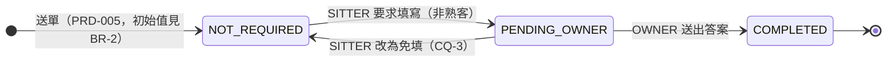

# PRD-006: 保母訂單評估、事前問卷與報價

| 項目 | 內容 |
|------|------|
| 狀態 | In Review |
| 建立日期 | 2026-05-09 |
| 歸屬 SD | SD-ORDER（見 `docs/sd/00-SD-PLAN.md` §0） |
| 測試情境 | TS-006 |
| 相依 PRD | PRD-005（訂單建立 O1、`review_expires_at` 寫入）；PRD-026（飼主撤回 O3 OWNER / O6）；PRD-004（問卷題目設定）；PRD-002（毛孩資料）；PRD-007（首次收款 payment 的規則、付款與核對）；PRD-012（訂閱等級與鎖定）；PRD-014（通知偏好）；PRD-027（婉拒 O3 SITTER、評估逾期 O4、付款前保母取消 O7，自本卡拆出） |
| 引用基準 | `docs/sa/00-DOMAIN-BASELINE.md` §1.1、§1.2（角色、資源歸屬）；§2.1、§2.2（手動調價 PRO+、快照、訂閱鎖定、月額度）；§3.1、§3.2 O2（主狀態與報價前置條件）；§3.3（首次收款 payment）；§3.5（問卷子狀態、熟客）；§3.6（鎖、版本 / `PRICE_CHANGED`、稽核、通知、冪等）；§3.7（錯誤碼）；§4（金額公式、整數 TWD）；§5（`review_expires_at`、`due_at`、`escalate_at`、付款提醒、時區）；§6（熟客、首日） |

> 一張 PRD = 一個可獨立驗收的功能。子模組 AC ≤ 8 條，子模組 > 3 個就拆卡。
> 共用概念（角色、SaaS 額度、訂單狀態、時間起算點）只能**引用** DOMAIN-BASELINE，不得在這裡重新定義；要改就改 baseline。
> 拆卡：訂單離開 `PENDING` / `PENDING_PAYMENT` 的「非報價」出口（O3 SITTER 婉拒含轉介入口、O4 評估逾期、O7 付款前保母取消）移至 **PRD-027**。本卡只處理「評估 → 報價」。

---

## 1. 背景與目的

飼主送出預約（PRD-005，O1）後訂單為 `PENDING`。保母需要一個評估頁，集中看行程、毛孩資料與問卷答案，決定是否要求飼主補填事前問卷，最後以原價或（PRO 以上）手動調價送出報價，讓訂單進入 `PENDING_PAYMENT` 並產生首次收款。報價是訂單內容與金額的凍結點（baseline §2.2 快照），之後只能透過變更協商（PRD-016）改動。系統不做容量 / 檔期控管，接不接單由保母判斷；系統只保證同一張訂單只會被成功轉出 `PENDING` 一次。

## 2. 使用者故事

- **US-1** 身為保母，我希望在一個頁面看到預約的行程、方案、毛孩資料、問卷答案與評估期限，以便判斷是否接單。
- **US-2** 身為保母，我希望對不熟的飼主要求填寫事前問卷，熟客則免填，以便在報價前取得足夠資訊。
- **US-3** 身為飼主，我希望在保母要求時於訂單詳情填寫問卷，以便保母繼續評估。
- **US-4** 身為保母，我希望以原價一鍵接單，以便快速成立訂單。
- **US-5** 身為 PRO / ULTIMATE 保母，我希望在報價時加價或折扣並寫下原因，以便反映車馬費、餵藥等非標準服務。
- **US-6** 身為飼主，我希望看到報價明細（原始試算、加價、折扣、原因、付款期限），以便決定是否付款。

## 3. 角色與權限

| 動作 | OWNER | SITTER | ADMIN | 匿名 | 方案限制 |
|------|-------|--------|-------|------|---------|
| 檢視評估頁（含問卷答案） | ✗（飼主看自己的訂單詳情） | 本人訂單 | ✗（`PENDING` / `PENDING_PAYMENT` 不在 ADMIN 可讀範圍） | ✗ | 無 |
| 要求填寫問卷 / 改為免填 | ✗ | 本人訂單（熟客不可要求，CQ-1） | ✗ | ✗ | 無；訂閱鎖定不擋（BR-14） |
| 填寫問卷 | 本人訂單 | ✗ | ✗ | ✗ | 無 |
| 原價報價 | ✗ | 本人訂單 | ✗ | ✗ | 全方案；訂閱鎖定 → 403 `SUBSCRIPTION_LOCKED` |
| 手動調價報價（加價 / 折扣） | ✗ | 本人訂單 | ✗ | ✗ | PRO / ULTIMATE；FREE / BASIC → 403 `PLAN_REQUIRED` |
| 檢視報價明細 | 本人訂單 | 本人訂單 | ✗ | ✗ | 無 |

- 「本人訂單」以 token 身分判斷；存在但不屬於呼叫者 → 403 `FORBIDDEN`，不存在 → 404 `NOT_FOUND`（baseline §1.2）。
- token 的 `currentRole` 與端點要求不符（例：OWNER 角色呼叫報價）→ 403 `ROLE_MISMATCH`，不自動切換（baseline §1.1）。未登入 → 401 `UNAUTHENTICATED`。

## 4. 主流程

### 4.1 評估頁

1. 保母從通知或「訂單 > 評估中」進入某筆 `PENDING` 訂單的評估頁。
2. 系統檢查呼叫者為該訂單的 sitter → 回傳：行程清單（日期、每日次數、方案名稱、方案單價）、目前原始試算 `base_amount`、飼主顯示名稱、毛孩基本資料（CQ-8）、`questionnaire_status`、熟客標記、問卷答案（`COMPLETED` 時）、`review_expires_at`（Asia/Taipei 顯示）。
3. 保母訂閱鎖定時，頁首顯示鎖定提示並停用「接單 / 送出報價」；本月額度已滿時顯示「本月額度已滿」（baseline §2.2；不擋報價，見 BR-12）。
4. 畫面不出現任何執行工項清單或 SOP 欄位（工項見 PRD-021）。

### 4.2 問卷子狀態

1. 保母在評估頁按「要求填寫問卷」→ 系統檢查：訂單 `PENDING`、`now < review_expires_at`、`questionnaire_status = NOT_REQUIRED`、飼主不是熟客、保母至少有 1 題啟用中問題 → `questionnaire_status = PENDING_OWNER`，記下本次要求的題目（要求當下啟用中的題目，CQ-4），寫 `order_logs`，通知飼主。
2. 飼主在自己的訂單詳情看到「保母請您填寫事前問卷」→ 填寫並送出 → 系統檢查：訂單 `PENDING`、`now < review_expires_at`、`questionnaire_status = PENDING_OWNER`、必填題皆有值 → 寫入答案（含題目文字快照）、`questionnaire_status = COMPLETED`，寫 `order_logs`，通知保母。
3. 保母在 `PENDING_OWNER` 時可按「改為免填」→ `NOT_REQUIRED`，通知飼主問卷已取消（CQ-3）。
4. `PENDING_OWNER` 期間保母仍可婉拒（PRD-027）；飼主仍可撤回（PRD-026）；`review_expires_at` 照常計時，到期走 O4（PRD-027）。

### 4.3 報價（O2）

1. 保母按「原價接單」，或（PRO+）按「調整價格」輸入加價金額、折扣金額與原因後按「送出報價」。前端同時送出畫面上的原始試算金額（`expectedBaseAmount`）與 `Idempotency-Key`。
2. 系統鎖訂單列（baseline §3.6），依序檢查：訂單 `PENDING`；保母未鎖定；`now < review_expires_at`；首個行程日期 ≥ 今天（Asia/Taipei）；問卷 `NOT_REQUIRED` 或 `COMPLETED`；欄位格式；FREE / BASIC 無調整；保母已設定收款帳號（CQ-6）；以當下方案單價重算 `base_amount` 並與 `expectedBaseAmount` 比對（CQ-5）；`total_amount = base_amount + surcharge_amount − discount_amount ≥ 1`。
3. 全部通過 → 同一交易內：
   - 訂單 `PENDING → PENDING_PAYMENT`，寫入 `base_amount`、`surcharge_amount`、`discount_amount`、`pricing_notes`、`total_amount`。
   - 快照：各行程對應方案的單價與方案名稱、保母當下訂閱等級的媒體額度與媒體保留期限（baseline §2.2）。
   - 建立首次收款 payment（`direction=CHARGE`、`purpose=INITIAL`、`amount = total_amount`、`UNPAID`），寫入 `due_at`、`escalate_at`、收款帳號快照（公式見 baseline §5；payment 本身的規則見 PRD-007）。
   - 寫 `order_logs`（`ORDER_QUOTED`，payload 含金額明細）。
   - 通知飼主報價與付款期限；`now ≥ 首日 − 48h` 時同一則通知附付款提醒（baseline §5）。
4. 回應 200，回傳訂單新狀態、金額明細與 payment 的 `due_at`。

## 5. 狀態轉移

| # | 從 | 到 | 觸發者 | 前置條件 | 不符時錯誤碼 |
|---|----|----|-------|---------|-------------|
| T1（O2） | 訂單 `PENDING` | `PENDING_PAYMENT` | SITTER | baseline O2 全部條件；收款帳號已設定（CQ-6）；`expectedBaseAmount` 與重算值相同（CQ-5） | 409 `ORDER_STATE_CONFLICT` / `DEADLINE_PASSED` / `FIRST_VISIT_DATE_PASSED` / `QUESTIONNAIRE_PENDING` / `PRICE_CHANGED`；422 `INVALID_QUOTE_AMOUNT` / `PAYOUT_ACCOUNT_REQUIRED`；403 `PLAN_REQUIRED` / `SUBSCRIPTION_LOCKED` |
| T2 | 首次收款 payment（不存在） | `UNPAID` | SYSTEM（隨 T1 同交易） | T1 成功 | — |
| Q1 | 問卷 `NOT_REQUIRED` | `PENDING_OWNER` | SITTER | 訂單 `PENDING`；`now < review_expires_at`；非熟客；有啟用題目 | 409 `ORDER_STATE_CONFLICT` / `DEADLINE_PASSED` / `QUESTIONNAIRE_STATE_CONFLICT`；422 `REGULAR_OWNER_EXEMPT` / `NO_ACTIVE_QUESTIONS` |
| Q2 | 問卷 `PENDING_OWNER` | `COMPLETED` | OWNER | 訂單 `PENDING`；`now < review_expires_at`；必填題有值 | 409 `ORDER_STATE_CONFLICT` / `DEADLINE_PASSED` / `QUESTIONNAIRE_STATE_CONFLICT`；400 `VALIDATION_FAILED` |
| Q3 | 問卷 `PENDING_OWNER` | `NOT_REQUIRED` | SITTER | 訂單 `PENDING`；`now < review_expires_at`（CQ-3） | 409 `ORDER_STATE_CONFLICT` / `DEADLINE_PASSED` / `QUESTIONNAIRE_STATE_CONFLICT` |

- 訂單離開 `PENDING` 後（任何原因），問卷子狀態不再可變更，所有 Q 轉移回 409 `ORDER_STATE_CONFLICT`。

## 6. 業務規則

| # | 規則 | 出處 |
|---|------|------|
| BR-1 | `questionnaire_status` 值域 `NOT_REQUIRED` / `PENDING_OWNER` / `COMPLETED`；只有 `NOT_REQUIRED` 或 `COMPLETED` 時可報價 | baseline §3.5、O2 |
| BR-2 | 送單時 `questionnaire_status` 初始值一律 `NOT_REQUIRED`；保母要求才轉 `PENDING_OWNER` | BR §3.6 步驟 1–2（送單不填問卷、保母選用要求）；初始值待確認 CQ-1 |
| BR-3 | 熟客 = 與該保母有過 `COMPLETED` 訂單的飼主，於呼叫時即時判定；與白名單（ULTIMATE 門禁）無關。熟客不可被要求問卷 | baseline §3.5、§6、CQ-6；BR §3.4（`NOT_REQUIRED`：熟客免填）；「不可要求」待確認 CQ-1 |
| BR-4 | 問卷題目取要求當下該保母啟用中的題目；答案保存題目文字與題型快照，之後題目異動不影響此訂單答案；必填題未填 → 400 | PRD-004「歷史隔離」「回答完整性」；題目時點待確認 CQ-4 |
| BR-5 | 報價金額：`total_amount = base_amount + surcharge_amount − discount_amount`，`total_amount ≥ 1`；`surcharge_amount`、`discount_amount` 為 ≥ 0 的整數 TWD，可同時填；任一 > 0 時 `pricing_notes`（原因）必填；計算中途 BigDecimal，入庫為整數 | baseline §4、O2、CQ-26；BR §5.1；上限待確認 CQ-7 |
| BR-6 | FREE / BASIC 只能原價（`surcharge_amount = discount_amount = 0`）；PRO / ULTIMATE 可調整。方案以報價當下的訂閱狀態即時判定 | baseline §2.1、§2.2；SAAS「定價權限」 |
| BR-7 | 報價時 `base_amount` 由後端以當下方案單價重算，不信任前端；與前端帶入的 `expectedBaseAmount` 不符 → 409 `PRICE_CHANGED`（payload 帶目前 `base_amount`），不寫入任何資料 | baseline §2.2（報價時快照單價）、§3.6（關鍵值比對）、§4（後端重算）；重算時點待確認 CQ-5 |
| BR-8 | 報價時快照：各行程方案的單價與名稱、保母當下訂閱等級的媒體額度、媒體保留期限。之後保母改方案價格或升降級只影響新訂單（媒體保留展延例外見 PRD-013） | baseline §2.2、CQ-20 |
| BR-9 | 報價前置：`now < review_expires_at`（否則 409 `DEADLINE_PASSED`，payload `deadline=review_expires_at`）；首個行程日期 ≥ 今天 Asia/Taipei（否則 409 `FIRST_VISIT_DATE_PASSED`）；以時間判斷，不等排程 | baseline O2、§3.2、CQ-45、CQ-46 |
| BR-10 | 報價同交易建立首次收款 payment：`CHARGE` / `INITIAL` / `UNPAID`，`amount = total_amount`；`due_at = max(首日 − 24h, 報價時間 + URGENT_WINDOW_HOURS)`、`escalate_at = max(首日, due_at) + URGENT_WINDOW_HOURS`；收款帳號快照。報價不會因付款期限太近而被拒（緊急單允許） | baseline O2、§3.3、§5、CQ-9、CQ-10、CQ-23、CQ-44 |
| BR-11 | 報價通知：通知飼主「保母已報價 NT${total_amount}，請於 {due_at} 前完成付款」；報價時 `now ≥ 首日 − 48h` 則同一則通知附付款提醒，不另發。時間以 Asia/Taipei `YYYY-MM-DD HH:mm` 顯示 | baseline O2、§5（付款提醒）；BR §3.2 |
| BR-12 | 月接單上限不在報價時檢查（計數於 `CONFIRMED`，PRD-007 O5）；達上限時評估頁只顯示「本月額度已滿」 | baseline §2.2、O2、CQ-5 |
| BR-13 | 報價後（`PENDING_PAYMENT` 起）訂單行程、方案、金額不可再編輯；不提供改價 API；要改內容由飼主撤回重下（PRD-026），`CONFIRMED` 後走變更協商（PRD-016） | baseline §3.2、CQ-3、CQ-13；沿用原 PRD-006「不可逆性」 |
| BR-14 | 保母訂閱鎖定時：報價 → 403 `SUBSCRIPTION_LOCKED`；要求問卷 / 改為免填、檢視評估頁不擋（baseline 列舉的鎖定範圍不含這些） | baseline §2.2、CQ-19 |
| BR-15 | 訂單內容只載明行程時間、方案、數量、加價、折扣、原因與最終金額，不含執行工項清單 | 沿用原 PRD-006「訂單內容範圍」；PRD-021 |
| BR-16 | 飼主訂單詳情顯示報價明細：原始試算、加價、折扣、原因與最終總額；保母輸入原因時欄位標示「飼主會看到」 | 沿用原 PRD-006 B.5（2026-10-25 fix-batch12 U6） |
| BR-17 | 不做容量 / 檔期控管：同日已有其他訂單不影響報價。只保證同一張訂單只會轉出 `PENDING` 一次（鎖訂單列，後到者 409 `ORDER_STATE_CONFLICT`） | 已定案產品決策（doc-conventions）；baseline §3.6 |
| BR-18 | 報價、要求問卷、改為免填、送出問卷答案都帶 `Idempotency-Key`，依 baseline §3.6 回放 | baseline §3.6 |
| BR-19 | 每次轉移（T1、Q1–Q3）寫一筆 `order_logs`，與狀態變更同交易；通知以 outbox 同交易寫入（站內），Email 依 PRD-014 偏好由排程寄送 | baseline §3.6 |

## 7. 例外處理

| # | 情境 | 系統行為 | HTTP / 錯誤碼 | 使用者看到 |
|---|------|---------|--------------|-----------|
| EX-1 | 其他保母讀評估頁、報價、要求問卷 | 拒絕，不改資料 | 403 `FORBIDDEN` | 「無權限操作此訂單」 |
| EX-2 | 其他飼主送出某訂單的問卷答案 | 拒絕 | 403 `FORBIDDEN` | 「無權限操作此訂單」 |
| EX-3 | token 角色不符（OWNER 角色呼叫報價 / 要求問卷；SITTER 角色送問卷答案） | 拒絕 | 403 `ROLE_MISMATCH` | 「請切換至保母（飼主）身分」 |
| EX-4 | ADMIN 讀 `PENDING` / `PENDING_PAYMENT` 訂單評估頁 | 拒絕（非 baseline §1.2 ADMIN 可讀範圍） | 403 `FORBIDDEN` | — |
| EX-5 | 訂單不存在 | 拒絕 | 404 `NOT_FOUND` | 「找不到此訂單」 |
| EX-6 | FREE / BASIC 帶加價或折扣 | 拒絕，不改資料 | 403 `PLAN_REQUIRED` | 調價按鈕顯示鎖頭，點擊提示「手動調價為專業版功能」與升級入口（沿用原 PRD-006） |
| EX-7 | 保母訂閱逾期 / 停權時報價 | 拒絕 | 403 `SUBSCRIPTION_LOCKED` | 評估頁頂部鎖定提示；「接單」「送出報價」停用 |
| EX-8 | 總額 < 1（含折扣 ≥ 原始試算） | 拒絕 | 422 `INVALID_QUOTE_AMOUNT` | 「報價總額至少需 NT$1」 |
| EX-9 | 加價 / 折扣為負數、非整數、超過上限，或有調整但原因空白 | 拒絕 | 400 `VALIDATION_FAILED` | 欄位下方錯誤訊息 |
| EX-10 | 已過 `review_expires_at`（排程尚未取消） | 拒絕 | 409 `DEADLINE_PASSED`（`deadline=review_expires_at`） | 「此預約已超過評估期限」，操作按鈕停用 |
| EX-11 | 首個行程日期 < 今天 | 拒絕 | 409 `FIRST_VISIT_DATE_PASSED` | 「首個行程日期已過，無法報價，請婉拒或請飼主重新預約」 |
| EX-12 | 問卷 `PENDING_OWNER` 時報價 | 拒絕 | 409 `QUESTIONNAIRE_PENDING` | 「飼主尚未完成問卷」；可選「改為免填」 |
| EX-13 | 畫面上的原始試算已過期（保母於評估期間改了方案單價） | 拒絕，不寫入 | 409 `PRICE_CHANGED`（payload 帶目前 `base_amount`） | 重新載入金額，提示「訂單金額已更新為 NT${base_amount}，請確認後再送出」 |
| EX-14 | 保母未設定收款帳號 | 拒絕 | 422 `PAYOUT_ACCOUNT_REQUIRED`（模組碼，CQ-6） | 「請先設定收款帳號」與設定頁連結 |
| EX-15 | 狀態不允許：訂單已非 `PENDING`（已報價、飼主已撤回、已逾期取消、已婉拒） | 拒絕 | 409 `ORDER_STATE_CONFLICT` | 「訂單狀態已變更，請重新整理」 |
| EX-16 | 跨角色併發：飼主撤回（PRD-026）與保母報價 / 要求問卷同時送出 | 鎖訂單列序列化，先到者生效，後到者看到 EX-15 | 409 `ORDER_STATE_CONFLICT` | 同 EX-15 |
| EX-17 | 鎖等待逾時 | 不改資料 | 409 `ORDER_BUSY` + `Retry-After: 1` | 前端自動重試 1 次後提示「系統忙碌，請稍後再試」 |
| EX-18 | 重複送出（同 `Idempotency-Key` 同內容） | 回放第一次的狀態碼與 body，不重複建立 payment | 同第一次 | 同第一次 |
| EX-19 | 同 key 不同內容 / 同 key 處理中 | 拒絕 | 422 `IDEMPOTENCY_KEY_REUSED` / 409 `IDEMPOTENCY_IN_PROGRESS` | 「請重新操作」 |
| EX-20 | 熟客被要求問卷 | 拒絕 | 422 `REGULAR_OWNER_EXEMPT`（模組碼，CQ-1） | 評估頁對熟客不顯示「要求填寫問卷」 |
| EX-21 | 保母沒有任何啟用中的問卷題目卻要求問卷 | 拒絕 | 422 `NO_ACTIVE_QUESTIONS`（模組碼，CQ-4） | 「您尚未設定問卷題目」與 PRD-004 設定頁連結 |
| EX-22 | 問卷子狀態不允許（已 `PENDING_OWNER` 再要求、`COMPLETED` 再要求、非 `PENDING_OWNER` 時送答案 / 改免填） | 拒絕 | 409 `QUESTIONNAIRE_STATE_CONFLICT`（模組碼） | 「問卷狀態已變更，請重新整理」 |
| EX-23 | 必填題未填 | 拒絕 | 400 `VALIDATION_FAILED`（列出題目 id） | 必填題標紅「此題必填」 |
| EX-24 | Resend 寄信失敗 | 不影響轉移（站內通知已同交易寫入）；Email 由排程重試最多 5 次 | — | 站內通知照常 |
| EX-25 | GCS | 不適用：本功能無檔案上傳（問卷題型無檔案類型，PRD-004） | — | — |
| EX-26 | 樂觀鎖 `@Version` 衝突（理論上被列鎖擋下的最後防線） | 交易回滾 | 409 `ORDER_STATE_CONFLICT` | 同 EX-15 |

## 8. 驗收標準（AC）

### 子模組 1：評估頁與事前問卷

- [ ] **AC-1.1 (評估頁內容)**：Given SITTER A 的 `PENDING` 訂單（2 個日期群組、問卷 `COMPLETED`），When A 開啟評估頁，Then 顯示每個行程的日期、每日次數、方案名稱與單價、原始試算 `base_amount`、飼主名稱、毛孩基本資料、每題題目與答案、評估期限（Asia/Taipei `YYYY-MM-DD HH:mm`）；頁面無任何工項清單 / SOP 欄位。對應：BR-15、CQ-8
- [ ] **AC-1.2 (評估頁越權)**：Given 訂單屬於 SITTER A，When SITTER B 讀取 → 403 `FORBIDDEN`；When A 以 OWNER 角色讀取 → 403 `ROLE_MISMATCH`；When ADMIN 讀取 → 403 `FORBIDDEN`；When 未登入 → 401 `UNAUTHENTICATED`；When 訂單 id 不存在 → 404 `NOT_FOUND`。對應：EX-1、EX-3、EX-4、EX-5
- [ ] **AC-1.3 (熟客判定)**：Given 飼主 O 與 SITTER A 有 1 筆 `COMPLETED` 訂單，When O 送出新預約後 A 開啟評估頁，Then `questionnaire_status = NOT_REQUIRED`、顯示「熟客」標記、不顯示「要求填寫問卷」；直接呼叫要求問卷 API → 422 `REGULAR_OWNER_EXEMPT`。Given O 與 A 只有 `CANCELLED` 訂單，Then 不顯示「熟客」，可要求問卷。對應：BR-2、BR-3、EX-20
- [ ] **AC-1.4 (要求填寫問卷)**：Given 非熟客訂單 `PENDING`、`NOT_REQUIRED`、A 有 3 題啟用題目，When A 按「要求填寫問卷」，Then `questionnaire_status = PENDING_OWNER`、記下這 3 題、寫 `order_logs`（`QUESTIONNAIRE_REQUESTED`）、飼主收到站內通知「保母請您填寫事前問卷」（連到該訂單詳情）；評估頁「送出報價」與「原價接單」停用並顯示「等待飼主填寫問卷」。對應：Q1、BR-4、BR-19
- [ ] **AC-1.5 (要求問卷被拒)**：Given A 沒有啟用題目 → 422 `NO_ACTIVE_QUESTIONS`；Given 已 `PENDING_OWNER` 或 `COMPLETED` → 409 `QUESTIONNAIRE_STATE_CONFLICT`；Given `now ≥ review_expires_at` → 409 `DEADLINE_PASSED`；Given 訂單已 `CANCELLED` → 409 `ORDER_STATE_CONFLICT`；Given 保母訂閱鎖定 → 200 成功。皆不改其他資料。對應：Q1、EX-21、EX-22、EX-10、EX-15、BR-14
- [ ] **AC-1.6 (飼主填寫問卷)**：Given 訂單 `PENDING_OWNER`，When 飼主 O 填完所有必填題送出，Then `questionnaire_status = COMPLETED`、答案含題目文字快照、寫 `order_logs`（`QUESTIONNAIRE_COMPLETED`）、A 收到通知「飼主已完成問卷」；之後 A 修改或停用該題，評估頁仍顯示送出時的題目文字與答案。對應：Q2、BR-4
- [ ] **AC-1.7 (填寫問卷被拒)**：Given 必填題空白 → 400 `VALIDATION_FAILED`（含題目 id）；Given 非該訂單飼主 → 403 `FORBIDDEN`；Given SITTER 角色 → 403 `ROLE_MISMATCH`；Given `now ≥ review_expires_at` → 409 `DEADLINE_PASSED`；Given 訂單已被撤回或婉拒 → 409 `ORDER_STATE_CONFLICT`；Given 已 `COMPLETED` 再送 → 409 `QUESTIONNAIRE_STATE_CONFLICT`。對應：Q2、EX-2、EX-3、EX-22、EX-23
- [ ] **AC-1.8 (改為免填)**：Given 訂單 `PENDING_OWNER`，When A 按「改為免填」，Then `questionnaire_status = NOT_REQUIRED`、寫 `order_logs`（`QUESTIONNAIRE_WAIVED`）、飼主收到通知「保母已取消問卷要求」、飼主詳情不再顯示填寫入口、A 可立即報價。Given 已 `COMPLETED` → 409 `QUESTIONNAIRE_STATE_CONFLICT`。對應：Q3、CQ-3

### 子模組 2：報價成立與快照

- [ ] **AC-2.1 (原價接單)**：Given FREE 保母 A 的訂單 `PENDING`、`NOT_REQUIRED`、`base_amount = 1800`，When A 按「原價接單」，Then 200；訂單 `PENDING_PAYMENT`；`surcharge_amount = 0`、`discount_amount = 0`、`total_amount = 1800`；寫 `order_logs`（`ORDER_QUOTED`，payload 含四個金額）；飼主收到「保母已報價 NT$1800，請於 {due_at} 前完成付款」。對應：T1、BR-5、BR-6、BR-11
- [ ] **AC-2.2 (PRO 手動調價)**：Given PRO 保母、`base_amount = 1800`，When 送出加價 300、折扣 100、原因「車馬費；首次優惠」，Then `total_amount = 2000`；飼主訂單詳情顯示「原始試算 NT$1800 / 加價 NT$300 / 折扣 NT$100 / 原因：車馬費；首次優惠 / 總額 NT$2000」；保母端原因欄位標示「飼主會看到」。ULTIMATE 保母同樣成功。對應：BR-5、BR-6、BR-16
- [ ] **AC-2.3 (報價快照)**：Given PRO 保母以方案 P（單價 600）報價成功，When 之後保母把 P 改為 800、並降級為 BASIC，Then 該訂單的方案單價仍為 600、方案名稱為報價時名稱、媒體額度仍為 PRO（10 照片 + 2 影片）、保留期限仍為 90 天；新訂單才套用新值。對應：BR-8
- [ ] **AC-2.4 (首次收款建立與期限—一般單)**：Given 首個行程 2026-12-10，When 於 2026-12-01 10:00（Asia/Taipei）報價 `total_amount = 2000`，Then 同交易建立一筆 payment：`direction=CHARGE`、`purpose=INITIAL`、`UNPAID`、`amount = 2000`、`due_at = 2026-12-08T16:00:00Z`（12-09 00:00 台北）、`escalate_at = 2026-12-09T18:00:00Z`（12-10 02:00 台北）、含收款帳號快照；報價通知不附付款提醒。對應：T2、BR-10、BR-11
- [ ] **AC-2.5 (首次收款期限—緊急單)**：Given 首個行程為當天 2026-12-10，When 於 12-10 09:00 台北報價，Then `due_at = 2026-12-10T03:00:00Z`（11:00 台北）、`escalate_at = 2026-12-10T05:00:00Z`（13:00 台北），報價成功不被拒；Given 首個行程 2026-12-11，When 於 12-10 23:30 台北報價，Then `due_at = 2026-12-10T17:30:00Z`（12-11 01:30 台北）、`escalate_at = 2026-12-10T19:30:00Z`（12-11 03:30 台北）。兩者報價通知都附付款提醒（已過首日 − 48h）。對應：BR-10、BR-11
- [ ] **AC-2.6 (重複送出與跨角色併發)**：Given 報價已以 key K 成功，When 同 key 同內容重送，Then 回放同一 200 與 body，payment 仍只有 1 筆；When 不帶相同 key 再報價 → 409 `ORDER_STATE_CONFLICT`。Given 飼主撤回（PRD-026）與保母報價同時送出，Then 只有一方成功，另一方 409 `ORDER_STATE_CONFLICT`，訂單最終為 `CANCELLED`（無 payment）或 `PENDING_PAYMENT`（1 筆 payment）其一。鎖等待逾時 → 409 `ORDER_BUSY` + `Retry-After: 1`。對應：BR-17、BR-18、EX-15–EX-18
- [ ] **AC-2.7 (報價後不可編輯)**：Given 訂單 `PENDING_PAYMENT`，Then 保母評估頁不顯示「調整價格」「送出報價」，金額與行程為唯讀；再呼叫報價 API → 409 `ORDER_STATE_CONFLICT`，金額與 payment 不變。對應：BR-13

### 子模組 3：報價前置檢查

- [ ] **AC-3.1 (報價越權)**：Given 訂單屬於 SITTER A，When SITTER B 報價 → 403 `FORBIDDEN`；When A 以 OWNER 角色報價 → 403 `ROLE_MISMATCH`；When 訂單不存在 → 404 `NOT_FOUND`。訂單維持 `PENDING`、無 payment。對應：EX-1、EX-3、EX-5
- [ ] **AC-3.2 (方案不足調價)**：Given FREE 或 BASIC 保母，Then 評估頁「調整價格」顯示鎖頭，點擊顯示「手動調價為專業版功能」與升級入口；直接呼叫 API 帶 `surcharge_amount = 100` 或 `discount_amount = 100` → 403 `PLAN_REQUIRED`，訂單維持 `PENDING`。對應：BR-6、EX-6
- [ ] **AC-3.3 (金額與欄位驗證)**：Given PRO 保母、`base_amount = 1800`，When 折扣 1800 → 422 `INVALID_QUOTE_AMOUNT`；When 折扣 1799 → 200、`total_amount = 1`；When 加價 -100、加價 100.5、或加價 100 但原因空白 → 400 `VALIDATION_FAILED`。對應：BR-5、EX-8、EX-9
- [ ] **AC-3.4 (評估期限與首個行程日)**：Given `now ≥ review_expires_at` 且排程尚未取消，When 報價 → 409 `DEADLINE_PASSED`（payload `deadline = review_expires_at`）。Given 飼主於 2026-12-10 23:30（台北）送出首個行程為 12-10 的預約（`review_expires_at` = 12-11 01:30 台北），When 保母於 12-11 00:30 報價 → 409 `FIRST_VISIT_DATE_PASSED`。Given 首個行程日期 = 今天，Then 報價成功。對應：BR-9、EX-10、EX-11
- [ ] **AC-3.5 (問卷未完成)**：Given 訂單 `PENDING_OWNER`，When 保母呼叫報價 API → 409 `QUESTIONNAIRE_PENDING`，訂單維持 `PENDING`；飼主送出問卷（`COMPLETED`）後再報價 → 200。對應：BR-1、EX-12
- [ ] **AC-3.6 (訂閱鎖定)**：Given 保母訂閱到期日隔天 00:00（Asia/Taipei）後未續訂，或被 ADMIN 停權，When 原價接單或調價報價 → 403 `SUBSCRIPTION_LOCKED`，評估頁頂部顯示鎖定提示、報價按鈕停用；同一保母要求問卷 → 200。對應：BR-14、EX-7
- [ ] **AC-3.7 (畫面金額過期)**：Given 保母開啟評估頁時 `base_amount = 1800`，之後把方案單價由 600 改為 700（重算為 2100），When 以 `expectedBaseAmount = 1800` 送出 → 409 `PRICE_CHANGED`（payload `base_amount = 2100`），訂單維持 `PENDING`；畫面顯示「訂單金額已更新為 NT$2100，請確認後再送出」；以 `expectedBaseAmount = 2100` 重送 → 200。對應：BR-7、EX-13、CQ-5
- [ ] **AC-3.8 (未設定收款帳號)**：Given 保母沒有任何收款帳號，When 報價 → 422 `PAYOUT_ACCOUNT_REQUIRED`，訂單維持 `PENDING`、無 payment；畫面顯示「請先設定收款帳號」與設定頁連結。對應：EX-14、CQ-6

## 9. 影響範圍

| 面向 | 內容 |
|------|------|
| 資料 | 訂單：`questionnaire_status`、`base_amount`（報價時重算覆寫）、`surcharge_amount`、`discount_amount`、`pricing_notes`、`total_amount`；訂單快照（單價、方案名稱、媒體額度、保留期限）；問卷要求的題目清單與答案（含題目文字 / 題型快照）；首次收款 payment（欄位定義見 PRD-007）；`order_logs` 動作 `QUESTIONNAIRE_REQUESTED`、`QUESTIONNAIRE_COMPLETED`、`QUESTIONNAIRE_WAIVED`、`ORDER_QUOTED`。DDL 在 SD-ORDER |
| 畫面 | 保母：`/sitter/orders/{id}` 評估頁（評估 / 問卷 / 報價區塊）；飼主：`/owner/orders/{id}` 訂單詳情的問卷填寫區塊與報價明細（實際路徑以 SD-FRONTEND-SPEC 為準） |
| 通知 | 要求問卷 → OWNER → 站內 + Email；飼主完成問卷 → SITTER → 站內 + Email（BR §3.6 步驟 3）；改為免填 → OWNER → 站內 + Email；報價（含必要時的付款提醒）→ OWNER → 站內 + Email。Email 依 PRD-014 偏好 |
| 排程 | 本卡無。評估逾期（O4）在 PRD-027；付款逾期 / 提醒 / 待核對升級在 PRD-007，以本卡寫入的 `due_at`、`escalate_at` 為基準 |
| API | 讀評估頁、要求問卷、改為免填、送出問卷答案、報價（原價與調價同一端點，調整欄位為 0 即原價）。契約在 SD-ORDER |
| 相容性 | 現況送單時可能已填問卷答案（PRD-005 Step 2）、ULTIMATE 門禁規則 `NO_QUESTIONNAIRE` 做免填；本卡改為送單後由保母要求（CQ-2、CQ-9）。既有交易資料依 baseline CQ-36 清空，不做對映 |

## 10. 待釐清事項

| CQ | 問題 | 建議預設值 | 狀態 |
|----|------|-----------|------|
| CQ-1 | baseline §3.5 只給三個值，沒定義送單時初始值，也沒說熟客能不能被要求問卷 | 送單時一律 `NOT_REQUIRED`（BR §3.6「保母要求問卷（選用）」）；熟客不可被要求（422 `REGULAR_OWNER_EXEMPT`），非熟客保母可要求 | Open |
| CQ-2 | 原 PRD-006「加入免填清單」（保母把某飼主設為永久免填）沒有需求出處；程式現有 ULTIMATE 門禁規則 `NO_QUESTIONNAIRE` | 不做；永久免填只有熟客一種。`NO_QUESTIONNAIRE` 規則隨 PRD-005 門禁改寫移除 | Open |
| CQ-3 | 保母要求問卷後能否改回免填（`PENDING_OWNER → NOT_REQUIRED`） | 可以（BR §3.6「決定是否需要問卷或是設定免填」），通知飼主問卷已取消；`COMPLETED` 後不可改 | Open |
| CQ-4 | 問卷題目取哪個時點的題目；保母無啟用題目時能否要求 | 取要求當下的啟用題目並快照題目文字 / 題型；無啟用題目 → 422 `NO_ACTIVE_QUESTIONS` | Open |
| CQ-5 | `PENDING` 期間保母改方案單價，報價時 `base_amount` 用送單時的值還是當下單價重算（baseline §2.2「報價時快照單價」與 §4「預約試算」沒寫兩者關係） | 報價時以當下單價重算並覆寫 `base_amount`；與畫面不符 → 409 `PRICE_CHANGED`。方案在 `PENDING` 期間被停用仍以其單價計算 | Open |
| CQ-6 | 保母沒有收款帳號時能否報價（首次收款 payment 需要帳號快照，baseline 沒寫缺帳號時怎麼辦） | 不可，422 `PAYOUT_ACCOUNT_REQUIRED`；碼名需與 PRD-007 一致 | Open |
| CQ-7 | 加價 / 折扣與原因的上限 | 加價、折扣各 0–999,999 的整數；`total_amount` ≤ 999,999；原因 1–200 字 | Open |
| CQ-8 | 評估頁顯示哪些毛孩：訂單有無綁定毛孩取決於 PRD-005 | PRD-005 有綁定 → 只顯示綁定的毛孩；未綁定 → 顯示該飼主名下全部毛孩（baseline §1.2 允許） | Open |
| CQ-9 | BR §3.6「送單時不填問卷」與 BR §4.5 Step 2「填寫問卷」矛盾（第 1 輪衝突 #7） | 以 BR §3.6 為準，問卷只在保母要求後於訂單詳情填寫；PRD-005 刪除送單時的問卷 | Open |

## 11. 變更紀錄

| 日期 | 變更 | 原因 / 審查輪次 |
|------|------|----------------|
| 2026-11-21 | 依新範本全文重寫，狀態 `In Review`。拆卡：O3 SITTER 婉拒（含轉介入口）、O4 評估逾期、O7 付款前保母取消移至 PRD-027；飼主撤回（原例外與 AC-7）移至 PRD-005；本卡改為三個子模組（評估頁與問卷 8 AC、報價成立 7 AC、報價前置檢查 8 AC） | `docs/reviews/00-DOMAIN-BASELINE.prd.review.md` 第 1、2 輪 PRD 衝突清單；baseline Approved 2026-11-21 |
| 2026-11-21 | 第 1 輪 #10（`PENDING_PAYMENT` 改名 `AWAITING_PAYMENT`）：不改名，沿用 `PENDING_PAYMENT` | baseline CQ-29 已決定沿用，覆蓋第 1 輪建議 |
| 2026-11-21 | 第 1 輪 #11（撤回可撤條件含「補款階段」）：刪除補款階段條件；飼主撤回整段移至 PRD-005（O3 OWNER / O6，前置 = 首次 payment `UNPAID`）；本卡只保留與報價的併發（AC-2.6） | baseline O6、§3.3；範圍劃分 |
| 2026-11-21 | 第 1 輪 #12（「已付款後（PAID 以後）」）：刪除 `PAID` 主狀態用語；撤回失敗碼依第 2 輪 #3 為 409 `PAYMENT_ALREADY_SUBMITTED`（定義在 PRD-005 / PRD-027 O7），本卡不再描述 | baseline O6、O7、§3.7；第 2 輪 #3 |
| 2026-11-21 | 第 1 輪 #13（報價有效期「未來擴充」）：刪除；改為報價時寫入 `due_at` / `escalate_at`（BR-10），AC-2.4、AC-2.5 含一般單、當天緊急單、23:30 報價三個範例；報價不因付款期限被拒（第 2 輪 #4 作廢 `PAYMENT_DEADLINE_PASSED`） | baseline §5、CQ-2、CQ-10、CQ-44；第 2 輪 #4 |
| 2026-11-21 | 第 1 輪 #14（最終 = 原始 + 單一調整欄位）：改為 `base + surcharge − discount`，兩欄各 ≥ 0、有調整必附原因；AC-2.2 驗原始 / 加價 / 折扣 / 總額 | baseline §4；BR §5.1 |
| 2026-11-21 | 第 1 輪 #15（`BigDecimal(18,4)`）：改為整數 TWD，計算中途 BigDecimal（BR-5）。NFR-009 需另行修正（不在本卡範圍） | baseline §4 |
| 2026-11-21 | 第 1 輪 #16（「白名單熟客」、「加入免填清單」）：熟客改依 baseline CQ-6（有 `COMPLETED` 訂單），與白名單分開（BR-3）；「加入免填清單」無出處，刪除並列 CQ-2 | baseline §3.5、§6；第 2 輪「熟客與白名單分開」 |
| 2026-11-21 | 第 1 輪 #17（鎖定行程、方案、數量、報價）：快照補方案名稱、媒體額度、保留期限，時點 = 報價（BR-8、AC-2.3） | baseline §2.2、CQ-20 |
| 2026-11-21 | 第 1 輪 #18（「訂單版本已過期需重新整理」）：依第 2 輪 #3 改寫——跨角色併發以列鎖序列化，後到者 409 `ORDER_STATE_CONFLICT`（AC-2.6）；畫面金額過期以 `expectedBaseAmount` 比對，409 `PRICE_CHANGED`（AC-3.7）；`@Version` 保留為最後防線（EX-26），不接受客戶端 version | baseline §3.6、CQ-35；第 2 輪 #3 |
| 2026-11-21 | 第 1 輪 #19（保母在待付款的操作）：依 CQ-13 不可改價（BR-13、AC-2.7）；`UNPAID` 時可取消（O7）寫在 PRD-027 | baseline O7、CQ-13 |
| 2026-11-21 | 原 D 段婉拒：「未填原因時註明保母未填寫原因」與 baseline O3「婉拒需原因」衝突，改為原因必填，移至 PRD-027 | baseline O3 |
| 2026-11-21 | 新增：問卷子狀態流程（子模組 1）、首個行程日期與評估期限檢查、訂閱鎖定、收款帳號檢查、冪等 | baseline §3.5、O2、§2.2、§3.6 |
| 2026-05-09 | 建立 | |
