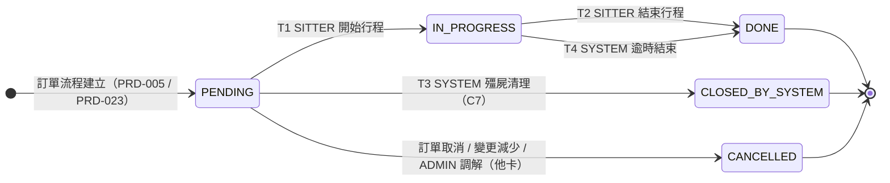

# PRD-008: 行程生命週期：開始、結束、系統關閉與行程檢視

| 項目 | 內容 |
|------|------|
| 狀態 | In Review |
| 建立日期 | 2026-05-09（2026-11-22 依 baseline 第 2 版全文改寫） |
| 歸屬 SD | SD-FULFILL（見 `docs/sd/00-SD-PLAN.md` §0） |
| 測試情境 | TS-008 |
| 相依 PRD | PRD-005（O1 建立行程：每個日期 × 每日次數一個 `PENDING` 行程，行程只有日期）；PRD-016 / PRD-023（變更減少行程 → `CANCELLED`；同意時目標已開始 → 409 `VISIT_ALREADY_STARTED`；新增行程於 `SETTLED` 建立）；PRD-024（`DISPUTED` 期間行程照常，AC-2.2）；PRD-007 / PRD-026 / PRD-027（訂單取消時剩餘 `PENDING` 行程同交易 `CANCELLED`）；PRD-022（照護日誌與媒體；`DONE` 後 24h 內送出）；PRD-009（O11 / O12 / O13 使用本卡的 `DONE` / `CLOSED_BY_SYSTEM` 與結束時間）；PRD-020（ADMIN 調解 O15 / O17 取消剩餘 `PENDING` 行程，需無 `IN_PROGRESS` 行程）；PRD-028（單日 SOP 檢核項，本卡拆出）；PRD-002 / PRD-021（注意事項捷徑）；PRD-014（通知偏好） |
| 引用基準 | `docs/sa/00-DOMAIN-BASELINE.md` §1.1、§1.2（角色、`currentRole`、資源歸屬、ADMIN 可讀範圍）；§2.2（訂閱鎖定只擋新生意，既有訂單行程照常 CQ-19）；§3.1（主狀態、有效行程）；§3.2 O9（CQ-28、CQ-56）、O11–O13（CQ-27、CQ-40）、O15 / O17（CQ-57）、`DISPUTED` 行程照常（CQ-48）；§3.4（協商期間行程照常、`DONE` / `CLOSED_BY_SYSTEM` 都計價）；§3.6（鎖入口、稽核、通知、冪等、外部 I/O、排程）；§3.7（錯誤碼、判斷順序 CQ-70 / CQ-76、payload 共通欄位 CQ-71）；§5（`VISIT_ZOMBIE_HOURS`、`completion_basis_at`、`CARE_LOG_EDIT_HOURS`、排程頻率）；§6（行程、`IN_PROGRESS` 逾時出口） |

> 一張 PRD = 一個可獨立驗收的功能。子模組 AC ≤ 8 條，子模組 > 3 個就拆卡。
> 共用概念只能**引用** DOMAIN-BASELINE，不得在這裡重新定義。
> 本卡只處理**行程（visit）本身的生命週期與檢視**。行程的建立 / 取消由訂單流程觸發（PRD-005 / 016 / 023 / 026 / 027 / 007，經 SD-ORDER），本卡只引用。照護日誌與媒體見 PRD-022；結案 / 爭議 / 帳務見 PRD-009；單日 SOP 檢核項見 PRD-028（2026-11-22 自本卡拆出）。
> AC 內以「情境 n」分隔的每個情境各自有完整的 Given / When / Then，TS 以「AC-x.y-情境 n」逐列對應。

---

## 1. 背景與目的

行程是保母到府服務的最小單位，也是訂單能否結案的依據（O11 / O12 / O13 只看行程是否全部 `DONE` 或 `CLOSED_BY_SYSTEM`）。舊版以「送出報告」直接讓行程 `PENDING → DONE`，與 PRD-022「行程 `DONE` 後才能送日誌」互為前提，baseline §6 要求重寫時解決。本卡依主流程定案：保母按「開始行程」（`PENDING → IN_PROGRESS`，第一次開始時訂單 `CONFIRMED → IN_PROGRESS`），服務完按「結束行程」（`→ DONE`，寫 `completed_at`），之後 24h 內處理日誌（PRD-022）。另定義兩個系統出口，確保任何行程都不會讓訂單永久卡住：未開始的行程逾 72h 由系統關閉（`CLOSED_BY_SYSTEM`），已開始卻忘了結束的行程逾時由系統結束。最後定義保母「今日行程」、飼主行程狀態檢視與同日多次服務的行程命名。

## 2. 使用者故事

- **US-1** 身為保母，我希望到府時按「開始行程」、服務完按「結束行程」，以便飼主知道服務進度，並開始寫照護日誌。
- **US-2** 身為保母，我希望在「行程」頁看到今天要去的行程與還沒處理完的行程，並能直接進入服務面板或毛孩注意事項。
- **US-3** 身為保母，我希望同一天同一飼主有多次服務時，能把行程命名為「早上服務」「晚上服務」，以便雙方分辨。
- **US-4** 身為飼主，我希望在訂單與「行程」頁看到每個行程目前是待執行、執行中或已完工，以及開始 / 結束時間。
- **US-5** 身為飼主與保母，我希望保母沒去或忘了按結束時，系統會在期限後自動處理，以便訂單仍能結案。

## 3. 角色與權限

| 動作 | OWNER | SITTER | ADMIN | 匿名 | 方案限制 |
|------|-------|--------|-------|------|---------|
| 開始行程 / 結束行程 | ✗ 403 `ROLE_MISMATCH` | 本人訂單的行程 | ✗ 403 `ROLE_MISMATCH` | ✗ 401 | 無（FREE / BASIC / PRO / ULTIMATE 皆同）；訂閱鎖定 / 停權不擋（BR-6） |
| 行程命名 | ✗ 403 `ROLE_MISMATCH` | 本人訂單的行程 | ✗ 403 `ROLE_MISMATCH` | ✗ 401 | 無；訂閱鎖定不擋 |
| 保母「今日行程」 | ✗ 403 `ROLE_MISMATCH` | 只列本人訂單的行程 | ✗ | ✗ 401 | 無 |
| 飼主「行程」頁、訂單詳情行程清單 | 本人訂單 | 本人訂單（保母訂單詳情） | 唯讀：`DISPUTED` 訂單或有 OPEN 待辦的訂單（baseline §1.2、CQ-18），其他 → 403 `FORBIDDEN` | ✗ 401 | 無 |
| 殭屍清理、`IN_PROGRESS` 逾時 | ✗ | ✗ | ✗ | ✗ | 僅 SYSTEM 排程（Cloud Scheduler 身分） |

- 「本人訂單」以 token 身分判斷：行程存在但所屬訂單不屬於呼叫者 → 403 `FORBIDDEN`；行程不存在 → 404 `NOT_FOUND`；`currentRole` 不符 → 403 `ROLE_MISMATCH`；未登入 → 401 `UNAUTHENTICATED`（baseline §1.1、§1.2）。
- 方案名稱依 baseline §2.1：FREE / BASIC / PRO / ULTIMATE（SAAS 文件稱「頂級版」，即呼叫方所稱 Premium）。行程生命週期、命名、檢視四級完全相同；媒體額度差異只在日誌（PRD-022）。
- 排程端點 `/api/internal/cron/*` 只接受 Cloud Scheduler 身分；其他身分 → 403 `FORBIDDEN`，不處理任何行程（baseline §3.6；驗證方式見 SD-GLOBAL-SPEC）。

## 4. 主流程

### 4.1 開始行程（T1，`PENDING → IN_PROGRESS`）

1. 保母在「行程」頁（4.5）或訂單詳情點行程卡進入服務執行面板（`sitter-visit-panel`），面板顯示行程名稱（BR-14）、日期、飼主、綁定毛孩、狀態（`sitter-visit-panel-status`），以及注意事項捷徑（PRD-002 / PRD-021）。
2. 行程 `PENDING` 且今天（Asia/Taipei）≥ 行程日期時，顯示「開始行程」（`sitter-visit-panel-btn-start`）；今天 < 行程日期時按鈕停用並顯示 `sitter-visit-panel-date-not-reached-message`「行程日期為 {YYYY-MM-DD}，當天才能開始」（BR-3）。
3. 保母按「開始行程」（帶 `Idempotency-Key`）→ 系統依 BR-8 判斷順序檢查：冪等回放 → 401 → 403 `ROLE_MISMATCH` → 404 → 403 `FORBIDDEN` → 400（缺 key）→ 冪等衝突 → 經 SD-ORDER 鎖入口鎖訂單列 → 訂單不是 `CONFIRMED` / `IN_PROGRESS` / `DISPUTED` → 409 `ORDER_STATE_CONFLICT` → 行程不是 `PENDING` → 409 `VISIT_STATE_CONFLICT` → `now ≥ 行程日期 00:00（Asia/Taipei）+ VISIT_ZOMBIE_HOURS` → 409 `DEADLINE_PASSED`（BR-4）→ 今天 < 行程日期 → 422 `VISIT_DATE_NOT_REACHED`。
4. 通過後同一交易：行程 `PENDING → IN_PROGRESS`、寫 `started_at`；呼叫 SD-ORDER `onVisitLeftPending(cause=STARTED)`：訂單為 `CONFIRMED` 時執行 O9（`CONFIRMED → IN_PROGRESS`），`IN_PROGRESS` / `DISPUTED` 時主狀態不變（BR-2）；寫一筆 `order_logs`（觸發 O9 時為 `ORDER_STARTED`，payload `visitId`、`cause=STARTED`；未觸發時為 `VISIT_STARTED`，payload `visitId`，列法依 SD-ORDER 稽核粒度）。
5. 回應成功後面板狀態變「執行中」，顯示「開始時間 {YYYY-MM-DD HH:mm}」（Asia/Taipei）與「結束行程」按鈕；照護日誌開放編輯（PRD-022）；SOP 檢核項開放打勾（PRD-028）。
6. 不通知飼主（CQ-5 建議預設值）。

### 4.2 結束行程（T2，`IN_PROGRESS → DONE`）

1. 行程 `IN_PROGRESS` 時面板顯示「結束行程」（`sitter-visit-panel-btn-complete`）。按下後出現確認框 `sitter-visit-panel-complete-dialog`：「結束後無法再開始此行程。請於結束後 24 小時內送出照護日誌，逾時日誌將無法送出。」；未打勾的 SOP 項目只顯示數量提示「尚有 {n} 項未打勾（不影響結束）」，不阻擋（BR-5）。
2. 保母按「確認結束」（`sitter-visit-panel-btn-complete-confirm`，帶 `Idempotency-Key`）→ 判斷順序同 4.1 步驟 3 至鎖訂單列 → 訂單不是 `IN_PROGRESS` / `DISPUTED` → 409 `ORDER_STATE_CONFLICT` → 行程不是 `IN_PROGRESS` → 409 `VISIT_STATE_CONFLICT`。不檢查日期、日誌、SOP 打勾。
3. 通過後同一交易：行程 `IN_PROGRESS → DONE`、寫 `completed_at`、完成來源 = `SITTER`；呼叫 SD-ORDER `onVisitFinished` 重算 `completion_basis_at`（此行程的結束時間 = `completed_at + CARE_LOG_EDIT_HOURS`，baseline §5）；寫 `order_logs`（`VISIT_COMPLETED`，payload `visitId`）。
4. 回應成功後面板狀態變「已完工」，顯示「結束時間」與「日誌可送出至 {completed_at + 24h，YYYY-MM-DD HH:mm}」；日誌送出入口開放（PRD-022）。
5. 訂單層後續（PRD-009）：所有有效行程 `DONE`（且日誌已送出）或 `CLOSED_BY_SYSTEM` 時飼主可確認結案（O11）；自動結案 O12 不看日誌（CQ-40）。本卡不寫訂單主狀態。

### 4.3 殭屍清理（T3，`PENDING → CLOSED_BY_SYSTEM`，C7）

1. 排程每 15 分鐘執行（baseline §5），唯讀查出 `PENDING` 且 `now ≥ 行程日期 00:00（Asia/Taipei）+ VISIT_ZOMBIE_HOURS`、所屬訂單為 `CONFIRMED` / `IN_PROGRESS` / `DISPUTED` 的行程，依訂單分組（`PENDING_PAYMENT` 等其他狀態的訂單不處理，CQ-56）。排程端點與候選查詢由 SD-ORDER C7 擁有，行程寫入由 SD-FULFILL 提供（SD-ORDER §2.3.1、§2.4.2）。
2. 每張訂單一個獨立交易：鎖訂單列（`SKIP LOCKED`）後重驗 → 仍成立的行程 `PENDING → CLOSED_BY_SYSTEM`、寫 `closed_at`（= 處理時刻）；`onVisitLeftPending(cause=CLOSED_BY_SYSTEM)`：訂單 `CONFIRMED` 時執行 O9（操作者 SYSTEM）；`onVisitFinished` 重算 `completion_basis_at`（此行程結束時間 = `closed_at`）；寫 `order_logs`（`VISITS_CLOSED_BY_SYSTEM`，payload 行程 id 清單；觸發 O9 時另寫 SYSTEM 的 `ORDER_STARTED`）。
3. 通知：保母「{YYYY-MM-DD} {行程名稱} 未於期限內開始，已由系統關閉」（沿用原 PRD-008「未提交時通知保母處理」）；飼主「保母未於期限內開始 {YYYY-MM-DD} {行程名稱}，系統已關閉此行程」（CQ-6 建議預設值）。同一訂單同批關閉多個行程時每方合併為 1 則，列出所有日期。
4. `CLOSED_BY_SYSTEM` 是終態，不能再開始、結束或命名；系統關閉的行程仍計價（baseline §3.4），有異議由飼主於爭議視窗回報問題（O13，PRD-009）。

### 4.4 `IN_PROGRESS` 逾時出口（T4，`IN_PROGRESS → DONE`，系統）

1. 排程每 15 分鐘執行，唯讀查出 `IN_PROGRESS` 且 `now ≥ started_at + VISIT_IN_PROGRESS_TIMEOUT_HOURS`（建議 24，CQ-1）的行程。
2. 每張訂單一個獨立交易：鎖訂單列（`SKIP LOCKED`）後重驗 → 仍成立的行程 `IN_PROGRESS → DONE`、`completed_at` = 處理時刻、完成來源 = `SYSTEM`；`onVisitFinished` 重算 `completion_basis_at`；寫 `order_logs`（`VISIT_AUTO_COMPLETED`，操作者 SYSTEM，payload `visitId`、`startedAt`）。
3. 通知保母「{YYYY-MM-DD} {行程名稱} 開始後超過 24 小時未結束，系統已自動結束。請於 {completed_at + 24h} 前送出照護日誌」；飼主不另通知（CQ-5）。
4. 系統結束的行程與保母結束的行程後續規則相同：日誌 24h 內可送出（PRD-022）、O11 / O12 / O13 一律視為 `DONE`。畫面以 `sitter-visit-panel-auto-completed-label` / `owner-order-detail-visit-auto-completed-{visitId}` 標示「系統自動結束」。
5. 排程未跑之前，保母仍可手動結束（結果同 4.2，`completed_at` = 保母按下時刻）；與排程以鎖訂單列序列化（BR-11）。

### 4.5 保母「今日行程」

1. 保母底部導覽「行程」頁（BR §2.1）分兩區（CQ-4 建議預設值）：
   - 「今日行程」（`sitter-dashboard-section-today`）：行程日期 = 今天（Asia/Taipei）、狀態非 `CANCELLED`、所屬訂單為 `CONFIRMED` / `IN_PROGRESS` / `DISPUTED` / `COMPLETED` 的本人行程。
   - 「待處理」（`sitter-dashboard-section-overdue`）：行程日期 < 今天，且狀態為 `PENDING`（尚未被系統關閉）或 `IN_PROGRESS` 的本人行程（訂單狀態條件同上）。為空時不顯示此區。
2. 每張行程卡（`sitter-dashboard-visit-card-{visitId}`）顯示：行程名稱（BR-14）、日期、飼主顯示名稱、綁定毛孩名稱、狀態（`sitter-dashboard-visit-status-{visitId}`，文字依 SD-FRONTEND-SPEC §6.4：待執行 / 執行中 / 已完工 / 系統結案）、「待處理」區的 `PENDING` 行程另顯示「系統將於 {關閉時刻 YYYY-MM-DD HH:mm} 關閉」；按鈕「進入服務面板」（`sitter-dashboard-visit-btn-open-{visitId}`）與「注意事項」（`sitter-dashboard-visit-link-pet-notes-{visitId}`，連到 PRD-002 / PRD-021 畫面）。
3. 排序（兩區相同）：依所屬訂單建立時間升冪，同訂單依行程日期、方案群組、同日序號（第幾次）升冪（沿用原 PRD-008 A.2「未排定時間之行程依訂單建立時間排序」；行程沒有時刻，PRD-005 BR-2）。
4. `PENDING` / `PENDING_PAYMENT` / `CANCELLED` 訂單的行程不出現（尚未成立或已取消）。今日與待處理皆無行程時顯示 `sitter-dashboard-empty`「今天沒有行程」。

### 4.6 飼主檢視行程狀態

1. 飼主訂單詳情的行程清單（`owner-order-detail-visit-row-{visitId}`）列出該訂單所有行程（含 `CANCELLED`，以「已取消」標示），每列顯示：行程名稱、日期、狀態（`owner-order-detail-visit-status-{visitId}`，文字依 SD-FRONTEND-SPEC §6.4）、開始時間（`owner-order-detail-visit-started-at-{visitId}`）、結束時間（`owner-order-detail-visit-completed-at-{visitId}`），時間以 Asia/Taipei `YYYY-MM-DD HH:mm` 顯示，無值時顯示「—」；系統結束者另顯示「系統自動結束」。已送出的日誌入口見 PRD-022。
2. 飼主底部導覽「行程」頁（BR §2.2「今日保母到府排程」）：列出本人訂單中行程日期 = 今天（Asia/Taipei）、狀態非 `CANCELLED`、訂單為 `CONFIRMED` / `IN_PROGRESS` / `DISPUTED` / `COMPLETED` 的行程卡（`owner-dashboard-visit-card-{visitId}`），顯示保母顯示名稱、行程名稱、狀態，點擊進入該訂單詳情；無行程時顯示 `owner-dashboard-empty`「今天沒有保母到府行程」。排序同 4.5 步驟 3。
3. 保母訂單詳情的行程列沿用既有 `sitter-order-visit-label` / `-date` / `-status`，`label` 改顯示行程名稱（BR-14）。

### 4.7 行程命名

1. 服務面板的行程名稱旁有「編輯名稱」（`sitter-visit-panel-btn-edit-name`）→ 輸入框 `sitter-visit-panel-input-name`（placeholder 為目前預設名稱）→「儲存」（`sitter-visit-panel-btn-save-name`）。
2. 系統檢查（BR-8 順序）→ 鎖訂單列 → 訂單不是 `CONFIRMED` / `IN_PROGRESS` / `DISPUTED` → 409 `ORDER_STATE_CONFLICT` → 行程為 `CLOSED_BY_SYSTEM` / `CANCELLED` → 409 `VISIT_STATE_CONFLICT` → 行程 `DONE` 且 `now ≥ completed_at + CARE_LOG_EDIT_HOURS` → 409 `DEADLINE_PASSED`（`deadline=CARE_LOG_EDIT_ENDS_AT`）→ 名稱去前後空白後 > 20 字 → 400 `VALIDATION_FAILED`（`field=name`）。
3. 通過後寫入名稱（去前後空白；空字串視為清除自訂名稱、回到預設名稱），寫 `order_logs`（`VISIT_RENAMED`，payload 新舊名稱）；不通知。
4. 名稱在雙方所有行程顯示處（今日行程、訂單詳情、服務面板、日誌 PRD-022、本卡通知）一致使用。

## 5. 狀態轉移

> 行程狀態集合依 baseline §6：`PENDING`、`IN_PROGRESS`、`DONE`、`CLOSED_BY_SYSTEM`、`CANCELLED`。BR §3.5 的 `SCHEDULED` 即 `PENDING`（baseline 第 1 輪 #25(c)），不再使用。

| # | 從 | 到 | 觸發者 | 前置條件 | 不符時錯誤碼 |
|---|----|----|-------|---------|-------------|
| T1 | 行程 `PENDING` | `IN_PROGRESS` | SITTER（本人訂單） | 訂單 `CONFIRMED` / `IN_PROGRESS` / `DISPUTED`；今天（Asia/Taipei）≥ 行程日期；`now < 行程日期 00:00 + VISIT_ZOMBIE_HOURS` | 401；403 `ROLE_MISMATCH` / `FORBIDDEN`；404；400 `VALIDATION_FAILED`；409 `ORDER_STATE_CONFLICT` / `VISIT_STATE_CONFLICT` / `DEADLINE_PASSED`；422 `VISIT_DATE_NOT_REACHED` |
| T1a（附帶） | 訂單 `CONFIRMED` | `IN_PROGRESS`（O9） | 同交易（附帶 T1，操作者 SITTER） | T1 成功且訂單為 `CONFIRMED` | — |
| T2 | 行程 `IN_PROGRESS` | `DONE`（完成來源 `SITTER`） | SITTER（本人訂單） | 訂單 `IN_PROGRESS` / `DISPUTED` | 同 T1（無 `DEADLINE_PASSED`、`VISIT_DATE_NOT_REACHED`） |
| T3 | 行程 `PENDING` | `CLOSED_BY_SYSTEM` | SYSTEM（C7） | 訂單 `CONFIRMED` / `IN_PROGRESS` / `DISPUTED`；`now ≥ 行程日期 00:00（Asia/Taipei）+ VISIT_ZOMBIE_HOURS` | 不符則略過（`skipped`） |
| T3a（附帶） | 訂單 `CONFIRMED` | `IN_PROGRESS`（O9） | 同交易（附帶 T3，操作者 SYSTEM） | T3 成功且訂單為 `CONFIRMED` | — |
| T4 | 行程 `IN_PROGRESS` | `DONE`（完成來源 `SYSTEM`） | SYSTEM（逾時排程） | `now ≥ started_at + VISIT_IN_PROGRESS_TIMEOUT_HOURS`（CQ-1） | 不符則略過（`skipped`） |

- `PENDING → CANCELLED` 由訂單取消（baseline §3.2 取消的共同附帶動作 CQ-65）、變更減少（§3.4 CQ-32）、ADMIN 調解（O15 / O17）觸發，**不觸發 O9**（CQ-56），本卡不定義其流程。
- `DONE`、`CLOSED_BY_SYSTEM`、`CANCELLED` 為終態，沒有任何轉出。
- 本卡不寫訂單主狀態，O9 由 SD-ORDER 在同一交易內執行。

## 6. 業務規則

| # | 規則 | 出處 |
|---|------|------|
| BR-1 | 行程只有日期（Asia/Taipei 解讀）、沒有時刻；同一日期同一方案可有 1–3 個行程（每日次數），以同日序號（第幾次）區分 | PRD-005 BR-2、BR-18；baseline §5 |
| BR-2 | 開始行程與 O9 同一交易：任一行程 `PENDING → IN_PROGRESS` 或 `PENDING → CLOSED_BY_SYSTEM` 時，訂單為 `CONFIRMED` 則同交易轉 `IN_PROGRESS`；訂單已是 `IN_PROGRESS` / `DISPUTED` 時主狀態不變；因變更或取消而 `CANCELLED` 不觸發 | baseline O9、CQ-28、CQ-56、CQ-57；第 1 輪衝突 #27 |
| BR-3 | 開始行程限今天（Asia/Taipei）≥ 行程日期；提前開始 → 422 `VISIT_DATE_NOT_REACHED`（payload `serviceDate`）。行程日期已過但未逾殭屍期限者可補開始 | 本卡 CQ-2 建議預設值（待決） |
| BR-4 | 開始行程以時間判斷殭屍期限：`now ≥ 行程日期 00:00（Asia/Taipei）+ VISIT_ZOMBIE_HOURS` 時，即使排程尚未關閉也拒絕 → 409 `DEADLINE_PASSED`（payload `deadline=VISIT_ZOMBIE_AT`、`deadlineAt`） | baseline §3.2「期限一律以時間判斷」精神（CQ-46）；本卡 CQ-3 建議預設值（待決，需 baseline §3.7 新增期限名稱） |
| BR-5 | 結束行程（`IN_PROGRESS → DONE`）的唯一條件是行程 `IN_PROGRESS` 且訂單 `IN_PROGRESS` / `DISPUTED`；**與 SOP 打勾、日誌是否建立 / 送出無關**。`DONE` 寫 `completed_at`，之後 `CARE_LOG_EDIT_HOURS`（24h）內可編輯 / 送出日誌（PRD-022） | BR §5.2「有沒有打勾並不影響報告」；主流程定案（呼叫方交辦，2026-11-22）；baseline CQ-40、§5；第 1 輪衝突 #26 |
| BR-6 | 開始 / 結束 / 命名不受方案等級與訂閱鎖定 / 停權影響（屬既有訂單的行程） | baseline §2.2、CQ-19 |
| BR-7 | `DISPUTED` 訂單的行程照常開始、結束、被系統關閉或逾時結束 | baseline §3.2（`DISPUTED` 凍結只限 payment 與變更）、CQ-48、CQ-57；PRD-024 AC-2.2 |
| BR-8 | 錯誤判斷順序依 baseline §3.7：401 → 冪等回放 → 403 `ROLE_MISMATCH` → 404（行程不存在）→ 403 `FORBIDDEN`（行程所屬訂單的 sitter 不是呼叫者）→ 400 `VALIDATION_FAILED`（含缺 `Idempotency-Key`；命名的長度屬固定格式也在此）→ 冪等衝突 → 409 `ORDER_STATE_CONFLICT`（payload `currentStatus`）→ 409 `VISIT_STATE_CONFLICT`（payload `currentVisitStatus`，比照第 9 步子實體狀態衝突）→ 409 `DEADLINE_PASSED` → 422 `VISIT_DATE_NOT_REACHED`（第 12 步模組碼） | baseline §3.7、CQ-70、CQ-76；模組碼由 SD-FULFILL 定義（§3.7 末段） |
| BR-9 | 所有改變行程狀態或名稱的操作經 SD-ORDER 訂單鎖入口（`FOR NO KEY UPDATE`、`lock_timeout 3s`，逾時 409 `ORDER_BUSY` + `Retry-After: 1`）；狀態變更與 `order_logs`、站內通知 outbox 同一交易 | baseline §3.6 鎖、稽核、通知；SD-ORDER §2.3.1 |
| BR-10 | 開始、結束行程須帶 `Idempotency-Key`，缺少 → 400 `VALIDATION_FAILED`（`field=Idempotency-Key`）；同 key 同內容回放第一次結果（含 409 / 422），同 key 不同內容 → 422 `IDEMPOTENCY_KEY_REUSED`，處理中 → 409 `IDEMPOTENCY_IN_PROGRESS`。命名為整值覆寫，同值重送結果相同，不要求 key | baseline §3.6 冪等、§3.7 |
| BR-11 | 殭屍清理：`PENDING` 行程於 `行程日期 00:00（Asia/Taipei）+ VISIT_ZOMBIE_HOURS（72）` 起由系統轉 `CLOSED_BY_SYSTEM`、寫 `closed_at`，只處理 `CONFIRMED` / `IN_PROGRESS` / `DISPUTED` 訂單；結束時間 = `closed_at`；仍計價；通知保母（飼主見 CQ-6） | baseline §5、CQ-24、CQ-56、§3.4 計價範圍、CQ-17；原 PRD-008 例外「未提交則通知保母處理」；第 1 輪衝突 #28；第 2 輪 #18 |
| BR-12 | `IN_PROGRESS` 逾時：`now ≥ started_at + VISIT_IN_PROGRESS_TIMEOUT_HOURS` 由系統轉 `DONE`，`completed_at` = 處理時刻、完成來源 `SYSTEM`，通知保母；排程處理前保母仍可手動結束，兩者以鎖序列化，後到者得 409 `VISIT_STATE_CONFLICT`（保母）或重驗略過（排程） | baseline §6（必須定義逾時出口）；本卡 CQ-1 建議預設值（待決） |
| BR-13 | 排程共通：每 15 分鐘；先唯讀查候選，再每張訂單一個獨立交易、鎖後重驗、`SKIP LOCKED`；一筆失敗不影響其他筆；可重跑；判斷以「`now ≥` 到期時間」為準（等於即處理）；端點回 200 + `processed` / `skipped` / `failed` 計數；非 Cloud Scheduler 身分 → 403 `FORBIDDEN` | baseline §3.6 排程、§5；比照 PRD-027 BR-5、BR-15 |
| BR-14 | 行程名稱：保母可自訂，去前後空白後 0–20 字（0 字 = 清除）；未自訂時顯示預設名稱：該行程所屬方案群組每日次數 = 1 → `{方案名稱}`；> 1 → `{方案名稱} 第 {n} 次`（n = 同日序號）。可改時機：訂單 `CONFIRMED` / `IN_PROGRESS` / `DISPUTED`，且行程 `PENDING` / `IN_PROGRESS`，或 `DONE` 且 `now < completed_at + CARE_LOG_EDIT_HOURS` | BR §5.2「同一天複數個服務，保母可編輯名稱」；長度、預設名稱、可改時機為本卡 CQ-7 建議預設值（待決） |
| BR-15 | 保母「今日行程」與飼主「行程」頁的範圍、分區與排序依 4.5、4.6；排序依訂單建立時間 → 行程日期 → 方案群組 → 同日序號 | BR §2.1、§2.2；沿用原 PRD-008 A.2；分區為本卡 CQ-4 建議預設值（待決） |
| BR-16 | 所有時間 UTC 儲存、ISO-8601 傳輸；畫面一律 Asia/Taipei，格式 `YYYY-MM-DD HH:mm`（日期 `YYYY-MM-DD`）；「今天」以 Asia/Taipei 自然日判斷 | baseline §5 |
| BR-17 | 狀態文字依 SD-FRONTEND-SPEC §6.4：`PENDING` 待執行、`IN_PROGRESS` 執行中、`DONE` 已完工、`CLOSED_BY_SYSTEM` 系統結案、`CANCELLED` 已取消；完成來源 `SYSTEM` 另加「系統自動結束」 | SD-FRONTEND-SPEC §6.4 |
| BR-18 | 開始 / 結束行程不通知飼主；殭屍關閉通知雙方（同訂單同批合併 1 則）；逾時結束通知保母。皆非 baseline 不可關閉類別，Email 依 PRD-014 偏好 | 原 PRD-008（通知保母）；本卡 CQ-5、CQ-6 建議預設值（待決）；baseline §3.6、CQ-73 |
| BR-19 | 行程不存在「保母重新開啟」：`DONE` / `CLOSED_BY_SYSTEM` 不可轉回；對系統關閉有異議走 O13（PRD-009），由 ADMIN 調解 | baseline §6 行程狀態、O13、O15 |

## 7. 例外處理

| # | 情境 | 系統行為 | HTTP / 錯誤碼 | 使用者看到 |
|---|------|---------|--------------|-----------|
| EX-1 | 其他保母開始 / 結束 / 命名 | 拒絕，不改資料 | 403 `FORBIDDEN` | 「無權限操作此行程」 |
| EX-2 | 以 OWNER 角色或 ADMIN 呼叫開始 / 結束 / 命名 | 拒絕 | 403 `ROLE_MISMATCH` | 「請切換至保母身分」 |
| EX-3 | 行程不存在 | 拒絕 | 404 `NOT_FOUND` | 「找不到此行程」 |
| EX-4 | 其他飼主讀取訂單行程清單；ADMIN 讀取非 `DISPUTED` 且無 OPEN 待辦的訂單 | 拒絕 | 403 `FORBIDDEN` | 「無權限檢視此訂單」 |
| EX-5 | 缺 `Idempotency-Key`；名稱 > 20 字 | 拒絕 | 400 `VALIDATION_FAILED`（`field=Idempotency-Key` / `name`） | 「名稱最多 20 字」 |
| EX-6 | 訂單狀態不允許（開始：非 `CONFIRMED` / `IN_PROGRESS` / `DISPUTED`，例如 `PENDING_PAYMENT`、`COMPLETED`、`CANCELLED`；結束：非 `IN_PROGRESS` / `DISPUTED`） | 拒絕 | 409 `ORDER_STATE_CONFLICT`（`currentStatus`） | 「訂單狀態已變更，請重新整理」 |
| EX-7 | 行程狀態不允許（開始時非 `PENDING`；結束時非 `IN_PROGRESS`；命名時為 `CLOSED_BY_SYSTEM` / `CANCELLED`） | 拒絕 | 409 `VISIT_STATE_CONFLICT`（`currentVisitStatus`） | 依 `currentVisitStatus`：`CANCELLED`「此行程已取消」；`CLOSED_BY_SYSTEM`「此行程已由系統關閉」；`DONE`「此行程已結束」；`IN_PROGRESS`「此行程已開始」 |
| EX-8 | 行程日期未到就開始 | 拒絕 | 422 `VISIT_DATE_NOT_REACHED`（`serviceDate`） | `sitter-visit-panel-date-not-reached-message` |
| EX-9 | 已過殭屍期限、排程尚未關閉時開始 | 拒絕 | 409 `DEADLINE_PASSED`（`deadline=VISIT_ZOMBIE_AT`、`deadlineAt`） | 「此行程已超過可開始期限，系統將自動關閉」 |
| EX-10 | `DONE` 已過 `CARE_LOG_EDIT_HOURS` 後命名 | 拒絕 | 409 `DEADLINE_PASSED`（`deadline=CARE_LOG_EDIT_ENDS_AT`） | 「已超過可編輯期限」 |
| EX-11 | 跨角色併發：保母開始行程 V 與飼主同意減少 V 的變更（PRD-023）同時 | 鎖訂單列序列化。開始先 → 同意得 409 `VISIT_ALREADY_STARTED`（PRD-023），V `IN_PROGRESS`；同意先 → V `CANCELLED`，開始得 EX-7 | 開始後到：409 `VISIT_STATE_CONFLICT`（`CANCELLED`） | 依先後 |
| EX-12 | 跨角色併發：保母開始行程與 ADMIN 調解結案（O15 / O17，PRD-020）同時 | 序列化。ADMIN 先 → 剩餘 `PENDING` 行程已 `CANCELLED`、訂單終態，開始得 EX-6；開始先 → O15 / O17 前置「無 `IN_PROGRESS` 行程」不成立（PRD-020 處理） | 開始後到：409 `ORDER_STATE_CONFLICT` | 依先後 |
| EX-13 | 跨角色併發：保母結束行程與逾時排程同時；保母開始與殭屍排程同時 | 序列化。排程先 → 保母得 EX-7（`DONE` / `CLOSED_BY_SYSTEM`）；保母先 → 排程重驗略過（`skipped`） | 保母後到：409 `VISIT_STATE_CONFLICT` | 「此行程已由系統自動結束」/「此行程已由系統關閉」 |
| EX-14 | 同一 `CONFIRMED` 訂單的兩個行程同時離開 `PENDING`（保母開始 V1、C7 關閉 V2） | 序列化；只有先完成者觸發 O9，後者見訂單已 `IN_PROGRESS` 不再觸發 | — | — |
| EX-15 | 鎖等待逾時 | 不改資料；排程則略過該筆（`skipped`），下次重跑 | 409 `ORDER_BUSY` + `Retry-After: 1` | 「系統忙碌，請稍後再試」 |
| EX-16 | 重複送出（同 key 同內容）/ 同 key 不同內容 / 處理中 | 回放第一次結果 / 拒絕 / 拒絕 | 同第一次 / 422 `IDEMPOTENCY_KEY_REUSED` / 409 `IDEMPOTENCY_IN_PROGRESS` | 同第一次 / 「請重新操作」 |
| EX-17 | 方案不足 / 訂閱鎖定 | 不適用：行程操作不分方案、鎖定不擋（BR-6） | 200 | 同正常流程 |
| EX-18 | Resend 寄信失敗 | 不影響轉移；站內通知已同交易寫入；Email 排程重試最多 5 次，4xx 直接判失敗 | — | 站內通知照常 |
| EX-19 | GCS | 不適用：本卡無檔案上傳（日誌媒體見 PRD-022） | — | — |
| EX-20 | 排程單筆處理失敗（例外） | 該筆訂單交易回滾（含 O9），寫含訂單 id 的錯誤 log，其他筆照常；下次重試 | 200，`failed` +1 | — |
| EX-21 | 非 Cloud Scheduler 身分呼叫排程端點 | 拒絕，不處理任何行程 | 403 `FORBIDDEN` | — |
| EX-22 | 協商中（變更 `REQUESTED` / `QUOTED`）開始被列為減少目標的行程 | 允許（協商期間行程照常），結果見 EX-11 | 200 | 同正常流程 |

## 8. 驗收標準（AC）

### 子模組 1：開始與結束行程（保母）

- [ ] **AC-1.1 (第一次開始觸發 O9)**：Given 訂單 `CONFIRMED`（SITTER A），行程 V1（2026-12-10）、V2（2026-12-11）皆 `PENDING`。When A 於 `2026-12-10T01:00:00Z`（Asia/Taipei 12-10 09:00）在 V1 面板按 `sitter-visit-panel-btn-start`（帶 key），Then 200；V1 `IN_PROGRESS`、`started_at = 2026-12-10T01:00:00Z`；訂單 `IN_PROGRESS`；V2 仍 `PENDING`；`order_logs` 新增 1 筆 `ORDER_STARTED`（payload `visitId=V1`、`cause=STARTED`，操作者 A）；`sitter-visit-panel-status` 顯示「執行中」與「開始時間 2026-12-10 09:00」；出現 `sitter-visit-panel-btn-complete`；飼主無新通知。對應：T1、T1a、BR-2、BR-9、BR-18
- [ ] **AC-1.2 (進行中 / 爭議中訂單開始不改主狀態)**：情境 1：Given 訂單 `IN_PROGRESS`、V1 `DONE`、V2 `PENDING`（日期已到），When A 開始 V2，Then 200、V2 `IN_PROGRESS`、訂單仍 `IN_PROGRESS`、`order_logs` 新增 `VISIT_STARTED`（`visitId=V2`）、無 `ORDER_STARTED`。情境 2：Given 訂單 `DISPUTED`、V3 `PENDING`（日期已到），When A 開始 V3，Then 200、V3 `IN_PROGRESS`、訂單仍 `DISPUTED`。對應：T1、BR-2、BR-7
- [ ] **AC-1.3 (開始的日期與殭屍期限)**：Given V 行程日期 2026-12-10、`PENDING`、訂單 `CONFIRMED`。情境 1：When A 於 `2026-12-09T15:59:00Z`（Taipei 12-09 23:59）開始，Then 422 `VISIT_DATE_NOT_REACHED`（`serviceDate=2026-12-10`），面板按鈕停用並顯示 `sitter-visit-panel-date-not-reached-message`。情境 2：When 於 `2026-12-12T15:59:00Z` 開始（日期已過、未逾 72h），Then 200、V `IN_PROGRESS`。情境 3：Given 殭屍排程尚未執行，When 於 `2026-12-12T16:00:00Z` 開始，Then 409 `DEADLINE_PASSED`（`deadline=VISIT_ZOMBIE_AT`、`deadlineAt=2026-12-12T16:00:00Z`），V 仍 `PENDING`、訂單仍 `CONFIRMED`。對應：BR-3、BR-4、EX-8、EX-9
- [ ] **AC-1.4 (狀態不允許)**：情境 1：Given V 為 `IN_PROGRESS` / `DONE` / `CLOSED_BY_SYSTEM` / `CANCELLED`，When A 開始 V，Then 409 `VISIT_STATE_CONFLICT`，`currentVisitStatus` 分別為該值。情境 2：Given V 為 `PENDING` / `DONE`，When A 結束 V，Then 409 `VISIT_STATE_CONFLICT`（`currentVisitStatus=PENDING` / `DONE`）。情境 3：Given 訂單 `PENDING_PAYMENT`（行程 `PENDING`、日期已到），When A 開始，Then 409 `ORDER_STATE_CONFLICT`（`currentStatus=PENDING_PAYMENT`）。情境 4：Given 訂單 `COMPLETED`、V `PENDING`（資料修補殘留），When A 開始，Then 409 `ORDER_STATE_CONFLICT`（`currentStatus=COMPLETED`）。皆不改資料、不寫 log。對應：BR-8、EX-6、EX-7
- [ ] **AC-1.5 (結束行程不看打勾與日誌)**：Given 訂單 `IN_PROGRESS`、V1 `IN_PROGRESS`、V1 有 3 項 SOP 皆未打勾（PRD-028）、尚無日誌草稿，When A 按 `sitter-visit-panel-btn-complete`，Then 出現 `sitter-visit-panel-complete-dialog`，含「請於結束後 24 小時內送出照護日誌」與「尚有 3 項未打勾（不影響結束）」；When A 於 `2026-12-10T03:00:00Z` 按 `sitter-visit-panel-btn-complete-confirm`，Then 200；V1 `DONE`、`completed_at = 2026-12-10T03:00:00Z`、完成來源 `SITTER`；`order_logs` 新增 `VISIT_COMPLETED`；面板顯示「已完工」與「日誌可送出至 2026-12-11 11:00」；若 V1 是唯一有效行程，訂單 `completion_basis_at = 2026-12-11T03:00:00Z`；訂單主狀態仍 `IN_PROGRESS`。對應：T2、BR-5、BR-9
- [ ] **AC-1.6 (越權、角色與缺 key)**：情境 1：When SITTER B 開始 / 結束 A 的行程，Then 403 `FORBIDDEN`。情境 2：When A 以 OWNER 角色開始，Then 403 `ROLE_MISMATCH`。情境 3：When ADMIN 開始，Then 403 `ROLE_MISMATCH`。情境 4：When 開始不存在的行程 id，Then 404 `NOT_FOUND`。情境 5：When A 開始時不帶 `Idempotency-Key`，Then 400 `VALIDATION_FAILED`（`field=Idempotency-Key`）。情境 6：When SITTER B 開始不存在的行程且不帶 key，Then 404 `NOT_FOUND`（404 先於 400）。皆不改資料。對應：BR-8、BR-10、EX-1~EX-3、EX-5
- [ ] **AC-1.7 (重送與訂閱鎖定)**：情境 1：Given A 以 key K 開始 V1 成功（觸發 O9），When 同 key 同內容重送，Then 回放同一 200，`order_logs` 仍只有 1 筆 `ORDER_STARTED`、`started_at` 不變。情境 2：Given V1 已 `IN_PROGRESS`，When A 以新 key K2 再開始，Then 409 `VISIT_STATE_CONFLICT`（`currentVisitStatus=IN_PROGRESS`）；When 以 K2 同內容重送，Then 回放同一 409。情境 3：When 以 K 帶不同行程 id 送出，Then 422 `IDEMPOTENCY_KEY_REUSED`。情境 4：Given A 為 FREE 且訂閱已逾期鎖定，When A 開始、結束、命名本人訂單行程，Then 皆 200。對應：BR-6、BR-10、EX-16、EX-17
- [ ] **AC-1.8 (跨角色併發)**：情境 1：Given 變更 `QUOTED` 將減少 V2（PRD-023），When A 開始 V2 與飼主同意同時送出且開始先取得鎖，Then V2 `IN_PROGRESS`、飼主得 409 `VISIT_ALREADY_STARTED`、變更仍 `QUOTED`。情境 2：同情境 1 但同意先取得鎖，Then V2 `CANCELLED`、A 得 409 `VISIT_STATE_CONFLICT`（`currentVisitStatus=CANCELLED`）、訂單主狀態不因取消而變（不觸發 O9）。情境 3：Given 訂單 `DISPUTED`，ADMIN O17 先完成（剩餘行程 `CANCELLED`、訂單 `CANCELLED`），When A 開始 V3，Then 409 `ORDER_STATE_CONFLICT`（`currentStatus=CANCELLED`）。情境 4：Given 訂單列被其他交易持有超過 3 秒，When A 開始，Then 409 `ORDER_BUSY`、回應標頭 `Retry-After: 1`、V 仍 `PENDING`。對應：EX-11、EX-12、EX-15、EX-22

### 子模組 2：系統關閉與逾時出口（排程）

- [ ] **AC-2.1 (殭屍關閉觸發 O9)**：Given 訂單 `CONFIRMED`，V1（2026-12-10）、V2（2026-12-11）皆 `PENDING`，雙方訂單類 Email 偏好開啟。When 殭屍排程於 `2026-12-12T16:05:00Z` 執行，Then V1 `CLOSED_BY_SYSTEM`、`closed_at = 2026-12-12T16:05:00Z`；V2 仍 `PENDING`；訂單 `IN_PROGRESS`；`order_logs` 有 `VISITS_CLOSED_BY_SYSTEM`（payload `[V1]`）與操作者 SYSTEM 的 `ORDER_STARTED`（`cause=CLOSED_BY_SYSTEM`）；保母 1 則站內通知「2026-12-10 {V1 名稱} 未於期限內開始，已由系統關閉」、飼主 1 則「保母未於期限內開始 2026-12-10 {V1 名稱}，系統已關閉此行程」，雙方各 1 筆 Email 投遞紀錄；排程回 200、`processed=1`。對應：T3、T3a、BR-11、BR-18
- [ ] **AC-2.2 (殭屍範圍與邊界)**：Given V 行程日期 2026-12-10、`PENDING`。情境 1：Given 訂單 `IN_PROGRESS`，When 排程於 `2026-12-12T15:59:00Z` 執行，Then V 仍 `PENDING`；When 於 `2026-12-12T16:00:00Z` 執行，Then V `CLOSED_BY_SYSTEM`、訂單仍 `IN_PROGRESS`、無新 `ORDER_STARTED`，若 V 是最後結束的有效行程則 `completion_basis_at = closed_at`。情境 2：Given 訂單 `DISPUTED`，When 排程於 `2026-12-12T16:00:00Z` 執行，Then V `CLOSED_BY_SYSTEM`、訂單仍 `DISPUTED`。情境 3：Given 訂單 `PENDING_PAYMENT`（首次付款 `SUBMITTED` 未核對），When 排程於 `2026-12-20T00:00:00Z` 執行，Then V 仍 `PENDING`、訂單仍 `PENDING_PAYMENT`、無通知。情境 4：Given 同訂單 V1、V2 同批關閉，Then 雙方各只收到 1 則通知，內容列出 2 個日期。對應：T3、BR-11、BR-13、BR-18
- [ ] **AC-2.3 (IN_PROGRESS 逾時自動結束)**：Given 訂單 `IN_PROGRESS`、V `IN_PROGRESS`、`started_at = 2026-12-10T02:00:00Z`。When 逾時排程於 `2026-12-11T02:10:00Z` 執行，Then V `DONE`、`completed_at = 2026-12-11T02:10:00Z`、完成來源 `SYSTEM`；`order_logs` 有操作者 SYSTEM 的 `VISIT_AUTO_COMPLETED`；保母 1 則站內通知含「系統已自動結束」與「請於 2026-12-12 10:10 前送出照護日誌」；飼主無通知；V 的結束時間 `2026-12-12T02:10:00Z` 計入 `completion_basis_at`；保母面板顯示 `sitter-visit-panel-auto-completed-label`「系統自動結束」，飼主訂單詳情顯示 `owner-order-detail-visit-auto-completed-{V}`；日誌送出入口開放（PRD-022）。對應：T4、BR-12、BR-18
- [ ] **AC-2.4 (逾時邊界與手動結束競爭)**：Given V `IN_PROGRESS`、`started_at = 2026-12-10T02:00:00Z`。情境 1：When 排程於 `2026-12-11T01:59:00Z` 執行，Then V 仍 `IN_PROGRESS`。情境 2：Given 已過 `2026-12-11T02:00:00Z`、排程尚未處理，When A 於 `02:05:00Z` 結束 V，Then 200、`completed_at = 2026-12-11T02:05:00Z`、完成來源 `SITTER`；When 之後排程執行，Then 略過 V（`skipped`），無 `VISIT_AUTO_COMPLETED`、無逾時通知。情境 3：Given 排程已先結束 V，When A 結束 V，Then 409 `VISIT_STATE_CONFLICT`（`currentVisitStatus=DONE`），畫面顯示「此行程已由系統自動結束」。情境 4：Given 訂單 `DISPUTED`、V `IN_PROGRESS` 已逾時，When 排程執行，Then V `DONE`、訂單仍 `DISPUTED`。對應：BR-7、BR-12、BR-13、EX-13
- [ ] **AC-2.5 (同訂單兩行程同時離開 PENDING)**：Given 訂單 `CONFIRMED`，V1 日期今天、V2 日期已逾 72h 皆 `PENDING`。When A 開始 V1 與殭屍排程關閉 V2 同時發生，Then V1 `IN_PROGRESS`、V2 `CLOSED_BY_SYSTEM`、訂單 `IN_PROGRESS`；`order_logs` 只有 1 筆 `ORDER_STARTED`，其操作者與 cause 屬先取得鎖者（A / `STARTED` 或 SYSTEM / `CLOSED_BY_SYSTEM`）。對應：BR-2、EX-14
- [ ] **AC-2.6 (排程重驗、失敗、重跑與身分)**：情境 1：Given 候選查出後、處理前 A 已開始該行程，When 排程處理，Then 略過、不改狀態、不寫 log、不發通知，`skipped` 計入。情境 2：Given 同批 3 張訂單其中 1 張處理拋例外，Then 該張訂單的行程與主狀態皆未變、有含訂單 id 的錯誤 log，其他 2 張照常，回 200、`processed=2`、`failed=1`；下次執行時該張被處理。情境 3：Given 已處理完畢，When 排程再跑，Then `processed=0`，通知與 log 不重複。情境 4：When 以一般使用者 token 呼叫殭屍或逾時排程端點，Then 403 `FORBIDDEN`，所有到期行程不變。情境 5：Given 訂單列被鎖住，When 排程處理該張，Then 略過（`skipped`），下次重試。對應：BR-13、EX-15、EX-20、EX-21

### 子模組 3：行程檢視與命名

- [ ] **AC-3.1 (保母今日行程內容與排序)**：Given 今天 2026-12-10（Asia/Taipei），A 有：訂單 X（建立 11-01，`IN_PROGRESS`）12-10 方案「到府餵食」每日 2 次 V1（`DONE`）、V2（`PENDING`）；訂單 Y（建立 10-20，`CONFIRMED`）12-10 V3（`PENDING`）；訂單 Z（`PENDING_PAYMENT`）12-10 V4；訂單 X 另有 12-10 已取消的 V5。When A 開啟「行程」頁，Then `sitter-dashboard-section-today` 依序為 V3、V1、V2；V1 名稱「到府餵食 第 1 次」、狀態「已完工」，V2「到府餵食 第 2 次」「待執行」；無 V4、V5；每張卡有 `sitter-dashboard-visit-btn-open-{visitId}` 與 `sitter-dashboard-visit-link-pet-notes-{visitId}`，顯示飼主名稱與毛孩名稱。情境 2：Given A 今天與過去皆無行程，Then 顯示 `sitter-dashboard-empty`「今天沒有行程」。對應：BR-1、BR-14、BR-15、BR-17
- [ ] **AC-3.2 (待處理區)**：Given 今天 2026-12-10，A 有 12-08 的 V6（`PENDING`，訂單 `IN_PROGRESS`，關閉時刻 2026-12-10T16:00:00Z）、12-09 的 V7（`IN_PROGRESS`）、12-09 的 V8（`DONE`）。When A 開啟「行程」頁，Then `sitter-dashboard-section-overdue` 依排序列出 V6、V7，不含 V8；V6 卡顯示「系統將於 2026-12-11 00:00 關閉」。When V6 被殭屍排程關閉後重新整理，Then V6 不再出現於待處理區。對應：BR-15、BR-16
- [ ] **AC-3.3 (飼主訂單詳情行程狀態)**：Given 飼主 O 的訂單 `IN_PROGRESS`：V1 `DONE`（started `2026-12-10T01:00:00Z`、completed `2026-12-10T03:00:00Z`、來源 `SITTER`）、V2 `DONE`（來源 `SYSTEM`）、V3 `CLOSED_BY_SYSTEM`、V4 `PENDING`、V5 `CANCELLED`。When O 開啟訂單詳情，Then 5 列 `owner-order-detail-visit-row-{visitId}` 皆出現；狀態文字依序「已完工」「已完工」「系統結案」「待執行」「已取消」；V1 開始時間「2026-12-10 09:00」、結束時間「2026-12-10 11:00」；V4 開始 / 結束時間為「—」；只有 V2 有 `owner-order-detail-visit-auto-completed-{V2}`「系統自動結束」；頁面不出現英文狀態碼。對應：BR-16、BR-17
- [ ] **AC-3.4 (飼主行程頁)**：Given 今天 2026-12-10，O 有訂單 X（`IN_PROGRESS`）12-10 的 V1（`IN_PROGRESS`）、訂單 Y（`PENDING_PAYMENT`）12-10 的 V2、訂單 X 12-11 的 V3。When O 開啟底部導覽「行程」，Then 只出現 `owner-dashboard-visit-card-{V1}`，顯示保母顯示名稱、行程名稱、「執行中」；點擊進入訂單 X 詳情。情境 2：Given O 今天無符合行程，Then 顯示 `owner-dashboard-empty`「今天沒有保母到府行程」。對應：BR-15、BR-17
- [ ] **AC-3.5 (讀取越權)**：情境 1：When 飼主 O2 讀取 O 的訂單行程清單，Then 403 `FORBIDDEN`。情境 2：When SITTER B 讀取 A 的訂單行程清單，Then 403 `FORBIDDEN`。情境 3：When 讀取不存在的訂單，Then 404 `NOT_FOUND`。情境 4：Given 訂單 `DISPUTED`，When ADMIN 讀取，Then 200（唯讀，無開始 / 結束 / 命名按鈕）；Given 訂單 `IN_PROGRESS` 且無 OPEN 待辦，When ADMIN 讀取，Then 403 `FORBIDDEN`。情境 5：保母「今日行程」回應只含本人訂單的行程（以 B 的行程資料驗證不出現在 A 的回應）。對應：EX-4
- [ ] **AC-3.6 (行程命名與預設名稱)**：Given 訂單 `IN_PROGRESS`、12-10 方案「到府餵食」每日 2 次的 V1（`DONE`，`completed_at = 2026-12-10T03:00:00Z`）、V2（`PENDING`）。情境 1：When A 在 V2 面板按 `sitter-visit-panel-btn-edit-name`、於 `sitter-visit-panel-input-name` 填「  晚上服務  」並按 `sitter-visit-panel-btn-save-name`，Then 200；V2 名稱「晚上服務」；`order_logs` 有 `VISIT_RENAMED`（舊值 null、新值「晚上服務」）；保母今日行程、飼主訂單詳情、`sitter-order-visit-label` 皆顯示「晚上服務」。情境 2：When A 於 `2026-12-11T02:59:00Z` 將 V1 命名為「早上服務」，Then 200。情境 3：When A 將 V2 名稱存為空字串，Then 200，V2 顯示回「到府餵食 第 2 次」。情境 4：Given 某群組每日次數 1 的行程未命名，Then 顯示方案名稱「到府餵食」（無「第 n 次」）。對應：BR-14
- [ ] **AC-3.7 (命名被拒)**：情境 1：When A 送出去空白後 21 字的名稱，Then 400 `VALIDATION_FAILED`（`field=name`），名稱不變；輸入框超過 20 字時「儲存」停用。情境 2：Given V `CLOSED_BY_SYSTEM` / `CANCELLED`，When A 命名，Then 409 `VISIT_STATE_CONFLICT`（`currentVisitStatus` 為該值）。情境 3：Given V1 `completed_at = 2026-12-10T03:00:00Z`，When A 於 `2026-12-11T03:00:00Z` 命名，Then 409 `DEADLINE_PASSED`（`deadline=CARE_LOG_EDIT_ENDS_AT`、`deadlineAt=2026-12-11T03:00:00Z`）。情境 4：Given 訂單 `COMPLETED`，When A 命名，Then 409 `ORDER_STATE_CONFLICT`（`currentStatus=COMPLETED`）。情境 5：When 飼主 O 或 SITTER B 命名，Then 分別 403 `ROLE_MISMATCH`、403 `FORBIDDEN`。皆不改資料。對應：BR-8、BR-14、EX-1、EX-2、EX-5、EX-7、EX-10

## 9. 影響範圍

| 面向 | 內容 |
|------|------|
| 資料 | 行程（`visits`，SD-FULFILL 擁有）：`status`、`started_at`、`completed_at`、完成來源（`SITTER` / `SYSTEM`）、`closed_at`、`cancelled_at`、自訂名稱（nullable）、行程日期 `service_date`、同日序號；`order_logs`（SD-ORDER）動作 `VISIT_STARTED`、`VISIT_COMPLETED`、`VISIT_AUTO_COMPLETED`、`VISIT_RENAMED`、`VISITS_CLOSED_BY_SYSTEM`、`ORDER_STARTED`；訂單 `completion_basis_at` 由 SD-ORDER 重算。舊欄位 `scheduled_at` 是否移除由 SD-FULFILL 決定（SD-ORDER CQ-23）。DDL 在 SD-FULFILL |
| 畫面 | 保母：「行程」頁（今日 / 待處理）、服務執行面板（開始 / 結束 / 命名）、訂單詳情行程列；飼主：「行程」頁、訂單詳情行程清單。testid：`sitter-visit-panel`、`sitter-visit-panel-status`、`sitter-visit-panel-btn-start`、`sitter-visit-panel-date-not-reached-message`、`sitter-visit-panel-btn-complete`、`sitter-visit-panel-complete-dialog`、`sitter-visit-panel-btn-complete-confirm`、`sitter-visit-panel-auto-completed-label`、`sitter-visit-panel-btn-edit-name`、`sitter-visit-panel-input-name`、`sitter-visit-panel-btn-save-name`、`sitter-dashboard-section-today`、`sitter-dashboard-section-overdue`、`sitter-dashboard-visit-card-{visitId}`、`sitter-dashboard-visit-status-{visitId}`、`sitter-dashboard-visit-btn-open-{visitId}`、`sitter-dashboard-visit-link-pet-notes-{visitId}`、`sitter-dashboard-empty`、`owner-order-detail-visit-row-{visitId}`、`owner-order-detail-visit-status-{visitId}`、`owner-order-detail-visit-started-at-{visitId}`、`owner-order-detail-visit-completed-at-{visitId}`、`owner-order-detail-visit-auto-completed-{visitId}`、`owner-dashboard-visit-card-{visitId}`、`owner-dashboard-empty`；沿用 `sitter-order-visit-label` / `-date` / `-status`（命名依 SD-FRONTEND-SPEC §4） |
| 通知 | 殭屍關閉 → SITTER、OWNER（同訂單同批合併）；逾時結束 → SITTER。站內必寫，Email 依 PRD-014 偏好。開始 / 結束不通知 |
| 排程 | 有：殭屍清理（SD-ORDER C7 端點，行程寫入由 SD-FULFILL 提供），時間基準 `service_date 00:00 Asia/Taipei + VISIT_ZOMBIE_HOURS`；`IN_PROGRESS` 逾時（SD-FULFILL 新端點），時間基準 `started_at + VISIT_IN_PROGRESS_TIMEOUT_HOURS`。皆每 15 分鐘、`/api/internal/cron/*`、回 `processed` / `skipped` / `failed` |
| API | 開始行程、結束行程、行程命名、保母今日行程、飼主今日行程、訂單行程清單（擴充）、逾時排程端點。契約在 SD-FULFILL；O9 / `onVisitFinished` 由 SD-ORDER 提供 |
| 卡外依賴 | baseline §5 新增 `VISIT_IN_PROGRESS_TIMEOUT_HOURS`、§3.7 新增期限名稱 `VISIT_ZOMBIE_AT`、`CARE_LOG_EDIT_ENDS_AT` 與行程狀態衝突碼的判斷位置（CQ-1、CQ-3、CQ-7）；PRD-022 的行程狀態錯誤碼宜與本卡 `VISIT_STATE_CONFLICT` 一致；PRD-020 處理 O15 / O17 遇 `IN_PROGRESS` 行程的回應 |

## 10. 待釐清事項

| CQ | 問題 | 建議預設值 | 狀態 |
|----|------|-----------|------|
| CQ-1 | `IN_PROGRESS` 逾時出口（baseline §6 要求必須定義）：多久、轉到哪個狀態 | `now ≥ started_at + 24h` → 系統轉 `DONE`（不是 `CLOSED_BY_SYSTEM`），`completed_at` = 處理時刻、完成來源 `SYSTEM`，通知保母；保母仍有 24h 送日誌。理由：已開始代表多半有到府，轉 `CLOSED_BY_SYSTEM` 會讓日誌永遠無法送出（PRD-022 要求 `DONE`）、O11 也只能等自動結案。24h 涵蓋過夜型方案。新參數 `VISIT_IN_PROGRESS_TIMEOUT_HOURS = 24` 需寫入 baseline §5 | Open |
| CQ-2 | 能否在行程日期之前開始行程 | 不能；今天（Asia/Taipei）< 行程日期 → 422 `VISIT_DATE_NOT_REACHED`。日期已過、未逾殭屍期限可補開始 | Open |
| CQ-3 | 已過殭屍期限、排程尚未關閉時，保母能否開始 | 不能，以時間判斷（比照 CQ-46）→ 409 `DEADLINE_PASSED`，`deadline=VISIT_ZOMBIE_AT`；需在 baseline §3.7 期限名稱清單新增 `VISIT_ZOMBIE_AT` | Open |
| CQ-4 | 保母「今日行程」的範圍：只列今天，還是也列過去未處理的行程 | 分「今日行程」（今天、非取消）與「待處理」（過去日期仍 `PENDING` 或 `IN_PROGRESS`）兩區；訂單限 `CONFIRMED` / `IN_PROGRESS` / `DISPUTED` / `COMPLETED`。不另做未來日期清單（行事曆見 PRD-011，已跳過） | Open |
| CQ-5 | 開始 / 結束行程要不要通知飼主 | 不通知；飼主在日誌送出時收到通知（PRD-022），避免一個行程推 3 則。系統逾時結束也不通知飼主 | Open |
| CQ-6 | 殭屍關閉要不要通知飼主（原 PRD-008 只通知保母） | 通知雙方，同訂單同批合併為 1 則；飼主文案「保母未於期限內開始 {日期} {名稱}，系統已關閉此行程」，讓飼主有機會在 O13 視窗內回報 | Open |
| CQ-7 | 行程命名規則：長度、未命名時的預設名稱、何時可改（BR §5.2 只說可自行取名） | 0–20 字（0 = 清除）；預設：每日次數 1 →「{方案名稱}」，> 1 →「{方案名稱} 第 n 次」；可改到 `DONE` 後 `CARE_LOG_EDIT_HOURS`（與日誌編輯期一致），`CLOSED_BY_SYSTEM` / `CANCELLED` 不可；所有行程皆可命名（不限同日多次）。過期回 409 `DEADLINE_PASSED`（`deadline=CARE_LOG_EDIT_ENDS_AT`，需 baseline §3.7 新增，PRD-022 日誌逾期也可共用） | Open |
| CQ-8 | 原 PRD-008 的「送出時記錄位置供內部稽核、偏差過大標註警示」與「離線快取 / 背景上傳」是否保留 | 位置：不做（BR 無此需求，需另取得定位權限與隱私告知）。離線 / 背景上傳：屬日誌媒體與 NFR，移至 PRD-022 / NFR 處理，本卡不定義 | Open |

## 11. 變更紀錄

| 日期 | 變更 | 原因 / 審查輪次 |
|------|------|----------------|
| 2026-11-22 | 依新範本與 baseline 第 2 版全文改寫，標題改為「行程生命週期：開始、結束、系統關閉與行程檢視」，歸屬 SD-FULFILL，狀態 `In Review`。子模組 8 / 6 / 7 = 21 條 AC；CQ-1~8 | baseline §6 要求解決 PRD-008 / PRD-022 互為前提、定義 `IN_PROGRESS` 逾時出口；呼叫方交辦主流程定案 2026-11-22 |
| 2026-11-22 | 拆卡：單日 SOP 檢核項（BR §5.2 增刪、排序、打勾不強制）移至 PRD-028，本卡只引用（4.2 結束確認框顯示未打勾數、BR-5 不受打勾影響） | 本卡 3 個子模組已用滿，SOP 需 8 條 AC |
| 2026-11-22 | baseline 第 1 輪衝突 #26：「送出報告 → `PENDING → DONE`」拆成「開始行程」（T1）與「結束行程」（T2）；`DONE` 只由結束行程或逾時觸發，與日誌無關；日誌送出、報告內容、送出後唯讀、媒體全部移至 PRD-022 | `docs/reviews/00-DOMAIN-BASELINE.prd.review.md` 第 1 輪衝突 #26；主流程定案 |
| 2026-11-22 | 第 1 輪衝突 #27：新增 O9 連動（BR-2、T1a、T3a、AC-1.1、AC-1.2、AC-2.1、AC-2.5），寫 `order_logs` | 第 1 輪衝突 #27；baseline CQ-28 |
| 2026-11-22 | 第 1 輪衝突 #28：「翌日清晨標記未執行」改為 `VISIT_ZOMBIE_HOURS`（72h）→ `CLOSED_BY_SYSTEM`（4.3、T3、BR-11、AC-2.1、AC-2.2）；保留「通知保母」，飼主通知列 CQ-6 | 第 1 輪衝突 #28；baseline §5、CQ-24 |
| 2026-11-22 | 第 1 輪衝突 #29、#30：方案媒體卡控（改依訂單快照）與影片規格（720p / 50MB）不再寫在本卡，統一見 PRD-022 | 第 1 輪衝突 #29、#30；baseline CQ-4、§2.2 |
| 2026-11-22 | 第 1 輪衝突 #31：刪除「顯示 PRD-006 執行契約任務清單」（PRD-006 BR-15 訂單不含工項）；SOP 改依 BR §5.2 每行程自行增刪（PRD-028）。審查建議「改引用 PRD-021 工項來源」不採用：PRD-021 只有記事本與模板，沒有檢核清單，初始內容來源列 PRD-028 CQ | 第 1 輪衝突 #31；PRD-006 BR-15；BR §5.2 |
| 2026-11-22 | baseline 第 1 輪 #25 / 第 2 輪 #25：(a) `DONE` 觸發 = 結束行程；(b) `PENDING → CANCELLED` 為軟狀態、由他卡觸發（§5）；(c) 註明 BR §3.5 `SCHEDULED` 即 `PENDING` | baseline 第 1 輪 #25、第 2 輪 #25 驗證「部分」 |
| 2026-11-22 | baseline 第 2 輪 #18：開始行程限訂單 `CONFIRMED` / `IN_PROGRESS` / `DISPUTED`（審查建議只列前兩者；依 baseline §3.2 `DISPUTED` 行程照常與 PRD-024 AC-2.2 納入 `DISPUTED`）；殭屍清理不處理 `PENDING_PAYMENT`（AC-1.4 情境 3、AC-2.2 情境 3） | 第 2 輪 #18；baseline CQ-56、CQ-57 |
| 2026-11-22 | baseline 第 2 輪 #17、#2 與 PRD 衝突 #7：`DONE` 結束時間採 baseline 定案 `completed_at + CARE_LOG_EDIT_HOURS`（審查建議的 `finished_at` 不採用，欄位名統一 `completed_at`）；`CLOSED_BY_SYSTEM` 結束時間 = `closed_at`；O11 要日誌已送出、O12 / O13 不看日誌由 PRD-009 實作，本卡只提供狀態與時間（4.2 步驟 5、AC-1.5、AC-2.3） | 第 2 輪 #2、#17、PRD 衝突 #7；baseline CQ-40 |
| 2026-11-22 | baseline §6：新增 `IN_PROGRESS` 逾時出口（4.4、T4、BR-12、AC-2.3、AC-2.4），參數列 CQ-1 | baseline §6 |
| 2026-11-22 | 原 PRD-008 刪除或移出：A.2「依預計執行時間排序」（行程已無時刻，PRD-005 BR-2；保留「依訂單建立時間」）、C.3 位置紀錄與 D 段報告組成（CQ-8 / PRD-022）、例外「背景非同步上傳」（PRD-022 / NFR）、「送出後唯讀」（PRD-022）、相依 PRD-012 / PRD-013（媒體額度與保留改由 PRD-022 引用） | 原 PRD-008 與 baseline / 已 Approved PRD 衝突或無出處 |
| 2026-05-09 | 建立 | |
