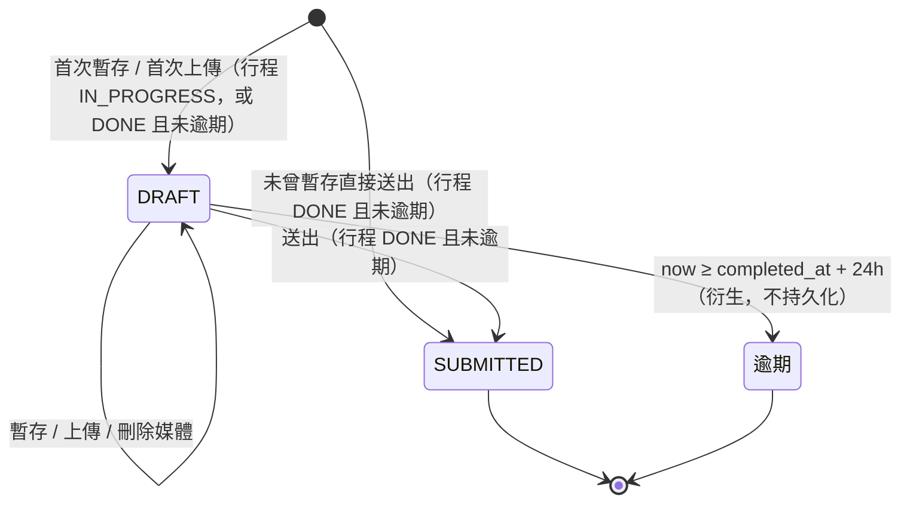

# PRD-022: 行程照護日誌與多媒體回報

| 項目 | 內容 |
|------|------|
| 狀態 | Approved |
| 建立日期 | 2026-05-23（2026-11-22 依 DOMAIN-BASELINE 第 2 版重寫） |
| 歸屬 SD | SD-FULFILL（`docs/sd/00-SD-PLAN.md` §0） |
| 測試情境 | TS-022 |
| 相依 PRD | PRD-008（行程 `PENDING → IN_PROGRESS`「開始行程」、`IN_PROGRESS → DONE`「結束行程」並寫 `completed_at`、`IN_PROGRESS` 逾時出口、行程名稱 BR-14（日誌與通知顯示的唯一名稱來源）、飼主訂單詳情行程列；本卡只消費行程狀態、`completed_at` 與行程名稱）；PRD-028（單日 SOP 檢核項）；PRD-009（O11 飼主確認結案讀取本卡「日誌已送出」、O12 自動結案不看日誌、O13 爭議、O15 / O17 ADMIN 調解結案）；PRD-006（O2 報價時快照媒體額度）；PRD-012（訂閱等級與鎖定）；PRD-013（媒體保留期限、到期刪除與提示）；PRD-014（通知範本、「訂單事務」偏好） |
| 引用基準 | `docs/sa/00-DOMAIN-BASELINE.md`（第 3 版修訂）§1.1（角色、`ROLE_MISMATCH`）、§1.2（訂單可讀範圍、ADMIN 唯讀 `DISPUTED` / OPEN 待辦訂單、403 / 404 規則；照護日誌歸屬：owner / ADMIN 只能讀已送出、未送出 404，CQ-81）、§2.1（照護回報媒體額度、媒體保留期限）、§2.2（報價時快照媒體額度 CQ-4 / CQ-20；訂閱鎖定不擋日誌 CQ-19）、§3.1–§3.2（`IN_PROGRESS` / `DISPUTED` / `COMPLETED` / `CANCELLED` 定義、O11 / O12 / O15、`DISPUTED` 期間行程照常 CQ-48 / CQ-57）、§3.6（鎖：日誌暫存 / 上傳 / 刪除 / 送出經 SD-ORDER 鎖入口 CQ-81；版本 CQ-35、通知 outbox、冪等 CQ-51、外部 I/O）、§3.7（跨模組碼 `VISIT_STATE_CONFLICT` CQ-80、期限名稱 `CARE_LOG_EDIT_ENDS_AT` CQ-80、判斷順序 CQ-70 / CQ-76（模組狀態類 409 碼緊接第 9 步，CQ-83）、payload 共通欄位、503 `STORAGE_UNAVAILABLE` 跨模組共用 CQ-83）、§5（`CARE_LOG_EDIT_HOURS` 以伺服器收到請求時間判斷、`VISIT_IN_PROGRESS_TIMEOUT_HOURS` CQ-78、`completion_basis_at`、媒體保留、UTC / Asia/Taipei）、§6（行程定義定案 CQ-78、照護日誌、有效行程） |

> 一張 PRD = 一個可獨立驗收的功能。子模組 AC ≤ 8 條，子模組 > 3 個就拆卡。
> 共用概念（角色、SaaS 額度、訂單狀態、時間起算點）只能**引用** DOMAIN-BASELINE，不得在這裡重新定義；要改就改 baseline。

---

## 1. 背景與目的

保母每次到府（一個行程）都要向飼主回報毛孩近況（BR §2.3「服務執行面板」、§5.2）。本卡定義「照護日誌」：一個行程一份，保母在行程進行中或結束後 `CARE_LOG_EDIT_HOURS`（24h）內撰寫文字並上傳照片 / 影片，送出後飼主可見並收到通知。媒體數量依**訂單報價時快照的訂閱等級**限制（baseline §2.1、§2.2），以控管儲存成本。

主流程定案（baseline CQ-27、CQ-40；PRD-008 / PRD-009 同步改寫）：保母按「結束行程」→ 行程 `DONE`、寫 `completed_at`（PRD-008）→ 24h 內編輯並送出日誌（本卡）→ 飼主才能手動確認結案（O11，PRD-009）；自動結案（O12）不看日誌。**行程 `DONE` 不以日誌送出為前提**，取代原 PRD-008「送出報告才 DONE」。行程若因 `VISIT_IN_PROGRESS_TIMEOUT_HOURS` 由系統轉 `DONE`（PRD-008 §4.4 T4，baseline §5、CQ-78），保母同樣自該 `completed_at` 起有 24h 可送出日誌。

「開始 / 結束行程」與行程名稱屬 PRD-008；行程檢核表（SOP 勾選）屬 PRD-028；媒體保留期限與到期刪除屬 PRD-013，本卡只引用。日誌本身不設標題，一律顯示所屬行程的行程名稱（PRD-008 BR-14；使用者決定 2026-11-22，CQ-18）。

## 2. 使用者故事

- **US-1** 身為保母，我希望在行程進行中就能先記錄文字與照片並暫存，以便結束後整理送出。
- **US-2** 身為飼主，我希望同一天有多個行程時，日誌與通知顯示保母取的行程名稱（例如「早上服務」「晚上服務」），以便分辨是哪一次服務（BR §5.2；命名操作屬 PRD-008）。
- **US-3** 身為保母，我希望依這張訂單成立時的方案額度上傳照片與影片，並能在送出前刪掉拍糊的媒體換新的。
- **US-4** 身為飼主，我希望在保母送出日誌後收到通知並查看文字與媒體，草稿不會被我看到。
- **US-5** 身為保母，我希望清楚知道日誌送出期限，逾期後草稿鎖定。

## 3. 角色與權限

| 動作 | OWNER | SITTER | ADMIN | 匿名 | 方案限制 |
|------|-------|--------|-------|------|---------|
| 暫存草稿（文字） | ✗ 403 `ROLE_MISMATCH` | 本人訂單 | ✗ 403 `ROLE_MISMATCH` | ✗ 401 | 無（四級皆可文字）；訂閱鎖定 / 停權不擋（§2.2、CQ-19） |
| 送出日誌 | ✗ 403 `ROLE_MISMATCH` | 本人訂單 | ✗ 403 `ROLE_MISMATCH` | ✗ 401 | 同上 |
| 上傳媒體 | ✗ 403 `ROLE_MISMATCH` | 本人訂單 | ✗ 403 `ROLE_MISMATCH` | ✗ 401 | 依**訂單快照**的媒體額度（BR-9） |
| 刪除媒體 | ✗ 403 `ROLE_MISMATCH` | 本人訂單 | ✗ 403 `ROLE_MISMATCH` | ✗ 401 | 無 |
| 讀取日誌（保母視角，含草稿與逾期草稿） | ✗ 403 `ROLE_MISMATCH` | 本人訂單 | ✗ 403 `ROLE_MISMATCH` | ✗ 401 | 無 |
| 讀取已送出日誌與媒體 | 本人訂單（僅 `SUBMITTED`，BR-16；baseline §1.2 CQ-81） | 本人訂單 | 可讀訂單範圍內唯讀（`DISPUTED` 或有 OPEN 待辦，§1.2），僅 `SUBMITTED`（CQ-81） | ✗ 401 | 無 |

- 「本人訂單」= 該行程所屬訂單的 owner / sitter，以 token 身分判斷；存在但不屬於呼叫者 → 403 `FORBIDDEN`；不存在 → 404 `NOT_FOUND`；token `currentRole` 與端點要求不符 → 403 `ROLE_MISMATCH`（§1.1、§1.2）。同一帳號兼具 OWNER / SITTER 時，以 OWNER token 呼叫保母端點一律 `ROLE_MISMATCH`。
- 路徑上的媒體不屬於路徑上的日誌 / 行程，或行程不屬於路徑上的訂單 → 404 `NOT_FOUND`，以路徑上層資源為準。
- **錯誤判斷順序**（多個錯誤同時成立時回第一個；依 baseline §3.7，CQ-70、CQ-76），本卡端點對應如下：
  1. 401 `UNAUTHENTICATED`
  2. 冪等回放（同使用者、同端點、同 key、同內容；只有申請上傳與送出帶 key，BR-21；確認上傳以「此次上傳」本身冪等，已確認成功者回放第一次結果，BR-28）
  3. 403 `ROLE_MISMATCH`
  4. 404 `NOT_FOUND`（含路徑資源不相屬；OWNER / ADMIN 讀取非 `SUBMITTED` 日誌，BR-16）
  5. 403 `FORBIDDEN`（非訂單當事人；ADMIN 不在可讀範圍）
  6. 400 `VALIDATION_FAILED`（文字 / 說明文字長度、申請上傳未宣告檔案或多於 1 檔、缺 `Idempotency-Key`）
  7. 422 `IDEMPOTENCY_KEY_REUSED` / 409 `IDEMPOTENCY_IN_PROGRESS`
  8. 409 `ORDER_STATE_CONFLICT`（訂單非 `IN_PROGRESS` / `DISPUTED`，含 `COMPLETED`（不論 O11 / O12 / O15）與 `CANCELLED`，BR-4）
  9. 409 `VISIT_STATE_CONFLICT`（baseline §3.7 跨模組碼，CQ-80；位於 baseline 第 9 步）→ 409 `CARE_LOG_STATE_CONFLICT`（SD-FULFILL 模組碼，緊接 baseline 第 9 步之後，baseline CQ-83；使用者決定 2026-11-22，本卡 CQ-3）→ 409 `CARE_LOG_UPLOAD_EXPIRED`（只在確認上傳時；SD-FULFILL 模組碼，位於 `CARE_LOG_STATE_CONFLICT` 之後；使用者決定 2026-11-22，CQ-19）
  10. 409 `DEADLINE_PASSED`（`deadline=CARE_LOG_EDIT_ENDS_AT`，baseline §3.7 期限名稱、§5 `CARE_LOG_EDIT_HOURS`，CQ-80）
  11. 422 業務規則（SD-FULFILL 模組碼，對應 baseline 第 12 步）：`CARE_LOG_CONTENT_EMPTY`、`CARE_LOG_MEDIA_TYPE_UNSUPPORTED`、`CARE_LOG_MEDIA_TOO_LARGE`、`CARE_LOG_VIDEO_DURATION_INVALID`、`CARE_LOG_MEDIA_QUOTA_EXCEEDED`（依此順序）
  - 以上 422 檔案類規則在**申請上傳**時以宣告值判斷；**確認上傳**時對實際檔案再判斷一次，用同一組 422 碼（格式 → 大小 → 影片時長，再到額度）。確認時的實際檔案檢驗排在第 10 步之後：先 503 `STORAGE_UNAVAILABLE`（讀取檔案失敗）→ 400 `VALIDATION_FAILED`（`field=file`：檔案不存在、內容雜湊與申請宣告不符）→ 第 11 步 422（只有已通過申請的上傳才會進到確認，BR-28；CQ-19、CQ-22）。
  - 409 `ORDER_BUSY` 只在取得訂單鎖時發生；503 `STORAGE_UNAVAILABLE`（baseline §3.7 跨模組碼，CQ-83）只在取得傳檔位置（申請階段，CQ-19）或確認時讀取已上傳檔案（CQ-22）時發生。本卡不使用 403 `PLAN_REQUIRED`（baseline 第 13 步；額度依快照，升級無法解除；使用者決定 2026-11-22，CQ-1）。
  - 依此得出的唯一結果（AC 以此為準）：訂單 `IN_PROGRESS` 時已送出且已逾期的日誌再暫存 → `CARE_LOG_STATE_CONFLICT`；已送出的日誌暫存 1001 字 → 400 `VALIDATION_FAILED`；已逾期且額度已滿時申請上傳 → `DEADLINE_PASSED`；已逾期草稿申請上傳附 101 字說明 → 400 `VALIDATION_FAILED`；他人訂單的保母對已送出日誌暫存 → 403 `FORBIDDEN`；訂單 `COMPLETED`（不論結案來源）時任何寫入，即使日誌已送出或已逾期 → `ORDER_STATE_CONFLICT`。

## 4. 主流程

> 範例：行程日期 2026-11-25；保母 2026-11-25 10:00（台北）開始行程、11:00 結束 → `completed_at = 2026-11-25T03:00:00Z`，編輯期限 `completed_at + CARE_LOG_EDIT_HOURS = 2026-11-26T03:00:00Z`（台北 11/26 11:00）。

### 4.1 開放條件與草稿

1. 保母在行程詳情（服務執行面板）看到「照護日誌」區塊。**可編輯**（暫存、上傳、刪除）須同時符合（BR-3、BR-4、BR-5）：
   - 訂單為 `IN_PROGRESS` 或 `DISPUTED`；
   - 行程為 `IN_PROGRESS`，或行程為 `DONE` 且 `receivedAt < completed_at + CARE_LOG_EDIT_HOURS`；
   - 日誌不存在或為 `DRAFT`。
   不符時畫面不顯示編輯輸入與按鈕；行程 `PENDING` / `CLOSED_BY_SYSTEM` / `CANCELLED` 時整個區塊不顯示編輯入口。
2. 日誌欄位（BR-6、BR-7）：
   - 日誌不設標題；區塊標頭顯示所屬行程的行程名稱（唯讀，取 PRD-008 BR-14，含未自訂時的預設名稱），改名在服務面板操作（PRD-008 §4.7）；
   - 文字日誌（多行，最多 1000 字）：輸入框下方即時顯示「目前字數 / 1000」（`sitter-care-log-text-counter`），達 1000 字時不允許再輸入；
   - 媒體列表（§4.3）。
3. 保母按「暫存草稿」（`sitter-care-log-btn-save`），送出文字（整份覆寫）。系統：鎖訂單列（§3.6，經 SD-ORDER 鎖入口，BR-20）→ 重驗可編輯條件 → 該行程尚無日誌時建立 `DRAFT`（一行程一份，唯一，BR-2），否則更新 → 提交，回傳最新內容。
4. **首次上傳媒體確認成功**也會在同一交易建立 `DRAFT`（§4.3）；首次暫存與首次上傳的確認同時送達時，只會有 1 份日誌（BR-2）。
5. **未暫存文字保護**：保母尚未暫存的輸入，不得因上傳 / 刪除媒體後的畫面重新整理被伺服器上的舊內容覆蓋；只有暫存或送出成功才以伺服器內容為準（BR-8）。

### 4.2 送出

1. 行程 `IN_PROGRESS` 時「送出日誌」（`sitter-care-log-btn-submit`）停用並顯示「行程結束後才能送出」；行程 `DONE` 且未逾期時啟用，旁邊顯示「請於 {期限 YYYY-MM-DD HH:mm} 前送出」（`sitter-care-log-deadline`，Asia/Taipei）。
2. 保母按送出（帶 `Idempotency-Key`，body 含目前畫面上的文字）。系統依 §3 判斷順序：
   1. 401 `UNAUTHENTICATED`（先於冪等回放，baseline §3.7）→ 冪等回放（baseline §3.6）；
   2. 授權（403 `ROLE_MISMATCH` → 404 → 403 `FORBIDDEN`）；
   3. 欄位驗證（文字 ≤ 1000 字、缺 key → 400）；
   4. 冪等認領（同 key 不同內容 422 / 處理中 409）；
   5. 鎖訂單列 → 依序重驗訂單 `IN_PROGRESS` / `DISPUTED`、行程 `DONE`、日誌不存在或 `DRAFT`、`receivedAt < completed_at + CARE_LOG_EDIT_HOURS`、文字去空白（含全形空白，定義見 SD-GLOBAL-SPEC）後 ≥ 1 字（BR-10）；
   6. 日誌不存在時建立；以 body 覆寫文字；`DRAFT → SUBMITTED`，寫 `submitted_at`；寫 `order_logs`（`CARE_LOG_SUBMITTED`，BR-19）；`enqueue` 飼主通知（站內必寫、Email 依偏好，BR-17）；提交。
3. 送出後日誌永久唯讀：不可再暫存、上傳、刪除、再送出；不會回到 `DRAFT`（BR-11）。
4. 送出即滿足 O11「該 `DONE` 行程日誌已送出」條件（PRD-009）；不影響行程狀態與 `completion_basis_at`（`DONE` 行程結束時間固定為 `completed_at + CARE_LOG_EDIT_HOURS`，baseline §5）。
5. **系統逾時轉 `DONE` 的行程**：保母未按「結束行程」、行程於 `started_at + VISIT_IN_PROGRESS_TIMEOUT_HOURS` 後被排程轉 `DONE`（`completed_at` = 排程處理時刻、完成來源 `SYSTEM`，PRD-008 §4.4 T4、BR-12），本卡規則與保母手動結束完全相同：可暫存、上傳、刪除、送出至 `completed_at + CARE_LOG_EDIT_HOURS`，期限顯示與判斷同第 1 點、BR-5；不因完成來源 `SYSTEM` 而縮短或鎖定（baseline §5 `VISIT_IN_PROGRESS_TIMEOUT_HOURS`、CQ-78；BR-27）。

### 4.3 媒體上傳

1. 上傳區（`sitter-care-log-btn-upload`、`sitter-care-log-input-file`）顯示本行程額度與已用量（`sitter-care-log-quota`，例「照片 3 / 5　影片 0 / 0」）。額度取**訂單報價時快照**的媒體額度（BR-9），不看保母當下等級：
   - 快照為 FREE（照片 0、影片 0）：不顯示上傳按鈕，顯示「此訂單方案僅支援文字回報」；
   - 某類型已用量 = 額度：選擇該類型檔案時前端擋下並顯示「此行程{照片 / 影片}額度已用完」，不發出請求。
2. 每次申請上傳 1 個檔案，可附說明文字（選填，≤ 100 字）；前端多選時逐一依序上傳（BR-14）。
3. 前端送出前檢查（BR-12、BR-13）：
   - 照片：先轉為 WebP 並壓縮至 < 1 MB；壓縮後仍 ≥ 1 MB → 顯示「照片需小於 1MB」，不送出。前端壓縮不取代後端驗證：後端仍驗證格式（JPEG / PNG / WebP）與大小（使用者決定 2026-11-22，CQ-6）；
   - 影片：格式 MP4 / MOV、長度 15–30 秒（以瀏覽器讀取時長）、< 50 MB；不符時依不符項目顯示與 EX-12–EX-14、AC-2.4 相同的文案，不送出：格式「照片僅支援 JPG、PNG、WebP；影片僅支援 MP4、MOV」、大小「影片需小於 50MB」、時長「影片長度需為 15–30 秒」（多項同時不符時依格式 → 大小 → 時長取第一個，與 §3 第 11 步順序一致）。
4. 上傳分三步：**申請上傳 → 傳檔 → 確認**（BR-28；檔案由瀏覽器直接傳到儲存服務、不經後端，因 50 MB 影片超過後端單一請求上限；使用者決定 2026-11-22，CQ-19）。
   - **(a) 申請上傳**（帶 `Idempotency-Key`；宣告媒體類型、檔案格式、大小、影片時長、說明文字）。伺服器記下收到申請的時間（**申請時間**，編輯期限以此判斷，BR-5）。系統依 §3 判斷順序（401 先於以下全部）：
     1. 冪等回放：同 key 同內容 → 回放同一次上傳（不需重新申請）；
     2. 授權：403 `ROLE_MISMATCH` → 404 `NOT_FOUND` → 403 `FORBIDDEN`；
     3. 欄位驗證：說明文字 ≤ 100 字、恰好宣告 1 個檔案、帶 `Idempotency-Key`，不符 → 400 `VALIDATION_FAILED`；
     4. 冪等認領：同 key 不同內容 → 422 `IDEMPOTENCY_KEY_REUSED`；處理中 → 409 `IDEMPOTENCY_IN_PROGRESS`；
     5. 狀態與期限預檢（不取鎖）：`ORDER_STATE_CONFLICT` → `VISIT_STATE_CONFLICT` → `CARE_LOG_STATE_CONFLICT` → `DEADLINE_PASSED`；
     6. 宣告值與額度預檢：格式 → 大小 → 影片時長 → 額度（已用量 + 1 ≤ 快照額度）；
     7. 全部通過才取得傳檔位置（自申請時間起 30 分鐘內有效）；任一步不通過即回錯誤，不會有檔案進入儲存服務；取得傳檔位置時儲存服務無法使用 → 503 `STORAGE_UNAVAILABLE`，此時無媒體紀錄、不建日誌、額度不變；已建立的上傳申請保留，同 key 重試回放該次申請並重新取得傳檔位置（EX-21）。
   - **(b) 傳檔**：瀏覽器把檔案直接傳到儲存服務。失敗時前端顯示「上傳失敗，請稍候重試」，保留已選檔案與重試按鈕；重試以同一 key 重新申請（回放同一次上傳）後重傳，伺服器端無任何變化（EX-21）。
   - **(c) 確認**：前端通知伺服器傳檔完成。依序：
     1. 授權（同 (a) 第 2 步）；
     2. 此次上傳已確認成功 → 回放第一次成功結果（201，同一媒體、不新增紀錄），不論編輯期限或 30 分鐘是否已過（BR-28；使用者決定 2026-11-22，CQ-21）；此次上傳已因業務錯誤作廢 → 回放第一次的錯誤，需以新 key 重新申請（CQ-22 (c)）；
     3. 狀態預檢：`ORDER_STATE_CONFLICT` → `VISIT_STATE_CONFLICT` → `CARE_LOG_STATE_CONFLICT` → 伺服器收到確認的時間 ≥ 申請時間 + 30 分鐘 → 409 `CARE_LOG_UPLOAD_EXPIRED`（此次上傳作廢，需以新 key 重新申請）→ 期限以**申請時間**判斷 `DEADLINE_PASSED`（確認請求的收到時間不拿來比期限，BR-5）；
     4. 檢驗實際檔案：
        - 讀取已上傳檔案時儲存服務無法使用 → 503 `STORAGE_UNAVAILABLE`，檔案保留、此次上傳仍有效，同一次上傳直接重試確認（CQ-22 (a)）；
        - 檔案不存在（尚未傳到）或內容雜湊與申請宣告不符 → 400 `VALIDATION_FAILED`（`field=file`）。檔案不存在時此次上傳仍有效，補傳後再確認（CQ-22 (b)）；雜湊不符時刪除該檔案、此次上傳作廢；
        - 實際格式 → 大小 → 影片時長不符 BR-12 / BR-13（或與宣告的媒體類型不符）→ 與申請時同一組 422（`CARE_LOG_MEDIA_TYPE_UNSUPPORTED` / `CARE_LOG_MEDIA_TOO_LARGE` / `CARE_LOG_VIDEO_DURATION_INVALID`），刪除該檔案、不計額度、此次上傳作廢（CQ-19）；
     5. 交易內：鎖訂單列 → 重驗可編輯條件（期限仍以申請時間判斷）與額度；
     6. 日誌不存在時建立 `DRAFT`；新增媒體紀錄（類型、物件鍵、大小、影片時長、說明文字、上傳時間）；寫 `order_logs`（`MEDIA_UPLOADED`，含物件鍵、類型、大小，BR §5.4.2）；提交；
     7. 第 3、5 步業務規則不通過（例：申請後訂單被 O15 結案、額度已被另一筆用掉）→ 回對應錯誤、刪除該檔案、此次上傳作廢（EX-22）；
     8. 取訂單鎖逾時 409 `ORDER_BUSY` → **保留已上傳檔案**，此次上傳仍有效，同一次上傳直接重試確認即可，不需重傳；`ORDER_BUSY` 不記為回放結果（使用者決定 2026-11-22，CQ-20）。
   - 申請後 30 分鐘內未確認的上傳不計額度，檔案由清除排程刪除（baseline §3.6 孤兒檔清除）。
5. 確認成功後回傳該媒體與最新已用量；前端保留輸入框中未暫存的文字（§4.1-5）。

### 4.4 媒體刪除

1. 可編輯期間（§4.1-1），每個媒體顯示刪除鈕（`sitter-care-log-btn-delete-media-{mediaId}`）。
2. 保母刪除 → 鎖訂單列、重驗可編輯條件 → 刪除媒體紀錄（不再計入已用量，額度立即釋放）、寫 `order_logs`（`MEDIA_DELETED`）、提交 → 交易後刪除 GCS 物件；物件刪除失敗不影響結果，由孤兒檔排程清除（BR-15、§3.6）。
3. 說明文字上傳後不可修改，要改就刪除重傳（BR-15；使用者決定 2026-11-22，CQ-12）。

### 4.5 檢視與逾期

1. **保母**：任何狀態都可讀自己的日誌。`DRAFT` 且已過 `completed_at + CARE_LOG_EDIT_HOURS` → 畫面標示「已逾期，未送出」（`sitter-care-log-status`），只顯示行程名稱、已暫存的文字與已上傳媒體，無任何輸入與按鈕（BR-5）。
2. **逾期是時間判斷的衍生結果**：資料庫只存 `DRAFT` / `SUBMITTED`，不寫 `EXPIRED`，不建排程（沿用原 PRD-022 B.2）；API 回應以衍生欄位標示是否逾期與期限時間。
3. **飼主**：訂單詳情的行程列（`owner-order-detail-visit-row-{visitId}`，PRD-008 §4.6）中，日誌為 `SUBMITTED` 的行程顯示「查看日誌」（`owner-order-detail-btn-view-log-{visitId}`），開啟後（`owner-care-log-view`）顯示行程名稱（`owner-care-log-visit-name`，讀取當下的 PRD-008 行程名稱）、文字、媒體與說明文字、送出時間（Asia/Taipei `YYYY-MM-DD HH:mm`）。`DRAFT`（含逾期草稿）一律不顯示入口，API 回 404（BR-16）。訂單 `IN_PROGRESS`、`DISPUTED`、`COMPLETED` 皆可查看（沿用原 PRD-009 A.4）。
4. 媒體檔以授權後產生的短效簽名網址讀取（BR-18）；保留期限與到期後「檔案已逾期移除」提示依 PRD-013。
5. **ADMIN**：可讀訂單範圍內唯讀查看 `SUBMITTED` 日誌與媒體，無編輯入口。

## 5. 狀態轉移

> 本卡只改變「照護日誌」的狀態，不造成訂單或行程轉移。行程 `DONE` 由 PRD-008 觸發；O11 讀取本卡結果（PRD-009）。

| # | 實體 | 從 | 到 | 觸發者 | 前置條件 | 不符時錯誤碼 |
|---|------|----|----|-------|---------|-------------|
| L1 | care log | （不存在） | `DRAFT` | SITTER（首次暫存或首次上傳確認成功） | 訂單 `IN_PROGRESS` / `DISPUTED`；行程 `IN_PROGRESS`，或 `DONE` 且 `receivedAt < completed_at + 24h`；同行程無日誌（唯一） | 409 `ORDER_STATE_CONFLICT` / `VISIT_STATE_CONFLICT` / `DEADLINE_PASSED` |
| L2 | care log | `DRAFT` | `DRAFT` | SITTER（暫存、確認上傳成功、刪除媒體） | 同 L1（上傳的期限以申請時間判斷）；上傳另需額度未滿、申請後 30 分鐘內確認、實際檔案存在且符合宣告與 BR-12 / BR-13 | 同 L1；409 `CARE_LOG_STATE_CONFLICT`（已送出）；409 `CARE_LOG_UPLOAD_EXPIRED`；400 `VALIDATION_FAILED`（`field=file`：檔案不存在、雜湊不符）；422 `CARE_LOG_MEDIA_*` |
| L3 | care log | `DRAFT` 或（不存在） | `SUBMITTED` | SITTER（送出） | 訂單 `IN_PROGRESS` / `DISPUTED`；行程 `DONE`；`receivedAt < completed_at + 24h`；文字去空白後 ≥ 1 字 | 409 `ORDER_STATE_CONFLICT` / `VISIT_STATE_CONFLICT` / `CARE_LOG_STATE_CONFLICT` / `DEADLINE_PASSED`；422 `CARE_LOG_CONTENT_EMPTY` |
| L4 | care log | `DRAFT` | （衍生）逾期 | 時間 | `now ≥ completed_at + 24h`；不寫入資料庫 | — |

## 6. 業務規則

| # | 規則 | 出處 |
|---|------|------|
| BR-1 | 照護日誌狀態只持久化 `DRAFT`、`SUBMITTED`；「逾期」為時間衍生，不寫入、不建排程 | 沿用原 PRD-022 B.2、B.3 |
| BR-2 | 一個行程最多一份日誌（唯一）；首次暫存或首次上傳時建立 `DRAFT`；同時送達只建 1 份 | baseline §6「照護日誌」；沿用原 PRD-022 A.1 |
| BR-3 | 可編輯的行程狀態：`IN_PROGRESS`，或 `DONE` 且未逾期；`PENDING`（BR 舊稱 `SCHEDULED`，baseline §6 改名）、`CLOSED_BY_SYSTEM`、`CANCELLED` 不可建立 / 編輯 → 409 `VISIT_STATE_CONFLICT`（payload `currentVisitStatus`）。送出只限行程 `DONE`（不論完成來源為保母或 `SYSTEM`，BR-27），`IN_PROGRESS` 送出 → 409 `VISIT_STATE_CONFLICT` | 沿用原 PRD-022 A.2；baseline §6（行程定義定案，CQ-78）、CQ-40；呼叫方交辦主流程定案 2026-11-22；錯誤碼為 baseline §3.7 跨模組碼（CQ-80） |
| BR-4 | 可寫入（暫存、上傳、刪除、送出）的訂單狀態只有 `IN_PROGRESS`、`DISPUTED`（爭議期間行程照常）；其餘狀態（含 `COMPLETED`，不論經 O11 / O12 / O15 結案；`CANCELLED`）→ 409 `ORDER_STATE_CONFLICT`（payload `currentStatus`）。日誌送出後即唯讀（BR-11）。**不需區分結案來源的推論**：(1) O11 前置條件要求所有有效行程為 `DONE` 且日誌已送出、或 `CLOSED_BY_SYSTEM`，故 O11 結案時所有日誌必已送出（已唯讀）；(2) O12 發生於 `completion_basis_at + AUTO_COMPLETE_HOURS`，而 `completion_basis_at` ≥ 每個 `DONE` 行程的 `completed_at + CARE_LOG_EDIT_HOURS`，故 O12 必晚於所有 24h 編輯期限。因此 O11 / O12 結案後不存在可編輯日誌，對 `COMPLETED` 一律拒絕不會縮短任何編輯期（與 PRD-009 BR-25 實質一致），SD-ORDER 不需提供 `completedBy`。實際會被提前鎖定的只有 O15 調解結案與 O17 / 其他取消：即使 `DONE` 行程仍在 24h 內也立即鎖定。ADMIN 調解前「尚有日誌未送出」的提示屬 PRD-020 | baseline §3.2 O11、O12、O15、O17、CQ-48、CQ-57；baseline §5 `completion_basis_at`、`AUTO_COMPLETE_HOURS`；使用者決定 2026-11-22（CQ-16；審查第 1 輪 #1 改回單一規則） |
| BR-5 | 編輯期限 = `completed_at + CARE_LOG_EDIT_HOURS`（24h）。以伺服器收到請求的時間 `receivedAt` 判斷：`receivedAt ≥ 期限` → 409 `DEADLINE_PASSED`（payload `deadline=CARE_LOG_EDIT_ENDS_AT`、`deadlineAt=<期限>`），適用暫存、申請上傳、刪除、送出；之後 `DRAFT` 對保母唯讀、對飼主永不可見、不發通知。**媒體上傳的期限比對用伺服器收到「申請上傳」的時間（申請時間）**，這是 baseline §5 `CARE_LOG_EDIT_HOURS`「伺服器收到請求時間」在上傳情境的解釋；確認請求的收到時間不拿來比期限，只用來判斷 30 分鐘確認窗。期限前申請、且自申請時間起 30 分鐘內完成確認者，即使確認時已過期限仍算數；確認時間 ≥ 申請時間 + 30 分鐘 → 409 `CARE_LOG_UPLOAD_EXPIRED`，需重新申請（重新申請時以新申請時間判斷期限，BR-28）。訂單 / 行程 / 日誌狀態則以確認時交易內鎖後重驗結果為準（例：申請後、確認前訂單被 O15 結案 → 確認回 409 `ORDER_STATE_CONFLICT`） | baseline §5 `CARE_LOG_EDIT_HOURS`（伺服器收到請求時間判斷）、§3.2「期限一律以時間判斷」、§3.7 期限名稱 `CARE_LOG_EDIT_ENDS_AT` 與 payload（CQ-80）；沿用原 PRD-022 B.2；使用者決定 2026-11-22（CQ-2、CQ-9，已寫入 baseline；上傳改以申請時間、30 分鐘確認窗：CQ-19；baseline 措辭的上傳情境解釋：主流程決定 2026-11-22） |
| BR-6 | 日誌不設標題欄位。保母端日誌區塊、飼主 / ADMIN 日誌檢視一律顯示所屬行程的行程名稱（PRD-008 BR-14 為唯一名稱來源，含未自訂時的預設名稱與可改時機），以讀取當下的名稱為準；送出通知於送出當下帶入行程名稱（BR-17）。本卡不提供改名 | BR §5.2「可編輯日誌名稱」；PRD-008 BR-14；使用者決定 2026-11-22（CQ-18，取代 CQ-4） |
| BR-7 | 文字日誌最多 1000 字（超過 → 400 `VALIDATION_FAILED`），前端顯示「目前字數 / 1000」且達上限禁止輸入；媒體說明文字選填、最多 100 字 | 沿用原 PRD-022 A.3 |
| BR-8 | 未暫存的輸入不得被上傳 / 刪除後的畫面更新覆蓋；暫存或送出成功才以伺服器內容為準 | 沿用原 PRD-022 A.2 |
| BR-9 | 媒體額度 = 訂單於 O2 報價時快照的訂閱等級額度（每行程，照片與影片分別計算）：FREE 0 照片 + 0 影片；BASIC 5 照片 + 0 影片；PRO 10 照片 + 2 影片；ULTIMATE 25 照片 + 5 影片。保母之後升降級不影響；不讀方案層 `maxPhotos`。超過 → 422 `CARE_LOG_MEDIA_QUOTA_EXCEEDED`（SD-FULFILL 模組碼，payload `mediaType`、`limit`、`used`）；不使用 403 `PLAN_REQUIRED` | baseline §2.1、§2.2、CQ-4、CQ-20；PRD-006 BR-8；錯誤碼：使用者決定 2026-11-22（CQ-1） |
| BR-10 | 送出時文字日誌去空白後至少 1 字，否則 422 `CARE_LOG_CONTENT_EMPTY`（SD-FULFILL 模組碼）；有媒體但無文字也不可送出；暫存不檢查 | 使用者決定 2026-11-22（CQ-5） |
| BR-11 | 送出後永久唯讀，不回 `DRAFT`；任何寫入 → 409 `CARE_LOG_STATE_CONFLICT`（SD-FULFILL 模組碼，判斷位置緊接 `VISIT_STATE_CONFLICT` 之後、`DEADLINE_PASSED` 之前） | 沿用原 PRD-022 B.1、資料規則；錯誤碼：使用者決定 2026-11-22（CQ-3） |
| BR-12 | 照片格式 JPEG / PNG / WebP，單檔 < 1 MB（1,048,576 bytes，嚴格小於）；前端上傳前轉 WebP 並壓縮至 < 1 MB，壓縮後仍 ≥ 1 MB 則前端提示、不送出；後端不信任前端，仍驗證格式與大小：申請上傳時宣告的格式不符 → 422 `CARE_LOG_MEDIA_TYPE_UNSUPPORTED`、宣告大小超過 → 422 `CARE_LOG_MEDIA_TOO_LARGE`；確認時以實際檔案再判斷，不符用同一組 422 碼，並刪除檔案、不計額度、此次上傳作廢（BR-28） | 沿用原 PRD-022 A.4；SAAS「技術實作建議」（WebP、< 1MB）；使用者決定 2026-11-22（CQ-6、CQ-7；申請 / 確認兩段檢驗：CQ-19；確認時沿用同組 422：主流程決定 2026-11-22） |
| BR-13 | 影片格式 MP4 / MOV，長度 15–30 秒（含端點，時長四捨五入至整數秒），單檔 < 50 MB（52,428,800 bytes，嚴格小於）；申請時宣告長度不符 → 422 `CARE_LOG_VIDEO_DURATION_INVALID`；格式 / 大小同 BR-12 錯誤碼；確認時以實際檔案的格式 / 大小 / 時長再判斷，不符用同一組 422 碼，並刪除檔案、不計額度、此次上傳作廢（BR-28）；只有快照額度含影片（PRO / ULTIMATE）才能上傳 | 沿用原 PRD-022 A.4；SAAS「影片限制在 15-30 秒」；使用者決定 2026-11-22（CQ-7；兩段檢驗：CQ-19；確認時沿用同組 422：主流程決定 2026-11-22） |
| BR-14 | 每次申請上傳恰好宣告 1 個檔案（0 或 > 1 → 400 `VALIDATION_FAILED`）；BR §5.4.2 的單次上傳檔案數參數本卡取 1、單次容量即 BR-12 / BR-13 單檔上限；前端多選時依序逐一上傳 | BR §5.4.2；使用者決定 2026-11-22（CQ-8） |
| BR-15 | 可編輯期間可刪除媒體，刪除後立即不計入額度；GCS 物件於交易後刪除，失敗由孤兒檔排程清除；送出後與逾期後不可刪除。媒體說明文字上傳後不可修改，要改就刪除重傳 | 沿用原 PRD-022 A.5；baseline §3.6 外部 I/O；說明文字：使用者決定 2026-11-22（CQ-12） |
| BR-16 | 飼主與 ADMIN 只能讀 `SUBMITTED` 日誌；讀非 `SUBMITTED`（含逾期草稿）一律 404 `NOT_FOUND`（不洩漏草稿存在與否），畫面不顯示入口。ADMIN 只限 §1.2 可讀訂單範圍 | 沿用原 PRD-022 AC-1.2、B.2；baseline §1.2 照護日誌歸屬（CQ-81）、CQ-18；使用者決定 2026-11-22（CQ-10，已寫入 baseline） |
| BR-17 | 送出時同交易 `enqueue` 飼主通知 1 則：「{行程日期 YYYY-MM-DD} {行程名稱} 的照護日誌已由保母回報，快來看看毛孩的近況吧！」；日期為行程日期（Asia/Taipei），行程名稱取送出當下的 PRD-008 行程名稱。站內通知一律寫入；Email 依 PRD-014「訂單事務」類別的使用者偏好（非 baseline 不可關閉類別）；Email 由排程寄送，Resend 失敗不影響送出。草稿、暫存、上傳、刪除、逾期不發通知 | 沿用原 PRD-022 B.4；baseline §3.6 通知 outbox、不可關閉類別（CQ-73）、Email 重試（CQ-33、CQ-52）；PRD-014 §2「訂單事務：服務報告送達」；與 SD-ORDER §7.2、PRD-008 BR-18 同規則；使用者決定 2026-11-22（審查第 1 輪 #3、#10） |
| BR-18 | 媒體為 GCS 私有物件，只透過授權後產生的短效簽名網址讀取，有效期 15 分鐘；簽名網址不寫入冪等回放 body | baseline §3.6；有效期：使用者決定 2026-11-22（CQ-11） |
| BR-19 | `order_logs` 寫入：`MEDIA_UPLOADED`（物件鍵、類型、大小）、`MEDIA_DELETED`、`CARE_LOG_SUBMITTED`，皆與該寫入同交易；暫存草稿不寫 | BR §5.4.2（上傳）；BR §5.8（訂單動態來源）；使用者決定 2026-11-22（CQ-13） |
| BR-20 | 暫存、確認上傳、刪除、送出一律先經 SD-ORDER 鎖入口鎖訂單列（`lock_timeout 3s`，逾時 409 `ORDER_BUSY` + `Retry-After: 1`），以與行程轉移（PRD-008 結束行程、`IN_PROGRESS` 逾時轉 `DONE`、殭屍清理）、O11、O15 序列化，並保證額度檢查不超賣 | baseline §3.6「鎖」（照護日誌寫入經訂單鎖，CQ-81）；使用者決定 2026-11-22（CQ-15，已寫入 baseline） |
| BR-21 | 申請上傳與送出必帶 `Idempotency-Key`（缺 → 400 `VALIDATION_FAILED`，`field=Idempotency-Key`），行為依 baseline §3.6（申請上傳的內容 hash 含宣告的檔案 SHA-256；同 key 同內容回放第一次狀態碼與 body；同 key 不同內容 422 `IDEMPOTENCY_KEY_REUSED`；處理中 409 `IDEMPOTENCY_IN_PROGRESS`；5xx 與 `ORDER_BUSY` 不記錄）。冪等查詢在取得傳檔位置之前。確認上傳不另帶 key，以「此次上傳」本身冪等：已確認成功者回放第一次成功結果（BR-28）。暫存（整份覆寫）與刪除不帶 key：重送暫存結果相同；重送刪除回 404 `NOT_FOUND`，前端視為已刪除 | baseline §3.6、CQ-51；沿用原 PRD-022 AC-2.2（改為回放，取代 409 `IDEMPOTENCY_CONFLICT`）；暫存 / 刪除不帶 key：使用者決定 2026-11-22（CQ-17） |
| BR-22 | 不接受客戶端 version；暫存為整份覆寫（後寫者為準）；日誌實體保留 `@Version` 作最後防線，觸發時回 409 `ORDER_BUSY`。同一保母多裝置 / 舊分頁互相覆蓋不處理 | baseline §3.6「版本」、CQ-35、§3.7；doc-conventions「不處理同一使用者多裝置自我併發」 |
| BR-23 | 訂閱逾期 / 停權不擋本卡任何操作（屬既有訂單） | baseline §2.2、CQ-19 |
| BR-24 | 日誌記錄 `created_by`、`updated_by` 與建立 / 更新 / 送出時間，`created_by` / `updated_by` 由系統寫入操作的保母（首次建立寫 `created_by`，每次寫入更新 `updated_by`）；媒體紀錄的建立者即上傳者（`uploaded_by`）與上傳時間，媒體不可修改（BR-15）故不另記 `updated_by`。時間 UTC 儲存、ISO-8601 傳輸，畫面以 Asia/Taipei `YYYY-MM-DD HH:mm` 顯示 | baseline §5；沿用原 PRD-022 資料規則；建立者欄位歸屬：`SD-FULFILL.data.review.md` 第 2 輪 N2（Q3 建議預設值，主流程交辦 2026-11-22） |
| BR-25 | 媒體保留期限依訂單快照（baseline §2.1，自訂單結案日起），到期刪除與提示依 PRD-013；逾期未送出的草稿媒體不特別處理，同樣依 PRD-013 自訂單結案日起的保留期限刪除，飼主不可見 | baseline §2.1、§5；PRD-013；使用者決定 2026-11-22（CQ-14） |
| BR-26 | 多錯誤同時成立時依 §3「錯誤判斷順序」回第一個 | baseline §3.7、CQ-70、CQ-76 |
| BR-27 | 行程因 `VISIT_IN_PROGRESS_TIMEOUT_HOURS`（24h）被系統轉 `DONE`（完成來源 `SYSTEM`、`completed_at` = 排程處理時刻）時，日誌規則與保母手動結束相同：`receivedAt < completed_at + CARE_LOG_EDIT_HOURS` 內可暫存、上傳、刪除、送出；本卡不讀完成來源 | baseline §5 `VISIT_IN_PROGRESS_TIMEOUT_HOURS`、§6、CQ-78；PRD-008 §4.4 T4、BR-12 |
| BR-28 | 媒體上傳分「申請上傳 → 傳檔 → 確認」三步，檔案由瀏覽器直接傳到儲存服務、不經後端（§4.3-4）。(1) 申請：檢查授權、狀態、期限（以申請時間）、宣告的類型 / 格式 / 大小 / 時長與額度，全部通過才可傳檔，拒絕時不會有檔案進入儲存服務；取得傳檔位置時儲存服務無法使用 → 503 `STORAGE_UNAVAILABLE`。(2) 傳檔失敗只在前端提示重試，伺服器無變化。(3) 確認：重驗狀態、30 分鐘確認窗（≥ 申請時間 + 30 分鐘 → 409 `CARE_LOG_UPLOAD_EXPIRED`，需以新 key 重新申請）、期限（以申請時間，確認請求的收到時間不比期限）；檢驗實際檔案：讀取失敗 → 503 `STORAGE_UNAVAILABLE`，檔案保留、同一次上傳直接重試確認；檔案不存在 → 400 `VALIDATION_FAILED`（`field=file`），此次上傳仍有效、補傳後再確認；內容雜湊與宣告不符 → 400 `VALIDATION_FAILED`（`field=file`）並刪除檔案、作廢；實際格式 / 大小 / 時長不符 BR-12 / BR-13 → 與申請時同一組 422 `CARE_LOG_MEDIA_*`，刪除檔案、不計額度、作廢；鎖後重驗業務失敗 → 回對應錯誤並刪除檔案、作廢；只有確認成功才建立媒體紀錄、計入額度。(4) 確認遇 409 `ORDER_BUSY`：保留已上傳檔案，同一次上傳直接重試確認，不需重傳。(5) 已確認成功的上傳以同 key 重跑流程（含期限或 30 分鐘已過）→ 回放第一次成功結果（201），不回 409、不新增媒體、不重傳；已作廢的上傳再次確認 → 回放第一次的錯誤，需以新 key 重新申請。(6) 30 分鐘內未確認的上傳不計額度，檔案由清除排程刪除 | Cloud Run 單一請求上限 32 MiB，50 MB 影片無法經後端（`docs/reviews/SD-FULFILL.api.review.md` 第 1 輪 B1、`SD-FULFILL.data.review.md` 第 1 輪 CQ-5）；錯誤碼 `CARE_LOG_UPLOAD_EXPIRED` 依 SD-FULFILL §6.5；使用者決定 2026-11-22（CQ-19、CQ-20、CQ-21）；確認時同組 422、CQ-22：主流程決定 2026-11-22（待使用者核准時確認） |

## 7. 例外處理

| # | 情境 | 系統行為 | HTTP / 錯誤碼 | 使用者看到 |
|---|------|---------|--------------|-----------|
| EX-1 | 非訂單當事人讀寫日誌 / 媒體（BOLA，含他人訂單的保母） | 拒絕，不改資料、不寫 GCS | 403 `FORBIDDEN` | 「無權限操作此行程」 |
| EX-2 | 行程 / 日誌 / 媒體不存在，或路徑資源不相屬 | 拒絕 | 404 `NOT_FOUND` | 「找不到此行程」 |
| EX-3 | 飼主或 ADMIN 呼叫保母端寫入；以 OWNER token 呼叫保母端點 | 拒絕 | 403 `ROLE_MISMATCH` | 「請切換至正確角色」 |
| EX-4 | 未登入 | 拒絕 | 401 `UNAUTHENTICATED` | 導向登入 |
| EX-5 | 文字 > 1000 字、說明 > 100 字、申請上傳未宣告檔案 / 多於 1 檔、申請上傳或送出缺 `Idempotency-Key` | 拒絕，不會有檔案進入儲存服務 | 400 `VALIDATION_FAILED` | 欄位下方錯誤訊息 |
| EX-6 | 訂單非 `IN_PROGRESS` / `DISPUTED`（含 `COMPLETED` 不論 O11 / O12 / O15、`CANCELLED`；實際會鎖到未逾期草稿的只有 O15 / O17，BR-4） | 拒絕，不寫 GCS | 409 `ORDER_STATE_CONFLICT`（`currentStatus`） | 「訂單已結束，無法編輯日誌」 |
| EX-7 | 行程 `PENDING` / `CLOSED_BY_SYSTEM` / `CANCELLED` 時寫入；行程 `IN_PROGRESS` 時送出 | 拒絕，不建立日誌 | 409 `VISIT_STATE_CONFLICT`（baseline §3.7 跨模組碼，`currentVisitStatus`） | 前端不提供入口；送出鈕停用「行程結束後才能送出」 |
| EX-8 | 日誌已 `SUBMITTED` 時暫存 / 上傳 / 刪除 / 以新 key 送出 | 拒絕 | 409 `CARE_LOG_STATE_CONFLICT`（SD-FULFILL 模組碼） | 畫面無編輯元素；API 直呼回錯誤 |
| EX-9 | `receivedAt ≥ completed_at + 24h` 時任何寫入（無排程，草稿仍為 `DRAFT`） | 拒絕，不寫 GCS | 409 `DEADLINE_PASSED`（`deadline=CARE_LOG_EDIT_ENDS_AT`、`deadlineAt`） | 「已超過日誌送出期限」；畫面改為唯讀「已逾期，未送出」 |
| EX-10 | 送出時文字去空白後為空 | 拒絕，狀態不變 | 422 `CARE_LOG_CONTENT_EMPTY` | 「請填寫日誌內容後再送出」 |
| EX-11 | SaaS 方案不足：快照額度為 0（FREE 傳任何媒體、BASIC 傳影片）或已用滿 | 前端不提供 / 擋下；申請上傳即拒絕，不會有檔案進入儲存服務 | 422 `CARE_LOG_MEDIA_QUOTA_EXCEEDED`（`mediaType`、`limit`、`used`） | FREE：「此訂單方案僅支援文字回報」；用滿：「此行程{照片 / 影片}額度已用完」 |
| EX-12 | 申請上傳宣告的格式不支援（照片非 JPEG / PNG / WebP；影片非 MP4 / MOV） | 申請即拒絕，不會有檔案進入儲存服務 | 422 `CARE_LOG_MEDIA_TYPE_UNSUPPORTED` | 「照片僅支援 JPG、PNG、WebP；影片僅支援 MP4、MOV」 |
| EX-13 | 申請上傳宣告照片 ≥ 1 MB / 影片 ≥ 50 MB | 前端先擋；申請即拒絕，不會有檔案進入儲存服務 | 422 `CARE_LOG_MEDIA_TOO_LARGE` | 「照片需小於 1MB」/「影片需小於 50MB」 |
| EX-14 | 申請上傳宣告影片長度 < 15 秒或 > 30 秒 | 前端先擋；申請即拒絕，不會有檔案進入儲存服務 | 422 `CARE_LOG_VIDEO_DURATION_INVALID` | 「影片長度需為 15–30 秒」 |
| EX-15 | 重複送出：同 key 同內容（申請上傳 / 送出）；已確認成功的上傳再次確認（含期限或 30 分鐘已過，BR-28） | 申請回放同一次上傳；確認回放第一次成功結果（不含簽名網址）；不新增媒體、不需重傳檔案、不重發通知 | 同第一次（201 / 200），不回 409 | 同第一次 |
| EX-16 | 同 key 不同內容 / 同 key 處理中 | 拒絕 | 422 `IDEMPOTENCY_KEY_REUSED` / 409 `IDEMPOTENCY_IN_PROGRESS` | 「請重新送出」/「處理中，請稍候」 |
| EX-17 | 額度剩 1 時兩筆上傳（不同 key）皆申請通過並傳檔後同時確認 | 訂單列鎖序列化；後到者確認時交易內額度重驗失敗，刪除其已上傳檔案 | 一筆 201；另一筆 422 `CARE_LOG_MEDIA_QUOTA_EXCEEDED` | 後者「此行程照片額度已用完」 |
| EX-18 | 跨角色競爭：保母送出 vs ADMIN 調解結案（O15）；保母送出 vs 飼主確認結案（O11） | 訂單列鎖序列化 | O15 先 → 送出 409 `ORDER_STATE_CONFLICT`；送出先 → O15 照常。O11 先 → O11 回 409 `VISITS_NOT_FINISHED`（PRD-009）；送出先 → O11 成功 | 依錯誤碼 |
| EX-19 | 訂單鎖等待 > 3 秒；`@Version` 衝突 | 拒絕，不記冪等結果，可重試；確認上傳時保留已上傳檔案，同一次上傳直接重試確認、不需重傳（CQ-20） | 409 `ORDER_BUSY` + `Retry-After: 1` | 「系統忙碌，請稍後再試」 |
| EX-20 | 樂觀鎖衝突（舊畫面覆蓋新草稿） | 不適用：不接受客戶端 version，同一保母自我併發不處理；跨角色無人可寫日誌（BR-22） | — | — |
| EX-21 | 儲存服務故障：(1) 申請上傳時無法取得傳檔位置；(2) 瀏覽器傳檔失敗 | (1) 無媒體紀錄、未建立日誌、額度不變；已建立的上傳申請（含申請時間與 30 分鐘確認窗）保留，同 key 重試會回放該次申請並重新取得傳檔位置（503 本身不記為回放結果；對齊 SD-FULFILL F16 / F17）。(2) 不經伺服器，伺服器無任何變化；前端提示重試（CQ-19） | (1) 503 `STORAGE_UNAVAILABLE`（baseline §3.7 跨模組碼，CQ-83）；(2) 無伺服器回應 | (1)「儲存服務暫時無法使用，請稍候重試」；(2)「上傳失敗，請稍候重試」；皆保留已選檔案，可按重試（同 key 重新申請） |
| EX-22 | 已傳檔但確認時鎖後重驗失敗（額度 / 狀態，例：申請後訂單被 O15 結案） | 回滾並刪除該檔案，此次上傳作廢；刪除失敗由孤兒檔排程清除 | 依失敗原因 | 依錯誤碼 |
| EX-23 | 刪除媒體時 GCS 物件刪除失敗 | 紀錄已刪、額度已釋放；物件由孤兒檔排程清除 | 200 | 媒體自列表消失 |
| EX-24 | 產生簽名網址失敗 | 不影響任何狀態 | 503 `STORAGE_UNAVAILABLE` | 「媒體暫時無法載入」 |
| EX-25 | Resend 寄送失敗（日誌送出通知的 Email） | 不影響送出結果；站內通知已與送出同交易寫入；Email 由排程重試最多 5 次指數退避，4xx 直接判失敗（baseline §3.6） | 送出照常 200 | 站內通知照常 |
| EX-26 | 訂單 `DISPUTED`、保母訂閱鎖定 / 停權 | 照常允許（BR-4、BR-23） | 200 / 201 | 正常 |
| EX-27 | 保母未按「結束行程」，行程被 `IN_PROGRESS` 逾時排程轉 `DONE`（完成來源 `SYSTEM`） | 照常允許至 `completed_at + 24h`；逾期後同 EX-9（BR-27） | 200 / 201；逾期 409 `DEADLINE_PASSED` | 保母收到 PRD-008 系統結束通知；`sitter-care-log-deadline` 顯示以系統 `completed_at` 計算的期限 |
| EX-28 | 確認上傳時實際檔案的格式 / 大小 / 影片時長不符 BR-12 / BR-13（例：宣告 900 KB JPEG 實為 GIF、宣告 20 秒實為 14 秒） | 刪除該檔案、不建立媒體紀錄、不計額度；此次上傳作廢，需重選檔案以新 key 重新申請（CQ-19） | 與申請時同一組 422：`CARE_LOG_MEDIA_TYPE_UNSUPPORTED` / `CARE_LOG_MEDIA_TOO_LARGE` / `CARE_LOG_VIDEO_DURATION_INVALID` | 同 EX-12 / EX-13 / EX-14 文案 |
| EX-29 | 申請上傳後 ≥ 30 分鐘才確認（且此次上傳尚未確認成功） | 不建立媒體紀錄、不計額度；此次上傳作廢，檔案由清除排程刪除；需以新 key 重新申請（期限以新申請時間判斷，BR-5）（CQ-19） | 409 `CARE_LOG_UPLOAD_EXPIRED`（SD-FULFILL 模組碼） | 「上傳逾時，請重新上傳」 |
| EX-30 | 確認上傳時檔案不存在（尚未傳到）或內容雜湊與申請宣告不符 | 不建立媒體紀錄、不計額度。檔案不存在：此次上傳仍有效，補傳後再確認（CQ-22 (b)）；雜湊不符：刪除該檔案，此次上傳作廢，需以新 key 重新申請 | 400 `VALIDATION_FAILED`（`field=file`） | 檔案不存在：前端自動補傳後再確認；雜湊不符：「檔案上傳不完整，請重新選擇檔案」 |
| EX-31 | 確認上傳時讀取已上傳檔案，儲存服務無法使用 | 檔案保留、此次上傳仍有效；無媒體紀錄、額度不變；同一次上傳直接重試確認，不需重傳（CQ-22 (a)） | 503 `STORAGE_UNAVAILABLE` | 「儲存服務暫時無法使用，請稍候重試」 |
| EX-32 | 已因業務錯誤作廢的上傳再次確認 | 回放第一次的錯誤，不改資料；需以新 key 重新申請（CQ-22 (c)） | 同第一次錯誤 | 同第一次 |

## 8. 驗收標準（AC）

> 範例日期見 §4：`completed_at = 2026-11-25T03:00:00Z`，期限 `2026-11-26T03:00:00Z`（台北 11/26 11:00）。訂單 A 屬於飼主 O1 / 保母 S1，訂單狀態 `IN_PROGRESS`、媒體額度快照 BASIC，V1 行程名稱「早上服務」（S1 已依 PRD-008 自訂），除非另註明。
> 多情境 AC 以「情境 n」標示，每個情境有獨立 Given / When / Then；TS 以「AC-x.y 情境 n」對應。

### 子模組 1：日誌草稿、送出與逾期鎖定

- [ ] **AC-1.1 (開放條件)**：情境 1：Given 訂單 A `IN_PROGRESS`、行程 V2 `PENDING`，When S1 開啟 V2，Then 無 `sitter-care-log-btn-save`；When S1 直接呼叫 V2 暫存 API，Then 409 `VISIT_STATE_CONFLICT`（`currentVisitStatus = "PENDING"`），V2 無日誌。情境 2：Given V2 為 `CLOSED_BY_SYSTEM`（或 `CANCELLED`），When S1 呼叫 V2 暫存 API，Then 409 `VISIT_STATE_CONFLICT`（`currentVisitStatus` 為該狀態），V2 無日誌。情境 3：Given 訂單 `CONFIRMED`（尚無行程開始）、V2 `PENDING`，When S1 呼叫 V2 暫存 API，Then 409 `ORDER_STATE_CONFLICT`（`currentStatus = "CONFIRMED"`）。情境 4：Given V1 `IN_PROGRESS`，When S1 開啟 V1，Then 顯示日誌區塊（標頭為行程名稱「早上服務」）與 `sitter-care-log-btn-save`。對應：L1、BR-3、BR-4、BR-6、EX-6、EX-7
- [ ] **AC-1.2 (首次暫存建立草稿與唯一性)**：情境 1：Given V1 `IN_PROGRESS` 且無日誌，When S1 輸入文字「乾乾吃完半碗」並按 `sitter-care-log-btn-save`，Then 200，V1 有 1 份日誌、狀態 `DRAFT`、文字同輸入。情境 2：Given 情境 1 之後，When S1 改文字為「乾乾吃完一碗」再暫存，Then 200，V1 仍只有 1 份日誌、文字為「乾乾吃完一碗」。情境 3：Given V1 `IN_PROGRESS` 且無日誌，When 首次暫存與首次上傳照片的確認同時送出，Then 兩者皆成功，V1 只有 1 份 `DRAFT` 日誌且含該照片。對應：L1、L2、BR-2、BR-20
- [ ] **AC-1.3 (文字欄位與未暫存保護)**：情境 1：Given V1 可編輯，When S1 開啟日誌區塊，Then `sitter-care-log-text-counter` 顯示「0 / 1000」；When 輸入 1000 字，Then 顯示「1000 / 1000」且無法再輸入。情境 2：Given V1 可編輯，When 直接呼叫 API 暫存 1001 字，Then 400 `VALIDATION_FAILED`；When 暫存 1000 字，Then 200。情境 3：Given 輸入框有未暫存文字「未存」，When S1 上傳一張照片成功，Then 輸入框仍為「未存」。對應：BR-7、BR-8、EX-5
- [ ] **AC-1.4 (送出限制與成功)**：情境 1：Given V1 `IN_PROGRESS` 且有草稿，When S1 開啟，Then `sitter-care-log-btn-submit` 停用並顯示「行程結束後才能送出」；When 直接呼叫送出，Then 409 `VISIT_STATE_CONFLICT`。情境 2：Given V1 `DONE`（`completed_at` 如範例）且有草稿，When S1 開啟，Then 送出鈕啟用、`sitter-care-log-deadline` 顯示「請於 2026-11-26 11:00 前送出」；When 送出文字「已餵藥」，Then 200、日誌 `DRAFT → SUBMITTED`、`submitted_at` 有值、`order_logs` 新增 1 筆 `CARE_LOG_SUBMITTED`。情境 3：Given 訂單快照 FREE、V3 `DONE` 且從未暫存，When S1 直接送出文字「一切正常」，Then 200 並建立 `SUBMITTED` 日誌。情境 4：Given V1 `DONE` 且有草稿，When 送出文字「   」，Then 422 `CARE_LOG_CONTENT_EMPTY`、日誌仍 `DRAFT`。對應：L3、BR-3、BR-10、BR-19、EX-7、EX-10
- [ ] **AC-1.5 (送出後唯讀)**：情境 1：Given V1 日誌 `SUBMITTED`、未過期限，When S1 開啟，Then 無任何輸入框、上傳、刪除、暫存、送出元素；When S1 直接呼叫暫存、申請上傳（有效檔案）、刪除媒體、以新 key 送出，Then 皆 409 `CARE_LOG_STATE_CONFLICT`，內容與媒體不變。情境 2：Given V1 日誌 `SUBMITTED` 且已過期限，When S1 呼叫暫存，Then 409 `CARE_LOG_STATE_CONFLICT`（非 `DEADLINE_PASSED`）。對應：BR-11、BR-26、EX-8
- [ ] **AC-1.6 (24h 期限邊界，含系統逾時轉 DONE)**：情境 1：Given V1 `DONE`、日誌 `DRAFT`，When 伺服器於 2026-11-26T02:59:59Z 收到送出，Then 200、日誌 `SUBMITTED`。情境 2：Given 同條件草稿，When 伺服器於 2026-11-26T03:00:00Z 收到暫存、申請上傳、刪除或送出，Then 皆 409 `DEADLINE_PASSED`，payload `deadline = "CARE_LOG_EDIT_ENDS_AT"`、`deadlineAt = "2026-11-26T03:00:00Z"`，申請上傳被拒時無檔案進入儲存服務，日誌狀態仍為 `DRAFT`（無排程改寫）。情境 3：Given 訂單快照 PRO、V1 `DONE`、日誌 `DRAFT`，When 伺服器於 2026-11-26T02:59:59Z 收到 40 MB、20 秒 MP4 的申請上傳，傳檔後伺服器於 2026-11-26T03:29:58Z 收到確認，Then 確認 201、媒體計入額度（期限以申請時間判斷）。情境 4：Given V4 `started_at = 2026-11-25T02:00:00Z`、保母未結束，排程於 2026-11-26T02:10:00Z 將 V4 轉 `DONE`（完成來源 `SYSTEM`、`completed_at = 2026-11-26T02:10:00Z`，PRD-008 T4）、日誌 `DRAFT`，When S1 開啟 V4，Then 送出鈕啟用、`sitter-care-log-deadline` 顯示「請於 2026-11-27 10:10 前送出」。情境 5：Given 情境 4 的 V4，When 伺服器於 2026-11-27T02:09:59Z 收到送出，Then 200 `SUBMITTED`；Given 另一份同條件草稿，When 伺服器於 2026-11-27T02:10:00Z 收到送出，Then 409 `DEADLINE_PASSED`（`deadlineAt = "2026-11-27T02:10:00Z"`）。情境 6：Given 情境 3 的條件，When 伺服器於 2026-11-26T02:59:59Z 收到申請、傳檔後於 2026-11-26T03:29:59Z（= 申請時間 + 30 分鐘）收到確認，Then 409 `CARE_LOG_UPLOAD_EXPIRED`、無媒體紀錄、已用量不變；When S1 以新 key 重新申請，Then 409 `DEADLINE_PASSED`。對應：L4、BR-1、BR-5、BR-27、BR-28、EX-9、EX-27、EX-29
- [ ] **AC-1.7 (逾期草稿)**：情境 1：Given V1 `DONE`、日誌 `DRAFT`（文字「乾乾吃完」、2 張照片）且 `now ≥ 2026-11-26T03:00:00Z`，When S1 開啟，Then `sitter-care-log-status` 顯示「已逾期，未送出」，顯示行程名稱「早上服務」、文字與 2 張照片，無任何輸入與按鈕。情境 2：Given 同上，When O1 開啟訂單詳情，Then `owner-order-detail-visit-row-{V1}` 內無 `owner-order-detail-btn-view-log-{V1}`；When O1 直接呼叫讀取，Then 404 `NOT_FOUND`；O1 自始至終未收到 V1 的日誌通知。對應：L4、BR-5、BR-16、EX-9
- [ ] **AC-1.8 (訂單狀態與訂閱鎖定)**：情境 1：Given 訂單 `DISPUTED`、V1 `DONE` 未逾期、日誌 `DRAFT`，When S1 暫存與送出，Then 皆成功。情境 2：Given S1 訂閱已逾期鎖定、V1 `DONE` 未逾期、日誌 `DRAFT`，When S1 暫存、上傳、送出，Then 皆成功。情境 3：Given ADMIN 已以 O15 將訂單調解為 `COMPLETED`、V1 `DONE` 未逾期、日誌 `DRAFT`，When S1 暫存或送出，Then 409 `ORDER_STATE_CONFLICT`（`currentStatus = "COMPLETED"`）；Given 同上且已逾期，Then 仍為 `ORDER_STATE_CONFLICT`。情境 4：Given O1 已以 O11 確認結案（V1 日誌 `SUBMITTED`、未過 V1 期限），When S1 呼叫 V1 暫存，Then 409 `ORDER_STATE_CONFLICT`（非 `CARE_LOG_STATE_CONFLICT`）。情境 5：Given 訂單經 O12 自動結案、V1 日誌 `DRAFT` 且已逾期，When S1 呼叫 V1 暫存，Then 409 `ORDER_STATE_CONFLICT`（非 `DEADLINE_PASSED`）。對應：BR-4、BR-23、BR-26、EX-6、EX-26

### 子模組 2：媒體上傳、額度與刪除

- [ ] **AC-2.1 (FREE 快照僅文字)**：情境 1：Given 訂單快照 FREE、S1 目前已升級為 ULTIMATE、V1 `IN_PROGRESS`，When S1 開啟日誌，Then 無 `sitter-care-log-btn-upload`，`sitter-care-log-quota` 顯示「此訂單方案僅支援文字回報」。情境 2：Given 同上且 V1 無日誌，When S1 直接申請上傳 500 KB JPEG，Then 422 `CARE_LOG_MEDIA_QUOTA_EXCEEDED`，payload `mediaType = "IMAGE"`、`limit = 0`、`used = 0`，無檔案進入儲存服務、V1 無日誌。情境 3：Given 同上，When S1 暫存文字，Then 200。對應：BR-9、EX-11
- [ ] **AC-2.2 (額度依快照逐級)**：情境 1：Given 快照 BASIC，When 依序上傳 5 張照片，Then 皆 201、`sitter-care-log-quota` 顯示「照片 5 / 5　影片 0 / 0」；When 上傳第 6 張，Then 422 `CARE_LOG_MEDIA_QUOTA_EXCEEDED`（`limit = 5`、`used = 5`）；When 上傳 20 秒 MP4，Then 422（`mediaType = "VIDEO"`、`limit = 0`）。情境 2：Given 快照 PRO 且 S1 已降級為 FREE，When 上傳 10 張照片 + 2 支影片，Then 皆 201；When 上傳第 11 張照片或第 3 支影片，Then 422。情境 3：Given 快照 ULTIMATE，When 上傳 25 張照片 + 5 支影片，Then 皆 201；When 上傳第 26 張或第 6 支，Then 422。情境 4：Given 快照 BASIC、S1 已升級 ULTIMATE、已用 5 張，When 上傳第 6 張，Then 422。對應：BR-9、BR-13、EX-11
- [ ] **AC-2.3 (照片格式與大小)**：情境 1：Given 快照 PRO、可編輯，When 分別上傳 900 KB 的 JPEG、PNG、WebP，Then 皆 201。情境 2：Given 同上，When 申請上傳宣告 GIF 或 HEIC，Then 422 `CARE_LOG_MEDIA_TYPE_UNSUPPORTED`、無檔案進入儲存服務。情境 3：Given 同上，When 直接申請上傳宣告 1,048,576 bytes 的 JPEG，Then 422 `CARE_LOG_MEDIA_TOO_LARGE`、無檔案進入儲存服務；When 宣告並上傳 1,048,575 bytes，Then 確認 201。情境 4：Given 同上，When 在畫面選 4 MB 相機 JPEG，Then 前端轉為 WebP 後上傳且確認後的媒體 < 1 MB。情境 5：Given 同上，When 在畫面選壓縮後仍 ≥ 1 MB 的照片，Then 顯示「照片需小於 1MB」且不發出請求。情境 6：Given 同上，When 申請時宣告 900 KB JPEG、實際傳上 GIF 後確認，Then 422 `CARE_LOG_MEDIA_TYPE_UNSUPPORTED`；When 另一次申請宣告 900 KB JPEG、實際傳上 1,048,576 bytes 後確認，Then 422 `CARE_LOG_MEDIA_TOO_LARGE`；兩者該檔案最終被刪除、無媒體紀錄、已用量不變。（註：正式環境的傳檔位置把上傳長度綁定宣告大小，實傳超過宣告會在傳檔時被儲存服務拒絕，之後確認得 400 `VALIDATION_FAILED`（`field=file`、`reason=OBJECT_MISSING`）、無媒體紀錄、已用量不變，E2E 以此斷言；確認時 422 `CARE_LOG_MEDIA_TOO_LARGE` 的實際大小檢驗由後端整合測試直接在儲存服務放置物件驗證，宣告的雜湊需與放置的檔案一致。SD-FULFILL 第 2 輪審查 I11）對應：BR-12、BR-28、EX-12、EX-13、EX-28
- [ ] **AC-2.4 (影片格式、長度、大小)**：情境 1：Given 快照 PRO、可編輯，When 上傳 MP4 15 秒、MOV 30 秒、MP4 20 秒 30 MB，Then 皆 201。情境 2：Given 同上，When 直接申請上傳宣告 14 秒或 31 秒 MP4，Then 422 `CARE_LOG_VIDEO_DURATION_INVALID`。情境 3：Given 同上，When 申請上傳宣告 52,428,800 bytes 的 MP4（20 秒），Then 422 `CARE_LOG_MEDIA_TOO_LARGE`。情境 4：Given 同上，When 申請上傳宣告 WebM 或 AVI，Then 422 `CARE_LOG_MEDIA_TYPE_UNSUPPORTED`。情境 5：Given 同上，When 在畫面選 31 秒影片，Then 顯示「影片長度需為 15–30 秒」且不發出請求。情境 2–4 被拒者無檔案進入儲存服務。情境 6：Given 同上，When 申請時宣告 20 秒 MP4、實際傳上 14 秒影片後確認，Then 422 `CARE_LOG_VIDEO_DURATION_INVALID`、該檔案最終被刪除、無媒體紀錄、已用量不變。對應：BR-13、BR-28、EX-12–EX-14、EX-28
- [ ] **AC-2.5 (上傳成功與紀錄)**：情境 1：Given 快照 BASIC、V1 `IN_PROGRESS` 且無日誌，When S1 以 800 KB WebP、說明「睡午覺」完成申請上傳、傳檔、確認，Then 確認 201，回應含媒體 ID、類型 `IMAGE`、說明「睡午覺」與已用量「照片 1 / 5」；V1 建立 `DRAFT` 日誌；`order_logs` 新增 1 筆 `MEDIA_UPLOADED`，含物件鍵、類型、大小；確認前（只完成申請與傳檔）已用量仍為「照片 0 / 5」。情境 2：Given 同上，When 申請上傳時說明 101 字，Then 400 `VALIDATION_FAILED`、無檔案進入儲存服務。情境 3：Given 同上，When 一次申請 2 個檔案或未宣告檔案，Then 400 `VALIDATION_FAILED`。對應：L1、BR-2、BR-7、BR-14、BR-19、EX-5
- [ ] **AC-2.6 (刪除與額度釋放)**：情境 1：Given 快照 BASIC、草稿已有 5 張照片（含 m1），When S1 按 `sitter-care-log-btn-delete-media-{m1}`，Then 200、m1 自列表消失、已用量「照片 4 / 5」、`order_logs` 新增 `MEDIA_DELETED`、GCS 物件被刪除；When 再上傳 1 張，Then 201、「照片 5 / 5」。情境 2：Given m1 已刪除，When 以相同 m1 再呼叫刪除，Then 404 `NOT_FOUND`。情境 3：Given V1 草稿有媒體 m2，When 以 V2 日誌路徑刪除 m2，Then 404 `NOT_FOUND`、m2 仍在。情境 4：Given GCS 刪除物件失敗，When S1 刪除媒體，Then 仍回 200、額度已釋放。對應：L2、BR-15、BR-21、EX-2、EX-23
- [ ] **AC-2.7 (額度併發)**：Given 快照 BASIC、草稿已有 4 張照片，When S1 以兩個不同 key 各申請上傳 1 張照片（皆通過）、傳檔後同時確認，Then 恰好 1 筆確認 201、另 1 筆 422 `CARE_LOG_MEDIA_QUOTA_EXCEEDED`（`used = 5`），最終媒體紀錄 5 筆，被拒那筆的檔案被刪除。對應：BR-20、EX-17、EX-22
- [ ] **AC-2.8 (儲存服務失敗與確認時狀態改變)**：情境 1：Given 儲存服務無法使用、V1 無日誌，When S1 以 key K 申請上傳照片，Then 503 `STORAGE_UNAVAILABLE`、無媒體紀錄、V1 仍無日誌、已用量不變；畫面顯示「儲存服務暫時無法使用，請稍候重試」且保留已選檔案與重試按鈕。情境 2：Given 情境 1 之後儲存服務恢復，When 以同 key K 重試（重新申請、傳檔、確認），Then 確認 201、媒體紀錄 1 筆。情境 3：Given 訂單 `DISPUTED`、V1 `DONE` 未逾期，S1 已申請並傳檔，確認前訂單被 ADMIN 以 O15 調解為 `COMPLETED`，When S1 確認，Then 409 `ORDER_STATE_CONFLICT`，該檔案被刪除、無媒體紀錄。情境 4：Given S1 以 key K2 申請上傳成功，When 瀏覽器傳檔失敗，Then 畫面顯示「上傳失敗，請稍候重試」且保留已選檔案與重試按鈕，無媒體紀錄、已用量不變；When S1 按重試（同 key K2 重新申請、傳檔、確認），Then 確認 201、媒體紀錄 1 筆。對應：BR-21、BR-28、EX-21、EX-22

### 子模組 3：飼主檢視、通知、權限與冪等

- [ ] **AC-3.1 (送出通知)**：情境 1：Given O1 未關閉 PRD-014「訂單事務」Email，V1 行程日期 2026-11-25、行程名稱「早上服務」，When S1 送出 V1 日誌，Then O1 收到站內通知 1 則，內容「2026-11-25 早上服務 的照護日誌已由保母回報，快來看看毛孩的近況吧！」，點擊開啟 V1 日誌；並排入 Email 1 封。情境 2：Given O1 已關閉「訂單事務」Email，When S1 送出 V1 日誌，Then 站內通知仍 1 則、無 Email 投遞紀錄。情境 3：Given V1 可編輯，When S1 暫存、上傳、刪除媒體，或草稿逾期，Then 皆不產生通知。情境 4：Given Resend 回 5xx，When S1 送出 V1 日誌，Then 送出 200、日誌 `SUBMITTED`、站內通知存在。對應：BR-6、BR-17、EX-25
- [ ] **AC-3.2 (飼主檢視)**：情境 1：Given V1 日誌 `SUBMITTED`（2 張照片含說明）、V2 日誌 `DRAFT`，When O1 開啟訂單詳情，Then `owner-order-detail-visit-row-{V1}` 內有 `owner-order-detail-btn-view-log-{V1}`、`owner-order-detail-visit-row-{V2}` 內無查看日誌入口；開啟 `owner-care-log-view` 顯示 `owner-care-log-visit-name`「早上服務」、文字、2 張照片與說明、送出時間（台北 `YYYY-MM-DD HH:mm`）。情境 2：Given 同上，When O1 呼叫讀取 V2 日誌，Then 404 `NOT_FOUND`。情境 3：Given V3 未自訂名稱、所屬方案群組名稱「到府餵食」且每日 1 次、日誌 `SUBMITTED`，When O1 開啟 V3 日誌，Then `owner-care-log-visit-name` 顯示「到府餵食」（PRD-008 BR-14 預設名稱）。情境 4：Given 媒體簽名網址已失效，When 前端重新請求讀取，Then 取得新網址並載入（15 分鐘有效期以後端整合測試驗證簽名參數 `X-Goog-Expires=900`，E2E 不等待過期）。情境 5：Given 訂單轉 `DISPUTED` 或 `COMPLETED`，When O1 開啟 V1 日誌，Then 仍可查看；Given 媒體已依 PRD-013 刪除，Then 該媒體位置顯示「檔案已逾期移除」。對應：BR-6、BR-16、BR-18、BR-25、EX-24
- [ ] **AC-3.3 (越權)**：情境 1：When 未帶 token 讀寫 V1 日誌，Then 401 `UNAUTHENTICATED`。情境 2：When 他人訂單的保母 S2 讀取、暫存、上傳、刪除、送出 V1 日誌，Then 403 `FORBIDDEN`。情境 3：When 飼主 O2 讀 V1 已送出日誌，Then 403 `FORBIDDEN`。情境 4：When O1 以 OWNER token 呼叫暫存 / 上傳 / 刪除 / 送出，Then 403 `ROLE_MISMATCH`；When ADMIN 呼叫任何寫入，Then 403 `ROLE_MISMATCH`。情境 5：When 行程 ID 不存在，或以訂單 B 的路徑存取 V1，Then 404 `NOT_FOUND`。以上情境日誌與媒體皆不變、GCS 無新物件。對應：EX-1–EX-4
- [ ] **AC-3.4 (ADMIN 唯讀)**：情境 1：Given 訂單 A `DISPUTED`、V1 `SUBMITTED`、V2 `DRAFT`，When ADMIN 讀 V1 日誌與媒體，Then 200 且畫面無編輯元素；When ADMIN 讀 V2，Then 404 `NOT_FOUND`。情境 2：Given 訂單 C `IN_PROGRESS` 且無 OPEN 待辦，When ADMIN 讀其已送出日誌，Then 403 `FORBIDDEN`。對應：BR-16、EX-1
- [ ] **AC-3.5 (送出冪等)**：情境 1：Given S1 以 key K 送出 V1 成功（200），When 以 K 與相同 body 重送，Then 回 200 與第一次相同的 body，`order_logs` 的 `CARE_LOG_SUBMITTED` 仍 1 筆、O1 站內通知仍 1 則。情境 2：Given 同上，When 以 K 改送不同文字，Then 422 `IDEMPOTENCY_KEY_REUSED`。情境 3：Given 以 K 的第一次送出仍處理中，When 再以 K 送出，Then 409 `IDEMPOTENCY_IN_PROGRESS`。情境 4：Given 情境 1 之後，When 以新 key K2 送出，Then 409 `CARE_LOG_STATE_CONFLICT`。情境 5：Given V1 可送出，When 不帶 key 送出，Then 400 `VALIDATION_FAILED`（`field = "Idempotency-Key"`）。對應：BR-21、EX-15、EX-16
- [ ] **AC-3.6 (上傳冪等)**：情境 1：Given S1 以 key K 上傳照片並確認成功（201），When 以 K 與相同檔案、相同說明重跑申請與確認，Then 申請回放同一次上傳、不需重傳檔案，確認回 201 與第一次相同 body（不含簽名網址），媒體紀錄仍 1 筆、儲存服務中檔案仍 1 個、已用量只計 1。情境 2：Given 同上，When 以 K 改申請不同檔案，Then 422 `IDEMPOTENCY_KEY_REUSED`。情境 3：Given 第一次確認成功後已過編輯期限且距申請已超過 30 分鐘，When 以 K 同內容重跑申請與確認，Then 仍回放 201（非 `DEADLINE_PASSED`、非 `CARE_LOG_UPLOAD_EXPIRED`）。對應：BR-21、BR-26、BR-28、EX-15、EX-16
- [ ] **AC-3.7 (跨角色競爭與鎖逾時)**：情境 1：Given 訂單 `DISPUTED`、V1 `DONE` 未逾期、日誌 `DRAFT`，When S1 送出與 ADMIN O15 調解結案同時送出，Then 依取得訂單鎖先後：送出先 → 日誌 `SUBMITTED`、訂單 `COMPLETED`；O15 先 → 訂單 `COMPLETED`、送出回 409 `ORDER_STATE_CONFLICT`、日誌仍 `DRAFT`。情境 2：Given 訂單 `IN_PROGRESS`、全部行程 `DONE`、僅 V1 日誌未送出，When S1 送出與 O1 確認結案同時送出，Then 送出先 → O11 成功；O11 先 → O11 回 409 `VISITS_NOT_FINISHED`、送出成功。情境 3：Given 訂單鎖被占用 > 3 秒，When S1 暫存，Then 409 `ORDER_BUSY` 且標頭 `Retry-After: 1`。情境 4：Given S1 以 key K 申請上傳照片並傳檔完成、訂單鎖被占用 > 3 秒，When S1 確認，Then 409 `ORDER_BUSY` 且標頭 `Retry-After: 1`、已上傳檔案保留、無媒體紀錄、已用量不變；When 鎖釋放後 S1 對同一次上傳直接重試確認（不重新傳檔），Then 201、媒體紀錄 1 筆（`ORDER_BUSY` 未被記錄為回放結果）。對應：BR-4、BR-20、BR-21、BR-28、EX-18、EX-19
- [ ] **AC-3.8 (錯誤判斷順序)**：情境 1：Given 訂單 `IN_PROGRESS`、V1 日誌 `SUBMITTED` 且已過期限，When S1 暫存，Then 409 `CARE_LOG_STATE_CONFLICT`；When S1 暫存 1001 字，Then 400 `VALIDATION_FAILED`；When S2（他人保母）暫存，Then 403 `FORBIDDEN`。情境 2：Given V2 `DRAFT`、已過期限、照片已用滿，When S1 申請上傳照片，Then 409 `DEADLINE_PASSED`。情境 3：Given V2 `DRAFT`、已過期限，When S1 申請上傳照片並附 101 字說明，Then 400 `VALIDATION_FAILED`（非 `DEADLINE_PASSED`）、無檔案進入儲存服務。情境 4：Given 訂單 `COMPLETED`（O15）且 V2 已過期限，When S1 暫存，Then 409 `ORDER_STATE_CONFLICT`。情境 5：Given 快照 BASIC、可編輯，When 申請上傳宣告 2 MB 的 GIF，Then 422 `CARE_LOG_MEDIA_TYPE_UNSUPPORTED`（格式先於大小）。對應：BR-26、§3 判斷順序、§4.3-4

## 9. 影響範圍

| 面向 | 內容 |
|------|------|
| 資料 | 照護日誌（`visit_service_reports`）：行程（唯一）、文字（不設標題欄位，CQ-18）、狀態 `DRAFT` / `SUBMITTED`、`submitted_at`、`created_by` / `updated_by`、時間戳、`@Version`（最後防線）。日誌媒體（`service_report_media`）：日誌、類型 `IMAGE` / `VIDEO`、GCS 物件鍵、大小、影片時長、說明文字、上傳者、上傳時間；保留到期欄位由 PRD-013 定義。上傳紀錄（每次申請上傳一筆：申請時間、30 分鐘確認窗、宣告內容、狀態，供確認、冪等回放與清除排程使用，BR-28）。讀取：行程 `status` / `completed_at` / 行程名稱（PRD-008）、訂單狀態與媒體額度快照（SD-ORDER）。寫入 `order_logs`（`MEDIA_UPLOADED`、`MEDIA_DELETED`、`CARE_LOG_SUBMITTED`）、`idempotency_keys`。DDL 在 SD-FULFILL |
| 畫面 | 保母：行程詳情（服務執行面板）的照護日誌區塊。飼主：訂單詳情行程清單的「查看日誌」與日誌檢視。ADMIN：可讀訂單內唯讀檢視。testid：`sitter-care-log-input-text`、`sitter-care-log-text-counter`、`sitter-care-log-btn-save`、`sitter-care-log-btn-submit`、`sitter-care-log-deadline`、`sitter-care-log-status`、`sitter-care-log-quota`、`sitter-care-log-btn-upload`、`sitter-care-log-input-file`、`sitter-care-log-input-caption`、`sitter-care-log-media-item-{mediaId}`、`sitter-care-log-btn-delete-media-{mediaId}`、`owner-order-detail-btn-view-log-{visitId}`（位於 PRD-008 的 `owner-order-detail-visit-row-{visitId}` 內）、`owner-care-log-view`、`owner-care-log-visit-name`（命名依 SD-FRONTEND-SPEC §4） |
| 通知 | 日誌送出 → OWNER。站內必寫，Email 依 PRD-014「訂單事務」偏好（與 SD-ORDER §7.2、PRD-008 同規則）；經 `notifications` outbox 同交易寫入，Email 由排程經 Resend 寄送 |
| 排程 | 無（逾期為時間衍生）。孤兒檔清除排程沿用 baseline §3.6 共用機制，另需涵蓋「申請後 30 分鐘未確認」與「確認失敗刪除未成功」的檔案（BR-28）；媒體保留排程屬 PRD-013 |
| 外部服務 | GCS（私有物件；瀏覽器直傳，不經後端——Cloud Run 單一請求上限 32 MiB，50 MB 影片無法代收（CQ-19）；申請時授權、狀態、期限、宣告值、額度預檢通過後才可傳檔；確認時後端檢驗實際檔案（類型、大小、影片時長），不符即刪除；讀取用簽名網址 15 分鐘）；Resend（送出通知 Email，經 outbox 排程，失敗不影響送出）。影片時長由後端讀取容器 metadata 驗證，檢測方式、傳檔位置的發放與 bucket CORS 由 SD-FULFILL 決定（雲端資源變更需使用者當次同意） |
| 非功能 | 原 PRD-022「上傳 P95 < 2s」與業務 log 格式移交 NFR（效能、可觀測性），本卡不再列為 AC |
| 跨卡 | PRD-008 移除自有的媒體規格（720p / 50MB）與「送出報告 → DONE」，改引用本卡；PRD-008 BR-14 行程名稱為日誌與通知唯一名稱來源（PRD-008 CQ-10 需同步標為已決）；PRD-009 O11 讀取「日誌已送出」；PRD-009 BR-25 / §9 跨卡所述「PRD-022 BR-4 需修訂」已依本卡 BR-4 推論解決（`COMPLETED` 一律 409 不縮短任何編輯期），PRD-009 措辭需同步；PRD-009 行程清單 testid（`owner-order-detail-visit-item-{visitId}`）與 PRD-008 / 本卡（`owner-order-detail-visit-row-{visitId}`）不一致，需由 PRD-009 統一；PRD-012 舊媒體額度表（3 / 10 / 20 照片、15s / 60s 影片）以 baseline §2.1 為準 |
| 卡外依賴 | 不需 SD-ORDER `LockedOrder` 增加 `completedBy`（BR-4 推論）；SD-ORDER 鎖入口與訂單狀態查詢沿用現有介面 |

## 10. 待釐清事項

| CQ | 問題 | 建議預設值 | 狀態 |
|----|------|-----------|------|
| CQ-1 | 媒體額度超過（含快照額度為 0）用哪個錯誤碼；baseline 無對應碼，原 PRD-022 用 `AUTH_PLAN_LIMIT`；403 `PLAN_REQUIRED` 暗示升級可解，但額度依快照、升級無效 | 模組碼 422 `CARE_LOG_MEDIA_QUOTA_EXCEEDED`，payload `mediaType`、`limit`、`used`；不用 `PLAN_REQUIRED` | 已決（使用者 2026-11-22）：採建議；寫入 §3、BR-9、EX-11、AC-2.1 / AC-2.2 |
| CQ-2 | 日誌逾期用哪個錯誤碼；原 PRD-022 用 403 `REPORT_EXPIRED`；baseline §3.7 `DEADLINE_PASSED` 的期限名稱清單沒有日誌期限 | 409 `DEADLINE_PASSED`，`deadline=CARE_LOG_EDIT_ENDS_AT`、`deadlineAt=completed_at + 24h`；需在 baseline §3.7 期限名稱清單補上 | 已決（使用者 2026-11-22）：採建議；已寫入 baseline §3.7 期限名稱、§5 `CARE_LOG_EDIT_HOURS`（CQ-80），本卡改為引用；寫入 BR-5、EX-9、AC-1.6 |
| CQ-3 | 行程狀態不允許、日誌已送出用哪個錯誤碼（原 PRD-022 用 422 `INVALID_VISIT_STATUS` / `VISIT_NOT_FINISHED`、409 `REPORT_STATE_CONFLICT`） | 409 `VISIT_STATE_CONFLICT`（payload `currentVisitStatus`）、409 `CARE_LOG_STATE_CONFLICT`，判斷順序位於 `ORDER_STATE_CONFLICT` 之後、`DEADLINE_PASSED` 之前；兩碼由 SD-FULFILL 定義，PRD-008 共用 `VISIT_STATE_CONFLICT` | 已決（使用者 2026-11-22）：採建議；`VISIT_STATE_CONFLICT` 已提升為 baseline §3.7 跨模組碼（CQ-80），本卡改為引用；`CARE_LOG_STATE_CONFLICT` 維持 SD-FULFILL 模組碼；寫入 §3 判斷順序、BR-3、BR-11、EX-7、EX-8 |
| CQ-4 | BR §5.2 的「日誌名稱」長度與未填時顯示 | 選填，去空白後 1–30 字；未填顯示「{行程日期 YYYY-MM-DD} 行程」 | 已由 CQ-18 取代（2026-11-22）：日誌標題移除，BR-6 改為顯示 PRD-008 行程名稱 |
| CQ-5 | 送出時內容是否必填（原 PRD-022 未定義；FREE 只能文字，空白送出無意義） | 文字去空白後 ≥ 1 字，否則 422 `CARE_LOG_CONTENT_EMPTY`；有媒體但無文字也不可送出 | 已決（使用者 2026-11-22）：採建議；寫入 BR-10、EX-10、AC-1.4 |
| CQ-6 | 照片是否由前端壓縮（SAAS 建議前端 WebP 壓縮；原 PRD-022 只寫格式與 < 1MB；手機原圖多半 > 1MB，不壓縮幾乎無法上傳） | 前端轉 WebP 壓縮至 < 1MB 後上傳；後端仍接受 JPEG / PNG / WebP 並驗證 < 1MB；壓縮後仍超過則前端提示不送出 | 已決（使用者 2026-11-22）：採建議，照片於前端轉 WebP 並壓到 < 1MB，後端仍驗證格式與大小；寫入 §4.3-3、BR-12、AC-2.3 |
| CQ-7 | 「< 1MB」「< 50MB」「15–30 秒」的精確邊界 | 1 MB = 1,048,576 bytes、50 MB = 52,428,800 bytes，皆嚴格小於；影片時長四捨五入至整數秒後 15 ≤ 秒數 ≤ 30 | 已決（使用者 2026-11-22）：採建議；寫入 BR-12、BR-13、AC-2.3、AC-2.4 |
| CQ-8 | BR §5.4.2 要求「單次上傳總容量 / 最大檔案數」參數化，與每行程額度的關係 | 每次請求 1 個檔案（參數值 1），單次容量 = 單檔上限；前端多選時依序逐一上傳 | 已決（使用者 2026-11-22）：採建議；寫入 §4.3-2、BR-14、AC-2.5 |
| CQ-9 | 上傳 / 送出的期限以哪個時間判斷（50MB 影片上傳需數秒，期限前送出可能進交易時已過期） | 以伺服器收到請求的時間 `receivedAt` 判斷（同 PRD-007 CQ-15）；進交易時狀態已變（如 O15 結案）仍依狀態拒絕 | 已決（使用者 2026-11-22）：採建議；判斷基準已寫入 baseline §5 `CARE_LOG_EDIT_HOURS`（伺服器收到請求時間），本卡改為引用；寫入 §4.3-4、BR-5、AC-1.6、AC-2.8。上傳部分已由 CQ-19 細化為「以申請上傳的收到時間判斷 + 30 分鐘確認窗」（2026-11-22） |
| CQ-10 | 飼主 / ADMIN 讀未送出日誌回什麼 | 404 `NOT_FOUND`（對飼主視同不存在，不洩漏草稿存在與否） | 已決（使用者 2026-11-22）：採建議；已寫入 baseline §1.2 照護日誌歸屬（CQ-81），本卡改為引用；寫入 §3、BR-16、AC-1.7、AC-3.2、AC-3.4 |
| CQ-11 | 日誌媒體簽名網址有效期（PRD-007 憑證為 5 分鐘；影片串流需較長） | 15 分鐘 | 已決（使用者 2026-11-22）：採建議；寫入 BR-18、AC-3.2 |
| CQ-12 | 媒體說明文字上傳後可否修改 | 不可，要改就刪除重傳（沿用原 PRD-022 A.5 刪除替換機制） | 已決（使用者 2026-11-22）：採建議；寫入 §4.4-3、BR-15 |
| CQ-13 | 哪些操作寫 `order_logs`（BR §5.4.2 只要求上傳；baseline §3.6 只規定狀態轉移要寫） | `MEDIA_UPLOADED`、`MEDIA_DELETED`、`CARE_LOG_SUBMITTED`；暫存草稿不寫 | 已決（使用者 2026-11-22）：採建議；寫入 BR-19、AC-1.4、AC-2.5、AC-2.6 |
| CQ-14 | 逾期未送出草稿中的媒體如何處理（飼主永遠看不到，仍占儲存） | 不特別處理，依 PRD-013 自訂單結案日起的保留期限刪除 | 已決（使用者 2026-11-22）：採建議；寫入 BR-25 |
| CQ-15 | 日誌寫入是否要鎖訂單列（baseline §3.6 只列「改變訂單 / payment / 變更 / 行程狀態」的操作） | 要，經 SD-ORDER 鎖入口；用於與 PRD-008 行程轉移、O11、O15 序列化及額度不超賣；需在 baseline §3.6 補一句 | 已決（使用者 2026-11-22）：採建議；已寫入 baseline §3.6「鎖」（CQ-81），本卡改為引用；寫入 BR-20、EX-17–EX-19、AC-1.2、AC-2.7、AC-3.7 |
| CQ-16 | ADMIN 以 O15 調解結案時，若有 `DONE` 行程仍在 24h 內且日誌未送出，草稿是否立即鎖定 | 立即鎖定（409 `ORDER_STATE_CONFLICT`），沿用原 PRD-022「訂單已結案拒絕」；ADMIN 結案前可於畫面看到「尚有日誌未送出」提示（提示屬 PRD-009） | 已決（使用者 2026-11-22）：採建議；寫入 BR-4、EX-6、EX-18、AC-1.8、AC-3.7 |
| CQ-17 | 暫存與刪除是否需要 `Idempotency-Key`（原 PRD-022 只要求送出與上傳） | 不需要：暫存為整份覆寫，重送結果相同；刪除重送回 404，前端視為已刪除 | 已決（使用者 2026-11-22）：採建議；寫入 BR-21、AC-2.6 |
| CQ-18 | BR §5.2 只有一個「日誌名稱」，本卡日誌標題（BR-6，1–30 字，預設「{行程日期} 行程」）與 PRD-008 行程名稱（BR-14，0–20 字，預設 `{方案名稱} 第 n 次`）重複，是否合併（審查第 1 輪 #2；同 PRD-008 CQ-10） | 合併為 PRD-008 的行程名稱；本卡移除標題欄位與 `sitter-care-log-input-title`，日誌檢視、送出通知改顯示行程名稱 | 已決定 2026-11-22（使用者）：採建議；寫入 §1、US-2、§4.1-2、§4.5、BR-6、BR-17、§9、AC-1.1、AC-1.7、AC-3.1、AC-3.2；移除 `sitter-care-log-input-title` |
| CQ-19 | 50 MB 影片超過 Cloud Run 單一請求上限 32 MiB，無法經後端代收（`SD-FULFILL.api.review.md` 第 1 輪 B1、`SD-FULFILL.data.review.md` 第 1 輪 CQ-5）。是否改瀏覽器直傳、期限與檢驗怎麼判斷 | 改瀏覽器直傳；分「申請上傳 → 傳檔 → 確認」；申請時檢查期限、額度、宣告的類型 / 大小 / 時長；確認時檢驗實際內容，不符 → 與申請時同一組 422 `CARE_LOG_MEDIA_*` 並刪除檔案、不計額度（主流程更正 2026-11-22：原交辦的「400」為主流程筆誤，非使用者決定；400 `field=file` 只用於檔案不存在 / 雜湊不符）；期限以申請時間判斷，申請後 30 分鐘內確認都算數；超過 → 409 `CARE_LOG_UPLOAD_EXPIRED`（碼依 SD-FULFILL §6.5）需重新申請；申請階段儲存服務故障 → 503 `STORAGE_UNAVAILABLE`，瀏覽器傳檔失敗由前端提示重試 | 已決定 2026-11-22（使用者）：採建議；寫入 §3、§4.1-4、§4.3、L1 / L2、BR-5、BR-12、BR-13、BR-14、BR-21、BR-28、EX-5、EX-11–EX-15、EX-17、EX-21、EX-22、EX-28–EX-30、§9、AC-1.2、AC-1.5、AC-1.6、AC-2.1、AC-2.3–AC-2.5、AC-2.7、AC-2.8、AC-3.8 |
| CQ-20 | 確認上傳時遇 409 `ORDER_BUSY`，已上傳檔案刪除（原 AC-3.7 情境 4）還是保留（直傳下可省 50 MB 重傳；`SD-FULFILL.api.review.md` I2、`SD-FULFILL.data.review.md` CQ-5 (b)） | 保留檔案，同一次上傳直接重試確認即可，不需重傳 | 已決定 2026-11-22（使用者）：採建議；寫入 §4.3-4 (c) 第 8 步、BR-28、EX-19、AC-3.7 情境 4 |
| CQ-21 | 已確認成功的上傳以同 key 重送（含編輯期限或 30 分鐘已過）回什麼（`SD-FULFILL.api.review.md` I1） | 回放第一次成功結果（201），不回 409 | 已決定 2026-11-22（使用者）：採建議；寫入 §4.3-4 (c) 第 2 步、BR-21、BR-28、EX-15、AC-3.6 情境 3 |
| CQ-22 | 確認上傳時以下情況的行為未定：(a) 讀取已上傳檔案時儲存服務故障；(b) 檔案尚未傳到（前端未傳完就確認）；(c) 已因業務錯誤作廢的上傳再次確認 | (a) 503 `STORAGE_UNAVAILABLE`，檔案保留，同一次上傳直接重試確認（比照 CQ-20）；(b) 400 `VALIDATION_FAILED`（`field=file`），此次上傳仍有效，補傳後再確認；(c) 回第一次的錯誤，需以新 key 重新申請 | 已決定 2026-11-22（主流程採建議，待使用者核准時確認）；寫入 §3、§4.3-4 (c)、BR-28、EX-30–EX-32 |

## 11. 變更紀錄

| 日期 | 變更 | 原因 / 審查輪次 |
|------|------|----------------|
| 2026-11-22 | 核准後回寫，使用者已同意 2026-11-22：TS 撰寫回饋：(1) §4.3-3 影片前端錯誤文案由合併句改為與 AC-2.4 / EX-12–EX-14 字面一致的三則（格式「照片僅支援 JPG、PNG、WebP；影片僅支援 MP4、MOV」、大小「影片需小於 50MB」、時長「影片長度需為 15–30 秒」，依格式 → 大小 → 時長取第一個）；(2) §7 例外表 EX-29 移到 EX-28 之後（僅排版，內容不變）；(3) §4.2 步驟 2.1 補 401 先於冪等回放（baseline §3.7，與 §3 判斷順序一致）；(4) §4.2 步驟 2.5「文字去空白」加註含全形空白（定義見 SD-GLOBAL-SPEC）。本卡畫面與通知無金額，金額格式不需改。AC 數不變，狀態維持 Approved | 使用者 2026-11-22 同意 |
| 2026-11-22 | 使用者核准（直傳修訂後再核准，含 CQ-19~22、BR-24 建立者寫法）：狀態 In Review → Approved | 使用者 2026-11-22 |
| 2026-11-22 | 依 SD-FULFILL 第 2 輪審查回寫：AC-2.3 情境 6 加註「實傳超過宣告大小」在正式環境於傳檔時即被儲存服務拒絕（確認得 400 `reason=OBJECT_MISSING`），確認時 422 `CARE_LOG_MEDIA_TOO_LARGE` 改由後端整合測試直接放置物件驗證；EX-21 (1) 與 §4.3-4 (a) 第 7 步由「不記冪等結果」改為「已建立的上傳申請保留，同 key 重試回放並重新取得傳檔位置」（對齊 SD-FULFILL F16 / F17，外部可觀察結果不變）；BR-24 註明日誌 `created_by` / `updated_by` 由系統寫入、媒體建立者即 `uploaded_by`、媒體無 `updated_by`。AC 數不變（24）。狀態維持 In Review | `docs/reviews/SD-FULFILL.api.review.md` 第 2 輪 I11、S18；`docs/reviews/SD-FULFILL.data.review.md` 第 2 輪 N2；主流程交辦 2026-11-22 |
| 2026-11-22 | 媒體上傳改瀏覽器直傳、分「申請上傳 → 傳檔 → 確認」三步（CQ-19）：§3 判斷順序加 `CARE_LOG_UPLOAD_EXPIRED`，確認時實際檔案檢驗順序為 503（讀取失敗）→ 400 `field=file`（檔案不存在 / 雜湊不符）→ 同組 422，503 限申請取傳檔位置與確認讀檔；§4.3-4 重寫；BR-5 期限改以申請時間判斷（baseline「伺服器收到請求時間」在上傳情境的解釋，確認請求不比期限）、30 分鐘確認窗；BR-12 / BR-13 申請驗宣告值、確認驗實際內容，皆用同一組 422（確認不符另刪檔、不計額度）；BR-14 / BR-20 / BR-21 措辭；新增 BR-28；L1 / L2；EX-5、EX-11–EX-15、EX-17、EX-19、EX-21、EX-22 改寫，新增 EX-28–EX-32；AC-2.8 情境 1 改為申請階段 503、新增情境 4（瀏覽器傳檔失敗）；AC-3.7 情境 4 改為 `ORDER_BUSY` 保留檔案直接重試確認（CQ-20）；AC-3.6 情境 1 / 3 改為重跑流程回放 201、不回 409（CQ-21）；AC-1.6 情境 3 改寫、新增情境 6（30 分鐘邊界）；AC-2.3 / AC-2.4 新增情境 6（實際內容不符）；AC-1.2、AC-1.5、AC-2.1、AC-2.5、AC-2.7、AC-3.8 措辭；§9 資料 / 排程 / 外部服務；新增 CQ-19–CQ-21（使用者已決定）、CQ-22（主流程採建議，待使用者核准時確認）。AC 數不變（8 / 8 / 8 = 24）。狀態維持 In Review | `docs/reviews/SD-FULFILL.api.review.md` 第 1 輪 B1、I1、I2；`docs/reviews/SD-FULFILL.data.review.md` 第 1 輪 CQ-5、阻擋 #1 / #2、重要 #5；使用者決定 2026-11-22；確認時同組 422、CQ-22、BR-5 解釋：主流程決定 2026-11-22 |
| 2026-11-22 | 依使用者決定退回 In Review（配合 SD-FULFILL 直傳設計） | 使用者決定 2026-11-22 |
| 2026-11-22 | 使用者核准：狀態 In Review → Approved | 使用者 2026-11-22 |
| 2026-11-22 | 依審查第 1 輪逐項修正：#1（阻擋）BR-4 改回單一規則——訂單非 `IN_PROGRESS` / `DISPUTED` 一律 409 `ORDER_STATE_CONFLICT`、送出後唯讀，附「O11 時日誌必已送出、O12 必晚於所有編輯期」推論，不需 SD-ORDER `completedBy`；§3 第 8 步、「唯一結果」、EX-6、§9 同步，AC-1.8 新增 O11 / O12 結案後情境。#2 / CQ-18 刪除日誌標題，改顯示 PRD-008 行程名稱（§1、US-2、§3、§4.1、§4.2、§4.5、BR-6、EX-5、§9 資料與 testid、AC-1.2 / 1.3 / 1.7 / 3.2），CQ-4 標為被取代。#3 通知改站內必寫、Email 依「訂單事務」偏好（BR-17、§9、EX-25、AC-3.1）。#4 §4.3-4 上傳流程依 §3 判斷順序重排，AC-3.8 加「逾期草稿 + 101 字說明 → 400」。#5 AC-1.6 補快照 PRO。#6 AC-3.7 拆出上傳 `ORDER_BUSY` 後同 key 重試情境。#7 AC-3.2 簽名網址有效期改以後端整合測試驗證。#8 全部多情境 AC 標「情境 n」。#9 SOP 改引 PRD-028。#10 通知文案帶行程名稱。飼主行程列 testid 對齊 PRD-008 `owner-order-detail-visit-row-{visitId}`，新增 `owner-care-log-visit-name`；`STORAGE_UNAVAILABLE` 改引 baseline §3.7（CQ-83）。§4.2-2 送出流程步驟對齊判斷順序。AC 數不變（8 / 8 / 8 = 24）。狀態 Needs Clarification → In Review | `docs/reviews/PRD-022-care-log.review.md` 第 1 輪；使用者決定 2026-11-22 |
| 2026-11-22 | BR-4：O11 / O12 結案不鎖日誌（依編輯期判斷），只有調解結案與取消鎖定；ADMIN 提示歸 PRD-020；「查看日誌」testid 統一為 `owner-order-detail-btn-view-log-{visitId}`（與 PRD-009 一致） | 主流程（跨卡一致性） |
| 2026-11-22 | CQ-1~17 全部已決（採建議預設值），逐條寫入正文：§3 判斷順序（`VISIT_STATE_CONFLICT` 改標 baseline §3.7 跨模組碼；`CARE_LOG_STATE_CONFLICT` / `CARE_LOG_MEDIA_QUOTA_EXCEEDED` / `CARE_LOG_CONTENT_EMPTY` 維持 SD-FULFILL 模組碼）、§4.3-3（前端 WebP < 1MB、後端仍驗證）、§4.4-3、BR-3~BR-6、BR-9~BR-16、BR-18~BR-21、BR-25、EX-7、EX-8；CQ-2 / CQ-3 / CQ-9 / CQ-10 / CQ-15 改引用 baseline §1.2 / §3.6 / §3.7 / §5（CQ-80、CQ-81）。新增系統逾時轉 `DONE` 情境：§1、§4.2-5、BR-27、EX-27、AC-1.6 併入（AC 數不變，24 條）。表頭引用基準更新為 baseline 第 3 版修訂。狀態維持 In Review | 使用者決定 2026-11-22；baseline 第 3 版修訂 CQ-78、CQ-80、CQ-81 |
| 2026-11-22 | 依新範本與 DOMAIN-BASELINE 第 2 版全文重寫；三子模組 24 條可觀察 AC；新增日誌標題（BR §5.2）、錯誤判斷順序、訂單狀態條件、`order_logs`、鎖與額度併發、ADMIN 唯讀、送出時建立日誌；效能預算與業務 log 格式移交 NFR；歸屬 SD 改為 SD-FULFILL；狀態 Approved → In Review | 全面重建；呼叫方交辦主流程定案 2026-11-22（行程 `DONE` 先於日誌，baseline CQ-27、CQ-40） |
| 2026-11-22 | 第 1 輪 #69（狀態）：修改規格內容，狀態退回 In Review | `docs/reviews/00-DOMAIN-BASELINE.prd.review.md` 第 1 輪 |
| 2026-11-22 | 第 1 輪 #70（冪等 409）：重複 key 改為回放第一次狀態碼與 body，不新增媒體、不重發通知；同 key 不同內容 422 `IDEMPOTENCY_KEY_REUSED`（BR-21、EX-15、EX-16、AC-3.5、AC-3.6） | baseline §3.6、CQ-51 |
| 2026-11-22 | 第 1 輪 #71（當前等級）：額度改依訂單 O2 報價快照，升降級不影響、不讀 `maxPhotos`（BR-9、AC-2.1、AC-2.2）；錯誤碼改模組碼 `CARE_LOG_MEDIA_QUOTA_EXCEEDED`（取代 `AUTH_PLAN_LIMIT`，CQ-1）；等級名稱 Premium 改 ULTIMATE | baseline §2.1、§2.2、CQ-4、CQ-20 |
| 2026-11-22 | 第 1 輪 #72（COMPLETED 一律 403 `ORDER_COMPLETED`）：依 CQ-27 / CQ-40，O11 要求日誌已送出、O12 晚於編輯期限，飼主不會砍掉補送期；訂單非 `IN_PROGRESS` / `DISPUTED` 改回 409 `ORDER_STATE_CONFLICT`，唯一實際情境為 O15（BR-4、AC-1.8、CQ-16） | baseline O11、O12、O15、CQ-27、CQ-40 |
| 2026-11-22 | 第 1 輪 #73（`SCHEDULED`）：行程狀態改用 `PENDING`（BR-3） | baseline §6 |
| 2026-11-22 | 第 1 輪 #74（樂觀鎖以多裝置為理由）：移除客戶端 version 與 409 `VERSION_CONFLICT`；暫存整份覆寫、`@Version` 僅作最後防線回 `ORDER_BUSY`；同人多裝置不處理（BR-22、EX-20） | baseline §3.6、CQ-35；doc-conventions |
| 2026-11-22 | 第 1 輪 #23、第 2 輪 #16(c)（模組自取錯誤碼名）：錯誤碼改用 baseline §3.7 跨模組碼，模組碼統一 `CARE_LOG_*` / `VISIT_STATE_CONFLICT` / `STORAGE_UNAVAILABLE`，不與 baseline 衝突（CQ-1~3） | baseline §3.7 |
| 2026-11-22 | 第 2 輪 #7（DONE 先於日誌 vs O11）：採「結束行程 → DONE → 24h 內送出」，O11 讀本卡送出狀態、O12 / O13 不看日誌；期限起算改 `completed_at`（原 `finished_at`）（§1、§4.2-4、BR-3、BR-5、AC-1.4、AC-3.7） | baseline CQ-40；呼叫方交辦 2026-11-22 |
| 2026-05-23 | 建立 | |
