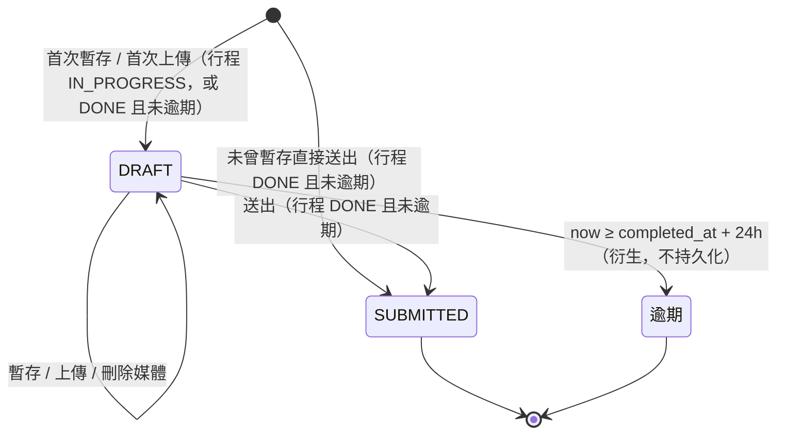

# PRD-022: 行程照護日誌與多媒體回報

| 項目 | 內容 |
|------|------|
| 狀態 | In Review |
| 建立日期 | 2026-05-23（2026-11-22 依 DOMAIN-BASELINE 第 2 版重寫） |
| 歸屬 SD | SD-FULFILL（`docs/sd/00-SD-PLAN.md` §0） |
| 測試情境 | TS-022 |
| 相依 PRD | PRD-008（行程 `PENDING → IN_PROGRESS`「開始行程」、`IN_PROGRESS → DONE`「結束行程」並寫 `completed_at`、`IN_PROGRESS` 逾時出口；本卡只消費行程狀態與 `completed_at`）；PRD-009（O11 飼主確認結案讀取本卡「日誌已送出」、O12 自動結案不看日誌、O13 爭議、O15 / O17 ADMIN 調解結案）；PRD-006（O2 報價時快照媒體額度）；PRD-012（訂閱等級與鎖定）；PRD-013（媒體保留期限、到期刪除與提示）；PRD-014（通知範本、「訂單事務」偏好） |
| 引用基準 | `docs/sa/00-DOMAIN-BASELINE.md` §1.1（角色、`ROLE_MISMATCH`）、§1.2（訂單可讀範圍、ADMIN 唯讀 `DISPUTED` / OPEN 待辦訂單、403 / 404 規則）、§2.1（照護回報媒體額度、媒體保留期限）、§2.2（報價時快照媒體額度 CQ-4 / CQ-20；訂閱鎖定不擋日誌 CQ-19）、§3.1–§3.2（`IN_PROGRESS` / `DISPUTED` / `COMPLETED` / `CANCELLED` 定義、O11 / O12 / O15、`DISPUTED` 期間行程照常 CQ-48 / CQ-57）、§3.6（鎖、版本 CQ-35、通知 outbox、冪等 CQ-51、外部 I/O）、§3.7（錯誤碼、判斷順序 CQ-70 / CQ-76、payload 共通欄位）、§5（`CARE_LOG_EDIT_HOURS`、`completion_basis_at`、媒體保留、UTC / Asia/Taipei）、§6（行程、照護日誌、有效行程） |

> 一張 PRD = 一個可獨立驗收的功能。子模組 AC ≤ 8 條，子模組 > 3 個就拆卡。
> 共用概念（角色、SaaS 額度、訂單狀態、時間起算點）只能**引用** DOMAIN-BASELINE，不得在這裡重新定義；要改就改 baseline。

---

## 1. 背景與目的

保母每次到府（一個行程）都要向飼主回報毛孩近況（BR §2.3「服務執行面板」、§5.2）。本卡定義「照護日誌」：一個行程一份，保母在行程進行中或結束後 `CARE_LOG_EDIT_HOURS`（24h）內撰寫文字並上傳照片 / 影片，送出後飼主可見並收到通知。媒體數量依**訂單報價時快照的訂閱等級**限制（baseline §2.1、§2.2），以控管儲存成本。

主流程定案（baseline CQ-27、CQ-40；PRD-008 / PRD-009 同步改寫）：保母按「結束行程」→ 行程 `DONE`、寫 `completed_at`（PRD-008）→ 24h 內編輯並送出日誌（本卡）→ 飼主才能手動確認結案（O11，PRD-009）；自動結案（O12）不看日誌。**行程 `DONE` 不以日誌送出為前提**，取代原 PRD-008「送出報告才 DONE」。

行程檢核表（SOP 勾選）與「開始 / 結束行程」屬 PRD-008；媒體保留期限與到期刪除屬 PRD-013，本卡只引用。

## 2. 使用者故事

- **US-1** 身為保母，我希望在行程進行中就能先記錄文字與照片並暫存，以便結束後整理送出。
- **US-2** 身為保母，我希望在同一天有多個行程時替日誌取名（例如「早上服務」「晚上服務」），以便飼主分辨（BR §5.2）。
- **US-3** 身為保母，我希望依這張訂單成立時的方案額度上傳照片與影片，並能在送出前刪掉拍糊的媒體換新的。
- **US-4** 身為飼主，我希望在保母送出日誌後收到通知並查看文字與媒體，草稿不會被我看到。
- **US-5** 身為保母，我希望清楚知道日誌送出期限，逾期後草稿鎖定。

## 3. 角色與權限

| 動作 | OWNER | SITTER | ADMIN | 匿名 | 方案限制 |
|------|-------|--------|-------|------|---------|
| 暫存草稿（標題、文字） | ✗ 403 `ROLE_MISMATCH` | 本人訂單 | ✗ 403 `ROLE_MISMATCH` | ✗ 401 | 無（四級皆可文字）；訂閱鎖定 / 停權不擋（§2.2、CQ-19） |
| 送出日誌 | ✗ 403 `ROLE_MISMATCH` | 本人訂單 | ✗ 403 `ROLE_MISMATCH` | ✗ 401 | 同上 |
| 上傳媒體 | ✗ 403 `ROLE_MISMATCH` | 本人訂單 | ✗ 403 `ROLE_MISMATCH` | ✗ 401 | 依**訂單快照**的媒體額度（BR-9） |
| 刪除媒體 | ✗ 403 `ROLE_MISMATCH` | 本人訂單 | ✗ 403 `ROLE_MISMATCH` | ✗ 401 | 無 |
| 讀取日誌（保母視角，含草稿與逾期草稿） | ✗ 403 `ROLE_MISMATCH` | 本人訂單 | ✗ 403 `ROLE_MISMATCH` | ✗ 401 | 無 |
| 讀取已送出日誌與媒體 | 本人訂單（僅 `SUBMITTED`，BR-16） | 本人訂單 | 可讀訂單範圍內唯讀（`DISPUTED` 或有 OPEN 待辦，§1.2），僅 `SUBMITTED` | ✗ 401 | 無 |

- 「本人訂單」= 該行程所屬訂單的 owner / sitter，以 token 身分判斷；存在但不屬於呼叫者 → 403 `FORBIDDEN`；不存在 → 404 `NOT_FOUND`；token `currentRole` 與端點要求不符 → 403 `ROLE_MISMATCH`（§1.1、§1.2）。同一帳號兼具 OWNER / SITTER 時，以 OWNER token 呼叫保母端點一律 `ROLE_MISMATCH`。
- 路徑上的媒體不屬於路徑上的日誌 / 行程，或行程不屬於路徑上的訂單 → 404 `NOT_FOUND`，以路徑上層資源為準。
- **錯誤判斷順序**（多個錯誤同時成立時回第一個；依 baseline §3.7，CQ-70、CQ-76），本卡端點對應如下：
  1. 401 `UNAUTHENTICATED`
  2. 冪等回放（同使用者、同端點、同 key、同內容；只有上傳與送出帶 key，BR-21）
  3. 403 `ROLE_MISMATCH`
  4. 404 `NOT_FOUND`（含路徑資源不相屬；OWNER / ADMIN 讀取非 `SUBMITTED` 日誌，BR-16）
  5. 403 `FORBIDDEN`（非訂單當事人；ADMIN 不在可讀範圍）
  6. 400 `VALIDATION_FAILED`（標題 / 文字 / 說明文字長度、缺檔案、多於 1 檔、缺 `Idempotency-Key`）
  7. 422 `IDEMPOTENCY_KEY_REUSED` / 409 `IDEMPOTENCY_IN_PROGRESS`
  8. 409 `ORDER_STATE_CONFLICT`（訂單非 `IN_PROGRESS` / `DISPUTED`，BR-4）
  9. 409 `VISIT_STATE_CONFLICT` → 409 `CARE_LOG_STATE_CONFLICT`（模組碼，CQ-3）
  10. 409 `DEADLINE_PASSED`（`deadline=CARE_LOG_EDIT_ENDS_AT`，CQ-2）
  11. 422 業務規則（模組碼）：`CARE_LOG_CONTENT_EMPTY`、`CARE_LOG_MEDIA_TYPE_UNSUPPORTED`、`CARE_LOG_MEDIA_TOO_LARGE`、`CARE_LOG_VIDEO_DURATION_INVALID`、`CARE_LOG_MEDIA_QUOTA_EXCEEDED`（依此順序）
  - 409 `ORDER_BUSY` 只在取得訂單鎖時發生；503 `STORAGE_UNAVAILABLE` 只在以上全部通過後的 GCS 呼叫發生。本卡不使用 403 `PLAN_REQUIRED`（額度依快照，升級無法解除，CQ-1）。
  - 依此得出的唯一結果（AC 以此為準）：已送出且已逾期的日誌再暫存 → `CARE_LOG_STATE_CONFLICT`；已送出的日誌暫存 1001 字 → 400 `VALIDATION_FAILED`；已逾期且額度已滿時上傳 → `DEADLINE_PASSED`；他人訂單的保母對已送出日誌暫存 → 403 `FORBIDDEN`；訂單 `COMPLETED` 且已逾期 → `ORDER_STATE_CONFLICT`。

## 4. 主流程

> 範例：行程日期 2026-11-25；保母 2026-11-25 10:00（台北）開始行程、11:00 結束 → `completed_at = 2026-11-25T03:00:00Z`，編輯期限 `completed_at + CARE_LOG_EDIT_HOURS = 2026-11-26T03:00:00Z`（台北 11/26 11:00）。

### 4.1 開放條件與草稿

1. 保母在行程詳情（服務執行面板）看到「照護日誌」區塊。**可編輯**（暫存、上傳、刪除）須同時符合（BR-3、BR-4、BR-5）：
   - 訂單為 `IN_PROGRESS` 或 `DISPUTED`；
   - 行程為 `IN_PROGRESS`，或行程為 `DONE` 且 `receivedAt < completed_at + CARE_LOG_EDIT_HOURS`；
   - 日誌不存在或為 `DRAFT`。
   不符時畫面不顯示編輯輸入與按鈕；行程 `PENDING` / `CLOSED_BY_SYSTEM` / `CANCELLED` 時整個區塊不顯示編輯入口。
2. 日誌欄位（BR-6、BR-7）：
   - 標題（選填，去前後空白後 1–30 字；空白存為 null，畫面顯示「{行程日期 YYYY-MM-DD} 行程」）；
   - 文字日誌（多行，最多 1000 字）：輸入框下方即時顯示「目前字數 / 1000」（`sitter-care-log-text-counter`），達 1000 字時不允許再輸入；
   - 媒體列表（§4.3）。
3. 保母按「暫存草稿」（`sitter-care-log-btn-save`），送出標題與文字（整份覆寫）。系統：鎖訂單列（§3.6，經 SD-ORDER 鎖入口，BR-20）→ 重驗可編輯條件 → 該行程尚無日誌時建立 `DRAFT`（一行程一份，唯一，BR-2），否則更新 → 提交，回傳最新內容。
4. **首次上傳媒體**也會在同一交易建立 `DRAFT`（§4.3）；首次暫存與首次上傳同時送達時，只會有 1 份日誌（BR-2）。
5. **未暫存文字保護**：保母尚未暫存的輸入，不得因上傳 / 刪除媒體後的畫面重新整理被伺服器上的舊內容覆蓋；只有暫存或送出成功才以伺服器內容為準（BR-8）。

### 4.2 送出

1. 行程 `IN_PROGRESS` 時「送出日誌」（`sitter-care-log-btn-submit`）停用並顯示「行程結束後才能送出」；行程 `DONE` 且未逾期時啟用，旁邊顯示「請於 {期限 YYYY-MM-DD HH:mm} 前送出」（`sitter-care-log-deadline`，Asia/Taipei）。
2. 保母按送出（帶 `Idempotency-Key`，body 含目前畫面上的標題與文字）。系統：
   1. 冪等查詢（§3.6）；
   2. 授權、欄位驗證；
   3. 鎖訂單列 → 重驗訂單 `IN_PROGRESS` / `DISPUTED`、行程 `DONE`、日誌不存在或 `DRAFT`、`receivedAt < completed_at + CARE_LOG_EDIT_HOURS`、文字去空白後 ≥ 1 字（BR-10）；
   4. 日誌不存在時建立；以 body 覆寫標題與文字；`DRAFT → SUBMITTED`，寫 `submitted_at`；寫 `order_logs`（`CARE_LOG_SUBMITTED`，BR-19）；`enqueue` 飼主站內通知（BR-17）；提交。
3. 送出後日誌永久唯讀：不可再暫存、上傳、刪除、再送出；不會回到 `DRAFT`（BR-11）。
4. 送出即滿足 O11「該 `DONE` 行程日誌已送出」條件（PRD-009）；不影響行程狀態與 `completion_basis_at`（`DONE` 行程結束時間固定為 `completed_at + CARE_LOG_EDIT_HOURS`，baseline §5）。

### 4.3 媒體上傳

1. 上傳區（`sitter-care-log-btn-upload`、`sitter-care-log-input-file`）顯示本行程額度與已用量（`sitter-care-log-quota`，例「照片 3 / 5　影片 0 / 0」）。額度取**訂單報價時快照**的媒體額度（BR-9），不看保母當下等級：
   - 快照為 FREE（照片 0、影片 0）：不顯示上傳按鈕，顯示「此訂單方案僅支援文字回報」；
   - 某類型已用量 = 額度：選擇該類型檔案時前端擋下並顯示「此行程{照片 / 影片}額度已用完」，不發出請求。
2. 每次請求上傳 1 個檔案，可附說明文字（選填，≤ 100 字）；前端多選時逐一依序上傳（BR-14）。
3. 前端送出前檢查（BR-12、BR-13）：
   - 照片：先轉為 WebP 壓縮；壓縮後仍 ≥ 1 MB → 顯示「照片需小於 1MB」，不送出；
   - 影片：格式 MP4 / MOV、長度 15–30 秒（以瀏覽器讀取時長）、< 50 MB；不符顯示「影片需為 MP4 / MOV、長度 15–30 秒、小於 50MB」，不送出。
4. 送出（帶 `Idempotency-Key`）。伺服器記下收到請求的時間 `receivedAt`（期限以此判斷，BR-5）。系統依序：
   1. 冪等查詢：同 key 同內容 → 回放第一次結果，不再上傳 GCS；
   2. 授權與狀態 / 期限預檢（不取鎖）；
   3. 欄位與檔案驗證（格式、大小、影片時長）、額度預檢（已用量 + 1 ≤ 快照額度）；
   4. 步驟 2–3 全部在 GCS 上傳前完成，不通過即回錯誤、不寫 GCS；
   5. GCS 上傳私有物件（交易外，§3.6）；
   6. 交易內：鎖訂單列 → 重驗可編輯條件（期限仍以 `receivedAt` 判斷）與額度；
   7. 日誌不存在時建立 `DRAFT`；新增媒體紀錄（類型、物件鍵、大小、影片時長、說明文字、上傳時間）；寫 `order_logs`（`MEDIA_UPLOADED`，含物件鍵、類型、大小，BR §5.4.2）；提交；
   8. 步驟 6–7 失敗 → 刪除步驟 5 的物件（孤兒檔由清除排程兜底）。
5. 上傳成功後回傳該媒體與最新已用量；前端保留輸入框中未暫存的文字（§4.1-5）。

### 4.4 媒體刪除

1. 可編輯期間（§4.1-1），每個媒體顯示刪除鈕（`sitter-care-log-btn-delete-media-{mediaId}`）。
2. 保母刪除 → 鎖訂單列、重驗可編輯條件 → 刪除媒體紀錄（不再計入已用量，額度立即釋放）、寫 `order_logs`（`MEDIA_DELETED`）、提交 → 交易後刪除 GCS 物件；物件刪除失敗不影響結果，由孤兒檔排程清除（BR-15、§3.6）。
3. 說明文字上傳後不可修改，要改就刪除重傳（CQ-12）。

### 4.5 檢視與逾期

1. **保母**：任何狀態都可讀自己的日誌。`DRAFT` 且已過 `completed_at + CARE_LOG_EDIT_HOURS` → 畫面標示「已逾期，未送出」（`sitter-care-log-status`），只顯示已暫存的標題、文字與已上傳媒體，無任何輸入與按鈕（BR-5）。
2. **逾期是時間判斷的衍生結果**：資料庫只存 `DRAFT` / `SUBMITTED`，不寫 `EXPIRED`，不建排程（沿用原 PRD-022 B.2）；API 回應以衍生欄位標示是否逾期與期限時間。
3. **飼主**：訂單詳情的行程清單中，日誌為 `SUBMITTED` 的行程顯示「查看日誌」（`owner-visit-btn-view-log-{visitId}`），開啟後（`owner-care-log-view`）顯示標題、文字、媒體與說明文字、送出時間（Asia/Taipei `YYYY-MM-DD HH:mm`）。`DRAFT`（含逾期草稿）一律不顯示入口，API 回 404（BR-16）。訂單 `IN_PROGRESS`、`DISPUTED`、`COMPLETED` 皆可查看（沿用原 PRD-009 A.4）。
4. 媒體檔以授權後產生的短效簽名網址讀取（BR-18）；保留期限與到期後「檔案已逾期移除」提示依 PRD-013。
5. **ADMIN**：可讀訂單範圍內唯讀查看 `SUBMITTED` 日誌與媒體，無編輯入口。

## 5. 狀態轉移

> 本卡只改變「照護日誌」的狀態，不造成訂單或行程轉移。行程 `DONE` 由 PRD-008 觸發；O11 讀取本卡結果（PRD-009）。

| # | 實體 | 從 | 到 | 觸發者 | 前置條件 | 不符時錯誤碼 |
|---|------|----|----|-------|---------|-------------|
| L1 | care log | （不存在） | `DRAFT` | SITTER（首次暫存或首次上傳成功） | 訂單 `IN_PROGRESS` / `DISPUTED`；行程 `IN_PROGRESS`，或 `DONE` 且 `receivedAt < completed_at + 24h`；同行程無日誌（唯一） | 409 `ORDER_STATE_CONFLICT` / `VISIT_STATE_CONFLICT` / `DEADLINE_PASSED` |
| L2 | care log | `DRAFT` | `DRAFT` | SITTER（暫存、上傳、刪除媒體） | 同 L1；上傳另需額度未滿 | 同 L1；409 `CARE_LOG_STATE_CONFLICT`（已送出）；422 `CARE_LOG_MEDIA_*` |
| L3 | care log | `DRAFT` 或（不存在） | `SUBMITTED` | SITTER（送出） | 訂單 `IN_PROGRESS` / `DISPUTED`；行程 `DONE`；`receivedAt < completed_at + 24h`；文字去空白後 ≥ 1 字 | 409 `ORDER_STATE_CONFLICT` / `VISIT_STATE_CONFLICT` / `CARE_LOG_STATE_CONFLICT` / `DEADLINE_PASSED`；422 `CARE_LOG_CONTENT_EMPTY` |
| L4 | care log | `DRAFT` | （衍生）逾期 | 時間 | `now ≥ completed_at + 24h`；不寫入資料庫 | — |

## 6. 業務規則

| # | 規則 | 出處 |
|---|------|------|
| BR-1 | 照護日誌狀態只持久化 `DRAFT`、`SUBMITTED`；「逾期」為時間衍生，不寫入、不建排程 | 沿用原 PRD-022 B.2、B.3 |
| BR-2 | 一個行程最多一份日誌（唯一）；首次暫存或首次上傳時建立 `DRAFT`；同時送達只建 1 份 | baseline §6「照護日誌」；沿用原 PRD-022 A.1 |
| BR-3 | 可編輯的行程狀態：`IN_PROGRESS`，或 `DONE` 且未逾期；`PENDING`（BR 舊稱 `SCHEDULED`，baseline §6 改名）、`CLOSED_BY_SYSTEM`、`CANCELLED` 不可建立 / 編輯 → 409 `VISIT_STATE_CONFLICT`（payload `currentVisitStatus`）。送出只限行程 `DONE`，`IN_PROGRESS` 送出 → 409 `VISIT_STATE_CONFLICT` | 沿用原 PRD-022 A.2；baseline §6、CQ-40；呼叫方交辦主流程定案 2026-11-22；錯誤碼 CQ-3 |
| BR-4 | 可編輯的訂單狀態：`IN_PROGRESS`、`DISPUTED`（爭議期間行程照常）；其餘（含 ADMIN 調解後的 `COMPLETED` / `CANCELLED`）→ 409 `ORDER_STATE_CONFLICT`（payload `currentStatus`）。O11 要求日誌已送出、O12 晚於編輯期限，故一般流程下結案時不會有可編輯的草稿；唯一例外是 O15 調解結案，其後草稿即鎖定 | baseline §3.2 O11、O12、O15、CQ-48、CQ-57；沿用原 PRD-022 例外表「訂單已結案拒絕」；CQ-16 |
| BR-5 | 編輯期限 = `completed_at + CARE_LOG_EDIT_HOURS`（24h）。以伺服器收到請求的時間 `receivedAt` 判斷：`receivedAt ≥ 期限` → 409 `DEADLINE_PASSED`（payload `deadline=CARE_LOG_EDIT_ENDS_AT`、`deadlineAt=<期限>`），適用暫存、上傳、刪除、送出；之後 `DRAFT` 對保母唯讀、對飼主永不可見、不發通知 | baseline §5 `CARE_LOG_EDIT_HOURS`、§3.2「期限一律以時間判斷」、§3.7 payload；沿用原 PRD-022 B.2；CQ-2、CQ-9 |
| BR-6 | 標題選填，去前後空白後 1–30 字，空白存 null；null 時顯示「{行程日期} 行程」 | BR §5.2「可編輯日誌名稱」；長度與預設顯示 CQ-4 |
| BR-7 | 文字日誌最多 1000 字（超過 → 400 `VALIDATION_FAILED`），前端顯示「目前字數 / 1000」且達上限禁止輸入；媒體說明文字選填、最多 100 字 | 沿用原 PRD-022 A.3 |
| BR-8 | 未暫存的輸入不得被上傳 / 刪除後的畫面更新覆蓋；暫存或送出成功才以伺服器內容為準 | 沿用原 PRD-022 A.2 |
| BR-9 | 媒體額度 = 訂單於 O2 報價時快照的訂閱等級額度（每行程，照片與影片分別計算）：FREE 0 照片 + 0 影片；BASIC 5 照片 + 0 影片；PRO 10 照片 + 2 影片；ULTIMATE 25 照片 + 5 影片。保母之後升降級不影響；不讀方案層 `maxPhotos`。超過 → 422 `CARE_LOG_MEDIA_QUOTA_EXCEEDED`（payload `mediaType`、`limit`、`used`） | baseline §2.1、§2.2、CQ-4、CQ-20；PRD-006 BR-8；錯誤碼 CQ-1 |
| BR-10 | 送出時文字日誌去空白後至少 1 字，否則 422 `CARE_LOG_CONTENT_EMPTY`；暫存不檢查 | CQ-5 |
| BR-11 | 送出後永久唯讀，不回 `DRAFT`；任何寫入 → 409 `CARE_LOG_STATE_CONFLICT` | 沿用原 PRD-022 B.1、資料規則；錯誤碼 CQ-3 |
| BR-12 | 照片格式 JPEG / PNG / WebP，單檔 < 1 MB（1,048,576 bytes）；前端上傳前轉 WebP 壓縮；不符格式 → 422 `CARE_LOG_MEDIA_TYPE_UNSUPPORTED`，超過大小 → 422 `CARE_LOG_MEDIA_TOO_LARGE` | 沿用原 PRD-022 A.4；SAAS「技術實作建議」（WebP、< 1MB）；CQ-6、CQ-7 |
| BR-13 | 影片格式 MP4 / MOV，長度 15–30 秒（含端點，時長四捨五入至整數秒），單檔 < 50 MB（52,428,800 bytes）；長度不符 → 422 `CARE_LOG_VIDEO_DURATION_INVALID`；格式 / 大小同 BR-12 錯誤碼；只有快照額度含影片（PRO / ULTIMATE）才能上傳 | 沿用原 PRD-022 A.4；SAAS「影片限制在 15-30 秒」；CQ-7 |
| BR-14 | 每次上傳請求恰好 1 個檔案（0 或 > 1 → 400 `VALIDATION_FAILED`）；BR §5.4.2 的單次上傳檔案數參數本卡取 1、單次容量即 BR-12 / BR-13 單檔上限 | BR §5.4.2；CQ-8 |
| BR-15 | 可編輯期間可刪除媒體，刪除後立即不計入額度；GCS 物件於交易後刪除，失敗由孤兒檔排程清除；送出後與逾期後不可刪除 | 沿用原 PRD-022 A.5；baseline §3.6 外部 I/O |
| BR-16 | 飼主與 ADMIN 只能讀 `SUBMITTED` 日誌；讀非 `SUBMITTED`（含逾期草稿）一律 404 `NOT_FOUND`，畫面不顯示入口。ADMIN 只限 §1.2 可讀訂單範圍 | 沿用原 PRD-022 AC-1.2、B.2；baseline §1.2、CQ-18；回應碼 CQ-10 |
| BR-17 | 送出時同交易 `enqueue` 飼主站內通知 1 則：「{行程日期 YYYY-MM-DD} 的行程日誌已由保母回報，快來看看毛孩的近況吧！」；日期為行程日期（Asia/Taipei）。屬 PRD-014「訂單事務」類別，依使用者偏好；草稿、暫存、上傳、逾期不發通知 | 沿用原 PRD-022 B.4；baseline §3.6 通知 outbox；PRD-014 §2「訂單事務：服務報告送達」 |
| BR-18 | 媒體為 GCS 私有物件，只透過授權後產生的短效簽名網址讀取，有效期 15 分鐘；簽名網址不寫入冪等回放 body | baseline §3.6；有效期 CQ-11 |
| BR-19 | `order_logs` 寫入：`MEDIA_UPLOADED`（物件鍵、類型、大小）、`MEDIA_DELETED`、`CARE_LOG_SUBMITTED`，皆與該寫入同交易；暫存草稿不寫 | BR §5.4.2（上傳）；BR §5.8（訂單動態來源）；CQ-13 |
| BR-20 | 暫存、上傳交易、刪除、送出一律先經 SD-ORDER 鎖入口鎖訂單列（`lock_timeout 3s`，逾時 409 `ORDER_BUSY` + `Retry-After: 1`），以與行程轉移（PRD-008 結束行程、殭屍清理）、O11、O15 序列化，並保證額度檢查不超賣 | baseline §3.6「鎖」；CQ-15 |
| BR-21 | 上傳與送出必帶 `Idempotency-Key`（缺 → 400 `VALIDATION_FAILED`，`field=Idempotency-Key`），行為依 baseline §3.6（multipart hash 含檔案 SHA-256；同 key 同內容回放第一次狀態碼與 body；同 key 不同內容 422 `IDEMPOTENCY_KEY_REUSED`；處理中 409 `IDEMPOTENCY_IN_PROGRESS`；5xx 與 `ORDER_BUSY` 不記錄）。冪等查詢在 GCS 上傳前。暫存（整份覆寫）與刪除不帶 key：重送暫存結果相同；重送刪除回 404 `NOT_FOUND`，前端視為已刪除 | baseline §3.6、CQ-51；沿用原 PRD-022 AC-2.2（改為回放，取代 409 `IDEMPOTENCY_CONFLICT`）；暫存 / 刪除 CQ-17 |
| BR-22 | 不接受客戶端 version；暫存為整份覆寫（後寫者為準）；日誌實體保留 `@Version` 作最後防線，觸發時回 409 `ORDER_BUSY`。同一保母多裝置 / 舊分頁互相覆蓋不處理 | baseline §3.6「版本」、CQ-35、§3.7；doc-conventions「不處理同一使用者多裝置自我併發」 |
| BR-23 | 訂閱逾期 / 停權不擋本卡任何操作（屬既有訂單） | baseline §2.2、CQ-19 |
| BR-24 | 日誌與媒體紀錄記錄 `created_by`、`updated_by`、建立 / 更新 / 送出時間；時間 UTC 儲存、ISO-8601 傳輸，畫面以 Asia/Taipei `YYYY-MM-DD HH:mm` 顯示 | baseline §5；沿用原 PRD-022 資料規則 |
| BR-25 | 媒體保留期限依訂單快照（baseline §2.1，自訂單結案日起），到期刪除與提示依 PRD-013；逾期未送出的草稿媒體同樣依 PRD-013，飼主不可見 | baseline §2.1、§5；PRD-013；CQ-14 |
| BR-26 | 多錯誤同時成立時依 §3「錯誤判斷順序」回第一個 | baseline §3.7、CQ-70、CQ-76 |

## 7. 例外處理

| # | 情境 | 系統行為 | HTTP / 錯誤碼 | 使用者看到 |
|---|------|---------|--------------|-----------|
| EX-1 | 非訂單當事人讀寫日誌 / 媒體（BOLA，含他人訂單的保母） | 拒絕，不改資料、不寫 GCS | 403 `FORBIDDEN` | 「無權限操作此行程」 |
| EX-2 | 行程 / 日誌 / 媒體不存在，或路徑資源不相屬 | 拒絕 | 404 `NOT_FOUND` | 「找不到此行程」 |
| EX-3 | 飼主或 ADMIN 呼叫保母端寫入；以 OWNER token 呼叫保母端點 | 拒絕 | 403 `ROLE_MISMATCH` | 「請切換至正確角色」 |
| EX-4 | 未登入 | 拒絕 | 401 `UNAUTHENTICATED` | 導向登入 |
| EX-5 | 標題 > 30 字、文字 > 1000 字、說明 > 100 字、缺檔案 / 多於 1 檔、上傳或送出缺 `Idempotency-Key` | 拒絕，不寫 GCS | 400 `VALIDATION_FAILED` | 欄位下方錯誤訊息 |
| EX-6 | 訂單非 `IN_PROGRESS` / `DISPUTED`（含 O15 調解結案後的草稿） | 拒絕 | 409 `ORDER_STATE_CONFLICT`（`currentStatus`） | 「訂單已結束，無法編輯日誌」 |
| EX-7 | 行程 `PENDING` / `CLOSED_BY_SYSTEM` / `CANCELLED` 時寫入；行程 `IN_PROGRESS` 時送出 | 拒絕，不建立日誌 | 409 `VISIT_STATE_CONFLICT`（`currentVisitStatus`） | 前端不提供入口；送出鈕停用「行程結束後才能送出」 |
| EX-8 | 日誌已 `SUBMITTED` 時暫存 / 上傳 / 刪除 / 以新 key 送出 | 拒絕 | 409 `CARE_LOG_STATE_CONFLICT` | 畫面無編輯元素；API 直呼回錯誤 |
| EX-9 | `receivedAt ≥ completed_at + 24h` 時任何寫入（無排程，草稿仍為 `DRAFT`） | 拒絕，不寫 GCS | 409 `DEADLINE_PASSED`（`deadline=CARE_LOG_EDIT_ENDS_AT`、`deadlineAt`） | 「已超過日誌送出期限」；畫面改為唯讀「已逾期，未送出」 |
| EX-10 | 送出時文字去空白後為空 | 拒絕，狀態不變 | 422 `CARE_LOG_CONTENT_EMPTY` | 「請填寫日誌內容後再送出」 |
| EX-11 | SaaS 方案不足：快照額度為 0（FREE 傳任何媒體、BASIC 傳影片）或已用滿 | 前端不提供 / 擋下；後端拒絕，不寫 GCS | 422 `CARE_LOG_MEDIA_QUOTA_EXCEEDED`（`mediaType`、`limit`、`used`） | FREE：「此訂單方案僅支援文字回報」；用滿：「此行程{照片 / 影片}額度已用完」 |
| EX-12 | 檔案格式不支援（照片非 JPEG / PNG / WebP；影片非 MP4 / MOV） | 拒絕，不寫 GCS | 422 `CARE_LOG_MEDIA_TYPE_UNSUPPORTED` | 「照片僅支援 JPG、PNG、WebP；影片僅支援 MP4、MOV」 |
| EX-13 | 照片 ≥ 1 MB / 影片 ≥ 50 MB | 前端先擋；後端拒絕，不寫 GCS | 422 `CARE_LOG_MEDIA_TOO_LARGE` | 「照片需小於 1MB」/「影片需小於 50MB」 |
| EX-14 | 影片長度 < 15 秒或 > 30 秒 | 前端先擋；後端拒絕，不寫 GCS | 422 `CARE_LOG_VIDEO_DURATION_INVALID` | 「影片長度需為 15–30 秒」 |
| EX-15 | 重複送出：同 key 同內容（上傳 / 送出） | 回放第一次狀態碼與 body（不含簽名網址），不新增媒體、不重複上傳 GCS、不重發通知 | 同第一次（201 / 200） | 同第一次 |
| EX-16 | 同 key 不同內容 / 同 key 處理中 | 拒絕 | 422 `IDEMPOTENCY_KEY_REUSED` / 409 `IDEMPOTENCY_IN_PROGRESS` | 「請重新送出」/「處理中，請稍候」 |
| EX-17 | 額度剩 1 時兩筆上傳（不同 key）同時進行 | 訂單列鎖序列化；後到者交易內額度重驗失敗，刪除已上傳物件 | 一筆 201；另一筆 422 `CARE_LOG_MEDIA_QUOTA_EXCEEDED` | 後者「此行程照片額度已用完」 |
| EX-18 | 跨角色競爭：保母送出 vs ADMIN 調解結案（O15）；保母送出 vs 飼主確認結案（O11） | 訂單列鎖序列化 | O15 先 → 送出 409 `ORDER_STATE_CONFLICT`；送出先 → O15 照常。O11 先 → O11 回 409 `VISITS_NOT_FINISHED`（PRD-009）；送出先 → O11 成功 | 依錯誤碼 |
| EX-19 | 訂單鎖等待 > 3 秒；`@Version` 衝突 | 拒絕，不記冪等結果，可重試 | 409 `ORDER_BUSY` + `Retry-After: 1` | 「系統忙碌，請稍後再試」 |
| EX-20 | 樂觀鎖衝突（舊畫面覆蓋新草稿） | 不適用：不接受客戶端 version，同一保母自我併發不處理；跨角色無人可寫日誌（BR-22） | — | — |
| EX-21 | GCS 上傳失敗 | 不開交易；無媒體紀錄、未建立日誌、額度不變；不記冪等結果 | 503 `STORAGE_UNAVAILABLE`（模組碼，與 PRD-007 同名） | 「儲存服務暫時無法使用，請稍候重試」；保留已選檔案，可按重試（同 key） |
| EX-22 | GCS 上傳成功但交易失敗（含額度 / 期限 / 狀態重驗失敗） | 回滾並刪除剛上傳物件；刪除失敗由孤兒檔排程清除 | 依失敗原因 | 依錯誤碼 |
| EX-23 | 刪除媒體時 GCS 物件刪除失敗 | 紀錄已刪、額度已釋放；物件由孤兒檔排程清除 | 200 | 媒體自列表消失 |
| EX-24 | 產生簽名網址失敗 | 不影響任何狀態 | 503 `STORAGE_UNAVAILABLE` | 「媒體暫時無法載入」 |
| EX-25 | Resend 寄送失敗 | 不適用：本卡通知只有站內（BR-17），經 outbox 同交易寫入，無外部寄送 | — | — |
| EX-26 | 訂單 `DISPUTED`、保母訂閱鎖定 / 停權 | 照常允許（BR-4、BR-23） | 200 / 201 | 正常 |

## 8. 驗收標準（AC）

> 範例日期見 §4：`completed_at = 2026-11-25T03:00:00Z`，期限 `2026-11-26T03:00:00Z`（台北 11/26 11:00）。訂單 A 屬於飼主 O1 / 保母 S1，訂單狀態 `IN_PROGRESS`，除非另註明。
> 多情境 AC 於 TS 撰寫時每個 Given 拆成獨立步驟並標同一 AC 編號。

### 子模組 1：日誌草稿、送出與逾期鎖定

- [ ] **AC-1.1 (開放條件)**：Given 訂單 A `IN_PROGRESS`、行程 V2 `PENDING`，When S1 開啟 V2，Then 無 `sitter-care-log-btn-save`；S1 直接呼叫暫存 API → 409 `VISIT_STATE_CONFLICT`（`currentVisitStatus = "PENDING"`），V2 無日誌；Given V2 為 `CLOSED_BY_SYSTEM` 或 `CANCELLED`，Then 同樣 409 `VISIT_STATE_CONFLICT`；Given 訂單 `CONFIRMED`（尚無行程開始），Then 暫存回 409 `ORDER_STATE_CONFLICT`（`currentStatus = "CONFIRMED"`）；Given 行程 V1 `IN_PROGRESS`，Then 顯示日誌區塊與 `sitter-care-log-btn-save`。對應：L1、BR-3、BR-4、EX-6、EX-7
- [ ] **AC-1.2 (首次暫存建立草稿與唯一性)**：Given V1 `IN_PROGRESS` 且無日誌，When S1 輸入標題「早上服務」、文字「乾乾吃完半碗」並按 `sitter-care-log-btn-save`，Then 200，V1 有 1 份日誌、狀態 `DRAFT`、內容同輸入；When 再改文字暫存，Then 仍只有 1 份、內容為新文字；Given V1 無日誌，When 首次暫存與首次上傳照片同時送出，Then 兩者皆成功且 V1 只有 1 份 `DRAFT` 日誌、含該照片。對應：L1、L2、BR-2、BR-20
- [ ] **AC-1.3 (內容欄位)**：Given 可編輯，Then 文字框下方 `sitter-care-log-text-counter` 初始顯示「0 / 1000」；輸入 1000 字後顯示「1000 / 1000」且無法再輸入；直接呼叫 API 暫存 1001 字 → 400 `VALIDATION_FAILED`，1000 字 → 200；標題 31 字 → 400，標題「   」→ 200 且存為 null、畫面顯示「2026-11-25 行程」；Given 輸入框有未暫存文字「未存」，When 上傳一張照片成功，Then 輸入框仍為「未存」。對應：BR-6、BR-7、BR-8、EX-5
- [ ] **AC-1.4 (送出限制與成功)**：Given V1 `IN_PROGRESS` 且有草稿，Then `sitter-care-log-btn-submit` 停用並顯示「行程結束後才能送出」，直接呼叫送出 → 409 `VISIT_STATE_CONFLICT`；Given V1 `DONE`（`completed_at` 如範例），Then 送出鈕啟用、`sitter-care-log-deadline` 顯示「請於 2026-11-26 11:00 前送出」；When 送出文字「已餵藥」，Then 200、日誌 `DRAFT → SUBMITTED`、`submitted_at` 有值、`order_logs` 新增 1 筆 `CARE_LOG_SUBMITTED`；Given V3 `DONE` 且從未暫存（FREE 保母），When 直接送出文字，Then 200 並建立 `SUBMITTED` 日誌；When 送出文字「   」，Then 422 `CARE_LOG_CONTENT_EMPTY`、日誌仍 `DRAFT`。對應：L3、BR-3、BR-10、BR-19、EX-7、EX-10
- [ ] **AC-1.5 (送出後唯讀)**：Given V1 日誌 `SUBMITTED`，When S1 開啟，Then 無任何輸入框、上傳、刪除、暫存、送出元素；S1 直接呼叫暫存、上傳（有效檔案）、刪除媒體、以新 key 送出 → 皆 409 `CARE_LOG_STATE_CONFLICT`，內容與媒體不變；Given 同上且已過期限，Then 仍回 409 `CARE_LOG_STATE_CONFLICT`（非 `DEADLINE_PASSED`）。對應：BR-11、BR-26、EX-8
- [ ] **AC-1.6 (24h 期限邊界)**：Given V1 `DONE`、日誌 `DRAFT`，When 伺服器於 2026-11-26T02:59:59Z 收到送出，Then 200 `SUBMITTED`；Given 另一份同條件草稿，When 伺服器於 2026-11-26T03:00:00Z 收到暫存、上傳、刪除或送出，Then 皆 409 `DEADLINE_PASSED`，payload `deadline = "CARE_LOG_EDIT_ENDS_AT"`、`deadlineAt = "2026-11-26T03:00:00Z"`，上傳時 GCS 無新物件；資料庫中日誌狀態仍為 `DRAFT`（無排程改寫）。Given 伺服器於 02:59:59Z 收到 40 MB 影片上傳、GCS 完成進交易時已過 03:00:00Z，Then 201（以 `receivedAt` 判斷）。對應：L4、BR-1、BR-5、EX-9
- [ ] **AC-1.7 (逾期草稿)**：Given V1 `DONE`、日誌 `DRAFT`（標題「早上服務」、2 張照片）且 `now ≥ 2026-11-26T03:00:00Z`，When S1 開啟，Then `sitter-care-log-status` 顯示「已逾期，未送出」，顯示標題、文字與 2 張照片，無任何輸入與按鈕；When O1 開啟訂單詳情，Then V1 無 `owner-visit-btn-view-log-{V1}`，直接呼叫讀取 → 404 `NOT_FOUND`；O1 自始至終未收到 V1 的日誌通知。對應：L4、BR-5、BR-16、EX-9
- [ ] **AC-1.8 (訂單狀態與訂閱鎖定)**：Given 訂單 `DISPUTED`、V1 `DONE` 未逾期、日誌 `DRAFT`，When S1 暫存與送出，Then 皆成功；Given S1 訂閱已逾期鎖定，Then 暫存、上傳、送出皆成功；Given ADMIN 已以 O15 將訂單調解為 `COMPLETED`、V1 `DONE` 未逾期、日誌 `DRAFT`，When S1 暫存或送出，Then 409 `ORDER_STATE_CONFLICT`（`currentStatus = "COMPLETED"`）；Given 同上且已逾期，Then 仍為 `ORDER_STATE_CONFLICT`。對應：BR-4、BR-23、BR-26、EX-6、EX-26

### 子模組 2：媒體上傳、額度與刪除

- [ ] **AC-2.1 (FREE 快照僅文字)**：Given 訂單快照等級 FREE、S1 目前已升級為 ULTIMATE、V1 `IN_PROGRESS`，When S1 開啟日誌，Then 無 `sitter-care-log-btn-upload`，`sitter-care-log-quota` 顯示「此訂單方案僅支援文字回報」；When S1 直接呼叫上傳 500 KB JPEG，Then 422 `CARE_LOG_MEDIA_QUOTA_EXCEEDED`，payload `mediaType = "IMAGE"`、`limit = 0`、`used = 0`，GCS 無新物件、V1 無日誌；暫存文字照常 200。對應：BR-9、EX-11
- [ ] **AC-2.2 (額度依快照逐級)**：Given 快照 BASIC，When 依序上傳 5 張照片，Then 皆 201、`sitter-care-log-quota` 顯示「照片 5 / 5　影片 0 / 0」；第 6 張 → 422 `CARE_LOG_MEDIA_QUOTA_EXCEEDED`（`limit = 5`、`used = 5`）；上傳 20 秒 MP4 → 422（`mediaType = "VIDEO"`、`limit = 0`）。Given 快照 PRO 且 S1 已降級為 FREE，Then 可上傳 10 張照片 + 2 支影片，第 11 張照片、第 3 支影片 → 422。Given 快照 ULTIMATE，Then 25 張 + 5 支皆 201，第 26 張、第 6 支 → 422。Given 快照 BASIC 且 S1 已升級 ULTIMATE，Then 第 6 張仍 422。對應：BR-9、BR-13、EX-11
- [ ] **AC-2.3 (照片格式與大小)**：Given 快照 PRO、可編輯，When 分別上傳 900 KB 的 JPEG、PNG、WebP，Then 皆 201；When 上傳 GIF 或 HEIC，Then 422 `CARE_LOG_MEDIA_TYPE_UNSUPPORTED`；When 直接呼叫 API 上傳 1,048,576 bytes 的 JPEG，Then 422 `CARE_LOG_MEDIA_TOO_LARGE`，1,048,575 bytes → 201；When 在畫面選 4 MB 相機 JPEG，Then 前端轉為 WebP 後上傳且伺服器收到的檔案 < 1 MB；壓縮後仍 ≥ 1 MB 時顯示「照片需小於 1MB」且不發出請求；以上被拒者 GCS 無新物件。對應：BR-12、EX-12、EX-13
- [ ] **AC-2.4 (影片格式、長度、大小)**：Given 快照 PRO、可編輯，When 上傳 MP4 15 秒、MOV 30 秒、MP4 20 秒 30 MB，Then 皆 201；When 直接呼叫 API 上傳 14 秒或 31 秒 MP4，Then 422 `CARE_LOG_VIDEO_DURATION_INVALID`；When 上傳 52,428,800 bytes 的 MP4（20 秒），Then 422 `CARE_LOG_MEDIA_TOO_LARGE`；When 上傳 WebM 或 AVI，Then 422 `CARE_LOG_MEDIA_TYPE_UNSUPPORTED`；When 在畫面選 31 秒影片，Then 顯示「影片長度需為 15–30 秒」且不發出請求。對應：BR-13、EX-12–EX-14
- [ ] **AC-2.5 (上傳成功與紀錄)**：Given 快照 BASIC、V1 `IN_PROGRESS` 且無日誌，When S1 上傳 800 KB WebP 並填說明「睡午覺」，Then 201，回應含媒體 ID、類型 `IMAGE`、說明「睡午覺」與已用量「照片 1 / 5」；V1 建立 `DRAFT` 日誌；`order_logs` 新增 1 筆 `MEDIA_UPLOADED`，含物件鍵、類型、大小；When 說明 101 字，Then 400 `VALIDATION_FAILED`、GCS 無新物件；When 一次附 2 個檔案或不附檔案，Then 400 `VALIDATION_FAILED`。對應：L1、BR-2、BR-7、BR-14、BR-19、EX-5
- [ ] **AC-2.6 (刪除與額度釋放)**：Given 快照 BASIC、草稿已有 5 張照片，When S1 按 `sitter-care-log-btn-delete-media-{m1}`，Then 200、m1 自列表消失、已用量「照片 4 / 5」、`order_logs` 新增 `MEDIA_DELETED`、GCS 物件被刪除；When 再上傳 1 張，Then 201、「照片 5 / 5」；When 以相同 m1 再呼叫刪除，Then 404 `NOT_FOUND`；When 以 V2 日誌路徑刪除 V1 的媒體，Then 404 `NOT_FOUND`；Given GCS 刪除物件失敗，Then 刪除仍回 200、額度已釋放。對應：L2、BR-15、BR-21、EX-2、EX-23
- [ ] **AC-2.7 (額度併發)**：Given 快照 BASIC、草稿已有 4 張照片，When S1 以兩個不同 key 同時上傳 2 張照片，Then 恰好 1 筆 201、另 1 筆 422 `CARE_LOG_MEDIA_QUOTA_EXCEEDED`（`used = 5`），最終媒體紀錄 5 筆，被拒那筆的 GCS 物件被刪除。對應：BR-20、EX-17、EX-22
- [ ] **AC-2.8 (GCS 失敗)**：Given GCS 回 5xx、V1 無日誌，When S1 上傳照片，Then 503 `STORAGE_UNAVAILABLE`、無媒體紀錄、V1 仍無日誌、已用量不變；畫面顯示「儲存服務暫時無法使用，請稍候重試」且保留已選檔案與重試按鈕；When GCS 恢復後以同 key 重試，Then 201；Given 訂單 `DISPUTED`、V1 `DONE` 未逾期，GCS 上傳成功後、進交易前訂單已被 ADMIN 以 O15 調解為 `COMPLETED`，Then 回 409 `ORDER_STATE_CONFLICT` 且剛上傳的物件被刪除、無媒體紀錄。對應：BR-21、EX-21、EX-22

### 子模組 3：飼主檢視、通知、權限與冪等

- [ ] **AC-3.1 (送出通知)**：Given O1 維持 PRD-014 預設偏好，When S1 送出 V1（行程日期 2026-11-25）日誌，Then O1 收到站內通知 1 則，內容「2026-11-25 的行程日誌已由保母回報，快來看看毛孩的近況吧！」，點擊開啟 V1 日誌；暫存、上傳、刪除、逾期皆不產生通知；Given O1 已關閉「訂單事務」類別，Then 送出成功但不產生該通知。對應：BR-17
- [ ] **AC-3.2 (飼主檢視)**：Given V1 日誌 `SUBMITTED`（標題「早上服務」、2 張照片含說明）、V2 日誌 `DRAFT`，When O1 開啟訂單詳情，Then V1 顯示 `owner-visit-btn-view-log-{V1}`、V2 不顯示；開啟 `owner-care-log-view` 顯示標題、文字、2 張照片與說明、送出時間（台北 `YYYY-MM-DD HH:mm`）；O1 呼叫讀取 V2 日誌 → 404 `NOT_FOUND`；媒體以簽名網址載入，簽發 15 分鐘後該網址被儲存服務拒絕、前端重新請求可取得新網址；訂單轉 `DISPUTED` 或 `COMPLETED` 後仍可查看 V1；媒體已依 PRD-013 刪除時顯示「檔案已逾期移除」。對應：BR-16、BR-18、BR-25、EX-24
- [ ] **AC-3.3 (越權)**：When 未帶 token 讀寫 V1 日誌，Then 401 `UNAUTHENTICATED`；When 他人訂單的保母 S2 讀取、暫存、上傳、刪除、送出，Then 403 `FORBIDDEN`；When 飼主 O2 讀 V1 已送出日誌，Then 403 `FORBIDDEN`；When O1 以 OWNER token 呼叫暫存 / 上傳 / 刪除 / 送出，Then 403 `ROLE_MISMATCH`；When ADMIN 呼叫任何寫入，Then 403 `ROLE_MISMATCH`；When 行程 ID 不存在，或以訂單 B 的路徑存取 V1，Then 404 `NOT_FOUND`；以上日誌與媒體皆不變、GCS 無新物件。對應：EX-1–EX-4
- [ ] **AC-3.4 (ADMIN 唯讀)**：Given 訂單 A `DISPUTED`、V1 `SUBMITTED`、V2 `DRAFT`，When ADMIN 讀 V1 日誌與媒體，Then 200 且畫面無編輯元素；讀 V2 → 404 `NOT_FOUND`；Given 訂單 C `IN_PROGRESS` 且無 OPEN 待辦，When ADMIN 讀其已送出日誌，Then 403 `FORBIDDEN`。對應：BR-16、EX-1
- [ ] **AC-3.5 (送出冪等)**：Given S1 以 key K 送出 V1 成功（200），When 以 K 與相同 body 重送，Then 回 200 與第一次相同的 body，`order_logs` 的 `CARE_LOG_SUBMITTED` 仍 1 筆、O1 通知仍 1 則；When 以 K 改送不同文字，Then 422 `IDEMPOTENCY_KEY_REUSED`；When 第一次仍處理中又以 K 送出，Then 409 `IDEMPOTENCY_IN_PROGRESS`；When 以新 key K2 送出，Then 409 `CARE_LOG_STATE_CONFLICT`；When 不帶 key，Then 400 `VALIDATION_FAILED`（`field = "Idempotency-Key"`）。對應：BR-21、EX-15、EX-16
- [ ] **AC-3.6 (上傳冪等)**：Given S1 以 key K 上傳照片成功（201），When 以 K 與相同檔案、相同說明重送，Then 回 201 與第一次相同 body（不含簽名網址），媒體紀錄仍 1 筆、GCS 物件仍 1 個、已用量只計 1；When 以 K 改傳不同檔案，Then 422 `IDEMPOTENCY_KEY_REUSED`；Given 第一次成功後已過期限，When 以 K 同內容重送，Then 仍回放 201（非 `DEADLINE_PASSED`）。對應：BR-21、BR-26、EX-15、EX-16
- [ ] **AC-3.7 (跨角色競爭與鎖逾時)**：Given 訂單 `DISPUTED`、V1 `DONE` 未逾期、日誌 `DRAFT`，When S1 送出與 ADMIN O15 調解結案同時送出，Then 依取得訂單鎖先後：送出先 → 日誌 `SUBMITTED`、訂單 `COMPLETED`；O15 先 → 訂單 `COMPLETED`、送出回 409 `ORDER_STATE_CONFLICT`、日誌仍 `DRAFT`；Given 訂單 `IN_PROGRESS`、全部行程 `DONE`、僅 V1 日誌未送出，When S1 送出與 O1 確認結案同時送出，Then 送出先 → O11 成功；O11 先 → O11 回 409 `VISITS_NOT_FINISHED`、送出成功；Given 訂單鎖被占用 > 3 秒，When S1 暫存，Then 409 `ORDER_BUSY` 且標頭 `Retry-After: 1`，同 key 的上傳 / 送出重試不被回放為該錯誤。對應：BR-4、BR-20、EX-18、EX-19
- [ ] **AC-3.8 (錯誤判斷順序)**：Given V1 日誌 `SUBMITTED` 且已過期限，When S1 暫存，Then 409 `CARE_LOG_STATE_CONFLICT`；When S1 暫存 1001 字，Then 400 `VALIDATION_FAILED`；When S2（他人保母）暫存，Then 403 `FORBIDDEN`；Given V2 `DRAFT`、已過期限、照片已用滿，When S1 上傳照片，Then 409 `DEADLINE_PASSED`；Given 訂單 `COMPLETED`（O15）且 V2 已過期限，When S1 暫存，Then 409 `ORDER_STATE_CONFLICT`；Given 快照 BASIC、可編輯，When 上傳 2 MB 的 GIF，Then 422 `CARE_LOG_MEDIA_TYPE_UNSUPPORTED`（格式先於大小）。對應：BR-26、§3 判斷順序

## 9. 影響範圍

| 面向 | 內容 |
|------|------|
| 資料 | 照護日誌（`visit_service_reports`）：行程（唯一）、標題、文字、狀態 `DRAFT` / `SUBMITTED`、`submitted_at`、`created_by` / `updated_by`、時間戳、`@Version`（最後防線）。日誌媒體（`service_report_media`）：日誌、類型 `IMAGE` / `VIDEO`、GCS 物件鍵、大小、影片時長、說明文字、上傳者、上傳時間；保留到期欄位由 PRD-013 定義。讀取：行程 `status` / `completed_at`（PRD-008）、訂單狀態與媒體額度快照（SD-ORDER）。寫入 `order_logs`（`MEDIA_UPLOADED`、`MEDIA_DELETED`、`CARE_LOG_SUBMITTED`）、`idempotency_keys`。DDL 在 SD-FULFILL |
| 畫面 | 保母：行程詳情（服務執行面板）的照護日誌區塊。飼主：訂單詳情行程清單的「查看日誌」與日誌檢視。ADMIN：可讀訂單內唯讀檢視。testid：`sitter-care-log-input-title`、`sitter-care-log-input-text`、`sitter-care-log-text-counter`、`sitter-care-log-btn-save`、`sitter-care-log-btn-submit`、`sitter-care-log-deadline`、`sitter-care-log-status`、`sitter-care-log-quota`、`sitter-care-log-btn-upload`、`sitter-care-log-input-file`、`sitter-care-log-input-caption`、`sitter-care-log-media-item-{mediaId}`、`sitter-care-log-btn-delete-media-{mediaId}`、`owner-visit-btn-view-log-{visitId}`、`owner-care-log-view`（命名依 SD-FRONTEND-SPEC §4） |
| 通知 | 日誌送出 → OWNER → 站內（PRD-014「訂單事務」，可關閉）；經 `notifications` outbox 同交易寫入 |
| 排程 | 無（逾期為時間衍生）。孤兒檔清除排程沿用 baseline §3.6 共用機制；媒體保留排程屬 PRD-013 |
| 外部服務 | GCS（私有物件；授權、驗證、額度預檢通過後才上傳；交易外；簽名網址 15 分鐘）。影片時長由後端讀取容器 metadata 驗證，檢測方式由 SD-FULFILL 決定 |
| 非功能 | 原 PRD-022「上傳 P95 < 2s」與業務 log 格式移交 NFR（效能、可觀測性），本卡不再列為 AC |
| 跨卡 | PRD-008 移除自有的媒體規格（720p / 50MB）與「送出報告 → DONE」，改引用本卡；PRD-009 O11 讀取「日誌已送出」；PRD-012 舊媒體額度表（3 / 10 / 20 照片、15s / 60s 影片）以 baseline §2.1 為準 |

## 10. 待釐清事項

| CQ | 問題 | 建議預設值 | 狀態 |
|----|------|-----------|------|
| CQ-1 | 媒體額度超過（含快照額度為 0）用哪個錯誤碼；baseline 無對應碼，原 PRD-022 用 `AUTH_PLAN_LIMIT`；403 `PLAN_REQUIRED` 暗示升級可解，但額度依快照、升級無效 | 模組碼 422 `CARE_LOG_MEDIA_QUOTA_EXCEEDED`，payload `mediaType`、`limit`、`used`；不用 `PLAN_REQUIRED` | Open |
| CQ-2 | 日誌逾期用哪個錯誤碼；原 PRD-022 用 403 `REPORT_EXPIRED`；baseline §3.7 `DEADLINE_PASSED` 的期限名稱清單沒有日誌期限 | 409 `DEADLINE_PASSED`，`deadline=CARE_LOG_EDIT_ENDS_AT`、`deadlineAt=completed_at + 24h`；需在 baseline §3.7 期限名稱清單補上 | Open |
| CQ-3 | 行程狀態不允許、日誌已送出用哪個錯誤碼（原 PRD-022 用 422 `INVALID_VISIT_STATUS` / `VISIT_NOT_FINISHED`、409 `REPORT_STATE_CONFLICT`） | 409 `VISIT_STATE_CONFLICT`（payload `currentVisitStatus`）、409 `CARE_LOG_STATE_CONFLICT`，判斷順序位於 `ORDER_STATE_CONFLICT` 之後、`DEADLINE_PASSED` 之前；兩碼由 SD-FULFILL 定義，PRD-008 共用 `VISIT_STATE_CONFLICT` | Open |
| CQ-4 | BR §5.2 的「日誌名稱」長度與未填時顯示 | 選填，去空白後 1–30 字；未填顯示「{行程日期 YYYY-MM-DD} 行程」 | Open |
| CQ-5 | 送出時內容是否必填（原 PRD-022 未定義；FREE 只能文字，空白送出無意義） | 文字去空白後 ≥ 1 字，否則 422 `CARE_LOG_CONTENT_EMPTY`；有媒體但無文字也不可送出 | Open |
| CQ-6 | 照片是否由前端壓縮（SAAS 建議前端 WebP 壓縮；原 PRD-022 只寫格式與 < 1MB；手機原圖多半 > 1MB，不壓縮幾乎無法上傳） | 前端轉 WebP 壓縮至 < 1MB 後上傳；後端仍接受 JPEG / PNG / WebP 並驗證 < 1MB；壓縮後仍超過則前端提示不送出 | Open |
| CQ-7 | 「< 1MB」「< 50MB」「15–30 秒」的精確邊界 | 1 MB = 1,048,576 bytes、50 MB = 52,428,800 bytes，皆嚴格小於；影片時長四捨五入至整數秒後 15 ≤ 秒數 ≤ 30 | Open |
| CQ-8 | BR §5.4.2 要求「單次上傳總容量 / 最大檔案數」參數化，與每行程額度的關係 | 每次請求 1 個檔案（參數值 1），單次容量 = 單檔上限；前端多選時依序逐一上傳 | Open |
| CQ-9 | 上傳 / 送出的期限以哪個時間判斷（50MB 影片上傳需數秒，期限前送出可能進交易時已過期） | 以伺服器收到請求的時間 `receivedAt` 判斷（同 PRD-007 CQ-15）；進交易時狀態已變（如 O15 結案）仍依狀態拒絕 | Open |
| CQ-10 | 飼主 / ADMIN 讀未送出日誌回什麼 | 404 `NOT_FOUND`（對飼主視同不存在，不洩漏草稿存在與否） | Open |
| CQ-11 | 日誌媒體簽名網址有效期（PRD-007 憑證為 5 分鐘；影片串流需較長） | 15 分鐘 | Open |
| CQ-12 | 媒體說明文字上傳後可否修改 | 不可，要改就刪除重傳（沿用原 PRD-022 A.5 刪除替換機制） | Open |
| CQ-13 | 哪些操作寫 `order_logs`（BR §5.4.2 只要求上傳；baseline §3.6 只規定狀態轉移要寫） | `MEDIA_UPLOADED`、`MEDIA_DELETED`、`CARE_LOG_SUBMITTED`；暫存草稿不寫 | Open |
| CQ-14 | 逾期未送出草稿中的媒體如何處理（飼主永遠看不到，仍占儲存） | 不特別處理，依 PRD-013 自訂單結案日起的保留期限刪除 | Open |
| CQ-15 | 日誌寫入是否要鎖訂單列（baseline §3.6 只列「改變訂單 / payment / 變更 / 行程狀態」的操作） | 要，經 SD-ORDER 鎖入口；用於與 PRD-008 行程轉移、O11、O15 序列化及額度不超賣；需在 baseline §3.6 補一句 | Open |
| CQ-16 | ADMIN 以 O15 調解結案時，若有 `DONE` 行程仍在 24h 內且日誌未送出，草稿是否立即鎖定 | 立即鎖定（409 `ORDER_STATE_CONFLICT`），沿用原 PRD-022「訂單已結案拒絕」；ADMIN 結案前可於畫面看到「尚有日誌未送出」提示（提示屬 PRD-009） | Open |
| CQ-17 | 暫存與刪除是否需要 `Idempotency-Key`（原 PRD-022 只要求送出與上傳） | 不需要：暫存為整份覆寫，重送結果相同；刪除重送回 404，前端視為已刪除 | Open |

## 11. 變更紀錄

| 日期 | 變更 | 原因 / 審查輪次 |
|------|------|----------------|
| 2026-11-22 | 依新範本與 DOMAIN-BASELINE 第 2 版全文重寫；三子模組 24 條可觀察 AC；新增日誌標題（BR §5.2）、錯誤判斷順序、訂單狀態條件、`order_logs`、鎖與額度併發、ADMIN 唯讀、送出時建立日誌；效能預算與業務 log 格式移交 NFR；歸屬 SD 改為 SD-FULFILL；狀態 Approved → In Review | 全面重建；呼叫方交辦主流程定案 2026-11-22（行程 `DONE` 先於日誌，baseline CQ-27、CQ-40） |
| 2026-11-22 | 第 1 輪 #69（狀態）：修改規格內容，狀態退回 In Review | `docs/reviews/00-DOMAIN-BASELINE.prd.review.md` 第 1 輪 |
| 2026-11-22 | 第 1 輪 #70（冪等 409）：重複 key 改為回放第一次狀態碼與 body，不新增媒體、不重發通知；同 key 不同內容 422 `IDEMPOTENCY_KEY_REUSED`（BR-21、EX-15、EX-16、AC-3.5、AC-3.6） | baseline §3.6、CQ-51 |
| 2026-11-22 | 第 1 輪 #71（當前等級）：額度改依訂單 O2 報價快照，升降級不影響、不讀 `maxPhotos`（BR-9、AC-2.1、AC-2.2）；錯誤碼改模組碼 `CARE_LOG_MEDIA_QUOTA_EXCEEDED`（取代 `AUTH_PLAN_LIMIT`，CQ-1）；等級名稱 Premium 改 ULTIMATE | baseline §2.1、§2.2、CQ-4、CQ-20 |
| 2026-11-22 | 第 1 輪 #72（COMPLETED 一律 403 `ORDER_COMPLETED`）：依 CQ-27 / CQ-40，O11 要求日誌已送出、O12 晚於編輯期限，飼主不會砍掉補送期；訂單非 `IN_PROGRESS` / `DISPUTED` 改回 409 `ORDER_STATE_CONFLICT`，唯一實際情境為 O15（BR-4、AC-1.8、CQ-16） | baseline O11、O12、O15、CQ-27、CQ-40 |
| 2026-11-22 | 第 1 輪 #73（`SCHEDULED`）：行程狀態改用 `PENDING`（BR-3） | baseline §6 |
| 2026-11-22 | 第 1 輪 #74（樂觀鎖以多裝置為理由）：移除客戶端 version 與 409 `VERSION_CONFLICT`；暫存整份覆寫、`@Version` 僅作最後防線回 `ORDER_BUSY`；同人多裝置不處理（BR-22、EX-20） | baseline §3.6、CQ-35；doc-conventions |
| 2026-11-22 | 第 1 輪 #23、第 2 輪 #16(c)（模組自取錯誤碼名）：錯誤碼改用 baseline §3.7 跨模組碼，模組碼統一 `CARE_LOG_*` / `VISIT_STATE_CONFLICT` / `STORAGE_UNAVAILABLE`，不與 baseline 衝突（CQ-1~3） | baseline §3.7 |
| 2026-11-22 | 第 2 輪 #7（DONE 先於日誌 vs O11）：採「結束行程 → DONE → 24h 內送出」，O11 讀本卡送出狀態、O12 / O13 不看日誌；期限起算改 `completed_at`（原 `finished_at`）（§1、§4.2-4、BR-3、BR-5、AC-1.4、AC-3.7） | baseline CQ-40；呼叫方交辦 2026-11-22 |
| 2026-05-23 | 建立 | |
