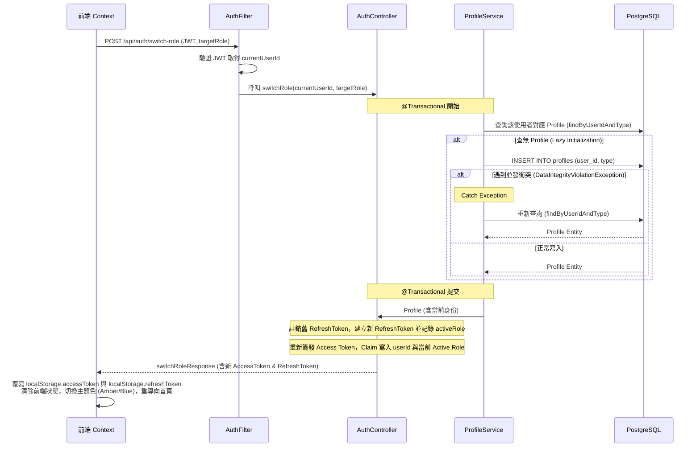
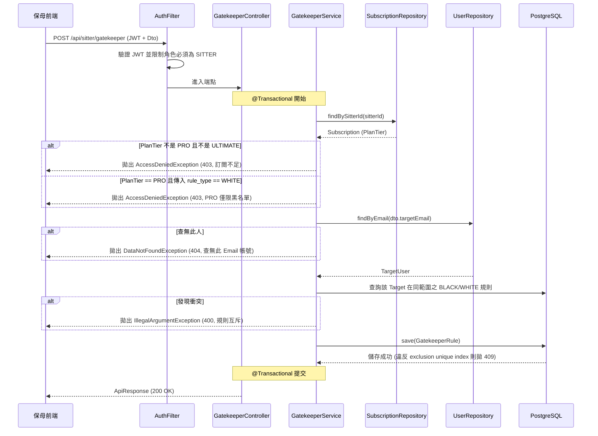
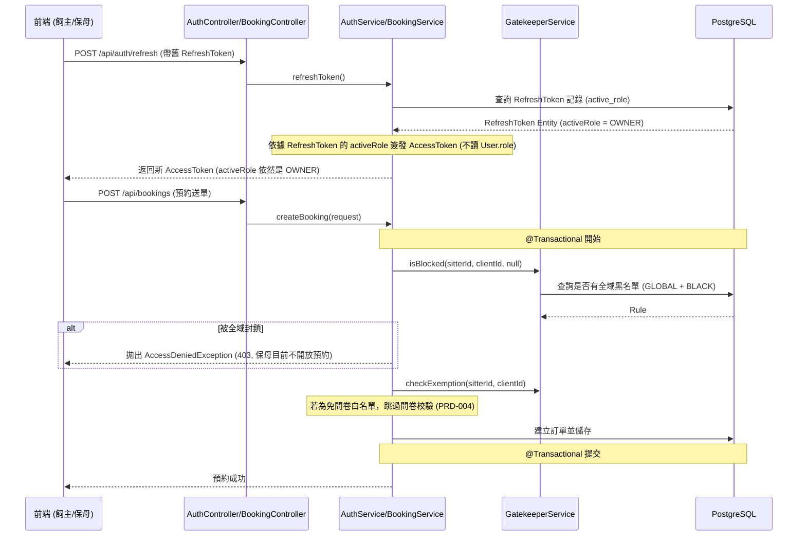

# SD-001: 角色切換與檔案管理 (含預約門禁) 設計文件

| 項目 | 內容 |
|------|------|
| 對應需求 | PRD-001 |
| 負責 SD | Antigravity (AI) |
| 建立日期 | 2026-05-27 |
| 狀態 | Approved |
| DB 表 | `profiles`, `gatekeeper_rules`, `users`, `subscriptions`, `refresh_tokens`, `log_user_action` |
| 相依共用設計 | [錯誤回應](shared/error-response.md), [RBAC 權限](shared/permission-rbac.md), [多租戶稽核](shared/audit-tenancy.md), [系統配置](shared/config-system.md) |

---

## 技術設計決策 (Design Decisions)

### 1. TokenContext 永遠回傳 Dummy UUID 與 JWT claims 修正 (CRITICAL)
- **問題背景**：`TokenContext.getUserId()` 依賴 `ThreadLocal` 獲取當前登入者 ID，但由於 `JwtAuthenticationFilter` 未執行 `TokenContext.setUserId()`，導致生產環境中 ID 恆為 zero-UUID (`00000000-0000-0000-0000-000000000000`)。這會造成資料庫 FK 錯誤，以及所有防 IDOR 和多租戶防線全面失效。
- **技術防禦**：
  - **JWT Claims 擴充**：於 `AuthService.createAuthResponse()` 簽發 token 時，在 extra claims 中塞入 `userId` (即 `user.getId().toString()`)。
  - **Filter 截收與執行期綁定**：在 `JwtAuthenticationFilter.doFilterInternal()` 驗證 JWT 並解析 claims 時，從 claims 取出 `userId`，呼叫 `TokenContext.setUserId(UUID.fromString(userId))`。
  - **ThreadLocal 洩漏防禦**：在 `filterChain.doFilter(request, response)` 執行完成後，於 `finally` 區塊強制呼叫 `TokenContext.clear()`，杜絕 ThreadLocal 髒資料污染與潛在記憶體洩漏。
- **後續（2026-10-25 fix-batch12 J2）**：`TokenContext.getUserId()` 原本在 ThreadLocal 為空時仍回傳 zero-UUID 作為「開發測試 fallback」，已移除——沒有身分一律拋 `AuthenticationCredentialsNotFoundException` → 401；身分可選的匿名端點用 `tryGetUserId()`（見 SD-GLOBAL-SPEC §3.4）。
- **Known Deviation**：為避免影響範圍過大，JWT `subject` 仍維持使用 `email`，暫不重構為 `accountId`。此偏離已於 `SD-GLOBAL-SPEC` 補強備註。

### 2. Switch-Role 角色回退與 Refresh Token 角色維持防線 (CRITICAL)
- **問題背景**：原設計在 `POST /api/auth/switch-role` 時僅回傳 `accessToken`。當 access token (15分鐘) 過期前端打 `/refresh` 時，`AuthService.refreshToken()` 會直接讀取 DB 欄位 `User.getRole()` 重新簽發 token，導致使用者無感地被「強制回退到原 DB role」。
- **技術防禦**：
  - **Token 完整回傳**：`/api/auth/switch-role` 接口被修正為返回完整 `AuthResponse`（含新的 access + refresh token）。每次切換時，舊的 refresh token 會被強制註銷 (revoke)，並建立全新的一筆。
  - **Refresh Token 角色狀態化**：在 `refresh_tokens` 表中加入 `active_role` 欄位。當 switch-role 發生時，將切換後的核心角色寫入該 refresh token 的 `active_role` 中。
  - **Refresh 邏輯重構**：重構 `AuthService.refreshToken()` 邏輯。簽發新的 access token 時，其 role 欄位**不再**讀取 DB `User.getRole()`，而是從 `RefreshToken.getActiveRole()` 讀取，確保角色狀態跨 Token 週期性存續。

### 3. 角色切換與 Lazy Initialization 的並發安全
- **問題背景**：並發切換角色時，`check-then-act` 條件競爭可能在 DB 內產生兩筆重複的 Profile。
- **技術防禦**：
  - **DB 唯一索引**：在 `profiles` 表加上唯一索引 `UNIQUE (user_id, type)`。
  - **應用級補償**：後端在 `switch-role` 事務中，若因並發插入觸發 `DataIntegrityViolationException`，會主動 catch 該例外，並退回執行 `findByUserIdAndType` 重新查出已建立的 Profile，完成冪等處理。

### 4. 門禁規則 (Gatekeeper) 的黑白名單互斥與 DB Constraint 確保
- **DB 級排除 (Partial Unique Index)**：建立局部唯一索引，排除 `BLACK` 與 `WHITE` 同時並存的可能，但不限制 `NO_QUESTIONNAIRE`：
  - 全域排除：`CREATE UNIQUE INDEX uidx_gatekeeper_global_excl ON gatekeeper_rules(sitter_id, target_user_id) WHERE scope_type = 'GLOBAL' AND rule_type IN ('BLACK', 'WHITE');`
  - 方案排除：`CREATE UNIQUE INDEX uidx_gatekeeper_plan_excl ON gatekeeper_rules(sitter_id, plan_id, target_user_id) WHERE scope_type = 'PLAN' AND rule_type IN ('BLACK', 'WHITE');`
- **CHECK constraint 防漏防護**：因為 PostgreSQL unique 索引遇到 NULL 欄位會跳過重複性檢核，在 DB 加上 CHECK 約束防止 `scope_type = 'PLAN'` 時 `plan_id` 為 NULL 導致互斥索引失效：
  ```sql
  CONSTRAINT chk_plan_scope CHECK (scope_type != 'PLAN' OR plan_id IS NOT NULL)
  ```

### 5. 敏感信用指標 (Trust Score) 隱私防守
- **規格背景**：保母 Profile 內含 `trust_score` (初始值 100)，供管理後台監控，屬高度敏感資料。
- **防禦設計**：
  - 本 SD 不提供 Profile CRUD API（歸屬 `PRD-018`）。
  - 對外的 DTO（如 `SitterProfileDto`）完全**不宣告** `trustScore` 屬性，且 JWT token claims 內亦不攜帶此值，杜絕前台資料外洩風險。

### 6. 方案到期與降級失效 (Subscription Gating)
- 前台載入方案列表 (GET `/api/sitters/{sitterId}/plans`) 與送單預約 (POST `/api/bookings`) 時，後端將即時關聯 `Subscription`：
  - 若保母訂閱過期 (`expiredAt` < NOW()) 或訂閱等級為 `FREE`/`BASIC`，則在記憶體過濾階段**直接跳過** Gatekeeper 門禁過濾邏輯（即規則標記為失效，全部放行）。

---

## 序列圖

### 1. 角色切換與 Lazy Initialization (Switch Role)



> [!IMPORTANT]
> **2026-09 修復的嚴重缺陷**：上圖畫的「FE 呼叫 `/api/auth/switch-role`」這段前端行為，實作上**全站從未有任何一處真正呼叫過這支端點**（`grep -rn "switch-role" frontend/src/` 零結果）——`/demo` 頁面的角色切換按鈕（`RoleContext.tsx` 的 `setRole()`）走的是完全不同的路徑：直接登出、改登入寫死的種子帳號（`sitter@test.com`/`owner@test.com`），不是對目前帳號呼叫 switch-role。實際後果：**真實使用者從 `POST /api/auth/register` OTP 驗證通過、或 Google 首次登入選角色建立帳號那一刻起，Profile 永遠不會被建立**（唯一會建立 Profile 的路徑，就是這支從未被呼叫過的 switch-role），保母角色第一次送出 KYC 就會撞上 `KycServiceImpl.submitKyc()`（及其餘十餘處同樣用 `orElseThrow` 的服務）回傳「找不到該保母資料」404，**100% 阻斷所有新保母帳號的實名認證**。舊種子帳號因為很久以前手動建過 Profile 才沒暴露這個洞，也因此這批跨模組 journey 測試（`docs/test-scenario/TS-JOURNEY-01~05`）一直沒測出來——測試 helper 裡的 `bootstrapVerifiedSitter()` 一直有明確呼叫 `switchRole()` 當前置步驟，反而把這個缺口遮住了。
>
> 修法：不再只依賴一個從未被觸發的「switch」動作，角色在註冊/Google 登入當下就已經確定，直接在 `AuthService.verifyRegistrationOtp()` 與 `AuthService.loginWithGoogle()` 建立 `User` 的同一個 transaction 內，用新抽出的 `ensureProfileExists()`（`switchRole()` 內既有的 lazy-init 邏輯原封不動搬過來共用）一併建好對應的 Profile（`User.role` OWNER↔`Profile.type` CLIENT、SITTER↔SITTER 的既有對應關係不變）。內部測試帳號建立端點 `E2eJourneyAccountProvisioningService` 也一併修正，避免用它建的測試帳號重蹈覆轍。`switch-role` 端點本身邏輯不變，繼續保留給「同一帳號日後想切換到另一個角色」這個情境使用（2026-10 起由 `/demo` 切換按鈕在正式登入模式下呼叫，見下方 D3 說明）。迴歸測試見 `AuthControllerTest.should_CreateSitterProfile_When_VerifyOtp_ForSitterRole`、`should_CreateClientProfile_When_VerifyOtp_ForOwnerRole`。

> [!IMPORTANT]
> **2026-10 修復（Backlog 第 3 批 D3）：正式登入使用者在 `/demo` 切換角色會被換成種子帳號。** `RoleContext.setRole()` 不看 `authMode`，一律 `POST /api/auth/login` 種子帳號；`DemoHome` 在 `RequireAuth` 之內，正式登入的使用者/管理員也看得到三顆切換按鈕，點了自己的 session 就被換成 `sitter@test.com` 等共用帳號。修法：`authMode=manual` 時改走 `frontend/src/contexts/manualRoleSwitch.ts`：
> - 目標角色＝目前 token 角色 → 不送請求；保母/飼主 → `POST /api/auth/switch-role {targetRole: SITTER|CLIENT}`（帶目前 token，後端依上圖 lazy 建立 Profile、簽發新 token），覆寫 token、`authMode` 維持 `manual`、`invalidateQueries()` 讓頁面重抓新角色資料。
> - 管理員不是 Profile 角色（switch-role 只接受 SITTER/CLIENT）：非管理員切管理員、管理員切保母/飼主一律拒絕（`alert` 說明原因），token/角色不變，不呼叫任何 API。
> - `authMode=seed`（Demo 模式）維持原行為：改登對應種子帳號。
> 迴歸：`frontend/e2e/manual-role-switch.spec.ts`（攔截 `switch-role` 斷言 body 與 `Authorization`，`POST /api/auth/login` 次數為 0）。

### 2. 預約門禁設定 (Gatekeeper Rule CRUD)



### 3. 預約送單與 token refresh 防線 (Refresh & Booking Gating)



---

## 資料模型變更

### 1. 新增 Table 與 唯一索引 (Flyway Migration)

建立 `V20260527_01__create_profiles_and_gatekeeper.sql`：

```sql
-- 建立 Profile 檔案側表
CREATE TABLE profiles (
    id          UUID PRIMARY KEY DEFAULT gen_random_uuid(),
    user_id     UUID NOT NULL REFERENCES users(id),
    type        VARCHAR(50) NOT NULL, -- SITTER, CLIENT
    trust_score INT NOT NULL DEFAULT 100, -- 信用指標
    kyc_status  VARCHAR(50) NOT NULL DEFAULT 'PENDING',
    created_at  TIMESTAMPTZ NOT NULL DEFAULT NOW(),
    updated_at  TIMESTAMPTZ NOT NULL DEFAULT NOW()
);

-- 防止 lazy initialization 競爭衝突
CREATE UNIQUE INDEX uidx_profiles_user_type ON profiles(user_id, type);

-- 建立預約門禁規則表
CREATE TABLE gatekeeper_rules (
    id              UUID PRIMARY KEY DEFAULT gen_random_uuid(),
    sitter_id       UUID NOT NULL REFERENCES users(id),
    rule_type       VARCHAR(50) NOT NULL, -- BLACK, WHITE, NO_QUESTIONNAIRE
    scope_type      VARCHAR(50) NOT NULL, -- GLOBAL, PLAN
    plan_id         UUID REFERENCES service_plans(id),
    target_user_id  UUID NOT NULL REFERENCES users(id),
    created_at      TIMESTAMPTZ NOT NULL DEFAULT NOW(),
    CONSTRAINT chk_plan_scope CHECK (scope_type != 'PLAN' OR plan_id IS NOT NULL)
);

-- 門禁互斥局部唯一索引
-- 1. 全域黑白單互斥
CREATE UNIQUE INDEX uidx_gatekeeper_global_excl ON gatekeeper_rules(sitter_id, target_user_id) 
WHERE scope_type = 'GLOBAL' AND rule_type IN ('BLACK', 'WHITE');

-- 2. 方案黑白單互斥
CREATE UNIQUE INDEX uidx_gatekeeper_plan_excl ON gatekeeper_rules(sitter_id, plan_id, target_user_id) 
WHERE scope_type = 'PLAN' AND rule_type IN ('BLACK', 'WHITE');

-- 3. 重複規則防呆 (GLOBAL & PLAN)
CREATE UNIQUE INDEX uidx_gatekeeper_global_duplicate ON gatekeeper_rules(sitter_id, rule_type, target_user_id)
WHERE scope_type = 'GLOBAL';

CREATE UNIQUE INDEX uidx_gatekeeper_plan_duplicate ON gatekeeper_rules(sitter_id, rule_type, plan_id, target_user_id)
WHERE scope_type = 'PLAN';

-- 4. 優化檢索索引
CREATE INDEX idx_gatekeeper_sitter ON gatekeeper_rules(sitter_id);

-- 5. 補充建立 log_user_action 表 (對齊多租戶稽核規範)
CREATE TABLE log_user_action (
    id           UUID PRIMARY KEY DEFAULT gen_random_uuid(),
    func_code    VARCHAR(100) NOT NULL,
    action_type  VARCHAR(50) NOT NULL,
    action_result VARCHAR(50) NOT NULL DEFAULT 'SUCCESS',
    operator_id  UUID REFERENCES users(id),
    target_id    UUID,
    target_table VARCHAR(100),
    created_at   TIMESTAMPTZ NOT NULL DEFAULT NOW()
);

-- 6. 擴充 refresh_tokens 表，儲存 active_role 角色狀態
ALTER TABLE refresh_tokens ADD COLUMN active_role VARCHAR(50);
```

### 2. log_user_action — 操作日誌稽核規格

每次寫入操作成功後，Service 層需寫入操作日誌：

| 功能項目 | `func_code` | `action_type` | `target_table` |
|--------|-------------|---------------|----------------|
| 角色切換 Profile 建立 | `SYS_SWITCH_ROLE` | `CREATE` | `profiles` |
| 新增門禁規則 | `SITTER_GATEKEEPER_MGT` | `CREATE` | `gatekeeper_rules` |
| 刪除門禁規則 | `SITTER_GATEKEEPER_MGT` | `DELETE` | `gatekeeper_rules` |

---

## API 設計

### 1. 角色切換
`POST /api/auth/switch-role`
- **Request Body**
```json
{
  "targetRole": "SITTER" // SITTER, OWNER
}
```
- **Response**
```json
{
  "code": 200,
  "message": "OK",
  "data": {
    "accessToken": "new_jwt_token_with_role_claim",
    "refreshToken": "new_refresh_token_with_active_role"
  }
}
```

### 2. 門禁規則 CRUD
| Method | Path | 說明 | 權限 |
|--------|------|------|-----|
| GET | `/api/sitter/gatekeeper` | 取得當前保母的門禁設定列表 | Sitter |
| POST | `/api/sitter/gatekeeper` | 新增門禁規則 | Sitter |
| DELETE | `/api/sitter/gatekeeper/{ruleId}` | 刪除門禁規則 | Sitter |

### 3. 訂閱等級查詢與開通（fix-batch10 H1）
| Method | Path | 說明 | 權限 | 環境 |
|--------|------|------|-----|-----|
| GET | `/api/sitter/gatekeeper/subscription` | 保母查自己的 `planTier` / `expiredAt`（無資料列視為 FREE） | Sitter | 全部 |
| POST | `/api/admin/subscriptions/{sitterId}` | 管理員開通 / 調整等級與到期日，寫 `ADMIN_SUBSCRIPTION_SET` 審計（`AdminSubscriptionController`，class 層 `@PreAuthorize("hasRole('ADMIN')")`） | Admin | 全部 |
| POST | `/api/sitter/gatekeeper/subscription/mock` | 開發用：保母自助切換等級（`GatekeeperDevSubscriptionController`，`@Profile("local")` 白名單） | 已登入 | **僅 local profile**；正式站（deploy.yml `SPRING_PROFILES_ACTIVE=prod`）與任何其他 profile 都不註冊 bean，回 404。2026-10-25 fix-batch12 J4 由黑名單 `@Profile("!prod")` 改為白名單：避免部署時 profile 設成 prod 以外的值（staging / 拼錯）就把端點開出來。注意 `application.yml` 的 `spring.profiles.default: local` 在「完全沒設 profile」時仍會啟用 local |

過去 `subscription/mock` 寫在 `GatekeeperController` 裡、沒有 profile 也沒有角色限制，正式站任何已登入使用者都能把自己升到 PRO / ULTIMATE。現在正式站開通只走管理員端點；保母端 `GatekeeperSettings` 不再有「模擬升級 / 降級」按鈕，鎖定畫面顯示「請聯繫平台管理員開通」（`data-testid="gatekeeper-contact-admin"`）。線上訂閱付款待 SD-015。迴歸：`GatekeeperSubscriptionProdProfileTest`（真 prod profile + 真 JWT：bean 不存在、保母打 mock 404、SITTER / OWNER 打管理員端點 403、匿名 401、ADMIN 200）、`GatekeeperDevSubscriptionLocalProfileTest`（local 仍可用）、`GatekeeperDevSubscriptionOtherProfileTest`（staging profile：bean 不存在、404，J4）；正式站 E2E 證據：TS-JOURNEY-05 測試 1 步驟 1.5。

---

## 權限與訂閱鎖定設計 (SaaS Gating)

| Sitter Subscription | 門禁管理權限 | 容許規則 |
|--------------------|-------------|---------|
| `FREE`, `BASIC` | ❌ 禁用 (前端顯示鎖定畫面＋「請聯繫平台管理員開通」，後端 403) | 無 |
| `PRO` | 展開設定 (僅限黑名單) | `BLACK` |
| `ULTIMATE` | 展開設定 (無限制) | `BLACK`, `WHITE`, `NO_QUESTIONNAIRE` |

---

## UX 設計

- **切換角色 UI**：點擊切換時，前端全域套用 `data-theme`（`sitter` = Amber，`client` = Blue）。
- **Demo 種子帳號自動登入的適用範圍（2026-10，C1）**：`RoleContext` 掛載時會以種子帳號（`sitter@test.com`/`owner@test.com`/`admin@test.com`，依 `userRole`）背景登入，Demo 模式（`authMode=seed`）下 `/demo` 的「切換為保母/飼主/管理員」也走同一組帳號（正式登入 `authMode=manual` 改走 `switch-role`，見上方 D3）。這是 Demo 展示機制，判斷集中在 `frontend/src/contexts/seedAutoLogin.ts` 的 `shouldSeedAutoLogin(pathname, authMode)`：

  | 情況 | 是否自動登入 |
  | :--- | :--- |
  | `authMode=manual`（經 `/login`、註冊、Google、WebAuthn 正式登入） | 否，不蓋掉真實 session |
  | 公開頁：`/login`、`/register`、`/forgot-password`、`/reset-password`、`/sitter/{id}/profile` | 否（任何 `authMode` 皆然） |
  | `authMode=seed`（先前從 Demo 入口進來過）＋受保護頁面 | 是，重新整理/深連結沿用 Demo session |
  | 無 session ＋ Demo 入口 `/`、`/demo` | 是，啟動 Demo 模式（寫入 `authMode=seed`） |
  | 無 session ＋其他受保護頁面（`/booking/{id}`、通知信裡的 `/owner/orders/{id}` 等） | 否，`RequireAuth` 導去 `/login?redirect=<原路徑>`，登入後回原頁 |

  過去只排除 `/login` 等四個頁面：匿名訪客開保母公開頁會在背景登入成 `sitter@test.com`，公開頁 API 帶著種子保母 token 送出（看到的不是匿名視角）；匿名開 `/booking/{id}` 會被登入成種子保母、再被 `RequireRole` 踢回 `/demo`；登出後點通知信連結同樣會被偷偷登入成種子帳號。迴歸：`frontend/e2e/seed-auto-login-scope.spec.ts`（以 `page.on('request')` 計數 `POST /api/auth/login`），Journey A 步驟 8、Journey E 兩個匿名步驟（`expectStillAnonymous`）。
- **種子登入的冪等性（2026-10，Backlog 第 3 批 D4）**：`RoleContext.loginAsRole()` 以模組層級 in-flight Promise 依角色去重（dev `<StrictMode>` effect 雙呼叫、或自動登入與 `/demo` 切換同時觸發，只送一次）；種子帳號是所有 Demo 訪客共用的，別的分頁/裝置同時登入同一帳號時後端改寫該帳號唯一一組 refresh token 會回 409 `MSG_DATA_CONCURRENCY_CONFLICT`，此時重送（最多 4 次、退避 150ms×次數＋抖動）。過去 409 時沒有 token，`finishInitialCheck()` 照樣結束 loading，`RequireAuth` 把人導去 `/login`（mock E2E 平行 worker 隨機失敗的根因）。迴歸：`e2e/seed-auto-login-scope.spec.ts` 的 D4 測試（第一次 409 → 重送成功留在 `/demo`、登入請求恰為 2 次）。
- **Session 失效後的換頁行為（2026-10，C1 起；Backlog 第 4 批 E1 查證）**：`RequireAuth` 為了組 `redirect` 用了 `useLocation()`，因此**每次 client-side 換頁都會重新檢查** `localStorage.accessToken`。`axiosClient` 在 API 401 且 `POST /api/auth/refresh` 也失敗時會清掉 access/refresh token；C1 之前 `RequireAuth` 不隨 location 重新渲染，token 被清後頁面停在原地、所有 API 401，要整頁重新整理才導去登入；C1 起下一次換頁就導去 `/login?redirect=<原路徑>`，登入後回原頁。這是預期行為（refresh token 真的失效才會清 token）。mock E2E 以假 token 進站時，任何沒 mock 的 API（AppHeader 的通知 / KYC 狀態等）都會觸發這條路徑，所以 mock spec 必須用 `e2e/support/mockSession.ts` 的 `mockDemoSession()`。
- **名單輸入 Email 格式校驗**：前端欄位輸入時需有正則表達式防呆。
- **門禁衝突 Toast**：當後端拋出互斥限制 (400) 或查無帳號 (404) 時，頁面阻擋並展示對應 Toast。
