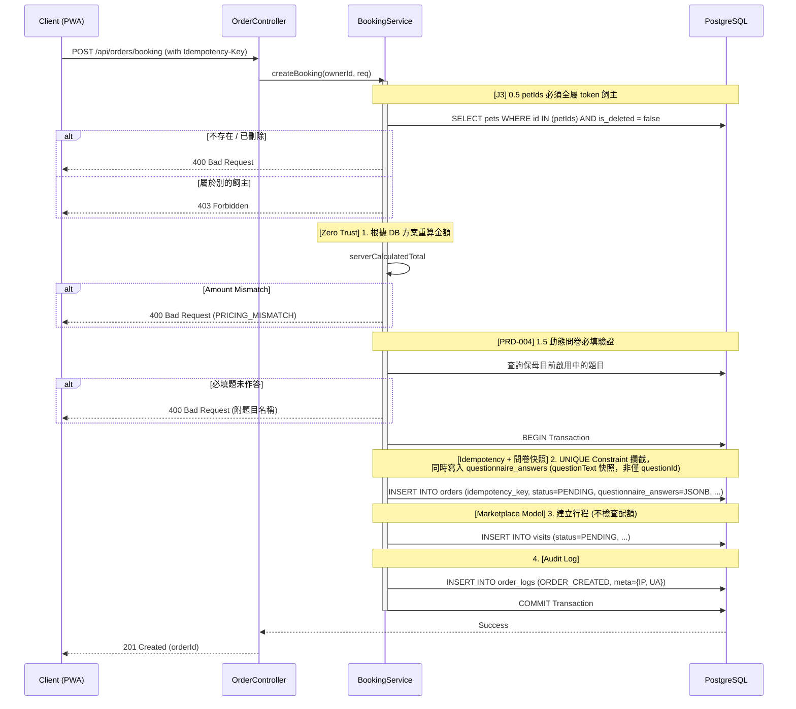

# SD-005: 飼主預約申請 (Public Booking)

| 項目 | 內容 |
|------|------|
| 模組編號 | SD-005 |
| 對應 PRD | PRD-005 |
| 核心技術 | Zero-Trust Pricing, DB-Level Idempotency |
| 狀態 | **Approved (Marketplace Model)** |

---

## 1. 業務邏輯與流程設計

### 1.1 核心流程說明
飼主提交預約申請。根據 **PRD-005**，系統**不做接單容量控管**（產品決策，2026-10）：送單、接單、報價、變更協商都不計算或鎖定任何名額，允許多位飼主同時對同一時段送單，要不要接由保母於審核階段 (SD-006) 自行判斷。

### 1.2 併發與冪等性
1. **送單階段**：主要透過 `idempotency_key` 的資料庫 `UNIQUE` 約束防止重複送單。
2. **接單 / 報價階段**（SD-006）：不做容量檢查、沒有保母 + 日期的 advisory lock。唯一的併發保護是**同一張訂單**只能從 `PENDING` 轉出一次：原價快速接單 `ConfirmOrderService.confirmOrder()`（`POST /api/orders/{id}/confirm`）與議價報價 `EvaluationService.sendQuote()`（`POST /api/orders/{id}/quote`）都以 `OrderRepository.findByIdForUpdate`（`SELECT ... FOR UPDATE`）讀訂單、取得鎖後比對保母是否為 token 身分（不符 → 403，fix-batch11 I1），同一張單的併發請求在此排隊，後到者讀到 `PENDING_PAYMENT` → 409 `STATE_CONFLICT`。**接單不改 visit 狀態**（維持 `PENDING`，SD-008）。2026-10 backlog 第 7 批移除 `dailyCapacity`、`CapacityGuard`、`CapacityFullException`（409 `CAPACITY_FULL`）與 `countBookedVisitsBySitterIdAndDate`；第 5 批（F2）已刪除從未被 controller 呼叫的舊版 `BookingService.confirmBooking()`。

### 1.3 動態問卷渲染與快照 (PRD-004 聯動)
飼主進入預約 Step 2 時，前端呼叫 `GET /api/sitters/{sitterId}/questions`（見 SD-004）動態渲染保母自訂的問卷表單。送單時：
- 後端重新查詢該保母**目前啟用中**的題目清單，逐一比對 `required` 題目是否有值，未填則拋出 `400`（`IllegalArgumentException`，訊息附題目名稱）——不信任前端傳來的必填檢查。
- 通過驗證後，將題目文字與答案一併寫入 `orders.questionnaire_answers`（JSONB 快照），詳見 SD-004 §1.1 歷史隔離設計。

### 1.4 Zero-Trust Pricing
`BookingRequest.expectedTotalAmount` 是前端試算的金額，僅供比對用途。後端一律以資料庫當下的 `ServicePlan.price` 重新計算 `totalAmount`，兩者不符時拒絕送單（`400 PRICING_MISMATCH`），避免飼主填表期間方案價格被異動、卻無感沿用舊報價成交。

---

## 2. API 定義

### 2.1 提交預約申請
- **Endpoint**: `POST /api/orders/booking`
- **Auth**: `@PreAuthorize("hasRole('OWNER')")`，飼主身分取自 token（`TokenContext`），由 controller 傳入 `BookingService.createBooking(ownerId, request)`。Request Body **沒有** `ownerId`（fix-batch11 I2 移除；過去讀 body 的 `ownerId`，任何已登入者都能以別的飼主名義下單、也能冒用別人繞過黑名單）。舊前端多帶的 `ownerId` 會被 Jackson 忽略。保母角色 → 403、未登入 → 401
- **petIds 歸屬（fix-batch12 J3）**：所有 `items[].petIds` 必須是 token 飼主自己的、未刪除的毛孩。毛孩不存在 / 已刪除 → **400**「找不到指定的毛孩」；存在但屬於別的飼主 → **403**「只能為自己的毛孩預約」（SD-GLOBAL-SPEC §3.4 的「不存在 400 / 不屬於你 403」）。檢查在方案與金額驗證之前，任一不符都不建單。`petIds` 可以為空。
- **Headers**:
  - `Idempotency-Key`: `UUID` (必填)
- **Request Body**:
```json
{
  "sitterId": "uuid",
  "expectedTotalAmount": 2500,
  "items": [
    {
      "planId": "uuid-planA",
      "petIds": ["uuid-pet1", "uuid-pet2"],
      "dates": ["2026-06-01", "2026-06-02", "2026-06-03"],
      "timesPerDay": 2
    },
    {
      "planId": "uuid-planB",
      "petIds": ["uuid-pet1", "uuid-pet2"],
      "dates": ["2026-06-01", "2026-06-02", "2026-06-03"],
      "timesPerDay": 1
    },
    {
      "planId": "uuid-planA",
      "petIds": ["uuid-pet1", "uuid-pet2"],
      "dates": ["2026-06-04"],
      "timesPerDay": 1
    }
  ],
  "answers": [
    {"questionId": "uuid-q1", "answerValues": ["會怕生"]}
  ]
}
```

---

## 3. 詳細邏輯與序列圖 (Sequence Diagram)



> [!NOTE]
> 系統不做容量檢查（PRD-005 / PRD-006）。同一張訂單的併發接單 / 報價保護見 SD-006 §2.1。

> [!IMPORTANT]
> **回應契約**：`POST /api/orders/booking` 回 `201`，body **只有** `{ "orderId": "<uuid>" }`，不包 `{ code, message, data }` 外層（`OrderController.createBooking` 回 `Map.of("orderId", orderId)`）。前端 `PublicBookingPage` 只認這個形狀：`orderId` 不是 UUID 字串時不再 fallback 成整個物件（過去 `res.orderId || res` 會導去 `/owner/orders/[object Object]`），改 alert「預約已送出，但無法取得訂單編號，請到「我的訂單」確認預約狀態」並導去 `/owner/orders`——此時訂單可能已建立，不可當送出失敗讓使用者重送。契約測試：`BookingServiceTest.ts005_06_should_ReturnOrderIdObject_When_BookingCreated`（2026-10 backlog F3）。

---

## 4. 資料庫異動與限制 (DB Constraint)

### 4.1 冪等性實作
- **Table**: `ORDERS`
- **Constraint**: `UNIQUE(idempotency_key)`

---

## 5. 防呆與邊界條件 (Edge Cases)

| 情境 | 處理方式 |
|------|---------|
| 併發送單 | 透過 `Idempotency-Key` 攔截，後到者回傳 409 或重複成功訊息。 |
| 同日已有其他訂單 | 送單、接單、報價都不阻擋，系統沒有「額滿」概念；接不接由保母自行判斷。前端選擇方案頁也**不**顯示任何「檔期已滿」的方案卡（2026-10 移除遺留的寫死「尊榮包月・此方案目前檔期已滿」mock 卡片，見 TS-005）。 |
| 送單金額與方案現價不符 | 400 `PRICING_MISMATCH`，不建立訂單，提示飼主重新整理頁面。 |
| 保母問卷必填題未作答 | 400，訊息附題目名稱，不建立訂單。 |
| 送單當下保母剛停用某題目 | 該題不在後端查到的「啟用中題目」清單內，不驗證也不快照，視同題目不存在。 |
| 保母尚未設定任何問卷題目 | `questionnaire_answers` 存空陣列 `[]`，不影響送單。 |
