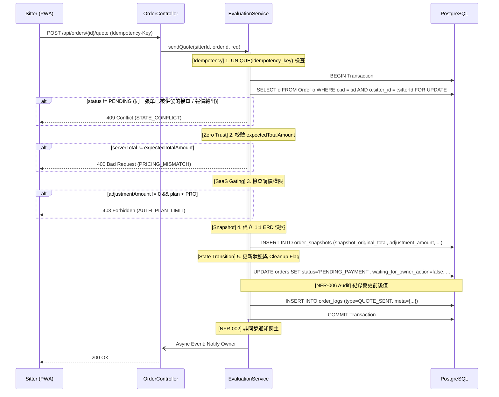

# SD-006: 保母報價審核與金額快照 (Order Evaluation)

| 項目 | 內容 |
|------|------|
| 模組編號 | SD-006 |
| 對應 PRD | PRD-004, PRD-006, PRD-012, PRD-013 |
| 核心技術 | Optimistic Locking (@Version), SaaS Plan Gating, Full-Contract Snapshotting, Zero-Trust Pricing |
| 狀態 | **Approved with Consultant Feedback** |

---

## 1. 業務邏輯與流程設計

### 1.1 核心流程說明
保母對 `PENDING` 狀態的訂單進行審核。所有操作皆須具備 **冪等性 (Idempotency)** 與 **狀態清理 (State Cleanup)** 機制。
當訂單完成報價或婉拒後，系統必須確保所有中間狀態 Flag（如 `waiting_for_owner_action`）被正確重設。

### 1.2 金額與權限規則
- **Sitter-Side Zero Trust**：保母送出報價時，必須傳回其畫面上顯示的 `expectedTotalAmount`。後端重新計算 `原始金額 + adjustmentAmount` 後，兩者若不符則拒絕報價，防止前端緩存過期導致的誤判。

---

## 2. API 定義

### 2.1 送出報價 (Accept & Quote)
- **Endpoint**: `POST /api/orders/{orderId}/quote`
- **Auth**: `ROLE_SITTER`
- **Headers**: `Idempotency-Key: UUID` (必填)
- **Request Body**: 
```json
{
  "adjustmentAmount": 200,
  "expectedTotalAmount": 1200,
  "adjustmentReason": "連假加收",
  "version": 1
}
```
- **邏輯檢核**:
  - 若 `adjustmentAmount != 0` 且保母方案 < `PRO`，拋出 `AUTH_PLAN_LIMIT`。
  - **Zero-Trust**: 校驗 `serverTotal == expectedTotalAmount`。
  - **Cleanup**: 強制將 `waiting_for_owner_action` 設為 `false`。
  - **不做容量控管（產品決策，2026-10）**：報價不檢查同日已有幾張單，系統沒有 `dailyCapacity`（PRD-005 / PRD-006：接不接由保母判斷）。2026-10 backlog 第 7 批移除了 `CapacityGuard`（保母 + 日期 advisory lock + 鎖內 count）與 409 `CAPACITY_FULL`。
  - **同一張單只轉出一次**：報價成功後訂單**直接**轉 `PENDING_PAYMENT`（沒有「飼主接受報價」的中間狀態）。`sendQuote` 與原價快速接單 `ConfirmOrderService.confirmOrder()` 都以 `OrderRepository.findByIdAndSitterIdForUpdate`（`@Lock(PESSIMISTIC_WRITE)` → `SELECT ... FOR UPDATE`）讀訂單；同一張單同時「原價接單 + 報價」、兩次報價（不同冪等鍵）或兩次接單時，後到者在列鎖上排隊，先到者 commit 後讀到 `PENDING_PAYMENT`，由狀態檢查拋 `IllegalStateException` → 409 `STATE_CONFLICT`。沒有這把列鎖時兩邊都讀到 `PENDING`，後到者會在 flush 時撞 `uk_order_snapshot_order_id`，回 400 `DATA_ERROR`（資料仍一致，但回應錯誤）。

### 2.2 要求回填問卷 (Request Info)
- **Endpoint**: `POST /api/orders/{orderId}/request-info`
- **Headers**: `Idempotency-Key: UUID` (必填)
- **說明**: 狀態維持 `PENDING`，更新 `waiting_for_owner_action = true` 並觸發通知。

### 2.3 婉拒預約 (Reject)
- **Endpoint**: `POST /api/orders/{orderId}/reject`
- **Headers**: `Idempotency-Key: UUID` (必填)
- **Request Body**: `{ "rejectReason": "...", "version": 1 }`
- **邏輯檢核**: 狀態轉為 `CANCELLED`，重設 `waiting_for_owner_action = false`。

### 2.5 飼主付款前撤單 (Owner Cancel，2026-10-25 fix-batch10 H5)
- **Endpoint**: `POST /api/orders/{orderId}/cancel`
- **Auth**: `@PreAuthorize("hasRole('OWNER')")`，飼主身分取自 token（`TokenContext`），不收 `ownerId` 參數；非該訂單飼主 → 403（BOLA）
- **Request Body**: `{ "version": 3 }`（必填，飼主畫面上的訂單版本；缺少 → 400）
- **可撤判斷**（`OwnerCancellationService.rejectReason`，訂單詳情的 `cancellableByOwner` 共用同一判斷，前端只照旗標顯示「取消預約」）：
  - `PENDING` → 可撤
  - `PENDING_PAYMENT` → `SupplementPaymentResolver.findOpenSupplement` 有值（訂單變更補款階段，首次已付款）→ 409「訂單變更補款階段無法取消預約…」；`paidAt` 或 `paymentProofUrl` 有值 → 409「已上傳付款憑證…」；否則可撤
  - `CANCELLED` → 409「此訂單已取消」；`COMPLETED` → 409「此訂單已結案」；其他（`PAID` / `CONFIRMED` / `IN_PROGRESS` / `MODIFYING` / `REFUND_VERIFY` / `DISPUTED`）→ 409，訊息皆附「如需取消請透過『申請訂單變更』與保母協商（PRD-016）」
- **併發**：以 `OrderRepository.findByIdForUpdate`（`PESSIMISTIC_WRITE`）讀訂單，與保母接單 / 報價的 `findByIdAndSitterIdForUpdate` 是同一列的同一把 `FOR UPDATE` 鎖。飼主先 → 保母後到讀到 `CANCELLED` → 409 `STATE_CONFLICT`；保母先 → 飼主後到讀到 `PENDING_PAYMENT`，version 已變 → 409 `MSG_DATA_CONCURRENCY_CONFLICT`（不會把保母剛報價的單撤掉）。飼主同時上傳憑證：`submitPaymentProof` 沒有列鎖但有 `@Version`，撤單先提交則上傳 flush 時樂觀鎖 409；上傳先提交則撤單讀到 `PAID` → 409。
- **動作**：訂單 `status=CANCELLED`、`cancelled_by='OWNER'`（V20261025_01 新增欄位）、`waiting_for_owner_action=false`；所有行程 `CANCELLED`；同一交易寫 `order_logs`（`ORDER_CANCELLED_BY_OWNER`，payload `previousStatus`。不用 `AuditLogService.writeOrderLog`：它是 `REQUIRES_NEW`，新交易插 `order_logs` 的 FK 檢查要等本交易的 `FOR UPDATE` 列鎖，會互等）；發布 `OrderCancelledByOwnerEvent`，`NotificationListener` AFTER_COMMIT 非同步通知保母（標題「飼主已取消預約」、`ORDER_AFFAIR`、`/sitter/orders`、`SITTER`）。
- **回應欄位**：`OrderDetailResponseDto` 新增 `cancelledBy`、`cancellableByOwner`；`OrderSummaryDto` 新增 `cancelledBy`。
- **前端**：`OwnerOrderDetail` 在 `cancellableByOwner` 時顯示「取消預約」（`owner-cancel-booking-btn`，`window.confirm` 後送出，409 時 alert 後端訊息並重抓），`CANCELLED` 顯示 `cancelled-status-banner`（飼主撤「您已取消此預約」/ 其他「此預約已取消」）；`SitterOrders` 對 `cancelledBy=OWNER` 顯示「飼主已取消預約」（`sitter-order-owner-cancelled-{id}`）；`OrderEvalView` 非 PENDING 時若為飼主撤單顯示「飼主已取消預約，無法在此頁面操作。」（`sitter-order-eval-not-pending`）。

---

## 3. 詳細邏輯與序列圖 (Sequence Diagram)



---

## 4. 資料庫異動與限制 (DB Constraint)

### 4.1 快照資料結構 (ORDER_SNAPSHOT)
對齊 SD-ERD 2.2 節欄位：
```json
{
  "orderId": "uuid",
  "snapshotAt": "timestamp",
  "snapshotOriginalTotal": 1000,
  "adjustmentAmount": 200,
  "mediaRetentionDays": 30,
  "maxPhotos": 10,
  "maxVideoSeconds": 0,
  "items": [
    {
      "planId": "uuid",
      "planName": "專業餵食",
      "unitPrice": 500,
      "timesPerDay": 2,
      "dates": ["2026-06-01", "2026-06-02"]
    }
  ]
}
```

---

## 5. 防呆與邊界條件 (Edge Cases)

| 情境 | 處理方式 |
|------|---------|
| 報價重複送單 | `Idempotency-Key` 透過資料庫 `UNIQUE` 限制攔截並報錯。 |
| 報價時方案已調價 | 系統依據 **預約送單時的單價** 進行重算。若與保母畫面上的 `expectedTotalAmount` 不同則報錯。 |
| 同日已有其他已接 / 已報價的訂單 | 不阻擋，系統不做容量控管（PRD-005 / PRD-006）。 |
| 同一張單同時原價接單 + 報價、兩次報價或兩次接單 | 訂單列 `SELECT ... FOR UPDATE` 序列化，只成功一個、快照只建一份，另一個 409 `STATE_CONFLICT`（TS-006-05 / 06、TS-005-02）。 |
| 飼主撤單 vs 保母接單 / 報價 | 同一把訂單列鎖序列化，只成功一方，另一方 409（§2.5、TS-006-07）。 |
| 髒資料防護 | 無論執行報價或婉拒，皆會強制清空 `waiting_for_owner_action` 標記。 |
| 前端列表快取 | `OrderEvalView.tsx` 原價接單 / 送出報價 / 婉拒成功後，先 `queryClient.invalidateQueries({ queryKey: ['orders'] })` 再導回 `/sitter/orders`。訂單列表 `useSitterOrdersQuery` 的 `staleTime` 為 60 秒，沒有 invalidate 的話列表會繼續吃快取，剛處理完的訂單仍停在「評估中」、徽章為「待評估」。 |
| 品項明細排版 | 每列「說明」可換行（`flex:1; min-width:0`）、價格 `white-space:nowrap` 不壓縮，兩者間距 1rem。2026-10 前兩個 span 直接貼齊，方案名稱一長價格欄被擠壓，「每天 1 次」的「1」緊貼「$ 600」看起來像「$ 1600」（驗收 P5 / Backlog 第 3 批 U4）。 |
