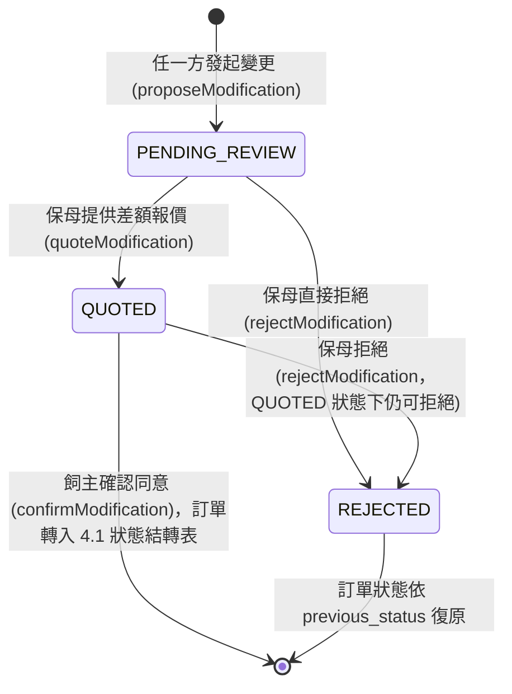
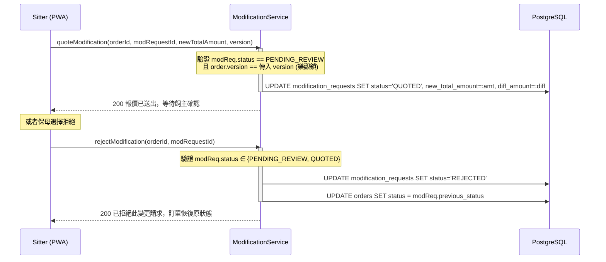
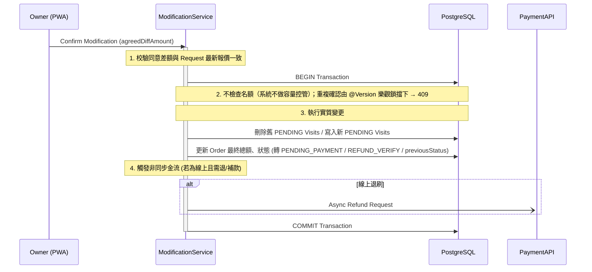

# SD-016: 訂單雙向變更與退款 (Modification & Cancellation)

| 項目 | 內容 |
|------|------|
| 模組編號 | SD-016 |
| 對應 PRD | PRD-016 |
| 核心技術 | Bidirectional Snapshot Recalculation, Refund Proof Verification, Optimistic Locking |
| 狀態 | **Approved with Consultant Feedback** |

---

## 1. 業務邏輯與流程設計

### 1.1 變更請求與生效樞紐
1. **提案階段 (Proposal)**：不論由哪一方發起變更，系統僅紀錄 `MODIFICATION_REQUEST` 數據。此階段 **不觸發** 行程重刷或金流行為。
2. **生效階段 (Confirm)**：必須由 **飼主 (Owner)** 執行最終確認。此時系統才會執行實質的行程重刷以及退/補款邏輯。系統**不做容量控管**（PRD-005 / PRD-016「檔期衝突由保母判斷」），新增日期不檢查名額；2026-10 backlog 第 7 批移除了原本的保母 + 日期 Sorted Advisory Locks 與 `countOccupiedCapacityWithSelfExclusion` 名額檢查。同一變更請求被重複確認由 `orders` / `modification_requests` 的 `@Version` 樂觀鎖擋下，後到者 409 `MSG_DATA_CONCURRENCY_CONFLICT`（`ModificationServiceIntegrationTest` Scenario C2）。

### 1.2 金額試算與對帳
- **快照優先**：所有增減金額皆以 `ORDER_SNAPSHOT` 紀錄的合約單價為準。
- **零信任 (Zero Trust)**：確認 API 必須帶入 `agreedDiffAmount`，由後端重新校驗須與 `ModificationRequest.diffAmount`（保母最新報價）完全一致，不符則拋 `PricingMismatchException`，防止協商期間資料過期仍被沿用成交。

### 1.3 `ModificationRequest` 狀態機

- **`previous_status` 快照**：發起變更當下，`Order.status`（`CONFIRMED`/`IN_PROGRESS`）會快照進 `ModificationRequest.previousStatus`。保母拒絕時，訂單狀態依此欄位復原，而非寫死回 `CONFIRMED`——避免「進行中」訂單被拒絕變更後誤退回「已確認未開始」狀態。
- **`dates` 快照**：發起變更時鎖定的新日期清單同樣以 JSONB 存入 `ModificationRequest.dates`，`confirmModification` 執行實質行程重刷時直接讀取此快照，**不再信任飼主確認當下重送的日期**，理由同 1.2 零信任精神。

---

## 2. API 定義

### 2.1 發起變更請求 (飼主/保母)
- **Endpoint**: `POST /api/orders/{orderId}/modify`
- **Headers**: `Idempotency-Key: UUID` (必填)

### 2.2 查詢訂單目前進行中的變更請求
- **Endpoint**: `GET /api/orders/{orderId}/modification`
- **Auth**: `ROLE_OWNER` 或 `ROLE_SITTER`
- **說明**: 供前端頁面（`OrderModificationWizard`/`SitterModificationQuote`/`OwnerModificationConfirm`）掛載時查詢真實的 `modRequestId` 與目前狀態，取代早期草稿寫死 UUID 呼叫既有端點的作法。
```json
{
  "id": "uuid-modRequestId",
  "orderId": "uuid",
  "status": "QUOTED",
  "orderStatus": "MODIFYING",
  "requestedBy": "OWNER",
  "diffAmount": -200,
  "newTotalAmount": 800,
  "currentOrderTotalAmount": 1000,
  "orderVersion": 2,
  "dates": ["2026-06-01", "2026-06-02"],
  "hasRefundProof": false
}
```
- **2026-08 修復的迴歸缺陷**：原本查詢邏輯只認 `ModificationRequest.status ∈ {PENDING_REVIEW, QUOTED}`。但 `confirmModification()`（2.6）成功後會把 `status` 設為終態 `M_DONE`，而退款分支恰好是**飼主先確認、保母才需要上傳退款憑證**（訂單此時已轉 `REFUND_VERIFY`）——保母端 `SitterModificationQuote` 頁面只要重新整理或重新導航進來就會查無資料、顯示「找不到進行中的變更請求」，實務上永遠上傳不了退款憑證。修法：當 `Order.status ∈ {MODIFYING, PENDING_PAYMENT, REFUND_VERIFY}`（即訂單仍處於變更協商相關狀態）時，改直接撈該訂單最新一筆變更請求（不限 `status`），讓已確認但退補款尚未走完的流程依然讀得到資料；其餘狀態維持原本只認 `PENDING_REVIEW`/`QUOTED` 的行為。詳見 `ModificationServiceTest.should_ReturnModificationRequest_When_OrderIsRefundVerifyAfterConfirm`。
- **`orderStatus`（2026-10，C2）**：回傳訂單目前狀態。前端 `components/orders/modificationPhase.ts` 依 `status` + `orderStatus` + `diffAmount` 正負收斂出唯一階段，兩個協商頁只顯示該階段可執行的動作：

  | 階段 | 判定 | 保母報價頁 | 飼主確認頁 |
  | :--- | :--- | :--- | :--- |
  | `AWAIT_QUOTE` | `PENDING_REVIEW` | 報價表單、拒絕 | 「等待保母報價」 |
  | `AWAIT_OWNER_CONFIRM` | `QUOTED` | 「報價已送出」、拒絕 | 同意表單 |
  | `SUPPLEMENT` | `M_DONE` + `PENDING_PAYMENT` + 差額 > 0 | 唯讀摘要（應補款） | 「變更已確認」＋前往補款，**無退款區塊** |
  | `REFUND` | `M_DONE` + `REFUND_VERIFY` + 差額 < 0 | 唯讀摘要＋退款憑證上傳（已上傳則顯示完成） | 「變更已確認」＋退款區塊：憑證未上傳時只顯示等待，上傳後才有「確認已收到退款」 |
  | `CLOSED` | 其餘 | 唯讀 | 唯讀 |

  每個動作成功後前端重新讀取本端點，不靠本地旗標猜下一步；拒絕、確認收到退款後訂單已不在協商狀態，本端點回 **204 No Content**（2026-10-24 驗收 N8 起；過去丟 `IllegalStateException` → 409，前端只能當錯誤顯示），頁面以中性資訊樣式（`mod-quote-empty` / `mod-confirm-empty`，`--color-on-surface-variant`）顯示「目前沒有進行中的變更協商：先前的協商已結清或已拒絕，或這筆訂單尚未發起變更。」且無任何按鈕；只有真正的錯誤（權限、網路、找不到訂單）才走紅字 `mod-*-error`。過去兩頁把所有表單同時渲染，只用本地 `quoteSent`/`confirmStatus` 旗標隱藏剛按過的那一個，重新進頁後報價、同意都能再按，補款分支也顯示退款區塊（驗收 P7）。
- **同批修復：真實入口缺失**：`SitterOrders.tsx`（`MODIFYING`/`REFUND_VERIFY` 訂單）與 `OwnerOrderDetail.tsx`（`MODIFYING`/`REFUND_VERIFY` 訂單）過去完全沒有導向本節三個變更協商頁面的按鈕，僅 `DemoHome.tsx` 有寫死假 orderId 的展示連結，真實使用者的訂單一旦進入協商狀態便無法從訂單列表/詳情頁點進去處理——跨模組 journey 測試（`docs/test-scenario/TS-JOURNEY-04`）設計階段發現此缺口後一併補上對應按鈕。

### 2.3 審核變更並提供差額報價 (保母)
- **Endpoint**: `POST /api/orders/{orderId}/modification/quote?modRequestId={id}`
- **Headers**: `Idempotency-Key: UUID` (必填)
- **權限**: `ROLE_SITTER`，且須為該訂單的保母
- **Request Body**:
```json
{
  "newTotalAmount": 800,
  "version": 1
}
```
- **前置條件**: `ModificationRequest.status == PENDING_REVIEW`，且 `version` 須與 `Order.version` 一致（樂觀鎖），否則 409。已報價後重送報價 → 409，報價金額不被覆寫（`OrderControllerTest.should_Return409_When_QuoteResubmittedAfterQuoted`）。

### 2.4 拒絕變更請求 (保母)
- **Endpoint**: `POST /api/orders/{orderId}/modification/reject?modRequestId={id}`
- **Headers**: `Idempotency-Key: UUID` (必填)
- **權限**: `ROLE_SITTER`
- **前置條件**: `ModificationRequest.status ∈ {PENDING_REVIEW, QUOTED}`
- **邏輯**: `ModificationRequest.status → REJECTED`；`Order.status` 依 `previousStatus` 快照復原。

### 2.5 上傳退款憑證 (保母)
- **Endpoint**: `POST /api/orders/{orderId}/modification/refund-proof`
- **Headers**: `Idempotency-Key: UUID`
- **權限**: `ROLE_SITTER`，身份取自 `TokenContext.getUserId()`
- **Request（2026-10 起，C4）**: `multipart/form-data`，欄位 `file`（JPG/PNG/WEBP，≤ 5MB，規則同 SD-007 付款憑證）。狀態、檔案都檢查通過才呼叫 `MediaStorageService.uploadRefundProof()` 上傳為**私有物件** `refund-proofs/{yyyy-MM-dd}/{orderId}_{uuid}.{ext}`，`modification_requests.refund_proof_url` 欄位名稱沿用、內容改存 Object Key（不需 migration）。舊版以 JSON `{"refundProofUrl": "..."}` 送網址字串一律 400（`GlobalExceptionHandler` 的 `MultipartException` 處理，舊版 PWA 快取送來也不會 500）。
- **2026-10 修復（C4，安全）**：過去本端點收保母手填的任意網址字串直接存進 DB，系統不上傳、不驗證格式；飼主端若把它當連結/圖片打開，等於點一個保母提供的任意外部網址（釣魚、追蹤像素）。評估後直接比照付款憑證（SD-007 §4.7）改成上傳 + 私有 + 簽名，而非網域白名單：白名單仍允許保母指向自己控制的同網域物件、也解決不了憑證公開可讀的個資問題，而上傳/簽名/BOLA 機制第 1 批已備妥，重用成本低。
- **前置條件（2026-10，C2）**: `Order.status == REFUND_VERIFY`，且該訂單最新一筆變更請求為 `M_DONE`、`diffAmount < 0`，否則 409。過去沒有任何狀態防護，協商中、補款分支、甚至飼主已確認收到退款之後都還能改寫憑證。訂單仍在 `REFUND_VERIFY` 時允許重傳覆蓋（飼主確認前更正錯誤憑證）。
- **2026-08 修復的 BOLA 缺陷**：本端點與 2.7 過去完全沒有 `@PreAuthorize`，身份也不是從 JWT (`TokenContext`) 取得，而是直接信任前端傳來的 `sitterId` query param——只驗證「這個 sitterId 是不是該訂單的保母」，沒驗證「呼叫者是不是這個 sitterId 本人」。該訂單的保母本來就合法看得到自己訂單的 `ownerId`（見 2.7），等於保母能自行呼叫 2.7 冒充飼主完成退款確認，繞過飼主二次確認的把關意義；反之任何已登入使用者只要知道目標訂單的真實 `sitterId` 也能冒充該保母呼叫本端點。已改為與 2.1-2.4/2.6 一致的作法：角色守門 + `TokenContext.getUserId()`，前端不再傳 `sitterId`/`ownerId`。詳見 `OrderControllerTest` 內以 `迴歸測試 (BOLA)` 為前綴的 4 支測試。

### 2.5.1 取得退款憑證簽名網址 (飼主/保母)
- **Endpoint**: `GET /api/orders/{orderId}/modification/refund-proof/signed-url` → `{ "signedUrl": "...", "expiresInSeconds": 600 }`
- **權限**: `ROLE_OWNER` / `ROLE_SITTER`，且須為該訂單飼主或保母，否則 403 且不簽名（`PaymentProofAccessService.generateRefundProofSignedUrl`，與付款憑證共用 BOLA 檢查與 10 分鐘 TTL）。
- **只簽 `refund-proofs/` 開頭的 Object Key**：查無憑證，或是 2026-10 前保母手填的外部網址（舊資料，僅 E2E 測試訂單）→ 409，回應不含該網址，前端顯示「無法載入」而不會出現可點的外部連結。
- **DTO**：§2.2 不再回傳 `refundProofUrl`，改 `hasRefundProof`；前端 `RefundProofImage` 只在需要顯示時呼叫本端點（不快取），以 `` 呈現。
- 迴歸：`OrderControllerTest` 以 `C4` 為前綴的 7 支（非圖片/超過 5MB/JSON 網址 → 400 且不上傳、雙方 200 簽 `refund-proofs/`、非當事人 403 不簽、舊外部網址與未上傳 409、DTO 只有 `hasRefundProof`）。

### 2.6 確認同意變更 (飼主)
- **Endpoint**: `POST /api/orders/{orderId}/modification/confirm?modRequestId={id}`
- **Headers**: `Idempotency-Key: UUID` (必填)
- **權限**: `ROLE_OWNER`，且須為該訂單的飼主
- **Request Body**:
```json
{
  "agreedDiffAmount": -200,
  "version": 1
}
```
- **前置條件**: `ModificationRequest.status == QUOTED`，且 `agreedDiffAmount` 須與 `ModificationRequest.diffAmount` 一致（Zero-Trust，見 §1.2）。已同意（`M_DONE`）後重送 → 409，訂單狀態不變（`OrderControllerTest.should_Return409_When_ConfirmResubmittedAfterDone`）。
- **邏輯**: 執行實質的行程重算（讀取 `ModificationRequest.dates` 快照，不檢查名額）與金流派發。訂單狀態依差額結轉（4.1）：正 → `PENDING_PAYMENT`、負 → `REFUND_VERIFY`、0 → `previousStatus`（2026-10 前寫死 `CONFIRMED`，迴歸：`ModificationServiceTest.should_RestoreInProgress_When_NoDiffModificationConfirmed`）；0 且變更後無預約項目（整筆取消、保母同意不退款）→ `CANCELLED`（`ModificationService.isWholeCancellation()`，與 2.7 共用；Backlog 第 3 批 D2 前會回 `previousStatus`，迴歸：`should_Cancel_When_NoDiffModificationIsWholeCancellation`）。

### 2.7 確認收到退款 (飼主) [新增]
- **Endpoint**: `POST /api/orders/{orderId}/modification/refund-confirm`
- **Headers**: `Idempotency-Key: UUID`
- **權限**: `ROLE_OWNER`，身份取自 `TokenContext.getUserId()`（2026-08 修復 BOLA，說明見 2.5）
- **前置條件**: `Order.status == REFUND_VERIFY`，否則 409（重送確認 → 409，`OrderControllerTest.should_Return409_When_RefundConfirmResubmitted`）。
- **邏輯**: 解除 `REFUND_VERIFY` 狀態：變更後已無預約項目（整筆取消，`ModificationService.isWholeCancellation()`，與 2.6 無差額分支共用）→ `CANCELLED`；否則依該訂單最新一筆變更請求的 `previousStatus` 復原（`CONFIRMED` 或 `IN_PROGRESS`，查無快照的舊資料 fallback `CONFIRMED`），與 2.4 拒絕變更、4.3 補款核帳同一套規則（`ModificationService.restoreStatus`）。
- **2026-10 修復**：過去寫死 `CONFIRMED`，`IN_PROGRESS` 中發起的減量變更退款後會被退回「已確認未開始」。迴歸：`ModificationServiceTest.should_RestoreInProgress_When_RefundConfirmed`、`should_RestoreConfirmed_When_RefundConfirmedFromConfirmedOrLegacy`。

---

## 3. 詳細邏輯與序列圖 (Sequence Diagram)

### 3.0 保母報價 / 拒絕流程 (Quote / Reject)



### 3.1 變更生效流程 (Confirm Modification)



---

## 4. 資料庫異動與限制 (DB Constraint)

### 4.1 狀態結轉規則
| 變更結果 | 最終狀態遷移 (Confirm / Refund Confirm 後) |
|---------|------------|
| 需退款 (線下) | `MODIFYING` -> `REFUND_VERIFY` -> `previousStatus`（`CONFIRMED` 或 `IN_PROGRESS`）；變更後無預約項目（整筆取消）-> `CANCELLED` |
| 需補款 (線上/線下) | `MODIFYING` -> `PENDING_PAYMENT` -> `PAID` -> `previousStatus`（`CONFIRMED` 或 `IN_PROGRESS`；應付金額為 `diffAmount`、補款紀錄存放見 4.3）；保母駁回補款憑證：`PAID` -> `PENDING_PAYMENT` |
| 無金額變動 | `MODIFYING` -> `previousStatus`（`CONFIRMED` 或 `IN_PROGRESS`）；變更後無預約項目（整筆取消）-> `CANCELLED` |
| 整筆取消 (無退款 / 線上退刷成功) | `MODIFYING` -> `CANCELLED`（無退款＝差額 0，由 `confirmModification()` 直接結轉；線下退款走上方「需退款」列） |
| 保母拒絕變更 | `MODIFYING` -> `previousStatus`（`CONFIRMED` 或 `IN_PROGRESS`，依發起變更當下快照決定，非寫死） |

### 4.2 補款應付金額 (`amountDue`)
- `confirmModification()` 會把 `Order.totalAmount` 直接更新為變更後新總額，因此 `totalAmount` **不是**飼主這次要匯的金額。
- `GET /api/orders/{orderId}` 與 `GET /api/orders/owner|sitter` 回應帶 `amountDue`（`OrderQueryServiceImpl.resolveAmountDue`）：訂單處於 `PENDING_PAYMENT`/`PAID` 且該訂單最新一筆 `ModificationRequest` 為 `M_DONE`、`diffAmount > 0`、**`supplementVerifiedAt` 為 null（尚未核帳）** 時 = `diffAmount`；其餘情況 = `totalAmount`（首次付款）。變更只能從 `CONFIRMED`/`IN_PROGRESS` 發起，所以付款狀態下最新一筆未結清的 `M_DONE` 正差額必然是本次補款。此判斷集中在 `SupplementPaymentResolver.findOpenSupplement()`，付款上傳/核帳/駁回、DTO、憑證簽名共用。
- 前端：`OwnerOrderDetail` 補款時顯示「本次應補差額」並把總額列改標「變更後訂單總額」；`SitterOrders` 核對面板顯示「本次應收補款差額」。
- **2026-10 修復**：過去 DTO 沒有此欄位，補款頁顯示新總額 $1,200 而非應補 $600，飼主會多匯、保母會誤判短付。迴歸測試見 `OrderQueryServiceListTest`。

### 4.3 補款付款紀錄與核帳後狀態（2026-10）
- **存放位置**：補款憑證不寫入 `orders`，改存該筆 `modification_requests`（Flyway `V20261024_01`）：
  - `supplement_proof_key`（私有 GCS Object Key，檢視走 SD-007 §4.7 簽名網址）、`supplement_proof_last_five`、`supplement_idempotency_key`（部分唯一索引 `idx_mod_req_supplement_idempotency`，與 `orders.payment_idempotency_key` 共用命名空間，兩邊都查重，重複一律 409）、`supplement_submitted_at`（同時為該次免責聲明同意時間）、`supplement_verified_at`（非 null 代表補款已結清）。
  - `orders.payment_proof_url / payment_proof_last_five / payment_idempotency_key / disclaimer_agreed_at / paid_at` 只代表**首次付款**，補款上傳、核帳、駁回都不會動到。
- **`POST /payment-proof`（補款階段）**：寫入上述 `supplement_*` 欄位，`Order.status → PAID`。
- **`POST /verify-payment`（補款階段）**：`supplement_verified_at = now()`，`Order.status → previousStatus`（null 時 fallback `CONFIRMED`），與 2.4 拒絕變更同一套復原規則；`paid_at` 不變。過去一律寫死 `CONFIRMED` 並覆寫 `paid_at`，`IN_PROGRESS` 中發起的變更補款後會被退回「已確認未開始」。
- **核帳通知（2026-10，C5）**：`PaymentVerifiedEvent.supplement = true`，飼主收到「補款已確認／您的訂單變更補款已通過保母確認，變更內容正式生效。」，category 沿用 `ORDER_AFFAIR`（同屬訂單事務，偏好設定不新增類別）。過去補款與首次付款共用「交易正式成立」文案，訂單早已成立，語意錯誤。迴歸：`PaymentControllerTest.should_SendSupplementWording_When_SupplementVerified`。
- **`POST /reject-payment`（補款階段）**：只清 `supplement_proof_key/last_five/idempotency_key/submitted_at`，`Order.status → PENDING_PAYMENT`，首次付款資料保留。
- **DTO**：`paymentProofLastFive`/`hasPaymentProof` 反映「目前階段」的憑證——補款 `PAID` 時是補款憑證；補款 `PENDING_PAYMENT`（尚未上傳或已被駁回）時為空；其餘為首次付款憑證。保母核對面板因此看到補款憑證與 `amountDue` 差額。
- **相容舊資料**：2026-10 前已提交的補款憑證是直接覆寫在 `orders` 上，`supplement_proof_key` 為 null；這類訂單在 `PAID` 時 DTO/簽名仍沿用 `orders` 欄位，核帳一樣依 `previousStatus` 復原。

---

## 5. NFR 規格對齊 (NFR Alignment)

> [!WARNING]
> **已知落差（本次未修復）**：`propose`/`quote`/`reject`/`confirm` 四支端點的 `Idempotency-Key` 目前**僅止於 Controller 層的必填 Header**（缺少即 400），`ModificationService` 內部完全沒有呼叫 `IdempotencyService.checkAndConsume`，也沒有如 SD-005 訂單建立那樣依賴 DB `UNIQUE` 約束防重——與同專案的 `EvaluationService`/`KycServiceImpl`/`VisitReportService` 等其他寫入端點的既定慣例不一致。目前僅能靠 `ModificationRequest.status` 狀態機間接擋下重複提交（例如重複呼叫 `quote` 會因狀態已非 `PENDING_REVIEW` 而报錯），但這是「重試會失敗」而非「重試會被安全地去重」，網路重試情境下使用者體驗會是誤導性的錯誤訊息而非靜默成功。屬既有技術債，非本次修復範圍。

| NFR 編號 | 設計實作 |
|----------|----------|
| **NFR-003 (Security)** | 所有變更階段操作於 API 層強制要求 **Idempotency-Key** Header（實際去重邏輯未串接，見上方 WARNING）。 |

> [!NOTE]
> **文件修正**：早期草稿曾規劃保母報價需經密碼二次驗證（`confirmPassword`），但實際 `ModificationQuoteRequest`/`quoteModification()` 並未實作此檢查，僅驗證 `ModificationRequest.status` 與 `Order.version`。本文件已依實作現狀移除此項描述；是否補回二次驗證屬產品決策，非本次修復範圍。
| **NFR-002 (Availability)** | 線上退刷採非同步 Hook 模式，確保與第三方金流最終一致。 |
| **NFR-006 (Audit)** | `order_logs` 紀錄 `MODIFICATION_REQUEST` 完整的前後項 JSON Diff。 |
| **NFR-009 (i18n)** | 全程使用 `BigDecimal` 處理差額計算，最終入庫前依據 `SD-GLOBAL-SPEC` 執行 `HALF_UP` 並轉為 `INT` 儲存。 |
