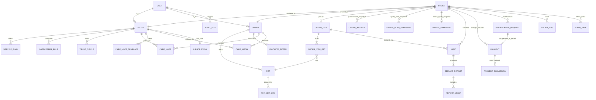

# SD-ERD: 核心實體關係圖 (Core Entity Relationship)

## 1. 核心關聯圖

## 2. 實體詳細設計 (Detailed Schema)

### 2.1 基礎實體規範 (Base Entity Standard)
為了確保審計追蹤與併發控制，除特殊中間表外，所有資料表一律包含以下標準欄位：
- **`id`**: `UUID` (Primary Key, 預設使用隨機 UUID)。
- **`version`**: `INT` (樂觀鎖版本號，用於 JPA `@Version` 防止併發覆蓋)。
- **`created_at`**: `TIMESTAMPTZ` (建立時間)。
- **`updated_at`**: `TIMESTAMPTZ` (最後更新時間)。
- **`created_by`**: `UUID` (建立者 ID，對應 USER.id)。
- **`updated_by`**: `UUID` (最後更新者 ID，對應 USER.id)。
- **`is_deleted`**: `BOOLEAN` (邏輯刪除標記，預設為 false)。

### 2.2 訂單交易（SD-ORDER，2026-11-22 重建，DDL 以 `SD-ORDER.md` §5 為準）

> 狀態機與共用概念以 `docs/sa/00-DOMAIN-BASELINE.md` §3 為準。舊的 `settlement_status`、`paid_at`、`payout_at`、`adjustment_reason`、`is_disputed`、訂單層付款憑證欄位已移除（遷移 `V20261122_01__order_rebuild.sql`，一支到位）。
- **ORDER**（`orders`）
  - `status`: VARCHAR（`PENDING` / `PENDING_PAYMENT` / `CONFIRMED` / `IN_PROGRESS` / `DISPUTED` / `COMPLETED` / `CANCELLED`，baseline §3.1）
  - 金額（INT，TWD）：`base_amount`（後端重算）、`surcharge_amount`、`discount_amount`、`pricing_notes`、`total_amount`（報價前 NULL；目前生效的合約總額，只在報價、變更 SETTLED、補款逾時重算時改）
  - 時間（TIMESTAMPTZ）：`review_expires_at`、`quoted_at`、`confirmed_at`（首次付款 VERIFIED，月接單額度計數依據）、`cancelled_at`、`completed_at`、`disputed_at`、`completion_basis_at`；`first_service_date` DATE（首日，Asia/Taipei）
  - 問卷：`questionnaire_status`（`NOT_REQUIRED` / `COMPLETED`）、`questionnaire_exempt_reason`（`REGULAR_OWNER` / `NO_ACTIVE_QUESTIONS` / NULL）
  - 取消 / 結案：`cancelled_by`（`OWNER` / `SITTER` / `SYSTEM` / `ADMIN`）、`cancel_reason_code`、`cancel_reason`、`completed_by`（`OWNER` / `SYSTEM` / `ADMIN`）
- **ORDER_ITEM**（`order_items`）：預約群組或變更新增項目；`plan_id`、`service_dates` DATE[]、`daily_count`、`booked_unit_price`、`source`（`BOOKING` / `MODIFICATION`）
- **ORDER_ITEM_PET**（`order_item_pets`）：群組 × 毛孩
- **ORDER_ANSWER**（`order_answers`）：問卷答案快照（題目文字、題型、答案）
- **ORDER_PLAN_SNAPSHOT**（`order_plan_snapshots`）：報價時各方案單價與名稱
- **ORDER_SNAPSHOT**（`order_snapshots`）：訂單層媒體額度快照 `plan_tier`、`max_photos`、`max_videos`、`media_retention_days`（-1 = 永久）
- **PAYMENT**（`payments`）：`direction`（`CHARGE` / `REFUND`）、`purpose`（`INITIAL` / `SUPPLEMENT` / `MODIFICATION_REFUND` / `ADMIN_ADJUSTMENT`）、`method`、`amount`、`status`（`UNPAID` / `SUBMITTED` / `VERIFIED` / `VOID`）、`due_at`、`remind_at`、`escalate_at`、`payee_account_snapshot`（AES-256-GCM 密文）
- **PAYMENT_SUBMISSION**（`payment_submissions`）：每次上傳憑證一列（後五碼、免責同意時間、物件鍵、狀態、駁回原因）
- **MODIFICATION_REQUEST**（`modification_requests`）：`type`、`status`（baseline §3.4）、`initiated_by`（`OWNER` / `SITTER` / `SYSTEM`）、期望 / 報價內容、計價欄位、`expires_at`、`ended_at`
- **ORDER_LOG**（`order_logs`）：`action_type`、`operator_role`、`operator_user_id`、`payload`（與狀態變更同交易）
- **ADMIN_TASK**（`admin_tasks`）：`type`、`status`（`OPEN` / `RESOLVED`）、`resolution`
- **IDEMPOTENCY_RECORD**（`idempotency_records`）：冪等範圍、request hash、回應回放（舊 `idempotency_keys` 暫留給尚未重建的模組）
- **VISIT**（`visits`，歸 SD-FULFILL）
  - `order_id`: UUID (FK)、`order_item_id`: UUID (FK)
  - `plan_id`: UUID (FK, 關聯方案)
  - `status`: `PENDING` / `IN_PROGRESS` / `DONE` / `CLOSED_BY_SYSTEM` / `CANCELLED`
  - `service_date`: DATE（Asia/Taipei 日期；取代以 UTC 午夜存的 `scheduled_at`，定義權屬 SD-FULFILL）
  - `finished_at`、`cancelled_at`、`closed_at`: TIMESTAMPTZ

### 2.3 SITTER & PROFILE (含審核與彈性資料)
- **SITTER**
  - **`kyc_status`**: VARCHAR (UNVERIFIED, PENDING, VERIFIED, REJECTED, SUSPENDED)
  - **`internal_trust_score`**: INT (內部信用分，預設 100)
  - **`tags`**: JSONB (專長標籤，如 ["老貓照顧", "餵藥", "剪指甲"])
  - **`service_areas`**: JSONB (服務區域，如 ["台北市信義區", "台北市大安區"])
  - `bank_account_info`: JSONB (加密存儲)
- **OWNER**
  - **`address`**: VARCHAR (飼主地址，供保母評估服務距離)
- **SUBSCRIPTION**
  - `sitter_id`: UUID (FK), `plan_tier`: VARCHAR, `expired_at`: TIMESTAMPTZ
  - `monthly_order_count`: INT（**已不使用**：月接單額度改由 `orders.confirmed_at` 即時計數，見 SD-ORDER §11；SD-BILLING 重寫時移除）

### 2.4 業務輔助實體
- **GATEKEEPER_RULE**: `sitter_id`, `target_client_id`, `rule_type` (WHITELIST, BLACKLIST).
- **TRUST_CIRCLE**: `sitter_a_id`, `sitter_b_id`, `status` (PENDING, ACCEPTED).
- **FAVORITE_SITTER**: `owner_id`, `sitter_id` (複合 PK).
- **PET_EDIT_LOG**: `pet_id`, `editor_id`, `diff_summary` (JSONB).

### 2.5 照護記事與媒體庫 (PRD-021, SD-021)
- **CARE_NOTE** (照護記事本)
  - `sitter_id`: UUID (FK), `owner_id`: UUID (FK)
  - `sections`: JSONB (結構化大項與條目清單，含流水號)
  - `updated_at`: TIMESTAMPTZ
- **CARE_NOTE_TEMPLATE** (記事模板)
  - `sitter_id`: UUID (FK)
  - `name`: VARCHAR (模板名稱)
  - `sections`: JSONB (同 CARE_NOTE 結構)
  - 限制：每位保母最多 3 筆
- **CARE_MEDIA** (照護媒體庫)
  - `sitter_id`: UUID (FK), `owner_id`: UUID (FK)
  - `caption`: VARCHAR (說明文字)
  - `media_url`: VARCHAR (GCS 路徑)
  - 限制：每對保母-飼主最多 20 筆

### 2.6 行程照護日誌 (PRD-022, SD-022)
- **SERVICE_REPORT** (照護日誌)
  - `visit_id`: UUID (FK, UNIQUE — 每個行程僅一份)
  - `status`: VARCHAR (`DRAFT` / `SUBMITTED`；`EXPIRED` 為邏輯衍生狀態，不持久化)
  - `text_content`: TEXT (nullable，≤ 1000 字)
  - `submitted_at`: TIMESTAMPTZ (nullable，送出時寫入)
  - 媒體保留天數不存於此表，由 `VISIT → ORDER → ORDER_SNAPSHOT.snapshot_media_retention_days` 查詢
- **REPORT_MEDIA** (日誌多媒體，原 ERD 圖中 `MEDIA`)
  - `service_report_id`: UUID (FK)
  - `media_type`: VARCHAR (`IMAGE` / `VIDEO`)
  - `media_url`: VARCHAR (GCS 路徑，不可變；使用標準生命週期路徑格式，`plan_tier` 取 ORDER_SNAPSHOT 快照值)
  - `caption`: VARCHAR (nullable，≤ 100 字)

---
