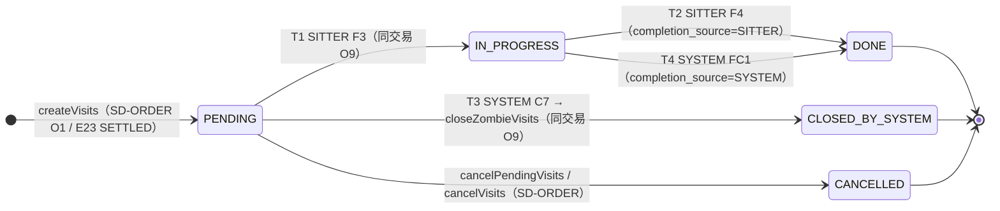
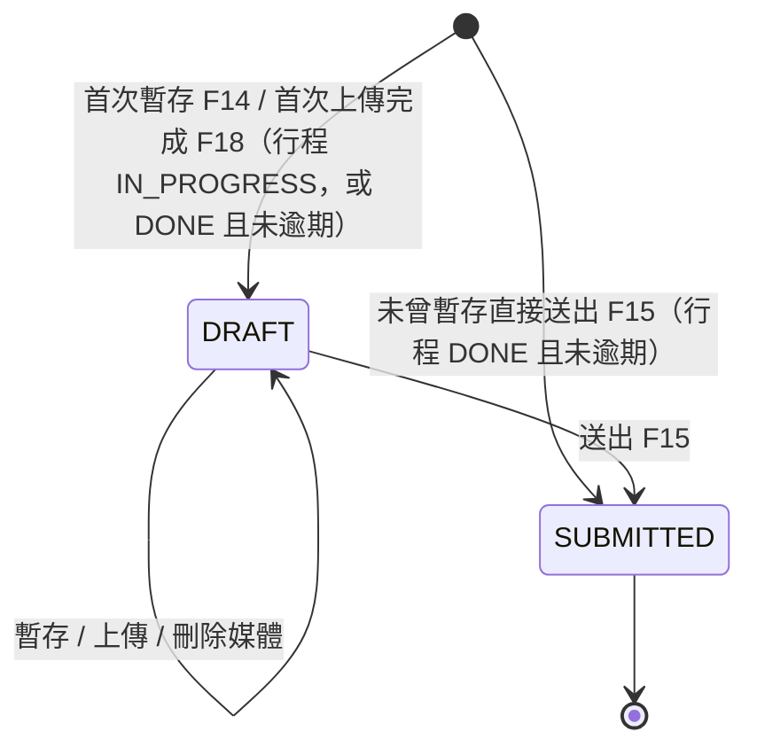
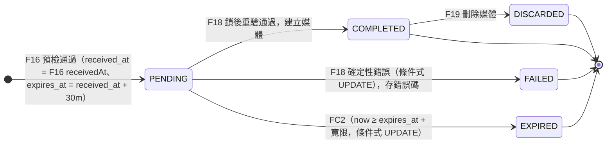
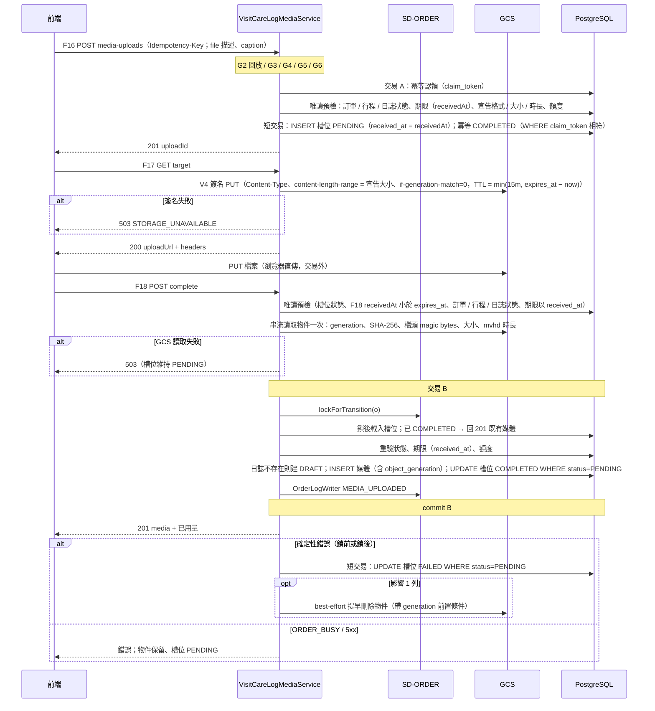
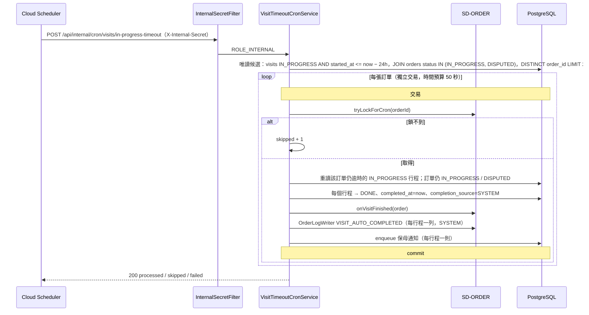
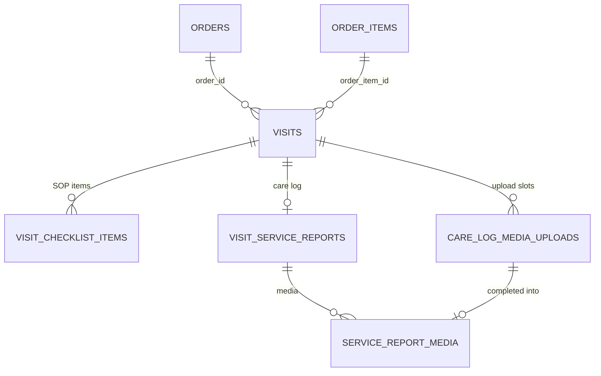

# SD-FULFILL: 服務履約設計文件

| 項目 | 內容 |
|------|------|
| 狀態 | Approved |
| 建立日期 | 2026-11-22 |
| 涵蓋 PRD | PRD-008、PRD-009、PRD-022、PRD-028（全部 Approved 2026-11-22；PRD-022 於直傳修訂後再核准）；對應表見 `00-SD-PLAN.md` §0）。PRD-009 只在本 SD 定義畫面（§9.2）與測試對應；其 API（E2、E3、E25、E26、E30、C8）由 SD-ORDER 擁有，本 SD 不重複定義 |
| 擁有的 Table | `visits`、`visit_checklist_items`（新）、`visit_service_reports`（照護日誌）、`service_report_media`（日誌媒體）、`care_log_media_uploads`（新，上傳槽位）。其他 SD 只能經本 SD 的 Service 存取 |
| 依賴的 SD | **SD-ORDER**（同一次發布，SD-ORDER CQ-21）：`OrderLockService`、`OrderLifecycleService`、`OrderLogWriter`、`OrderQueryService.getParticipants` / `getMediaQuota` / `getOrderContexts`、E2 `serverTime` / `completionHint`、E30 `serverMonth`、排程 C7。**本 SD 需要的 SD-ORDER 修訂（§12 CQ-1~4、CQ-10）已由使用者 2026-11-22 決定讓 SD-ORDER 退回 In Review、由原作者同批修訂，兩份一起核准**。**SD-GLOBAL-SPEC**：冪等三段式（§2.4，`@Idempotent`）、實體基底（§2.5，`AuditedEntity` / `VersionedEntity`）、例外對映（§2.6）。**SD-SUPPLY**（未重建，過渡實作）：`ServicePlanQuery.findDefaultTasks`（新）。**SD-NOTIFY**：`NotificationService.enqueue()`。**SD-CARE / SD-ORDER**：呼叫本 SD 的 `CareLogMediaRetentionPort`（媒體保留、到期提醒，PRD-013） |
| 遵守 | `SD-GLOBAL-SPEC.md`（§2.3、§4.1、§4.2 依其註記以 baseline 為準）、`SD-FRONTEND-SPEC.md`、`docs/sa/00-DOMAIN-BASELINE.md` 第 3 版（下稱 baseline）、`SD-ORDER.md`（下稱 SD-ORDER；判斷順序代號 G1–G7、L 沿用其 §6.1） |
| 取代 | SD-008、SD-009、SD-022；本 SD 核准後由使用者將上述改 `Superseded` |

> 共用概念（角色、SaaS 額度、訂單主狀態、行程狀態、時間起算點、錯誤碼與判斷順序）一律引用 baseline，本文件不重新定義。行程狀態集合、`VISIT_IN_PROGRESS_TIMEOUT_HOURS`、`VISIT_ZOMBIE_HOURS`、`CARE_LOG_EDIT_HOURS`、`completion_basis_at` 定義見 baseline §5、§6。
> 本 SD **實作 SD-ORDER §2.4.2 要求的介面**（`VisitCommandService`、`VisitQueryService`）。本 SD 需要的 SD-ORDER 修訂列 §12 CQ-1~4、CQ-10，由 SD-ORDER 原作者同批修訂（SD-ORDER 已退回 In Review）；冪等、實體基底、例外對映的共用規則在 SD-GLOBAL-SPEC §2.4–§2.6，本 SD 只引用。
> 禁止貼實作程式碼；類別只寫名稱與一句責任。DDL 為契約的一部分，照寫。

---

## 1. AC 對應實作

> 端點代號：F1–F19 為本 SD 使用者端點、FC1–FC2 排程、FT1–FT2 測試造資料（§6.2）；E\*、C\* 為 SD-ORDER 端點。「鎖」欄：「訂單鎖」= `OrderLockService.lockForTransition`（`FOR NO KEY UPDATE` + `lock_timeout 3s`）；「排程鎖」= `tryLockForCron`（`SKIP LOCKED`）。路徑前綴 `…/` = `/api/orders/{orderId}/visits/{visitId}`。

### 1.1 PRD-008 行程生命週期（21 條）

| PRD | AC | API / 畫面 | Table / 欄位 | 鎖 / 交易 | 測試 |
|-----|----|-----------|-------------|----------|------|
| PRD-008 | AC-1.1 | F3 `POST …/start`；`sitter-visit-panel` | `visits.status`、`started_at`；`orders.status`（O9，SD-ORDER）；`order_logs` 恰 1 列 `ORDER_STARTED` | 訂單鎖；T1 + `onVisitLeftPending(STARTED)` 同交易；觸發 O9 時不寫 `VISIT_STARTED` | `VisitStartIntegrationTest` |
| PRD-008 | AC-1.2 | F3 | `visits.status`；`order_logs` `VISIT_STARTED` | 訂單鎖；`IN_PROGRESS` / `DISPUTED` 不觸發 O9 | `VisitStartIntegrationTest` |
| PRD-008 | AC-1.3 | F3；`sitter-visit-panel-date-not-reached-message`、`sitter-visit-panel-deadline-passed-message` | `visits.service_date` | 鎖後以注入 `Clock` 判斷 `VISIT_ZOMBIE_AT` 與行程日期 | `VisitStartIntegrationTest`；畫面 TS-008 |
| PRD-008 | AC-1.4 | F3、F4 | `visits.status`；`orders.status` | 訂單鎖；`ORDER_STATE_CONFLICT` 先於 `VISIT_STATE_CONFLICT`；不寫 log | `VisitStartIntegrationTest`、`VisitCompleteIntegrationTest` |
| PRD-008 | AC-1.5 | F4 `POST …/complete`；`sitter-visit-panel-complete-dialog`（未打勾數取自 F2） | `visits.completed_at`、`completion_source=SITTER`；`orders.completion_basis_at`（`onVisitFinished`） | 訂單鎖；T2 + 基準重算 + `VISIT_COMPLETED` 同交易 | `VisitCompleteIntegrationTest`；對話框 TS-008 |
| PRD-008 | AC-1.6 | F3、F4 | — | G3 / G4 / G5 / G6 判斷順序（404 先於 400） | `VisitAuthorizationIntegrationTest`（真 JWT filter chain） |
| PRD-008 | AC-1.7 | F3、F4、F5 | `idempotency_records` | 冪等三段式（SD-ORDER §3.6.2）；訂閱鎖定不擋 | `VisitIdempotencyIntegrationTest` |
| PRD-008 | AC-1.8 | F3 vs E23 / E29；鎖逾時 | `visits.status`、`modification_requests` | 訂單鎖序列化（兩條執行緒真打）；逾時 409 `ORDER_BUSY` + `Retry-After: 1` | `VisitConcurrencyIntegrationTest` |
| PRD-008 | AC-2.1 | C7（SD-ORDER）→ `closeZombieVisits` | `visits.closed_at`；`notifications`（雙方各 1） | 排程鎖；T3 + O9 + 通知 enqueue 同交易（C7 端點測試歸本 SD） | `CloseZombieVisitsIntegrationTest` |
| PRD-008 | AC-2.2 | C7 | `visits` | 候選唯讀 JOIN `orders` 只取 `CONFIRMED` / `IN_PROGRESS` / `DISPUTED`；同批合併通知 | `CloseZombieVisitsIntegrationTest` |
| PRD-008 | AC-2.3 | FC1 `/api/internal/cron/visits/in-progress-timeout`；`sitter-visit-panel-auto-completed-label`、`owner-order-detail-visit-auto-completed-{visitId}` | `visits.completion_source=SYSTEM`；`order_logs` `VISIT_AUTO_COMPLETED` | 排程鎖；T4 + 基準重算 + 通知保母同交易 | `InProgressTimeoutCronIntegrationTest` |
| PRD-008 | AC-2.4 | FC1、F4 | `visits` | 排程鎖 vs 訂單鎖序列化；`VISIT_STATE_CONFLICT` 帶 `completionSource` | `InProgressTimeoutCronIntegrationTest`、`VisitConcurrencyIntegrationTest` |
| PRD-008 | AC-2.5 | F3 vs C7；C7 vs E23 | `visits`、`order_logs` | 訂單鎖 / 排程鎖序列化；只有先完成者觸發 O9 | `VisitConcurrencyIntegrationTest` |
| PRD-008 | AC-2.6 | FC1、C7 | — | 鎖後重驗略過、單筆失敗隔離、重跑、`X-Internal-Secret` 403 | `InProgressTimeoutCronIntegrationTest`、`CloseZombieVisitsIntegrationTest` |
| PRD-008 | AC-3.1 | F6 `GET /api/visits/sitter/dashboard`；`/sitter/visits` | `visits.sitter_id`、`service_date`、`sequence_in_day`、`slots_in_day` | 唯讀 | `VisitDashboardIntegrationTest`；畫面 TS-008 |
| PRD-008 | AC-3.2 | F6（`overdue[]`、`zombieAt`） | `visits.status`、`service_date` | 唯讀 | `VisitDashboardIntegrationTest` |
| PRD-008 | AC-3.3 | F1 `GET /api/orders/{orderId}/visits`；`owner-order-detail-visit-row-{visitId}` | `visits.started_at`、`completed_at`、`completion_source` | 唯讀 | `OrderVisitListIntegrationTest`；畫面 TS-008 |
| PRD-008 | AC-3.4 | F7 `GET /api/visits/owner/today`；`/owner/visits` | `visits.owner_id`、`service_date` | 唯讀 | `VisitDashboardIntegrationTest` |
| PRD-008 | AC-3.5 | F1、F6 | — | G3 / G4 / G4a / G5；ADMIN 依 `OrderContextView.adminReadable`（§12 CQ-1） | `OrderVisitListIntegrationTest` |
| PRD-008 | AC-3.6 | F5 `PUT …/name`；`sitter-visit-panel-btn-edit-name` | `visits.custom_name`、`booking_plan_title`；O2 方案名稱快照（SD-ORDER `order_plan_snapshots`，經 §12 CQ-1） | 訂單鎖；`VISIT_RENAMED` 同交易 | `VisitRenameIntegrationTest` |
| PRD-008 | AC-3.7 | F5 | `visits.custom_name` | 長度在鎖前（G6）；鎖後 `ORDER_STATE_CONFLICT` → `VISIT_STATE_CONFLICT` → `DEADLINE_PASSED`（`receivedAt`） | `VisitRenameIntegrationTest` |

### 1.2 PRD-028 行程單日 SOP 檢核項（10 條）

| PRD | AC | API / 畫面 | Table / 欄位 | 鎖 / 交易 | 測試 |
|-----|----|-----------|-------------|----------|------|
| PRD-028 | AC-1.1 | `VisitCommandService.createVisits`（SD-ORDER O1 / E23 呼叫）；F1 / F8 | `visit_checklist_items`（`created_source=SYSTEM`）；讀 SD-SUPPLY `findDefaultTasks` | 與行程建立同交易（呼叫端已持有訂單鎖）；不寫 log、不通知 | `ChecklistSeedIntegrationTest` |
| PRD-028 | AC-1.2 | F9 `POST …/checklist/items`；`sitter-visit-panel-checklist-btn-add` | `visit_checklist_items.title`、`sort_order` | 訂單鎖；冪等；不寫 log | `ChecklistEditIntegrationTest` |
| PRD-028 | AC-1.3 | F10 `DELETE …/checklist/items/{itemId}`、F11 `PUT …/checklist/order` | `sort_order`（重排，`DEFERRABLE` 唯一） | 訂單鎖；id 集合鎖外檢查、鎖內重驗 | `ChecklistEditIntegrationTest` |
| PRD-028 | AC-1.4 | F9–F11 | `visits.status`；`orders.status` | 訂單鎖；`DISPUTED` 可編、訂閱鎖定不擋 | `ChecklistEditIntegrationTest` |
| PRD-028 | AC-1.5 | F9 | 20 項上限 | 訂單鎖內計數；`VISIT_STATE_CONFLICT`（第 9 步）先於上限（第 12 步） | `ChecklistEditIntegrationTest` |
| PRD-028 | AC-1.6 | F9–F11 | — | G3 / G4 / G5（404 先於 400） | `ChecklistAuthorizationIntegrationTest` |
| PRD-028 | AC-2.1 | F12 `PUT …/checklist/items/{itemId}/check`；F4 對話框 | `is_completed`、`checked_at` | 訂單鎖；`DONE` 後 409 | `ChecklistCheckIntegrationTest` |
| PRD-028 | AC-2.2 | F12 vs FC1；鎖逾時 | `visits.status` | 訂單鎖 vs 排程鎖序列化 | `ChecklistCheckIntegrationTest`、`VisitConcurrencyIntegrationTest` |
| PRD-028 | AC-2.3 | F1（`checklist.items[]`）；`owner-order-detail-visit-checklist-{visitId}` | `visit_checklist_items` | 唯讀 | `ChecklistReadIntegrationTest`；畫面 TS-028 |
| PRD-028 | AC-2.4 | F1、F8、F9 | — | G3 / G4 / G5；ADMIN 可讀範圍 | `ChecklistReadIntegrationTest` |

### 1.3 PRD-022 照護日誌與多媒體（24 條）

| PRD | AC | API / 畫面 | Table / 欄位 | 鎖 / 交易 | 測試 |
|-----|----|-----------|-------------|----------|------|
| PRD-022 | AC-1.1 | F14 `PUT …/care-log/draft`；F13 | `visit_service_reports` | 訂單鎖；`ORDER_STATE_CONFLICT` → `VISIT_STATE_CONFLICT` | `VisitCareLogDraftIntegrationTest` |
| PRD-022 | AC-1.2 | F14、F18 | `visit_service_reports.visit_id` UNIQUE（`visit_service_reports_visit_id_key`） | 訂單鎖序列化首次暫存與首次上傳；唯一約束為防線 | `VisitCareLogDraftIntegrationTest` |
| PRD-022 | AC-1.3 | F14；`sitter-care-log-text-counter` | `content`（≤ 1000 code point） | G6 | `VisitCareLogDraftIntegrationTest`；未暫存保護 TS-022 |
| PRD-022 | AC-1.4 | F15 `POST …/care-log/submit`；`sitter-care-log-btn-submit`、`sitter-care-log-deadline` | `status`、`submitted_at`；`order_logs` `CARE_LOG_SUBMITTED` | 訂單鎖；轉移 + log + 通知同交易 | `VisitCareLogSubmitIntegrationTest` |
| PRD-022 | AC-1.5 | F14 / F15 / F16 / F18 / F19 | `status=SUBMITTED` | `CARE_LOG_STATE_CONFLICT` 先於 `DEADLINE_PASSED` | `VisitCareLogSubmitIntegrationTest` |
| PRD-022 | AC-1.6 | F14–F16、F18、F19 | `visits.completed_at`；`care_log_media_uploads.received_at` | 期限以 `receivedAt` 判斷（上傳以 F16 的 `received_at`；F18 以自身 `receivedAt` 判 30 分鐘窗），狀態以鎖後為準 | `VisitCareLogDeadlineIntegrationTest` |
| PRD-022 | AC-1.7 | F13；`sitter-care-log-status`、`owner-order-detail-btn-view-log-{visitId}` | 衍生欄位 `expired`、`deadlineAt` | 唯讀；OWNER 讀 `DRAFT` → 404 | `VisitCareLogReadIntegrationTest` |
| PRD-022 | AC-1.8 | F14、F15、F16 | `orders.status` | 訂單鎖；`COMPLETED` 一律 `ORDER_STATE_CONFLICT` | `VisitCareLogSubmitIntegrationTest` |
| PRD-022 | AC-2.1 | F16 `POST …/care-log/media-uploads`（PRD「申請上傳」= F16 + F17）；`sitter-care-log-quota` | `getMediaQuota`（O2 快照） | 預檢不取鎖；拒絕時不簽發上傳網址、無 GCS 物件 | `VisitCareLogMediaUploadIntegrationTest` |
| PRD-022 | AC-2.2 | F16、F18 | `service_report_media.media_type` 計數 | 預檢 + 訂單鎖內重驗額度 | `VisitCareLogMediaUploadIntegrationTest` |
| PRD-022 | AC-2.3 | F16（宣告值）、F18（檔頭 magic bytes、實際大小）；前端 WebP 壓縮 | `size_bytes` | 交易外檢驗 | `VisitCareLogMediaUploadIntegrationTest`、`MediaInspectorTest`；前端 TS-022 |
| PRD-022 | AC-2.4 | F16、F18（容器 `mvhd` 時長） | `duration_seconds` | 交易外檢驗 | `MediaInspectorTest`、`VisitCareLogMediaUploadIntegrationTest` |
| PRD-022 | AC-2.5 | F16–F18 | `service_report_media`；`order_logs` `MEDIA_UPLOADED` | 訂單鎖；首次上傳同交易建 `DRAFT` | `VisitCareLogMediaUploadIntegrationTest` |
| PRD-022 | AC-2.6 | F19 `DELETE …/care-log/media/{mediaId}` | 刪 `service_report_media` 列；`care_log_media_uploads.status=DISCARDED`；`order_logs` `MEDIA_DELETED` | 訂單鎖；commit 後刪 GCS，失敗由 FC2 補 | `VisitCareLogMediaDeleteIntegrationTest` |
| PRD-022 | AC-2.7 | F18 × 2（不同 key） | 額度 | 訂單鎖序列化（兩條執行緒真打）；後到者刪物件 | `VisitCareLogConcurrencyIntegrationTest` |
| PRD-022 | AC-2.8 | F17 / F18（GCS 失敗、O15 介入） | `care_log_media_uploads.status` | F17 簽名失敗 503；F18 讀物件失敗 503（物件保留、直接重試 F18）；鎖後重驗失敗以條件式 UPDATE 轉 `FAILED` 後刪物件 | `VisitCareLogMediaUploadIntegrationTest` |
| PRD-022 | AC-3.1 | F15 → `enqueue` | `notifications`（`CARE_LOG_SUBMITTED`） | 同交易；Email 依偏好 | `VisitCareLogSubmitIntegrationTest` |
| PRD-022 | AC-3.2 | F13（OWNER）；`owner-care-log-view`、`owner-care-log-visit-name` | 簽名網址 TTL 900 秒 | 唯讀；`X-Goog-Expires=900` | `VisitCareLogReadIntegrationTest` |
| PRD-022 | AC-3.3 | F13–F19 | — | G1 / G3 / G4 / G5 | `VisitCareLogAuthorizationIntegrationTest` |
| PRD-022 | AC-3.4 | F13（ADMIN） | — | `adminReadable`；`DRAFT` → 404 | `VisitCareLogReadIntegrationTest` |
| PRD-022 | AC-3.5 | F15 | `idempotency_records` | 冪等三段式 | `VisitCareLogIdempotencyIntegrationTest` |
| PRD-022 | AC-3.6 | F16、F18 | `idempotency_records`（hash 含宣告 SHA-256）；`care_log_media_uploads` | 冪等回放在簽發網址前；完成後重送回放 | `VisitCareLogIdempotencyIntegrationTest` |
| PRD-022 | AC-3.7 | F15 vs E29 / E25；鎖逾時 | — | 訂單鎖序列化；F18 `ORDER_BUSY` 保留物件、槽位 `PENDING`，同 `uploadId` 直接重打 F18（使用者 2026-11-22，PRD-022 已同步） | `VisitCareLogConcurrencyIntegrationTest` |
| PRD-022 | AC-3.8 | F14、F16 | — | 判斷順序（§6.3） | `VisitCareLogErrorOrderIntegrationTest` |

### 1.4 PRD-009 訂單結案、服務爭議與帳務（24 條；API 屬 SD-ORDER）

> 端點、轉移與其後端整合測試由 SD-ORDER 擁有（使用者 2026-11-22：E25 / E26 / C8 / E30 / E3 / E2 提示的 API 行為歸 SD-ORDER 測試；類別名以 SD-ORDER §10.3 為準，§12 CQ-4）。本 SD 只負責畫面（§9.2，TS-009）與行程端資料（F1 的 `careLog.submitted` / `deadlineAt`）的測試。

| PRD | AC | API / 畫面 | Table / 欄位 | 鎖 / 交易 | 測試 |
|-----|----|-----------|-------------|----------|------|
| PRD-009 | AC-1.1 | E25；`owner-order-detail-btn-complete`、`owner-order-complete-btn-confirm` | `orders.completed_at`、`completed_by=OWNER`；`notifications` `ORDER_COMPLETED_BY_OWNER` | 訂單鎖（SD-ORDER） | `CompletionIntegrationTest`；畫面 TS-009 |
| PRD-009 | AC-1.2 | E25；E2 `completionHint`（§9.2） | `visits`、`visit_service_reports.status` | 同上 | `CompletionIntegrationTest`、`OrderDetailCompletionHintIntegrationTest`；`OrderVisitListIntegrationTest`（`careLog.submitted`）；畫面 TS-009 |
| PRD-009 | AC-1.3 | E25；`owner-order-detail-complete-hint`（`completionHint.code=MODIFICATION_IN_PROGRESS`） | `modification_requests` | 同上 | `CompletionIntegrationTest`、`OrderDetailCompletionHintIntegrationTest`；畫面 TS-009 |
| PRD-009 | AC-1.4 | E25、E17 | `orders.status` | 同上 | `CompletionIntegrationTest` |
| PRD-009 | AC-1.5 | E25 | — | G1–G6 | `CompletionIntegrationTest` |
| PRD-009 | AC-1.6 | E25 vs C8；鎖逾時 | `idempotency_records` | 訂單鎖 vs 排程鎖 | `CompletionIntegrationTest` |
| PRD-009 | AC-1.7 | `/owner/orders/:orderId`、`/sitter/orders/:orderId`；`owner-order-detail-completed-at`、`sitter-order-detail-completed-at` | — | 唯讀 | 畫面 TS-009 |
| PRD-009 | AC-1.8 | F1 + E2；`owner-order-detail-visit-row-{visitId}`、`owner-order-detail-btn-view-log-{visitId}` | `visit_service_reports.status` | 唯讀 | `OrderVisitListIntegrationTest`；畫面 TS-009 |
| PRD-009 | AC-2.1 | C8 | `orders.completed_at`；`notifications` `ORDER_AUTO_COMPLETED` | 排程鎖（SD-ORDER） | `CompletionIntegrationTest` |
| PRD-009 | AC-2.2 | C8、E25；E2 `completionHint.code=CARE_LOG_EXPIRED` | `completion_basis_at` | 同上 | `CompletionIntegrationTest`、`CompletionBasisIntegrationTest`、`OrderDetailCompletionHintIntegrationTest`；`OrderVisitListIntegrationTest`（`deadlineAt`）；畫面 TS-009 |
| PRD-009 | AC-2.3 | C8 | `orders`、`modification_requests` | 同上 | `CompletionIntegrationTest`、`CompletionBasisIntegrationTest` |
| PRD-009 | AC-2.4 | C8 | — | 失敗隔離、重跑、403 | `CompletionIntegrationTest` |
| PRD-009 | AC-2.5 | E26、E28；`owner-order-detail-btn-report-issue`、`owner-order-dispute-*` | `admin_tasks`（`SERVICE_DISPUTE`） | 訂單鎖（SD-ORDER） | `CompletionIntegrationTest`；畫面 TS-009 |
| PRD-009 | AC-2.6 | E26 vs C8；`owner-order-detail-dispute-window-ends-at`、`sitter-order-detail-auto-complete-at`（E2 `serverTime`） | `completion_basis_at` | 鎖後時間判斷視窗 | `CompletionIntegrationTest`、`CompletionBasisIntegrationTest`、`OrderDetailCompletionHintIntegrationTest`（`serverTime`）；畫面 TS-009 |
| PRD-009 | AC-2.7 | E26 | — | 判斷順序 | `CompletionIntegrationTest` |
| PRD-009 | AC-2.8 | E26 | `order_logs` payload | G5 / G6 / G7 | `CompletionIntegrationTest`；計數器 TS-009 |
| PRD-009 | AC-3.1 | E30；`sitter-ledger-*` | `payments` 加總 | 唯讀 | `SitterLedgerIntegrationTest` |
| PRD-009 | AC-3.2 | E30 | `completed_at` / `cancelled_at`（Asia/Taipei 月） | 唯讀 | `SitterLedgerIntegrationTest` |
| PRD-009 | AC-3.3 | E30 | — | 唯讀 | `SitterLedgerIntegrationTest` |
| PRD-009 | AC-3.4 | E30（`serverMonth`）；`/sitter/ledger` 預設月份 | — | 唯讀 | `SitterLedgerIntegrationTest`（`serverMonth`）；畫面 TS-009 |
| PRD-009 | AC-3.5 | E30 | — | G3 | `SitterLedgerIntegrationTest` |
| PRD-009 | AC-3.6 | E3 `tab=HISTORY`；`owner-orders-tab-history`、`owner-orders-history-btn-load-more` | `ix_orders_owner_terminal` | 唯讀 | `OrderHistoryIntegrationTest`；畫面 TS-009 |
| PRD-009 | AC-3.7 | E3 `status` / `month`；`owner-orders-history-filter-status`、`-select-month`、`-empty` | — | 唯讀 | `OrderHistoryIntegrationTest`；畫面 TS-009 |
| PRD-009 | AC-3.8 | E30 | `payments` | 唯讀 | `SitterLedgerIntegrationTest` |

**合計 79 / 79 條 AC**（PRD-008 21、PRD-028 10、PRD-022 24、PRD-009 24）。

---

## 2. 模組邊界

### 2.1 負責

- **行程（`visits`）**：行程狀態機 T1–T4 與 `PENDING → CANCELLED`（由 SD-ORDER 觸發）的寫入；行程命名與預設名稱；保母「今日行程 / 待處理」、飼主「今日到府」、訂單行程清單查詢。
- **排程**：`IN_PROGRESS` 逾時出口 FC1（新端點）；殭屍關閉的行程寫入與通知（`closeZombieVisits`，由 SD-ORDER C7 呼叫）；日誌上傳孤兒檔清除 FC2。
- **SOP 檢核項（`visit_checklist_items`）**：行程建立時自方案預設任務快照、增刪、排序、打勾、唯讀檢視。
- **照護日誌（`visit_service_reports`）與日誌媒體（`service_report_media`、`care_log_media_uploads`）**：暫存、送出、逾期衍生、媒體上傳（三段式）/ 刪除、簽名網址、送出通知。
- **PRD-009 畫面**（§9.2）與 PRD-009 AC 的整合測試。
- **行程類 `order_logs` action 與通知類型代碼**的定義（§7）。

### 2.2 不負責

| 項目 | 歸屬 | 本 SD 的關係 |
|------|------|-------------|
| 訂單主狀態（含 O9、O11–O13、O15 / O17）、`completion_basis_at` 計算與儲存 | SD-ORDER | 呼叫 `onVisitLeftPending` / `onVisitFinished`；O11–O13 與帳務 API（E25、E26、C8、E30、E3）由 SD-ORDER 提供 |
| 行程的建立 / 取消時機（O1、變更、取消、調解） | SD-ORDER | SD-ORDER 在持鎖交易內呼叫本 SD 的 `VisitCommandService` |
| C7 殭屍清理的排程端點、候選分組、`VISITS_CLOSED_BY_SYSTEM` 與 `ORDER_STARTED` log | SD-ORDER | 本 SD 提供候選查詢與 `closeZombieVisits`（含通知） |
| 方案預設任務清單的設定與上限 | SD-SUPPLY（PRD-003） | 唯讀 `ServicePlanQuery.findDefaultTasks` |
| 媒體保留期限計算、到期刪除排程與到期提醒（PRD-013） | SD-CARE | 本 SD 提供 `CareLogMediaRetentionPort`（候選查詢、標記已刪） |
| 通知範本、偏好、Email 投遞 | SD-NOTIFY | 本 SD 在轉移交易內 `enqueue()` |
| ADMIN 待辦與調解畫面（PRD-020） | PRD-020 對應 SD | 本 SD 提供 ADMIN 唯讀的行程 / 檢核項 / 已送出日誌端點 |

### 2.3 對外提供

#### 2.3.1 實作 SD-ORDER §2.4.2 的介面（簽名不變）

| 介面 / 方法 | 本 SD 的行為 | 傳播 |
|------------|-------------|------|
| `VisitCommandService.createVisits(LockedOrder, List<VisitSpec>)` | 依 spec 建 `PENDING` 行程：`service_date`、`order_item_id`、`plan_id`、`booking_plan_title = planTitle`、`sequence_in_day`、`slots_in_day`（同 `orderItemId` + `serviceDate` 的 spec 數）、`owner_id` / `sitter_id`（取自 `LockedOrder`）；同交易依 §4.8 帶入檢核項。不寫 `order_logs`、不通知。**不寫 `scheduled_at`**（欄位刪除，§5.1 第 13 段；SD-ORDER §2.4.2 註記由原作者同批修正，§12 CQ-3） | `MANDATORY`，須持訂單鎖 |
| `VisitCommandService.cancelPendingVisits(LockedOrder, OffsetDateTime now)` | 該訂單所有 `PENDING` 行程 → `CANCELLED`、寫 `cancelled_at`；回傳 id；檢核項不動 | 同上 |
| `VisitCommandService.cancelVisits(LockedOrder, Set<UUID>, OffsetDateTime now)` | 全部為 `PENDING` 才整批取消；任一不是 → 拋 `VisitNotPendingException(visitIds)`，不改任何列 | 同上 |
| `VisitCommandService.closeZombieVisits(LockedOrder, OffsetDateTime now, Duration zombieAfter)` | 防線：`order.status` 不在 `CONFIRMED` / `IN_PROGRESS` / `DISPUTED` → 回空。否則把 `PENDING` 且 `service_date 00:00（Asia/Taipei）+ zombieAfter ≤ now` 的行程 → `CLOSED_BY_SYSTEM`、`closed_at = now`；本批非空時同交易 `enqueue` 保母與飼主各 1 則（§7.2，列出本批所有日期與行程名稱）；本批為空 → 不通知、回空（SD-ORDER 據此略過，PRD-008 EX-23）。SD-ORDER §8.1 C7 的呼叫寫成 `closeZombieVisits(orderId, now)`，與本簽名不一致，由原作者修正（§12 CQ-3） | 同上 |
| `VisitQueryService.listVisits(UUID orderId)` | `VisitView`：`visitId`、`orderItemId`、`planId`、`serviceDate`、`status`、`completedAt`、`closedAt`、`careLogSubmitted`（`visit_service_reports.status = SUBMITTED`）；一次查詢（LEFT JOIN 日誌），不 N+1 | `SUPPORTS` |
| `VisitQueryService.effectiveServiceDateRanges(Collection<UUID> orderIds)` | `Map<UUID, ServiceDateRange>`：各訂單 `status ≠ CANCELLED` 行程的 `MIN` / `MAX(service_date)`，一次 `GROUP BY order_id` 查詢（`ix_visits_order_status`）；空集合不查 DB；無有效行程的訂單不在 Map 內 | `SUPPORTS` |
| `VisitQueryService.findOrderIdsWithZombieVisits(LocalDate maxServiceDate, Set<OrderStatus>, int limit, CronScope scope)` | `visits.status='PENDING' AND service_date <= :max`，唯讀 JOIN `orders.status IN (:statuses)`（SD-ORDER CQ-22 排程候選例外），`DISTINCT order_id`，`LIMIT`。`CronScope`（使用者 2026-11-22 TS 回饋）：`orderId` 有值時只取該訂單；無值（Cloud Scheduler 自動觸發）時唯讀 JOIN `users` 排除 owner 或 sitter 為 `@e2e-journey.test` 帳號的訂單。`closeZombieVisits` 本身不變（範圍由候選決定） | `SUPPORTS` |

- 寫入方法丟出的例外只有 `VisitNotPendingException`（業務）；其餘 DB 例外使呼叫端交易回滾。
- **命名**：既有 `domain/model/CareLog.java` / `CareLogRepository`（`care_logs` 表）屬 SD-CARE 照護操作稽核，本模組一律不使用 `CareLog*` 作類別名，日誌相關類別沿用表名前綴 `VisitServiceReport*` / `ServiceReport*`，Service / Controller 用 `VisitCareLog*`；對外 port `CareLogMediaRetentionPort` 保留原名（SD-ORDER M32 已引用，且不與 `CareLog` / `CareLogRepository` 撞名）。
- **ArchUnit**（`FulfillAggregateArchTest`）：`VisitRepository`、`VisitChecklistItemRepository`、`VisitServiceReportRepository`、`ServiceReportMediaRepository`、`ServiceReportUploadRepository` 只能被 `application/service/fulfill/**` 依賴；`VisitCommandService` 寫入方法的呼叫者限 `application/service/order/**` 與本套件；`Visit` 不得依賴 `Order` entity（與 SD-ORDER `OrderAggregateArchTest` 對稱）。

#### 2.3.2 給 SD-CARE / SD-ORDER：`CareLogMediaRetentionPort`（取代他模組直讀 `service_report_media`）

| 方法 | 參數 / 回傳 | 規則 | 傳播 |
|------|------------|------|------|
| `findExpiredMedia` | `OffsetDateTime now`、`int limit` → `List<ExpiredMediaView>`（`mediaId`、`objectKey`、`objectGeneration`、`orderId`） | 條件由 SD-CARE 的 PRD-013 規則決定，查詢沿用現行語意（`is_purged = false`，所屬訂單結案日 + 快照保留天數 ≤ now，`-1` 永久除外）；唯讀 JOIN `visits` / `orders` / `order_snapshots`（排程候選例外） | `SUPPORTS` |
| `markPurged` | `UUID mediaId`、`OffsetDateTime now` | 同交易：媒體 `is_purged = true`、`purged_at`；對應槽位寫 `object_deleted_at`（同模組表）。不鎖訂單（不是行程或日誌的狀態轉移，不影響額度：已送出或已結案的日誌不可再上傳） | `REQUIRED` |
| `hasUnpurgedMedia` | `Set<UUID> orderIds` → `Set<UUID>`（仍有 `is_purged = false` 媒體的訂單） | 與 SD-ORDER M32 `findCompletedOrdersPendingMediaExpiryWarning`（只讀 orders）搭配，取代原本直讀 `service_report_media`（含已刪欄位 `is_deleted`）的 `EXISTS` 子查詢；協調者改寫見 §8.4.2 F-M22；單次查詢 | `SUPPORTS` |

#### 2.3.3 給 SD-ORDER test-data：`FulfillTestInspectionQuery`

`inspect(UUID orderId)` → 行程 / 日誌 / 媒體 / 檢核項 / 上傳槽位的唯讀快照，掛進 SD-ORDER `GET /api/internal/test-data/orders/{orderId}/inspect`（限 `@e2e-journey.test` 訂單）；欄位見 §10.2。`SUPPORTS`、固定 5 次查詢、不含簽名網址；ArchUnit 限只有 test-data controller 可呼叫。

#### 2.3.4 給前端（本 SD 端點）

見 §6.2（F1–F19）。PRD-009 畫面另呼叫 SD-ORDER 的 E2、E3、E25、E26、E30。

### 2.4 依賴的介面

| 提供方 | 介面 / 方法 | 用途 | 狀態 |
|--------|------------|------|------|
| SD-ORDER | `OrderLockService.lockForTransition` / `tryLockForCron`（§2.4.1） | 所有寫入與 FC1 | 已定義 |
| SD-ORDER | `OrderLifecycleService.onVisitLeftPending(order, visitId, STARTED, actor)` / `onVisitFinished(order)` | T1（O9）、T2、T4 | 已定義 |
| SD-ORDER | `OrderLogWriter.write(order, actionType, actor, payload)` | §7.1 | 已定義 |
| SD-ORDER | `OrderQueryService.getParticipants(orderId)` | 鎖前歸屬（403）判斷 | 已定義 |
| SD-ORDER | `OrderQueryService.getMediaQuota(orderId)` | 日誌媒體額度（BR-9） | 已定義 |
| SD-ORDER | **`OrderQueryService.getOrderContexts(Set<UUID>)`** | O2 方案名稱快照（行程預設名稱，PRD-008 BR-14、CQ-9 / CQ-15）、ADMIN 可讀判斷、儀表板卡片的對方名稱 / 毛孩 / 訂單建立時間 / 群組順序 | SD-ORDER 原作者已新增（§12 CQ-1） |
| SD-ORDER | **E2 `serverTime` / `completionHint`、E30 `serverMonth`** | PRD-009 結案提示、「即將自動結案」、帳務預設月份（§9.2） | SD-ORDER 原作者已新增（§12 CQ-10）；`completionHint` = `{ code, autoCompleteAt } | null`，`code`：`MODIFICATION_IN_PROGRESS` / `VISITS_NOT_FINISHED` / `CARE_LOG_EXPIRED` / `CARE_LOG_PENDING` |
| SD-ORDER | `OrderBusyException`、`IdempotencyException`、`StorageUnavailableException`（`application/exception/`） | 本 SD 的 advice 一併對映 | 已定義 |
| SD-GLOBAL-SPEC §2.4（共用套件） | 冪等三段式：`@Idempotent` 端點標註、`IdempotencyService`（`claim` / `complete` / `fail`）、`IdempotencyInterceptor`、`IdempotencyBodyCachingFilter`、`idempotency_records`（使用者 2026-11-22：移到共用套件、表由 GLOBAL 擁有） | F3、F4、F9、F15、F16 | 已寫入 GLOBAL §2.4（SD-ORDER 原作者），本 SD 只引用 |
| SD-GLOBAL-SPEC §2.5 / §2.6 | 實體基底規則（不映射已刪除的 `is_deleted`；`@Version` 只放在需要的實體；系統寫入的列不經 `RequestAuditorAware`）；業務時間欄一律以注入 `Clock` 由 Service 寫入 | 本模組所有 entity（§2.5 第 7 點） | 已寫入 GLOBAL §2.5 / §2.6，本 SD 只引用 |
| SD-SUPPLY（過渡） | **`ServicePlanQuery.findDefaultTasks(Set<UUID> planIds)`** → `Map<UUID, List<String>>` | 檢核項初始帶入（PRD-028 BR-2）；方案已刪除或下架回空清單；JSONB 中的非字串 / null 元素略過、不拋例外 | 新增（同發布，§8.4.1） |
| SD-NOTIFY | `NotificationService.enqueue(NotificationCommand)` | §7.2 | 已定義（SD-ORDER §2.4.2） |
| 共用 | `MediaStorageService`（擴充，§8.2） | 簽名上傳、讀取串流、刪除、簽名讀取網址 | 本 SD 擴充介面 |

### 2.5 交易與鎖規則（本 SD 所有寫入）

1. **鎖前只用投影**：路徑帶 `orderId`；G4 / G5 以投影查詢 `VisitRef(visitId, orderId, sitterId, ownerId)`（以及項目 / 媒體 / 槽位的 `id + visitId` 投影）判斷 404 / 403，**不載入** `Visit`、日誌、檢核項、槽位實體。`VisitRef.orderId ≠ 路徑 orderId` → 404。不以 `FOR UPDATE` 鎖 `visits` 或日誌列（SD-ORDER §2.3.1 鎖順序）。理由：不帶 key 的端點（F5、F10–F12、F14、F19）的 G4 與交易 B 可能在同一 persistence context，鎖前載入的實體鎖後會從一級快取回舊值，使狀態檢查以舊值通過（例：打勾時行程剛被 FC1 轉 `DONE`，會得 `ORDER_BUSY` 而不是 PRD-008 AC-2.4 要求的 `VISIT_STATE_CONFLICT`）。
2. **`Visit` 實體不與 `Order` 建 JPA 關聯**：只存 `orderId`（UUID 欄）。理由：關聯讓本模組能經由行程修改訂單聚合；現況雖為 `FetchType.LAZY`，代理若在鎖前被觸發，同樣有 SD-ORDER §3.6.1「鎖後新鮮度」問題。
3. **交易 B**：`lockForTransition(orderId)` → 鎖後**首次**載入行程 / 日誌 / 檢核項 / 槽位實體（第 1 點保證快取中沒有舊值）→ 依判斷順序重驗 → 寫入 → `OrderLogWriter` → `enqueue()` → 冪等完成（有 key 時，帶 `claim_token` 條件）→ commit。
4. **外部 I/O 不在交易內**：簽名網址產生、GCS 讀取檢驗與刪除一律在交易外（F13 的簽名在 `@Transactional(readOnly)` 範圍之外執行）；上傳由瀏覽器直傳 GCS（§4.4、§11 決策 1）。
5. **同一使用者多裝置自我併發不處理**（doc-conventions）；跨角色與系統排程以訂單鎖序列化。同一 `uploadId` 的兩個 F18 並行屬會刪錯物件的資料錯誤，另以條件式更新處理（§3.3）。
6. 實體 `@Version`：`visits`、`visit_service_reports` 保留作最後防線；衝突回 409 `ORDER_BUSY`（baseline §3.6）。不接受客戶端 version。
7. **實體基底**（依 SD-GLOBAL-SPEC §2.5，§12 CQ-13）：`Visit`、`VisitServiceReport` 繼承 `VersionedEntity`（無 `is_deleted`，含 `@Version`）；`VisitChecklistItem`、`ServiceReportMedia` 繼承 `AuditedEntity`。**建立者 / 更新者**（PRD-022 BR-24；主流程 2026-11-22 決定）：`VisitServiceReport` 映射 `created_by` / `updated_by`，由 Service 寫入 token 保母（F14 / F15 / F18 首次建立日誌時寫 `created_by`，每次寫入都更新 `updated_by`）；`ServiceReportMedia` 以 `uploaded_by` 作為 BR-24 的建立者（媒體建立後不可修改，故無 `updated_by`）；`visits.created_by` / `updated_by` 刪欄（行程操作者記在 `order_logs`，與 SD-ORDER 一致）。`ServiceReportMedia` 不含 `version`、不用 `@CreatedBy`；`VisitChecklistItem` 不用 `@CreatedBy` / `@LastModifiedBy`，`created_by` / `updated_by` 由 Service 明確寫入（SITTER 寫 token 身分、SYSTEM 帶入寫 NULL；否則 O1 由 OWNER 觸發時 auditing 會填入 OWNER id 而撞 `ck_checklist_source`）；`ServiceReportUpload`（`care_log_media_uploads`）不用 auditing。
8. **時間欄**：`started_at`、`completed_at`、`closed_at`、`cancelled_at`、`checked_at`、`submitted_at`、`uploaded_at`、`received_at`、`expires_at` 一律由 Service 以注入 `Clock` 寫入；auditing 只負責 `created_at` / `updated_at`。
9. **`receivedAt` 定義**：Controller 進入時以注入 `Clock` 取得一次，傳入 Service；F16 把它寫入 `care_log_media_uploads.received_at`（不用 DB 預設值）。F18 另取自己的 `receivedAt`，只用於判斷槽位是否逾期（§3.3）。

---

## 3. 狀態機

### 3.1 行程（`visits.status`，baseline §6；轉移編號沿用 PRD-008 §5）



| 轉移 | API | 鎖 | 鎖後前置條件（依序） | 不符時 |
|------|-----|----|--------------------|-------|
| T1 `PENDING → IN_PROGRESS` | F3 | 訂單鎖 | 訂單 `CONFIRMED` / `IN_PROGRESS` / `DISPUTED` → 行程 `PENDING` → `now < VISIT_ZOMBIE_AT` → 今天（Asia/Taipei）≥ `service_date` | 409 `ORDER_STATE_CONFLICT` → 409 `VISIT_STATE_CONFLICT` → 409 `DEADLINE_PASSED`（`VISIT_ZOMBIE_AT`）→ 422 `VISIT_DATE_NOT_REACHED` |
| T2 `IN_PROGRESS → DONE` | F4 | 訂單鎖 | 訂單 `IN_PROGRESS` / `DISPUTED` → 行程 `IN_PROGRESS` | 409 `ORDER_STATE_CONFLICT` → 409 `VISIT_STATE_CONFLICT` |
| T3 `PENDING → CLOSED_BY_SYSTEM` | C7（SD-ORDER）→ `closeZombieVisits` | 排程鎖 | 訂單 `CONFIRMED` / `IN_PROGRESS` / `DISPUTED`；`now ≥ VISIT_ZOMBIE_AT` | 略過（`skipped`） |
| T4 `IN_PROGRESS → DONE` | FC1 | 排程鎖 | 行程 `IN_PROGRESS`；`now ≥ started_at + VISIT_IN_PROGRESS_TIMEOUT_HOURS`；訂單 `IN_PROGRESS` / `DISPUTED`（防線） | 略過（`skipped`） |
| `PENDING → CANCELLED` | SD-ORDER 呼叫 | 呼叫端已持有 | `PENDING` | `cancelVisits`：`VisitNotPendingException` |

- `VISIT_ZOMBIE_AT` = `service_date` 00:00（Asia/Taipei）+ `VISIT_ZOMBIE_HOURS`（讀 SD-ORDER `app.order.visit-zombie-hours`，不重複定義）。
- `VISIT_STATE_CONFLICT` payload：`currentVisitStatus`；`currentVisitStatus = DONE` 時另帶 `completionSource`（`SITTER` / `SYSTEM`，PRD-008 CQ-11）。
- 命名（F5）不是狀態轉移，但同樣受行程狀態限制（§6.3 F5）。

### 3.2 照護日誌（`visit_service_reports.status`，PRD-022 §5）



- 只持久化 `DRAFT` / `SUBMITTED`。「逾期」為衍生值：`receivedAt ≥ visits.completed_at + CARE_LOG_EDIT_HOURS`（`DONE` 行程）；不寫入、無排程（PRD-022 BR-1）。
- 送出後永久唯讀；任何寫入 → 409 `CARE_LOG_STATE_CONFLICT`（payload `currentCareLogStatus=SUBMITTED`）。

### 3.3 上傳槽位（`care_log_media_uploads.status`，本 SD 技術實體）



- **互斥**：`PENDING → COMPLETED`、`PENDING → FAILED`、`PENDING → EXPIRED` 一律以 `UPDATE ... WHERE id=:id AND status='PENDING'` 寫入，影響 0 列即表示已被他方轉移，該請求不得做後續副作用（不得刪物件），改為重讀槽位依其狀態回應。同一 `uploadId` 兩個 F18 並行時，恰一個成功，另一個回 201 既有媒體（鎖後見 `COMPLETED`）或依重讀結果回應，物件不會被刪。
- **簽名網址不得超過槽位**：F17 簽發 TTL = `min(upload-url-ttl, expires_at − now)`；結果 ≤ 0 才回 409 `CARE_LOG_UPLOAD_EXPIRED`。因此 PUT 只能在 `expires_at` 前開始；在途上傳由 FC2 的寬限期（`upload-delete-grace` = 15 分鐘）涵蓋。
- **槽位逾期判斷**：F18 以**自己的** `receivedAt < expires_at` 判斷，交易 B 不再以鎖後 `now` 重比（第 29:50 開始、串流 20 秒的合法完成不被誤判）。F18 遇 `ORDER_BUSY` 後若重打時已過 `expires_at`，重打的 F18 以其自己的 `receivedAt` 比對而得 409 `CARE_LOG_UPLOAD_EXPIRED`、檔案作廢，即使第一次確認在窗內收到；這是照 PRD-022 BR-28 字面（每次確認各自比對）的結果（主流程 2026-11-22 決定）。
- **物件刪除分兩種**：(1) 提早刪除（best-effort）：本請求把槽位轉 `FAILED`、或 F19 把媒體轉 `DISCARDED` 後，在交易外刪除；**不寫** `object_deleted_at`。(2) 最終清除：FC2 對 `FAILED` / `EXPIRED` / `DISCARDED` 且 `now ≥ expires_at + upload-delete-grace` 的槽位刪除物件（不存在視為成功），成功才寫 `object_deleted_at`。理由：簽名網址在 `expires_at` 前仍有效，提早刪除後可能被遲到的 PUT 重新寫入，只有過了 `expires_at + 寬限` 的刪除才是最終的。`COMPLETED` 槽位的物件只由 F19（→ `DISCARDED`）或 PRD-013 `markPurged`（直接寫 `object_deleted_at`）處理。

**F18 失敗類別 × 槽位 × 物件 × 前端動作**

| 情境 | 回應 | 槽位 | 物件 | 前端動作（§9.3） |
|------|------|------|------|----------------|
| 槽位已 `COMPLETED`（請求進入時或鎖後才發現） | 201 既有媒體 | 不變 | 不動 | 完成 |
| 槽位已 `FAILED` | 回存下的錯誤（狀態碼、code、payload） | 不變 | — | 顯示錯誤；使用者重選檔案時換新 key 從 F16 開始 |
| 槽位 `DISCARDED` | 404 `NOT_FOUND` | 不變 | — | 視為已刪除 |
| 槽位 `EXPIRED`，或 F18 `receivedAt ≥ expires_at` | 409 `CARE_LOG_UPLOAD_EXPIRED` | 維持（FC2 轉 `EXPIRED`） | FC2 最終清除 | 換新 key 從 F16 開始 |
| 物件不存在（尚未 PUT 完成） | 400 `VALIDATION_FAILED`（`field=file`、`reason=OBJECT_MISSING`） | `PENDING` | — | 同槽位重做 F17 + PUT + F18 |
| GCS 讀取失敗 | 503 `STORAGE_UNAVAILABLE` | `PENDING` | 不動 | 同槽位重打 F18 |
| 鎖前或鎖後的確定性錯誤：409 `ORDER_STATE_CONFLICT` / `VISIT_STATE_CONFLICT` / `CARE_LOG_STATE_CONFLICT` / `DEADLINE_PASSED`；400 `reason=SHA256_MISMATCH`；422 `CARE_LOG_MEDIA_*` | 該錯誤 | 條件式 → `FAILED`（存錯誤） | 只有本請求轉成 `FAILED` 時才提早刪除 | 顯示錯誤；換新 key 從 F16 開始 |
| 409 `ORDER_BUSY` / 5xx | 該錯誤 | `PENDING` | **保留**（使用者決定 2026-11-22） | 同槽位直接重打 F18（同次上傳，不重傳檔案） |

### 3.4 檢核項寫入窗口（無狀態機，PRD-028 §5）

| 操作 | 訂單狀態 | 行程狀態 | 不符時 |
|------|---------|---------|-------|
| 新增 / 刪除 / 排序（F9–F11） | `CONFIRMED` / `IN_PROGRESS` / `DISPUTED` | `PENDING` / `IN_PROGRESS` | 409 `ORDER_STATE_CONFLICT` → 409 `VISIT_STATE_CONFLICT` |
| 打勾 / 取消打勾（F12） | `IN_PROGRESS` / `DISPUTED` | `IN_PROGRESS` | 同上 |
| 初始帶入 | 行程建立交易內 | `PENDING` | 不回錯（空清單） |

---

## 4. 流程

> 所有使用者寫入端點共通前段（SD-ORDER §6.1）：`JwtAuthenticationFilter`（G1 401）→ `IdempotencyInterceptor`（G2 回放，僅帶 key 的端點）→ `@PreAuthorize`（G3 `ROLE_MISMATCH`）→ Service：G4 404 → G4a（混合角色端點）→ G5 403 → G6 400（`FulfillRequestValidator`）→ G7 冪等認領 → L 訂單鎖 → 狀態類檢查。DTO 不掛 `@Valid`、`Idempotency-Key` 以 `required = false` 讀取（理由同 SD-ORDER §11）。

### 4.1 開始行程（T1 + O9）


- 業務錯誤（409 / 422）→ 交易 B 回滾，交易 C 把冪等紀錄記為該錯誤（可回放）；`ORDER_BUSY` / 5xx → 刪冪等紀錄（SD-ORDER §3.6.2）。
- 一個操作一列 `order_logs`（SD-ORDER §3.6.3）：觸發 O9 時只有 `ORDER_STARTED`，否則只有 `VISIT_STARTED`（PRD-008 §4.1 步驟 4）。是否觸發以 `LockedOrder.status`（鎖後值）是否為 `CONFIRMED` 判斷。
- 不通知（PRD-008 BR-18）。

### 4.2 結束行程、命名

- **F4 結束（T2）**：前段同 4.1 至 L → 訂單 / 行程狀態 → `status=DONE`、`completed_at = now`、`completion_source=SITTER` → `onVisitFinished(order)`（重算 `completion_basis_at`）→ `VISIT_COMPLETED` → commit。不檢查日期、日誌、打勾。
- **F5 命名**：不帶 key（整值覆寫），沒有 G2 / G7；`receivedAt` 於 Controller 進入時取注入 `Clock`。名稱去前後空白後 > 20 code point → 400（鎖前）。鎖後：訂單狀態 → 行程 `CLOSED_BY_SYSTEM` / `CANCELLED` → 409 `VISIT_STATE_CONFLICT` → 行程 `DONE` 且 `receivedAt ≥ completed_at + CARE_LOG_EDIT_HOURS` → 409 `DEADLINE_PASSED`（`CARE_LOG_EDIT_ENDS_AT`）。空字串 → `custom_name = NULL`。值未變也寫 `VISIT_RENAMED`（payload 新舊值相同；不做差異比對，保持整值覆寫語意）。

### 4.3 預設行程名稱（PRD-008 BR-14）

`VisitNameResolver`（唯讀）：`custom_name` 非 NULL → 用之；否則 `{方案名稱}`，`slots_in_day > 1` 時加「 第 {sequence_in_day} 次」。`{方案名稱}` 取 `OrderContextView.planTitles[plan_id]`（O2 報價快照）；訂單尚未報價（map 無此方案）→ `visits.booking_plan_title`（O1 建立行程時帶入，PRD-008 CQ-15）。變更新增的行程方案必在訂單內（SD-ORDER `PLAN_NOT_IN_ORDER`），因此快照必有該方案。名稱在讀取時組成，不落地；通知文案於 enqueue 當下組成。

### 4.4 日誌媒體上傳（三段式：預檢 → 交易外直傳 → 訂單鎖重驗）

> 媒體由瀏覽器以 V4 簽名網址**直傳 GCS**，不經 Cloud Run（Cloud Run HTTP/1 單一請求上限 32 MiB，影片上限 50 MB；使用者 2026-11-22 採用，§11 決策 1、§12 CQ-5）。



- **冪等**：F16 帶 `Idempotency-Key`，hash = 路由樣板 + 路徑變數 + 正規化 body（含 `file.sha256`）；同 key 同內容回放 F16 第一次結果（`uploadId`、`receivedAt`、`expiresAt`；回放 body 不含槽位目前狀態）；同 key 換檔案 → 422 `IDEMPOTENCY_KEY_REUSED`。F18 以 `uploadId` 天然冪等（§3.3 表）。F17 遇 `COMPLETED` 回 `alreadyCompleted=true`（先於逾期判斷），前端略過 PUT 直接 F18 取回既有結果，因此「同 key 同內容重送」在第一次完成後、甚至槽位逾時或日誌期限已過後，仍回 201 同一媒體且不重傳（PRD-022 AC-3.6 情境 1、3）；前提是冪等紀錄未過 `IDEMPOTENCY_KEY_TTL_HOURS`（24h，baseline §5）。
- **期限**：寫入期限以 F16 的 `received_at` 判斷（PRD-022 BR-5「上傳耗時不影響」）；F18 自己的 `receivedAt ≥ received_at + 30 分` → 409 `CARE_LOG_UPLOAD_EXPIRED`（不用鎖後 now）。這是 baseline §5「以伺服器收到請求時間判斷」在兩段式上傳情境的解釋：「收到上傳請求」= 收到申請（F16），30 分鐘窗則以確認（F18）請求的收到時間比對（使用者 2026-11-22 決定，PRD-022 BR-5、BR-28 已同步）。訂單 / 行程 / 日誌狀態以交易 B 鎖後為準（AC-2.8 情境 3）。
- **檔案檢驗**：F16 驗宣告值，F18 驗實際物件（不信任宣告與 GCS metadata），順序：SHA-256 與宣告不符 → 400（`reason=SHA256_MISMATCH`）→ magic bytes 不屬允許格式、與 `mediaType` 不符、或與宣告 `contentType` 不同（例宣告 JPEG 實為 PNG）→ 422 `CARE_LOG_MEDIA_TYPE_UNSUPPORTED`（**影片**：MP4 與 MOV 同為 ISO BMFF 容器、`ftyp` brand 與瀏覽器宣告常不一致，視為同一格式族，宣告 `video/mp4` 實為 MOV 或反之皆通過；物件鍵副檔名與讀取時 `response-content-type` 依 F16 宣告的 `contentType`。**照片**：判定格式須與宣告完全相同。使用者 2026-11-22 決定） → 實際大小 → 422 `CARE_LOG_MEDIA_TOO_LARGE` → 時長（half-up 整數秒）→ 422 `CARE_LOG_VIDEO_DURATION_INVALID` → 額度。物件不存在 → 400（`reason=OBJECT_MISSING`），槽位維持 `PENDING`。同時以既有 `isPubliclyReadable` 檢查物件，若為公開（bucket 預設 ACL 設錯）則 `revokePublicRead` 並記 WARN log（DF7）。
- **與 PRD-022 原字面的差異**（使用者 2026-11-22 採用，PRD-022 已同步：CQ-19~22、BR-5、BR-28、EX-28~32；PRD「申請上傳」= F16 + F17）：實際內容檢驗發生在物件已寫入 GCS 之後，不符者在 F18 被拒並刪除，結果為「最終無物件」；瀏覽器 PUT 失敗不經後端，後端的 503 只來自 F17 簽名或 F18 讀取（§12 CQ-5）。
- **EX-21 (1) 對應**：PRD-022「申請時無法取得傳檔位置 → 503，不記冪等結果」在本設計等價於「F16 已記錄槽位與冪等結果、F17 簽名失敗回 503 可同 key 重試」：同 key 重送回放同一槽位，無媒體紀錄、額度不變，外部可觀察結果相同；TS-022 以此斷言。
- **連線**：預檢、GCS 串流期間不持有 DB 連線（`open-in-view: false`；只在短交易與交易 B 取連線），符合 Hikari 小池。

### 4.5 暫存、送出、刪除媒體

- **F14 暫存**：G6（`text` ≤ 1000 code point）→ L → 訂單 `IN_PROGRESS` / `DISPUTED` → 行程 `IN_PROGRESS` 或 `DONE` → 日誌非 `SUBMITTED` → 行程 `DONE` 時 `receivedAt < completed_at + CARE_LOG_EDIT_HOURS` → 日誌不存在則建 `DRAFT`，整份覆寫 `content` → commit。不寫 `order_logs`、不通知（PRD-022 BR-19）。
- **F15 送出**：G6（`text` ≤ 1000、key）→ G7 → L → 訂單 → 行程必須 `DONE` → 日誌非 `SUBMITTED` → 期限 → 文字去空白後 ≥ 1 code point（否則 422 `CARE_LOG_CONTENT_EMPTY`）→ 日誌不存在則建立 → 以 body 覆寫文字 → `SUBMITTED`、`submitted_at = now` → `CARE_LOG_SUBMITTED` → `enqueue` 飼主通知（§7.2）→ 冪等完成 → commit。
- **F19 刪除媒體**：G4（媒體不存在、或不屬於路徑行程的日誌 → 404）→ G5 → L → 訂單 → 行程 → 日誌狀態 → 期限（`receivedAt`）→ 刪 `service_report_media` 列、槽位 `COMPLETED → DISCARDED` → `MEDIA_DELETED` → commit → 交易後同一請求內 best-effort 提早刪除 GCS 物件（帶 `object_generation` 前置條件，不寫 `object_deleted_at`）；失敗只記 log；FC2 於 `expires_at + 寬限` 後最終清除（§3.3、PRD-022 EX-23）。不帶 key：重送 → 404（PRD-022 BR-21）。

### 4.6 `IN_PROGRESS` 逾時（FC1，T4）



- 重驗後該訂單沒有任何行程符合 → 不寫任何資料、計 `skipped`（PRD-008 AC-2.4 情境 2、AC-2.6 情境 1）。單筆例外 → 該交易回滾、記含 `orderId` 的錯誤 log、`failed + 1`（AC-2.6 情境 2）。終態行程不再被候選查出，重跑不重複（情境 3）。
- 判斷一律 `now ≥ 到期時間`（等於即處理），`now` 為注入的 `Clock`。

### 4.7 殭屍關閉（T3，SD-ORDER C7 呼叫 `closeZombieVisits`）

- 排程端點、候選分組、排程鎖、`onVisitLeftPending(CLOSED_BY_SYSTEM)`、`onVisitFinished`、`VISITS_CLOSED_BY_SYSTEM` 與 O9 的 `ORDER_STARTED`：皆由 SD-ORDER C7 執行（SD-ORDER §8.1）。
- 本 SD 在 `closeZombieVisits` 內：鎖後重驗（§2.3.1）→ 寫行程 → 本批非空時同交易 `enqueue` `VISIT_CLOSED_BY_SYSTEM_SITTER`、`VISIT_CLOSED_BY_SYSTEM_OWNER` 各 1 則（收件者取自 `LockedOrder.sitterId` / `ownerId`）。重驗略過的行程不列入通知（PRD-008 4.3 步驟 3）。

### 4.8 行程建立時的檢核項帶入（PRD-028 §4.1）

1. `createVisits` 收集本批 `planId` → 一次呼叫 `ServicePlanQuery.findDefaultTasks(planIds)`。
2. 每個新行程依該方案清單順序複製：略過去空白後為空的名稱、每項去前後空白後截至 50 code point、只取前 20 項（PRD-028 CQ-7）；`sort_order` 0 起；`is_completed=false`；`created_source=SYSTEM`、`created_by=NULL`（由 Service 明確寫入，不經 auditing，§2.5 第 7 點）。
3. 方案已刪除、下架或無預設任務 → 空清單，不回錯（EX-14）。寫入失敗 → 例外使行程建立的整個交易回滾（EX-15，500）。
4. 以 JDBC batch 寫入（一個 O1 最多 60 日 × 3 次 × 20 項 = 3,600 列，設定見 §8.2），不逐列 flush。`findDefaultTasks` 已略過非字串 / null 元素，帶入不會因髒資料拋例外。

---

## 5. 資料模型

### 5.1 遷移

- **併入 SD-ORDER 規劃的同一支 `V20261122_01__order_rebuild.sql`**，不另開檔。本 SD 負責 **第 13–16 段**，接在第 12 段 `idempotency_records` 之後。**SD-ORDER §5.1.1 原第 13 段整段刪除**、改為「見 SD-FULFILL §5.1」（由 SD-ORDER 原作者同批修訂，§12 CQ-3）；否則 `RENAME COLUMN finished_at` 與 `ix_visits_order_status` / `ix_visits_zombie` 會重複，Flyway 啟動失敗。實作驗收：整支檔案 `RENAME COLUMN finished_at` 恰出現 1 次。
- 檔頭第 0 段已 `TRUNCATE` `service_report_media`、`visit_service_reports`、`visits`（參照 `visits` 的表只有 `visit_service_reports`），以下皆在空表上執行，可直接 `NOT NULL`。
- 一支到位、破壞性（沿用 SD-ORDER §5.1：未上線、交易資料全清；後端與前端連續部署，接受短暫空窗；forward fix only）。同發布改寫所有讀寫這些表的舊程式（§8.4.2）。
- 時間 `TIMESTAMPTZ`；長度檢查用 `char_length`（UTF8 DB 以 code point 計，與 Java `codePointCount` 一致）。

```sql
-- ============================================================
-- 13. visits（SD-FULFILL；SD-ORDER 原第 13 段已刪除）
-- ============================================================
DROP INDEX IF EXISTS idx_visits_order;                       -- 被 ix_visits_order_status 前導欄涵蓋
ALTER TABLE visits DROP COLUMN scheduled_at,                 -- 改用 service_date（idx_visits_status_scheduled 隨之刪除）
                   DROP COLUMN is_deleted,                   -- 行程不做軟刪除
                   DROP COLUMN created_by,                   -- 行程操作者記在 order_logs（與 SD-ORDER 一致）
                   DROP COLUMN updated_by;
ALTER TABLE visits RENAME COLUMN finished_at TO completed_at;
ALTER TABLE visits RENAME COLUMN snapshot_plan_title TO booking_plan_title;  -- O1 帶入的方案名稱，報價前顯示用（PRD-008 CQ-15）
ALTER TABLE visits ALTER COLUMN plan_id SET NOT NULL,
                   ALTER COLUMN booking_plan_title SET NOT NULL;
ALTER TABLE visits
    ADD COLUMN order_item_id     UUID NOT NULL REFERENCES order_items(id),
    ADD COLUMN owner_id          UUID NOT NULL REFERENCES users(id),   -- 取自 LockedOrder，訂單當事人不變；供飼主今日行程查詢
    ADD COLUMN sitter_id         UUID NOT NULL REFERENCES users(id),   -- 同上；供保母今日 / 待處理查詢
    ADD COLUMN service_date      DATE NOT NULL,                        -- Asia/Taipei 日期
    ADD COLUMN sequence_in_day   SMALLINT NOT NULL,                    -- 同日序號（第幾次）
    ADD COLUMN slots_in_day      SMALLINT NOT NULL,                    -- 該群組每日次數（預設名稱是否加「第 n 次」）
    ADD COLUMN custom_name       VARCHAR(20),                          -- 保母自訂名稱；NULL = 使用預設名稱
    ADD COLUMN started_at        TIMESTAMPTZ,
    ADD COLUMN completion_source VARCHAR(8),                           -- SITTER / SYSTEM
    ADD COLUMN cancelled_at      TIMESTAMPTZ,
    ADD COLUMN closed_at         TIMESTAMPTZ;
ALTER TABLE visits
    ADD CONSTRAINT ck_visits_status CHECK (status IN ('PENDING','IN_PROGRESS','DONE','CLOSED_BY_SYSTEM','CANCELLED')),
    ADD CONSTRAINT ck_visits_started   CHECK ((status IN ('IN_PROGRESS','DONE')) = (started_at IS NOT NULL)),
    ADD CONSTRAINT ck_visits_done      CHECK ((status = 'DONE') = (completed_at IS NOT NULL)
                                           AND (status = 'DONE') = (completion_source IS NOT NULL)),
    ADD CONSTRAINT ck_visits_source    CHECK (completion_source IS NULL OR completion_source IN ('SITTER','SYSTEM')),
    ADD CONSTRAINT ck_visits_closed    CHECK ((status = 'CLOSED_BY_SYSTEM') = (closed_at IS NOT NULL)),
    ADD CONSTRAINT ck_visits_cancelled CHECK ((status = 'CANCELLED') = (cancelled_at IS NOT NULL)),
    ADD CONSTRAINT ck_visits_slots     CHECK (slots_in_day BETWEEN 1 AND 3 AND sequence_in_day BETWEEN 1 AND slots_in_day),
    ADD CONSTRAINT ck_visits_name      CHECK (custom_name IS NULL OR char_length(custom_name) BETWEEN 1 AND 20),
    ADD CONSTRAINT ux_visits_slot      UNIQUE (order_item_id, service_date, sequence_in_day);
CREATE INDEX ix_visits_order_status   ON visits (order_id, status);                                 -- listVisits、O11 / O15 判斷
CREATE INDEX ix_visits_zombie         ON visits (service_date) WHERE status = 'PENDING';            -- C7 候選
CREATE INDEX ix_visits_in_progress    ON visits (started_at) WHERE status = 'IN_PROGRESS';          -- FC1 候選
CREATE INDEX ix_visits_sitter_date    ON visits (sitter_id, service_date);                          -- F6 今日
CREATE INDEX ix_visits_sitter_open    ON visits (sitter_id, service_date) WHERE status IN ('PENDING','IN_PROGRESS');  -- F6 待處理
CREATE INDEX ix_visits_owner_date     ON visits (owner_id, service_date);                           -- F7

-- ============================================================
-- 14. visit_checklist_items：單日 SOP 檢核項（PRD-028）
-- ============================================================
CREATE TABLE visit_checklist_items (
    id             UUID PRIMARY KEY DEFAULT gen_random_uuid(),
    visit_id       UUID NOT NULL REFERENCES visits(id),
    title          VARCHAR(50) NOT NULL,
    sort_order     SMALLINT NOT NULL,
    is_completed   BOOLEAN NOT NULL DEFAULT FALSE,
    checked_at     TIMESTAMPTZ,
    created_source VARCHAR(8) NOT NULL,                   -- SYSTEM（方案帶入）/ SITTER
    created_by     UUID REFERENCES users(id),             -- SYSTEM 時 NULL；由 Service 寫入，不用 @CreatedBy
    updated_by     UUID REFERENCES users(id),
    created_at     TIMESTAMPTZ NOT NULL DEFAULT now(),
    updated_at     TIMESTAMPTZ NOT NULL DEFAULT now(),
    CONSTRAINT ck_checklist_title   CHECK (char_length(title) BETWEEN 1 AND 50),
    CONSTRAINT ck_checklist_checked CHECK (is_completed = (checked_at IS NOT NULL)),
    CONSTRAINT ck_checklist_source  CHECK (created_source IN ('SYSTEM','SITTER')
                                           AND (created_source = 'SYSTEM') = (created_by IS NULL)),
    CONSTRAINT ck_checklist_sort    CHECK (sort_order >= 0),
    CONSTRAINT ux_checklist_sort    UNIQUE (visit_id, sort_order) DEFERRABLE INITIALLY DEFERRED  -- 排序整批改寫時交易結束才檢查
);

-- ============================================================
-- 15. 照護日誌：visit_service_reports（PRD-022）
-- ============================================================
DROP INDEX IF EXISTS idx_visit_service_reports_visit;
DROP INDEX IF EXISTS idx_service_report_media_report;
ALTER TABLE visit_service_reports DROP COLUMN is_deleted;
ALTER TABLE visit_service_reports
    ADD CONSTRAINT ck_care_log_status    CHECK (status IN ('DRAFT','SUBMITTED')),
    ADD CONSTRAINT ck_care_log_submitted CHECK ((status = 'SUBMITTED') = (submitted_at IS NOT NULL)),
    ADD CONSTRAINT ck_care_log_content   CHECK (content IS NULL OR char_length(content) <= 1000);
-- visit_id UNIQUE（V20260523_03，約束名 visit_service_reports_visit_id_key）保留：一行程一份日誌的最後防線
-- created_by / updated_by（V20260523_03）保留，由 Service 寫入保母 id（PRD-022 BR-24），不經 auditing

-- ============================================================
-- 16. care_log_media_uploads：上傳槽位（§3.3）；service_report_media 改寫
-- ============================================================
CREATE TABLE care_log_media_uploads (
    id                        UUID PRIMARY KEY DEFAULT gen_random_uuid(),
    visit_id                  UUID NOT NULL REFERENCES visits(id),
    order_id                  UUID NOT NULL REFERENCES orders(id),
    sitter_id                 UUID NOT NULL REFERENCES users(id),
    media_type                VARCHAR(8)  NOT NULL,
    content_type              VARCHAR(32) NOT NULL,
    declared_size             INT NOT NULL,
    declared_sha256           CHAR(64) NOT NULL,
    declared_duration_seconds SMALLINT,
    caption                   VARCHAR(100),
    object_key                VARCHAR(255) NOT NULL,
    status                    VARCHAR(12) NOT NULL,
    received_at               TIMESTAMPTZ NOT NULL,    -- F16 Controller 進入時的 receivedAt（Service 寫入，非 DB 預設）
    expires_at                TIMESTAMPTZ NOT NULL,    -- received_at + upload-slot-ttl（30m）
    completed_at              TIMESTAMPTZ,
    failure_status            SMALLINT,
    failure_code              VARCHAR(48),
    failure_payload           JSONB,
    object_deleted_at         TIMESTAMPTZ,             -- 只由 FC2 最終清除或 markPurged 寫入
    delete_attempts           SMALLINT NOT NULL DEFAULT 0,
    created_at                TIMESTAMPTZ NOT NULL DEFAULT now(),
    updated_at                TIMESTAMPTZ NOT NULL DEFAULT now(),
    CONSTRAINT ux_uploads_object_key UNIQUE (object_key),
    CONSTRAINT ck_uploads_type      CHECK (media_type IN ('IMAGE','VIDEO')),
    CONSTRAINT ck_uploads_content   CHECK (content_type IN ('image/jpeg','image/png','image/webp','video/mp4','video/quicktime')),
    CONSTRAINT ck_uploads_duration  CHECK ((media_type = 'VIDEO') = (declared_duration_seconds IS NOT NULL)),
    CONSTRAINT ck_uploads_status    CHECK (status IN ('PENDING','COMPLETED','FAILED','DISCARDED','EXPIRED')),
    CONSTRAINT ck_uploads_failed    CHECK ((status = 'FAILED') = (failure_code IS NOT NULL)),
    CONSTRAINT ck_uploads_completed CHECK ((status IN ('COMPLETED','DISCARDED')) = (completed_at IS NOT NULL)),
    CONSTRAINT ck_uploads_window    CHECK (expires_at > received_at),
    CONSTRAINT ck_uploads_sha       CHECK (declared_sha256 ~ '^[0-9a-f]{64}$'),
    CONSTRAINT ck_uploads_size      CHECK (declared_size > 0),
    CONSTRAINT ck_uploads_caption   CHECK (caption IS NULL OR char_length(caption) <= 100)
);
CREATE INDEX ix_uploads_visit   ON care_log_media_uploads (visit_id);
CREATE INDEX ix_uploads_cleanup ON care_log_media_uploads (status, expires_at)
    WHERE object_deleted_at IS NULL AND status <> 'COMPLETED';                                      -- FC2

ALTER TABLE service_report_media DROP COLUMN version, DROP COLUMN is_deleted;   -- 媒體建立後不可修改（說明文字不可改，PRD-022 BR-15）；刪除為實刪
ALTER TABLE service_report_media RENAME COLUMN media_url TO object_key;          -- 私有物件鍵，不存公開網址
ALTER TABLE service_report_media
    ADD COLUMN upload_id         UUID NOT NULL REFERENCES care_log_media_uploads(id),
    ADD COLUMN object_generation BIGINT NOT NULL,       -- F18 檢驗時的 GCS generation；之後刪除帶前置條件
    ADD COLUMN size_bytes        INT NOT NULL,
    ADD COLUMN duration_seconds  SMALLINT,
    ADD COLUMN uploaded_by       UUID NOT NULL REFERENCES users(id),
    ADD COLUMN uploaded_at       TIMESTAMPTZ NOT NULL;
ALTER TABLE service_report_media
    ADD CONSTRAINT ux_report_media_upload    UNIQUE (upload_id),
    ADD CONSTRAINT ux_report_media_object    UNIQUE (object_key),
    ADD CONSTRAINT ck_report_media_type      CHECK (media_type IN ('IMAGE','VIDEO')),
    ADD CONSTRAINT ck_report_media_duration  CHECK ((media_type = 'VIDEO') = (duration_seconds IS NOT NULL)),
    ADD CONSTRAINT ck_report_media_size      CHECK (size_bytes > 0),
    ADD CONSTRAINT ck_report_media_caption   CHECK (caption IS NULL OR char_length(caption) <= 100);
CREATE INDEX ix_report_media_report ON service_report_media (report_id, media_type);   -- 額度計數
-- idx_report_media_purge（V20260703_01，WHERE is_purged = FALSE）保留給 PRD-013 清除排程
```

### 5.2 約束與索引理由

| 約束 / 索引 | 保護的規則 | 出處 |
|------------|-----------|------|
| `ck_visits_started` / `_done` / `_closed` / `_cancelled` | 狀態與時間欄一致；`DONE` 必有完成來源 | baseline §5、§6；PRD-008 §9 |
| `ux_visits_slot`、`ck_visits_slots` | 同群組同日序號唯一、每日 1–3 次 | PRD-008 BR-1、PRD-005 BR-2 |
| `ck_visits_name` | 自訂名稱 1–20 字（清除存 NULL） | PRD-008 BR-14 |
| `ix_visits_in_progress` | FC1 只掃 `IN_PROGRESS` 行程 | baseline §5 |
| `ix_visits_sitter_*` / `ix_visits_owner_date` | F6 / F7 不 JOIN 訂單即可取候選（訂單狀態再由 SD-ORDER 批次過濾） | PRD-008 §4.5、§4.6 |
| `ux_checklist_sort`（`DEFERRABLE`） | 排序唯一；整批重排在同交易內暫時重複 | PRD-028 BR-7 |
| `ck_checklist_checked`、`ck_checklist_source` | 未打勾不留 `checked_at`；系統帶入者無建立人 | PRD-028 §4.3、BR-11 |
| 20 項上限 | 跨列計數，無法以 CHECK 表達；訂單鎖內由 Service 檢查 | PRD-028 BR-6 |
| `visit_service_reports_visit_id_key` | 一行程一份日誌（首次暫存與首次上傳已由訂單鎖序列化，此為防線） | PRD-022 BR-2 |
| `ck_care_log_submitted` | 送出必有時間 | PRD-022 §5 |
| `ux_report_media_upload` / `ux_uploads_object_key` | 一槽位最多一筆媒體；物件鍵不重用 | §4.4 |
| `ck_uploads_completed` / `_window` / `_sha` / `_content` / `_duration` | 槽位欄位組合合法（完成時間、期限晚於收到時間、雜湊格式、允許的類型、影片必宣告時長） | §3.3、PRD-022 BR-12 / 13 |
| `object_generation` | 提早刪除與 PRD-013 刪除帶 generation 前置條件，不誤刪被重寫的物件 | §3.3 |
| 額度上限 | 跨列計數，訂單鎖內檢查（AC-2.7 不超賣） | PRD-022 BR-9、BR-20 |
| `ix_uploads_cleanup`（排除 `COMPLETED`） | FC2 只掃尚未最終清除的非完成槽位；已完成槽位不進索引，索引不隨上傳量無限成長 | §8.1 |

### 5.3 ER



### 5.4 刪除 / 改名總表

| 表 | 刪除 | 新增 / 改名 |
|----|------|------------|
| `visits` | `scheduled_at`、`is_deleted`、`created_by`、`updated_by`、索引 `idx_visits_order`（`idx_visits_status_scheduled` 隨欄位刪除） | `finished_at → completed_at`、`snapshot_plan_title → booking_plan_title`；新增 `order_item_id`、`owner_id`、`sitter_id`、`service_date`、`sequence_in_day`、`slots_in_day`、`custom_name`、`started_at`、`completion_source`、`cancelled_at`、`closed_at` |
| `visit_service_reports` | `is_deleted`、索引 `idx_visit_service_reports_visit` | CHECK 三條；`created_by` / `updated_by` 保留並改由 Service 寫入 |
| `service_report_media` | `version`、`is_deleted`、索引 `idx_service_report_media_report` | `media_url → object_key`；新增 `upload_id`、`object_generation`、`size_bytes`、`duration_seconds`、`uploaded_by`、`uploaded_at` |
| 新表 | — | `visit_checklist_items`、`care_log_media_uploads` |
| 不動 | `service_plans.default_tasks`（SD-SUPPLY，唯讀） | — |

---

## 6. API 契約

### 6.1 共通規則

沿用 SD-ORDER §6.1 全部共通規則（身分取自 token、`@PreAuthorize` → `ROLE_MISMATCH`、DTO 不掛 `@Valid`、錯誤格式 `{ code, message, payload, traceId, timestamp }`、null 欄位不輸出、時間 ISO-8601 UTC、日期 Asia/Taipei、`ORDER_BUSY` 帶 `Retry-After: 1`、判斷順序代號 G1–G7 / G4a / L）。本模組補充：

| 項目 | 規則 |
|------|------|
| 方案 | 不用 `@RequirePlan`、不呼叫 `PlanPolicy`：行程、檢核項、日誌皆不分方案且訂閱鎖定不擋（PRD-008 BR-6、PRD-028 EX-12、PRD-022 BR-23）；媒體額度依訂單快照（`getMediaQuota`），超過回 422 模組碼而非 403 `PLAN_REQUIRED`（PRD-022 CQ-1） |
| 路徑歸屬 | `visit.order_id ≠ 路徑 orderId`、項目 / 媒體 / 槽位不屬於路徑行程 → 404（G4，以路徑上層為準；鎖前以投影判斷，§2.5） |
| 混合角色 GET | F1、F2、F8、F13 允許 OWNER / SITTER / ADMIN：token 使用者是該單當事人但 `currentRole` 不是其當事人角色 → 403 `ROLE_MISMATCH`（G4a）；非當事人 → 403 `FORBIDDEN`；ADMIN 不在可讀範圍（`OrderContextView.adminReadable = false`）→ 403 `FORBIDDEN`。例外：F13 的非當事人與不在可讀範圍的 ADMIN 改回 404 `NOT_FOUND`（§6.3 F13） |
| DTO 型別 | 延後到 G6 才判型別（SD-ORDER §6.1 規則）：body 內的 UUID 欄（F11 `itemIds`）宣告為 `List<String>`；F5 `name`、F12 `checked`、F14 / F15 `text`、F16 `file` 以 `JsonNode` 接收，由 `FulfillRequestValidator` 判斷型別（避免 Jackson 把數字轉字串、把字串 `"true"` 轉布林） |
| 字數 | 一律以 Unicode code point 計（§12 CQ-6）；「去前後空白」與「空白」一律依 SD-GLOBAL-SPEC 定義 = `String.strip()`（Unicode 空白）：名稱、檢核項標題先 `strip()` 再計；日誌文字與說明文字以原文計，送出時另檢查去空白後 ≥ 1 |
| `receivedAt` | §2.5 第 9 點 |
| 冪等 | F3、F4、F9、F15、F16 以 `@Idempotent` 宣告、必帶 `Idempotency-Key`（1–128 可見 ASCII），走 SD-GLOBAL-SPEC §2.4 的三段式與 `idempotency_records`（§12 CQ-2）；其餘寫入端點為整值寫入或天然冪等，不收 key |
| 例外 | `FulfillException`（帶 `FulfillErrorCode`、`payload`，`application/exception/`）；`FulfillExceptionHandler`（`@RestControllerAdvice(basePackageClasses = 本模組 controller 套件)`、最高優先序）對映 §6.5，並對映 `OrderBusyException`、`IdempotencyException`、`StorageUnavailableException`、`ObjectOptimisticLockingFailureException`、鎖逾時 / 死結（55P03 / 40P01）→ 409 `ORDER_BUSY`。依 SD-GLOBAL-SPEC §2.6，`DataIntegrityViolationException` 只有 SQLSTATE **23505**（唯一約束防線，含 commit 時的延遲約束 `ux_checklist_sort`）→ 409 `ORDER_BUSY`（重試時重驗會回正確錯誤）；23514 / 23502 / 23503 等其他違反為程式錯誤 → 500 `INTERNAL_ERROR` 並記 ERROR log（使用者 2026-11-22 決定） |

### 6.2 總表

| 代號 | Method | Path | `@PreAuthorize` | 歸屬檢查 | 冪等 |
|------|--------|------|----------------|---------|------|
| F1 | GET | `/api/orders/{orderId}/visits` | OWNER, SITTER, ADMIN | 當事人（G4a）；ADMIN `adminReadable` | — |
| F2 | GET | `/api/orders/{orderId}/visits/{visitId}` | OWNER, SITTER, ADMIN | 同 F1 | — |
| F3 | POST | `…/start` | SITTER | `order.sitter == token` | 必填 |
| F4 | POST | `…/complete` | SITTER | 同上 | 必填 |
| F5 | PUT | `…/name` | SITTER | 同上 | —（整值覆寫） |
| F6 | GET | `/api/visits/sitter/dashboard` | SITTER | 只查 `visits.sitter_id = token` | — |
| F7 | GET | `/api/visits/owner/today` | OWNER | 只查 `visits.owner_id = token` | — |
| F8 | GET | `…/checklist` | OWNER, SITTER, ADMIN | 同 F1 | — |
| F9 | POST | `…/checklist/items` | SITTER | `order.sitter == token` | 必填 |
| F10 | DELETE | `…/checklist/items/{itemId}` | SITTER | 同上 | —（重送 404） |
| F11 | PUT | `…/checklist/order` | SITTER | 同上 | —（整值覆寫） |
| F12 | PUT | `…/checklist/items/{itemId}/check` | SITTER | 同上 | —（整值覆寫） |
| F13 | GET | `…/care-log` | OWNER, SITTER, ADMIN | 同 F1；OWNER / ADMIN 只讀 `SUBMITTED` | — |
| F14 | PUT | `…/care-log/draft` | SITTER | `order.sitter == token` | —（整份覆寫） |
| F15 | POST | `…/care-log/submit` | SITTER | 同上 | 必填 |
| F16 | POST | `…/care-log/media-uploads` | SITTER | 同上 | 必填（hash 含 `file.sha256`） |
| F17 | GET | `…/care-log/media-uploads/{uploadId}/target` | SITTER | 同上；槽位 `sitter_id == token` | — |
| F18 | POST | `…/care-log/media-uploads/{uploadId}/complete` | SITTER | 同上 | —（以 `uploadId` 天然冪等，§3.3） |
| F19 | DELETE | `…/care-log/media/{mediaId}` | SITTER | 同上 | —（重送 404） |
| FC1 | POST | `/api/internal/cron/visits/in-progress-timeout` | `ROLE_INTERNAL`（`InternalSecretFilter`） | — | 以重驗保證可重跑 |
| FC2 | POST | `/api/internal/cron/storage/care-log-orphans` | 同上 | — | 同上 |
| FT1 | POST | `/api/internal/test-data/visits/{visitId}/force-status` | 同上；只接受 `@e2e-journey.test` 帳號的訂單 | — | — |
| FT2 | POST | `/api/internal/test-data/visits/{visitId}/shift-time` | 同上 | — | — |

共 **19 支使用者端點 + 2 支排程 + 2 支測試造資料**。舊 `/api/visits/{visitId}/**` 與 `OrderController` 的 `GET /api/orders/{orderId}/visits` 刪除（§8.4.3）。

### 6.3 端點契約

> 「錯誤」欄依判斷順序列 G4 起的專屬項；G1–G3、G5–G7 依 §6.1。狀態類 409 的 payload：`ORDER_STATE_CONFLICT` 帶 `currentStatus`；`VISIT_STATE_CONFLICT` 帶 `currentVisitStatus`（`DONE` 時加 `completionSource`）；`DEADLINE_PASSED` 帶 `deadline`、`deadlineAt`。

#### 行程

**F1 `GET /api/orders/{orderId}/visits`**

Response 200：`{ "orderId", "orderStatus", "visits": [ VisitRow ] }`（**物件**，不再是陣列），依「方案群組順序 → `service_date` → `sequence_in_day`」排序；含 `CANCELLED`；任何訂單狀態都回傳（顯示範圍由畫面決定，§9.1）。

`VisitRow`：`{ "visitId", "orderItemId", "planId", "serviceDate", "sequenceInDay", "slotsInDay", "name", "customName", "status", "startedAt", "completedAt", "completionSource", "closedAt", "cancelledAt", "zombieAt", "careLog": { "submitted", "status", "deadlineAt", "expired" }, "checklist": { "total", "completed", "items": [ { "itemId", "title", "sortOrder", "isCompleted", "checkedAt" } ] } }`

- `name` = §4.3 組成的顯示名稱（報價前用 `booking_plan_title`）；`zombieAt` 只在 `PENDING` 時輸出。
- `careLog`：SITTER 看到 `status`（`DRAFT` / `SUBMITTED` / 不輸出）、`deadlineAt`（`DONE` 時 = `completed_at + CARE_LOG_EDIT_HOURS`）、`expired`；OWNER / ADMIN 看到 `submitted` 與 `deadlineAt`（不輸出 `status` / `expired`，不洩漏草稿，baseline §1.2 CQ-81）；`deadlineAt` 只由行程 `completed_at` 推導，不透露草稿是否存在（使用者 2026-11-22 決定）。
- 查詢：行程 + 日誌狀態 + 檢核項各一次查詢、`getOrderContexts` 一次，不 N+1。
- 錯誤：G4（訂單不存在）→ G4a → G5。

**F2 `GET /api/orders/{orderId}/visits/{visitId}`**（服務面板）

Response 200：`VisitRow` 全部欄位 ＋ `{ "owner": { "userId", "displayName" }, "pets": [ { "petId", "name" } ], "allowedActions": [ "START", "COMPLETE", "RENAME", "EDIT_CHECKLIST", "CHECK_ITEM", "EDIT_CARE_LOG", "SUBMIT_CARE_LOG" ], "dateReached", "zombieDeadlinePassed" }`。`allowedActions` 以注入 `Clock` 與鎖外資料計算，只供畫面啟用 / 停用（PRD-008 §4.1 步驟 2「畫面狀態只是提示」）；OWNER / ADMIN 一律空陣列。錯誤：G4（行程不存在或不屬路徑訂單）→ G4a → G5。

**F3 `POST …/start`**（T1）

Request：無 body。Response 200：`{ "visitId", "status": "IN_PROGRESS", "startedAt", "orderStatus" }`

錯誤：G4 → G5 → G6（缺 key）→ G7 → L → 409 `ORDER_STATE_CONFLICT`（非 `CONFIRMED` / `IN_PROGRESS` / `DISPUTED`）→ 409 `VISIT_STATE_CONFLICT`（非 `PENDING`）→ 409 `DEADLINE_PASSED`（`deadline=VISIT_ZOMBIE_AT`）→ 422 `VISIT_DATE_NOT_REACHED`（payload `serviceDate`）。

**F4 `POST …/complete`**（T2）

Request：無 body。Response 200：`{ "visitId", "status": "DONE", "completedAt", "completionSource": "SITTER", "careLogDeadlineAt" }`

錯誤：G4 → G5 → G6 → G7 → L → 409 `ORDER_STATE_CONFLICT`（非 `IN_PROGRESS` / `DISPUTED`）→ 409 `VISIT_STATE_CONFLICT`（非 `IN_PROGRESS`）。

**F5 `PUT …/name`**

| 欄位 | 型別 | 必填 | 規則 |
|------|------|------|------|
| `name` | string（`JsonNode` 判型別） | ✓ | 去前後空白後 0–20 code point；0 = 清除自訂名稱；非字串 → 400 |

Response 200：`{ "visitId", "name", "customName" }`。錯誤：G4 → G5 → G6（`field=name`）→ L → 409 `ORDER_STATE_CONFLICT`（非 `CONFIRMED` / `IN_PROGRESS` / `DISPUTED`）→ 409 `VISIT_STATE_CONFLICT`（`CLOSED_BY_SYSTEM` / `CANCELLED`）→ 409 `DEADLINE_PASSED`（`DONE` 且 `receivedAt ≥ completed_at + CARE_LOG_EDIT_HOURS`，`deadline=CARE_LOG_EDIT_ENDS_AT`）。

**F6 `GET /api/visits/sitter/dashboard`**

Response 200：`{ "today": [ DashboardCard ], "overdue": [ DashboardCard ] }`

- `today`：`sitter_id = token`、`service_date = 今天（Asia/Taipei，注入 Clock）`、`status ≠ CANCELLED`；`overdue`：`service_date < 今天`、`status IN (PENDING, IN_PROGRESS)`。兩者再以 `getOrderContexts` 過濾訂單狀態 ∈ `CONFIRMED` / `IN_PROGRESS` / `DISPUTED` / `COMPLETED`（PRD-008 §4.5）。
- `DashboardCard`：`{ "visitId", "orderId", "serviceDate", "name", "status", "completionSource", "zombieAt", "zombieDeadlinePassed", "counterpart": { "userId", "displayName" }, "pets": [ { "petId", "name" } ] }`（`zombieAt` 只在 `PENDING`）。`zombieDeadlinePassed` = `PENDING` 且注入 `Clock` 的 now ≥ `zombieAt`（排程尚未關閉），由後端計算，畫面不以瀏覽器時間判斷。
- 排序：訂單 `createdAt` 升冪 → `service_date` → 方案群組順序 → `sequence_in_day`（PRD-008 BR-15）。
- 錯誤：G1、G3。

**F7 `GET /api/visits/owner/today`**

Response 200：`{ "today": [ DashboardCard ] }`（`counterpart` = 保母）；範圍 `owner_id = token`、今天、非 `CANCELLED`、訂單狀態同 F6；排序同 F6。錯誤：G1、G3。

#### SOP 檢核項

**F8 `GET …/checklist`**：Response 200 `{ "visitId", "items": [ { "itemId", "title", "sortOrder", "isCompleted", "checkedAt", "createdSource" } ] }`（`sort_order` 升冪）。錯誤：G4 → G4a → G5。

**F9 `POST …/checklist/items`**

| 欄位 | 型別 | 必填 | 規則 |
|------|------|------|------|
| `title` | string | ✓ | 去前後空白後 1–50 code point |

Response 201：`{ "itemId", "title", "sortOrder", "isCompleted": false }`（加在最後）。錯誤：G4 → G5 → G6（`field=title` / `Idempotency-Key`）→ G7 → L → 409 `ORDER_STATE_CONFLICT` → 409 `VISIT_STATE_CONFLICT`（非 `PENDING` / `IN_PROGRESS`）→ 400 `VALIDATION_FAILED`（`field=items`、`max=20`；依當下資料判斷，第 12 步）。

**F10 `DELETE …/checklist/items/{itemId}`**：Response 200 `{ "visitId", "items": [ 同 F8 ] }`（刪除後其餘項目 `sort_order` 依序重編）。錯誤：G4（項目不存在或不屬該行程）→ G5 → L → 鎖後項目不存在 → 404 → 409 `ORDER_STATE_CONFLICT` → 409 `VISIT_STATE_CONFLICT`。

**F11 `PUT …/checklist/order`**

| 欄位 | 型別 | 必填 | 規則 |
|------|------|------|------|
| `itemIds` | `List<String>` | ✓ | 每個值為 UUID 字串，且集合恰好等於該行程目前全部項目 id（不缺、不多、不重複、不含他行程 id） |

Response 200：同 F10。錯誤：G4 → G5 → G6（`field=itemIds`；格式與集合比對以鎖外讀值判斷，PRD-028 BR-8 把 id 清單列在第 6 步）→ L → 鎖後重驗集合（不符仍 400）→ 409 `ORDER_STATE_CONFLICT` → 409 `VISIT_STATE_CONFLICT`。

**F12 `PUT …/checklist/items/{itemId}/check`**

| 欄位 | 型別 | 必填 | 規則 |
|------|------|------|------|
| `checked` | boolean（`JsonNode` 判型別） | ✓ | 目標狀態；字串 `"true"` → 400 |

Response 200：`{ "itemId", "isCompleted", "checkedAt" }`（`checked=true` 寫 `checked_at = now`；`false` 清空；已是目標狀態時不改 `checked_at`）。錯誤：G4 → G5 → G6（`field=checked`）→ L → 409 `ORDER_STATE_CONFLICT`（非 `IN_PROGRESS` / `DISPUTED`）→ 409 `VISIT_STATE_CONFLICT`（非 `IN_PROGRESS`）。

#### 照護日誌

**F13 `GET …/care-log`**

- SITTER（本人訂單）Response 200：`{ "visitId", "visitName", "serviceDate", "careLogId", "status", "text", "submittedAt", "deadlineAt", "expired", "editable", "submittable", "quota": { "planTier", "imageLimit", "imageUsed", "videoLimit", "videoUsed" }, "media": [ MediaItem ] }`；日誌不存在時 `careLogId` / `status` / `text` 不輸出、`media=[]`。`editable` / `submittable` 依 §3.2 與 PRD-022 §4.1-1、§4.2-1 以注入 `Clock` 計算（只供畫面）。
- OWNER / ADMIN Response 200：`{ "visitId", "visitName", "serviceDate", "careLogId", "text", "submittedAt", "media": [ MediaItem ] }`。
- `MediaItem`：`{ "mediaId", "mediaType", "caption", "sizeBytes", "durationSeconds", "uploadedAt", "url", "urlExpiresAt", "purged" }`；`url` 為 V4 簽名 GET 網址（`X-Goog-Expires=900`，含 `response-content-type` 與 `response-content-disposition=inline`，§8.2），`urlExpiresAt` 為該網址簽名時的原始到期時間（快取命中時不重算，§8.2）；`purged=true`（PRD-013 已刪實體檔）時不輸出 `url`，前端顯示「檔案已逾期移除」。簽名在讀取交易結束後執行。
- 錯誤：G4（行程不存在 / 不屬路徑訂單）→ 404 `NOT_FOUND`（非當事人，或 ADMIN 不在可讀範圍：**不論日誌是否送出一律 404**，取代 G5 的 403，避免以 403 / 404 差異推知某行程日誌是否已送出）→ G4a（當事人錯角色 → 403 `ROLE_MISMATCH`）→ 404 `NOT_FOUND`（讀取者為 OWNER / ADMIN 且日誌不存在或非 `SUBMITTED`）→ 503 `STORAGE_UNAVAILABLE`（簽名失敗）。該單保母以 OWNER token 讀自己的草稿 → `ROLE_MISMATCH`（與 PRD-022 §3 第 3 步一致，原「已知邊界」不再存在）；`VisitCareLogAuthorizationIntegrationTest` 斷言非當事人讀已送出 / 未送出日誌的回應相同。

**F14 `PUT …/care-log/draft`**

| 欄位 | 型別 | 必填 | 規則 |
|------|------|------|------|
| `text` | string | ✓（可為空字串） | ≤ 1000 code point |

Response 200：`{ "careLogId", "status": "DRAFT", "text", "updatedAt" }`。錯誤：G4 → G5 → G6（`field=text`）→ L → 409 `ORDER_STATE_CONFLICT`（非 `IN_PROGRESS` / `DISPUTED`）→ 409 `VISIT_STATE_CONFLICT`（非 `IN_PROGRESS` / `DONE`）→ 409 `CARE_LOG_STATE_CONFLICT` → 409 `DEADLINE_PASSED`（`CARE_LOG_EDIT_ENDS_AT`）。

**F15 `POST …/care-log/submit`**

Request：`{ "text" }`（同 F14）。Response 200：`{ "careLogId", "status": "SUBMITTED", "submittedAt" }`（不含簽名網址，可回放）。錯誤：G4 → G5 → G6（`text`、`Idempotency-Key`）→ G7 → L → 409 `ORDER_STATE_CONFLICT` → 409 `VISIT_STATE_CONFLICT`（非 `DONE`）→ 409 `CARE_LOG_STATE_CONFLICT` → 409 `DEADLINE_PASSED` → 422 `CARE_LOG_CONTENT_EMPTY`。

**F16 `POST …/care-log/media-uploads`**

| 欄位 | 型別 | 必填 | 規則 |
|------|------|------|------|
| `file` | object | ✓ | 單一物件；缺、為陣列或 null → 400（`field=file`，PRD-022 BR-14「恰好 1 個檔案」） |
| `file.mediaType` | string | ✓ | `IMAGE` / `VIDEO` |
| `file.contentType` | string | ✓ | 1–32 字；值是否允許在第 12 步判斷 |
| `file.sizeBytes` | int | ✓ | ≥ 1 |
| `file.sha256` | string | ✓ | 64 個小寫十六進位字元 |
| `file.durationSeconds` | number | `VIDEO` 必填 | 瀏覽器讀到的時長；預檢前以 half-up 取整數秒（與 `MediaInspector` 同規則） |
| `caption` | string | | ≤ 100 code point |

Response 201：`{ "uploadId", "receivedAt", "expiresAt" }`（可回放；不含槽位狀態）。冪等完成 UPDATE 帶 `WHERE claim_token=:mine AND status='PROCESSING'`，影響 0 列即回滾（SD-GLOBAL-SPEC 冪等規則）。

錯誤：G4 → G5 → G6 → G7 → 預檢（不取鎖）：409 `ORDER_STATE_CONFLICT` → 409 `VISIT_STATE_CONFLICT`（非 `IN_PROGRESS` / `DONE`）→ 409 `CARE_LOG_STATE_CONFLICT` → 409 `DEADLINE_PASSED` → 422 `CARE_LOG_MEDIA_TYPE_UNSUPPORTED`（`IMAGE`：`image/jpeg`、`image/png`、`image/webp`；`VIDEO`：`video/mp4`、`video/quicktime`）→ 422 `CARE_LOG_MEDIA_TOO_LARGE`（`maxBytes`）→ 422 `CARE_LOG_VIDEO_DURATION_INVALID` → 422 `CARE_LOG_MEDIA_QUOTA_EXCEEDED`（`mediaType`、`limit`、`used`）。任一不通過即不建槽位、不簽發網址（GCS 無新物件）。

**F17 `GET …/care-log/media-uploads/{uploadId}/target`**

Response 200：`{ "uploadId", "alreadyCompleted": false, "uploadUrl", "method": "PUT", "headers": { "Content-Type", "x-goog-content-length-range", "x-goog-if-generation-match": "0" }, "urlExpiresAt" }`；`urlExpiresAt = now + min(upload-url-ttl, expires_at − now)`；`x-goog-content-length-range = {declared_size},{declared_size}`。

錯誤（依序）：G4（槽位不存在或不屬該行程）→ G5 → 槽位 `COMPLETED` → 200 `{ "uploadId", "alreadyCompleted": true }`（**先於**逾期判斷，PRD-022 AC-3.6 情境 3）→ 槽位 `FAILED` → 回存下的錯誤（同 F18）→ 槽位 `DISCARDED` → 404 → 槽位 `EXPIRED` 或 `now ≥ expires_at`（簽發 TTL ≤ 0）→ 409 `CARE_LOG_UPLOAD_EXPIRED`（`expiresAt`）→ 503 `STORAGE_UNAVAILABLE`（簽名失敗）。

**F18 `POST …/care-log/media-uploads/{uploadId}/complete`**

Request：無 body。Response 201：`{ "mediaId", "mediaType", "caption", "sizeBytes", "durationSeconds", "uploadedAt", "careLogId", "quota": { 同 F13 } }`（不含簽名網址）。

錯誤（依序）：G4 → G5 → 槽位 `COMPLETED` → 201 既有媒體 → 槽位 `FAILED` → 回存下的錯誤 → 槽位 `DISCARDED` → 404 → 預檢：409 `ORDER_STATE_CONFLICT` → 409 `VISIT_STATE_CONFLICT` → 409 `CARE_LOG_STATE_CONFLICT` → 409 `CARE_LOG_UPLOAD_EXPIRED`（`EXPIRED` 或 F18 `receivedAt ≥ expires_at`）→ 409 `DEADLINE_PASSED`（以槽位 `received_at`）→ 檢驗物件：503 `STORAGE_UNAVAILABLE`（讀取失敗）→ 400 `VALIDATION_FAILED`（`field=file`，`reason=OBJECT_MISSING` / `SHA256_MISMATCH`）→ 422 `CARE_LOG_MEDIA_TYPE_UNSUPPORTED` → 422 `CARE_LOG_MEDIA_TOO_LARGE` → 422 `CARE_LOG_VIDEO_DURATION_INVALID` → 422 `CARE_LOG_MEDIA_QUOTA_EXCEEDED` → L → 鎖後槽位已 `COMPLETED` → 201 既有媒體 → 重驗同上狀態 / 期限 / 額度。槽位與物件處置見 §3.3 表。

**F19 `DELETE …/care-log/media/{mediaId}`**：Response 200 `{ "mediaId", "quota": { 同 F13 } }`。錯誤：G4（媒體不存在或不屬路徑行程的日誌）→ G5 → L → 409 `ORDER_STATE_CONFLICT` → 409 `VISIT_STATE_CONFLICT` → 409 `CARE_LOG_STATE_CONFLICT` → 409 `DEADLINE_PASSED`。

#### 排程與測試造資料

**FC1 / FC2**：契約同 SD-ORDER C1–C10（`POST`、無 body、`X-Internal-Secret`；200 `{ "job", "processed", "skipped", "failed", "startedAt", "finishedAt" }`；驗證失敗 403 `FORBIDDEN`）。另接受可選 query `orderId`（使用者 2026-11-22 TS 回饋，與 SD-ORDER C1–C10 同規則）：有值時只處理該訂單（FC1 = 該訂單逾時行程；FC2 = `order_id` 相同的槽位），該訂單須屬 `@e2e-journey.test` 帳號，否則 404 `NOT_FOUND`（與 SD-ORDER C1–C10 一致）；批次上限與計數單位（使用者 2026-11-22 決定）：**FC1 以訂單為單位**（候選 `DISTINCT order_id LIMIT cron.batch-size`，`processed` / `skipped` / `failed` 各計一張訂單）、**FC2 以上傳槽位為單位**（第 ① 步與第 ② 步各自 `LIMIT cron.batch-size` 列槽位，計數各計一個槽位）；無值（Cloud Scheduler 自動觸發）時候選查詢排除 owner 或 sitter 為 `@e2e-journey.test` 帳號的訂單 / 槽位（唯讀 JOIN `users`，排程候選例外），避免正式排程搶先處理測試資料。計數只含本次範圍。

**FT1 `POST /api/internal/test-data/visits/{visitId}/force-status`**（SD-ORDER §10.4 改為引用本契約，§12 CQ-4）

| 欄位 | 型別 | 必填 | 規則 |
|------|------|------|------|
| `status` | string | ✓ | `IN_PROGRESS` / `DONE` / `CLOSED_BY_SYSTEM` / `CANCELLED` |
| `startedAt` | timestamp | | 預設 now |
| `completedAt` | timestamp | | `DONE` 時，預設 now |
| `completionSource` | string | | `DONE` 時，預設 `SITTER` |
| `closedAt` | timestamp | | `CLOSED_BY_SYSTEM` 時，預設 now |
| `cancelledAt` | timestamp | | `CANCELLED` 時，預設 now |
| `careLogSubmitted` | boolean | | `DONE` 時建立 `SUBMITTED` 日誌；新建或既有內容為空白時寫入固定測試文字「E2E 測試照護日誌」，既有非空白內容保留 |

允許的轉換（其餘 → 409 `VISIT_STATE_CONFLICT`）：`PENDING → IN_PROGRESS`、`PENDING → DONE`（一併寫 `started_at` ≤ `completed_at`）、`PENDING → CLOSED_BY_SYSTEM`、`PENDING → CANCELLED`、`IN_PROGRESS → DONE`。訂單狀態限制（其餘 → 409 `ORDER_STATE_CONFLICT`，不造出正式路徑不可能的狀態）：`IN_PROGRESS` / `DONE` / `CLOSED_BY_SYSTEM` 需訂單 `CONFIRMED` / `IN_PROGRESS` / `DISPUTED`；`CANCELLED` 另允許 `PENDING_PAYMENT`（等同取消路徑的行程取消，不改訂單主狀態、不觸發 O9 / O10，供造「有已取消行程的訂單」；`CANCELLED` 只走 `cancelVisits`，不呼叫 `onVisitLeftPending`，但呼叫 `onVisitFinished` 重算基準）。取訂單鎖後經本 SD 的 Service 改行程，並呼叫 `onVisitLeftPending` / `onVisitFinished`（與正式路徑一致）；寫 `order_logs` `TEST_VISIT_FORCED`（不列入業務 action）；`onVisitLeftPending` 與 `order_logs` 的操作者一律記 `SYSTEM`（測試造資料無業務操作者，使用者 2026-11-22 決定；FT2 `TEST_TIME_SHIFTED` 同）；不發通知。以上細節只供測試，不屬正式行為。

**FT2 `POST /api/internal/test-data/visits/{visitId}/shift-time`**：`target` = `STARTED_AT` / `COMPLETED_AT` / `CLOSED_AT`（`minutes`，負值 = 提前）/ `SERVICE_DATE`（`days`，**同 `order_item_id` 整群組一起平移**，避免撞 `ux_visits_slot`）；取訂單鎖；`COMPLETED_AT` / `CLOSED_AT` / `SERVICE_DATE` 變更後呼叫 `onVisitFinished` 重算基準；寫 `TEST_TIME_SHIFTED`。接受的訂單狀態：`PENDING_PAYMENT` / `CONFIRMED` / `IN_PROGRESS` / `DISPUTED`（`PENDING`、`COMPLETED`、`CANCELLED` → 409 `ORDER_STATE_CONFLICT`）；`PENDING_PAYMENT` 只允許 `SERVICE_DATE`（供造過去日期的殭屍不處理情境，PRD-008 AC-2.2 情境 3）。TS 呼叫順序：先 FT1 / FT2，再 SD-ORDER `shift-time COMPLETION_BASIS_AT`（後者會被前者的重算覆蓋）。

### 6.4 例外類別

| 例外（`application/exception/`） | 帶的資料 | 對映 |
|------|---------|------|
| `FulfillException` | `FulfillErrorCode code`、`Map payload` | §6.5 |
| `VisitNotPendingException` | `visitIds` | 只給 SD-ORDER 轉換為 `VISIT_ALREADY_STARTED`（SD-ORDER §6.4）；本模組端點不拋 |
| `OrderBusyException`、`IdempotencyException`、`StorageUnavailableException` | — | 同 SD-ORDER §6.4 |
| `MediaInspectionException`（GCS 讀取 I/O 失敗） | — | 包成 `StorageUnavailableException` → 503 |

### 6.5 錯誤碼總表（本 SD 使用）

| HTTP | code | 來源 | payload | 端點 |
|------|------|------|---------|------|
| 400 | `VALIDATION_FAILED` | baseline | `field`；`max`（`items`）；`reason`（F18：`OBJECT_MISSING` / `SHA256_MISMATCH`） | F3–F5、F9、F11、F12、F14–F16、F18 |
| 401 | `UNAUTHENTICATED` | baseline | — | 全部 |
| 403 | `ROLE_MISMATCH` | baseline | — | 全部（G3 / G4a） |
| 403 | `FORBIDDEN` | baseline | — | 全部；FC / FT 驗證失敗 |
| 404 | `NOT_FOUND` | baseline | — | 全部 |
| 409 | `ORDER_STATE_CONFLICT` | baseline | `currentStatus` | F3–F5、F9–F12、F14–F16、F18、F19、FT1 |
| 409 | `VISIT_STATE_CONFLICT` | baseline（CQ-80） | `currentVisitStatus`、`completionSource`（`DONE` 時） | F3–F5、F9–F12、F14–F16、F18、F19 |
| 409 | `CARE_LOG_STATE_CONFLICT` | 模組（PRD-022 CQ-3；緊接 baseline 第 9 步） | `currentCareLogStatus` | F14–F16、F18、F19 |
| 409 | `CARE_LOG_UPLOAD_EXPIRED` | 模組（直傳槽位逾時，使用者 2026-11-22，PRD-022 同步；位置在 `CARE_LOG_STATE_CONFLICT` 之後） | `expiresAt` | F17、F18 |
| 409 | `DEADLINE_PASSED` | baseline | `deadline`（`VISIT_ZOMBIE_AT` / `CARE_LOG_EDIT_ENDS_AT`）、`deadlineAt` | F3、F5、F14–F16、F18、F19 |
| 409 | `ORDER_BUSY` | baseline | —（`Retry-After: 1`） | 所有取鎖端點；23505 防線 |
| 409 | `IDEMPOTENCY_IN_PROGRESS` | baseline | — | F3、F4、F9、F15、F16 |
| 422 | `IDEMPOTENCY_KEY_REUSED` | baseline | — | 同上 |
| 422 | `VISIT_DATE_NOT_REACHED` | 模組（baseline §5 CQ-79） | `serviceDate` | F3 |
| 422 | `CARE_LOG_CONTENT_EMPTY` | 模組（PRD-022 CQ-5） | — | F15 |
| 422 | `CARE_LOG_MEDIA_TYPE_UNSUPPORTED` | 模組（PRD-022 BR-12） | `mediaType` | F16、F18 |
| 422 | `CARE_LOG_MEDIA_TOO_LARGE` | 模組（PRD-022 BR-12 / 13） | `maxBytes` | F16、F18 |
| 422 | `CARE_LOG_VIDEO_DURATION_INVALID` | 模組（PRD-022 BR-13） | `minSeconds`、`maxSeconds`、`actualSeconds` | F16、F18 |
| 422 | `CARE_LOG_MEDIA_QUOTA_EXCEEDED` | 模組（PRD-022 CQ-1） | `mediaType`、`limit`、`used` | F16、F18 |
| 503 | `STORAGE_UNAVAILABLE` | baseline（CQ-83） | — | F13、F17、F18 |
| 500 | `INTERNAL_ERROR` | 全域 | `traceId` | 全部（含非 23505 的 DB 約束違反） |

- 冪等回放只記錄 2xx 與 409 / 422 業務錯誤；`ORDER_BUSY`、`IDEMPOTENCY_IN_PROGRESS`、`STORAGE_UNAVAILABLE`、5xx 不記錄（baseline §3.6）。

---

## 7. 副作用

> 全部與觸發寫入同一交易：`order_logs` 用 SD-ORDER `OrderLogWriter`、通知用 `enqueue()`，皆 `MANDATORY`；交易回滾 → log 與通知一併不存在。唯一在交易外的副作用：GCS 物件刪除（§3.3），失敗由 FC2 補。

### 7.1 `order_logs` action（本 SD 定義；共通 payload `transitions[]`、`idempotencyKey` 依 SD-ORDER §7.1）

| action_type | 觸發 | operator_role | 專屬 payload |
|-------------|------|---------------|-------------|
| `VISIT_STARTED` | F3，未觸發 O9 | SITTER | `visitId` |
| （`ORDER_STARTED`，SD-ORDER 寫） | F3 觸發 O9 | SITTER | `visitId`、`cause=STARTED`（本 SD 不另寫 `VISIT_STARTED`） |
| `VISIT_COMPLETED` | F4 | SITTER | `visitId`、`completedAt` |
| `VISIT_AUTO_COMPLETED` | FC1（每行程一列） | SYSTEM | `visitId`、`startedAt`、`completedAt` |
| `VISIT_RENAMED` | F5 | SITTER | `visitId`、`oldName`（自訂名稱，可為 null）、`newName`（可為 null） |
| `MEDIA_UPLOADED` | F18 | SITTER | `visitId`、`careLogId`、`mediaId`、`uploadId`、`objectKey`、`mediaType`、`sizeBytes`、`durationSeconds`、`careLogCreated` |
| `MEDIA_DELETED` | F19 | SITTER | `visitId`、`careLogId`、`mediaId`、`objectKey`、`mediaType` |
| `CARE_LOG_SUBMITTED` | F15 | SITTER | `visitId`、`careLogId`、`submittedAt`、`textLength`、`imageCount`、`videoCount` |
| `TEST_VISIT_FORCED` / `TEST_TIME_SHIFTED` | FT1 / FT2 | SYSTEM | `visitId`、目標狀態或位移（非業務 action） |

- **不寫**：檢核項帶入與編輯（PRD-028 BR-11）、日誌暫存（PRD-022 BR-19）、讀取、上傳槽位建立 / 失敗 / 逾期、排程重驗略過者。
- 殭屍關閉的 `VISITS_CLOSED_BY_SYSTEM` 由 SD-ORDER C7 寫。

### 7.2 通知（`NotificationService.enqueue()`；類型代碼由本 SD 定義，範本由 SD-NOTIFY 管理）

管道：**站內一律寫入；Email 依收件人 PRD-014「訂單事務」（`ORDER_AFFAIR`）偏好**；全部 `mandatory=false`（皆非 baseline CQ-73 不可關閉類別）。冪等回放、排程重跑、被略過者不產生通知。本 SD 不使用 `SERVICE_RECORD` 類別。

| 觸發 | type | 收件者 | 文案（PRD 字面；`{名稱}` = 當下行程名稱，日期 Asia/Taipei） | 連結 |
|------|------|--------|---------------------------------|------|
| `closeZombieVisits`（本批非空） | `VISIT_CLOSED_BY_SYSTEM_SITTER` | SITTER | 「{YYYY-MM-DD} {名稱} 未於期限內開始，已由系統關閉」；多筆時逐筆列出（PRD-008 4.3） | `/sitter/orders/{orderId}` |
| 同上 | `VISIT_CLOSED_BY_SYSTEM_OWNER` | OWNER | 「保母未於期限內開始 {YYYY-MM-DD} {名稱}，系統已關閉此行程」；多筆逐筆列出 | `/owner/orders/{orderId}` |
| FC1 | `VISIT_AUTO_COMPLETED` | SITTER（每行程一則；PRD-008 §4.4 文案為單一行程、未要求合併，故不同於殭屍關閉的合併） | 「{YYYY-MM-DD} {名稱} 開始後超過 24 小時未結束，系統已自動結束。請於 {completed_at + 24h，YYYY-MM-DD HH:mm} 前送出照護日誌」 | `/sitter/orders/{orderId}/visits/{visitId}` |
| F15 | `CARE_LOG_SUBMITTED` | OWNER | 「{行程日期} {名稱} 的照護日誌已由保母回報，快來看看毛孩的近況吧！」（PRD-022 BR-17） | `/orders/{orderId}/visits/{visitId}/care-log` |

- 範本參數：`orderId`、`visitId`（或 `visits[]` 的 `serviceDate` + `name`）、`careLogDeadlineAt`。通知不含媒體網址。
- 測試帳號收件者：SD-NOTIFY C11 對 `@e2e-journey.test` 收件者不寄信，Email 投遞狀態標 `SUPPRESSED_TEST`（SD-ORDER 定義）。站內通知照常寫入。因此 E2E 對本 SD 四種通知只斷言站內通知內容，以及「依偏好應寄者 = `SUPPRESSED_TEST`、偏好關閉者 = 無投遞」；實際寄送與 Resend 行為由整合測試（非測試網域收件者）與 SD-NOTIFY 測試覆蓋。
- 開始 / 結束行程、檢核項、暫存、上傳、刪除、逾期一律不通知（PRD-008 BR-18、PRD-022 BR-17）。
- 前端通知列表依類型代碼顯示上述四種標籤與深連結，需要 `GET /api/notifications` 回傳 `type`：過渡契約見 SD-GLOBAL-SPEC §4.4（使用者 2026-11-22 決定；SD-NOTIFY 撰寫時接手）。

### 7.3 失敗處理

| 情境 | 處理 |
|------|------|
| Resend 失敗 | 站內通知已同交易寫入；SD-NOTIFY C11 重試最多 5 次指數退避，4xx 直接失敗（PRD-008 EX-18、PRD-022 EX-25） |
| 簽名網址產生失敗（F13 / F17） | 503 `STORAGE_UNAVAILABLE`，不影響任何狀態（PRD-022 EX-24） |
| 前端 PUT GCS 失敗 | 不觸及後端；畫面「上傳失敗，請稍候重試」（PRD-022 EX-21 (2)、AC-2.8 情境 4），保留已選檔案；重試同槽位重做 F17 + PUT（§9.3） |
| F18 各類失敗 | §3.3 表；物件只在本請求以條件式 UPDATE 把槽位轉 `FAILED` 時提早刪除，`ORDER_BUSY` / 5xx 保留物件 |
| F19 GCS 提早刪除失敗 | 紀錄已刪、額度已釋放、回 200；FC2 最終清除（EX-23） |
| FC2 刪除持續失敗 | `delete_attempts + 1`；達 5 次起每次記 ERROR log（觸發 Error Reporting），仍每輪重試 |
| 排程單筆失敗 | 該筆回滾、記含 `orderId` 的錯誤 log、`failed + 1`，下一輪重試（PRD-008 EX-20） |
| 檢核項帶入失敗 | 行程建立整筆回滾，由 SD-ORDER 端點回 500（PRD-028 EX-15）；DB 約束違反（非 23505）一律 500，不偽裝成可重試的 `ORDER_BUSY` |

---

## 8. 排程與外部服務

### 8.1 排程

| 代號 | 端點 | 頻率（Asia/Taipei） | 候選查詢（唯讀） | 逐筆處理 | 冪等 / 重跑 | 索引 |
|------|------|------|-----------------|---------|-----------|------|
| FC1 | `/api/internal/cron/visits/in-progress-timeout` | `7-59/15 * * * *`（避開 SD-ORDER D5：C1 :00、C2 :01、C3 :02、C4 :03、C5 :05、C6 :06、C7 :08、C8 :10 起每 15 分，C11 `4-59/5`） | `visits.status='IN_PROGRESS' AND started_at <= :now − VISIT_IN_PROGRESS_TIMEOUT_HOURS`，唯讀 JOIN `orders.status IN ('IN_PROGRESS','DISPUTED')`（排程候選例外，SD-ORDER CQ-22），`DISTINCT order_id LIMIT 200` | §4.6 | 已 `DONE` 不再被查出；重驗擋已處理者 | `ix_visits_in_progress` |
| FC2 | `/api/internal/cron/storage/care-log-orphans` | `27 * * * *`（`7-59/15` 已涵蓋 :37，避開 FC1 與 SD-ORDER D5 各分鐘） | ① `status='PENDING' AND expires_at <= :now − upload-delete-grace` → 條件式 UPDATE 為 `EXPIRED`（等過寬限才轉，不搶確認窗內已收到、仍在串流的 F18，主流程 2026-11-22）；② `status IN ('FAILED','EXPIRED','DISCARDED') AND object_deleted_at IS NULL AND expires_at <= :now − upload-delete-grace`；①、② 各 `LIMIT 200` 列槽位（以槽位計，FC1 則以訂單計，§6.3） | ② 每列：刪 GCS 物件（不存在視為成功）→ 短交易寫 `object_deleted_at`；失敗 `delete_attempts + 1`；不鎖訂單（不影響行程 / 日誌狀態） | 天然冪等 | `ix_uploads_cleanup` |
| C7 | SD-ORDER | `*/15`（SD-ORDER） | 本 SD 提供 `findOrderIdsWithZombieVisits` | SD-ORDER C7 呼叫 `closeZombieVisits` | — | `ix_visits_zombie` |

- 範圍：FC1 / FC2 接受可選 `orderId`；自動觸發時候選排除 owner 或 sitter 為 `@e2e-journey.test` 的訂單 / 槽位（§6.3 FC1 / FC2；C7 經 `CronScope` 同規則）。
- 共通：時間預算 50 秒（`app.fulfill.cron.time-budget=PT50S`）、一次只佔 1 條連線、一筆失敗不影響其他筆、`now` 為注入 `Clock`（SD-ORDER §8.1 規則）。
- 分工：FC2 清「未成為媒體、或已被刪除媒體」的槽位物件；PRD-013 的 `/api/internal/cron/media/cleanup`（SD-CARE）清「保留期滿」的媒體（經 `CareLogMediaRetentionPort`）。兩者不重疊。
- 與其他排程錯開：完整分鐘表以 SD-ORDER §8.3 D5 為準（含現有 `/notifications/cleanup`、`/media/cleanup`、`/media/expiry-warning`、`/test-data/*` 端點的排定分鐘）；FC1 / FC2 使用其中未被佔用的分鐘，同樣遵守每支 50 秒預算；部署時以 `gcloud scheduler jobs list` 唯讀核對實際 job 清單。
- `LocalCronSimulator`（local profile）加入 FC1、FC2。
- 舊 `CompletionService` 的殭屍處理（SD-ORDER M5）刪除，由 C7 + `closeZombieVisits` 取代。

### 8.2 外部服務與設定

| 服務 | 用途 | Mock 開關 | 失敗處理 | 設定 / Secret |
|------|------|----------|---------|--------------|
| GCS | 日誌媒體私有物件；V4 簽名 PUT（上傳）與 GET（讀取）；串流讀取檢驗；刪除 | `@Profile("local")` → `LocalMediaStorageServiceImpl`：簽名上傳網址為**相對路徑**，指向只在 local profile 註冊的 `PUT /local-storage/**`（`frontend/vite.config.ts` 新增 `/local-storage` 代理到後端，同源請求不需後端 CORS 放行 `x-goog-*` 標頭）（**不在 `/api/internal/` 下**，避開 `InternalSecretFilter`；`permitAll`），以網址內 HMAC 簽名 + 到期時間驗證，並模擬 `Content-Type`、`x-goog-content-length-range`、`if-generation-match=0`（物件已存在回 412）；整合測試以可程式化 fake（可注入失敗、預置物件）；mock E2E 以 `page.route('https://storage.googleapis.com/**')` 攔 PUT | 簽名 / 讀取失敗 503；刪除失敗交 FC2 | `gcp.storage.bucket-name`；Cloud Run attached SA 簽名；local HMAC 金鑰 `app.storage.local.hmac-key` 只在 `application-local.yml`，未設定時 `LocalSignedUploads` 每次啟動以 `SecureRandom` 產生 32 bytes 隨機金鑰（重啟後舊上傳網址失效）；該元件 `@Profile("local")`，非 local profile 不存在，正式站不受影響（使用者 2026-11-22 決定） |
| Resend | 經 SD-NOTIFY | SD-NOTIFY | SD-NOTIFY 重試 | SD-NOTIFY |
| Cloud Scheduler | 觸發 FC1、FC2 | `LocalCronSimulator` | 單次失敗由下一輪補 | `INTERNAL_CRON_SECRET`（沿用，prod 無預設值，SD-ORDER D2） |

**`MediaStorageService` 擴充**（介面與兩個實作；既有 `uploadReportMedia`（公開物件）刪除）：

| 方法 | 責任 |
|------|------|
| `createSignedUploadUrl(objectKey, contentType, exactBytes, ttl)` | V4 簽名 PUT，綁定 `Content-Type`、`x-goog-content-length-range: {exactBytes},{exactBytes}`（宣告大小；GCS 在 PUT 階段就拒絕大小不符）、`x-goog-if-generation-match: 0`；不帶 `x-goog-acl`（套 bucket 預設，DF7 確認非公開） |
| `openPrivateObject(objectKey)` | 串流讀取並回傳 `generation`；不存在回空 |
| `deletePrivateObject(objectKey, Long generation)` | 刪除；`generation` 非 null 時帶前置條件；不存在視為成功 |
| `generateSignedUrl(objectKey, ttl, contentType)`（既有，擴充參數） | V4 簽名 GET；簽入 query 參數 `response-content-type={contentType}` 與 `response-content-disposition=inline`（2026-11-22，NFR-003 U-7、SEC-FILE-3），讓 GCS 回應的 `Content-Type` 固定為伺服器判定的格式、不以下載或 metadata 值呈現；兩個參數屬簽名的一部分，改動即簽章失效。`contentType` 由物件鍵副檔名對映（`jpg` → `image/jpeg`、`png` → `image/png`、`webp` → `image/webp`、`mp4` → `video/mp4`、`mov` → `video/quicktime`；副檔名於 F16 依宣告 `contentType` 決定；F18 已確保實際格式與宣告相同，唯影片 MP4 / MOV 視為同一格式族，宣告 MP4 實為 MOV（或反之）時仍以宣告的副檔名存放並以宣告型別回應，兩者瀏覽器皆可播放，使用者 2026-11-22 決定；不需新欄位），對映不到 → 不簽發、記 ERROR、該媒體不輸出 `url` |
| `isPubliclyReadable` / `revokePublicRead`（既有） | F18 防線檢查 |

**物件鍵**：`{plan_tier 小寫}/{上傳日 UTC yyyy-MM-dd}/{orderId}/{uploadId}.{ext}`（沿用 SD-GLOBAL-SPEC §4.1 `/{plan_tier}/{date}/{order_id}/{file_uuid}` 格式，`plan_tier` 取 O2 快照；`ext` 由 `contentType` 決定：`jpg` / `png` / `webp` / `mp4` / `mov`）。**私有物件**（修正現況以 `uploadPublic` 上傳的問題）。

**媒體檢驗 `MediaInspector`**（交易外、單次串流）：同時計算 SHA-256、取前 16 bytes 判定格式（JPEG `FF D8 FF`；PNG `89 50 4E 47 0D 0A 1A 0A`；WebP `RIFF....WEBP`；MP4 / MOV 第 4–8 bytes 為 `ftyp`，或 QuickTime 首個 atom 為 `moov` / `wide` / `mdat` / `free`）、累計實際大小；影片逐一走頂層 atom，遇 `moov` 時緩衝（上限 8 MB，超過視為格式不支援）並解析 `mvhd` 的 `timescale` / `duration`（version 0 / 1），時長 = duration ÷ timescale 以 half-up 取整數秒；無 `mvhd` → `CARE_LOG_MEDIA_TYPE_UNSUPPORTED`。

**簽名讀取網址**：每次 F13 產生；同一實例以 `objectKey` 為鍵快取 **5 分鐘**（Caffeine，新增依賴，記憶體內；網址 TTL 15 分鐘，交付時剩餘 ≥ 10 分鐘），`urlExpiresAt` 回傳簽名時的原始到期時間。授權每次都做，快取不延長已交付網址的曝露時間。不寫入 DB 與冪等 body。

**JDBC batch**（`createVisits` 帶入最多 3,600 列檢核項，§4.8）：`spring.jpa.properties.hibernate.jdbc.batch_size=100`、`hibernate.order_inserts=true`、`hibernate.order_updates=true`；JDBC URL 加 `reWriteBatchedInserts=true`（與 Transaction Pooler 所需的 `prepareThreshold=0` 相容）；實體 id 維持應用端產生 UUID（不用 IDENTITY，否則 batch 失效）。全域設定，對其他模組無行為差異。

| 參數（`app.fulfill.*`，皆可由環境變數覆寫） | 值 | 出處 |
|------|----|------|
| `care-log-edit-hours` | 24 | baseline §5（SD-ORDER `care-log-edit-hours` 讀此值） |
| `visit-in-progress-timeout-hours` | 24 | baseline §5、CQ-78 |
| （`visit-zombie-hours`） | 讀 `app.order.visit-zombie-hours`（72） | baseline §5，不重複定義 |
| `visit-name-max` / `checklist-title-max` / `checklist-max-items` | 20 / 50 / 20 | PRD-008 BR-14、PRD-028 BR-6 |
| `care-log-text-max` / `caption-max` | 1000 / 100 | PRD-022 BR-7 |
| `photo-max-bytes-exclusive` / `video-max-bytes-exclusive` | 1048576 / 52428800 | PRD-022 BR-12、BR-13 |
| `video-min-seconds` / `video-max-seconds` | 15 / 30 | PRD-022 BR-13 |
| `upload-slot-ttl` / `upload-url-ttl` / `upload-delete-grace` | PT30M / PT15M / PT15M | §3.3、使用者 2026-11-22 |
| `media-url-ttl` / `media-url-cache-ttl` | PT15M / PT5M | PRD-022 BR-18 |
| `orphan-delete-alert-attempts` | 5 | §7.3 |
| `cron.batch-size` / `cron.time-budget` | 200 / PT50S | 同 SD-ORDER |

### 8.3 部署清單（只列，執行需使用者當次同意）

| # | 項目 | 內容 | 驗證 |
|---|------|------|------|
| DF1 | Cloud Scheduler | 新增 `visit-in-progress-timeout`（`7-59/15 * * * *`）、`care-log-orphans`（`27 * * * *`），時區 Asia/Taipei、`X-Internal-Secret`、attempt-deadline 60s、重試 0 次 | 手動觸發各回 200 與計數；整點與 FC1 同時觸發 C7 時，一般請求不逾時 |
| DF2 | GCS bucket CORS | `cat-sitter-media-bucket` 只開 `PUT`；origin 逐一列出：Firebase Hosting 預設網域 `https://{site}.web.app`、`https://{site}.firebaseapp.com`、自訂網域（若有）、local `http://localhost:5173`（實際值部署前以 `firebase hosting:sites:list` 唯讀取得）。**不列 Cloud Run `*.run.app`**（2026-11-22 依 NFR-003 U-6 移除）：前端只由 Firebase Hosting 提供（SD-GLOBAL-SPEC §1.2），瀏覽器直傳不會來自 run.app；允許標頭 `Content-Type`、`x-goog-content-length-range`、`x-goog-if-generation-match`；`maxAgeSeconds` 3600。讀取以 `` / `<video>` 直接載入，不開 `GET` | 正式站瀏覽器直傳 200；其他來源被擋 |
| DF3 | runner SA 權限 | `cat-sitter-runner` 在 bucket 有 `storage.objects.create` / `get` / `delete` 與 `iam.serviceAccounts.signBlob`（後者 SD-ORDER D9 已列） | FC2 手動觸發成功；F17 回網址可 PUT |
| DF4 | Lifecycle | 確認 bucket 仍無 lifecycle 規則；本次不新增（媒體保留由 PRD-013 排程依 DB 刪除） | `gcloud storage buckets describe` 唯讀確認 |
| DF5 | 舊公開日誌物件 | 現況 `{tier}/` 前綴下的日誌媒體為公開物件且遷移後已無 DB 參照，建議刪除 | 列表為空 |
| DF6 | 部署順序 | 與 SD-ORDER D6 同一次：後端（含 `V20261122_01` 全部段落）→ 前端 | 部署後 E2E journey 全綠 |
| DF7 | bucket 預設物件 ACL | 唯讀確認 `defaultObjectAcl` 不含 `allUsers` / `allAuthenticatedUsers`（現況 fine-grained ACL，簽名 PUT 不帶 `x-goog-acl` 時套用預設值）；不符時須使用者同意後修改 | `gcloud storage buckets describe --format="value(default_acl)"` 不含上述主體；正式站上傳後 `isPubliclyReadable=false` |

### 8.4 同發布範圍與現有呼叫點改寫（SD-ORDER CQ-21：ORDER + FULFILL 一起發布）

> 行號為 2026-11-22 現況，實作時以 repo 為準。SD-ORDER §8.4.2 已列的 M1–M3、M5、M14、M17、M26 由本 SD 的新類別承接，以下不重複其處置，只補本 SD 範圍的其他點。

#### 8.4.1 同發布的依賴

| 提供方 | 必須交付 | 本 SD 使用處 |
|--------|---------|-------------|
| SD-ORDER（原作者同批修訂，已退回 In Review） | §2.4 已定義介面；`getOrderContexts`（CQ-1）；E2 `serverTime` / `completionHint`、E30 `serverMonth`（CQ-10）；§5.1.1 第 13 段刪除、C7 簽名、M26 補漏（CQ-3）；§10.3 / §10.4 測試支援（CQ-4） | 全部 |
| SD-GLOBAL-SPEC（SD-ORDER 原作者改寫） | 冪等共用套件與 `@Idempotent`（CQ-2）；實體基底規則（CQ-13） | F3、F4、F9、F15、F16；全部 entity |
| SD-SUPPLY（過渡） | `ServicePlanQuery.findDefaultTasks(Set<UUID>)`：在現有 `ServicePlanService` 上新增，回傳 `default_tasks`（JSONB 字串陣列，非字串 / null 元素略過），方案已刪除或 `active=false` 回空清單 | `createVisits` |
| SD-NOTIFY | §7.2 四個類型代碼的範本；類別 `ORDER_AFFAIR`；既有 `SERVICE_RECORD` 偏好列去留由 SD-NOTIFY 決定 | §7.2 |
| SD-CARE（過渡） | `MediaRetentionServiceImpl`、`MediaPurgeBatchDeleter` 改呼叫 `CareLogMediaRetentionPort`；刪 GCS 改用 `deletePrivateObject(objectKey, generation)` | PRD-013 |

#### 8.4.2 舊呼叫點改寫

| # | 檔案:行（現況） | 現況 | 處置 |
|---|----------------|------|------|
| F-M1 | `interfaces/controller/VisitReportController.java`（`/api/visits/{visitId}/report`、`/media`、`/media/{mediaId}`、`/report/submit`、`/start`、`/end`） | 舊路徑、`version` 參數、舊錯誤格式 | 刪除；改為 `VisitController`（F1–F7）、`VisitChecklistController`（F8–F12）、`VisitCareLogController`（F13–F19）、`InternalFulfillCronController`（FC1、FC2）、`FulfillTestDataController`（FT1、FT2） |
| F-M2 | `application/service/VisitReportService.java`（`saveDraft:93`、`uploadMedia:149`、`deleteMedia:298`、`submitReport:341`、`getReport:395`、`startVisit:493`、`endVisit:543`、`isExpired:57`） | 不經訂單鎖、`REQUIRES_NEW` 稽核、舊冪等、公開上傳、客戶端 version | 刪除；拆為 `application/service/fulfill/` 下 `VisitLifecycleService`、`VisitCommandServiceImpl`、`VisitQueryServiceImpl`、`VisitReadService`、`VisitChecklistService`、`VisitCareLogService`、`VisitCareLogMediaService`、`VisitTimeoutCronService`、`ServiceReportUploadOrphanCronService`、`VisitNameResolver`、`MediaInspector`、`CareLogMediaRetentionPortImpl` |
| F-M3 | `OrderController.java:361` `GET /{orderId}/visits` | 訂單 controller 內的行程清單 | 刪除，由 F1 取代（SD-ORDER §8.4.3 已註明歸本 SD） |
| F-M4 | `domain/model/Visit.java`（`@ManyToOne(fetch = LAZY) Order order`、`scheduledAt`、`finishedAt`、`snapshotPlanTitle`） | 關聯訂單 entity、舊欄位 | 改 `orderId` UUID 欄（§2.5 第 2 點）；欄位依 §5.4；基底依 §2.5 第 7 點 |
| F-M5 | `domain/model/VisitServiceReport.java`、`ServiceReportMedia.java` | 繼承含 `is_deleted` / `version` / `@CreatedBy` 的 `BaseEntity`、`mediaUrl` | 依 §5.4 與 §2.5 第 7 點；新增 `VisitChecklistItem`、`ServiceReportUpload` entity |
| F-M6 | `domain/repository/VisitRepository.java:14` `findByOrderId`、`:16` `findByStatusAndScheduledAtBefore`；`VisitServiceReportRepository.java:22` `findSubmittedVisitIds`；`ServiceReportMediaRepository.java:13–29` | 舊查詢 | 依新欄位重寫；`findByStatusAndScheduledAtBefore` 刪除；`findExpiredMedia` 移入 `CareLogMediaRetentionPortImpl`；新增鎖前投影 `VisitRef` 查詢 |
| F-M7 | `application/dto/VisitSummaryDto.java`、`VisitServiceReportDto.java`、`ReportMediaDto` | 舊 DTO | 依 §6.3 重寫 |
| F-M8 | `application/exception/VisitReportException.java` 與 `GlobalExceptionHandler` 的對映 | 舊錯誤碼（`MSG_DATA_*`、`REPORT_EXPIRED` 等） | 刪除；改 `FulfillException` + `FulfillExceptionHandler`（§6.1） |
| F-M9 | `application/event/VisitNotificationEvent.java`、`NotificationListener` 的行程 / 日誌 handler（`@Async` + `AFTER_COMMIT`） | 交易後非同步通知 | 刪除；改交易內 `enqueue()`（§7.2） |
| F-M10 | `MediaStorageService.uploadReportMedia`、`GcsMediaStorageServiceImpl.java:98`（`uploadPublic`）、`LocalMediaStorageServiceImpl.java:56`、`frontend/vite.config.ts`（只代理 `/api`、`/local-media`） | 日誌媒體公開上傳；無 `/local-storage` 代理 | 刪除；新增 §8.2 方法與 local `/local-storage/**` 端點 |
| F-M11 | `MediaRetentionServiceImpl.java:26、42、51`、`MediaPurgeBatchDeleter.java:17–25` | 直讀寫 `service_report_media`、以 `mediaUrl` 刪檔 | 改呼叫 `CareLogMediaRetentionPort`（§2.3.2）；刪檔改 `deletePrivateObject(objectKey, generation)` |
| F-M12 | `IdempotencyService.checkAndConsume`（`VisitReportService` 內使用） | 舊冪等（重複回 409） | 本模組改用 SD-GLOBAL-SPEC 共用的 `idempotency_records` 三段式（`@Idempotent`）；SD-ORDER M28「照護日誌維持舊表」由原作者改寫（CQ-2） |
| F-M13 | `ServicePlanService`（`defaultTasks`） | 無對外查詢 | 新增 `findDefaultTasks`（SD-SUPPLY 過渡，§8.4.1） |
| F-M14 | `E2eJourneyDataCleanupService.java:54–60` | 只刪 `visits` 等 | 依 §10.2 新順序與交易邊界（CQ-4） |
| F-M15 | 前端 `pages/sitter/VisitReportManager.tsx`、`pages/client/VisitReportView.tsx`、`api/visitReportApi.ts`、`hooks/useVisitReport.ts`（舊日誌 API 與 `version`）、`routes.tsx:62–70、141、155`（`/visit-reports/manage/:visitId`、`/visit-reports/view/:visitId`） | 舊頁面、hook 與路徑 | 刪除；改 §9.1 新頁面、hook 與路由，舊路徑改顯示提示頁 `LegacyVisitLinkPage`（不轉址，§9.1） |
| F-M16 | 前端 `pages/sitter/SitterOrders.tsx:44–84`（`sitter-order-visit-*`）、`pages/client/OwnerOrderDetail.tsx`、`api/orderApi.ts`、`hooks/useOrders.ts:36–39`（`useOrderVisitsQuery`，型別 `VisitSummaryDto[]`） | 讀舊 `GET /orders/{id}/visits`（陣列）、`label` 為方案名 | 改呼叫 F1（回應為物件 `{ orderId, orderStatus, visits }`）；`sitter-order-visit-label-{visitId}` / `-date-{visitId}` / `-status-{visitId}`，label 顯示 `name`（PRD-008 4.6 步驟 3） |
| F-M17 | 前端 `components/notifications/resolveNotificationLink.ts` | 舊行程 / 日誌通知連結 | 支援 §7.2 四種 type 與新連結 |
| F-M18 | 前端 `components/ui/statusLabels.ts` 行程 `CONFIRMED` 對照 | 舊狀態 | 移除 `CONFIRMED`；新增完成來源「系統自動結束」（SD-FRONTEND-SPEC §6.4 已同步修正） |
| F-M19 | 前端 `pages/DemoHome.tsx` 行程捷徑、現有導覽 | 無「行程」入口 | 只新增「行程」入口（保母 `/sitter/visits`、飼主 `/owner/visits`）；全站 `BottomNav` 不在本 SD（SD-FRONTEND-SPEC §3 待辦，CQ-12） |
| F-M20 | 後端測試 `VisitReportControllerTest`、`MediaRetentionServiceTest`、`CompletionServiceTest`、`NotificationListenerLinkTest`（`VisitNotificationEvent`）、`OrderIdentityFromTokenSecurityTest`（`Visit.builder` 舊欄位） | 舊契約 | 刪除或依新契約重寫 |
| F-M21 | `OrderRepository.java:32–35` `findOrdersReadyForAutoComplete` | JPQL `v.order`、`v2.scheduledAt`；本 SD 刪欄 / 刪關聯後 **Spring Data 啟動驗證失敗、後端無法啟動** | 刪除（與 SD-ORDER M6 刪 `CompletionService` 同發布；SD-ORDER M26 補列，CQ-3） |
| F-M22 | `OrderRepository.java:69–85` `findOrdersPendingMediaExpiryWarning`（native SQL 讀 `service_report_media.is_deleted`） | 本 SD 刪欄後 PRD-013 到期提醒排程每次 SQL 失敗；且為他模組直讀本 SD 表 | SD-ORDER M32 拆兩段：SD-ORDER 提供 `findCompletedOrdersPendingMediaExpiryWarning`（只讀 orders），本 SD 提供 `CareLogMediaRetentionPort.hasUnpurgedMedia`；協調者 `MediaExpiryWarningBatchProcessor`（SD-CARE 範圍，未重建）的改寫**由本 F-M22 認領**，同發布處理 |
| F-M23 | `domain/model/CareLog.java`、`domain/repository/CareLogRepository.java`（SD-CARE 既有，`care_logs` 表） | 與原規劃的日誌類別撞名 | 不動；本 SD 類別改名（§2.3.1 命名規則） |
| F-M24 | E2E：`e2e/service-execution.spec.ts`、`dispute-and-completion.spec.ts`、`order-visit-gating.spec.ts`、`order-status-labels.spec.ts`、`notification-links.spec.ts`、`offline-payment.spec.ts:23`、`owner-cancel-booking.spec.ts:135、199`（mock F1 回陣列）、`ui-layout-contrast.spec.ts:473–495、837`（`/visit-reports/manage/`、`/api/visits/.../report` mock；N18 改以新服務面板為對象，SD-FRONTEND-SPEC §2.3 已同步註記）、`e2e/support/mockSession.ts` 的行程 / 日誌 mock | 舊契約 | 依新契約重寫（TS-008 / 009 / 022 / 028 重寫後） |
| F-M25 | Journey：`journeys/service-execution-and-completion.spec.ts`（全支）、`journeys/trust-gating-boundary.spec.ts:191–200`（`visits[0].id`、`POST /api/visits/{id}/start`）、`journeys/order-modification-negotiation.spec.ts:140–146`（讀 F1 陣列與 `scheduledAt`） | 舊契約 | 依 SD-ORDER M33：兩支 journey 的訂單步驟歸 SD-ORDER，行程 / 日誌步驟（左列行號與 `service-execution-and-completion` 全支）歸本 F-M25，同一 PR 處理 |

#### 8.4.3 刪除或改語意的 API

| 端點（現況） | 處置 |
|-------------|------|
| `PUT /api/visits/{visitId}/report`、`GET /api/visits/{visitId}/report`、`POST /api/visits/{visitId}/report/submit` | 刪除 → F14、F13、F15 |
| `POST /api/visits/{visitId}/media`、`DELETE /api/visits/media/{mediaId}` | 刪除 → F16–F18、F19 |
| `POST /api/visits/{visitId}/start`、`/end` | 刪除 → F3、F4 |
| `GET /api/orders/{orderId}/visits` | 同路徑，response 由陣列改為 §6.3 F1 物件；改由本 SD controller 提供 |

---

## 9. 前端

### 9.1 路由（PRD-008 / 022 / 028）

| 路由 | 角色 | 呼叫端點 | 載入 | 空 | 錯誤 | 無權限 | 主要 testid（出處） |
|------|------|---------|------|----|------|-------|-------------------|
| `/sitter/visits`（新；「行程」入口） | SITTER | F6 | 卡片骨架 | 兩區皆空：`sitter-dashboard-empty`「今天沒有行程」；`overdue` 為空不顯示該區 | 重試按鈕 | 角色不符導向角色切換 | `sitter-dashboard-section-today`、`sitter-dashboard-section-overdue`、`sitter-dashboard-visit-card-{visitId}`、`sitter-dashboard-visit-status-{visitId}`、`sitter-dashboard-visit-btn-open-{visitId}`、`sitter-dashboard-visit-link-pet-notes-{visitId}`（導向 PRD-021 現行照護記事本路由 `/care-notes/manage/{sitterId}/{ownerId}`，`sitterId` = 本人、`ownerId` = 卡片 `counterpart.userId`；PRD-002 毛孩頁現無保母可用路由）、`sitter-dashboard-empty`（PRD-008 §9） |
| `/owner/visits`（新；「行程」入口） | OWNER | F7 | 骨架 | `owner-dashboard-empty`「今天沒有保母到府行程」 | 重試 | 同上 | `owner-dashboard-visit-card-{visitId}`、`owner-dashboard-empty`（PRD-008 §9） |
| `/sitter/orders/:orderId/visits/:visitId`（新；服務執行面板，取代 `/visit-reports/manage/:visitId`） | SITTER | F2、F3、F4、F5、F8–F19 | 面板骨架 | 檢核項空：`sitter-visit-panel-checklist-empty`「尚無檢核項，可新增照護項目」；日誌未建立時顯示空白輸入 | 404「找不到此行程」；其餘依下方「操作 × 錯誤碼」表；`ORDER_BUSY` 同 key 自動重試一次 | 403「無權限操作此行程」 | PRD-008：`sitter-visit-panel`、`-status`、`-btn-start`、`-date-not-reached-message`、`-deadline-passed-message`、`-btn-complete`、`-complete-dialog`、`-btn-complete-confirm`、`-auto-completed-label`、`-btn-edit-name`、`-input-name`、`-btn-save-name`；PRD-028：`sitter-visit-panel-checklist`、`-checklist-empty`、`-checklist-item-{itemId}`、`-checklist-input-new`、`-checklist-btn-add`、`-checklist-btn-delete-{itemId}`、`-checklist-drag-{itemId}`、`-checklist-check-{itemId}`；PRD-022：`sitter-care-log-input-text`、`-text-counter`、`-btn-save`、`-btn-submit`、`-deadline`、`-status`、`-quota`、`-btn-upload`、`-input-file`、`-input-caption`、`-media-item-{mediaId}`、`-btn-delete-media-{mediaId}` |
| `/orders/:orderId/visits/:visitId/care-log`（新；取代 `/visit-reports/view/:visitId`） | OWNER、ADMIN | F13 | 骨架 | — | 404「找不到此日誌」（含草稿、非當事人、ADMIN 不在可讀範圍）；媒體網址失效時重新呼叫 F13；`purged` →「檔案已逾期移除」；503「媒體暫時無法載入」 | 403（只有 `ROLE_MISMATCH`）「無權限檢視此訂單」 | `owner-care-log-view`、`owner-care-log-visit-name`（PRD-022 §9） |
| `/owner/orders/:orderId`（既有，行程區塊） | OWNER | F1（＋ SD-ORDER E2，§9.2） | 行程列骨架 | 訂單 `PENDING` / `PENDING_PAYMENT` / `CANCELLED` 不顯示行程區塊（PRD-009 BR-24）；展開的檢核項為空時顯示「保母未設定檢核項」（PRD-028 §4.4） | 重試 | 403 | `owner-order-detail-visit-row-{visitId}`、`-visit-status-{visitId}`、`-visit-started-at-{visitId}`、`-visit-completed-at-{visitId}`、`-visit-auto-completed-{visitId}`、`owner-order-detail-visit-checklist-{visitId}`、`owner-order-detail-visit-checklist-item-{itemId}`（單項，帶 `data-checked`，PRD-028 §9）、`owner-order-detail-btn-view-log-{visitId}`（只在 `careLog.submitted`） |
| `/sitter/orders/:orderId`（SD-ORDER §9.1 新路由，行程區塊） | SITTER | F1 | 同上 | **任何訂單狀態都顯示**（使用者 2026-11-22，CQ-11）：`PENDING` / `PENDING_PAYMENT` 唯讀、名稱用 `booking_plan_title` 組成的預設名稱（PRD-008 CQ-15）；`CANCELLED` 顯示並標「已取消」 | 同上 | 同上 | `sitter-order-visit-label-{visitId}`（顯示 `name`）、`sitter-order-visit-date-{visitId}`、`sitter-order-visit-status-{visitId}`（加 `visitId` 供同訂單多行程定位，使用者 2026-11-22 journey TS 回饋，PRD-008 由 writer 同步）；`CONFIRMED` 之後點擊進入服務面板 |
| `/admin/orders/:orderId`（SD-ORDER §9.1，行程區塊） | ADMIN | F1、F13 | 同上 | 同飼主規則 | 同上 | 403「無權限檢視此訂單」 | 唯讀；無開始 / 結束 / 命名 / 編輯元素（PRD-008 AC-3.5 情境 4）；其餘 PRD-020 改寫時定義 |

**服務面板「操作 × 錯誤碼 → 文案」**（同一錯誤碼依操作類別取各 PRD 例外表字面；`VISIT_STATE_CONFLICT` 一律直接依 payload 判斷，不重新讀取）

| 操作 | `ORDER_STATE_CONFLICT` | `VISIT_STATE_CONFLICT` | `ROLE_MISMATCH` | 其他 |
|------|-----------------------|------------------------|-----------------|------|
| 行程（開始 / 結束 / 命名） | 「訂單狀態已變更，請重新整理」（PRD-008 EX-6） | 依 `currentVisitStatus` / `completionSource`：「此行程已取消」「此行程已由系統關閉」「此行程已結束」「此行程已由系統自動結束」「此行程已開始」（PRD-008 EX-7） | 「請切換至保母身分」 | `DEADLINE_PASSED`：`VISIT_ZOMBIE_AT`「此行程已超過可開始期限，系統將自動關閉」、`CARE_LOG_EDIT_ENDS_AT`「已超過可編輯期限」；`VISIT_DATE_NOT_REACHED` 顯示 `sitter-visit-panel-date-not-reached-message` |
| 檢核項（新增 / 刪除 / 排序 / 打勾） | 「訂單狀態已變更，請重新整理」（PRD-028 EX-7） | 編輯，或打勾時行程為 `DONE` / `CLOSED_BY_SYSTEM` / `CANCELLED`：「此行程已結束，無法修改」；打勾且 `PENDING`：「開始行程後才能打勾」（PRD-028 EX-8；PRD-028 由 writer 同步） | 「請切換至保母身分」 | 20 項上限「每個行程最多 20 項」；標題「請輸入 1–50 字」 |
| 照護日誌（暫存 / 送出 / 上傳 / 刪除） | 「訂單已結束，無法編輯日誌」（PRD-022 EX-6） | 前端不提供入口；送出鈕停用「行程結束後才能送出」（PRD-022 EX-7） | 「請切換至正確角色」（PRD-022 EX-3） | `CARE_LOG_STATE_CONFLICT` 畫面轉唯讀；`DEADLINE_PASSED`「已超過日誌送出期限」；`CARE_LOG_CONTENT_EMPTY`「請填寫日誌內容後再送出」；`CARE_LOG_UPLOAD_EXPIRED`「上傳逾時，請重新上傳」（EX-29）；400 `reason=SHA256_MISMATCH`「檔案上傳不完整，請重新選擇檔案」（EX-30）；400 `reason=OBJECT_MISSING` 不顯示文案，前端自動補傳後再確認（EX-30）；F17 503「儲存服務暫時無法使用，請稍候重試」（EX-21 (1)）；`CARE_LOG_MEDIA_*` 依 PRD-022 EX-11–14 |

- 「待處理」區 `PENDING` 卡片（PRD-008 §4.5-2）：`zombieDeadlinePassed=false` 時顯示「系統將於 {`zombieAt`，YYYY-MM-DD HH:mm} 關閉」；`zombieDeadlinePassed=true`（已過 `VISIT_ZOMBIE_AT`、排程尚未關閉）改以 `sitter-dashboard-visit-deadline-passed-{visitId}` 顯示「已超過可開始期限，系統將自動關閉」，與服務面板 `sitter-visit-panel-deadline-passed-message` 一致（使用者 2026-11-22 決定 C；PRD-008 由 writer 同步）。
- 舊路由 `/visit-reports/manage/:visitId`（SITTER）、`/visit-reports/view/:visitId`（OWNER）**不轉址**，改顯示提示頁 `LegacyVisitLinkPage`（使用者 2026-11-22 決定）：容器 `legacy-visit-link`，文案「此連結已更新，請從行程或訂單詳情進入照護日誌。」，一顆按鈕 `legacy-visit-link-btn-back` 依目前角色導向 SITTER `/sitter/visits`（「前往行程」）或 OWNER `/owner/orders`（「前往我的訂單」）；不呼叫任何 API、無載入 / 空 / 錯誤狀態；角色守門沿用路由現行 `RequireRole`。理由：F2 / F13 路徑本身就需要 `orderId`，後端沒有以 `visitId` 反查訂單的端點；系統尚未上線，外部不存在舊通知連結，不為此新增反查 API（反查端點另需歸屬檢查與 404 / 403 區分，成本大於效益）。
- 服務面板「開始行程」三態（PRD-008 §4.1 步驟 2）依 F2 的 `dateReached`、`zombieDeadlinePassed` 決定；按下後以伺服器結果為準。
- 打勾時間：已打勾項目在 `sitter-visit-panel-checklist-item-{itemId}` 內以 `sitter-visit-panel-checklist-checked-at-{itemId}` 顯示 `checkedAt`（Asia/Taipei `YYYY-MM-DD HH:mm`）；未打勾不顯示該元素（PRD-028 AC-2.1 情境 1；testid 由 writer 回寫 PRD-028 §9）。
- 結束確認框未打勾提示：`n = checklist.total − checklist.completed`；`n = 0` 或無檢核項時不顯示該行（PRD-008 AC-1.5 情境 2）。
- 狀態文字依 SD-FRONTEND-SPEC §6.4；`completionSource=SYSTEM` 另加「系統自動結束」；時間一律 Asia/Taipei `YYYY-MM-DD HH:mm`，無值顯示「—」。

### 9.2 PRD-009 畫面（API 屬 SD-ORDER）

| 路由 | 角色 | 呼叫端點 | 載入 | 空 | 錯誤 | 無權限 | 主要 testid（PRD-009 §9） |
|------|------|---------|------|----|------|-------|-------------------|
| `/owner/orders/:orderId`（結案區塊） | OWNER | E2、F1、E25、E26 | 詳情骨架 | — | E25 / E26 錯誤依 SD-ORDER §6.5 對應 PRD-009 §7 文案；`ORDER_BUSY` 自動同 key 重試一次 | 403「無權限操作此訂單」 | `owner-order-detail-btn-complete`、`owner-order-detail-complete-hint`、`owner-order-complete-btn-confirm`、`owner-order-detail-btn-report-issue`、`owner-order-detail-dispute-window-ends-at`、`owner-order-dispute-input-description`、`owner-order-dispute-description-counter`、`owner-order-dispute-btn-submit`、`owner-order-detail-disputed-banner`、`owner-order-detail-completed-at` |
| `/sitter/orders/:orderId`（結案資訊） | SITTER | E2 | 同上 | — | 同上 | 同上 | `sitter-order-detail-disputed-banner`、`sitter-order-detail-completed-at`、`sitter-order-detail-auto-complete-at` |
| `/sitter/ledger`（保母「收款」分頁） | SITTER | E30 | 骨架 | 總收入 NT$ 0 並顯示 `sitter-ledger-empty`「本月沒有已結束的訂單」 | 重試 | 角色不符導向角色切換 | `sitter-ledger-select-month`、`sitter-ledger-total-income`、`sitter-ledger-item-{orderId}`、`sitter-ledger-empty` |
| `/owner/orders`（歷史分頁） | OWNER | E3 `tab=HISTORY` | 卡片骨架 | 無篩選「尚無歷史訂單」；有篩選「沒有符合條件的訂單」（`owner-orders-history-empty`）；SD-ORDER §9.1 的「各分頁尚無訂單」對歷史分頁改依本列（CQ-3） | 重試 | 同上 | `owner-orders-tab-history`、`owner-order-card-{orderId}`、`owner-orders-history-filter-status`、`owner-orders-history-select-month`、`owner-orders-history-btn-load-more`、`owner-orders-history-empty` |

**伺服器時間來源**（使用者 2026-11-22，CQ-10；SD-ORDER 原作者同批修訂 E2 / E30）：不讀 HTTP `Date` 標頭。E2 回 `serverTime`（注入 `Clock`）與 `completionHint`（與 `allowedActions` 同一套前置條件、同次計算）；E30 回 `serverMonth`（Asia/Taipei）。

**飼主結案區塊（PRD-009 §4.1 步驟 1、BR-26）**：只在 E2 `status = IN_PROGRESS` 時顯示。按鈕依 E2 `allowedActions`（`COMPLETE`、`REPORT_SERVICE_ISSUE`）；提示依 E2 `completionHint`（SD-ORDER 物件形狀 `{ code, autoCompleteAt } | null`）：

| `completionHint.code` | 對應 PRD-009 §4.1 | `owner-order-detail-complete-hint` |
|------------------|------------------|-----------------------------------|
| `MODIFICATION_IN_PROGRESS` | i | 「訂單變更處理中，完成後才能確認結案」 |
| `VISITS_NOT_FINISHED` | ii | 「所有行程完成且保母送出照護日誌後，即可確認結案」 |
| `CARE_LOG_EXPIRED` | iii | 「保母未於期限內送出照護日誌，訂單將於 {`completionHint.autoCompleteAt`，YYYY-MM-DD HH:mm} 自動結案」；`serverTime ≥ autoCompleteAt` 時改顯示「即將自動結案」（沿用 PRD-009 CQ-15 已決文字，不另擬） |
| `CARE_LOG_PENDING` | iv | 同 ii |
| `completionHint` 為 null | v | 不顯示提示，顯示 `owner-order-detail-btn-complete` |

- `owner-order-detail-dispute-window-ends-at` 與 `sitter-order-detail-auto-complete-at` 顯示 `disputeWindowEndsAt`；`serverTime ≥ disputeWindowEndsAt` 且訂單仍 `IN_PROGRESS` 時改顯示「即將自動結案」（PRD-009 BR-21、CQ-15）。
- **帳務預設月份**（AC-3.4）：前端先以瀏覽器 Asia/Taipei 月份呼叫 E30；回應 `serverMonth` 不同時改選 `serverMonth` 並重查一次。
- 確認框文案「確認結案後將無法再回報服務問題，確定要結案嗎？」；回報問題表單只有說明欄，無類別、無附件元件；前端 `onChange` 以 code point 截斷於 500，計數器 `owner-order-dispute-description-counter` 顯示剩餘字數（`500 − code point 數`）；`strip()` 後為空時停用送出；後端仍驗證（使用者 2026-11-22 TS 回饋，PRD-009 由 writer 同步）。
- `DISPUTED`：雙方顯示爭議橫幅；不顯示確認結案、回報問題、申請變更、付款動作；行程照常（保母服務面板可操作）。
- `COMPLETED`：顯示「已結案」與 `completed_at`；行程清單與「查看日誌」照常；無任何操作按鈕；O15 調解結果區塊歸 PRD-020。
- 帳務列表：訂單編號 = `orderId` 前 8 碼大寫，點擊進入 `/sitter/orders/{orderId}`。**金額一律依 SD-FRONTEND-SPEC §6.4.1 `formatMoney`（`$ 1,200`，`$` 後接 U+00A0）**，PRD-009 AC 文字中的「NT$ 2,900」以此格式呈現（使用者 2026-11-22 決定）。

### 9.3 共通行為

- 錯誤一律經 `getApiError(e)`（SD-ORDER §9.2）；`ORDER_BUSY` 以同一 `Idempotency-Key` 自動重試一次；`IDEMPOTENCY_IN_PROGRESS` 同 key 自動重試不提示。
- **媒體上傳**（每個檔案依序，多選時逐一）：
  1. 照片：先把長邊縮至 2048 px（原本較小則不放大），再以 canvas 轉 `image/webp`，品質依序 0.9、0.8、0.7、0.6、0.5，第一個 < 1,048,576 bytes 者即上傳；瀏覽器無法編碼 WebP 時改以 JPEG 同品質階梯壓縮（canvas 回傳的格式與要求不符即切換；F16 宣告的 `contentType` 一律取實際輸出格式，`image/jpeg` 在允許清單內）；0.5 仍 ≥ 1,048,576 bytes →「照片需小於 1MB」，不送出（可測：以已知像素與雜訊的測試圖檔驗證最終尺寸 ≤ 2048 px、品質序列與拒絕分支；壓縮邏輯放在純函式，以單元測試覆蓋，E2E 可用 mock spec 驗拒絕畫面）。影片（文案依 PRD-022 EX-12–14 / AC-2.4 字面，writer 同步 PRD-022 §4.3-3）：`<video>` 讀時長 half-up 後不在 15–30 秒 →「影片長度需為 15–30 秒」；格式非 MP4 / MOV →「照片僅支援 JPG、PNG、WebP；影片僅支援 MP4、MOV」；≥ 50 MB →「影片需小於 50MB」；皆不送出。某類型已用滿 → 前端擋下「此行程{照片 / 影片}額度已用完」。快照 FREE → 不顯示上傳按鈕，顯示「此訂單方案僅支援文字回報」。
  2. 以 `crypto.subtle.digest('SHA-256')` 計算雜湊；產生 `Idempotency-Key`。
  3. F16 → F17（`alreadyCompleted=true` 時略過 PUT）→ `fetch PUT` 到 `uploadUrl`（帶回應指定的標頭）→ F18。PUT 回 412（物件已存在）視為已上傳，直接 F18。
  4. 重試規則（對應 §3.3 表）：

| 收到 | 前端動作 |
|------|---------|
| PUT 網路 / GCS 失敗 | 顯示「上傳失敗，請稍候重試」（PRD-022 EX-21 (2)），保留檔案；重試：同槽位重做 F17 + PUT + F18 |
| F18 `ORDER_BUSY` / 5xx / 503 | 同槽位**直接重打 F18**（物件已在 GCS，不重傳） |
| F18 400 `reason=OBJECT_MISSING` | 同槽位重做 F17 + PUT + F18 |
| F18 / F17 `CARE_LOG_UPLOAD_EXPIRED`、F18 確定性錯誤（含 `SHA256_MISMATCH`、`CARE_LOG_MEDIA_*`、狀態類 409）、F17 回 `FAILED` 的錯誤 | 顯示錯誤；使用者重選檔案時**換新 key** 從 F16 開始 |
| F16 / F18 / F17 `alreadyCompleted` 回放既有結果 | 視為成功 |

  5. 上傳 / 刪除成功後只更新媒體列表與額度，不覆蓋輸入框中未暫存的文字（PRD-022 BR-8）。
- 字數計數器一律以 code point 計（`[...value].length`），在 `onChange` 截斷；**不得使用 `<textarea maxLength>`**（以 UTF-16 code unit 計，emoji 會被提早截斷）。

---

## 10. 測試設計

### 10.1 整合測試類別

> 共用基礎設施沿用 SD-ORDER §10.1（Testcontainers PostgreSQL、真 JWT filter chain、注入 `Clock`、`MediaStorageService` fake 可注入失敗與預置物件）。`@DisplayName` 以 `PRD-NNN AC-x.y` 開頭。
> **歸屬**（使用者 2026-11-22）：C7 端點的整合測試歸本 SD（`CloseZombieVisitsIntegrationTest` 涵蓋 C7 計數、O9、行程寫入與通知；SD-ORDER 刪除 `ZombieVisitCronIntegrationTest`，CQ-4）。PRD-009 的 E25 / E26 / C8 / E30 / E3 / E2 提示的 API 行為由 SD-ORDER 具名測試類別承接（`CompletionIntegrationTest`、`CompletionBasisIntegrationTest`、`OrderHistoryIntegrationTest`、`SitterLedgerIntegrationTest`、`OrderDetailCompletionHintIntegrationTest`，對應見 §1.4）；本 SD 只測行程端資料與畫面。

| 類別 | 對應 AC | 必測重點 |
|------|--------|---------|
| `VisitStartIntegrationTest` | PRD-008 AC-1.1–1.4 | O9 只寫 `ORDER_STARTED`；`IN_PROGRESS` / `DISPUTED` 寫 `VISIT_STARTED`；日期 / 殭屍邊界（等於即拒）；訂單先於行程檢查；不改資料不寫 log |
| `VisitCompleteIntegrationTest` | PRD-008 AC-1.4、AC-1.5 | `completion_basis_at = completed_at + 24h`（唯一有效行程時）；不看打勾與日誌 |
| `VisitAuthorizationIntegrationTest` | PRD-008 AC-1.6 | 他人保母 403、OWNER / ADMIN 403 `ROLE_MISMATCH`、404 先於 400 |
| `VisitIdempotencyIntegrationTest` | PRD-008 AC-1.7 | 回放不重複 log；409 被記錄回放；同 key 換行程 422；鎖定帳號 200；同 key 第一個請求處理中 → 409 `IDEMPOTENCY_IN_PROGRESS`（F3、F4；PRD-008 EX-16）。PRD-008 EX-18（Resend 失敗）歸 SD-NOTIFY C11 測試，本 SD 不測 |
| `VisitConcurrencyIntegrationTest` | PRD-008 AC-1.8、AC-2.4 情境 2–3、AC-2.5；PRD-028 AC-2.2 情境 3 | 兩條執行緒真打：開始 vs E23 同意、開始 vs E29、開始 vs C7、結束 vs FC1、打勾 vs FC1（斷言 409 `VISIT_STATE_CONFLICT` 而非 `ORDER_BUSY`，驗證鎖前只用投影）；`ORDER_BUSY` + `Retry-After`；新增檢核項 vs E23 同意變更取消目標行程（PRD-028 EX-9，2026-11-22 修訂：同意先 → 新增 409 `VISIT_STATE_CONFLICT` `CANCELLED`；新增先 → 201、之後同意照常；打勾 vs 同意取消不會發生：只有 `PENDING` 行程可被取消，打勾須 `IN_PROGRESS`） |
| `CloseZombieVisitsIntegrationTest` | PRD-008 AC-2.1、AC-2.2、AC-2.6 | 經 C7 端點：O9 另寫 SYSTEM 列、基準重算、計數；雙方各 1 則合併通知、Email 投遞欄位依偏好（非測試網域收件者；測試網域收件者為 `SUPPRESSED_TEST`）；`PENDING_PAYMENT` 不處理；本批為空不通知 |
| `InProgressTimeoutCronIntegrationTest` | PRD-008 AC-2.3、AC-2.4、AC-2.6 | `started_at + 24h` 邊界；`DISPUTED` 照常；重驗略過；失敗隔離；重跑；403；`orderId` 參數只處理該訂單、非測試帳號訂單帶 `orderId` → 400；無 `orderId` 時跳過 `@e2e-journey.test` 訂單（C7 / FC2 同規則，分別在 `CloseZombieVisitsIntegrationTest`、`ServiceReportUploadOrphanCronIntegrationTest` 驗） |
| `VisitDashboardIntegrationTest` | PRD-008 AC-3.1、AC-3.2、AC-3.4 | 分區、排序、預設名稱「第 n 次」、排除 `PENDING_PAYMENT` / `CANCELLED`、`zombieAt` |
| `OrderVisitListIntegrationTest` | PRD-008 AC-3.3、AC-3.5；PRD-009 AC-1.2、AC-1.8、AC-2.2（行程端資料） | 物件結構、含 `CANCELLED`、`PENDING` 訂單用 `booking_plan_title`；G4a；ADMIN 可讀範圍；OWNER 只見 `submitted`；`deadlineAt` |
| `VisitRenameIntegrationTest` | PRD-008 AC-3.6、AC-3.7 | 清除回預設、方案改名後仍用 O2 快照、報價前用 `booking_plan_title`、`receivedAt` 邊界、組合錯誤順序 |
| `ChecklistSeedIntegrationTest` | PRD-028 AC-1.1 | O1 帶入順序、`created_source=SYSTEM`；**以 OWNER token 走 E1，檢核項 `created_by IS NULL`**；方案改動不影響既有行程、變更新增行程取當下預設、空白 / 超過 20 / 超長截斷 / 非字串元素略過、方案下架回空；60 日 × 3 次 × 20 項時語句數 ≤ 50（datasource-proxy 計數）；帶入寫入失敗（注入例外）→ 行程建立整筆回滾、E1 回 500 `INTERNAL_ERROR`、無訂單 / 行程 / 檢核項（PRD-028 EX-15） |
| `ChecklistEditIntegrationTest` | PRD-028 AC-1.2–1.5 | 新增冪等、刪除重編、排序集合不符 400、非 UUID 字串 400（不在進方法前）、`DISPUTED` 可編、20 上限與 409 先後；commit 時延遲約束違反 → 409；新增 / 刪除 / 排序 / 打勾後 `updated_by` = token 保母、`updated_at` 更新、SITTER 新增者 `created_by` = token（PRD-028 BR-11）；F9 同 key 處理中 → 409 `IDEMPOTENCY_IN_PROGRESS`（PRD-028 EX-11） |
| `ChecklistAuthorizationIntegrationTest` | PRD-028 AC-1.6 | 403 / `ROLE_MISMATCH` / 跨行程項目 404 / 404 先於 400 |
| `ChecklistCheckIntegrationTest` | PRD-028 AC-2.1、AC-2.2 | `checked_at` 寫入與清空、字串 `"true"` → 400、`CONFIRMED` → `ORDER_STATE_CONFLICT`、`PENDING` / `DONE` → `VISIT_STATE_CONFLICT` |
| `ChecklistReadIntegrationTest` | PRD-028 AC-2.3、AC-2.4 | 飼主見 `PENDING` 行程項目；ADMIN 範圍 |
| `VisitCareLogDraftIntegrationTest` | PRD-022 AC-1.1–1.3 | 首次暫存建 `DRAFT`、整份覆寫、首次暫存與首次上傳同時只 1 份、1000 / 1001 code point |
| `VisitCareLogSubmitIntegrationTest` | PRD-022 AC-1.4、AC-1.5、AC-1.8、AC-3.1 | 直接送出建立、空白 422、送出後唯讀、`COMPLETED`（O11 / O12 / O15）一律 `ORDER_STATE_CONFLICT`、通知與 Email 偏好、Resend 失敗不影響 |
| `VisitCareLogDeadlineIntegrationTest` | PRD-022 AC-1.6 | 02:59:59 / 03:00:00 邊界（暫存、F16、刪除、送出）；F16 在期限前、F18 在期限後但槽位內 → 201；F18 `receivedAt` 在槽位到期前、鎖後才過到期 → 仍 201；AC-1.6 情境 6（F18 `receivedAt = expires_at` → 409 `CARE_LOG_UPLOAD_EXPIRED`；換新 key 重新申請 → 409 `DEADLINE_PASSED`）；系統逾時 `DONE` 以其 `completed_at` 起算 |
| `VisitCareLogMediaUploadIntegrationTest` | PRD-022 AC-2.1–2.5、AC-2.8 | 各快照額度（升降級不影響）、FREE 0；宣告值與實際物件檢驗（magic bytes、宣告 / 實際類型不同、大小邊界、時長）、`SHA256_MISMATCH` / `OBJECT_MISSING`；拒絕時無槽位 / 無物件或物件被刪；`MEDIA_UPLOADED` payload；GCS 讀取失敗 503 後同槽位重打成功；AC-2.3 情境 6 後半（宣告大小錯、宣告雜湊等於實際檔案、實際 1,048,576 bytes → 422 `CARE_LOG_MEDIA_TOO_LARGE`）以 fake 直接放置物件造出（正式環境 GCS 在 PUT 階段即依綁定的宣告大小拒絕，E2E 無法重現；PRD-022 由 writer 加註）；AC-2.8 情境 1–2 在 F17 注入簽名失敗；O15 介入後鎖內重驗刪物件；F17 TTL = min(15m, 剩餘)、剩餘 ≤ 0 → 409；F17 對 `COMPLETED` 先於逾期回 `alreadyCompleted` |
| `VisitCareLogMediaDeleteIntegrationTest` | PRD-022 AC-2.6 | 額度釋放、重送 404、跨行程 404、GCS 刪除失敗仍 200 且 FC2 最終清除 |
| `VisitCareLogConcurrencyIntegrationTest` | PRD-022 AC-2.7、AC-3.7 | 額度剩 1 兩筆同時完成恰 1 筆成功、被拒者物件刪除；**同 uploadId 兩條執行緒同時 F18：恰 1 筆媒體、物件仍存在**；送出 vs E29、送出 vs E25；F18 `ORDER_BUSY` 時物件保留、槽位 `PENDING`，鎖釋放後同槽位重打 F18 → 201 |
| `VisitCareLogReadIntegrationTest` | PRD-022 AC-1.7、AC-3.2、AC-3.4 | 逾期草稿保母可讀、飼主 404；簽名網址含 `X-Goog-Expires=900`、`response-content-type`（等於判定格式）、`response-content-disposition=inline`、快取命中時 `urlExpiresAt` 為原值；`purged` 不給網址；ADMIN `DRAFT` 404 |
| `VisitCareLogAuthorizationIntegrationTest` | PRD-022 AC-3.3 | 401、他人保母寫入 403、`ROLE_MISMATCH`、跨訂單路徑 404；F13 他人保母 / 他人飼主讀取（已送出與未送出）皆 404 且回應相同；保母以 OWNER token 讀自己草稿 → `ROLE_MISMATCH`（§6.3 F13） |
| `VisitCareLogIdempotencyIntegrationTest` | PRD-022 AC-3.5、AC-3.6 | 送出回放不重發通知；F16 同 key 換檔案 422；完成後超過 31 分鐘（槽位已逾時、期限已過）以同 key 走完 F16 → F17 → F18 仍 201 同一媒體（限冪等紀錄 24h 內）；F15、F16 同 key 處理中 → 409 `IDEMPOTENCY_IN_PROGRESS`（PRD-022 AC-3.5 情境 3） |
| `VisitCareLogErrorOrderIntegrationTest` | PRD-022 AC-3.8 | 「唯一結果」五例逐一 |
| `MediaInspectorTest`（單元） | PRD-022 AC-2.3、AC-2.4 | JPEG / PNG / WebP / GIF / HEIC 檔頭；MP4 `moov` 在前 / 在後、MOV、`mvhd` v0 / v1、14.4 / 14.5 / 30.4 / 30.5 秒 half-up；`moov` 超過 8 MB |
| `ServiceReportUploadOrphanCronIntegrationTest` | 共用（FC2） | 逾時槽位在 `expires_at + 寬限` 後才轉 `EXPIRED`、與 F18 完成互斥；F18 在 `expires_at` 前收到、串流期間 FC2 觸發 → 仍 201；寬限期前不刪、寬限後刪除並寫 `object_deleted_at`；提早刪除後被遲到 PUT 重寫的物件於最終清除時刪掉；`delete_attempts` 與 ERROR log；重跑冪等 |
| `FulfillExceptionMappingTest` | 共用（§6.1） | 23505 → 409 `ORDER_BUSY`；23514 / 23502 / 23503 → 500 |
| `FulfillAggregateArchTest` | 共用（§2.3.1） | ArchUnit：本模組 Repository 只被 fulfill 套件依賴；`Visit` 不依賴 `Order` entity；除 `CareLogMediaRetentionPort` 外不新增 `CareLog*` 類別 |

共 **29 個測試類別**（其中 `ServiceReportUploadOrphanCronIntegrationTest`、`FulfillExceptionMappingTest`、`FulfillAggregateArchTest` 驗證共用機制）。前端互動類 AC（PRD-008 AC-1.3 情境 4、AC-1.5 對話框；PRD-022 AC-1.3 情境 3、AC-2.3 情境 4–5、AC-2.4 情境 5、AC-2.8 情境 4（瀏覽器傳檔失敗）；PRD-028 AC-2.3；PRD-009 全部畫面斷言）由 TS-008 / 009 / 022 / 028 的 E2E 驗證。

### 10.2 TS 需要的後端支援

| 項目 | 契約 | 提供方 |
|------|------|--------|
| 行程狀態造資料 | FT1（§6.3） | 本 SD |
| 行程時間平移 | FT2（§6.3）；呼叫順序：先 FT1 / FT2，再 SD-ORDER `shift-time COMPLETION_BASIS_AT` | 本 SD |
| 訂單時間平移 / 帳號 / 保母 / 飼主設定 | SD-ORDER §10.4 | SD-ORDER |
| 排程觸發 | 直接呼叫 FC1、FC2、C7、C8（帶 `X-Internal-Secret`），E2E 一律帶 `orderId` 只處理自己的訂單；自動觸發不處理測試帳號訂單 | 本 SD / SD-ORDER |
| 訂單檢視 | SD-ORDER `GET /api/internal/test-data/orders/{orderId}/inspect`（限 `@e2e-journey.test` 訂單）掛入本 SD `FulfillTestInspectionQuery.inspect(orderId)` 的 `fulfill` 區塊：`visits[]`（`visitId`、`serviceDate`、`planId`、`status`、`completionSource`、`startedAt`、`completedAt`、`closedAt`、`cancelledAt`、`customName`）；`careLogs[]`（`visitId`、`careLogId`、`status`、`submittedAt`、`createdBy`、`updatedBy`）；`media[]`（`mediaId`、`visitId`、`mediaType`、`sizeBytes`、`durationSeconds`、`objectKey`、`purged`）；`checklistItems[]`（`itemId`、`visitId`、`title`、`sortOrder`、`isCompleted`、`checkedAt`、`createdSource`、`createdBy`、`updatedBy`、`updatedAt`）；`uploads[]`（`uploadId`、`visitId`、`status`、`receivedAt`、`expiresAt`、`failureCode`、`objectDeletedAt`）。`SUPPORTS` 唯讀、固定 5 次查詢、不含簽名網址；只在 test-data 端點使用（ArchUnit 限制呼叫者） | SD-ORDER 端點 + 本 SD 查詢 |
| 方案預設任務 | SD-ORDER §10.4 `sitter-setup` 的 `plans[]` 需可帶 `defaultTasks`（字串陣列，不擋超過 20 項，供驗 PRD-028 CQ-7 截斷） | SD-ORDER（CQ-4） |
| Cleanup | `E2eJourneyDataCleanupService` 在 SD-ORDER §10.4 順序的 `service_report_media / visit_service_reports / visits` 位置改為（與 SD-ORDER §10.4 同一順序）：① 唯讀收集 `service_report_media.object_key` 與 `care_log_media_uploads.object_key` → ② DB 交易依序刪 `service_report_media` → `care_log_media_uploads` → `visit_service_reports` → `visit_checklist_items` → `visits` → ③ commit 後**交易外**刪 GCS 物件（以資料列為準，GCS 失敗只記 log）。槽位刪除後，仍在簽名效期內的遲到 PUT 會留下測試帳號殘檔，FC2 無法再追蹤，接受此殘留（只限 `@e2e-journey.test` 帳號） | SD-ORDER 清單擴充（CQ-4） |
| mock E2E | 以 `page.route('https://storage.googleapis.com/**')` 攔 PUT；F16–F18 照一般 API mock | 前端 |
| TS 文件 | TS-008 / TS-009 / TS-022 為舊版，TS-028 不存在；需依 Approved PRD（PRD-022 依 CQ-5 同步小修後）重寫 / 新建；`VisitCareLogIdempotencyIntegrationTest` 類情境限定在冪等 TTL 24h 內 | `/ts` |

---

## 11. 技術決策

| # | 決策 | 選擇 | 捨棄方案與理由 |
|---|------|------|---------------|
| 1 | 日誌媒體上傳路徑（使用者 2026-11-22 採用，CQ-5） | 瀏覽器以 V4 簽名 PUT 直傳 GCS，三段式「F16 預檢建槽位 → 交易外直傳 → F18 串流檢驗 + 訂單鎖重驗」；期限以 F16 的 `received_at` 判斷；槽位 30 分鐘；F18 `ORDER_BUSY` 保留物件 | (a) 後端代收 multipart（PRD-022 §4.3 原字面）：Cloud Run HTTP/1 單一請求上限 32 MiB（官方文件），影片上限 50 MB 無法通過；改 HTTP/2 端到端則前端經 Firebase Hosting 轉發 Cloud Run，代理層限制**未查證**（推測可能同樣受限），且 50 MB 上傳佔住實例；SD-ORDER 全域 multipart 上限只有 20 MB。(b) 照片代收、影片直傳：兩套流程與錯誤處理。(c) 影片上限降到 < 32 MB：業務規格變更 |
| 2 | 影片時長檢測 | 後端自行解析 ISO BMFF / QuickTime 的 `moov/mvhd`（`MediaInspector`，單次串流同時算 SHA-256） | ffprobe：Cloud Run 映像需另裝二進位檔、啟動子行程；mp4parser 類函式庫：為一個欄位引入整套解析器，且仍需自行處理 `moov` 在尾端時的串流 |
| 3 | 媒體檔格式判定 | 檔頭 magic bytes，且須與宣告 `contentType` 相同（不同即 422，不改寫 metadata；影片 MP4 / MOV 視為同一格式族，使用者 2026-11-22 決定，§4.4）；讀取時簽名 GET 加 `response-content-type`（等於判定格式）與 `response-content-disposition=inline`（2026-11-22，NFR-003 U-7），即使物件 metadata 異常，瀏覽器收到的型別仍是判定格式 | 信任 `Content-Type` / 副檔名：可偽造；改寫 metadata：多一條 GCS 寫入路徑，規則較複雜；讀取時不覆寫回應型別：物件 metadata 若被改動（例 bucket 權限設錯），瀏覽器會依 metadata 呈現 |
| 4 | `Visit` 與 `Order` 的 JPA 關係 | 只存 `orderId` UUID | `@ManyToOne(LAZY) Order`：讓本模組能經行程改訂單聚合；代理在鎖前被觸發時有鎖後新鮮度問題 |
| 5 | 鎖前讀取 | 只用投影（`VisitRef` 等） | 鎖前載入實體、鎖後 `refresh`：每支端點都要記得 refresh，漏一處就以舊值通過狀態檢查 |
| 6 | 行程預設名稱 | 讀取時組成（`custom_name` → O2 快照名稱 → `booking_plan_title`），不落地 | 建立時寫入完整名稱：O2 報價時須回頭改所有行程（SD-ORDER 需呼叫本 SD），且變更新增 / 改名規則要同步多處 |
| 7 | 今日行程查詢 | `visits` 冗餘 `owner_id` / `sitter_id`（建立時取自 `LockedOrder`，當事人不變），訂單狀態與卡片資料以 SD-ORDER 批次查詢補齊 | 唯讀 JOIN `orders`：超出 SD-ORDER CQ-22「排程候選」例外範圍；逐筆呼叫 SD-ORDER：N+1 |
| 8 | 表名與類別名 | 表沿用 `visit_service_reports` / `service_report_media`；類別用 `VisitServiceReport*` / `ServiceReport*` / `VisitCareLog*` | 改名為 `care_logs`：該表名與 `CareLog` 類別已被 SD-CARE 照護稽核使用；改表名還牽動 SD-ORDER 遷移第 0 段、§10.4 與 PRD-013 排程 |
| 9 | 刪除日誌媒體 | 實刪媒體列，上傳槽位保留為 `DISCARDED` 墓碑（物件鍵供 FC2 最終清除） | 軟刪除（`is_deleted`）：每個額度計數與查詢都要過濾，舊版 `is_deleted` 正是過去漏過濾與 `findOrdersPendingMediaExpiryWarning` 依賴的來源 |
| 10 | 孤兒檔清除 | 以槽位表驅動；提早刪除不寫 `object_deleted_at`，只有 `expires_at + 寬限` 之後的最終清除才寫 | 列舉 bucket 前綴比對 DB（SD-ORDER C10 作法）：日誌媒體量大、列舉成本高；提早刪除即標記完成：簽名網址仍有效時遲到的 PUT 會留下永久孤兒 |
| 11 | 槽位狀態轉移與物件刪除 | 條件式 UPDATE（`WHERE status='PENDING'`）成功才刪物件 | 失敗就刪：同 `uploadId` 並行時會刪掉已完成媒體的檔案 |
| 12 | 檢核項排序約束 | `UNIQUE (visit_id, sort_order) DEFERRABLE INITIALLY DEFERRED` | 不設唯一：排序錯亂無防線；非 deferrable：整批重排時中途撞約束 |
| 13 | 簽名讀取網址 | 每次 F13 產生、實例內快取 5 分鐘、回傳原始到期時間 | 存 DB：時效性資料不得入庫；不快取：一份日誌最多 30 次 IAM `signBlob` 往返；快取 10 分鐘：交付時剩餘只有 5 分鐘，與 PRD-022 BR-18「15 分鐘」落差大 |
| 14 | DB 約束違反對映 | 只有 23505 → `ORDER_BUSY`，其餘 500 | 全部 → `ORDER_BUSY`：確定性錯誤被偽裝成可重試，客戶端無限重試 |
| 15 | 錯誤 advice | 本模組自有 `FulfillExceptionHandler`（只套本模組 controller） | 併入 SD-ORDER `OrderExceptionHandler`：其 `basePackageClasses` 只涵蓋訂單 controller |

---

## 12. 待釐清事項

| CQ | 問題 | 建議預設值 | 狀態 |
|----|------|-----------|------|
| CQ-1 | **SD-ORDER 修訂（介面新增）**：本 SD 需讀 O2 報價快照的方案名稱（PRD-008 BR-14、CQ-9 / CQ-15）、ADMIN 可讀範圍、儀表板卡片資料，SD-ORDER §2.4.1 沒有對應查詢 | 新增批次唯讀 `OrderQueryService.getOrderContexts(Set<UUID> orderIds)` → `Map<UUID, OrderContextView>`，`SUPPORTS`，單次最多 200 筆、固定查詢次數。欄位：`orderId`、`status`、`createdAt`、`ownerId`、`sitterId`、`ownerDisplayName`、`sitterDisplayName`、`adminReadable`（與 E27 共用同一 policy、讀取當下計算）、`items[]`（`orderItemId`、`planId`、`source`、`sortIndex`）、`pets` 依 `orderItemId`、`planTitles`（`order_plan_snapshots` 的 `planId → plan_title`，報價前為空；若同方案可能有多列快照則改以 `orderItemId` 為鍵，由原作者確認） | 已決定 2026-11-22（使用者）；SD-ORDER 已新增（`planTitles` 以 `planId` 為鍵、單次 ≤ 200 筆） |
| CQ-2 | **冪等機制擁有權**：SD-ORDER §11.3 寫「供其他模組沿用」，但端點範圍、Service 與 Repository 都在訂單套件內 | 移到 SD-GLOBAL-SPEC §2.4 定的共用套件 `application/common/idempotency`，`idempotency_records` 由 SD-GLOBAL-SPEC 擁有；端點以 `@Idempotent` 宣告；`IdempotencyBodyCachingFilter` 在 handler mapping 前執行，需以 `HandlerMappingIntrospector` 判斷或對 `/api/**` JSON POST / PUT 一律快取 ≤ 64 KB；`complete()` 只要求 `MANDATORY` 交易、不要求持有訂單鎖（F16 不取鎖）；SD-ORDER §3.6.2「交易外 I/O 只有 E11」改通用；M28 改寫 | 已決定 2026-11-22（使用者）；已寫入 SD-GLOBAL-SPEC §2.4，本 SD 只引用 |
| CQ-3 | **SD-ORDER 修訂（同批）**：(1) §5.1.1 第 13 段整段刪除、改「見 SD-FULFILL §5.1」；(2) §2.4.2 `createVisits` 註記改為不寫 `scheduled_at`、`planTitle` 寫入 `booking_plan_title`；(3) §8.1 C7 的 `closeZombieVisits(orderId, now)` 改為 `(LockedOrder, now, Duration)`；(4) M26 補 `findOrdersReadyForAutoComplete`（F-M21）、M32 拆 `findOrdersPendingMediaExpiryWarning`（F-M22，已完成）；(5) §6.4 `DataIntegrityViolationException` 改為只有 23505 → `ORDER_BUSY`；(6) §9.1 `/owner/orders` 歷史分頁空狀態改依本 SD §9.2；(7) 兩支 journey spec 分界（SD-ORDER M33 已完成）；(8) C1–C8 錯開分鐘（SD-ORDER §8.3 D5 已完成） | 照列修訂 | 已決定 2026-11-22（使用者）：交 SD-ORDER 原作者同批修訂 |
| CQ-4 | **SD-ORDER 修訂（測試支援與歸屬）**：§10.4 cleanup 清單、`sitter-setup.plans[].defaultTasks`、`force-status` 契約；§10.3 PRD-009 測試歸屬；`ZombieVisitCronIntegrationTest` 與本 SD 重疊 | §10.4 依本 SD §10.2 順序（先唯讀收集鍵 → DB 交易刪列 → commit 後交易外刪 GCS）擴充；`force-status` 改引用本 SD FT1（含 FT2）；§10.3 新增具名類別承接 PRD-009 AC：`CompletionIntegrationTest`、`CompletionBasisIntegrationTest`、`OrderHistoryIntegrationTest`、`SitterLedgerIntegrationTest`、`OrderDetailCompletionHintIntegrationTest`（本 SD §1.4 已引用）；刪除 `ZombieVisitCronIntegrationTest`（C7 歸本 SD `CloseZombieVisitsIntegrationTest`） | 已決定 2026-11-22（使用者 / 主流程）：交 SD-ORDER 原作者同批修訂 |
| CQ-5 | **日誌媒體直傳 GCS 對 PRD-022 的可觀察行為變更**：(a) 實際內容（magic bytes、SHA-256、時長）在物件已進 GCS 後才檢驗，偽造宣告的檔案會先寫入再刪除，AC-2.3 / 2.4「GCS 無新物件」變成「最終無物件」；(b) 新增 30 分鐘槽位與 409 `CARE_LOG_UPLOAD_EXPIRED`，F16 → F18 超過 30 分鐘不再適用「上傳耗時不影響」；(c) 新增 400 原因（`OBJECT_MISSING`、`SHA256_MISMATCH`、`file` 描述欄位格式、`VIDEO` 缺時長）；(d) 瀏覽器 PUT 失敗不經後端，後端 503 只來自 F17 簽名或 F18 讀取（AC-2.8 情境 1）；(e)「上傳回應」拆成 F16（`uploadId`）與 F18（媒體 + 已用量），回放只對 F16；另 (f) F18 `ORDER_BUSY` 保留物件、同次上傳直接重打 F18（取代 AC-3.7 情境 4「刪除物件」）。雲端資源：DF2 CORS、DF5 刪舊公開物件、DF7 預設 ACL 檢查，依硬性規則 5 當次分開同意 | 採用直傳；PRD-022 加註上述行為（以申請時間判斷期限、30 分鐘內確認都算、`CARE_LOG_UPLOAD_EXPIRED`、確認時檢驗內容、`ORDER_BUSY` 保留檔案直接重試 F18、已完成上傳同 key 重送回放 201 先於逾時判斷） | 已決定 2026-11-22（使用者）：採用；PRD-022 已同步（CQ-19~22、BR-5、BR-28、EX-28~32） |
| CQ-6 | 字數單位：PRD-008（名稱 20）、PRD-022（日誌 1000、說明 100）、PRD-028（標題 50）未定義以何計字 | 一律 Unicode code point（PostgreSQL `char_length`、Java `codePointCount`、前端 `[...str].length` 三端一致；ZWJ emoji 等組合字計多個，屬可接受落差，寫入 TS-022 邊界案例）；名稱與檢核項標題先去前後空白再計，日誌文字與說明以原文計 | 已決定 2026-11-22（使用者採建議） |
| CQ-7 | （改列 CQ-12） | — | 已移至 CQ-12 |
| CQ-8 | 方案端（PRD-003）尚未定義預設任務的 20 項 / 50 字上限 | 依 PRD-028 CQ-7 截斷，不擋行程建立；PRD-003 改寫時方案端採同一上限 | 已決定 2026-11-22（使用者採建議） |
| CQ-9 | 通知類型代碼與類別（SD-NOTIFY 尚未重建） | 採 §7.2 四個代碼，類別 `ORDER_AFFAIR`；本 SD 不使用 `SERVICE_RECORD`，`notification_preferences` 既有 `SERVICE_RECORD` 列的去留交 SD-NOTIFY | 已決定 2026-11-22（使用者採建議） |
| CQ-10 | 畫面需要伺服器時間的三處（結案提示 iii、「即將自動結案」、帳務預設月份） | SD-ORDER E2 新增 `serverTime` 與 `completionHint`（`MODIFICATION_IN_PROGRESS` / `VISITS_NOT_FINISHED` / `CARE_LOG_EXPIRED`（附 `autoCompleteAt`）/ `CARE_LOG_PENDING` / null，以注入 `Clock` 與 `allowedActions` 同次計算）；E30 新增 `serverMonth`；§9.2 改用這些，不讀 HTTP `Date` | 已決定 2026-11-22（使用者）；SD-ORDER E2 / E30 已新增 |
| CQ-11 | 保母訂單詳情行程區塊在 `PENDING` / `PENDING_PAYMENT` / `CANCELLED` 是否顯示 | 保母任何狀態都顯示（報價前名稱用 `booking_plan_title`、`CANCELLED` 標已取消）；飼主仍依 PRD-009 BR-24；由主流程回寫 PRD-008 §4.6 步驟 3；回寫前 TS-008 不得斷言保母 `PENDING` 訂單的行程列 | 已決定 2026-11-22（使用者）：採建議；已回寫 PRD-008 §4.6 步驟 3 |
| CQ-12 | 底部導覽範圍（原 CQ-7） | 本次只加「行程」入口；全站 `BottomNav` 寫進 SD-FRONTEND-SPEC 待辦（已寫入 §3），不在本 SD 實作 | 已決定 2026-11-22（使用者） |
| CQ-13 | **實體基底規則**：現況 `BaseEntity` 固定映射 `is_deleted`、`version`、`@CreatedBy`，本 SD 與 SD-ORDER 都刪了 `is_deleted`，新表不需 `version`，系統帶入的列不得被 `RequestAuditorAware` 填入 token 使用者 | SD-GLOBAL-SPEC 定義：基底不含 `is_deleted`；`@Version` 只放需要的實體；系統寫入的列不用 auditing 的建立人；業務時間欄由 Service 以注入 `Clock` 寫入。本模組用法見 §2.5 第 7、8 點 | 已決定 2026-11-22（使用者）；已寫入 SD-GLOBAL-SPEC §2.5 / §2.6，本 SD 引用 |
| CQ-14 | 飼主行程列展開的檢核單項 testid | PRD-028 §9 已補 `owner-order-detail-visit-checklist-item-{itemId}`（核准後回寫 2026-11-22），§9.1 已引用 | 已決定 2026-11-22 |

---

## 13. 變更紀錄

| 日期 | 變更 | 原因 |
|------|------|------|
| 2026-11-22 | 實作審查回饋（狀態維持 Approved）：§2.3.1 新增 `VisitQueryService.effectiveServiceDateRanges` 批次查詢（SD-ORDER E3 / E4 / E30 列表不 N+1） | code review（E3 / E4 N+1） |
| 2026-11-22 | 實作審查回饋（狀態維持 Approved）：§9.3 日誌照片壓縮補「瀏覽器無法編碼 WebP 時改以 JPEG 同品質階梯壓縮」，F16 宣告 `contentType` 取實際輸出格式 | Safari canvas 不支援 WebP 編碼會靜默回 PNG 並忽略品質，導致照片一律「照片需小於 1MB」 |
| 2026-11-22 | 使用者同意之核准後修訂（狀態維持 Approved）：§6.3 F13 非當事人與不在可讀範圍的 ADMIN 改為不論日誌是否送出一律 404 `NOT_FOUND`（取代 403 `FORBIDDEN`），移除以 403 / 404 推知日誌是否送出的存在性預言；判斷順序改為歸屬（404）→ G4a → OWNER / ADMIN 讀非 `SUBMITTED`（404），原「保母以 OWNER token 讀自己草稿得 404」已知邊界消失、改回 `ROLE_MISMATCH`；§6.1 混合角色 GET、§9.1 飼主日誌頁、§10.3 `VisitCareLogAuthorizationIntegrationTest` 同步。PRD-022 AC-3.3 情境 2（讀取部分）/ 情境 3、AC-3.4 情境 2 與 TS-022 待同步 | `docs/reviews/IMPL-ORDER-FULFILL.review.md` #13；使用者 2026-11-22 決定 |
| 2026-11-22 | 使用者同意之核准後修訂（狀態維持 Approved）：§9.1 舊路由 `/visit-reports/manage/:visitId`、`/visit-reports/view/:visitId` 由「以 F2 / F13 查出 `orderId` 後轉址」改為顯示提示頁 `LegacyVisitLinkPage`（`legacy-visit-link`、`legacy-visit-link-btn-back`，依角色導向行程列表 / 我的訂單）；§8 F-M15 同步；§7.2 補註通知列表 `type` 欄位見 SD-GLOBAL-SPEC §4.4。理由：後端無 `visitId` → `orderId` 反查、系統未上線不存在舊連結 | 使用者 2026-11-22 決定 |
| 2026-11-22 | 使用者決定（核准後小修，狀態維持 Approved）：§8.2 物件鍵副檔名改為 F16 依宣告 `contentType` 決定（對齊實作），影片 MP4 / MOV 同族時以宣告型別存放與回應 | 使用者 2026-11-22 決定 |
| 2026-11-22 | 使用者決定之核准後修訂（狀態維持 Approved，同步實作細節）：(1) §6.3 F1 OWNER / ADMIN 的 `careLog` 加 `deadlineAt`（由行程時間推導，不洩漏草稿）；(2) §4.4 影片 MP4 / MOV 視為同一格式族，照片實際格式須與宣告相同；(3) §6.3 FC1 / FC2 批次上限與計數：FC1 以訂單、FC2 以上傳槽位為單位（取代前一列「計數以訂單為單位」對 FC2 的描述）；(4) §10.1 PRD-028 EX-9 改為「新增檢核項 vs 同意取消」（打勾 vs 同意取消不會發生）；(5) §6.3 FT1 / FT2 操作者記 `SYSTEM`、`careLogSubmitted` 預設文字，僅供測試；(6) §8.2 local 上傳簽名金鑰未設定時每次啟動隨機產生（`@Profile("local")`） | 使用者 2026-11-22 決定 |
| 2026-11-22 | 使用者同意之核准後修訂（狀態維持 Approved）：§8.3 DF2 bucket CORS 移除 Cloud Run `*.run.app` origin（U-6）；§8.2 `generateSignedUrl` 加 `contentType` 參數、簽名 GET 帶 `response-content-type` 與 `response-content-disposition=inline`（型別由物件鍵副檔名對映），§6.3 `MediaItem.url` 與 §11 決策 3 同步（U-7） | NFR-003 核准回寫，使用者 2026-11-22 同意 |
| 2026-11-22 | TS 更新回饋小修（狀態維持 Approved）：FC1 / FC2 帶非測試帳號 `orderId` 改 404 與 SD-ORDER 一致；計數以訂單為單位 | TS-008 §5 L-12 |
| 2026-11-22 | 使用者核准（與 SD-ORDER 同批）：CQ-6 / 8 / 9 採建議；狀態 In Review → Approved | 使用者 2026-11-22 |
| 2026-11-22 | 使用者同意之核准後修訂：journey TS 回饋（狀態維持 Approved）。決定 C：「待處理」卡片於已過 `VISIT_ZOMBIE_AT` 且未關閉時改顯示「已超過可開始期限，系統將自動關閉」（testid `sitter-dashboard-visit-deadline-passed-{visitId}`），`DashboardCard` 新增後端計算的 `zombieDeadlinePassed`；保母訂單詳情行程列 testid 加 `{visitId}`；`FulfillTestInspectionQuery.visits[]` 補 `serviceDate`、`planId`；測試帳號收件者 Email 為 `SUPPRESSED_TEST` 的通知斷言說明；SD-FRONTEND-SPEC §6.4 狀態對照表對齊 baseline | TS-JOURNEY-03 / 04 §5；使用者同意 2026-11-22 |
| 2026-11-22 | 使用者同意之核准後修訂：TS 撰寫回饋（狀態維持 Approved）。`findOrderIdsWithZombieVisits` 加 `CronScope`、FC1 / FC2 可選 `orderId` 且自動觸發跳過 `@e2e-journey.test` 訂單；SD-ORDER test-data `inspect` 端點的本 SD 欄位與 `FulfillTestInspectionQuery`；FT1 支援 `CANCELLED` 並列明允許轉換、FT2 列明接受的訂單狀態；空白定義 = `String.strip()`（GLOBAL）；金額依 SD-FRONTEND-SPEC §6.4.1；PRD-009 回報說明 code point 截斷與 `owner-order-dispute-description-counter`；打勾時間顯示 `sitter-visit-panel-checklist-checked-at-{itemId}`、打勾遇已結束行程文案；飼主檢核單項 testid 改引 PRD-028 §9；注意事項連結目的地路由；照片壓縮下限（2048 px、品質 0.9→0.5）；影片文案統一 PRD-022 EX-12–14；後端測試補 PRD-028 EX-15、EX-9、EX-11、BR-11，F 系列 `IDEMPOTENCY_IN_PROGRESS`，PRD-008 EX-18 註明歸 SD-NOTIFY | TS-008 / TS-028 / TS-009 / TS-022 §4、§5；使用者同意 2026-11-22 |
| 2026-11-22 | 第 2 輪審查修訂（狀態不動）：N1 FC2 第 ① 步等過 `expires_at + 寬限` 才轉 `EXPIRED`；N2 日誌 `created_by` / `updated_by` 由 Service 寫入、媒體以 `uploaded_by` 為建立者、`visits.created_by` / `updated_by` 刪欄；N3 排程分鐘改引 SD-ORDER D5 完整表；S2 cleanup 對齊 SD-ORDER 順序並接受測試殘檔；S4 `ORDER_BUSY` 後跨 30 分鐘照 BR-28 字面作廢；I10 三處文案改 PRD-022 字面；I11 AC-2.3 情境 6 後半以整合測試放置物件造出；I12 表頭上游狀態（PRD-022 In Review）與核准順序；I13 / B2 §1.4 填 SD-ORDER 具名測試類別、`ZombieVisitCronIntegrationTest` 由 SD-ORDER 刪除；S14b `completionHint` 物件形狀；S15 刪除「剩餘不足 2 分鐘」規則；S16 iii 逾時文字沿用 PRD-009 CQ-15；S17 補 AC-1.6 情境 6 與 AC-2.8 情境 4；S18 EX-21 (1) 等價說明；S19 local 相對路徑 + Vite `/local-storage` 代理；S20 CQ-11 註明待回寫；冪等套件路徑改 `application/common/idempotency` | `docs/reviews/SD-FULFILL.data.review.md`、`SD-FULFILL.api.review.md` 第 2 輪；主流程決定 2026-11-22 |
| 2026-11-22 | 第 1 輪審查修訂（狀態 Needs Clarification）。資料面：#1 F18 失敗路徑改條件式 UPDATE 成功才刪物件、鎖後見 `COMPLETED` 回 201、新增同 uploadId 並行測試；#2 F17 簽名 TTL 取 min、FC2 寬限期最終清除、F18 以自身 `receivedAt` 判槽位逾期；#3 實體基底（§2.5 第 7 點、CQ-13）；#4 鎖前只用投影；#5 §3.3 失敗類別表與 §9.3 重試表、400 `reason`、`DISCARDED` → 404；#6 FC1 `7-59/15`、FC2 `27 * * * *`（對齊 SD-ORDER D5 分鐘表）；#7 只有 23505 → `ORDER_BUSY`；#8 SD-ORDER 第 13 段整段刪除、`DROP INDEX idx_visits_order`；#9 / API #I8 local 上傳端點改 `/local-storage/**`；#10 DF2 origin 清單與只開 PUT、DF7 預設 ACL、F18 公開檢查；#11 Hibernate batch 設定；#12 `received_at` 定義統一；#13–#24 建議項（索引條件、CHECK、content-length 綁宣告大小、`object_generation`、快取 5 分鐘、FT2 整群組平移、時間欄用 `Clock`、`delete_attempts`、cleanup 交易邊界、`claim_token`、非字串任務略過、理由修正）。API 面：#B1 CQ-5 改列可觀察行為變更；#I1 F17 `COMPLETED` 先於逾期；#I2 `ORDER_BUSY` 保留物件直接重打 F18（使用者決定）；#I3 E2 `serverTime` / `completionHint`、E30 `serverMonth`（CQ-10）；#I4 F-M21 / F-M22、`hasUnpurgedMedia`；#I5 避開 `CareLog*` 撞名；#I6 補 hook、5 支 spec、2 個後端測試、journey 認領；#I7 保母行程區塊任何狀態顯示（CQ-11）；#I9 表頭改為需 SD-ORDER 配合修訂；S1–S14（文案表、DTO 型別、提示限 `IN_PROGRESS`、FT1 狀態限制與 `closedAt`、空狀態、SD-FRONTEND-SPEC §6.4、測試歸屬、F13 邊界、TTL 註記、`maxLength`、類型不符拒絕、FC1 不合併理由、FC2 與 media cleanup 分工）。PRD-009 後端測試改由 SD-ORDER 承接；測試類別 34 → 29。同步更新 SD-ERD、SD-FRONTEND-SPEC（§6.4、§2.3 N18、§3 BottomNav 待辦） | `docs/reviews/SD-FULFILL.data.review.md`、`SD-FULFILL.api.review.md` 第 1 輪；使用者決定 2026-11-22 |
| 2026-11-22 | 建立草稿：涵蓋 PRD-008 / 009 / 022 / 028 共 79 條 AC；實作 SD-ORDER §2.4.2 `VisitCommandService` / `VisitQueryService`；新增 `visit_checklist_items`、`care_log_media_uploads`，改寫 `visits` / 日誌兩表（併入 `V20261122_01` 第 13–16 段）；19 支使用者端點、2 支排程、2 支測試造資料；媒體直傳 GCS 三段式；CQ-1~9 | 全面重建；baseline 第 3 版與 FULFILL PRD 核准（2026-11-22） |
