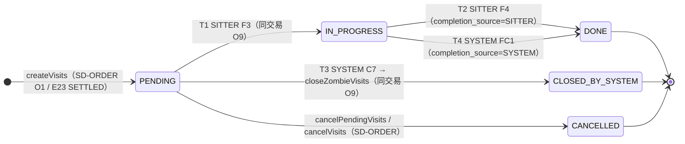
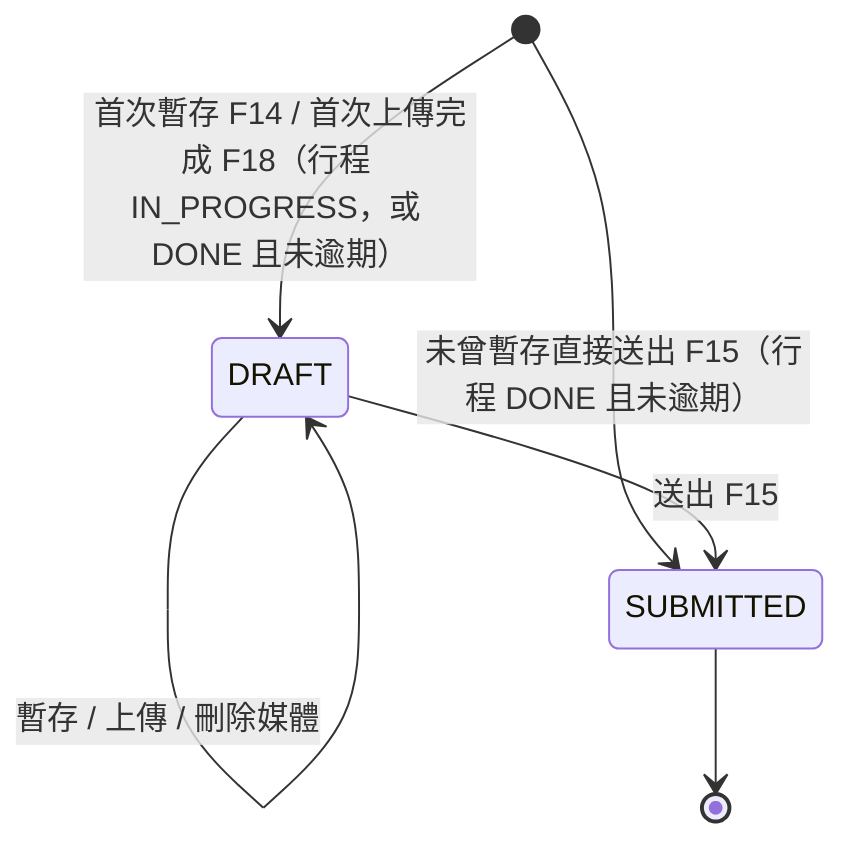
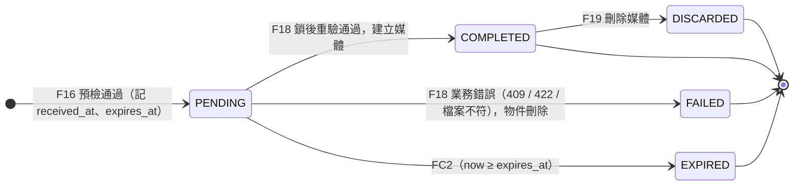
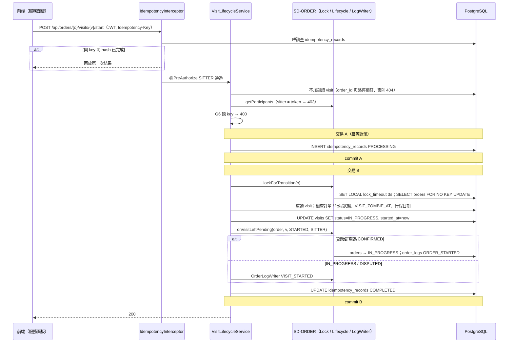
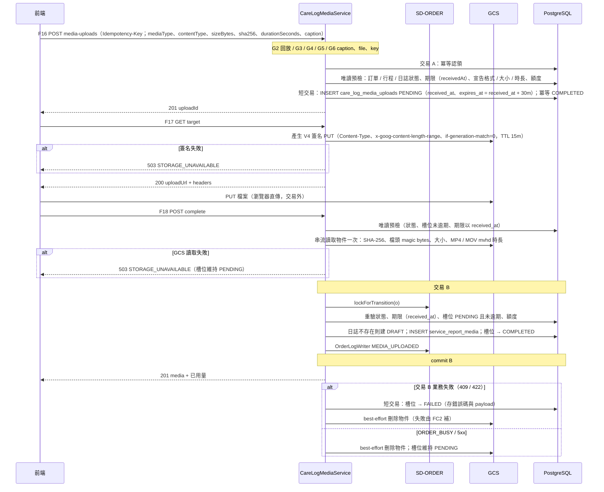
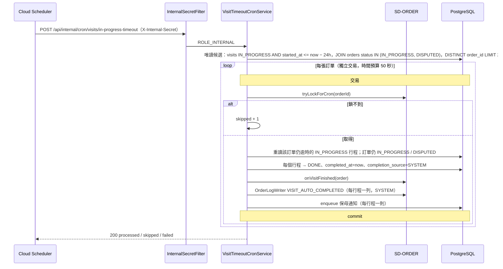
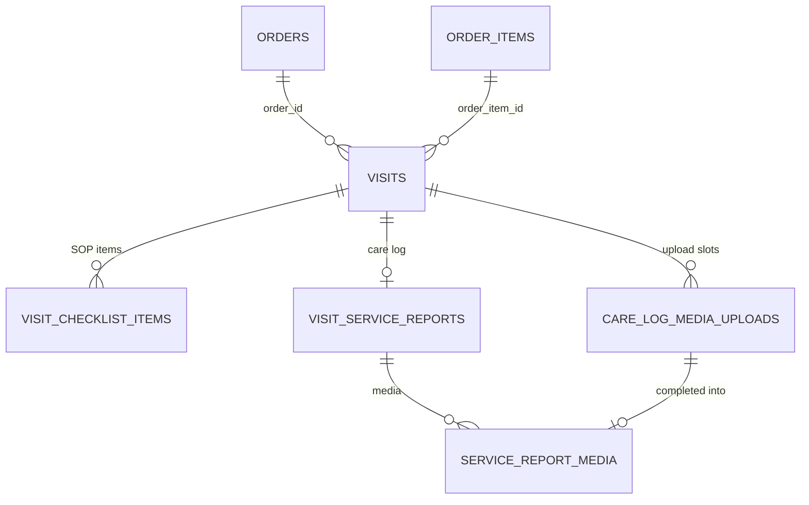

# SD-FULFILL: 服務履約設計文件

| 項目 | 內容 |
|------|------|
| 狀態 | Draft |
| 建立日期 | 2026-11-22 |
| 涵蓋 PRD | PRD-008、PRD-009、PRD-022、PRD-028（全部 Approved 2026-11-22；對應表見 `00-SD-PLAN.md` §0）。PRD-009 只在本 SD 定義畫面（§9.2）與測試對應；其 API（E2、E3、E25、E26、E30、C8）由 SD-ORDER 擁有，本 SD 不重複定義 |
| 擁有的 Table | `visits`、`visit_checklist_items`（新）、`visit_service_reports`（照護日誌）、`service_report_media`（日誌媒體）、`care_log_media_uploads`（新，上傳槽位）。其他 SD 只能經本 SD 的 Service 存取 |
| 依賴的 SD | **SD-ORDER**（Approved，同一次發布，SD-ORDER CQ-21）：`OrderLockService`、`OrderLifecycleService`、`OrderLogWriter`、`OrderQueryService.getParticipants` / `getMediaQuota`、冪等三段式（§3.6.2）、排程 C7；需新增的查詢見 §12 CQ-1、CQ-2。**SD-SUPPLY**（未重建，過渡實作）：`ServicePlanQuery.findDefaultTasks`（新）。**SD-NOTIFY**：`NotificationService.enqueue()`。**SD-CARE**：呼叫本 SD 的 `CareLogMediaRetentionPort`（媒體保留，PRD-013） |
| 遵守 | `SD-GLOBAL-SPEC.md`（§2.3、§4.1、§4.2 依其註記以 baseline 為準）、`SD-FRONTEND-SPEC.md`、`docs/sa/00-DOMAIN-BASELINE.md` 第 3 版（下稱 baseline）、`SD-ORDER.md`（下稱 SD-ORDER；判斷順序代號 G1–G7、L 沿用其 §6.1） |
| 取代 | SD-008、SD-009、SD-022；本 SD 核准後由使用者將上述改 `Superseded` |

> 共用概念（角色、SaaS 額度、訂單主狀態、行程狀態、時間起算點、錯誤碼與判斷順序）一律引用 baseline，本文件不重新定義。行程狀態集合、`VISIT_IN_PROGRESS_TIMEOUT_HOURS`、`VISIT_ZOMBIE_HOURS`、`CARE_LOG_EDIT_HOURS`、`completion_basis_at` 定義見 baseline §5、§6。
> 本 SD **實作 SD-ORDER §2.4.2 要求的介面**（`VisitCommandService`、`VisitQueryService`），不修改 SD-ORDER；需要 SD-ORDER 配合的項目列 §12。
> 禁止貼實作程式碼；類別只寫名稱與一句責任。DDL 為契約的一部分，照寫。

---

## 1. AC 對應實作

> 端點代號：F1–F19 為本 SD 使用者端點、FC1–FC2 排程、FT1–FT2 測試造資料（§6.2）；E\*、C\* 為 SD-ORDER 端點。「鎖」欄：「訂單鎖」= `OrderLockService.lockForTransition`（`FOR NO KEY UPDATE` + `lock_timeout 3s`）；「排程鎖」= `tryLockForCron`（`SKIP LOCKED`）。路徑前綴 `…/` = `/api/orders/{orderId}/visits/{visitId}`。

### 1.1 PRD-008 行程生命週期（21 條）

| PRD | AC | API / 畫面 | Table / 欄位 | 鎖 / 交易 | 測試 |
|-----|----|-----------|-------------|----------|------|
| PRD-008 | AC-1.1 | F3 `POST …/start`；`sitter-visit-panel` | `visits.status`、`started_at`；`orders.status`（O9，SD-ORDER）；`order_logs` 恰 1 列 `ORDER_STARTED` | 訂單鎖；T1 + `onVisitLeftPending(STARTED)` 同交易；觸發 O9 時不寫 `VISIT_STARTED` | `VisitStartIntegrationTest` |
| PRD-008 | AC-1.2 | F3 | `visits.status`；`order_logs` `VISIT_STARTED` | 訂單鎖；`IN_PROGRESS` / `DISPUTED` 不觸發 O9 | `VisitStartIntegrationTest` |
| PRD-008 | AC-1.3 | F3；`sitter-visit-panel-date-not-reached-message`、`sitter-visit-panel-deadline-passed-message` | `visits.service_date` | 鎖後以注入 `Clock` 判斷 `VISIT_ZOMBIE_AT` 與行程日期 | `VisitStartIntegrationTest`；畫面 TS-008 |
| PRD-008 | AC-1.4 | F3、F4 | `visits.status`；`orders.status` | 訂單鎖；`ORDER_STATE_CONFLICT` 先於 `VISIT_STATE_CONFLICT`；不寫 log | `VisitStartIntegrationTest`、`VisitCompleteIntegrationTest` |
| PRD-008 | AC-1.5 | F4 `POST …/complete`；`sitter-visit-panel-complete-dialog`（未打勾數取自 F2） | `visits.completed_at`、`completion_source=SITTER`；`orders.completion_basis_at`（`onVisitFinished`） | 訂單鎖；T2 + 基準重算 + `VISIT_COMPLETED` 同交易 | `VisitCompleteIntegrationTest`；對話框 TS-008 |
| PRD-008 | AC-1.6 | F3、F4 | — | G3 / G4 / G5 / G6 判斷順序（404 先於 400） | `VisitAuthorizationIntegrationTest`（真 JWT filter chain） |
| PRD-008 | AC-1.7 | F3、F4、F5 | `idempotency_records` | 冪等三段式（SD-ORDER §3.6.2）；訂閱鎖定不擋 | `VisitIdempotencyIntegrationTest` |
| PRD-008 | AC-1.8 | F3 vs E23 / E29；鎖逾時 | `visits.status`、`modification_requests` | 訂單鎖序列化（兩條執行緒真打）；逾時 409 `ORDER_BUSY` + `Retry-After: 1` | `VisitConcurrencyIntegrationTest` |
| PRD-008 | AC-2.1 | C7（SD-ORDER）→ `closeZombieVisits` | `visits.closed_at`；`notifications`（雙方各 1） | 排程鎖；T3 + O9 + 通知 enqueue 同交易 | `CloseZombieVisitsIntegrationTest` |
| PRD-008 | AC-2.2 | C7 | `visits` | 候選唯讀 JOIN `orders` 只取 `CONFIRMED` / `IN_PROGRESS` / `DISPUTED`；同批合併通知 | `CloseZombieVisitsIntegrationTest` |
| PRD-008 | AC-2.3 | FC1 `/api/internal/cron/visits/in-progress-timeout`；`sitter-visit-panel-auto-completed-label`、`owner-order-detail-visit-auto-completed-{visitId}` | `visits.completion_source=SYSTEM`；`order_logs` `VISIT_AUTO_COMPLETED` | 排程鎖；T4 + 基準重算 + 通知保母同交易 | `InProgressTimeoutCronIntegrationTest` |
| PRD-008 | AC-2.4 | FC1、F4 | `visits` | 排程鎖 vs 訂單鎖序列化；`VISIT_STATE_CONFLICT` 帶 `completionSource` | `InProgressTimeoutCronIntegrationTest`、`VisitConcurrencyIntegrationTest` |
| PRD-008 | AC-2.5 | F3 vs C7；C7 vs E23 | `visits`、`order_logs` | 訂單鎖 / 排程鎖序列化；只有先完成者觸發 O9 | `VisitConcurrencyIntegrationTest` |
| PRD-008 | AC-2.6 | FC1、C7 | — | 鎖後重驗略過、單筆失敗隔離、重跑、`X-Internal-Secret` 403 | `InProgressTimeoutCronIntegrationTest`、`CloseZombieVisitsIntegrationTest` |
| PRD-008 | AC-3.1 | F6 `GET /api/visits/sitter/dashboard`；`/sitter/visits` | `visits.sitter_id`、`service_date`、`sequence_in_day`、`slots_in_day` | 唯讀 | `VisitDashboardIntegrationTest`；畫面 TS-008 |
| PRD-008 | AC-3.2 | F6（`overdue[]`、`zombieAt`） | `visits.status`、`service_date` | 唯讀 | `VisitDashboardIntegrationTest` |
| PRD-008 | AC-3.3 | F1 `GET /api/orders/{orderId}/visits`；`owner-order-detail-visit-row-{visitId}` | `visits.started_at`、`completed_at`、`completion_source` | 唯讀 | `OrderVisitListIntegrationTest`；畫面 TS-008 |
| PRD-008 | AC-3.4 | F7 `GET /api/visits/owner/today`；`/owner/visits` | `visits.owner_id`、`service_date` | 唯讀 | `VisitDashboardIntegrationTest` |
| PRD-008 | AC-3.5 | F1、F6 | — | G3 / G4 / G4a / G5；ADMIN 依 `OrderContextView.adminReadable`（§12 CQ-1） | `OrderVisitListIntegrationTest` |
| PRD-008 | AC-3.6 | F5 `PUT …/name`；`sitter-visit-panel-btn-edit-name` | `visits.custom_name`、`booking_plan_title`；O2 方案名稱快照（SD-ORDER `order_plan_snapshots`，經 §12 CQ-1） | 訂單鎖；`VISIT_RENAMED` 同交易 | `VisitRenameIntegrationTest` |
| PRD-008 | AC-3.7 | F5 | `visits.custom_name` | 長度在鎖前（G6）；鎖後 `ORDER_STATE_CONFLICT` → `VISIT_STATE_CONFLICT` → `DEADLINE_PASSED`（`receivedAt`） | `VisitRenameIntegrationTest` |

### 1.2 PRD-028 行程單日 SOP 檢核項（10 條）

| PRD | AC | API / 畫面 | Table / 欄位 | 鎖 / 交易 | 測試 |
|-----|----|-----------|-------------|----------|------|
| PRD-028 | AC-1.1 | `VisitCommandService.createVisits`（SD-ORDER O1 / E23 呼叫）；F1 / F8 | `visit_checklist_items`（`created_source=SYSTEM`）；讀 SD-SUPPLY `findDefaultTasks` | 與行程建立同交易（呼叫端已持有訂單鎖）；不寫 log、不通知 | `ChecklistSeedIntegrationTest` |
| PRD-028 | AC-1.2 | F9 `POST …/checklist/items`；`sitter-visit-panel-checklist-btn-add` | `visit_checklist_items.title`、`sort_order` | 訂單鎖；冪等；不寫 log | `ChecklistEditIntegrationTest` |
| PRD-028 | AC-1.3 | F10 `DELETE …/checklist/items/{itemId}`、F11 `PUT …/checklist/order` | `sort_order`（重排，`DEFERRABLE` 唯一） | 訂單鎖；id 集合鎖外檢查、鎖內重驗 | `ChecklistEditIntegrationTest` |
| PRD-028 | AC-1.4 | F9–F11 | `visits.status`；`orders.status` | 訂單鎖；`DISPUTED` 可編、訂閱鎖定不擋 | `ChecklistEditIntegrationTest` |
| PRD-028 | AC-1.5 | F9 | 20 項上限 | 訂單鎖內計數；`VISIT_STATE_CONFLICT`（第 9 步）先於上限（第 12 步） | `ChecklistEditIntegrationTest` |
| PRD-028 | AC-1.6 | F9–F11 | — | G3 / G4 / G5（404 先於 400） | `ChecklistAuthorizationIntegrationTest` |
| PRD-028 | AC-2.1 | F12 `PUT …/checklist/items/{itemId}/check`；F4 對話框 | `is_completed`、`checked_at` | 訂單鎖；`DONE` 後 409 | `ChecklistCheckIntegrationTest` |
| PRD-028 | AC-2.2 | F12 vs FC1；鎖逾時 | `visits.status` | 訂單鎖 vs 排程鎖序列化 | `ChecklistCheckIntegrationTest`、`VisitConcurrencyIntegrationTest` |
| PRD-028 | AC-2.3 | F1（`checklist.items[]`）；`owner-order-detail-visit-checklist-{visitId}` | `visit_checklist_items` | 唯讀 | `ChecklistReadIntegrationTest`；畫面 TS-028 |
| PRD-028 | AC-2.4 | F1、F8、F9 | — | G3 / G4 / G5；ADMIN 可讀範圍 | `ChecklistReadIntegrationTest` |

### 1.3 PRD-022 照護日誌與多媒體（24 條）

| PRD | AC | API / 畫面 | Table / 欄位 | 鎖 / 交易 | 測試 |
|-----|----|-----------|-------------|----------|------|
| PRD-022 | AC-1.1 | F14 `PUT …/care-log/draft`；F13 | `visit_service_reports` | 訂單鎖；`ORDER_STATE_CONFLICT` → `VISIT_STATE_CONFLICT` | `CareLogDraftIntegrationTest` |
| PRD-022 | AC-1.2 | F14、F18 | `visit_service_reports.visit_id` UNIQUE（`visit_service_reports_visit_id_key`） | 訂單鎖序列化首次暫存與首次上傳；唯一約束為防線 | `CareLogDraftIntegrationTest` |
| PRD-022 | AC-1.3 | F14；`sitter-care-log-text-counter` | `content`（≤ 1000 code point） | G6 | `CareLogDraftIntegrationTest`；未暫存保護 TS-022 |
| PRD-022 | AC-1.4 | F15 `POST …/care-log/submit`；`sitter-care-log-btn-submit`、`sitter-care-log-deadline` | `status`、`submitted_at`；`order_logs` `CARE_LOG_SUBMITTED` | 訂單鎖；轉移 + log + 通知同交易 | `CareLogSubmitIntegrationTest` |
| PRD-022 | AC-1.5 | F14 / F15 / F16 / F18 / F19 | `status=SUBMITTED` | `CARE_LOG_STATE_CONFLICT` 先於 `DEADLINE_PASSED` | `CareLogSubmitIntegrationTest` |
| PRD-022 | AC-1.6 | F14–F16、F18、F19 | `visits.completed_at`；`care_log_media_uploads.received_at` | 期限以 `receivedAt` 判斷（上傳以槽位建立時間），狀態以鎖後為準 | `CareLogDeadlineIntegrationTest` |
| PRD-022 | AC-1.7 | F13；`sitter-care-log-status`、`owner-order-detail-btn-view-log-{visitId}` | 衍生欄位 `expired`、`deadlineAt` | 唯讀；OWNER 讀 `DRAFT` → 404 | `CareLogReadIntegrationTest` |
| PRD-022 | AC-1.8 | F14、F15、F16 | `orders.status` | 訂單鎖；`COMPLETED` 一律 `ORDER_STATE_CONFLICT` | `CareLogSubmitIntegrationTest` |
| PRD-022 | AC-2.1 | F16 `POST …/care-log/media-uploads`；`sitter-care-log-quota` | `getMediaQuota`（O2 快照） | 預檢不取鎖；拒絕時不簽發上傳網址、無 GCS 物件 | `CareLogMediaUploadIntegrationTest` |
| PRD-022 | AC-2.2 | F16、F18 | `service_report_media.media_type` 計數 | 預檢 + 訂單鎖內重驗額度 | `CareLogMediaUploadIntegrationTest` |
| PRD-022 | AC-2.3 | F16（宣告值）、F18（檔頭 magic bytes、實際大小）；前端 WebP 壓縮 | `size_bytes` | 交易外檢驗 | `CareLogMediaUploadIntegrationTest`、`MediaInspectorTest`；前端 TS-022 |
| PRD-022 | AC-2.4 | F16、F18（容器 `mvhd` 時長） | `duration_seconds` | 交易外檢驗 | `MediaInspectorTest`、`CareLogMediaUploadIntegrationTest` |
| PRD-022 | AC-2.5 | F16–F18 | `service_report_media`；`order_logs` `MEDIA_UPLOADED` | 訂單鎖；首次上傳同交易建 `DRAFT` | `CareLogMediaUploadIntegrationTest` |
| PRD-022 | AC-2.6 | F19 `DELETE …/care-log/media/{mediaId}` | 刪 `service_report_media` 列；`care_log_media_uploads.status=DISCARDED`；`order_logs` `MEDIA_DELETED` | 訂單鎖；commit 後刪 GCS，失敗由 FC2 補 | `CareLogMediaDeleteIntegrationTest` |
| PRD-022 | AC-2.7 | F18 × 2（不同 key） | 額度 | 訂單鎖序列化（兩條執行緒真打）；後到者刪物件 | `CareLogConcurrencyIntegrationTest` |
| PRD-022 | AC-2.8 | F17 / F18（GCS 失敗、O15 介入） | `care_log_media_uploads.status` | GCS 失敗 503 不開交易；鎖後重驗失敗刪物件 | `CareLogMediaUploadIntegrationTest` |
| PRD-022 | AC-3.1 | F15 → `enqueue` | `notifications`（`CARE_LOG_SUBMITTED`） | 同交易；Email 依偏好 | `CareLogSubmitIntegrationTest` |
| PRD-022 | AC-3.2 | F13（OWNER）；`owner-care-log-view`、`owner-care-log-visit-name` | 簽名網址 TTL 900 秒 | 唯讀；`X-Goog-Expires=900` | `CareLogReadIntegrationTest` |
| PRD-022 | AC-3.3 | F13–F19 | — | G1 / G3 / G4 / G5 | `CareLogAuthorizationIntegrationTest` |
| PRD-022 | AC-3.4 | F13（ADMIN） | — | `adminReadable`；`DRAFT` → 404 | `CareLogReadIntegrationTest` |
| PRD-022 | AC-3.5 | F15 | `idempotency_records` | 冪等三段式 | `CareLogIdempotencyIntegrationTest` |
| PRD-022 | AC-3.6 | F16、F18 | `idempotency_records`（hash 含宣告 SHA-256）；`care_log_media_uploads` | 冪等回放在簽發網址前；完成後重送回放 | `CareLogIdempotencyIntegrationTest` |
| PRD-022 | AC-3.7 | F15 vs E29 / E25；鎖逾時 | — | 訂單鎖序列化；`ORDER_BUSY` 不記冪等、刪物件 | `CareLogConcurrencyIntegrationTest` |
| PRD-022 | AC-3.8 | F14、F16 | — | 判斷順序（§6.3） | `CareLogErrorOrderIntegrationTest` |

### 1.4 PRD-009 訂單結案、服務爭議與帳務（24 條；API 屬 SD-ORDER）

> 端點與轉移由 SD-ORDER 實作；本 SD 負責畫面（§9.2）與以 PRD-009 AC 命名的整合測試（測的是 SD-ORDER 程式）。

| PRD | AC | API / 畫面 | Table / 欄位 | 鎖 / 交易 | 測試 |
|-----|----|-----------|-------------|----------|------|
| PRD-009 | AC-1.1 | E25；`owner-order-detail-btn-complete`、`owner-order-complete-btn-confirm` | `orders.completed_at`、`completed_by=OWNER`；`notifications` `ORDER_COMPLETED_BY_OWNER` | 訂單鎖（SD-ORDER） | `OwnerCompleteIntegrationTest` |
| PRD-009 | AC-1.2 | E25；結案區塊 i–v（E2 + F1） | `visits`、`visit_service_reports.status` | 同上 | `OwnerCompleteIntegrationTest`；畫面 TS-009 |
| PRD-009 | AC-1.3 | E25；`owner-order-detail-complete-hint` | `modification_requests` | 同上；`MODIFICATION_IN_PROGRESS` 先於 `VISITS_NOT_FINISHED` | `OwnerCompleteIntegrationTest` |
| PRD-009 | AC-1.4 | E25、E17 | `orders.status` | 同上 | `OwnerCompleteIntegrationTest` |
| PRD-009 | AC-1.5 | E25 | — | G1–G6 | `OwnerCompleteIntegrationTest` |
| PRD-009 | AC-1.6 | E25 vs C8；鎖逾時 | `idempotency_records` | 訂單鎖 vs 排程鎖 | `OwnerCompleteIntegrationTest` |
| PRD-009 | AC-1.7 | `/owner/orders/:orderId`、`/sitter/orders/:orderId`；`owner-order-detail-completed-at`、`sitter-order-detail-completed-at` | — | 唯讀 | 畫面 TS-009 |
| PRD-009 | AC-1.8 | F1 + E2；`owner-order-detail-visit-row-{visitId}` | — | 唯讀 | 畫面 TS-009；`OrderVisitListIntegrationTest`（`careLog.submitted`） |
| PRD-009 | AC-2.1 | C8 | `orders.completed_at`；`notifications` `ORDER_AUTO_COMPLETED` | 排程鎖（SD-ORDER） | `AutoCompleteCronIntegrationTest` |
| PRD-009 | AC-2.2 | C8、E25；結案區塊 iii | `completion_basis_at` | 同上 | `AutoCompleteCronIntegrationTest`；畫面 TS-009 |
| PRD-009 | AC-2.3 | C8 | `orders`、`modification_requests` | 同上 | `AutoCompleteCronIntegrationTest` |
| PRD-009 | AC-2.4 | C8 | — | 失敗隔離、重跑、403 | `AutoCompleteCronIntegrationTest` |
| PRD-009 | AC-2.5 | E26、E28；`owner-order-detail-btn-report-issue`、`owner-order-dispute-*` | `admin_tasks`（`SERVICE_DISPUTE`） | 訂單鎖（SD-ORDER） | `ServiceDisputeIntegrationTest` |
| PRD-009 | AC-2.6 | E26 vs C8；`owner-order-detail-dispute-window-ends-at`、`sitter-order-detail-auto-complete-at` | `completion_basis_at` | 鎖後時間判斷視窗 | `ServiceDisputeIntegrationTest` |
| PRD-009 | AC-2.7 | E26 | — | 判斷順序 | `ServiceDisputeIntegrationTest` |
| PRD-009 | AC-2.8 | E26 | `order_logs` payload | G5 / G6 / G7 | `ServiceDisputeIntegrationTest` |
| PRD-009 | AC-3.1 | E30；`sitter-ledger-*` | `payments` 加總 | 唯讀 | `SitterLedgerIntegrationTest` |
| PRD-009 | AC-3.2 | E30 | `completed_at` / `cancelled_at`（Asia/Taipei 月） | 唯讀 | `SitterLedgerIntegrationTest` |
| PRD-009 | AC-3.3 | E30 | — | 唯讀 | `SitterLedgerIntegrationTest` |
| PRD-009 | AC-3.4 | E30；`/sitter/ledger` 預設月份（`Date` 標頭） | — | 唯讀 | `SitterLedgerIntegrationTest`；畫面 TS-009 |
| PRD-009 | AC-3.5 | E30 | — | G3 | `SitterLedgerIntegrationTest` |
| PRD-009 | AC-3.6 | E3 `tab=HISTORY`；`owner-orders-tab-history`、`owner-orders-history-btn-load-more` | `ix_orders_owner_terminal` | 唯讀 | `OwnerHistoryIntegrationTest` |
| PRD-009 | AC-3.7 | E3 `status` / `month`；`owner-orders-history-filter-status`、`-select-month`、`-empty` | — | 唯讀 | `OwnerHistoryIntegrationTest`；畫面 TS-009 |
| PRD-009 | AC-3.8 | E30 | `payments` | 唯讀 | `SitterLedgerIntegrationTest` |

**合計 79 / 79 條 AC**（PRD-008 21、PRD-028 10、PRD-022 24、PRD-009 24）。

---

## 2. 模組邊界

### 2.1 負責

- **行程（`visits`）**：行程狀態機 T1–T4 與 `PENDING → CANCELLED`（由 SD-ORDER 觸發）的寫入；行程命名與預設名稱；保母「今日行程 / 待處理」、飼主「今日到府」、訂單行程清單查詢。
- **排程**：`IN_PROGRESS` 逾時出口 FC1（新端點）；殭屍關閉的行程寫入與通知（`closeZombieVisits`，由 SD-ORDER C7 呼叫）；日誌上傳孤兒檔清除 FC2。
- **SOP 檢核項（`visit_checklist_items`）**：行程建立時自方案預設任務快照、增刪、排序、打勾、唯讀檢視。
- **照護日誌（`visit_service_reports`）與日誌媒體（`service_report_media`、`care_log_media_uploads`）**：暫存、送出、逾期衍生、媒體上傳（三段式）/ 刪除、簽名網址、送出通知。
- **PRD-009 畫面**（§9.2）與 PRD-009 AC 的整合測試。
- **行程類 `order_logs` action 與通知類型代碼**的定義（§7）。

### 2.2 不負責

| 項目 | 歸屬 | 本 SD 的關係 |
|------|------|-------------|
| 訂單主狀態（含 O9、O11–O13、O15 / O17）、`completion_basis_at` 計算與儲存 | SD-ORDER | 呼叫 `onVisitLeftPending` / `onVisitFinished`；O11–O13 與帳務 API（E25、E26、C8、E30、E3）由 SD-ORDER 提供 |
| 行程的建立 / 取消時機（O1、變更、取消、調解） | SD-ORDER | SD-ORDER 在持鎖交易內呼叫本 SD 的 `VisitCommandService` |
| C7 殭屍清理的排程端點、候選分組、`VISITS_CLOSED_BY_SYSTEM` 與 `ORDER_STARTED` log | SD-ORDER | 本 SD 提供候選查詢與 `closeZombieVisits`（含通知） |
| 方案預設任務清單的設定與上限 | SD-SUPPLY（PRD-003） | 唯讀 `ServicePlanQuery.findDefaultTasks` |
| 媒體保留期限計算、到期刪除排程與到期提醒（PRD-013） | SD-CARE | 本 SD 提供 `CareLogMediaRetentionPort`（候選查詢、標記已刪） |
| 通知範本、偏好、Email 投遞 | SD-NOTIFY | 本 SD 在轉移交易內 `enqueue()` |
| ADMIN 待辦與調解畫面（PRD-020） | PRD-020 對應 SD | 本 SD 提供 ADMIN 唯讀的行程 / 檢核項 / 已送出日誌端點 |

### 2.3 對外提供

#### 2.3.1 實作 SD-ORDER §2.4.2 的介面（簽名不變）

| 介面 / 方法 | 本 SD 的行為 | 傳播 |
|------------|-------------|------|
| `VisitCommandService.createVisits(LockedOrder, List<VisitSpec>)` | 依 spec 建 `PENDING` 行程：`service_date`、`order_item_id`、`plan_id`、`booking_plan_title = planTitle`、`sequence_in_day`、`slots_in_day`（同 `orderItemId` + `serviceDate` 的 spec 數）、`owner_id` / `sitter_id`（取自 `LockedOrder`）；同交易依 §4.8 帶入檢核項。不寫 `order_logs`、不通知。**不再寫 `scheduled_at`**（欄位刪除，§5.1 第 13 段；SD-ORDER CQ-23 交由本 SD 決定） | `MANDATORY`，須持訂單鎖 |
| `VisitCommandService.cancelPendingVisits(LockedOrder, OffsetDateTime now)` | 該訂單所有 `PENDING` 行程 → `CANCELLED`、寫 `cancelled_at`；回傳 id；檢核項不動 | 同上 |
| `VisitCommandService.cancelVisits(LockedOrder, Set<UUID>, OffsetDateTime now)` | 全部為 `PENDING` 才整批取消；任一不是 → 拋 `VisitNotPendingException(visitIds)`，不改任何列 | 同上 |
| `VisitCommandService.closeZombieVisits(LockedOrder, OffsetDateTime now, Duration zombieAfter)` | 防線：`order.status` 不在 `CONFIRMED` / `IN_PROGRESS` / `DISPUTED` → 回空。否則把 `PENDING` 且 `service_date 00:00（Asia/Taipei）+ zombieAfter ≤ now` 的行程 → `CLOSED_BY_SYSTEM`、`closed_at = now`；本批非空時同交易 `enqueue` 保母與飼主各 1 則（§7.2，列出本批所有日期與行程名稱）；本批為空 → 不通知、回空（SD-ORDER 據此略過，PRD-008 EX-23） | 同上 |
| `VisitQueryService.listVisits(UUID orderId)` | `VisitView`：`visitId`、`orderItemId`、`planId`、`serviceDate`、`status`、`completedAt`、`closedAt`、`careLogSubmitted`（`visit_service_reports.status = SUBMITTED`）；一次查詢（LEFT JOIN 日誌），不 N+1 | `SUPPORTS` |
| `VisitQueryService.findOrderIdsWithZombieVisits(LocalDate maxServiceDate, Set<OrderStatus>, int limit)` | `visits.status='PENDING' AND service_date <= :max`，唯讀 JOIN `orders.status IN (:statuses)`（SD-ORDER CQ-22 排程候選例外），`DISTINCT order_id`，`LIMIT` | `SUPPORTS` |

- 寫入方法丟出的例外只有 `VisitNotPendingException`（業務）；其餘 DB 例外使呼叫端交易回滾。
- **ArchUnit**（`FulfillAggregateArchTest`）：`VisitRepository`、`VisitChecklistItemRepository`、`CareLogRepository`、`CareLogMediaRepository`、`CareLogMediaUploadRepository` 只能被 `application/service/fulfill/**` 依賴；`VisitCommandService` 寫入方法的呼叫者限 `application/service/order/**` 與本套件（與 SD-ORDER `OrderAggregateArchTest` 對稱）。

#### 2.3.2 給 SD-CARE：`CareLogMediaRetentionPort`（取代 `MediaRetentionServiceImpl` 直讀 `service_report_media`）

| 方法 | 參數 / 回傳 | 規則 | 傳播 |
|------|------------|------|------|
| `findExpiredMedia` | `OffsetDateTime now`、`int limit` → `List<ExpiredMediaView>`（`mediaId`、`objectKey`、`orderId`） | 條件由 SD-CARE 的 PRD-013 規則決定，查詢沿用現行語意（`is_purged = false`，所屬訂單結案日 + 快照保留天數 ≤ now，`-1` 永久除外）；唯讀 JOIN `visits` / `orders` / `order_snapshots`（排程候選例外） | `SUPPORTS` |
| `markPurged` | `UUID mediaId`、`OffsetDateTime now` | 單列 UPDATE `is_purged = true`、`purged_at`；不鎖訂單（不是行程或日誌的狀態轉移，不影響額度：已送出或已結案的日誌不可再上傳） | `REQUIRED` |

#### 2.3.3 給前端（本 SD 端點）

見 §6.2（F1–F19）。PRD-009 畫面另呼叫 SD-ORDER 的 E2、E3、E25、E26、E30。

### 2.4 依賴的介面

| 提供方 | 介面 / 方法 | 用途 | 狀態 |
|--------|------------|------|------|
| SD-ORDER | `OrderLockService.lockForTransition` / `tryLockForCron`（§2.4.1） | 所有寫入與 FC1 | 已定義 |
| SD-ORDER | `OrderLifecycleService.onVisitLeftPending(order, visitId, STARTED, actor)` / `onVisitFinished(order)` | T1（O9）、T2、T4 | 已定義 |
| SD-ORDER | `OrderLogWriter.write(order, actionType, actor, payload)` | §7.1 | 已定義 |
| SD-ORDER | `OrderQueryService.getParticipants(orderId)` | 鎖前歸屬（403）判斷 | 已定義 |
| SD-ORDER | `OrderQueryService.getMediaQuota(orderId)` | 日誌媒體額度（BR-9） | 已定義 |
| SD-ORDER | **`OrderQueryService.getOrderContexts(Set<UUID>)`** | O2 方案名稱快照（行程預設名稱，PRD-008 BR-14、CQ-9 / CQ-15）、ADMIN 可讀判斷、儀表板卡片的對方名稱 / 毛孩 / 訂單建立時間 / 群組順序 | **需 SD-ORDER 新增（§12 CQ-1）** |
| SD-ORDER | 冪等三段式 `IdempotencyInterceptor` / `IdempotencyService`（§3.6.2） | F3、F4、F9、F15、F16 | **需 SD-ORDER 開放給本模組（§12 CQ-2）** |
| SD-ORDER | `OrderBusyException`、`IdempotencyException`、`StorageUnavailableException`（`application/exception/`） | 本 SD 的 advice 一併對映 | 已定義 |
| SD-SUPPLY（過渡） | **`ServicePlanQuery.findDefaultTasks(Set<UUID> planIds)`** → `Map<UUID, List<String>>` | 檢核項初始帶入（PRD-028 BR-2）；方案已刪除或下架回空清單 | 新增（同發布，§8.4.1） |
| SD-NOTIFY | `NotificationService.enqueue(NotificationCommand)` | §7.2 | 已定義（SD-ORDER §2.4.2） |
| 共用 | `MediaStorageService`（擴充，§8.2） | 簽名上傳、讀取串流、刪除、簽名讀取網址 | 本 SD 擴充介面 |

### 2.5 交易與鎖規則（本 SD 所有寫入）

1. **取得 `orderId`**：路徑本來就帶 `orderId`；以不加鎖查詢讀 `visits`（`id = :visitId`），`visit.order_id ≠ 路徑 orderId` → 404。不以 `FOR UPDATE` 鎖 `visits` 或日誌列（SD-ORDER §2.3.1 鎖順序）。
2. **`Visit` 實體不與 `Order` 建 JPA 關聯**：只存 `orderId`（UUID 欄），避免 EAGER 載入他模組聚合（SD-ORDER §3.6.1「鎖後新鮮度」的成因）並讓其他模組無法經行程改訂單。
3. **交易 B**：`lockForTransition(orderId)` → 重讀行程 / 日誌 / 檢核項 / 上傳槽位 → 依判斷順序重驗 → 寫入 → `OrderLogWriter` → `enqueue()` → 冪等完成（有 key 時）→ commit。
4. **外部 I/O 不在交易內**：簽名網址產生、GCS 讀取檢驗與刪除一律在交易外；上傳由瀏覽器直傳 GCS（§4.4、§11 決策 1）。
5. **同一使用者多裝置自我併發不處理**（doc-conventions）；跨角色與系統排程以訂單鎖序列化。
6. 實體 `@Version`：`visits`、`visit_service_reports` 保留作最後防線；衝突回 409 `ORDER_BUSY`（baseline §3.6）。不接受客戶端 version。

---

## 3. 狀態機

### 3.1 行程（`visits.status`，baseline §6；轉移編號沿用 PRD-008 §5）



| 轉移 | API | 鎖 | 鎖後前置條件（依序） | 不符時 |
|------|-----|----|--------------------|-------|
| T1 `PENDING → IN_PROGRESS` | F3 | 訂單鎖 | 訂單 `CONFIRMED` / `IN_PROGRESS` / `DISPUTED` → 行程 `PENDING` → `now < VISIT_ZOMBIE_AT` → 今天（Asia/Taipei）≥ `service_date` | 409 `ORDER_STATE_CONFLICT` → 409 `VISIT_STATE_CONFLICT` → 409 `DEADLINE_PASSED`（`VISIT_ZOMBIE_AT`）→ 422 `VISIT_DATE_NOT_REACHED` |
| T2 `IN_PROGRESS → DONE` | F4 | 訂單鎖 | 訂單 `IN_PROGRESS` / `DISPUTED` → 行程 `IN_PROGRESS` | 409 `ORDER_STATE_CONFLICT` → 409 `VISIT_STATE_CONFLICT` |
| T3 `PENDING → CLOSED_BY_SYSTEM` | C7（SD-ORDER）→ `closeZombieVisits` | 排程鎖 | 訂單 `CONFIRMED` / `IN_PROGRESS` / `DISPUTED`；`now ≥ VISIT_ZOMBIE_AT` | 略過（`skipped`） |
| T4 `IN_PROGRESS → DONE` | FC1 | 排程鎖 | 行程 `IN_PROGRESS`；`now ≥ started_at + VISIT_IN_PROGRESS_TIMEOUT_HOURS`；訂單 `IN_PROGRESS` / `DISPUTED`（防線） | 略過（`skipped`） |
| `PENDING → CANCELLED` | SD-ORDER 呼叫 | 呼叫端已持有 | `PENDING` | `cancelVisits`：`VisitNotPendingException` |

- `VISIT_ZOMBIE_AT` = `service_date` 00:00（Asia/Taipei）+ `VISIT_ZOMBIE_HOURS`（讀 SD-ORDER `app.order.visit-zombie-hours`，不重複定義）。
- `VISIT_STATE_CONFLICT` payload：`currentVisitStatus`；`currentVisitStatus = DONE` 時另帶 `completionSource`（`SITTER` / `SYSTEM`，PRD-008 CQ-11）。
- 命名（F5）不是狀態轉移，但同樣受行程狀態限制（§6.3 F5）。

### 3.2 照護日誌（`visit_service_reports.status`，PRD-022 §5）



- 只持久化 `DRAFT` / `SUBMITTED`。「逾期」為衍生值：`receivedAt ≥ visits.completed_at + CARE_LOG_EDIT_HOURS`（`DONE` 行程）；不寫入、無排程（PRD-022 BR-1）。
- 送出後永久唯讀；任何寫入 → 409 `CARE_LOG_STATE_CONFLICT`（payload `currentCareLogStatus=SUBMITTED`）。

### 3.3 上傳槽位（`care_log_media_uploads.status`，本 SD 技術實體）



- `PENDING → COMPLETED` 與 `PENDING → EXPIRED` 皆以條件式 UPDATE（`WHERE status='PENDING' AND expires_at ...`）寫入，兩者互斥。
- F18 遇 `ORDER_BUSY` / 5xx：刪除已上傳物件、槽位維持 `PENDING`（可同槽位重傳重試）。
- `FAILED` / `EXPIRED` / `DISCARDED` 且 `object_deleted_at IS NULL` 的物件由 FC2 清除。

### 3.4 檢核項寫入窗口（無狀態機，PRD-028 §5）

| 操作 | 訂單狀態 | 行程狀態 | 不符時 |
|------|---------|---------|-------|
| 新增 / 刪除 / 排序（F9–F11） | `CONFIRMED` / `IN_PROGRESS` / `DISPUTED` | `PENDING` / `IN_PROGRESS` | 409 `ORDER_STATE_CONFLICT` → 409 `VISIT_STATE_CONFLICT` |
| 打勾 / 取消打勾（F12） | `IN_PROGRESS` / `DISPUTED` | `IN_PROGRESS` | 同上 |
| 初始帶入 | 行程建立交易內 | `PENDING` | 不回錯（空清單） |

---

## 4. 流程

> 所有使用者寫入端點共通前段（SD-ORDER §6.1）：`JwtAuthenticationFilter`（G1 401）→ `IdempotencyInterceptor`（G2 回放，僅帶 key 的端點）→ `@PreAuthorize`（G3 `ROLE_MISMATCH`）→ Service：G4 404 → G4a（混合角色端點）→ G5 403 → G6 400（`FulfillRequestValidator`）→ G7 冪等認領 → L 訂單鎖 → 狀態類檢查。DTO 不掛 `@Valid`、`Idempotency-Key` 以 `required = false` 讀取（理由同 SD-ORDER §11）。

### 4.1 開始行程（T1 + O9）



- 業務錯誤（409 / 422）→ 交易 B 回滾，交易 C 把冪等紀錄記為該錯誤（可回放）；`ORDER_BUSY` / 5xx → 刪冪等紀錄（SD-ORDER §3.6.2）。
- 一個操作一列 `order_logs`（SD-ORDER §3.6.3）：觸發 O9 時只有 `ORDER_STARTED`，否則只有 `VISIT_STARTED`（PRD-008 §4.1 步驟 4）。是否觸發以 `LockedOrder.status`（鎖後值）是否為 `CONFIRMED` 判斷。
- 不通知（PRD-008 BR-18）。

### 4.2 結束行程、命名

- **F4 結束（T2）**：前段同 4.1 至 L → 訂單 / 行程狀態 → `status=DONE`、`completed_at = now`、`completion_source=SITTER` → `onVisitFinished(order)`（重算 `completion_basis_at`）→ `VISIT_COMPLETED` → commit。不檢查日期、日誌、打勾。
- **F5 命名**：不帶 key（整值覆寫），沒有 G2 / G7；`receivedAt` 於 Controller 進入時取注入 `Clock`。名稱去前後空白後 > 20 code point → 400（鎖前）。鎖後：訂單狀態 → 行程 `CLOSED_BY_SYSTEM` / `CANCELLED` → 409 `VISIT_STATE_CONFLICT` → 行程 `DONE` 且 `receivedAt ≥ completed_at + CARE_LOG_EDIT_HOURS` → 409 `DEADLINE_PASSED`（`CARE_LOG_EDIT_ENDS_AT`）。空字串 → `custom_name = NULL`。值未變也寫 `VISIT_RENAMED`（payload 新舊值相同；不做差異比對，保持整值覆寫語意）。

### 4.3 預設行程名稱（PRD-008 BR-14）

`VisitNameResolver`（唯讀）：`custom_name` 非 NULL → 用之；否則 `{方案名稱}`，`slots_in_day > 1` 時加「 第 {sequence_in_day} 次」。`{方案名稱}` 取 `OrderContextView.planTitles[plan_id]`（O2 報價快照）；訂單尚未報價（map 無此方案）→ `visits.booking_plan_title`（O1 建立行程時帶入，PRD-008 CQ-15）。變更新增的行程方案必在訂單內（SD-ORDER `PLAN_NOT_IN_ORDER`），因此快照必有該方案。名稱在讀取時組成，不落地；通知文案於 enqueue 當下組成。

### 4.4 日誌媒體上傳（三段式：預檢 → 交易外上傳 → 訂單鎖重驗）

> 媒體由瀏覽器以 V4 簽名網址**直傳 GCS**，不經 Cloud Run（HTTP/1 請求上限 32 MiB，影片上限 50 MB；§11 決策 1，需使用者確認，§12 CQ-5）。



- **冪等**：F16 帶 `Idempotency-Key`，hash = 路由樣板 + 路徑變數 + 正規化 body（含 `sha256`）；同 key 同內容回放 F16 的第一次結果（`uploadId`，不含網址）；同 key 換檔案（`sha256` 不同）→ 422 `IDEMPOTENCY_KEY_REUSED`。F18 以 `uploadId` 天然冪等：槽位已 `COMPLETED` → 回 201 與已建立的媒體（不含網址以外的變動資料）；已 `FAILED` → 回存下的錯誤。因此「同 key 同內容重送」的完整流程結果與第一次相同，且不重複上傳（F17 遇 `COMPLETED` 回 `alreadyCompleted=true`，前端略過 PUT），PRD-022 AC-3.6 成立。
- **期限**：寫入期限一律以 F16 收到請求的 `received_at` 判斷（PRD-022 BR-5「上傳耗時不影響」）；槽位有效 30 分鐘（`expires_at`），逾時 → 409 `CARE_LOG_UPLOAD_EXPIRED`（本 SD 技術碼）。訂單 / 行程 / 日誌狀態以交易 B 鎖後為準（AC-2.8 情境 3）。
- **檔案檢驗**：F16 驗宣告值（格式由 `contentType` 判斷），F18 驗實際物件（不信任宣告與 GCS metadata）：SHA-256 與宣告不符 → 400 `VALIDATION_FAILED`（`field=file`）；magic bytes 不屬允許格式或與 `mediaType` 不符 → 422 `CARE_LOG_MEDIA_TYPE_UNSUPPORTED`；大小 → 422 `CARE_LOG_MEDIA_TOO_LARGE`；影片時長（四捨五入整數秒）不在 15–30 → 422 `CARE_LOG_VIDEO_DURATION_INVALID`。物件不存在（前端未上傳）→ 400 `VALIDATION_FAILED`（`field=file`），槽位維持 `PENDING`。
- **連線**：預檢、GCS 串流期間不持有 DB 連線（`open-in-view: false`；只在短交易與交易 B 取連線），符合 Hikari 小池。

### 4.5 暫存、送出、刪除媒體

- **F14 暫存**：G6（`text` ≤ 1000 code point）→ L → 訂單 `IN_PROGRESS` / `DISPUTED` → 行程 `IN_PROGRESS` 或 `DONE` → 日誌非 `SUBMITTED` → 行程 `DONE` 時 `receivedAt < completed_at + CARE_LOG_EDIT_HOURS` → 日誌不存在則建 `DRAFT`，整份覆寫 `content` → commit。不寫 `order_logs`、不通知（PRD-022 BR-19）。
- **F15 送出**：G6（`text` ≤ 1000、key）→ G7 → L → 訂單 → 行程必須 `DONE` → 日誌非 `SUBMITTED` → 期限 → 文字去空白後 ≥ 1 code point（否則 422 `CARE_LOG_CONTENT_EMPTY`）→ 日誌不存在則建立 → 以 body 覆寫文字 → `SUBMITTED`、`submitted_at = now` → `CARE_LOG_SUBMITTED` → `enqueue` 飼主通知（§7.2）→ 冪等完成 → commit。
- **F19 刪除媒體**：G4（媒體不存在、或不屬於路徑行程的日誌 → 404）→ G5 → L → 訂單 → 行程 → 日誌狀態 → 期限（`receivedAt`）→ 刪 `service_report_media` 列、槽位 `COMPLETED → DISCARDED` → `MEDIA_DELETED` → commit → 交易後同一請求內刪 GCS 物件，成功則寫 `object_deleted_at`；失敗只記 log，由 FC2 補（PRD-022 EX-23）。不帶 key：重送 → 404（PRD-022 BR-21）。

### 4.6 `IN_PROGRESS` 逾時（FC1，T4）



- 重驗後該訂單沒有任何行程符合 → 不寫任何資料、計 `skipped`（PRD-008 AC-2.4 情境 2、AC-2.6 情境 1）。單筆例外 → 該交易回滾、記含 `orderId` 的錯誤 log、`failed + 1`（AC-2.6 情境 2）。終態行程不再被候選查出，重跑不重複（情境 3）。
- 判斷一律 `now ≥ 到期時間`（等於即處理），`now` 為注入的 `Clock`。

### 4.7 殭屍關閉（T3，SD-ORDER C7 呼叫 `closeZombieVisits`）

- 排程端點、候選分組、排程鎖、`onVisitLeftPending(CLOSED_BY_SYSTEM)`、`onVisitFinished`、`VISITS_CLOSED_BY_SYSTEM` 與 O9 的 `ORDER_STARTED`：皆由 SD-ORDER C7 執行（SD-ORDER §8.1）。
- 本 SD 在 `closeZombieVisits` 內：鎖後重驗（§2.3.1）→ 寫行程 → 本批非空時同交易 `enqueue` `VISIT_CLOSED_BY_SYSTEM_SITTER`、`VISIT_CLOSED_BY_SYSTEM_OWNER` 各 1 則（收件者取自 `LockedOrder.sitterId` / `ownerId`）。重驗略過的行程不列入通知（PRD-008 4.3 步驟 3）。

### 4.8 行程建立時的檢核項帶入（PRD-028 §4.1）

1. `createVisits` 收集本批 `planId` → 一次呼叫 `ServicePlanQuery.findDefaultTasks(planIds)`。
2. 每個新行程依該方案清單順序複製：略過去空白後為空的名稱、每項去前後空白後截至 50 code point、只取前 20 項（PRD-028 CQ-7）；`sort_order` 0 起；`is_completed=false`；`created_source=SYSTEM`、`created_by=NULL`。
3. 方案已刪除、下架或無預設任務 → 空清單，不回錯（EX-14）。寫入失敗 → 例外使行程建立的整個交易回滾（EX-15，500）。
4. 以 JDBC batch 寫入（一個 O1 最多 60 日 × 3 次 × 20 項 = 3,600 列），不逐列 flush。

---

## 5. 資料模型

### 5.1 遷移

- **併入 SD-ORDER 規劃的同一支 `V20261122_01__order_rebuild.sql`**，不另開檔。本 SD 負責的段落為 **第 13 段（取代 SD-ORDER §5.1.1 原第 13 段，SD-ORDER 已註明「定義權屬 SD-FULFILL，可修改」）與新增第 14–16 段**，接在第 12 段 `idempotency_records` 之後。檔頭第 0 段已 `TRUNCATE` `service_report_media`、`visit_service_reports`、`visits`，以下皆在空表上執行，可直接 `NOT NULL`。
- 一支到位、破壞性（沿用 SD-ORDER §5.1 決定：未上線、交易資料全清；後端與前端連續部署，接受短暫空窗；forward fix only）。同發布改寫所有讀寫這些表的舊程式（§8.4.2）。
- 時間 `TIMESTAMPTZ`；長度檢查用 `char_length`（PostgreSQL 以字元 = code point 計，與 Java 端 `codePointCount` 一致）。

```sql
-- ============================================================
-- 13. visits（SD-FULFILL；取代 SD-ORDER 原第 13 段）
-- ============================================================
ALTER TABLE visits DROP COLUMN scheduled_at,                 -- 改用 service_date（CQ-23 由本 SD 決定刪除）
                   DROP COLUMN is_deleted;                   -- 行程不做軟刪除
ALTER TABLE visits RENAME COLUMN finished_at TO completed_at;
ALTER TABLE visits RENAME COLUMN snapshot_plan_title TO booking_plan_title;  -- O1 帶入的方案名稱，報價前顯示用（PRD-008 CQ-15）
ALTER TABLE visits ALTER COLUMN plan_id SET NOT NULL,
                   ALTER COLUMN booking_plan_title SET NOT NULL;
ALTER TABLE visits
    ADD COLUMN order_item_id     UUID NOT NULL REFERENCES order_items(id),
    ADD COLUMN owner_id          UUID NOT NULL REFERENCES users(id),   -- 取自 LockedOrder，訂單當事人不變；供飼主今日行程查詢
    ADD COLUMN sitter_id         UUID NOT NULL REFERENCES users(id),   -- 同上；供保母今日 / 待處理查詢
    ADD COLUMN service_date      DATE NOT NULL,                        -- Asia/Taipei 日期
    ADD COLUMN sequence_in_day   SMALLINT NOT NULL,                    -- 同日序號（第幾次）
    ADD COLUMN slots_in_day      SMALLINT NOT NULL,                    -- 該群組每日次數（預設名稱是否加「第 n 次」）
    ADD COLUMN custom_name       VARCHAR(20),                          -- 保母自訂名稱；NULL = 使用預設名稱
    ADD COLUMN started_at        TIMESTAMPTZ,
    ADD COLUMN completion_source VARCHAR(8),                           -- SITTER / SYSTEM
    ADD COLUMN cancelled_at      TIMESTAMPTZ,
    ADD COLUMN closed_at         TIMESTAMPTZ;
ALTER TABLE visits
    ADD CONSTRAINT ck_visits_status CHECK (status IN ('PENDING','IN_PROGRESS','DONE','CLOSED_BY_SYSTEM','CANCELLED')),
    ADD CONSTRAINT ck_visits_started   CHECK ((status IN ('IN_PROGRESS','DONE')) = (started_at IS NOT NULL)),
    ADD CONSTRAINT ck_visits_done      CHECK ((status = 'DONE') = (completed_at IS NOT NULL)
                                           AND (status = 'DONE') = (completion_source IS NOT NULL)),
    ADD CONSTRAINT ck_visits_source    CHECK (completion_source IS NULL OR completion_source IN ('SITTER','SYSTEM')),
    ADD CONSTRAINT ck_visits_closed    CHECK ((status = 'CLOSED_BY_SYSTEM') = (closed_at IS NOT NULL)),
    ADD CONSTRAINT ck_visits_cancelled CHECK ((status = 'CANCELLED') = (cancelled_at IS NOT NULL)),
    ADD CONSTRAINT ck_visits_slots     CHECK (slots_in_day BETWEEN 1 AND 3 AND sequence_in_day BETWEEN 1 AND slots_in_day),
    ADD CONSTRAINT ck_visits_name      CHECK (custom_name IS NULL OR char_length(custom_name) BETWEEN 1 AND 20),
    ADD CONSTRAINT ux_visits_slot      UNIQUE (order_item_id, service_date, sequence_in_day);
CREATE INDEX ix_visits_order_status   ON visits (order_id, status);                                 -- listVisits、O11 / O15 判斷
CREATE INDEX ix_visits_zombie         ON visits (service_date) WHERE status = 'PENDING';            -- C7 候選
CREATE INDEX ix_visits_in_progress    ON visits (started_at) WHERE status = 'IN_PROGRESS';          -- FC1 候選
CREATE INDEX ix_visits_sitter_date    ON visits (sitter_id, service_date);                          -- F6 今日
CREATE INDEX ix_visits_sitter_open    ON visits (sitter_id, service_date) WHERE status IN ('PENDING','IN_PROGRESS');  -- F6 待處理
CREATE INDEX ix_visits_owner_date     ON visits (owner_id, service_date);                           -- F7

-- ============================================================
-- 14. visit_checklist_items：單日 SOP 檢核項（PRD-028）
-- ============================================================
CREATE TABLE visit_checklist_items (
    id             UUID PRIMARY KEY DEFAULT gen_random_uuid(),
    visit_id       UUID NOT NULL REFERENCES visits(id),
    title          VARCHAR(50) NOT NULL,
    sort_order     SMALLINT NOT NULL,
    is_completed   BOOLEAN NOT NULL DEFAULT FALSE,
    checked_at     TIMESTAMPTZ,
    created_source VARCHAR(8) NOT NULL,        -- SYSTEM（方案帶入）/ SITTER
    created_by     UUID,                       -- SYSTEM 時 NULL
    updated_by     UUID,
    created_at     TIMESTAMPTZ NOT NULL DEFAULT now(),
    updated_at     TIMESTAMPTZ NOT NULL DEFAULT now(),
    CONSTRAINT ck_checklist_title   CHECK (char_length(title) BETWEEN 1 AND 50),
    CONSTRAINT ck_checklist_checked CHECK (is_completed = (checked_at IS NOT NULL)),
    CONSTRAINT ck_checklist_source  CHECK (created_source IN ('SYSTEM','SITTER')
                                           AND (created_source = 'SYSTEM') = (created_by IS NULL)),
    CONSTRAINT ck_checklist_sort    CHECK (sort_order >= 0),
    CONSTRAINT ux_checklist_sort    UNIQUE (visit_id, sort_order) DEFERRABLE INITIALLY DEFERRED  -- 排序整批改寫時交易結束才檢查
);

-- ============================================================
-- 15. 照護日誌：visit_service_reports / service_report_media（PRD-022）
-- ============================================================
DROP INDEX IF EXISTS idx_visit_service_reports_visit;
DROP INDEX IF EXISTS idx_service_report_media_report;
ALTER TABLE visit_service_reports DROP COLUMN is_deleted;
ALTER TABLE visit_service_reports
    ADD CONSTRAINT ck_care_log_status    CHECK (status IN ('DRAFT','SUBMITTED')),
    ADD CONSTRAINT ck_care_log_submitted CHECK ((status = 'SUBMITTED') = (submitted_at IS NOT NULL)),
    ADD CONSTRAINT ck_care_log_content   CHECK (content IS NULL OR char_length(content) <= 1000);
-- visit_id UNIQUE（V20260523_03）保留：一行程一份日誌的最後防線

-- ============================================================
-- 16. care_log_media_uploads：上傳槽位（本 SD 技術實體，§4.4）
-- ============================================================
CREATE TABLE care_log_media_uploads (
    id                        UUID PRIMARY KEY DEFAULT gen_random_uuid(),
    visit_id                  UUID NOT NULL REFERENCES visits(id),
    order_id                  UUID NOT NULL REFERENCES orders(id),
    sitter_id                 UUID NOT NULL REFERENCES users(id),
    media_type                VARCHAR(8)  NOT NULL,
    content_type              VARCHAR(32) NOT NULL,
    declared_size             INT NOT NULL,
    declared_sha256           CHAR(64) NOT NULL,
    declared_duration_seconds SMALLINT,
    caption                   VARCHAR(100),
    object_key                VARCHAR(255) NOT NULL,
    status                    VARCHAR(12) NOT NULL,
    received_at               TIMESTAMPTZ NOT NULL,    -- 期限判斷基準（PRD-022 BR-5）
    expires_at                TIMESTAMPTZ NOT NULL,    -- 槽位有效期限（received_at + 30m）
    completed_at              TIMESTAMPTZ,
    failure_status            SMALLINT,
    failure_code              VARCHAR(48),
    failure_payload           JSONB,
    object_deleted_at         TIMESTAMPTZ,
    created_at                TIMESTAMPTZ NOT NULL DEFAULT now(),
    updated_at                TIMESTAMPTZ NOT NULL DEFAULT now(),
    CONSTRAINT ux_uploads_object_key UNIQUE (object_key),
    CONSTRAINT ck_uploads_type     CHECK (media_type IN ('IMAGE','VIDEO')),
    CONSTRAINT ck_uploads_status   CHECK (status IN ('PENDING','COMPLETED','FAILED','DISCARDED','EXPIRED')),
    CONSTRAINT ck_uploads_failed   CHECK ((status = 'FAILED') = (failure_code IS NOT NULL)),
    CONSTRAINT ck_uploads_size     CHECK (declared_size > 0),
    CONSTRAINT ck_uploads_caption  CHECK (caption IS NULL OR char_length(caption) <= 100)
);
CREATE INDEX ix_uploads_visit   ON care_log_media_uploads (visit_id);
CREATE INDEX ix_uploads_cleanup ON care_log_media_uploads (status, expires_at) WHERE object_deleted_at IS NULL;  -- FC2

ALTER TABLE service_report_media DROP COLUMN version, DROP COLUMN is_deleted;   -- 媒體建立後不可修改（說明文字不可改，PRD-022 BR-15）；刪除為實刪
ALTER TABLE service_report_media RENAME COLUMN media_url TO object_key;          -- 私有物件鍵，不存公開網址
ALTER TABLE service_report_media
    ADD COLUMN upload_id        UUID NOT NULL REFERENCES care_log_media_uploads(id),
    ADD COLUMN size_bytes       INT NOT NULL,
    ADD COLUMN duration_seconds SMALLINT,
    ADD COLUMN uploaded_by      UUID NOT NULL REFERENCES users(id),
    ADD COLUMN uploaded_at      TIMESTAMPTZ NOT NULL;
ALTER TABLE service_report_media
    ADD CONSTRAINT ux_report_media_upload    UNIQUE (upload_id),
    ADD CONSTRAINT ux_report_media_object    UNIQUE (object_key),
    ADD CONSTRAINT ck_report_media_type      CHECK (media_type IN ('IMAGE','VIDEO')),
    ADD CONSTRAINT ck_report_media_duration  CHECK ((media_type = 'VIDEO') = (duration_seconds IS NOT NULL)),
    ADD CONSTRAINT ck_report_media_caption   CHECK (caption IS NULL OR char_length(caption) <= 100);
CREATE INDEX ix_report_media_report ON service_report_media (report_id, media_type);   -- 額度計數
-- idx_report_media_purge（V20260703_01，WHERE is_purged = FALSE）保留給 PRD-013 清除排程
```

### 5.2 約束與索引理由

| 約束 / 索引 | 保護的規則 | 出處 |
|------------|-----------|------|
| `ck_visits_started` / `_done` / `_closed` / `_cancelled` | 狀態與時間欄一致；`DONE` 必有完成來源 | baseline §5、§6；PRD-008 §9 |
| `ux_visits_slot`、`ck_visits_slots` | 同群組同日序號唯一、每日 1–3 次 | PRD-008 BR-1、PRD-005 BR-2 |
| `ck_visits_name` | 自訂名稱 1–20 字（清除存 NULL） | PRD-008 BR-14 |
| `ix_visits_in_progress` | FC1 只掃 `IN_PROGRESS` 行程 | baseline §5 |
| `ix_visits_sitter_*` / `ix_visits_owner_date` | F6 / F7 不 JOIN 訂單即可取候選（訂單狀態再由 SD-ORDER 批次過濾） | PRD-008 §4.5、§4.6 |
| `ux_checklist_sort`（`DEFERRABLE`） | 排序唯一；整批重排在同交易內暫時重複 | PRD-028 BR-7 |
| `ck_checklist_checked` | 未打勾不留 `checked_at` | PRD-028 §4.3 |
| 20 項上限 | 跨列計數，無法以 CHECK 表達；訂單鎖內由 Service 檢查 | PRD-028 BR-6 |
| `visit_service_reports.visit_id` UNIQUE | 一行程一份日誌（首次暫存與首次上傳已由訂單鎖序列化，此為防線） | PRD-022 BR-2 |
| `ck_care_log_submitted` | 送出必有時間 | PRD-022 §5 |
| `ux_report_media_upload` / `ux_uploads_object_key` | 一槽位最多一筆媒體；物件鍵不重用 | §4.4 |
| 額度上限 | 跨列計數，訂單鎖內檢查（AC-2.7 不超賣） | PRD-022 BR-9、BR-20 |
| `ix_uploads_cleanup` | FC2 只掃尚未刪物件的非完成槽位 | §8.1 |

### 5.3 ER



### 5.4 刪除 / 改名總表

| 表 | 刪除 | 新增 / 改名 |
|----|------|------------|
| `visits` | `scheduled_at`、`is_deleted` | `finished_at → completed_at`、`snapshot_plan_title → booking_plan_title`；新增 `order_item_id`、`owner_id`、`sitter_id`、`service_date`、`sequence_in_day`、`slots_in_day`、`custom_name`、`started_at`、`completion_source`、`cancelled_at`、`closed_at` |
| `visit_service_reports` | `is_deleted`、索引 `idx_visit_service_reports_visit` | CHECK 三條 |
| `service_report_media` | `version`、`is_deleted`、索引 `idx_service_report_media_report` | `media_url → object_key`；新增 `upload_id`、`size_bytes`、`duration_seconds`、`uploaded_by`、`uploaded_at` |
| 新表 | — | `visit_checklist_items`、`care_log_media_uploads` |
| 不動 | `service_plans.default_tasks`（SD-SUPPLY，唯讀） | — |

---

## 6. API 契約

### 6.1 共通規則

沿用 SD-ORDER §6.1 全部共通規則（身分取自 token、`@PreAuthorize` → `ROLE_MISMATCH`、DTO 不掛 `@Valid`、錯誤格式 `{ code, message, payload, traceId, timestamp }`、null 欄位不輸出、時間 ISO-8601 UTC、日期 Asia/Taipei、`ORDER_BUSY` 帶 `Retry-After: 1`、判斷順序代號 G1–G7 / G4a / L）。本模組補充：

| 項目 | 規則 |
|------|------|
| 方案 | 不用 `@RequirePlan`、不呼叫 `PlanPolicy`：行程、檢核項、日誌皆不分方案且訂閱鎖定不擋（PRD-008 BR-6、PRD-028 EX-12、PRD-022 BR-23）；媒體額度依訂單快照（`getMediaQuota`），超過回 422 模組碼而非 403 `PLAN_REQUIRED`（PRD-022 CQ-1） |
| 路徑歸屬 | `visit.order_id ≠ 路徑 orderId`、項目 / 媒體 / 槽位不屬於路徑行程 → 404（G4，以路徑上層為準） |
| 混合角色 GET | F1、F2、F8、F13 允許 OWNER / SITTER / ADMIN：token 使用者是該單當事人但 `currentRole` 不是其當事人角色 → 403 `ROLE_MISMATCH`（G4a）；非當事人 → 403 `FORBIDDEN`；ADMIN 不在可讀範圍（`OrderContextView.adminReadable = false`）→ 403 `FORBIDDEN` |
| 字數 | 一律以 Unicode code point 計（§12 CQ-6）：名稱、檢核項標題先去前後空白再計；日誌文字與說明文字以原文計，送出時另檢查去空白後 ≥ 1 |
| `receivedAt` | Controller 進入時以注入 `Clock` 取得，傳入 Service；F18 的期限基準為槽位的 `received_at` |
| 冪等 | F3、F4、F9、F15、F16 必帶 `Idempotency-Key`（1–128 可見 ASCII），走 SD-ORDER §3.6.2 三段式與 `idempotency_records`（§12 CQ-2）；其餘寫入端點為整值寫入或天然冪等，不收 key |
| 例外 | `FulfillException`（帶 `FulfillErrorCode`、`payload`，`application/exception/`）；`FulfillExceptionHandler`（`@RestControllerAdvice(basePackageClasses = 本模組 controller 套件)`、最高優先序）對映 §6.5，並對映 `OrderBusyException`、`IdempotencyException`、`StorageUnavailableException`、`ObjectOptimisticLockingFailureException`、鎖逾時 / 死結（55P03 / 40P01）→ 409 `ORDER_BUSY`、`DataIntegrityViolationException`（唯一約束防線）→ 409 `ORDER_BUSY`（重試時重驗會回正確錯誤） |

### 6.2 總表

| 代號 | Method | Path | `@PreAuthorize` | 歸屬檢查 | 冪等 |
|------|--------|------|----------------|---------|------|
| F1 | GET | `/api/orders/{orderId}/visits` | OWNER, SITTER, ADMIN | 當事人（G4a）；ADMIN `adminReadable` | — |
| F2 | GET | `/api/orders/{orderId}/visits/{visitId}` | OWNER, SITTER, ADMIN | 同 F1 | — |
| F3 | POST | `…/start` | SITTER | `order.sitter == token` | 必填 |
| F4 | POST | `…/complete` | SITTER | 同上 | 必填 |
| F5 | PUT | `…/name` | SITTER | 同上 | —（整值覆寫） |
| F6 | GET | `/api/visits/sitter/dashboard` | SITTER | 只查 `visits.sitter_id = token` | — |
| F7 | GET | `/api/visits/owner/today` | OWNER | 只查 `visits.owner_id = token` | — |
| F8 | GET | `…/checklist` | OWNER, SITTER, ADMIN | 同 F1 | — |
| F9 | POST | `…/checklist/items` | SITTER | `order.sitter == token` | 必填 |
| F10 | DELETE | `…/checklist/items/{itemId}` | SITTER | 同上 | —（重送 404） |
| F11 | PUT | `…/checklist/order` | SITTER | 同上 | —（整值覆寫） |
| F12 | PUT | `…/checklist/items/{itemId}/check` | SITTER | 同上 | —（整值覆寫） |
| F13 | GET | `…/care-log` | OWNER, SITTER, ADMIN | 同 F1；OWNER / ADMIN 只讀 `SUBMITTED` | — |
| F14 | PUT | `…/care-log/draft` | SITTER | `order.sitter == token` | —（整份覆寫） |
| F15 | POST | `…/care-log/submit` | SITTER | 同上 | 必填 |
| F16 | POST | `…/care-log/media-uploads` | SITTER | 同上 | 必填（hash 含 `sha256`） |
| F17 | GET | `…/care-log/media-uploads/{uploadId}/target` | SITTER | 同上；槽位 `sitter_id == token` | — |
| F18 | POST | `…/care-log/media-uploads/{uploadId}/complete` | SITTER | 同上 | —（以 `uploadId` 天然冪等） |
| F19 | DELETE | `…/care-log/media/{mediaId}` | SITTER | 同上 | —（重送 404） |
| FC1 | POST | `/api/internal/cron/visits/in-progress-timeout` | `ROLE_INTERNAL`（`InternalSecretFilter`） | — | 以重驗保證可重跑 |
| FC2 | POST | `/api/internal/cron/storage/care-log-orphans` | 同上 | — | 同上 |
| FT1 | POST | `/api/internal/test-data/visits/{visitId}/force-status` | 同上；只接受 `@e2e-journey.test` 帳號的訂單 | — | — |
| FT2 | POST | `/api/internal/test-data/visits/{visitId}/shift-time` | 同上 | — | — |

共 **19 支使用者端點 + 2 支排程 + 2 支測試造資料**。舊 `/api/visits/{visitId}/**` 與 `OrderController` 的 `GET /api/orders/{orderId}/visits` 刪除（§8.4.3）。

### 6.3 端點契約

> 「錯誤」欄依判斷順序列 G4 起的專屬項；G1–G3、G5–G7 依 §6.1。狀態類 409 的 payload：`ORDER_STATE_CONFLICT` 帶 `currentStatus`；`VISIT_STATE_CONFLICT` 帶 `currentVisitStatus`（`DONE` 時加 `completionSource`）；`DEADLINE_PASSED` 帶 `deadline`、`deadlineAt`。

#### 行程

**F1 `GET /api/orders/{orderId}/visits`**

Response 200：`{ "orderId", "orderStatus", "visits": [ VisitRow ] }`，依「方案群組順序 → `service_date` → `sequence_in_day`」排序；含 `CANCELLED`。

`VisitRow`：`{ "visitId", "orderItemId", "planId", "serviceDate", "sequenceInDay", "slotsInDay", "name", "customName", "status", "startedAt", "completedAt", "completionSource", "closedAt", "cancelledAt", "zombieAt", "careLog": { "submitted", "status", "deadlineAt", "expired" }, "checklist": { "total", "completed", "items": [ { "itemId", "title", "sortOrder", "isCompleted", "checkedAt" } ] } }`

- `name` = §4.3 組成的顯示名稱；`zombieAt` 只在 `PENDING` 時輸出。
- `careLog`：SITTER 看到 `status`（`DRAFT` / `SUBMITTED` / 不輸出）、`deadlineAt`（`DONE` 時 = `completed_at + CARE_LOG_EDIT_HOURS`）、`expired`；OWNER / ADMIN 只看到 `submitted`（不洩漏草稿，baseline §1.2 CQ-81）與 `deadlineAt`（供 PRD-009 結案提示 iii 判斷，期限本身不屬草稿內容）。
- 查詢：行程 + 日誌狀態 + 檢核項各一次查詢、`getOrderContexts` 一次，不 N+1。
- 錯誤：G4（訂單不存在）→ G4a → G5。

**F2 `GET /api/orders/{orderId}/visits/{visitId}`**（服務面板）

Response 200：`VisitRow` 全部欄位 ＋ `{ "owner": { "userId", "displayName" }, "pets": [ { "petId", "name" } ], "allowedActions": [ "START", "COMPLETE", "RENAME", "EDIT_CHECKLIST", "CHECK_ITEM", "EDIT_CARE_LOG", "SUBMIT_CARE_LOG" ], "dateReached", "zombieDeadlinePassed" }`。`allowedActions` 以伺服器當下時間與鎖外資料計算，只供畫面啟用 / 停用（PRD-008 §4.1 步驟 2「畫面狀態只是提示」）；OWNER / ADMIN 一律空陣列。錯誤：G4（行程不存在或不屬路徑訂單）→ G4a → G5。

**F3 `POST …/start`**（T1）

Request：無 body。Response 200：`{ "visitId", "status": "IN_PROGRESS", "startedAt", "orderStatus" }`

錯誤：G4 → G5 → G6（缺 key）→ G7 → L → 409 `ORDER_STATE_CONFLICT`（非 `CONFIRMED` / `IN_PROGRESS` / `DISPUTED`）→ 409 `VISIT_STATE_CONFLICT`（非 `PENDING`）→ 409 `DEADLINE_PASSED`（`deadline=VISIT_ZOMBIE_AT`）→ 422 `VISIT_DATE_NOT_REACHED`（payload `serviceDate`）。

**F4 `POST …/complete`**（T2）

Request：無 body。Response 200：`{ "visitId", "status": "DONE", "completedAt", "completionSource": "SITTER", "careLogDeadlineAt" }`

錯誤：G4 → G5 → G6 → G7 → L → 409 `ORDER_STATE_CONFLICT`（非 `IN_PROGRESS` / `DISPUTED`）→ 409 `VISIT_STATE_CONFLICT`（非 `IN_PROGRESS`）。

**F5 `PUT …/name`**

| 欄位 | 型別 | 必填 | 規則 |
|------|------|------|------|
| `name` | string | ✓ | 去前後空白後 0–20 code point；0 = 清除自訂名稱 |

Response 200：`{ "visitId", "name", "customName" }`。錯誤：G4 → G5 → G6（`field=name`；缺欄位或非字串也是 400）→ L → 409 `ORDER_STATE_CONFLICT`（非 `CONFIRMED` / `IN_PROGRESS` / `DISPUTED`）→ 409 `VISIT_STATE_CONFLICT`（`CLOSED_BY_SYSTEM` / `CANCELLED`）→ 409 `DEADLINE_PASSED`（`DONE` 且 `receivedAt ≥ completed_at + CARE_LOG_EDIT_HOURS`，`deadline=CARE_LOG_EDIT_ENDS_AT`）。

**F6 `GET /api/visits/sitter/dashboard`**

Response 200：`{ "today": [ DashboardCard ], "overdue": [ DashboardCard ] }`

- `today`：`sitter_id = token`、`service_date = 今天（Asia/Taipei，伺服器時鐘）`、`status ≠ CANCELLED`；`overdue`：`service_date < 今天`、`status IN (PENDING, IN_PROGRESS)`。兩者再以 `getOrderContexts` 過濾訂單狀態 ∈ `CONFIRMED` / `IN_PROGRESS` / `DISPUTED` / `COMPLETED`（PRD-008 §4.5）。
- `DashboardCard`：`{ "visitId", "orderId", "serviceDate", "name", "status", "completionSource", "zombieAt", "counterpart": { "userId", "displayName" }, "pets": [ { "petId", "name" } ] }`（`zombieAt` 只在 `PENDING`）。
- 排序：訂單 `createdAt` 升冪 → `service_date` → 方案群組順序 → `sequence_in_day`（PRD-008 BR-15）。
- 錯誤：G1、G3。

**F7 `GET /api/visits/owner/today`**

Response 200：`{ "today": [ DashboardCard ] }`（`counterpart` = 保母）；範圍 `owner_id = token`、今天、非 `CANCELLED`、訂單狀態同 F6；排序同 F6。錯誤：G1、G3。

#### SOP 檢核項

**F8 `GET …/checklist`**：Response 200 `{ "visitId", "items": [ { "itemId", "title", "sortOrder", "isCompleted", "checkedAt", "createdSource" } ] }`（`sort_order` 升冪）。錯誤：G4 → G4a → G5。

**F9 `POST …/checklist/items`**

| 欄位 | 型別 | 必填 | 規則 |
|------|------|------|------|
| `title` | string | ✓ | 去前後空白後 1–50 code point |

Response 201：`{ "itemId", "title", "sortOrder", "isCompleted": false }`（加在最後）。錯誤：G4 → G5 → G6（`field=title` / `Idempotency-Key`）→ G7 → L → 409 `ORDER_STATE_CONFLICT` → 409 `VISIT_STATE_CONFLICT`（非 `PENDING` / `IN_PROGRESS`）→ 400 `VALIDATION_FAILED`（`field=items`、`max=20`；依當下資料判斷，第 12 步）。

**F10 `DELETE …/checklist/items/{itemId}`**：Response 200 `{ "visitId", "items": [ 同 F8 ] }`（刪除後其餘項目 `sort_order` 依序重編）。錯誤：G4（項目不存在或不屬該行程）→ G5 → L → 鎖後重讀項目不存在 → 404 → 409 `ORDER_STATE_CONFLICT` → 409 `VISIT_STATE_CONFLICT`。

**F11 `PUT …/checklist/order`**

| 欄位 | 型別 | 必填 | 規則 |
|------|------|------|------|
| `itemIds` | UUID[] | ✓ | 必須恰好等於該行程目前全部項目 id 的集合（不缺、不多、不重複、不含他行程 id） |

Response 200：同 F10。錯誤：G4 → G5 → G6（`field=itemIds`；集合比對以鎖外讀值判斷，PRD-028 BR-8 把 id 清單列在第 6 步）→ L → 鎖後重驗集合（不符仍 400）→ 409 `ORDER_STATE_CONFLICT` → 409 `VISIT_STATE_CONFLICT`。

**F12 `PUT …/checklist/items/{itemId}/check`**

| 欄位 | 型別 | 必填 | 規則 |
|------|------|------|------|
| `checked` | boolean | ✓ | 目標狀態 |

Response 200：`{ "itemId", "isCompleted", "checkedAt" }`（`checked=true` 寫 `checked_at = now`；`false` 清空；已是目標狀態時不改 `checked_at`）。錯誤：G4 → G5 → G6（`field=checked`）→ L → 409 `ORDER_STATE_CONFLICT`（非 `IN_PROGRESS` / `DISPUTED`）→ 409 `VISIT_STATE_CONFLICT`（非 `IN_PROGRESS`）。

#### 照護日誌

**F13 `GET …/care-log`**

- SITTER（本人訂單）Response 200：`{ "visitId", "visitName", "serviceDate", "careLogId", "status", "text", "submittedAt", "deadlineAt", "expired", "editable", "submittable", "quota": { "planTier", "imageLimit", "imageUsed", "videoLimit", "videoUsed" }, "media": [ MediaItem ] }`；日誌不存在時 `careLogId` / `status` / `text` 不輸出、`media=[]`。`editable` / `submittable` 依 §3.2 與 PRD-022 §4.1-1、§4.2-1 以伺服器時間計算（只供畫面）。
- OWNER / ADMIN Response 200：`{ "visitId", "visitName", "serviceDate", "careLogId", "text", "submittedAt", "media": [ MediaItem ] }`。
- `MediaItem`：`{ "mediaId", "mediaType", "caption", "sizeBytes", "durationSeconds", "uploadedAt", "url", "urlExpiresAt", "purged" }`；`url` 為 V4 簽名 GET 網址（TTL 15 分鐘，`X-Goog-Expires=900`）；`purged=true`（PRD-013 已刪實體檔）時不輸出 `url`，前端顯示「檔案已逾期移除」。
- 錯誤：G4（行程不存在 / 不屬路徑訂單；OWNER / ADMIN 讀取時日誌不存在或非 `SUBMITTED`）→ G4a → G5 → 503 `STORAGE_UNAVAILABLE`（簽名失敗）。

**F14 `PUT …/care-log/draft`**

| 欄位 | 型別 | 必填 | 規則 |
|------|------|------|------|
| `text` | string | ✓（可為空字串） | ≤ 1000 code point |

Response 200：`{ "careLogId", "status": "DRAFT", "text", "updatedAt" }`。錯誤：G4 → G5 → G6（`field=text`）→ L → 409 `ORDER_STATE_CONFLICT`（非 `IN_PROGRESS` / `DISPUTED`）→ 409 `VISIT_STATE_CONFLICT`（非 `IN_PROGRESS` / `DONE`）→ 409 `CARE_LOG_STATE_CONFLICT` → 409 `DEADLINE_PASSED`（`CARE_LOG_EDIT_ENDS_AT`）。

**F15 `POST …/care-log/submit`**

Request：`{ "text" }`（同 F14）。Response 200：`{ "careLogId", "status": "SUBMITTED", "submittedAt" }`（不含簽名網址，可回放）。錯誤：G4 → G5 → G6（`text`、`Idempotency-Key`）→ G7 → L → 409 `ORDER_STATE_CONFLICT` → 409 `VISIT_STATE_CONFLICT`（非 `DONE`）→ 409 `CARE_LOG_STATE_CONFLICT` → 409 `DEADLINE_PASSED` → 422 `CARE_LOG_CONTENT_EMPTY`。

**F16 `POST …/care-log/media-uploads`**

| 欄位 | 型別 | 必填 | 規則 |
|------|------|------|------|
| `file` | object | ✓ | 單一物件；缺、為陣列或 null → 400（`field=file`，PRD-022 BR-14「恰好 1 個檔案」） |
| `file.mediaType` | string | ✓ | `IMAGE` / `VIDEO` |
| `file.contentType` | string | ✓ | 1–32 字；值是否允許在第 12 步判斷 |
| `file.sizeBytes` | int | ✓ | ≥ 1 |
| `file.sha256` | string | ✓ | 64 個小寫十六進位字元 |
| `file.durationSeconds` | number | `VIDEO` 必填 | 瀏覽器讀到的時長，只作預檢 |
| `caption` | string | | ≤ 100 code point |

Response 201：`{ "uploadId", "status": "PENDING", "receivedAt", "expiresAt" }`（可回放）。

錯誤：G4 → G5 → G6 → G7 → 預檢（不取鎖）：409 `ORDER_STATE_CONFLICT` → 409 `VISIT_STATE_CONFLICT`（非 `IN_PROGRESS` / `DONE`）→ 409 `CARE_LOG_STATE_CONFLICT` → 409 `DEADLINE_PASSED` → 422 `CARE_LOG_MEDIA_TYPE_UNSUPPORTED`（`IMAGE`：`image/jpeg`、`image/png`、`image/webp`；`VIDEO`：`video/mp4`、`video/quicktime`）→ 422 `CARE_LOG_MEDIA_TOO_LARGE`（`maxBytes`）→ 422 `CARE_LOG_VIDEO_DURATION_INVALID` → 422 `CARE_LOG_MEDIA_QUOTA_EXCEEDED`（`mediaType`、`limit`、`used`）。任一不通過即不建槽位、不簽發網址（GCS 無新物件）。

**F17 `GET …/care-log/media-uploads/{uploadId}/target`**

Response 200：`{ "uploadId", "alreadyCompleted": false, "uploadUrl", "method": "PUT", "headers": { "Content-Type", "x-goog-content-length-range", "x-goog-if-generation-match": "0" }, "urlExpiresAt" }`；槽位已 `COMPLETED` → `{ "uploadId", "alreadyCompleted": true }`。錯誤：G4（槽位不存在或不屬該行程）→ G5 → 409 `CARE_LOG_UPLOAD_EXPIRED`（`EXPIRED` 或 `now ≥ expires_at`；`FAILED` 亦回此碼並附 `failureCode`）→ 503 `STORAGE_UNAVAILABLE`。

**F18 `POST …/care-log/media-uploads/{uploadId}/complete`**

Request：無 body。Response 201：`{ "mediaId", "mediaType", "caption", "sizeBytes", "durationSeconds", "uploadedAt", "careLogId", "quota": { 同 F13 } }`（不含簽名網址）。

錯誤：G4 → G5 → 槽位 `COMPLETED` → 回 201 既有媒體 / `FAILED` → 回存下的錯誤 → 預檢：409 `ORDER_STATE_CONFLICT` → 409 `VISIT_STATE_CONFLICT` → 409 `CARE_LOG_STATE_CONFLICT` → 409 `CARE_LOG_UPLOAD_EXPIRED` → 409 `DEADLINE_PASSED`（以槽位 `received_at`）→ 檢驗物件：503 `STORAGE_UNAVAILABLE`（讀取失敗）→ 400 `VALIDATION_FAILED`（`field=file`：物件不存在、SHA-256 不符）→ 422 `CARE_LOG_MEDIA_TYPE_UNSUPPORTED` → 422 `CARE_LOG_MEDIA_TOO_LARGE` → 422 `CARE_LOG_VIDEO_DURATION_INVALID` → 422 `CARE_LOG_MEDIA_QUOTA_EXCEEDED` → L → 鎖後重驗同上狀態 / 期限 / 額度。

**F19 `DELETE …/care-log/media/{mediaId}`**：Response 200 `{ "mediaId", "quota": { 同 F13 } }`。錯誤：G4（媒體不存在或不屬路徑行程的日誌）→ G5 → L → 409 `ORDER_STATE_CONFLICT` → 409 `VISIT_STATE_CONFLICT` → 409 `CARE_LOG_STATE_CONFLICT` → 409 `DEADLINE_PASSED`。

#### 排程與測試造資料

**FC1 / FC2**：契約同 SD-ORDER C1–C10（`POST`、無 body、`X-Internal-Secret`；200 `{ "job", "processed", "skipped", "failed", "startedAt", "finishedAt" }`；驗證失敗 403 `FORBIDDEN`）。

**FT1 `POST /api/internal/test-data/visits/{visitId}/force-status`**（SD-ORDER §10.4 列為本 SD 提供）

| 欄位 | 型別 | 必填 | 規則 |
|------|------|------|------|
| `status` | string | ✓ | `IN_PROGRESS` / `DONE` / `CLOSED_BY_SYSTEM` |
| `startedAt` | timestamp | | 預設 now |
| `completedAt` | timestamp | | `DONE` 時，預設 now |
| `completionSource` | string | | `DONE` 時，預設 `SITTER` |
| `careLogSubmitted` | boolean | | `DONE` 時建立 `SUBMITTED` 日誌（固定測試文字） |

取訂單鎖後經本 SD 的 Service 改行程，並呼叫 `onVisitLeftPending` / `onVisitFinished`（與正式路徑一致）；寫 `order_logs` `TEST_VISIT_FORCED`（不列入業務 action）；不發通知。

**FT2 `POST /api/internal/test-data/visits/{visitId}/shift-time`**：`target` = `STARTED_AT` / `COMPLETED_AT`（`minutes`，負值 = 提前）/ `SERVICE_DATE`（`days`）；取訂單鎖；`COMPLETED_AT` / `SERVICE_DATE` 變更後呼叫 `onVisitFinished` 重算基準；寫 `TEST_TIME_SHIFTED`（payload `target`、位移量）。供 TS 造「24h 逾時」「72h 殭屍」「日誌期限」邊界。

### 6.4 例外類別

| 例外（`application/exception/`） | 帶的資料 | 對映 |
|------|---------|------|
| `FulfillException` | `FulfillErrorCode code`、`Map payload` | §6.5 |
| `VisitNotPendingException` | `visitIds` | 只給 SD-ORDER 轉換為 `VISIT_ALREADY_STARTED`（SD-ORDER §6.4）；本模組端點不拋 |
| `OrderBusyException`、`IdempotencyException`、`StorageUnavailableException`（SD-ORDER 定義） | — | 同 SD-ORDER §6.4 |
| `MediaInspectionException`（GCS 讀取 I/O 失敗） | — | 包成 `StorageUnavailableException` → 503 |

### 6.5 錯誤碼總表（本 SD 使用）

| HTTP | code | 來源 | payload | 端點 |
|------|------|------|---------|------|
| 400 | `VALIDATION_FAILED` | baseline | `field`；`max`（`items`） | F3–F5、F9、F11、F12、F14–F16、F18 |
| 401 | `UNAUTHENTICATED` | baseline | — | 全部 |
| 403 | `ROLE_MISMATCH` | baseline | — | 全部（G3 / G4a） |
| 403 | `FORBIDDEN` | baseline | — | 全部；FC / FT 驗證失敗 |
| 404 | `NOT_FOUND` | baseline | — | 全部 |
| 409 | `ORDER_STATE_CONFLICT` | baseline | `currentStatus` | F3–F5、F9–F12、F14–F16、F18、F19 |
| 409 | `VISIT_STATE_CONFLICT` | baseline（CQ-80） | `currentVisitStatus`、`completionSource`（`DONE` 時） | 同上 |
| 409 | `CARE_LOG_STATE_CONFLICT` | 模組（PRD-022 CQ-3；位置緊接 baseline 第 9 步） | `currentCareLogStatus` | F14–F16、F18、F19 |
| 409 | `CARE_LOG_UPLOAD_EXPIRED` | 模組（本 SD 技術碼，§11 決策 1；位置同上，在 `CARE_LOG_STATE_CONFLICT` 之後） | `expiresAt`；`failureCode`（槽位 `FAILED`） | F17、F18 |
| 409 | `DEADLINE_PASSED` | baseline | `deadline`（`VISIT_ZOMBIE_AT` / `CARE_LOG_EDIT_ENDS_AT`）、`deadlineAt` | F3、F5、F14–F16、F18、F19 |
| 409 | `ORDER_BUSY` | baseline | —（`Retry-After: 1`） | 所有取鎖端點 |
| 409 | `IDEMPOTENCY_IN_PROGRESS` | baseline | — | F3、F4、F9、F15、F16 |
| 422 | `IDEMPOTENCY_KEY_REUSED` | baseline | — | 同上 |
| 422 | `VISIT_DATE_NOT_REACHED` | 模組（baseline §5 CQ-79） | `serviceDate` | F3 |
| 422 | `CARE_LOG_CONTENT_EMPTY` | 模組（PRD-022 CQ-5） | — | F15 |
| 422 | `CARE_LOG_MEDIA_TYPE_UNSUPPORTED` | 模組（PRD-022 BR-12） | `mediaType` | F16、F18 |
| 422 | `CARE_LOG_MEDIA_TOO_LARGE` | 模組（PRD-022 BR-12 / 13） | `maxBytes` | F16、F18 |
| 422 | `CARE_LOG_VIDEO_DURATION_INVALID` | 模組（PRD-022 BR-13） | `minSeconds`、`maxSeconds`、`actualSeconds` | F16、F18 |
| 422 | `CARE_LOG_MEDIA_QUOTA_EXCEEDED` | 模組（PRD-022 CQ-1） | `mediaType`、`limit`、`used` | F16、F18 |
| 503 | `STORAGE_UNAVAILABLE` | baseline（CQ-83） | — | F13、F17、F18 |
| 500 | `INTERNAL_ERROR` | 全域 | `traceId` | 全部 |

- 冪等回放只記錄 2xx 與 409 / 422 業務錯誤；`ORDER_BUSY`、`IDEMPOTENCY_IN_PROGRESS`、`STORAGE_UNAVAILABLE`、5xx 不記錄（baseline §3.6）。

---

## 7. 副作用

> 全部與觸發寫入同一交易：`order_logs` 用 SD-ORDER `OrderLogWriter`、通知用 `enqueue()`，皆 `MANDATORY`；交易回滾 → log 與通知一併不存在。唯一在交易外的副作用：GCS 物件刪除（F18 失敗、F19 成功後），失敗由 FC2 補。

### 7.1 `order_logs` action（本 SD 定義；共通 payload `transitions[]`、`idempotencyKey` 依 SD-ORDER §7.1）

| action_type | 觸發 | operator_role | 專屬 payload |
|-------------|------|---------------|-------------|
| `VISIT_STARTED` | F3，未觸發 O9 | SITTER | `visitId` |
| （`ORDER_STARTED`，SD-ORDER 寫） | F3 觸發 O9 | SITTER | `visitId`、`cause=STARTED`（本 SD 不另寫 `VISIT_STARTED`） |
| `VISIT_COMPLETED` | F4 | SITTER | `visitId`、`completedAt` |
| `VISIT_AUTO_COMPLETED` | FC1（每行程一列） | SYSTEM | `visitId`、`startedAt`、`completedAt` |
| `VISIT_RENAMED` | F5 | SITTER | `visitId`、`oldName`（自訂名稱，可為 null）、`newName`（可為 null） |
| `MEDIA_UPLOADED` | F18 | SITTER | `visitId`、`careLogId`、`mediaId`、`objectKey`、`mediaType`、`sizeBytes`、`durationSeconds`、`careLogCreated`（本次是否建立日誌） |
| `MEDIA_DELETED` | F19 | SITTER | `visitId`、`careLogId`、`mediaId`、`objectKey`、`mediaType` |
| `CARE_LOG_SUBMITTED` | F15 | SITTER | `visitId`、`careLogId`、`submittedAt`、`textLength`、`imageCount`、`videoCount` |
| `TEST_VISIT_FORCED` / `TEST_TIME_SHIFTED` | FT1 / FT2 | SYSTEM | `visitId`、目標狀態或位移（非業務 action） |

- **不寫**：檢核項帶入與編輯（PRD-028 BR-11）、日誌暫存（PRD-022 BR-19）、讀取、上傳槽位建立、排程重驗略過者。
- 殭屍關閉的 `VISITS_CLOSED_BY_SYSTEM` 由 SD-ORDER C7 寫。

### 7.2 通知（`NotificationService.enqueue()`；類型代碼由本 SD 定義，範本由 SD-NOTIFY 管理）

管道：**站內一律寫入；Email 依收件人 PRD-014「訂單事務」偏好**；全部 `mandatory=false`（皆非 baseline CQ-73 不可關閉類別）。冪等回放、排程重跑、被略過者不產生通知。

| 觸發 | type | 收件者 | 文案（PRD 字面；`{名稱}` = 當下行程名稱，日期 Asia/Taipei） | 連結 |
|------|------|--------|---------------------------------|------|
| `closeZombieVisits`（本批非空） | `VISIT_CLOSED_BY_SYSTEM_SITTER` | SITTER | 「{YYYY-MM-DD} {名稱} 未於期限內開始，已由系統關閉」；多筆時逐筆列出（PRD-008 4.3） | `/sitter/orders/{orderId}` |
| 同上 | `VISIT_CLOSED_BY_SYSTEM_OWNER` | OWNER | 「保母未於期限內開始 {YYYY-MM-DD} {名稱}，系統已關閉此行程」；多筆逐筆列出 | `/owner/orders/{orderId}` |
| FC1 | `VISIT_AUTO_COMPLETED` | SITTER（每行程一則） | 「{YYYY-MM-DD} {名稱} 開始後超過 24 小時未結束，系統已自動結束。請於 {completed_at + 24h，YYYY-MM-DD HH:mm} 前送出照護日誌」（PRD-008 4.4） | `/sitter/orders/{orderId}/visits/{visitId}` |
| F15 | `CARE_LOG_SUBMITTED` | OWNER | 「{行程日期} {名稱} 的照護日誌已由保母回報，快來看看毛孩的近況吧！」（PRD-022 BR-17） | `/orders/{orderId}/visits/{visitId}/care-log` |

- 範本參數：`orderId`、`visitId`（或 `visits[]` 的 `serviceDate` + `name`）、`careLogDeadlineAt`。通知不含媒體網址。
- 開始 / 結束行程、檢核項、暫存、上傳、刪除、逾期一律不通知（PRD-008 BR-18、PRD-022 BR-17）。

### 7.3 失敗處理

| 情境 | 處理 |
|------|------|
| Resend 失敗 | 站內通知已同交易寫入；SD-NOTIFY C11 重試最多 5 次指數退避，4xx 直接失敗（PRD-008 EX-18、PRD-022 EX-25） |
| 簽名網址產生失敗（F13 / F17） | 503 `STORAGE_UNAVAILABLE`，不影響任何狀態（PRD-022 EX-24） |
| 前端 PUT GCS 失敗 | 不觸及後端；畫面「儲存服務暫時無法使用，請稍候重試」，保留已選檔案，重試以同一 `Idempotency-Key` 重跑流程（F16 回放同一槽位） |
| F18 讀取 GCS 失敗 | 503，槽位維持 `PENDING`，無媒體紀錄、未建日誌、額度不變（PRD-022 EX-21） |
| F18 交易 B 業務失敗 | 槽位 `FAILED`；best-effort 刪物件，失敗留給 FC2（EX-22） |
| F18 `ORDER_BUSY` / 5xx | 刪物件、槽位維持 `PENDING`；同 key 重試可成功（AC-3.7 情境 4） |
| F19 GCS 刪除失敗 | 紀錄已刪、額度已釋放、回 200；FC2 依槽位 `DISCARDED` 且 `object_deleted_at IS NULL` 補刪（EX-23） |
| 排程單筆失敗 | 該筆回滾、記含 `orderId` 的錯誤 log、`failed + 1`，下一輪重試（PRD-008 EX-20） |
| 檢核項帶入失敗 | 行程建立整筆回滾，由 SD-ORDER 端點回 500（PRD-028 EX-15） |

---

## 8. 排程與外部服務

### 8.1 排程

| 代號 | 端點 | 頻率 | 候選查詢（唯讀） | 逐筆處理 | 冪等 / 重跑 | 索引 |
|------|------|------|-----------------|---------|-----------|------|
| FC1 | `/api/internal/cron/visits/in-progress-timeout` | 15 分 | `visits.status='IN_PROGRESS' AND started_at <= :now − VISIT_IN_PROGRESS_TIMEOUT_HOURS`，唯讀 JOIN `orders.status IN ('IN_PROGRESS','DISPUTED')`（排程候選例外，SD-ORDER CQ-22），`DISTINCT order_id LIMIT 200` | §4.6 | 已 `DONE` 不再被查出；重驗擋已處理者 | `ix_visits_in_progress` |
| FC2 | `/api/internal/cron/storage/care-log-orphans` | 每小時 | ① `status='PENDING' AND expires_at <= :now` → 條件式 UPDATE 為 `EXPIRED`；② `status IN ('FAILED','EXPIRED','DISCARDED') AND object_deleted_at IS NULL` | 每列：刪 GCS 物件（不存在視為成功）→ 短交易寫 `object_deleted_at`；不鎖訂單（不影響行程 / 日誌狀態）；失敗記 log 下輪再試 | 天然冪等 | `ix_uploads_cleanup` |
| C7 | SD-ORDER | 15 分 | 本 SD 提供 `findOrderIdsWithZombieVisits` | SD-ORDER C7 呼叫 `closeZombieVisits` | — | `ix_visits_zombie` |

- 共通：時間預算 50 秒（`app.fulfill.cron.time-budget=PT50S`）、一次只佔 1 條連線、一筆失敗不影響其他筆、`now` 為注入 `Clock`（SD-ORDER §8.1 規則）。
- `LocalCronSimulator`（local profile）加入 FC1、FC2。
- 舊 `CompletionService` 的殭屍處理（SD-ORDER M5）刪除，由 C7 + `closeZombieVisits` 取代。

### 8.2 外部服務與設定

| 服務 | 用途 | Mock 開關 | 失敗處理 | 設定 / Secret |
|------|------|----------|---------|--------------|
| GCS | 日誌媒體私有物件；V4 簽名 PUT（上傳）與 GET（讀取）；串流讀取檢驗；刪除 | `@Profile("local")` → `LocalMediaStorageServiceImpl`（簽名上傳網址指向 local profile 才註冊的 `PUT /api/internal/local-storage/**`）；整合測試以可程式化的 fake（可注入失敗、預置物件） | 簽名 / 讀取失敗 503；刪除失敗交 FC2 | `gcp.storage.bucket-name`；Cloud Run attached SA 簽名 |
| Resend | 經 SD-NOTIFY | SD-NOTIFY | SD-NOTIFY 重試 | SD-NOTIFY |
| Cloud Scheduler | 觸發 FC1、FC2 | `LocalCronSimulator` | 單次失敗由下一輪補 | `INTERNAL_CRON_SECRET`（沿用，prod 無預設值，SD-ORDER D2） |

**`MediaStorageService` 擴充**（介面與兩個實作；既有 `uploadReportMedia`（公開物件）刪除）：

| 方法 | 責任 |
|------|------|
| `createSignedUploadUrl(objectKey, contentType, maxBytesExclusive, ttl)` | V4 簽名 PUT，綁定 `Content-Type`、`x-goog-content-length-range: 1,{max−1}`、`x-goog-if-generation-match: 0`（物件不存在才可寫） |
| `openPrivateObject(objectKey)` | 串流讀取；不存在回空 |
| `deletePrivateObject(objectKey)` | 刪除；不存在視為成功 |
| `generateSignedUrl(objectKey, ttl)`（既有） | 讀取網址 |

**物件鍵**：`{plan_tier 小寫}/{上傳日 UTC yyyy-MM-dd}/{orderId}/{uploadId}.{ext}`（沿用 SD-GLOBAL-SPEC §4.1 `/{plan_tier}/{date}/{order_id}/{file_uuid}` 格式，`plan_tier` 取 O2 快照；`ext` 由 `contentType` 決定：`jpg` / `png` / `webp` / `mp4` / `mov`）。**私有物件**（修正現況以 `uploadPublic` 上傳的問題）。

**媒體檢驗 `MediaInspector`**（交易外、單次串流）：同時計算 SHA-256、取前 16 bytes 判定格式（JPEG `FF D8 FF`；PNG `89 50 4E 47 0D 0A 1A 0A`；WebP `RIFF....WEBP`；MP4 / MOV 第 4–8 bytes 為 `ftyp`，或 QuickTime 首個 atom 為 `moov` / `wide` / `mdat` / `free`）、累計實際大小；影片逐一走頂層 atom，遇 `moov` 時緩衝（上限 8 MB，超過視為格式不支援）並解析 `mvhd` 的 `timescale` / `duration`（version 0 / 1），時長 = duration ÷ timescale 四捨五入整數秒；無 `mvhd` → `CARE_LOG_MEDIA_TYPE_UNSUPPORTED`。

**簽名讀取網址**：每次 F13 產生；同一實例以 `objectKey` 為鍵快取 10 分鐘（Caffeine，記憶體內；網址 TTL 15 分鐘，交付時剩餘 ≥ 5 分鐘），避免一份日誌 30 個媒體每次都呼叫 IAM `signBlob`。不寫入 DB 與冪等 body。

| 參數（`app.fulfill.*`，皆可由環境變數覆寫） | 值 | 出處 |
|------|----|------|
| `care-log-edit-hours` | 24 | baseline §5（SD-ORDER `care-log-edit-hours` 讀此值） |
| `visit-in-progress-timeout-hours` | 24 | baseline §5、CQ-78 |
| （`visit-zombie-hours`） | 讀 `app.order.visit-zombie-hours`（72） | baseline §5，不重複定義 |
| `visit-name-max` / `checklist-title-max` / `checklist-max-items` | 20 / 50 / 20 | PRD-008 BR-14、PRD-028 BR-6 |
| `care-log-text-max` / `caption-max` | 1000 / 100 | PRD-022 BR-7 |
| `photo-max-bytes-exclusive` / `video-max-bytes-exclusive` | 1048576 / 52428800 | PRD-022 BR-12、BR-13 |
| `video-min-seconds` / `video-max-seconds` | 15 / 30 | PRD-022 BR-13 |
| `upload-slot-ttl` / `upload-url-ttl` / `media-url-ttl` | PT30M / PT15M / PT15M | §11 決策 1；PRD-022 BR-18 |
| `cron.batch-size` / `cron.time-budget` | 200 / PT50S | 同 SD-ORDER |

### 8.3 部署清單（只列，執行需使用者當次同意）

| # | 項目 | 內容 | 驗證 |
|---|------|------|------|
| DF1 | Cloud Scheduler | 新增 `visit-in-progress-timeout`（`*/15 * * * *`）、`care-log-orphans`（`0 * * * *`），時區 Asia/Taipei、`X-Internal-Secret`、attempt-deadline 60s、重試 0 次 | 手動觸發各回 200 與計數 |
| DF2 | GCS bucket CORS | `cat-sitter-media-bucket` 允許 Firebase Hosting 正式網域（與 local dev 網域）`PUT`，允許標頭 `Content-Type`、`x-goog-content-length-range`、`x-goog-if-generation-match`，`maxAgeSeconds` 3600 | 正式站瀏覽器直傳 200；其他來源被擋 |
| DF3 | runner SA 權限 | `cat-sitter-runner` 在 bucket 有 `storage.objects.create` / `get` / `delete` 與 `iam.serviceAccounts.signBlob`（後者 SD-ORDER D9 已列） | FC2 手動觸發成功；F17 回網址可 PUT |
| DF4 | Lifecycle | 確認 bucket 仍無 lifecycle 規則；本次不新增（媒體保留由 PRD-013 排程依 DB 刪除） | `gcloud storage buckets describe` 唯讀確認 |
| DF5 | 舊公開日誌物件 | 現況 `{tier}/` 前綴下的日誌媒體為公開物件且遷移後已無 DB 參照，建議刪除（需同意） | 列表為空 |
| DF6 | 部署順序 | 與 SD-ORDER D6 同一次：後端（含 `V20261122_01` 全部段落）→ 前端 | 部署後 E2E journey 全綠 |

### 8.4 同發布範圍與現有呼叫點改寫（SD-ORDER CQ-21：ORDER + FULFILL 一起發布）

> 行號為 2026-11-22 現況，實作時以 repo 為準。SD-ORDER §8.4.2 已列的 M1–M3、M5、M14、M17、M26 由本 SD 的新類別承接，以下不重複其處置，只補本 SD 範圍的其他點。

#### 8.4.1 同發布的依賴

| 提供方 | 必須交付 | 本 SD 使用處 |
|--------|---------|-------------|
| SD-ORDER | §2.4 已定義介面；**`getOrderContexts`**（§12 CQ-1）；**冪等機制開放**（§12 CQ-2）；§10.4 cleanup 清單擴充（§12 CQ-4） | 全部 |
| SD-SUPPLY（過渡） | `ServicePlanQuery.findDefaultTasks(Set<UUID>)`：在現有 `ServicePlanService` 上新增，回傳 `default_tasks`（JSONB 字串陣列），方案已刪除或 `active=false` 回空清單 | `createVisits` |
| SD-NOTIFY | §7.2 四個類型代碼的範本；類別歸「訂單事務」 | §7.2 |
| SD-CARE（過渡） | `MediaRetentionServiceImpl`、`MediaPurgeBatchDeleter` 改呼叫 `CareLogMediaRetentionPort`；刪 GCS 改用 `deletePrivateObject(objectKey)` | PRD-013 |

#### 8.4.2 舊呼叫點改寫

| # | 檔案:行（現況） | 現況 | 處置 |
|---|----------------|------|------|
| F-M1 | `interfaces/controller/VisitReportController.java`（`/api/visits/{visitId}/report`、`/media`、`/media/{mediaId}`、`/report/submit`、`/start`、`/end`） | 舊路徑、`version` 參數、舊錯誤格式 | 刪除；改為 `VisitController`（F1–F7）、`VisitChecklistController`（F8–F12）、`CareLogController`（F13–F19）、`InternalFulfillCronController`（FC1、FC2）、`FulfillTestDataController`（FT1、FT2） |
| F-M2 | `application/service/VisitReportService.java`（`saveDraft:93`、`uploadMedia:149`、`deleteMedia:298`、`submitReport:341`、`getReport:395`、`startVisit:493`、`endVisit:543`、`isExpired:57`） | 不經訂單鎖、`REQUIRES_NEW` 稽核、舊冪等、公開上傳、客戶端 version | 刪除；拆為 `application/service/fulfill/` 下 `VisitLifecycleService`（T1 / T2 / 命名）、`VisitCommandServiceImpl`、`VisitQueryServiceImpl`、`VisitReadService`（F1 / F2 / F6 / F7）、`VisitChecklistService`、`CareLogService`（F13–F15）、`CareLogMediaService`（F16–F19）、`VisitTimeoutCronService`、`CareLogOrphanCronService`、`VisitNameResolver`、`MediaInspector` |
| F-M3 | `OrderController.java:361` `GET /{orderId}/visits` | 訂單 controller 內的行程清單 | 刪除，由 F1 取代（SD-ORDER §8.4.3 已註明歸本 SD） |
| F-M4 | `domain/model/Visit.java`（`@ManyToOne Order order`、`scheduledAt`、`finishedAt`、`snapshotPlanTitle`） | 關聯訂單 entity、舊欄位 | 改 `orderId` UUID 欄（§2.5）；欄位依 §5.4 |
| F-M5 | `domain/model/VisitServiceReport.java`、`ServiceReportMedia.java` | `is_deleted`、媒體 `version`、`mediaUrl` | 依 §5.4；新增 `VisitChecklistItem`、`CareLogMediaUpload` entity |
| F-M6 | `domain/repository/VisitRepository.java:14` `findByOrderId`、`:16` `findByStatusAndScheduledAtBefore`；`VisitServiceReportRepository.java:22` `findSubmittedVisitIds`；`ServiceReportMediaRepository.java:13–29` | 舊查詢 | 依新欄位重寫；`findByStatusAndScheduledAtBefore` 刪除；`findExpiredMedia` 移入 `CareLogMediaRetentionPort` 實作 |
| F-M7 | `application/dto/VisitSummaryDto.java`、`VisitServiceReportDto.java`、`ReportMediaDto` | 舊 DTO | 依 §6.3 重寫 |
| F-M8 | `application/exception/VisitReportException.java` 與 `GlobalExceptionHandler` 的對映 | 舊錯誤碼（`MSG_DATA_*`、`REPORT_EXPIRED` 等） | 刪除；改 `FulfillException` + `FulfillExceptionHandler`（§6.1） |
| F-M9 | `application/event/VisitNotificationEvent.java`、`NotificationListener` 的行程 / 日誌 handler（`@Async` + `AFTER_COMMIT`） | 交易後非同步通知 | 刪除；改交易內 `enqueue()`（§7.2） |
| F-M10 | `MediaStorageService.uploadReportMedia`、`GcsMediaStorageServiceImpl.java:98`（`uploadPublic`）、`LocalMediaStorageServiceImpl.java:56` | 日誌媒體公開上傳 | 刪除；新增 §8.2 方法 |
| F-M11 | `MediaRetentionServiceImpl.java:26、42、51`、`MediaPurgeBatchDeleter.java:17–25` | 直讀寫 `service_report_media`、以 `mediaUrl` 刪檔 | 改呼叫 `CareLogMediaRetentionPort`（§2.3.2）；刪檔改 `deletePrivateObject(objectKey)` |
| F-M12 | `IdempotencyService.checkAndConsume`（`VisitReportService` 內使用） | 舊冪等（重複回 409） | 本模組改用 `idempotency_records` 三段式；SD-ORDER M28「照護日誌維持舊表」對本模組不再適用（§12 CQ-2） |
| F-M13 | `ServicePlanService`（`defaultTasks`） | 無對外查詢 | 新增 `findDefaultTasks`（SD-SUPPLY 過渡，§8.4.1） |
| F-M14 | `E2eJourneyDataCleanupService.java:54–60` | 只刪 `visits` 等 | 依 §10.2 新順序（§12 CQ-4） |
| F-M15 | 前端 `pages/sitter/VisitReportManager.tsx`、`pages/client/VisitReportView.tsx`、`api/visitReportApi.ts`、`routes.tsx:62–70、141、155`（`/visit-reports/manage/:visitId`、`/visit-reports/view/:visitId`） | 舊頁面與路徑 | 刪除；改 §9.1 新頁面與路由，舊路徑轉址 |
| F-M16 | 前端 `pages/sitter/SitterOrders.tsx:44–84`（`sitter-order-visit-*`）、`pages/client/OwnerOrderDetail.tsx`、`api/orderApi.ts` 的行程清單 | 讀舊 `GET /orders/{id}/visits`、`label` 為方案名 | 改呼叫 F1；`sitter-order-visit-label` 顯示 `name`（PRD-008 4.6 步驟 3） |
| F-M17 | 前端 `components/notifications/resolveNotificationLink.ts` | 舊行程 / 日誌通知連結 | 支援 §7.2 四種 type 與新連結 |
| F-M18 | 前端 `components/ui/statusLabels.ts` 行程 `CONFIRMED` 對照 | 舊狀態 | 移除 `CONFIRMED`；新增完成來源「系統自動結束」 |
| F-M19 | 前端 `pages/DemoHome.tsx` 行程捷徑；`components/layout/AppShell.tsx` 底部導覽預留空間 | 無「行程」入口 | 新增 `/sitter/visits`、`/owner/visits` 入口（§12 CQ-7） |
| F-M20 | 後端測試 `VisitReportControllerTest`、`MediaRetentionServiceTest`、`CompletionServiceTest`；前端 `e2e/service-execution.spec.ts`、`dispute-and-completion.spec.ts`、`order-visit-gating.spec.ts`、`order-status-labels.spec.ts`、`notification-links.spec.ts`、`journeys/service-execution-and-completion.spec.ts` 及 `e2e/support/mockSession.ts` 的行程 / 日誌 mock | 舊契約 | 刪除或依新契約重寫（TS-008 / 009 / 022 / 028 重寫後） |

#### 8.4.3 刪除或改語意的 API

| 端點（現況） | 處置 |
|-------------|------|
| `PUT /api/visits/{visitId}/report`、`GET /api/visits/{visitId}/report`、`POST /api/visits/{visitId}/report/submit` | 刪除 → F14、F13、F15 |
| `POST /api/visits/{visitId}/media`、`DELETE /api/visits/media/{mediaId}` | 刪除 → F16–F18、F19 |
| `POST /api/visits/{visitId}/start`、`/end` | 刪除 → F3、F4 |
| `GET /api/orders/{orderId}/visits` | 同路徑，response 改為 §6.3 F1；改由本 SD controller 提供 |

---

## 9. 前端

### 9.1 路由（PRD-008 / 022 / 028）

| 路由 | 角色 | 呼叫端點 | 載入 | 空 | 錯誤 | 無權限 | 主要 testid（出處） |
|------|------|---------|------|----|------|-------|-------------------|
| `/sitter/visits`（新；底部導覽「行程」） | SITTER | F6 | 卡片骨架 | 兩區皆空：`sitter-dashboard-empty`「今天沒有行程」；`overdue` 為空不顯示該區 | 重試按鈕 | 角色不符導向角色切換 | `sitter-dashboard-section-today`、`sitter-dashboard-section-overdue`、`sitter-dashboard-visit-card-{visitId}`、`sitter-dashboard-visit-status-{visitId}`、`sitter-dashboard-visit-btn-open-{visitId}`、`sitter-dashboard-visit-link-pet-notes-{visitId}`、`sitter-dashboard-empty`（PRD-008 §9） |
| `/owner/visits`（新；底部導覽「行程」） | OWNER | F7 | 骨架 | `owner-dashboard-empty`「今天沒有保母到府行程」 | 重試 | 同上 | `owner-dashboard-visit-card-{visitId}`、`owner-dashboard-empty`（PRD-008 §9） |
| `/sitter/orders/:orderId/visits/:visitId`（新；服務執行面板，取代 `/visit-reports/manage/:visitId`） | SITTER | F2、F3、F4、F5、F8–F19 | 面板骨架 | 檢核項空：`sitter-visit-panel-checklist-empty`；日誌未建立時顯示空白輸入 | 404「找不到此行程」；`ORDER_BUSY` 同 key 自動重試一次後「系統忙碌，請稍後再試」；`VISIT_STATE_CONFLICT` 依 `currentVisitStatus` / `completionSource` 直接選文案（PRD-008 EX-7），不重新讀取 | 403「無權限操作此行程」 | PRD-008：`sitter-visit-panel`、`-status`、`-btn-start`、`-date-not-reached-message`、`-deadline-passed-message`、`-btn-complete`、`-complete-dialog`、`-btn-complete-confirm`、`-auto-completed-label`、`-btn-edit-name`、`-input-name`、`-btn-save-name`；PRD-028：`sitter-visit-panel-checklist`、`-checklist-empty`、`-checklist-item-{itemId}`、`-checklist-input-new`、`-checklist-btn-add`、`-checklist-btn-delete-{itemId}`、`-checklist-drag-{itemId}`、`-checklist-check-{itemId}`；PRD-022：`sitter-care-log-input-text`、`-text-counter`、`-btn-save`、`-btn-submit`、`-deadline`、`-status`、`-quota`、`-btn-upload`、`-input-file`、`-input-caption`、`-media-item-{mediaId}`、`-btn-delete-media-{mediaId}` |
| `/orders/:orderId/visits/:visitId/care-log`（新；取代 `/visit-reports/view/:visitId`） | OWNER、ADMIN | F13 | 骨架 | — | 404「找不到此日誌」（含草稿）；媒體網址失效時重新呼叫 F13；`purged` →「檔案已逾期移除」；503「媒體暫時無法載入」 | 403「無權限檢視此訂單」 | `owner-care-log-view`、`owner-care-log-visit-name`（PRD-022 §9） |
| `/owner/orders/:orderId`（既有，行程區塊） | OWNER | F1（＋ SD-ORDER E2，§9.2） | 行程列骨架 | 訂單 `PENDING` / `PENDING_PAYMENT` / `CANCELLED` 不顯示行程區塊（PRD-009 BR-24） | 重試 | 403 | `owner-order-detail-visit-row-{visitId}`、`-visit-status-{visitId}`、`-visit-started-at-{visitId}`、`-visit-completed-at-{visitId}`、`-visit-auto-completed-{visitId}`、`owner-order-detail-visit-checklist-{visitId}`（展開項目以 `data-checked` 標示）、`owner-order-detail-btn-view-log-{visitId}`（只在 `careLog.submitted`） |
| `/sitter/orders/:orderId`（SD-ORDER §9.1 新路由，行程區塊） | SITTER | F1 | 同上 | 同上 | 同上 | 同上 | 沿用 `sitter-order-visit-label`（顯示 `name`）、`-date`、`-status`；點擊進入服務面板 |
| `/admin/orders/:orderId`（SD-ORDER §9.1，行程區塊） | ADMIN | F1、F13 | 同上 | 同上 | 同上 | 403「無權限檢視此訂單」 | 唯讀；無開始 / 結束 / 命名 / 編輯元素（PRD-008 AC-3.5 情境 4）；其餘 PRD-020 改寫時定義 |

- 舊路由 `/visit-reports/manage/:visitId`、`/visit-reports/view/:visitId` 以 F2 / F13 查出 `orderId` 後轉址到新路由（舊通知連結相容）。
- 服務面板「開始行程」三態（PRD-008 §4.1 步驟 2）依 F2 的 `dateReached`、`zombieDeadlinePassed` 決定；按下後以伺服器結果為準。
- 結束確認框未打勾提示：`n = checklist.total − checklist.completed`；`n = 0` 或無檢核項時不顯示該行（PRD-008 AC-1.5 情境 2）。
- 打勾：行程 `PENDING` 時勾選框停用並顯示「開始行程後才能打勾」；`DONE` 後唯讀。排序：拖曳放開後送 F11 完整 id 清單。
- 狀態文字依 SD-FRONTEND-SPEC §6.4；`completionSource=SYSTEM` 另加「系統自動結束」；時間一律 Asia/Taipei `YYYY-MM-DD HH:mm`，無值顯示「—」。

### 9.2 PRD-009 畫面（API 屬 SD-ORDER）

| 路由 | 角色 | 呼叫端點 | 載入 | 空 | 錯誤 | 無權限 | 主要 testid（PRD-009 §9） |
|------|------|---------|------|----|------|-------|-------------------|
| `/owner/orders/:orderId`（結案區塊） | OWNER | E2、F1、E25、E26 | 詳情骨架 | — | E25 / E26 錯誤依 §6.5（SD-ORDER）對應 PRD-009 §7 文案；`ORDER_BUSY` 自動同 key 重試一次 | 403「無權限操作此訂單」 | `owner-order-detail-btn-complete`、`owner-order-detail-complete-hint`、`owner-order-complete-btn-confirm`、`owner-order-detail-btn-report-issue`、`owner-order-detail-dispute-window-ends-at`、`owner-order-dispute-input-description`、`owner-order-dispute-btn-submit`、`owner-order-detail-disputed-banner`、`owner-order-detail-completed-at` |
| `/sitter/orders/:orderId`（結案資訊） | SITTER | E2 | 同上 | — | 同上 | 同上 | `sitter-order-detail-disputed-banner`、`sitter-order-detail-completed-at`、`sitter-order-detail-auto-complete-at` |
| `/sitter/ledger`（保母「收款」分頁） | SITTER | E30 | 骨架 | 總收入 NT$ 0 並顯示 `sitter-ledger-empty`「本月沒有已結束的訂單」 | 重試 | 角色不符導向角色切換 | `sitter-ledger-select-month`、`sitter-ledger-total-income`、`sitter-ledger-item-{orderId}`、`sitter-ledger-empty` |
| `/owner/orders`（歷史分頁） | OWNER | E3 `tab=HISTORY` | 卡片骨架 | 無篩選「尚無歷史訂單」；有篩選「沒有符合條件的訂單」（`owner-orders-history-empty`） | 重試 | 同上 | `owner-orders-tab-history`、`owner-order-card-{orderId}`、`owner-orders-history-filter-status`、`owner-orders-history-select-month`、`owner-orders-history-btn-load-more`、`owner-orders-history-empty` |

**飼主結案區塊（PRD-009 §4.1 步驟 1、BR-26）**：按鈕是否出現一律依 E2 `allowedActions`（`COMPLETE`、`REPORT_SERVICE_ISSUE`，由 SD-ORDER 以同一套前置條件計算）；提示文案依序判斷第一個成立者：

| 序 | 條件（資料來源） | `owner-order-detail-complete-hint` |
|----|-----------------|-----------------------------------|
| i | E2 `openModification` 存在 | 「訂單變更處理中，完成後才能確認結案」 |
| ii | F1 有有效行程為 `PENDING` / `IN_PROGRESS` | 「所有行程完成且保母送出照護日誌後，即可確認結案」 |
| iii | F1 有 `DONE` 行程 `careLog.submitted=false` 且伺服器時間 ≥ `careLog.deadlineAt` | 「保母未於期限內送出照護日誌，訂單將於 {E2 `disputeWindowEndsAt`} 自動結案」 |
| iv | F1 有 `DONE` 行程 `careLog.submitted=false` 且仍在期限內 | 同 ii |
| v | 以上皆不成立 | 不顯示提示，顯示 `owner-order-detail-btn-complete` |

- **伺服器時間**：取 API 回應的 HTTP `Date` 標頭（與瀏覽器時區、時鐘無關）；`disputeWindowEndsAt` 已過但訂單仍 `IN_PROGRESS` 時，`owner-order-detail-dispute-window-ends-at` 與 `sitter-order-detail-auto-complete-at` 改顯示「即將自動結案」（PRD-009 BR-21、CQ-15）。帳務總覽預設月份同樣以 `Date` 標頭換算 Asia/Taipei 月份（AC-3.4）。
- 確認框文案「確認結案後將無法再回報服務問題，確定要結案嗎？」；回報問題表單只有說明欄（前端以 code point 計數 1–500，去頭尾空白後判斷），無類別、無附件元件。
- `DISPUTED`：雙方顯示爭議橫幅；不顯示確認結案、回報問題、申請變更、付款動作；行程照常（保母服務面板可操作）。
- `COMPLETED`：顯示「已結案」與 `completed_at`；行程清單與「查看日誌」照常；無任何操作按鈕；O15 調解結果區塊歸 PRD-020。
- 帳務列表：訂單編號 = `orderId` 前 8 碼大寫，點擊進入 `/sitter/orders/{orderId}`；金額依 SD-FRONTEND-SPEC §6.4.1。

### 9.3 共通行為

- 錯誤一律經 `getApiError(e)`（SD-ORDER §9.2）；`ORDER_BUSY` 以同一 `Idempotency-Key` 自動重試一次；`IDEMPOTENCY_IN_PROGRESS` 同 key 自動重試不提示。
- **媒體上傳**（每個檔案依序，多選時逐一）：
  1. 照片：canvas 轉 `image/webp`，品質由高到低嘗試直到 < 1,048,576 bytes；仍不符 →「照片需小於 1MB」，不送出。影片：`<video>` 讀時長（15–30 秒）、格式 MP4 / MOV、< 50 MB，不符 →「影片需為 MP4 / MOV、長度 15–30 秒、小於 50MB」，不送出。某類型已用滿 → 前端擋下「此行程{照片 / 影片}額度已用完」。快照 FREE → 不顯示上傳按鈕，顯示「此訂單方案僅支援文字回報」。
  2. 以 `crypto.subtle.digest('SHA-256')` 計算雜湊；產生 `Idempotency-Key`。
  3. F16 → F17（`alreadyCompleted=true` 時略過 PUT）→ `fetch PUT` 到 `uploadUrl`（帶回應指定的標頭）→ F18。PUT 回 412（物件已存在）視為已上傳，直接 F18。
  4. 任一步網路 / GCS 失敗：顯示「儲存服務暫時無法使用，請稍候重試」，保留檔案與重試按鈕；重試沿用同一 key 從步驟 3 重跑。
  5. 上傳 / 刪除成功後只更新媒體列表與額度，不覆蓋輸入框中未暫存的文字（PRD-022 BR-8）。
- 日誌字數計數器以 code point 計（與後端一致），達 1000 不允許再輸入。

---

## 10. 測試設計

### 10.1 整合測試類別

> 共用基礎設施沿用 SD-ORDER §10.1（Testcontainers PostgreSQL、真 JWT filter chain、注入 `Clock`、`MediaStorageService` fake 可注入失敗與預置物件）。`@DisplayName` 以 `PRD-NNN AC-x.y` 開頭。

| 類別 | 對應 AC | 必測重點 |
|------|--------|---------|
| `VisitStartIntegrationTest` | PRD-008 AC-1.1–1.4 | O9 只寫 `ORDER_STARTED`；`IN_PROGRESS` / `DISPUTED` 寫 `VISIT_STARTED`；日期 / 殭屍邊界（等於即拒）；訂單先於行程檢查；不改資料不寫 log |
| `VisitCompleteIntegrationTest` | PRD-008 AC-1.4、AC-1.5 | `completion_basis_at = completed_at + 24h`（唯一有效行程時）；不看打勾與日誌 |
| `VisitAuthorizationIntegrationTest` | PRD-008 AC-1.6 | 他人保母 403、OWNER / ADMIN 403 `ROLE_MISMATCH`、404 先於 400 |
| `VisitIdempotencyIntegrationTest` | PRD-008 AC-1.7 | 回放不重複 log；409 被記錄回放；同 key 換行程 422；鎖定帳號 200 |
| `VisitConcurrencyIntegrationTest` | PRD-008 AC-1.8、AC-2.4 情境 2–3、AC-2.5；PRD-028 AC-2.2 情境 3 | 兩條執行緒真打：開始 vs E23 同意、開始 vs E29、開始 vs C7、結束 vs FC1、打勾 vs FC1；`ORDER_BUSY` + `Retry-After` |
| `CloseZombieVisitsIntegrationTest` | PRD-008 AC-2.1、AC-2.2、AC-2.6 | 經 C7 端點：雙方各 1 則合併通知、Email 投遞欄位依偏好；`PENDING_PAYMENT` 不處理；本批為空不通知 |
| `InProgressTimeoutCronIntegrationTest` | PRD-008 AC-2.3、AC-2.4、AC-2.6 | `started_at + 24h` 邊界；`DISPUTED` 照常；重驗略過；失敗隔離；重跑；403 |
| `VisitDashboardIntegrationTest` | PRD-008 AC-3.1、AC-3.2、AC-3.4 | 分區、排序、預設名稱「第 n 次」、排除 `PENDING_PAYMENT` / `CANCELLED`、`zombieAt` |
| `OrderVisitListIntegrationTest` | PRD-008 AC-3.3、AC-3.5；PRD-009 AC-1.8 | 欄位、含 `CANCELLED`；G4a；ADMIN 可讀範圍；OWNER 只見 `submitted` |
| `VisitRenameIntegrationTest` | PRD-008 AC-3.6、AC-3.7 | 清除回預設、方案改名後仍用 O2 快照、報價前用 `booking_plan_title`、`receivedAt` 邊界、組合錯誤順序 |
| `ChecklistSeedIntegrationTest` | PRD-028 AC-1.1 | O1 帶入順序、`created_source=SYSTEM`、方案改動不影響既有行程、變更新增行程取當下預設、空白 / 超過 20 / 超長截斷、方案下架回空 |
| `ChecklistEditIntegrationTest` | PRD-028 AC-1.2–1.5 | 新增冪等、刪除重編、排序集合不符 400、`DISPUTED` 可編、20 上限與 409 先後 |
| `ChecklistAuthorizationIntegrationTest` | PRD-028 AC-1.6 | 403 / `ROLE_MISMATCH` / 跨行程項目 404 / 404 先於 400 |
| `ChecklistCheckIntegrationTest` | PRD-028 AC-2.1、AC-2.2 | `checked_at` 寫入與清空、`CONFIRMED` → `ORDER_STATE_CONFLICT`、`PENDING` / `DONE` → `VISIT_STATE_CONFLICT` |
| `ChecklistReadIntegrationTest` | PRD-028 AC-2.3、AC-2.4 | 飼主見 `PENDING` 行程項目；ADMIN 範圍 |
| `CareLogDraftIntegrationTest` | PRD-022 AC-1.1–1.3 | 首次暫存建 `DRAFT`、整份覆寫、首次暫存與首次上傳同時只 1 份、1000 / 1001 字 |
| `CareLogSubmitIntegrationTest` | PRD-022 AC-1.4、AC-1.5、AC-1.8、AC-3.1 | 直接送出建立、空白 422、送出後唯讀、`COMPLETED`（O11 / O12 / O15）一律 `ORDER_STATE_CONFLICT`、通知與 Email 偏好、Resend 失敗不影響 |
| `CareLogDeadlineIntegrationTest` | PRD-022 AC-1.6 | 02:59:59 / 03:00:00 邊界（暫存、上傳、刪除、送出）；F16 在期限前、F18 在期限後 → 201；系統逾時 `DONE` 以其 `completed_at` 起算 |
| `CareLogMediaUploadIntegrationTest` | PRD-022 AC-2.1–2.5、AC-2.8 | 各快照額度（升降級不影響）、FREE 0；宣告值與實際物件檢驗（magic bytes、大小邊界、時長）、SHA-256 不符 400；拒絕時無槽位 / 無物件或物件被刪；`MEDIA_UPLOADED` payload；GCS 讀取失敗 503 後同 key 成功；O15 介入後鎖內重驗刪物件 |
| `CareLogMediaDeleteIntegrationTest` | PRD-022 AC-2.6 | 額度釋放、重送 404、跨行程 404、GCS 刪除失敗仍 200 且 FC2 補刪 |
| `CareLogConcurrencyIntegrationTest` | PRD-022 AC-2.7、AC-3.7 | 額度剩 1 兩筆同時完成恰 1 筆成功；送出 vs E29、送出 vs E25；鎖逾時上傳刪物件、同 key 重試 201 |
| `CareLogReadIntegrationTest` | PRD-022 AC-1.7、AC-3.2、AC-3.4 | 逾期草稿保母可讀、飼主 404；簽名網址含 `X-Goog-Expires=900`；`purged` 不給網址；ADMIN `DRAFT` 404 |
| `CareLogAuthorizationIntegrationTest` | PRD-022 AC-3.3 | 401、他人保母 403、他人飼主 403、`ROLE_MISMATCH`、跨訂單路徑 404 |
| `CareLogIdempotencyIntegrationTest` | PRD-022 AC-3.5、AC-3.6 | 送出回放不重發通知；F16 同 key 換檔案 422；完成後過期限重送仍回放 201 |
| `CareLogErrorOrderIntegrationTest` | PRD-022 AC-3.8 | 「唯一結果」五例逐一 |
| `MediaInspectorTest`（單元） | PRD-022 AC-2.3、AC-2.4 | JPEG / PNG / WebP / GIF / HEIC 檔頭；MP4 `moov` 在前 / 在後、MOV、`mvhd` v0 / v1、14.4 / 14.5 / 30.4 / 30.5 秒四捨五入；`moov` 超過 8 MB |
| `CareLogUploadOrphanCronIntegrationTest` | 共用（FC2） | 逾時槽位轉 `EXPIRED`、與 F18 完成互斥、刪除物件後寫 `object_deleted_at`、重跑冪等 |
| `FulfillAggregateArchTest` | 共用（§2.3.1） | ArchUnit：本模組 Repository 只被 fulfill 套件依賴；`Visit` 不依賴 `Order` entity |
| `OwnerCompleteIntegrationTest` | PRD-009 AC-1.1–1.6 | E25 成功與通知、`VISITS_NOT_FINISHED`（日誌未送出、行程進行中）、錯誤先後、終態不可改、越權與缺 key、回放 / E25 vs C8 / `ORDER_BUSY` 重試 |
| `AutoCompleteCronIntegrationTest` | PRD-009 AC-2.1–2.4 | 48h 邊界、不看日誌、`DISPUTED` / 有變更 / 行程未結束略過、`SETTLED` 後基準延後、失敗隔離與重跑、403 |
| `ServiceDisputeIntegrationTest` | PRD-009 AC-2.5–2.8 | E26 建 `SERVICE_DISPUTE` 待辦且 E28 可查、ADMIN 無通知、視窗以鎖後時間判斷、E26 vs C8、code point 字數、回放 / 換說明 422 |
| `SitterLedgerIntegrationTest` | PRD-009 AC-3.1–3.5、AC-3.8 | §4.5 計算例 A / B / C / I / J / K / L；月份 Asia/Taipei 邊界；非終態不計；排序；`ROLE_MISMATCH`；FREE / 鎖定可查 |
| `OwnerHistoryIntegrationTest` | PRD-009 AC-3.6、AC-3.7 | 分頁 20 + 載入更多無重複；狀態 / 月份篩選；終態時間排序 |

共 **34 個測試類別**（其中 `CareLogUploadOrphanCronIntegrationTest`、`FulfillAggregateArchTest` 驗證共用機制）。前端互動類 AC（PRD-008 AC-1.3 情境 4、AC-1.5 對話框；PRD-022 AC-1.3 情境 3、AC-2.3 情境 4–5、AC-2.4 情境 5；PRD-028 AC-2.3；PRD-009 AC-1.7、AC-1.8、AC-2.2 提示、AC-3.4 預設月份、AC-3.7）由 TS-008 / 009 / 022 / 028 的 E2E 驗證。

### 10.2 TS 需要的後端支援

| 項目 | 契約 | 提供方 |
|------|------|--------|
| 行程狀態造資料 | FT1（§6.3） | 本 SD |
| 行程時間平移 | FT2（§6.3） | 本 SD |
| 訂單時間平移 / 帳號 / 保母 / 飼主設定 | SD-ORDER §10.4 | SD-ORDER |
| 排程觸發 | 直接呼叫 FC1、FC2、C7、C8（帶 `X-Internal-Secret`） | 本 SD / SD-ORDER |
| 方案預設任務 | SD-ORDER §10.4 `sitter-setup` 的 `plans[]` 需可帶 `defaultTasks`（字串陣列） | SD-ORDER（§12 CQ-4） |
| Cleanup | `E2eJourneyDataCleanupService` 在 SD-ORDER §10.4 順序的 `service_report_media / visit_service_reports / visits` 位置改為：先刪 `service_report_media.object_key` 與 `care_log_media_uploads.object_key` 的 GCS 物件 → `service_report_media` → `care_log_media_uploads` → `visit_service_reports` → `visit_checklist_items` → `visits` | SD-ORDER 清單擴充（§12 CQ-4） |
| TS 文件 | TS-008 / TS-009 / TS-022 為舊版（對應舊 SD），TS-028 不存在；需依本次 Approved PRD 重寫 / 新建 | `/ts` |

---

## 11. 技術決策

| # | 決策 | 選擇 | 捨棄方案與理由 |
|---|------|------|---------------|
| 1 | 日誌媒體上傳路徑（**需使用者確認，§12 CQ-5**） | 瀏覽器以 V4 簽名 PUT 直傳 GCS，三段式「F16 預檢建槽位 → 交易外直傳 → F18 串流檢驗 + 訂單鎖重驗」；期限以 F16 的 `received_at` 判斷；槽位 30 分鐘 | (a) 後端代收 multipart（PRD-022 §4.3 字面）：Cloud Run HTTP/1 單一請求上限 32 MiB，影片上限 50 MB 無法通過；若改 HTTP/2 端到端，前端經 Firebase Hosting 轉發 Cloud Run，代理層限制未經驗證（推測同樣有限制），且 50 MB 上傳佔住 Cloud Run 實例與記憶體；SD-ORDER 全域 multipart 上限也只有 20 MB。(b) 照片代收、影片直傳：兩套流程、兩套錯誤處理，前端與測試加倍。(c) 把影片上限降到 < 32 MB：業務規格變更，不屬技術決策 |
| 2 | 影片時長檢測 | 後端自行解析 ISO BMFF / QuickTime 的 `moov/mvhd`（`MediaInspector`，單次串流同時算 SHA-256） | ffprobe：Cloud Run 映像需另裝二進位檔、啟動子行程；mp4parser 類函式庫：為一個欄位引入整套解析器，且仍需自行處理 `moov` 在尾端時的串流 |
| 3 | 媒體檔格式判定 | 檔頭 magic bytes（與 SD-ORDER 憑證相同原則） | 信任 `Content-Type` / 副檔名：可偽造 |
| 4 | `Visit` 與 `Order` 的 JPA 關係 | 只存 `orderId` UUID | `@ManyToOne Order`：EAGER 載入他模組聚合、鎖後需 refresh（SD-ORDER §3.6.1），且讓本模組能直接改訂單 |
| 5 | 行程預設名稱 | 讀取時組成（`custom_name` → O2 快照名稱 → `booking_plan_title`），不落地 | 建立時寫入完整名稱：O2 報價時須回頭改所有行程（SD-ORDER 需呼叫本 SD），且變更新增 / 改名規則要同步多處 |
| 6 | 今日行程查詢 | `visits` 冗餘 `owner_id` / `sitter_id`（建立時取自 `LockedOrder`，當事人不變），訂單狀態與卡片資料以 SD-ORDER 批次查詢補齊 | 唯讀 JOIN `orders`：超出 SD-ORDER CQ-22「排程候選」例外範圍；逐筆呼叫 SD-ORDER：N+1 |
| 7 | 表名 | 沿用 `visit_service_reports` / `service_report_media` | 改名為 `care_logs` / `care_log_media`：牽動 SD-ORDER 遷移第 0 段、§10.4 清單、PRD-013 排程與 PRD-022 §9，無功能收益 |
| 8 | 刪除日誌媒體 | 實刪媒體列，上傳槽位保留為 `DISCARDED` 墓碑（物件鍵供 FC2 補刪） | 軟刪除（`is_deleted`）：每個額度計數與查詢都要過濾，舊版 `is_deleted` 正是過去漏過濾的來源 |
| 9 | 孤兒檔清除 | 以槽位表驅動（不列舉 bucket） | 列舉前綴比對 DB（SD-ORDER C10 作法）：日誌媒體量遠大於憑證，列舉成本高；槽位表已知道每個物件的生命週期 |
| 10 | 檢核項排序約束 | `UNIQUE (visit_id, sort_order) DEFERRABLE INITIALLY DEFERRED` | 不設唯一：排序錯亂無防線；非 deferrable：整批重排時中途撞約束，需先移到負值再移回 |
| 11 | 簽名讀取網址 | 每次 F13 產生、實例內快取 10 分鐘 | 存 DB：時效性資料不得入庫；不快取：一份日誌最多 30 次 IAM `signBlob` 往返 |
| 12 | 錯誤 advice | 本模組自有 `FulfillExceptionHandler`（只套本模組 controller） | 併入 SD-ORDER `OrderExceptionHandler`：其 `basePackageClasses` 只涵蓋訂單 controller，改動需修 SD-ORDER |

---

## 12. 待釐清事項

| CQ | 問題 | 建議預設值 | 狀態 |
|----|------|-----------|------|
| CQ-1 | **需 SD-ORDER 修訂（介面新增）**：本 SD 需讀 O2 報價快照的方案名稱（PRD-008 BR-14、CQ-9 / CQ-15），SD-ORDER §2.4.1 沒有對應查詢；ADMIN 可讀範圍（`AdminOrderAccessPolicy`）、儀表板卡片的對方名稱 / 毛孩 / 訂單建立時間 / 群組順序也只在 SD-ORDER 內 | SD-ORDER §2.4.1 新增一個批次唯讀方法 `OrderQueryService.getOrderContexts(Set<UUID> orderIds)` → `Map<UUID, OrderContextView>`，`SUPPORTS`，單次最多 200 筆、固定查詢次數（不 N+1）。`OrderContextView`：`orderId`、`status`、`createdAt`、`ownerId`、`sitterId`、`ownerDisplayName`、`sitterDisplayName`、`adminReadable`（`DISPUTED` 或有 OPEN 待辦）、`items[]`（`orderItemId`、`planId`、`source`、`sortIndex`：BOOKING 依 `group_index`、MODIFICATION 依建立時間接在後）、`pets` 依 `orderItemId`（`petId`、`name`、`deleted`）、`planTitles`（`order_plan_snapshots` 的 `planId → plan_title`；報價前為空 map） | Open |
| CQ-2 | **需 SD-ORDER 修訂（機制開放）**：SD-ORDER §11.3 寫明冪等三段式「供其他模組重建時沿用」，但 `IdempotencyInterceptor` 的端點範圍、`IdempotencyService` 與 `IdempotencyRecordRepository` 都在訂單套件內並受 `OrderAggregateArchTest` 限制；SD-ORDER §8.4.2 M28 又寫「照護日誌維持舊表」 | SD-ORDER 把 `IdempotencyService`（`claim` / `complete` / `fail`）列為對外介面（`MANDATORY` 規則同 §3.6.2），以 `@Idempotent` 標註宣告冪等端點（取代寫死的端點清單）讓本模組 F3、F4、F9、F15、F16 使用；`OrderAggregateArchTest` 允許其他模組依賴 `IdempotencyService`（不含 Repository）；M28 改為「照護日誌隨 SD-FULFILL 改用 `idempotency_records`」 | Open |
| CQ-3 | **需 SD-ORDER 修訂（文件同步）**：SD-ORDER §5.1.1 第 13 段與 §2.4.2 `createVisits` 註記「過渡期同時寫 `scheduled_at` 與 `snapshot_plan_title`」；本 SD 同發布重寫照護日誌，過渡不再需要 | SD-ORDER §5.1.1 第 13 段改為「見 SD-FULFILL §5.1 第 13–16 段」；`createVisits` 註記改為「不寫 `scheduled_at`（欄位刪除）；`planTitle` 寫入 `booking_plan_title`」；CQ-23 標為由 SD-FULFILL 決定刪除 `scheduled_at` | Open |
| CQ-4 | **需 SD-ORDER 修訂（測試支援）**：SD-ORDER §10.4 cleanup 清單不含本 SD 新表與日誌媒體物件；`sitter-setup` 的 `plans[]` 無預設任務；`force-status` 契約缺 `startedAt` / `completionSource` | §10.4 cleanup 依本 SD §10.2 順序擴充；`plans[]` 加 `defaultTasks`；`force-status` 契約改引用本 SD FT1（並新增 FT2 行程時間平移） | Open |
| CQ-5 | **需使用者決策（技術）**：日誌媒體改為瀏覽器直傳 GCS（§11 決策 1），PRD-022 §4.3「每次請求上傳 1 個檔案」由單一 multipart 請求變成 F16 → 直傳 → F18 三次呼叫；錯誤碼、判斷順序、期限以首個請求時間判斷、額度不超賣、失敗刪物件等可觀察結果不變。另需變更雲端資源：bucket CORS（DF2） | **推薦採用**直傳（理由：Cloud Run HTTP/1 32 MiB 上限擋住 50 MB 影片，且不佔實例資源）；PRD-022 AC 不需改寫（AC-2.5 情境 3 的「附 2 個檔案 / 不附檔案」對應 F16 `file` 為陣列 / 缺漏 → 400），由 TS-022 依此流程寫步驟。若不採用，需把影片上限改為 < 32 MB（業務變更，PRD-022 退回 In Review） | Open |
| CQ-6 | 字數單位：PRD-008（名稱 20）、PRD-022（日誌 1000、說明 100）、PRD-028（標題 50）未定義以何計字；PRD-009 已定 code point | 一律 Unicode code point（與 PostgreSQL `char_length`、前端計數一致）；名稱與檢核項標題先去前後空白再計，日誌文字與說明以原文計（送出另檢查去空白後 ≥ 1） | Open |
| CQ-7 | 「行程」頁位於底部導覽（BR §2.1 / §2.2），現況前端沒有底部導覽元件（`AppShell` 只預留空間） | 本次新增 `BottomNav`，依 BR §2.1 / §2.2 五個項目對應現有頁面（行程 → `/sitter/visits` / `/owner/visits`；訂單 → `/sitter/orders` / `/owner/orders`；收款 → `/sitter/ledger`；保母 → `/owner/favorites`；通知 → `/notifications`；我的 → 現有設定頁），尚無頁面的項目不顯示；testid `nav-bottom-{item}` | Open |
| CQ-8 | 檢核項 20 項上限與標題 50 字在方案端（PRD-003 預設任務清單）尚未定義，帶入時截斷規則已由 PRD-028 CQ-7 定案；但 SD-SUPPLY 未重建前方案端仍可存超過上限的資料 | 依 PRD-028 CQ-7 截斷，不擋行程建立；PRD-003 改寫時方案端採同一上限 | Open（待 PRD-003） |
| CQ-9 | 通知類型代碼命名與「訂單事務」類別歸屬（SD-NOTIFY 尚未重建） | 採 §7.2 四個代碼，類別 `ORDER_AFFAIR`；範本文字以 PRD 字面為準，由 SD-NOTIFY 建立 | Open |

---

## 13. 變更紀錄

| 日期 | 變更 | 原因 |
|------|------|------|
| 2026-11-22 | 建立草稿：涵蓋 PRD-008 / 009 / 022 / 028 共 79 條 AC；實作 SD-ORDER §2.4.2 `VisitCommandService` / `VisitQueryService`；新增 `visit_checklist_items`、`care_log_media_uploads`，改寫 `visits` / 日誌兩表（併入 `V20261122_01` 第 13–16 段）；19 支使用者端點、2 支排程、2 支測試造資料；媒體直傳 GCS 三段式；CQ-1~9 | 全面重建；baseline 第 3 版與 FULFILL PRD 核准（2026-11-22） |
