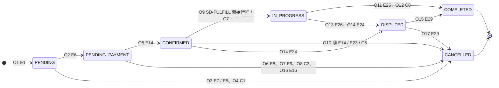
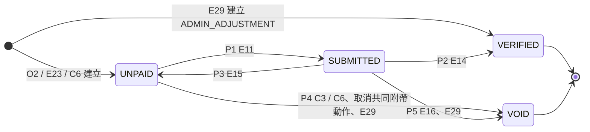
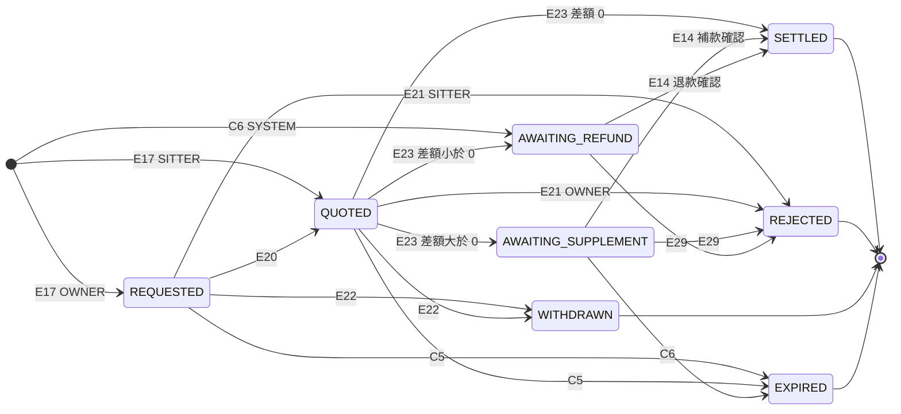
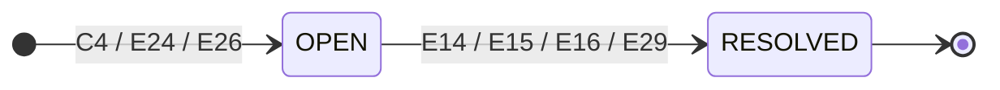
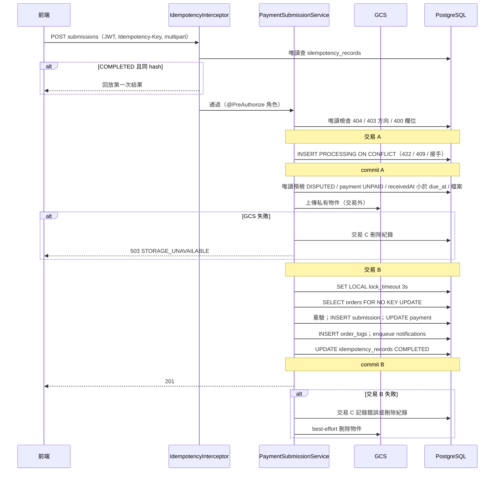
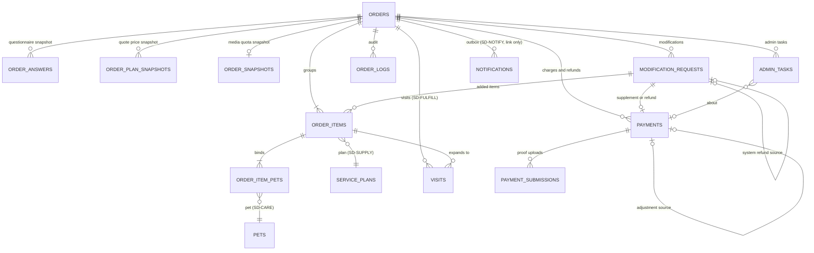

# SD-ORDER: 訂單交易設計文件

| 項目 | 內容 |
|------|------|
| 狀態 | Draft（第一階段：核心設計；API 契約細節、副作用文案、前端、測試設計於第二階段補齊後改 In Review） |
| 建立日期 | 2026-11-22 |
| 涵蓋 PRD | PRD-005、PRD-006、PRD-007、PRD-016、PRD-023、PRD-024、PRD-026、PRD-027（全部 Approved 2026-11-22；對應表見 `00-SD-PLAN.md` §0） |
| 擁有的 Table | `orders`、`order_items`、`order_item_pets`、`order_answers`、`order_plan_snapshots`、`order_snapshots`、`payments`、`payment_submissions`、`modification_requests`、`order_logs`、`admin_tasks`、`idempotency_records`（只有本 SD 能寫；其他 SD 走本 SD 的 Service） |
| 依賴的 SD | SD-FULFILL（`visits` 建立 / 取消 / 關閉、行程狀態查詢）；SD-SUPPLY（方案、問卷題目、公開狀態、我的最愛、收款帳號 `PayoutAccountQuery`）；SD-NOTIFY（`NotificationService.enqueue()`、Email 投遞排程）；SD-TRUST（KYC / 停權狀態）；SD-BILLING（訂閱等級與鎖定即時查詢）；SD-IDENTITY（門禁名單）；SD-CARE（毛孩存在 / 歸屬 / 邏輯刪除） |
| 遵守 | `SD-GLOBAL-SPEC.md`（§2.3、§4.2 依其註記以 baseline 為準）、`SD-FRONTEND-SPEC.md`、`docs/sa/00-DOMAIN-BASELINE.md` 第 2 版 |
| 取代 | SD-005、SD-006、SD-007（付款憑證與訂單詳情部分）、SD-016；本 SD 核准後由使用者將上述改 `Superseded` |

> 共用概念（角色、SaaS 額度、訂單主狀態 O1–O17、付款 / 變更子流程、時間起算點、錯誤碼與判斷順序）一律引用 DOMAIN-BASELINE（下稱 baseline），本文件不重新定義。
> 禁止貼實作程式碼；類別只寫名稱與一句責任。DDL 為契約的一部分，照寫。
> 本文件的「第二階段」標記代表該段落尚未完成，不得據以實作。

---

## 1. AC 對應實作

> 8 張 PRD 共 **156 條 AC**（PRD-005 24、PRD-006 20、PRD-007 24、PRD-016 24、PRD-023 22、PRD-024 16、PRD-026 8、PRD-027 18）。API 欄以 §2.3 端點代號（E*、C*）與路徑表示，request / response 細節於第二階段 §6 補齊。「訂單鎖」= §3.6.1 `OrderLockService.lockForTransition`（`FOR NO KEY UPDATE` + `lock_timeout 3s`）；「排程鎖」= `tryLockForCron`（`SKIP LOCKED`）；「三段式」= §3.6.2 冪等流程。測試欄的整合測試類別為第二階段要建立的新測試，`@DisplayName` 以 `PRD-NNN AC-x.y` 開頭。

### 1.1 PRD-005 公開預約頁與送出預約

| PRD | AC | API / 畫面 | Table / 欄位 | 鎖 / 交易 | 測試 |
|-----|----|-----------|-------------|----------|------|
| PRD-005 | AC-1.1 匿名瀏覽與登入送單 | E31 `GET /api/sitters/{sitterId}/booking-context`（匿名可）；E1 `POST /api/orders` 無 token → 401 | — | 無 | `BookingContextIntegrationTest`；TS-005 |
| PRD-005 | AC-1.2 KYC 未通過 | E31 `bookability=NOT_VERIFIED`；E1 403 `SITTER_NOT_BOOKABLE`（`reason=NOT_VERIFIED`） | 讀 SD-TRUST KYC | 無 | `BookingIntegrationTest` |
| PRD-005 | AC-1.3 隱藏與全域黑名單同文案 | E31 `bookability=UNAVAILABLE`；E1 403 `SITTER_NOT_BOOKABLE`（`reason=UNAVAILABLE`，回應欄位一致） | 讀 SD-SUPPLY 公開狀態、SD-IDENTITY 門禁、SD-BILLING 等級 | 無 | `BookingIntegrationTest` |
| PRD-005 | AC-1.4 方案黑 / 白名單依等級生效 | E31 方案清單依門禁與當下等級過濾；E1 422 `PLAN_NOT_BOOKABLE` | 同上 | 無 | `BookingContextIntegrationTest`、`BookingIntegrationTest` |
| PRD-005 | AC-1.5 全域白名單 | E31 / E1 同 AC-1.3 | 同上 | 無 | `BookingIntegrationTest` |
| PRD-005 | AC-1.6 訂閱鎖定與 ADMIN 停權 | E31 `bookability=LOCKED`；E1 403 `SUBSCRIPTION_LOCKED`（判斷順序第 13 步） | 讀 SD-BILLING / SD-TRUST | 無 | `BookingIntegrationTest` |
| PRD-005 | AC-1.7 每月接單上限 | E31 `bookability=QUOTA_REACHED`；E1 422 `MONTHLY_QUOTA_REACHED` | `orders.confirmed_at`（`ix_orders_sitter_confirmed`，Asia/Taipei 自然月） | 無（不做容量鎖，送單不佔額度） | `BookingIntegrationTest` |
| PRD-005 | AC-1.8 角色不符與預約自己 | E31 `bookability=SELF`；E1 403 `ROLE_MISMATCH` / 422 `SELF_BOOKING_NOT_ALLOWED` | — | 無 | `BookingIntegrationTest`、`OrderIdentitySecurityTest` |
| PRD-005 | AC-2.1 日期群組組合與試算 | 前端試算；E1 後端重算 `base_amount` | `orders.base_amount`、`order_items` | 交易 B | `BookingIntegrationTest`；TS-005 |
| PRD-005 | AC-2.2 日期上下限 | E1 422 `INVALID_VISIT_DATE`（payload 日期）；畫面日期停用 | `order_items.service_dates` | 無 | `BookingIntegrationTest` |
| PRD-005 | AC-2.3 方案可預約區間依等級生效 | E1 422 `INVALID_VISIT_DATE` | 讀 SD-SUPPLY 方案區間、SD-BILLING 等級 | 無 | `BookingIntegrationTest` |
| PRD-005 | AC-2.4 毛孩預設全選與種類提示 | 畫面（讀 SD-CARE 毛孩清單） | — | — | TS-005 |
| PRD-005 | AC-2.5 毛孩綁定檢核 | E1 400 `field=petIds` / 403 / 404，判斷順序 403 先於 400 | `order_item_pets` | 無 | `BookingIntegrationTest` |
| PRD-005 | AC-2.6 格式與數量上限 | E1 400 `VALIDATION_FAILED` | `ck_order_items_daily_count`、`ck_order_items_dates` | 無 | `BookingIntegrationTest` |
| PRD-005 | AC-2.7 同日不阻擋 | E1 201 | 無檔期查詢 | 無 | `BookingIntegrationTest` |
| PRD-005 | AC-2.8 方案不可預約 | E1 422 `PLAN_NOT_BOOKABLE`（不存在 / 他人 / 下架 / 門禁回應一致） | 讀 SD-SUPPLY | 無 | `BookingIntegrationTest` |
| PRD-005 | AC-3.1 建立訂單、行程與毛孩綁定 | E1 201 | `orders`（`PENDING`、`questionnaire_*`）、`order_items`、`order_item_pets`、`visits`（經 SD-FULFILL）、`order_logs` `ORDER_CREATED` | 三段式（無 I/O），交易 B 單一交易 | `BookingIntegrationTest` |
| PRD-005 | AC-3.2 評估期限：一般單與緊急單 | E1 回 `reviewExpiresAt` | `orders.review_expires_at`、`orders.first_service_date` | 交易 B | `BookingIntegrationTest`（注入 `Clock`） |
| PRD-005 | AC-3.3 後端重算、畫面過期與金額上限 | E1 409 `PRICE_CHANGED`（`baseAmount`）/ 400 `field=baseAmount` | `ck_orders_base_amount` | 無 | `BookingIntegrationTest` |
| PRD-005 | AC-3.4 冪等重送 | E1 `Idempotency-Key` 回放 / 422 / 409 / 400 | `idempotency_records` | 三段式認領短交易 | `BookingIdempotencyIntegrationTest` |
| PRD-005 | AC-3.5 新客戶填寫問卷 | E1 201 `questionnaireStatus=COMPLETED` | `order_answers`（題目文字、題型、答案快照） | 交易 B | `BookingQuestionnaireIntegrationTest` |
| PRD-005 | AC-3.6 問卷畫面過期與格式 | E1 409 `QUESTIONNAIRE_CHANGED` / 400 `questionId` | `order_answers` | 無 | `BookingQuestionnaireIntegrationTest` |
| PRD-005 | AC-3.7 熟客與無題目免填 | E1 `NOT_REQUIRED` + `questionnaire_exempt_reason` | `orders.questionnaire_exempt_reason`（`ix_orders_owner_sitter_completed`） | 無 | `BookingQuestionnaireIntegrationTest` |
| PRD-005 | AC-3.8 送單附帶：我的最愛與通知 | E1；`NotificationService.enqueue()`；AFTER_COMMIT 呼叫 SD-SUPPLY `FavoriteSitterService.addIfAbsent` | `notifications`（SD-NOTIFY） | enqueue 同交易；我的最愛 commit 後獨立短交易 | `BookingSideEffectIntegrationTest` |

### 1.2 PRD-006 保母訂單評估與報價

| PRD | AC | API / 畫面 | Table / 欄位 | 鎖 / 交易 | 測試 |
|-----|----|-----------|-------------|----------|------|
| PRD-006 | AC-1.1 評估頁內容 | E5 `GET /api/orders/{orderId}/evaluation` | `order_items`、`order_item_pets`、毛孩（SD-CARE，含已刪除） | 唯讀 | `EvaluationQueryIntegrationTest` |
| PRD-006 | AC-1.2 問卷答案快照 | E5 | `order_answers` | 唯讀 | `EvaluationQueryIntegrationTest` |
| PRD-006 | AC-1.3 免填顯示與熟客標記 | E5 `questionnaireExemptReason`、`isRegularOwner`（即時查） | `orders.questionnaire_exempt_reason`、`ix_orders_owner_sitter_completed` | 唯讀 | `EvaluationQueryIntegrationTest` |
| PRD-006 | AC-1.4 評估頁越權 | E5 401 / 403 / 404 | — | 唯讀 | `OrderIdentitySecurityTest` |
| PRD-006 | AC-1.5 報價預檢提示 | E5 `precheck`（`subscriptionLocked`、`quotaReached`、`payoutAccountMissing`） | `orders.confirmed_at`；SD-SUPPLY `PayoutAccountQuery.isConfigured` | 唯讀 | `EvaluationQueryIntegrationTest` |
| PRD-006 | AC-2.1 原價接單 | E6 `POST /api/orders/{orderId}/quote` | `orders` 金額欄、`quoted_at`、`payments`（INITIAL）、`order_logs` `ORDER_QUOTED`、`notifications` | 訂單鎖；三段式（無 I/O） | `QuoteIntegrationTest` |
| PRD-006 | AC-2.2 PRO 手動調價 | E6（`PlanPolicy` 於第 13 步判斷） | `orders.surcharge_amount`、`discount_amount`、`pricing_notes` | 訂單鎖 | `QuoteIntegrationTest` |
| PRD-006 | AC-2.3 報價快照 | E6 | `order_plan_snapshots`、`order_snapshots` | 訂單鎖 | `QuoteIntegrationTest` |
| PRD-006 | AC-2.4 首次收款建立與期限—一般單 | E6 | `payments`（`due_at`、`escalate_at`、`remind_at`、`payee_account_snapshot`） | 訂單鎖 | `QuoteIntegrationTest` |
| PRD-006 | AC-2.5 首次收款期限—緊急單 | E6；報價通知併付款提醒（不可關閉） | `payments.remind_at = null` | 訂單鎖 | `QuoteIntegrationTest` |
| PRD-006 | AC-2.6 重複送出與跨角色併發 | E6 回放；E6 vs E8 | `idempotency_records` | 訂單鎖序列化；`ORDER_BUSY` | `QuoteConcurrencyIntegrationTest` |
| PRD-006 | AC-2.7 報價後不可編輯 | E6 409 `ORDER_STATE_CONFLICT`；畫面唯讀 | — | 訂單鎖 | `QuoteIntegrationTest`；TS-006 |
| PRD-006 | AC-3.1 報價越權 | E6 403 / 404 | — | 鎖前檢查 | `OrderIdentitySecurityTest` |
| PRD-006 | AC-3.2 方案不足調價 | E6 403 `PLAN_REQUIRED` | — | 訂單鎖 | `QuoteIntegrationTest` |
| PRD-006 | AC-3.3 金額與欄位驗證 | E6 422 `INVALID_QUOTE_AMOUNT` / 400 | `ck_orders_quote_parts` | 訂單鎖 | `QuoteIntegrationTest` |
| PRD-006 | AC-3.4 評估期限與首個行程日 | E6 409 `DEADLINE_PASSED`（`REVIEW_EXPIRES_AT`）/ `FIRST_VISIT_DATE_PASSED` | `orders.review_expires_at`、`first_service_date` | 訂單鎖 | `QuoteIntegrationTest` |
| PRD-006 | AC-3.5 月接單額度 | E6 422 `MONTHLY_QUOTA_REACHED` | `orders.confirmed_at` | 訂單鎖（只鎖本單，不鎖額度） | `QuoteIntegrationTest` |
| PRD-006 | AC-3.6 訂閱鎖定 | E6 403 `SUBSCRIPTION_LOCKED`；E5 200 | — | 訂單鎖 | `QuoteIntegrationTest` |
| PRD-006 | AC-3.7 畫面金額過期 | E6 409 `PRICE_CHANGED`（`baseAmount`、`totalAmount`） | — | 訂單鎖 | `QuoteIntegrationTest` |
| PRD-006 | AC-3.8 未設定收款帳號 | E6 422 `PAYOUT_ACCOUNT_REQUIRED`；成功時快照 | `payments.payee_account_snapshot` | 訂單鎖 | `QuoteIntegrationTest` |

### 1.3 PRD-007 線下付款憑證上傳與核對

| PRD | AC | API / 畫面 | Table / 欄位 | 鎖 / 交易 | 測試 |
|-----|----|-----------|-------------|----------|------|
| PRD-007 | AC-1.1 CHARGE 付款頁與帳號快照 | E10 `GET /api/orders/{orderId}/payments` | `payments.payee_account_snapshot`（解密） | 唯讀 | `PaymentQueryIntegrationTest`；TS-007 |
| PRD-007 | AC-1.2 REFUND 付款頁與 ADMIN_ADJUSTMENT | E10；E11 / E14 409 `PAYMENT_STATE_CONFLICT` | `payments.method` | 唯讀 / 訂單鎖 | `PaymentSubmissionIntegrationTest` |
| PRD-007 | AC-1.3 讀取與上傳越權 | E10 / E11 401 / 403 / 404（payment 不屬路徑訂單 → 404） | — | 鎖前 | `OrderIdentitySecurityTest` |
| PRD-007 | AC-1.4 上傳成功 | E11 `POST /api/orders/{orderId}/payments/{paymentId}/submissions`（multipart） | `payment_submissions`、`payments.status`、`order_logs` `PAYMENT_PROOF_SUBMITTED` | 三段式（GCS 交易外） | `PaymentSubmissionIntegrationTest` |
| PRD-007 | AC-1.5 欄位與檔案驗證 | E11 400 / 422 `PROOF_FILE_TYPE_UNSUPPORTED` / `PROOF_FILE_TOO_LARGE` | `ck_submissions_*` | GCS 前完成 | `PaymentSubmissionIntegrationTest` |
| PRD-007 | AC-1.6 冪等 | E11 回放不重傳 GCS | `idempotency_records`（物件鍵由 record id 決定） | 三段式 | `PaymentSubmissionIdempotencyIntegrationTest` |
| PRD-007 | AC-1.7 狀態與期限不允許 | E11 409（`receivedAt` 判斷期限） | `payments.due_at` | 預檢 + 訂單鎖重驗 | `PaymentSubmissionIntegrationTest` |
| PRD-007 | AC-1.8 GCS 失敗與跨角色競爭 | E11 503 `STORAGE_UNAVAILABLE`；E11 vs E9 | — | 訂單鎖；失敗刪物件 | `PaymentSubmissionConcurrencyIntegrationTest` |
| PRD-007 | AC-2.1 首次付款確認 → 訂單成立 | E14 `POST .../payments/{paymentId}/verify` | `payments`、`payment_submissions`、`orders.confirmed_at`、`admin_tasks` RESOLVED | 訂單鎖 | `PaymentReviewIntegrationTest` |
| PRD-007 | AC-2.2 補款 / 退款確認 | E14（連動 PRD-023 T7 / T10） | `modification_requests.status` | 訂單鎖 | `PaymentReviewIntegrationTest` |
| PRD-007 | AC-2.3 駁回、重新上傳與逾期確認框 | E15 `POST .../payments/{paymentId}/reject`；畫面確認框 | `payment_submissions.reject_reason` | 訂單鎖 | `PaymentReviewIntegrationTest`；TS-007 |
| PRD-007 | AC-2.4 退款不可駁回 | E15 403 先於 409（判斷順序） | — | 鎖前 | `PaymentReviewIntegrationTest` |
| PRD-007 | AC-2.5 確認 / 駁回權限 | E14 / E15 401 / 403 | — | 鎖前 | `OrderIdentitySecurityTest` |
| PRD-007 | AC-2.6 狀態不允許、過期畫面與冪等 | E14 `submissionId` 比對；回放 | `idempotency_records` | 訂單鎖 | `PaymentReviewIntegrationTest` |
| PRD-007 | AC-2.7 憑證檢視與簽名網址 | E12 `GET .../submissions`、E13 `GET .../submissions/{submissionId}/proof-url`（TTL 5 分） | `payment_submissions.proof_object_key` | 唯讀 | `PaymentQueryIntegrationTest` |
| PRD-007 | AC-2.8 通知失敗不回滾 | E14；outbox | `notifications`（SD-NOTIFY） | enqueue 同交易 | `PaymentReviewIntegrationTest` |
| PRD-007 | AC-3.1 期限顯示與緊急單 | E10 `dueAt`、`escalateAt` | `payments.due_at`、`escalate_at` | 唯讀 | `QuoteIntegrationTest` |
| PRD-007 | AC-3.2 付款提醒 | C2 `POST /api/internal/cron/payments/reminder` | `payments.remind_at`、`reminded_at` | 排程鎖 | `PaymentCronIntegrationTest` |
| PRD-007 | AC-3.3 逾期取消 O8 | C3 `POST /api/internal/cron/payments/initial-expiry` | `orders`、`payments`、`visits`、`order_logs` | 排程鎖 | `PaymentCronIntegrationTest` |
| PRD-007 | AC-3.4 SUBMITTED 不逾期；逾期後駁回 | C3 略過 `SUBMITTED`；E15 | — | 排程鎖 / 訂單鎖 | `PaymentCronIntegrationTest` |
| PRD-007 | AC-3.5 待核對升級 | C4 `POST /api/internal/cron/payments/escalation` | `admin_tasks`、`payments.escalated_at` | 排程鎖 | `PaymentCronIntegrationTest` |
| PRD-007 | AC-3.6 ADMIN 作廢並取消 O16 | E16 `POST /api/admin/orders/{orderId}/payments/{paymentId}/void` | `orders`、`payments`、`admin_tasks` | 訂單鎖 | `AdminVoidIntegrationTest` |
| PRD-007 | AC-3.7 ADMIN 限制 | E16 / E10 403 `FORBIDDEN` | `admin_tasks`（OPEN 判斷） | 鎖前授權 | `AdminVoidIntegrationTest` |
| PRD-007 | AC-3.8 保母確認 / 駁回 vs ADMIN 作廢競爭 | E14 / E15 vs E16 | — | 訂單鎖 | `AdminVoidConcurrencyIntegrationTest` |

### 1.4 PRD-016 訂單變更：發起、報價與協商期限

| PRD | AC | API / 畫面 | Table / 欄位 | 鎖 / 交易 | 測試 |
|-----|----|-----------|-------------|----------|------|
| PRD-016 | AC-1.1 飼主發起 CHANGE | E17 `POST /api/orders/{orderId}/modifications`（OWNER → `REQUESTED`） | `modification_requests.requested_content`、`expires_at` | 訂單鎖 | `ModificationInitiateIntegrationTest` |
| PRD-016 | AC-1.2 飼主發起 CANCEL_ALL 與原因 | E17 | `modification_requests.type`、`reason` | 訂單鎖 | `ModificationInitiateIntegrationTest` |
| PRD-016 | AC-1.3 保母發起即報價 | E17（SITTER → `QUOTED`） | `quoted_content`、`system_amount`、`new_total_amount`、`quoted_net_paid`、`quoted_diff` | 訂單鎖 | `ModificationInitiateIntegrationTest` |
| PRD-016 | AC-1.4 不可發起 | E17 409 `ORDER_STATE_CONFLICT` / `MODIFICATION_NOT_ALLOWED` | — | 訂單鎖 | `ModificationInitiateIntegrationTest` |
| PRD-016 | AC-1.5 同時只能一筆未結束變更 | E17 409 `MODIFICATION_IN_PROGRESS` | `ux_modreq_open_per_order` | 訂單鎖 + partial unique | `ModificationInitiateIntegrationTest` |
| PRD-016 | AC-1.6 減少目標與空內容 | E17 409 `VISIT_ALREADY_STARTED` / 400 / 422 `MODIFICATION_EMPTY` | 讀 SD-FULFILL 行程狀態 | 訂單鎖 | `ModificationInitiateIntegrationTest` |
| PRD-016 | AC-1.7 越權與角色 | E17 / E20 403 / 404 | — | 鎖前 | `OrderIdentitySecurityTest` |
| PRD-016 | AC-1.8 新增行程的毛孩、數量與方案 | E17 400 / 422 `PLAN_NOT_IN_ORDER` | `order_plan_snapshots`、`order_item_pets` | 訂單鎖 | `ModificationInitiateIntegrationTest` |
| PRD-016 | AC-2.1 FREE / BASIC 系統計價 | E20 `POST .../modifications/{modificationId}/quote` | `system_amount`、`new_total_amount`、`expires_at` 重設 | 訂單鎖 | `ModificationQuoteIntegrationTest` |
| PRD-016 | AC-2.2 FREE / BASIC 不可自訂 | E20 403 `PLAN_REQUIRED`（第 13 步，晚於 422） | — | 訂單鎖 | `ModificationQuoteIntegrationTest` |
| PRD-016 | AC-2.3 PRO 自訂並附原因 | E20 | `surcharge_amount`、`discount_amount`、`adjustment_reason` | 訂單鎖 | `ModificationQuoteIntegrationTest` |
| PRD-016 | AC-2.4 計價範圍含 DONE 與 CLOSED_BY_SYSTEM | E20 | `order_plan_snapshots.unit_price` × 有效行程 | 訂單鎖 | `ModificationQuoteIntegrationTest` |
| PRD-016 | AC-2.5 新增日期下限與方案區間 | E17 / E20 422 `INVALID_VISIT_DATE`（`reason=PLAN_NOT_IN_RANGE`） | — | 訂單鎖 | `ModificationQuoteIntegrationTest` |
| PRD-016 | AC-2.6 保母拒絕 | E21 `POST .../modifications/{modificationId}/reject`（SITTER，`REQUESTED`） | `reject_reason`、`ended_at` | 訂單鎖 | `ModificationLifecycleIntegrationTest` |
| PRD-016 | AC-2.7 金額與原因上限 | E20 400 | `ck_modreq_amounts` | 訂單鎖 | `ModificationQuoteIntegrationTest` |
| PRD-016 | AC-2.8 方案以報價當下判斷；鎖定依 FREE 計價 | E20（`PlanPolicy.modificationPricing`） | — | 訂單鎖 | `ModificationQuoteIntegrationTest` |
| PRD-016 | AC-3.1 飼主撤回 | E22 `POST .../modifications/{modificationId}/withdraw` | `ended_at` | 訂單鎖 | `ModificationLifecycleIntegrationTest` |
| PRD-016 | AC-3.2 撤回權限與不可撤回狀態 | E22 403（非發起者，含 SYSTEM）/ 409 | `initiated_by` | 訂單鎖 | `ModificationLifecycleIntegrationTest` |
| PRD-016 | AC-3.3 逾時排程 | C5 `POST /api/internal/cron/modifications/expiry` | `ix_modreq_expiry` | 排程鎖 | `ModificationCronIntegrationTest` |
| PRD-016 | AC-3.4 期限以時間判斷 | E20 / E21 / E22 409 `DEADLINE_PASSED`（`MODIFICATION_EXPIRES_AT`） | `expires_at` | 訂單鎖 | `ModificationLifecycleIntegrationTest` |
| PRD-016 | AC-3.5 協商頁可執行動作與歷史 | E18 `GET /api/orders/{orderId}/modifications`（`created_at` 倒序，含 `allowedActions`）；畫面 | — | 唯讀 | `ModificationQueryIntegrationTest`；TS-016 |
| PRD-016 | AC-3.6 跨角色併發 | E22 vs E20 | — | 訂單鎖序列化 | `ModificationConcurrencyIntegrationTest` |
| PRD-016 | AC-3.7 發起與報價冪等 | E17 / E20 回放 | `idempotency_records` | 三段式 | `ModificationIdempotencyIntegrationTest` |
| PRD-016 | AC-3.8 寄信失敗不影響轉移 | E17；outbox | `notifications` | enqueue 同交易 | `ModificationInitiateIntegrationTest` |

### 1.5 PRD-023 訂單變更：飼主回應、補款、退款與結清

| PRD | AC | API / 畫面 | Table / 欄位 | 鎖 / 交易 | 測試 |
|-----|----|-----------|-------------|----------|------|
| PRD-023 | AC-1.1 無差額立即生效 | E23 `POST .../modifications/{modificationId}/accept` | `modification_requests`（`SETTLED`）、`orders.total_amount`、`completion_basis_at`、`order_items`（MODIFICATION）、`visits`（經 SD-FULFILL） | 訂單鎖 | `ModificationSettlementIntegrationTest` |
| PRD-023 | AC-1.2 差額 > 0 建立補款；同意不重驗方案 | E23 | `payments`（`SUPPLEMENT`、`due_at`、快照） | 訂單鎖 | `ModificationSettlementIntegrationTest` |
| PRD-023 | AC-1.3 差額 < 0 建立退款 | E23 | `payments`（`MODIFICATION_REFUND`）、`agreed_net_paid`、`agreed_diff` | 訂單鎖 | `ModificationSettlementIntegrationTest` |
| PRD-023 | AC-1.4 減少目標已開始 | E23 409 `VISIT_ALREADY_STARTED` | — | 訂單鎖 | `ModificationSettlementIntegrationTest` |
| PRD-023 | AC-1.5 同意的跨角色併發、O9 不觸發 | E23 vs SD-FULFILL 開始行程 / E22 | — | 訂單鎖序列化 | `ModificationConcurrencyIntegrationTest` |
| PRD-023 | AC-1.6 飼主拒絕 | E21（OWNER，`QUOTED`） | `ended_at` | 訂單鎖 | `ModificationLifecycleIntegrationTest` |
| PRD-023 | AC-1.7 越權、狀態與期限 | E23 403 / 409 | — | 訂單鎖 | `ModificationSettlementIntegrationTest` |
| PRD-023 | AC-1.8 同意冪等 | E23 回放；換 key 409 | `ux_payments_per_modreq` | 三段式 | `ModificationIdempotencyIntegrationTest` |
| PRD-023 | AC-2.1 補款確認即生效 | E14（SUPPLEMENT → T7） | `orders.total_amount`、`order_items`、`visits` | 訂單鎖 | `ModificationSettlementIntegrationTest` |
| PRD-023 | AC-2.2 首次付款不被覆寫 | E10 | `payments` 分列、`payment_submissions` | 唯讀 | `ModificationSettlementIntegrationTest` |
| PRD-023 | AC-2.3 新增日期已過不擋同意、仍建立 | E23 / E14 | `visits`（日期已過仍 `PENDING`） | 訂單鎖 | `ModificationSettlementIntegrationTest` |
| PRD-023 | AC-2.4 補款逾時重算並建系統退款 | C6 `POST /api/internal/cron/modifications/supplement-expiry` | `payments` VOID、`modification_requests`（EXPIRED + SYSTEM 新列）、`orders.total_amount` | 排程鎖；先結束舊列再建新列 | `SupplementExpiryIntegrationTest` |
| PRD-023 | AC-2.5 純新增逾時不退款 | C6 | 同上 | 排程鎖 | `SupplementExpiryIntegrationTest` |
| PRD-023 | AC-2.6 重算下限 0 | C6 | `orders.total_amount` | 排程鎖 | `SupplementExpiryIntegrationTest` |
| PRD-023 | AC-2.7 SUBMITTED 不逾時；駁回與逾期上傳 | C6 略過；E15；E11 409 `DEADLINE_PASSED` | — | 排程鎖 / 訂單鎖 | `SupplementExpiryIntegrationTest` |
| PRD-023 | AC-2.8 先前已有 SETTLED 變更時只扣本次取消 | C6 | `modification_requests.quoted_content`（本次減少目標） | 排程鎖 | `SupplementExpiryIntegrationTest` |
| PRD-023 | AC-3.1 退款確認即結清 | E14（MODIFICATION_REFUND → T10） | `orders.total_amount` | 訂單鎖 | `ModificationSettlementIntegrationTest` |
| PRD-023 | AC-3.2 退款前不可確認、退款無逾時 | E14 409；無排程 | — | 訂單鎖 | `ModificationSettlementIntegrationTest` |
| PRD-023 | AC-3.3 CONFIRMED 整筆取消結清 → O10 | E14 → O10 | `orders`（`cancel_reason_code=MODIFICATION`）、`order_logs` `ORDER_CANCELLED_BY_MODIFICATION` | 訂單鎖 | `ModificationSettlementIntegrationTest` |
| PRD-023 | AC-3.4 無差額的整筆取消立即 O10 | E23 → O10 | 同上 | 訂單鎖 | `ModificationSettlementIntegrationTest` |
| PRD-023 | AC-3.5 IN_PROGRESS 整筆取消照常結案 | E14 | `orders.status` 不變、`completion_basis_at` | 訂單鎖 | `ModificationSettlementIntegrationTest` |
| PRD-023 | AC-3.6 系統退款變更 | E22 403；E11 / E14 | `modification_requests.initiated_by=SYSTEM` | 訂單鎖 | `SupplementExpiryIntegrationTest` |

### 1.6 PRD-024 訂單變更：款項爭議與協商期間限制

| PRD | AC | API / 畫面 | Table / 欄位 | 鎖 / 交易 | 測試 |
|-----|----|-----------|-------------|----------|------|
| PRD-024 | AC-1.1 飼主於等待退款時申報 | E24 `POST /api/orders/{orderId}/payment-disputes` | `orders`（`DISPUTED`、`disputed_at`）、`admin_tasks`（`MODIFICATION_PAYMENT_DISPUTE`）、`order_logs`（含說明） | 訂單鎖 | `PaymentDisputeIntegrationTest` |
| PRD-024 | AC-1.2 保母於 CONFIRMED 訂單申報 | E24 | 同上 | 訂單鎖 | `PaymentDisputeIntegrationTest` |
| PRD-024 | AC-1.3 補款待核對滿 72h | E24 409 `PAYMENT_STATE_CONFLICT`（`disputeAvailableAt`） | `payment_submissions.submitted_at` | 訂單鎖 | `PaymentDisputeIntegrationTest` |
| PRD-024 | AC-1.4 不符申報條件 | E24 409 | — | 訂單鎖 | `PaymentDisputeIntegrationTest` |
| PRD-024 | AC-1.5 越權 | E24 403 / 404 | — | 鎖前 | `OrderIdentitySecurityTest` |
| PRD-024 | AC-1.6 併發與冪等 | E24 | `ux_admin_tasks_open`、`idempotency_records` | 訂單鎖 | `PaymentDisputeIntegrationTest` |
| PRD-024 | AC-1.7 申報與確認款項併發 | E24 vs E14 | — | 訂單鎖序列化 | `PaymentDisputeIntegrationTest` |
| PRD-024 | AC-1.8 爭議說明 | E24 400 | `order_logs.payload.description` | 訂單鎖 | `PaymentDisputeIntegrationTest` |
| PRD-024 | AC-2.1 DISPUTED 凍結 | E11 / E14 / E15 / E17 / E20–E23 → 409 `ORDER_STATE_CONFLICT` | — | 訂單鎖 | `DisputeFreezeIntegrationTest` |
| PRD-024 | AC-2.2 爭議期間行程照常 | SD-FULFILL 開始行程 → `OrderLifecycleService.onVisitLeftPending`（無主狀態變化） | — | 訂單鎖（由 SD-FULFILL 取得） | `DisputeFreezeIntegrationTest` |
| PRD-024 | AC-2.3 調解結果：UNPAID 退款 | E29 `POST /api/admin/orders/{orderId}/mediation`（O15 / O17） | `modification_requests` REJECTED、`payments` VOID、`admin_tasks` RESOLVED | 訂單鎖 | `MediationIntegrationTest` |
| PRD-024 | AC-2.4 調解結果：SUBMITTED 退款與補款 | E29（每筆 `SUBMITTED` 退款必填 `exported`） | `payments`（`ADMIN_ADJUSTMENT`、`source_payment_id`） | 訂單鎖 | `MediationIntegrationTest` |
| PRD-024 | AC-2.5 ADMIN 唯讀範圍 | E27 `GET /api/admin/orders/{orderId}` | `admin_tasks`（OPEN） | 唯讀 | `AdminOrderQueryIntegrationTest` |
| PRD-024 | AC-2.6 協商期間不可結案、不自動結案 | E25 `POST /api/orders/{orderId}/complete`、E26 `POST /api/orders/{orderId}/service-disputes` → 409 `MODIFICATION_IN_PROGRESS`；C8 候選排除 | `ux_modreq_open_per_order` | 訂單鎖 / 排程鎖 | `CompletionIntegrationTest` |
| PRD-024 | AC-2.7 結案基準只看 SETTLED 變更 | `CompletionBasisCalculator`；C8 | `orders.completion_basis_at` | 與觸發轉移同交易 | `CompletionBasisIntegrationTest` |
| PRD-024 | AC-2.8 訂閱鎖定 / 停權不擋 | E17 / E20 / E21 / E22 / E14 / E11 / E24 不檢查 `SUBSCRIPTION_LOCKED` | — | 訂單鎖 | `SubscriptionLockedOrderIntegrationTest` |

### 1.7 PRD-026 飼主撤回預約

| PRD | AC | API / 畫面 | Table / 欄位 | 鎖 / 交易 | 測試 |
|-----|----|-----------|-------------|----------|------|
| PRD-026 | AC-1.1 評估中撤回 | E8 `POST /api/orders/{orderId}/withdraw` | `orders`（`cancelled_by=OWNER`、`cancel_reason`）、`visits`、`order_logs` `ORDER_WITHDRAWN` | 訂單鎖 | `OrderWithdrawIntegrationTest` |
| PRD-026 | AC-1.2 報價後付款前撤回 | E8（O6） | `payments` VOID | 訂單鎖 | `OrderWithdrawIntegrationTest` |
| PRD-026 | AC-1.3 已上傳憑證不可撤回 | E8 409 `PAYMENT_ALREADY_SUBMITTED`；畫面 | — | 訂單鎖 | `OrderWithdrawIntegrationTest` |
| PRD-026 | AC-1.4 付款後與終態不可撤回 | E8 409 `ORDER_STATE_CONFLICT` | — | 訂單鎖 | `OrderWithdrawIntegrationTest` |
| PRD-026 | AC-1.5 期限已過仍可撤回 | E8（不檢查期限）；C1 / C3 鎖後重驗略過 | — | 訂單鎖 / 排程鎖 | `OrderWithdrawIntegrationTest` |
| PRD-026 | AC-1.6 越權與角色 | E8 403 / 404 | — | 鎖前 | `OrderIdentitySecurityTest` |
| PRD-026 | AC-1.7 畫面過期與跨角色併發 | E8 `expectedStatus` 比對；E8 vs E7 | — | 訂單鎖 | `OrderWithdrawConcurrencyIntegrationTest` |
| PRD-026 | AC-1.8 重複送出與格式 | E8 回放 / 400 | `idempotency_records` | 三段式 | `OrderWithdrawIntegrationTest` |

### 1.8 PRD-027 保母婉拒、評估逾期與付款前保母取消

| PRD | AC | API / 畫面 | Table / 欄位 | 鎖 / 交易 | 測試 |
|-----|----|-----------|-------------|----------|------|
| PRD-027 | AC-1.1 婉拒成功 | E7 `POST /api/orders/{orderId}/decline` | `orders`（`cancelled_by=SITTER`、`cancel_reason_code=SITTER_DECLINED`）、`visits`、`order_logs` `ORDER_REJECTED` | 訂單鎖 | `SitterDeclineIntegrationTest` |
| PRD-027 | AC-1.2 婉拒確認框與原因 | 畫面；E7 400 `field=reason` | — | 鎖前 | `SitterDeclineIntegrationTest`；TS-027 |
| PRD-027 | AC-1.3 婉拒被拒 | E7 409 / 403 / 404 / 400 | — | 訂單鎖 | `SitterDeclineIntegrationTest` |
| PRD-027 | AC-1.4 婉拒併發與重送 | E7 vs E8；回放 | — | 訂單鎖 | `SitterDeclineIntegrationTest` |
| PRD-027 | AC-1.5 轉介入口 | 畫面；PRD-010 依賴 `OrderQueryService.isDeclinedBySitter` | `order_logs` `ORDER_REJECTED` | 唯讀 | TS-027 |
| PRD-027 | AC-1.6 鎖定或額度已滿仍可婉拒 | E7 不檢查鎖定 / 額度 | — | 訂單鎖 | `SitterDeclineIntegrationTest` |
| PRD-027 | AC-1.7 期限後仍可婉拒 | E7（不檢查 `review_expires_at`）；C1 略過 | — | 訂單鎖 / 排程鎖 | `SitterDeclineIntegrationTest` |
| PRD-027 | AC-2.1 逾期取消 | C1 `POST /api/internal/cron/orders/review-expiry` | `orders`（`REVIEW_EXPIRED`）、`visits`、`order_logs` `ORDER_REVIEW_EXPIRED` | 排程鎖 | `ReviewExpiryCronIntegrationTest` |
| PRD-027 | AC-2.2 到期邊界 | C1 `review_expires_at <= :now` | `ix_orders_review_expiry` | 排程鎖 | `ReviewExpiryCronIntegrationTest` |
| PRD-027 | AC-2.3 重驗與略過 | C1 回 `processed` / `skipped` / `failed` | — | 逐筆獨立交易 | `ReviewExpiryCronIntegrationTest` |
| PRD-027 | AC-2.4 重跑冪等與端點身分 | C1；非 `X-Internal-Secret` → 403 `FORBIDDEN` | — | — | `InternalCronSecurityTest` |
| PRD-027 | AC-3.1 取消成功 | E9 `POST /api/orders/{orderId}/sitter-cancel` | `orders`（`SITTER_CANCELLED`）、`payments` VOID、`visits`、`order_logs` `ORDER_CANCELLED_BY_SITTER` | 訂單鎖 | `SitterCancelIntegrationTest` |
| PRD-027 | AC-3.2 已上傳憑證不可取消 | E9 409 `PAYMENT_ALREADY_SUBMITTED` | — | 訂單鎖 | `SitterCancelIntegrationTest` |
| PRD-027 | AC-3.3 狀態不允許 | E9 409 `ORDER_STATE_CONFLICT` | — | 訂單鎖 | `SitterCancelIntegrationTest` |
| PRD-027 | AC-3.4 越權與原因 | E9 403 / 400 | — | 鎖前 | `SitterCancelIntegrationTest` |
| PRD-027 | AC-3.5 跨角色併發 | E9 vs E11 | — | 訂單鎖；上傳失敗刪物件 | `PaymentSubmissionConcurrencyIntegrationTest` |
| PRD-027 | AC-3.6 重送與鎖定 | E9 回放；鎖定不擋 | `idempotency_records` | 三段式 | `SitterCancelIntegrationTest` |
| PRD-027 | AC-3.7 付款期限後仍可取消 | E9（不檢查 `due_at`）；C3 略過 | — | 訂單鎖 / 排程鎖 | `SitterCancelIntegrationTest` |

---

## 2. 模組邊界

### 2.1 負責

- **訂單聚合**：`orders` 與其子實體（預約群組、毛孩綁定、問卷答案快照、報價快照、payments、submissions、變更請求、稽核、ADMIN 待辦）的全部寫入。
- **O1–O17 全部主狀態轉移的 API 與排程**（`00-SD-PLAN.md` §0），含 O9（由 SD-FULFILL 開始行程或殭屍清理觸發，經本 SD 鎖入口）、O11–O13（PRD-009 畫面呼叫）、O15 / O17（PRD-020 畫面呼叫）。
- **付款子流程**（baseline §3.3）：首次收款、補款、變更退款、調解退款；線下憑證上傳 / 核對；期限、提醒、逾期、升級；收款帳號**快照**的加密存放與讀取。
- **變更子流程**（baseline §3.4）：發起、報價、拒絕、撤回、同意、逾時、補款逾時重算（CQ-53）、系統退款變更。
- **訂單層共用機制**（baseline §3.6）：訂單鎖入口、冪等、`order_logs`、`admin_tasks`、付款憑證 GCS 物件與孤兒檔清除。
- **預約可行性**：公開預約頁的可預約判斷彙整（E31，彙整 SD-TRUST / SD-SUPPLY / SD-IDENTITY / SD-BILLING 的查詢結果與本 SD 的月額度計數）。
- **衍生值**：已收淨額、當月 `CONFIRMED` 計數、熟客判斷、`completion_basis_at`、保母帳務總覽（由 payments 加總，baseline §4）。

### 2.2 不負責

| 項目 | 歸屬 | 本 SD 的關係 |
|------|------|-------------|
| 收款帳號的設定 / 修改 / 通知（PRD-025） | SD-SUPPLY | 只呼叫 `PayoutAccountQuery`（§2.3.2），快照存在本 SD 的 `payments` |
| 行程（`visits`）的狀態機、開始 / 完成 / 照護日誌、`IN_PROGRESS` 逾時出口（baseline §6） | SD-FULFILL | 本 SD 透過 SD-FULFILL 的 Service 建立 / 取消 / 關閉行程；SD-FULFILL 改行程前必須先取本 SD 的訂單鎖 |
| 通知內容範本、偏好、Email 投遞與重試 | SD-NOTIFY | 本 SD 在轉移交易內呼叫 `enqueue()`，並決定是否為不可關閉類別 |
| 方案、問卷題目 CRUD、公開檔案、我的最愛 | SD-SUPPLY | 唯讀查詢；我的最愛於 commit 後呼叫 `addIfAbsent` |
| 訂閱等級、到期、鎖定通知（CQ-19 通知受影響飼主） | SD-BILLING | 唯讀查詢 `SubscriptionQuery`；`subscriptions.monthly_order_count` 本 SD 不讀寫 |
| KYC 與 ADMIN 停權 | SD-TRUST | 唯讀查詢 |
| 轉介（PRD-010） | SD-TRUST | 提供 `isDeclinedBySitter` 查詢 |
| 媒體保留期限的計算與展延規則（PRD-013） | SD-CARE | 本 SD 擁有 `order_snapshots` 的媒體欄位並提供讀取 / 展延方法 |
| PRD-009 結案畫面、PRD-020 ADMIN 後台畫面 | PRD-009 / PRD-020 對應 SD | 畫面呼叫本 SD 端點（§2.3.4） |

### 2.3 對外提供

#### 2.3.1 給 SD-FULFILL：行程鎖入口與 O9 / 結案基準

| Service | 方法（責任） | 交易要求 |
|---------|-------------|---------|
| `OrderLockService` | `lockForTransition(orderId)`：`SET LOCAL lock_timeout = '3s'` 後以 `FOR NO KEY UPDATE` 鎖訂單列並回傳訂單；逾時拋 `OrderBusyException`（409 `ORDER_BUSY` + `Retry-After: 1`）；不存在拋 `OrderException(NOT_FOUND)` | `MANDATORY`（呼叫端必須已在交易中） |
| `OrderLockService` | `tryLockForCron(orderId)`：`FOR NO KEY UPDATE SKIP LOCKED`，鎖不到回空（排程計入 `skipped`） | `MANDATORY` |
| `OrderLifecycleService` | `onVisitLeftPending(order, visitId, cause)`：`cause ∈ {STARTED, CLOSED_BY_SYSTEM}`；訂單為 `CONFIRMED` 時同交易執行 O9 並寫 `order_logs`；`DISPUTED` / `IN_PROGRESS` 不變（CQ-28、CQ-56、CQ-57） | `MANDATORY`，須已持有訂單鎖 |
| `OrderLifecycleService` | `onVisitFinished(order)`：行程轉 `DONE` / `CLOSED_BY_SYSTEM` 後重算 `completion_basis_at`（§3.1.3） | `MANDATORY`，須已持有訂單鎖 |
| `OrderQueryService` | `getParticipants(orderId)`、`hasAnyOrderBetween(sitterId, ownerId)`、`getMediaQuota(orderId)`（快照額度與保留天數） | 唯讀 |

SD-FULFILL 必須提供給本 SD（依賴，第二階段與 SD-FULFILL 對齊簽名）：`VisitCommandService.createVisits(order, items)`、`cancelPendingVisits(orderId)`、`cancelVisits(orderId, visitIds)`、`closeZombieVisits(orderId, now)`；`VisitQueryService.listEffectiveVisits(orderId)`（狀態、`service_date`、`plan_id`、`completed_at`、`closed_at`、日誌是否已送出）。以上寫入方法皆 `MANDATORY`，由本 SD 在持有訂單鎖的交易內呼叫。

#### 2.3.2 給 SD-SUPPLY：收款帳號查詢依賴（本 SD 呼叫，SD-SUPPLY 實作）

| 介面 | 方法 | 規則 |
|------|------|------|
| `PayoutAccountQuery` | `isConfigured(sitterId)` | O2 前置檢查（CQ-63）與 E5 預檢 |
| `PayoutAccountQuery` | `getSnapshot(sitterId)` | 單次讀取同一筆紀錄的四欄（銀行代碼、分行、帳號、戶名），不取鎖（PRD-025 BR-12）；本 SD 收到明文後立即以 `PayoutSnapshotCipher` 加密寫入 `payments.payee_account_snapshot`，不落 log |

#### 2.3.3 給 SD-NOTIFY：`NotificationService.enqueue()` 依賴（本 SD 呼叫，SD-NOTIFY 實作）

- 簽名（第二階段與 SD-NOTIFY 對齊）：`enqueue(NotificationCommand)`，欄位 = 收件者 userId、收件角色、通知類型代碼、是否不可關閉（`mandatory`）、連結（訂單 / 變更詳情）、範本參數。
- 傳播 `MANDATORY`：必須在本 SD 的轉移交易內呼叫；轉移回滾則通知一併回滾。
- `mandatory=true` 的類別（baseline §3.6、CQ-73）：付款提醒（含併入報價通知的提醒）、付款逾期取消（O8）、憑證駁回、ADMIN 作廢（O16）。其餘依 PRD-014 偏好，由 SD-NOTIFY 判斷是否排 Email。
- Email 寄送、Resend `Idempotency-Key = notification.id`、最多 5 次指數退避、4xx 直接失敗：全歸 SD-NOTIFY 排程（§8.1 C11 只列依賴）。

#### 2.3.4 給 PRD-009 / PRD-020 畫面（及其他畫面）呼叫的端點清單

> 端點代號供 §1、§3、§8 引用；request / response / 錯誤碼完整契約於第二階段 §6 補齊。

| 代號 | Method | Path | 角色 | 轉移 / 用途 | 呼叫畫面 |
|------|--------|------|------|------------|---------|
| E1 | POST | `/api/orders` | OWNER | O1 | PRD-005 預約頁 |
| E2 | GET | `/api/orders/{orderId}` | OWNER / SITTER | 訂單詳情（含 payments、變更摘要、可執行動作） | 雙方訂單詳情 |
| E3 | GET | `/api/orders/owner` | OWNER | 列表（分頁、依 baseline §3.1 分頁籤） | 飼主訂單列表 |
| E4 | GET | `/api/orders/sitter` | SITTER | 列表 | 保母訂單列表 |
| E5 | GET | `/api/orders/{orderId}/evaluation` | SITTER | 評估頁 | PRD-006 |
| E6 | POST | `/api/orders/{orderId}/quote` | SITTER | O2 | PRD-006 |
| E7 | POST | `/api/orders/{orderId}/decline` | SITTER | O3（SITTER） | PRD-027 |
| E8 | POST | `/api/orders/{orderId}/withdraw` | OWNER | O3（OWNER）/ O6 | PRD-026 |
| E9 | POST | `/api/orders/{orderId}/sitter-cancel` | SITTER | O7 | PRD-027 |
| E10 | GET | `/api/orders/{orderId}/payments` | OWNER / SITTER / ADMIN（可讀範圍） | 付款頁 | PRD-007、PRD-020 |
| E11 | POST | `/api/orders/{orderId}/payments/{paymentId}/submissions` | OWNER / SITTER（付款方） | P1 | PRD-007 |
| E12 | GET | `/api/orders/{orderId}/payments/{paymentId}/submissions` | OWNER / SITTER / ADMIN | submission 歷史 | PRD-007、PRD-020 |
| E13 | GET | `/api/orders/{orderId}/payments/{paymentId}/submissions/{submissionId}/proof-url` | OWNER / SITTER / ADMIN | 憑證簽名網址 | PRD-007、PRD-020 |
| E14 | POST | `/api/orders/{orderId}/payments/{paymentId}/verify` | SITTER / OWNER（收款方） | P2（連動 O5、T7、T10、O10） | PRD-007、PRD-023 |
| E15 | POST | `/api/orders/{orderId}/payments/{paymentId}/reject` | SITTER（僅 CHARGE 收款方） | P3 | PRD-007 |
| E16 | POST | `/api/admin/orders/{orderId}/payments/{paymentId}/void` | ADMIN | O16 | PRD-020 |
| E17 | POST | `/api/orders/{orderId}/modifications` | OWNER / SITTER | 變更 T1（OWNER）/ T2（SITTER） | PRD-016 |
| E18 | GET | `/api/orders/{orderId}/modifications` | OWNER / SITTER / ADMIN | 變更歷史（`created_at` 倒序） | PRD-016、PRD-020 |
| E19 | GET | `/api/orders/{orderId}/modifications/{modificationId}` | OWNER / SITTER / ADMIN | 協商頁 | PRD-016、PRD-023 |
| E20 | POST | `/api/orders/{orderId}/modifications/{modificationId}/quote` | SITTER | 變更 T3 | PRD-016 |
| E21 | POST | `/api/orders/{orderId}/modifications/{modificationId}/reject` | SITTER（`REQUESTED`）/ OWNER（`QUOTED`） | PRD-016 T4、PRD-023 T4 | PRD-016、PRD-023 |
| E22 | POST | `/api/orders/{orderId}/modifications/{modificationId}/withdraw` | 發起者 | PRD-016 T5 | PRD-016 |
| E23 | POST | `/api/orders/{orderId}/modifications/{modificationId}/accept` | OWNER | PRD-023 T1–T3（連動 O10） | PRD-023 |
| E24 | POST | `/api/orders/{orderId}/payment-disputes` | OWNER / SITTER | O14 | PRD-024 |
| E25 | POST | `/api/orders/{orderId}/complete` | OWNER | O11 | PRD-009 |
| E26 | POST | `/api/orders/{orderId}/service-disputes` | OWNER | O13 | PRD-009 |
| E27 | GET | `/api/admin/orders/{orderId}` | ADMIN | 唯讀詳情（可讀範圍：`DISPUTED` 或有 OPEN 待辦） | PRD-020 |
| E28 | GET | `/api/admin/tasks` | ADMIN | 待辦列表（`status=OPEN`，分頁） | PRD-020 |
| E29 | POST | `/api/admin/orders/{orderId}/mediation` | ADMIN | O15 / O17（終態由系統依行程判斷，CQ-57） | PRD-020 |
| E30 | GET | `/api/orders/sitter/ledger` | SITTER | 帳務總覽（payments 加總） | PRD-009 |
| E31 | GET | `/api/sitters/{sitterId}/booking-context` | 匿名 / 任一角色 | 可預約判斷、門禁過濾後方案、問卷是否需填與題目 | PRD-005 |

#### 2.3.5 其他 SD 可用的查詢

| Service | 方法 | 使用者 |
|---------|------|--------|
| `OrderQueryService` | `isDeclinedBySitter(orderId, sitterId)`：訂單 `CANCELLED`、`cancelled_by=SITTER`、有 `ORDER_REJECTED` log（PRD-027 BR-3） | SD-TRUST 轉介 |
| `OrderQueryService` | `isRegularOwner(ownerId, sitterId)`、`countConfirmedInMonth(sitterId, yearMonthTaipei)` | SD-SUPPLY（公開頁） |
| `OrderQueryService` | `getNetPaid(orderId)` | SD-BILLING（未來撥款） |
| `OrderSnapshotService` | `extendMediaRetention(orderId, days)`：PRD-013 升級展延（規則由 SD-CARE 判斷，本 SD 只寫值） | SD-CARE |
| `OrderQueryService` | `hasActiveOrder(userId)`（非 `COMPLETED` / `CANCELLED`） | SD-IDENTITY（註銷）、SD-CARE（毛孩刪除） |

---

## 3. 狀態機

### 3.1 訂單主狀態（O1–O17）

權威定義在 baseline §3.1–§3.2；本節只補「由哪個端點 / 排程觸發、取什麼鎖、不符時由哪個例外拋出」。



#### 3.1.1 轉移表

例外類別（`application/exception/`）：`OrderException`（帶 `OrderErrorCode`，`GlobalExceptionHandler` 依 code 對映 HTTP 狀態與 payload）、`OrderBusyException`（409 `ORDER_BUSY` + `Retry-After: 1`）、`IdempotencyException`（422 `IDEMPOTENCY_KEY_REUSED` / 409 `IDEMPOTENCY_IN_PROGRESS`）、`StorageUnavailableException`（503 `STORAGE_UNAVAILABLE`）。角色不符由 `@PreAuthorize` 擋下後 `GlobalExceptionHandler` 回 403 `ROLE_MISMATCH`；非當事人由 Service 拋 `AccessDeniedException` → 403 `FORBIDDEN`。下表「不符時」只列狀態 / 業務類錯誤碼，401 / 403 / 404 / 400 / 冪等類各端點共通，依 baseline §3.7 判斷順序。

| # | 轉移 | 觸發 | 鎖 | 同交易附帶 | 不符時（依判斷順序） |
|---|------|------|----|-----------|---------------------|
| O1 | → `PENDING` | E1（OWNER） | 無訂單鎖（新建；不做容量 / 檔期鎖）；冪等認領防重 | 建 `order_items`、`order_item_pets`、`order_answers`（需填時）；SD-FULFILL `createVisits`；`review_expires_at`、`first_service_date`；`ORDER_CREATED`；enqueue 保母「新預約申請」；commit 後我的最愛 | 422 `SELF_BOOKING_NOT_ALLOWED` → 403 `SITTER_NOT_BOOKABLE` → 422 `MONTHLY_QUOTA_REACHED` → 422 `PLAN_NOT_BOOKABLE` → 422 `INVALID_VISIT_DATE` → 409 `QUESTIONNAIRE_CHANGED` / 400（問卷長度）→ 400（`baseAmount` 上限）→ 409 `PRICE_CHANGED` → 403 `SUBSCRIPTION_LOCKED`（PRD-005 §4.4 步驟 3.8–3.9） |
| O2 | `PENDING → PENDING_PAYMENT` | E6（SITTER） | 訂單鎖 | 寫金額欄與 `quoted_at`；`order_plan_snapshots`、`order_snapshots`；建 INITIAL payment（`due_at`、`escalate_at`、`remind_at`、加密快照）；`ORDER_QUOTED`；enqueue 飼主報價通知（`quoted_at ≥ 首日 − 48h` 時併提醒、`mandatory`） | 409 `ORDER_STATE_CONFLICT` → 409 `DEADLINE_PASSED`（`REVIEW_EXPIRES_AT`）→ 409 `FIRST_VISIT_DATE_PASSED` → 422 `MONTHLY_QUOTA_REACHED` → 422 `PAYOUT_ACCOUNT_REQUIRED` → 409 `PRICE_CHANGED` → 422 `INVALID_QUOTE_AMOUNT` / 400 `totalAmount` → 403 `PLAN_REQUIRED` → 403 `SUBSCRIPTION_LOCKED`（PRD-006 §4.3） |
| O3 | `PENDING → CANCELLED` | E7（SITTER，原因必填）/ E8（OWNER，原因選填） | 訂單鎖 | 取消共同附帶動作（§3.1.2）；`ORDER_REJECTED` / `ORDER_WITHDRAWN`；enqueue 雙方 | 409 `ORDER_STATE_CONFLICT`（E8 另含 `expectedStatus` 不符）；不檢查 `review_expires_at`（CQ-61） |
| O4 | `PENDING → CANCELLED` | C1（SYSTEM） | 排程鎖 | 取消共同附帶動作；`cancel_reason_code=REVIEW_EXPIRED`；`ORDER_REVIEW_EXPIRED`；enqueue 雙方 | 鎖後重驗不符 → 略過（`skipped`） |
| O5 | `PENDING_PAYMENT → CONFIRMED` | E14（SITTER 確認 INITIAL） | 訂單鎖 | P2 / S2；`confirmed_at`（即月額度 +1）；OPEN 的 `INITIAL_PAYMENT_UNVERIFIED` 待辦 → RESOLVED（`SITTER_VERIFIED`）；`PAYMENT_VERIFIED`；enqueue 雙方「訂單啟動成功」；不檢查日期 | 409 `ORDER_STATE_CONFLICT`（`DISPUTED` 不會發生於此狀態，保留防線）→ 409 `PAYMENT_STATE_CONFLICT`（非 `SUBMITTED` / `submissionId` 不符 / `ADMIN_ADJUSTMENT`） |
| O6 | `PENDING_PAYMENT → CANCELLED` | E8（OWNER） | 訂單鎖 | 取消共同附帶動作（INITIAL `UNPAID → VOID`）；`ORDER_WITHDRAWN` | 409 `ORDER_STATE_CONFLICT` → 409 `PAYMENT_ALREADY_SUBMITTED`；不檢查 `due_at` |
| O7 | `PENDING_PAYMENT → CANCELLED` | E9（SITTER，原因必填） | 訂單鎖 | 同 O6；`ORDER_CANCELLED_BY_SITTER` | 同 O6 |
| O8 | `PENDING_PAYMENT → CANCELLED` | C3（SYSTEM） | 排程鎖 | 取消共同附帶動作；`cancel_reason_code=PAYMENT_EXPIRED`；`PAYMENT_EXPIRED`；enqueue 雙方（`mandatory`） | 重驗（`UNPAID` 且 `now ≥ due_at`）不符 → 略過 |
| O16 | `PENDING_PAYMENT → CANCELLED` | E16（ADMIN，原因 1–200 字） | 鎖前授權（payment 為 INITIAL 且有 OPEN 待辦，否則 403 `FORBIDDEN`）；訂單鎖後重驗 | payment `SUBMITTED → VOID`（submission 維持 `SUBMITTED`）；取消共同附帶動作；待辦 RESOLVED（`ADMIN_VOIDED`）；`PAYMENT_VOIDED_BY_ADMIN`；enqueue 雙方（`mandatory`） | 403 `FORBIDDEN`（鎖前）→ 409 `PAYMENT_STATE_CONFLICT`（鎖後重驗失敗） |
| O9 | `CONFIRMED → IN_PROGRESS` | SD-FULFILL 開始行程 / C7 殭屍清理 → `onVisitLeftPending` | 訂單鎖（由 SD-FULFILL 或 C7 取得） | `ORDER_STARTED`（payload 帶觸發行程與 cause）；因變更而 `CANCELLED` 不觸發 | 不適用（訂單非 `CONFIRMED` 時只更新行程） |
| O10 | `CONFIRMED → CANCELLED` | 隨 E23（差額 0）/ E14（T7、T10）/ C6（補款逾時且不需系統退款） | 沿用觸發者已持有的訂單鎖 | 取消共同附帶動作；`cancelled_by=SYSTEM`、`cancel_reason_code=MODIFICATION`；另寫一列 `ORDER_CANCELLED_BY_MODIFICATION`（payload `modificationId`、`initiatedBy`）；enqueue 雙方 | 不適用（條件不成立即維持 `CONFIRMED`） |
| O11 | `IN_PROGRESS → COMPLETED` | E25（OWNER） | 訂單鎖 | `completed_by=OWNER`、`completed_at`；`ORDER_COMPLETED` | 409 `ORDER_STATE_CONFLICT` → 409 `MODIFICATION_IN_PROGRESS` → 409 `VISITS_NOT_FINISHED`（順序見 §12 CQ-6） |
| O12 | `IN_PROGRESS → COMPLETED` | C8（SYSTEM） | 排程鎖 | `completed_by=SYSTEM`；`ORDER_COMPLETED` | 重驗不符 → 略過 |
| O13 | `IN_PROGRESS → DISPUTED` | E26（OWNER） | 訂單鎖 | `disputed_at`；建 `SERVICE_DISPUTE` 待辦（§12 CQ-5）；`SERVICE_DISPUTE_OPENED` | 409 `ORDER_STATE_CONFLICT` → 409 `MODIFICATION_IN_PROGRESS` → 409 `VISITS_NOT_FINISHED` → 409 `DEADLINE_PASSED`（視窗已過，期限名稱見 §12 CQ-5） |
| O14 | `CONFIRMED` / `IN_PROGRESS → DISPUTED` | E24（OWNER / SITTER，說明 1–500 字） | 訂單鎖 | `disputed_at`；建 `MODIFICATION_PAYMENT_DISPUTE` 待辦（`payment_id` = 退款或補款 payment）；`PAYMENT_DISPUTE_OPENED`（payload 含說明）；enqueue 另一方；不通知 ADMIN | 409 `ORDER_STATE_CONFLICT` → 409 `MODIFICATION_STATE_CONFLICT`（無 `AWAITING_*`）→ 409 `PAYMENT_STATE_CONFLICT`（補款非 `SUBMITTED`；未滿 72h 帶 `disputeAvailableAt`） |
| O15 | `DISPUTED → COMPLETED` | E29（ADMIN） | 訂單鎖 | 剩餘 `PENDING` 行程取消；未結束變更 → `REJECTED` + `ended_at`；`UNPAID` payment → `VOID`；`SUBMITTED` 退款依 `exported` → `VOID`（+ 等額 `ADMIN_ADJUSTMENT`）；`SUBMITTED` 補款 → `VOID`；可登記一筆手動 `ADMIN_ADJUSTMENT`（≤ 已收淨額，附依據）；所有 OPEN 待辦 RESOLVED（`ADMIN_MEDIATED`）；`completed_by=ADMIN`；`ORDER_MEDIATED` | 409 `ORDER_STATE_CONFLICT` → 409 `VISITS_NOT_FINISHED`（有 `IN_PROGRESS` 行程，§12 CQ-7）→ 400（`SUBMITTED` 退款未標 `exported`）→ 422（調解金額超過已收淨額，§12 CQ-7） |
| O17 | `DISPUTED → CANCELLED` | E29（ADMIN） | 訂單鎖 | 同 O15；`cancelled_by=ADMIN`、`cancel_reason_code=ADMIN_MEDIATED` | 同 O15 |

- **O15 / O17 的終態由系統判斷**（baseline O15 / O17、CQ-57）：有任何 `DONE` / `CLOSED_BY_SYSTEM` 行程 → O15，否則 O17；E29 不收「要結成哪個狀態」的參數。
- **期限以時間判斷**（CQ-46）：需要期限的操作在鎖後以 `now`（注入的 `Clock`）比對；上傳憑證以伺服器收到請求的 `receivedAt` 比對（PRD-007 BR-12）。取消類操作（O3、O6、O7）不檢查期限（CQ-61）。
- **`DISPUTED` 凍結**（CQ-48）：所有 payment / 變更的使用者端點在判斷順序第 8 步回 409 `ORDER_STATE_CONFLICT`；排程候選查詢排除 `DISPUTED`，鎖後重驗亦排除（防線）。

#### 3.1.2 取消的共同附帶動作（baseline §3.2、CQ-65）

`OrderCancellationApplier.apply(order, cancelledBy, reasonCode, reason)`（`MANDATORY`，須持有訂單鎖）：

1. 訂單 → `CANCELLED`，寫 `cancelled_by`、`cancelled_at`、`cancel_reason_code`、`cancel_reason`。
2. 該訂單所有 `UNPAID` / `SUBMITTED` payment → `VOID`（`void_reason_code` 記取消來源）；submission 不改（PRD-007 BR-24）。
3. 呼叫 SD-FULFILL `cancelPendingVisits(orderId)`。
4. 不寫 `order_logs`（由呼叫端的轉移寫一列，payload `transitions[]` 列出上述附帶轉移）。

#### 3.1.3 `completion_basis_at` 維護

- 定義引用 baseline §5（CQ-17、CQ-40、CQ-69）。`CompletionBasisCalculator` 依有效行程與最後一筆 `SETTLED` 變更的 `ended_at` 計算。
- **儲存時點**：任何有效行程仍為 `PENDING` / `IN_PROGRESS` 時存 `NULL`（基準尚未成立）；全部有效行程皆 `DONE` / `CLOSED_BY_SYSTEM` 時存計算值。理由：O12 / O13 前置條件本來就要求行程全部結束，`NULL` 讓 C8 的部分索引只掃成立的訂單。
- **重算觸發**（與觸發轉移同交易）：行程轉 `DONE` / `CLOSED_BY_SYSTEM`（`onVisitFinished`）、行程因變更或調解轉 `CANCELLED`、變更 `SETTLED`（含新增行程使基準回到 `NULL`）。拒絕 / 撤回 / 逾時的變更不觸發重算。

### 3.2 付款（`payments`）與憑證（`payment_submissions`）

權威定義在 baseline §3.3；PRD-007 §5 的 P1–P5 / S1–S3。



| # | 轉移 | 觸發 | 鎖 | 附帶 | 不符時 |
|---|------|------|----|------|-------|
| 建立 INITIAL | → `UNPAID` | O2（E6） | 訂單鎖 | `due_at`、`escalate_at`、`remind_at`、加密快照 | 由 O2 決定 |
| 建立 SUPPLEMENT | → `UNPAID` | E23 差額 > 0 | 訂單鎖 | `due_at = now + MODIFICATION_TIMEOUT_HOURS`、加密快照 | 由 E23 決定 |
| 建立 MODIFICATION_REFUND | → `UNPAID` | E23 差額 < 0 / C6 系統退款 | 訂單鎖 / 排程鎖 | `due_at = null`、無快照 | 由觸發者決定 |
| 建立 ADMIN_ADJUSTMENT | → `VERIFIED` | E29（手動一筆 / `exported` 補登） | 訂單鎖 | `adjustment_basis`；補登者帶 `source_payment_id` | 由 E29 決定 |
| P1 | `UNPAID → SUBMITTED` | E11（付款方） | 三段式：預檢不取鎖 → GCS → 訂單鎖重驗 | S1 建 submission；`PAYMENT_PROOF_SUBMITTED`；enqueue 收款方 | 403 `FORBIDDEN`（方向）→ 400 → 冪等 → 409 `ORDER_STATE_CONFLICT`（`DISPUTED`）→ 409 `PAYMENT_STATE_CONFLICT`（非 `UNPAID`、`ADMIN_ADJUSTMENT`、鎖後已 `VOID`）→ 409 `DEADLINE_PASSED`（`PAYMENT_DUE_AT`，`receivedAt ≥ due_at`）→ 422 `PROOF_FILE_TYPE_UNSUPPORTED` / `PROOF_FILE_TOO_LARGE`；GCS 失敗 503 `STORAGE_UNAVAILABLE` |
| P2 | `SUBMITTED → VERIFIED` | E14（收款方） | 訂單鎖 | S2；依 `purpose`：INITIAL → O5；SUPPLEMENT → 變更 T7 `SETTLED`；MODIFICATION_REFUND → 變更 T10 `SETTLED`；`SETTLED` 後檢查 O10；`PAYMENT_VERIFIED` | 403 `FORBIDDEN`（方向；ADMIN → `ROLE_MISMATCH`）→ 409 `ORDER_STATE_CONFLICT` → 409 `PAYMENT_STATE_CONFLICT` |
| P3 | `SUBMITTED → UNPAID` | E15（CHARGE 收款方，原因 1–200 字） | 訂單鎖 | S3；OPEN 的 INITIAL 待辦 → RESOLVED（`SITTER_REJECTED`）；`PAYMENT_REJECTED`；enqueue 付款方（`mandatory`）；不給寬限 | 403 `FORBIDDEN`（REFUND 不可駁回，先於凍結）→ 400 → 409 `ORDER_STATE_CONFLICT` → 409 `PAYMENT_STATE_CONFLICT` |
| P4 | `UNPAID → VOID` | C3（INITIAL）/ C6（SUPPLEMENT）/ 取消共同附帶動作 / E29 | 排程鎖 / 訂單鎖 | `voided_at`、`void_reason_code` | 排程重驗不符 → 略過 |
| P5 | `SUBMITTED → VOID` | E16（O16，INITIAL）/ E29（O15 / O17） | 訂單鎖 | submission 維持 `SUBMITTED`（畫面標「已作廢」） | 見 O16 / O15 |
| A1 | 待辦 → `OPEN` | C4（`now ≥ escalate_at` 且 INITIAL `SUBMITTED`） | 排程鎖 | `escalated_at`；`PAYMENT_ESCALATED`；enqueue 雙方 | `ux_admin_tasks_open` 保證不重建；重驗不符略過 |

- submission 狀態：`SUBMITTED` / `ACCEPTED` / `REJECTED`；同一 payment 同時最多一筆 `SUBMITTED`（`ux_submissions_open`）。
- `method=ADMIN_ADJUSTMENT` 的 payment 對任何當事人寫入一律 409 `PAYMENT_STATE_CONFLICT`（狀態檢查先於方向檢查，PRD-007 §3）。
- `ONLINE`（SD-BILLING）同實體，金流回呼 `UNPAID → VERIFIED`，不在本階段範圍。

### 3.3 變更請求（`modification_requests`）

權威定義在 baseline §3.4；PRD-016 T1–T6、PRD-023 T1–T11、PRD-024 T2。



| # | 轉移 | 觸發 | 鎖 | 附帶 | 不符時（依 PRD-016 BR-28） |
|---|------|------|----|------|---------------------------|
| T1 | → `REQUESTED` | E17（OWNER） | 訂單鎖 | `expires_at = now + 72h`；`MODIFICATION_REQUESTED`；enqueue SITTER | 409 `ORDER_STATE_CONFLICT` → `MODIFICATION_IN_PROGRESS` → `MODIFICATION_NOT_ALLOWED` → 409 `VISIT_ALREADY_STARTED` → 422 `INVALID_VISIT_DATE` / `MODIFICATION_EMPTY` / `PLAN_NOT_IN_ORDER` |
| T2 | → `QUOTED` | E17（SITTER） | 訂單鎖 | 計價（`PlanPolicy.modificationPricing`，鎖定時依 FREE）；`quoted_net_paid`、`quoted_diff`；`MODIFICATION_PROPOSED`；enqueue OWNER | 同 T1；422 `INVALID_MODIFICATION_AMOUNT`；403 `PLAN_REQUIRED` |
| T3 | `REQUESTED → QUOTED` | E20（SITTER） | 訂單鎖 | `expires_at` 重設；`MODIFICATION_QUOTED`；enqueue OWNER | 409 `ORDER_STATE_CONFLICT` → `MODIFICATION_STATE_CONFLICT` → `DEADLINE_PASSED`（`MODIFICATION_EXPIRES_AT`）→ `VISIT_ALREADY_STARTED` → 422 `INVALID_VISIT_DATE` / `MODIFICATION_EMPTY` / `PLAN_NOT_IN_ORDER` / `INVALID_MODIFICATION_AMOUNT` → 403 `PLAN_REQUIRED` |
| T4（SITTER） | `REQUESTED → REJECTED` | E21（SITTER，原因 1–200 字） | 訂單鎖 | `ended_at`、`reject_reason`；`MODIFICATION_REJECTED`；enqueue OWNER（含原因） | 409 `ORDER_STATE_CONFLICT` → `MODIFICATION_STATE_CONFLICT`（含 SITTER 對 `QUOTED` 呼叫）→ `DEADLINE_PASSED` |
| T4（OWNER） | `QUOTED → REJECTED` | E21（OWNER） | 訂單鎖 | `ended_at`；`MODIFICATION_REJECTED`；enqueue SITTER | 同上 |
| T5 | `REQUESTED` / `QUOTED → WITHDRAWN` | E22（發起者） | 訂單鎖 | `ended_at`；`MODIFICATION_WITHDRAWN`；enqueue 對方 | 403 `FORBIDDEN`（非發起者，含 `initiated_by=SYSTEM`，§12 CQ-1）→ 409 `ORDER_STATE_CONFLICT` → `MODIFICATION_STATE_CONFLICT` → `DEADLINE_PASSED` |
| T6 | `REQUESTED` / `QUOTED → EXPIRED` | C5 | 排程鎖 | `ended_at`；`MODIFICATION_EXPIRED`；enqueue 雙方 | 重驗不符 → 略過 |
| 同意 | `QUOTED → SETTLED / AWAITING_SUPPLEMENT / AWAITING_REFUND` | E23（OWNER） | 訂單鎖 | 減少目標 → SD-FULFILL `cancelVisits`（不觸發 O9）；重算已收淨額寫 `agreed_net_paid` / `agreed_diff`；差額 0 → `SETTLED`（建 MODIFICATION `order_items` 與行程、`total_amount = new_total_amount`、重算 `completion_basis_at`、檢查 O10）；> 0 → 建 SUPPLEMENT payment；< 0 → 建 MODIFICATION_REFUND payment；`MODIFICATION_ACCEPTED`；不重驗方案 | 409 `ORDER_STATE_CONFLICT` → `MODIFICATION_STATE_CONFLICT` → `DEADLINE_PASSED` → `VISIT_ALREADY_STARTED`（整筆不生效） |
| T7 | `AWAITING_SUPPLEMENT → SETTLED` | E14（SUPPLEMENT 確認） | 訂單鎖 | 建新增行程（日期已過仍建）、`total_amount`、`ended_at`、重算基準、檢查 O10 | 見 P2 |
| T8 | `AWAITING_SUPPLEMENT → EXPIRED` | C6 | 排程鎖 | payment VOID；`total_amount = max(0, total_amount − Σ 本變更減少目標的快照單價)`；需要時 T9；不需退款時檢查 O10；`SUPPLEMENT_EXPIRED` | 重驗（payment 仍 `UNPAID` 且 `now ≥ due_at`）不符 → 略過 |
| T9 | → `AWAITING_REFUND`（SYSTEM） | 隨 T8 | 同 T8 | 先結束舊列並 flush，再建新列（避開 `ux_modreq_open_per_order`、`ux_payments_open_per_order`）與退款 payment | — |
| T10 | `AWAITING_REFUND → SETTLED` | E14（MODIFICATION_REFUND 確認） | 訂單鎖 | 一般變更：建新增行程、`total_amount`；SYSTEM 變更：不改 `total_amount`；`ended_at`；檢查 O10 | 見 P2 |
| 調解 | `AWAITING_* → REJECTED` | E29 | 訂單鎖 | `ended_at`；不推遲基準 | 見 O15 |

- **內容儲存**：OWNER 期望內容存 `requested_content`，SITTER 報價內容存 `quoted_content`（JSONB，結構：減少的行程 id 陣列 + 新增項目陣列〔日期、方案、每日次數、毛孩 id〕）；鎖內以 SD-FULFILL 行程狀態驗證減少目標。
- **計價**：`system_amount = Σ(新內容有效行程的 order_plan_snapshots.unit_price)`；PRO / ULTIMATE 未鎖定可加減（`PlanPolicy`），新總額 0–999,999。

### 3.4 事前問卷（只有 O1 寫入）

| 情境（O1 當下後端判斷，baseline §3.5） | `orders.questionnaire_status` | `orders.questionnaire_exempt_reason` | `order_answers` |
|------|------|------|------|
| 熟客（`ix_orders_owner_sitter_completed` 有列；兩種免填同時成立亦此列） | `NOT_REQUIRED` | `REGULAR_OWNER` | 不寫（送來的答案忽略） |
| 保母沒有啟用中題目 | `NOT_REQUIRED` | `NO_ACTIVE_QUESTIONS` | 不寫 |
| 其他 | `COMPLETED` | `NULL` | 每題一列：送單當下題目文字、題型、答案（非必填未答存 JSON `null`） |

- O1 之後無任何轉移；`ck_orders_questionnaire` 保證組合合法（§5.1.2）。
- 判斷所需的題目定義於 O1 交易內向 SD-SUPPLY 讀取一次，驗證（PRD-005 BR-22、BR-24）與快照使用同一份資料。

### 3.5 ADMIN 待辦（`admin_tasks`）



| type | 建立 | 關閉（`resolution`） |
|------|------|---------------------|
| `INITIAL_PAYMENT_UNVERIFIED` | C4（A1） | E14 O5（`SITTER_VERIFIED`）；E15 駁回（`SITTER_REJECTED`）；E16 O16（`ADMIN_VOIDED`） |
| `MODIFICATION_PAYMENT_DISPUTE` | E24（O14） | E29（`ADMIN_MEDIATED`） |
| `SERVICE_DISPUTE` | E26（O13，名稱待確認 §12 CQ-5） | E29（`ADMIN_MEDIATED`） |

建立與關閉都與觸發轉移同交易（CQ-55）；`(type, order_id) WHERE status='OPEN'` 唯一。ADMIN 可讀範圍（baseline §1.2、CQ-18）= 訂單 `DISPUTED` 或該訂單有任一 OPEN 待辦，判斷由 `AdminOrderAccessPolicy` 統一提供給 E10、E12、E13、E16、E18、E19、E27。

### 3.6 共用機制落地

#### 3.6.1 訂單鎖入口

| 項目 | 規則 |
|------|------|
| 實作 | `OrderLockService`（§2.3.1）。以 native SQL 執行 `SET LOCAL lock_timeout = '3s'` 與 `SELECT ... FROM orders WHERE id = :id FOR NO KEY UPDATE`，不依賴 JPA `PESSIMISTIC_WRITE` 產生的 SQL |
| 為何 `FOR NO KEY UPDATE` | 子表（payments、submissions、modification_requests、order_logs、visits）INSERT 時的 FK 檢查取 `FOR KEY SHARE`，與之相容，不會因鎖父列而互等 |
| 逾時 | PostgreSQL SQLSTATE `55P03`（lock_not_available）→ `OrderBusyException` → 409 `ORDER_BUSY` + `Retry-After: 1`；冪等紀錄刪除（可重試，baseline §3.6） |
| 範圍 | 所有改變訂單主狀態、payment、submission、變更、行程狀態的操作；SD-FULFILL 開始 / 完成行程也必須先呼叫 |
| 排程 | `tryLockForCron` 用 `SKIP LOCKED`，鎖不到計入 `skipped`，不等待 |
| `@Version` | `orders`、`payments`、`payment_submissions`、`modification_requests`、`admin_tasks` 保留 `version` 欄與 `@Version` 作最後防線；不接受客戶端 version；畫面過期以關鍵值比對（`expectedAmount`、`expectedStatus`、`submissionId`，CQ-35）。觸發時的錯誤碼見 §12 CQ-2 |
| Transaction Pooler | `SET LOCAL`、`FOR NO KEY UPDATE`、`pg_advisory_xact_lock` 在交易內可用；不使用 session 級 `SET` / `pg_advisory_lock` |
| 不做 | 容量 / 檔期鎖、月額度鎖（月額度只在 O5 隱含 +1，O1 / O2 只讀計數，baseline §2.2） |

#### 3.6.2 冪等（三段式）

適用所有帶 `Idempotency-Key` 的寫入端點（E1、E6–E9、E11、E14–E17、E20–E26、E29）。範圍 = （token 使用者, HTTP method + 路由樣板, key），存在 `idempotency_records`（§5.1）。

| 段 | 交易 | 內容 | 佔連線 |
|----|------|------|-------|
| 0 回放查詢 | 唯讀 | `IdempotencyInterceptor`（handler 已解析路由樣板、`@PreAuthorize` 之前）以範圍查紀錄：`COMPLETED`、未過期、`request_hash` 相同 → 直接回放第一次的狀態碼與 body（判斷順序第 2 步）。其餘情況不在此回錯 | 1，毫秒級 |
| 1 認領 | 短交易 A | 角色 / 404 / 403 / 400 檢查通過後：`INSERT ... status='PROCESSING', locked_until=now+30s, expires_at=now+24h ON CONFLICT (user_id, scope, idempotency_key) DO UPDATE ... WHERE 舊列已過期`；衝突時讀既有列：hash 不同 → 422 `IDEMPOTENCY_KEY_REUSED`；`PROCESSING` 且 `locked_until > now` → 409 `IDEMPOTENCY_IN_PROGRESS`；`PROCESSING` 且已過 `locked_until` → 條件式 UPDATE 接手（只有一個請求能接手） | 1，毫秒級 |
| 2 交易外 I/O | 無交易 | 只有 E11：GCS 上傳（物件鍵由認領紀錄 id 決定，`doesNotExist` precondition；接手的重試遇到已存在物件視為已上傳，內容由相同 hash 保證一致） | 0 |
| 3 鎖定寫入 | 交易 B | 訂單鎖 → 重驗狀態 → 業務寫入 → `order_logs` → `enqueue()` → `UPDATE idempotency_records SET status='COMPLETED', response_status, response_body WHERE id=:id AND status='PROCESSING'`（0 列 → 回滾，視為被接手，回 409 `IDEMPOTENCY_IN_PROGRESS`）→ commit | 1 |
| 失敗 | 短交易 C | 可記錄的業務錯誤（409 / 422，`ORDER_BUSY` 除外）→ 紀錄改 `COMPLETED` 並存錯誤回應；5xx、`ORDER_BUSY`、`STORAGE_UNAVAILABLE` → 刪除紀錄（允許同 key 重試）。E11 另以 best-effort 刪除段 2 的物件 | 1，毫秒級 |

- **request hash**：SHA-256（路由樣板 + 已解析的路徑變數 + 正規化後的 JSON body；multipart = 各欄位值 + 檔案 SHA-256）。路徑變數必須入 hash，否則同一把 key 用在兩張訂單會互相回放。
- **回應 body** 不含簽名網址等時效性資料（E11 回應只含 submission id 與狀態）。
- 段 0 與段 1 分開的理由：判斷順序要求回放在 403 `ROLE_MISMATCH` 之前、`IDEMPOTENCY_KEY_REUSED` 在 400 之後（baseline §3.7）。
- 段 1 獨立成短交易的理由：若認領與交易 B 合併，同 key 的第二個請求會在 INSERT 上等待第一個交易的唯一索引鎖並佔住第 2 條連線（prod pool 小）。
- 每個請求同一時間只佔 1 條連線；不使用 `REQUIRES_NEW` 巢狀交易（避免抽樣缺陷 #3）。



#### 3.6.3 `order_logs`（同交易稽核）

| 項目 | 規則 |
|------|------|
| 寫入者 | `OrderLogWriter`，傳播 `MANDATORY`，與狀態變更同交易；不得使用 `REQUIRES_NEW`（抽樣缺陷 #2）。舊 `AuditLogService.writeOrderLog` 不再用於訂單 |
| 粒度 | **一個操作一列**；同一操作造成的附帶轉移（payment VOID、行程取消、待辦關閉、O5 等）列在該列 payload 的 `transitions[]`（PRD-026 §5、PRD-007 AC-2.1 的「一筆紀錄」）。例外：同交易內**操作者不同**的主狀態轉移另寫一列 —— O10（SYSTEM，觸發者為 OWNER / SITTER）與 O9（由 C7 觸發時為 SYSTEM） |
| 欄位 | `order_id`、`action_type`、`operator_role`（OWNER / SITTER / ADMIN / SYSTEM）、`operator_user_id`（SYSTEM 為 NULL）、`payload`（JSONB）、`created_at` |
| payload 共通 | `transitions[]`（`entity`、`id`、`from`、`to`）、`idempotencyKey`（有則記）；各 action 的專屬欄位於第二階段 §7 列表 |
| action_type | `ORDER_CREATED`、`ORDER_QUOTED`、`ORDER_REJECTED`、`ORDER_WITHDRAWN`、`ORDER_REVIEW_EXPIRED`、`ORDER_CANCELLED_BY_SITTER`、`PAYMENT_PROOF_SUBMITTED`、`PAYMENT_VERIFIED`、`PAYMENT_REJECTED`、`PAYMENT_EXPIRED`、`PAYMENT_ESCALATED`、`PAYMENT_VOIDED_BY_ADMIN`、`MODIFICATION_REQUESTED`、`MODIFICATION_PROPOSED`、`MODIFICATION_QUOTED`、`MODIFICATION_REJECTED`、`MODIFICATION_WITHDRAWN`、`MODIFICATION_EXPIRED`、`MODIFICATION_ACCEPTED`、`SUPPLEMENT_EXPIRED`、`ORDER_CANCELLED_BY_MODIFICATION`、`ORDER_STARTED`、`VISITS_CLOSED_BY_SYSTEM`、`ORDER_COMPLETED`、`SERVICE_DISPUTE_OPENED`、`PAYMENT_DISPUTE_OPENED`、`ORDER_MEDIATED` |
| 不寫 | 付款提醒（只寫 `reminded_at`，不是轉移）；排程重驗不符而略過者 |
| 失敗語意 | 主交易回滾 → log 一併不存在（整合測試必測） |

#### 3.6.4 Outbox（`notifications`，歸 SD-NOTIFY）

- 轉移交易內呼叫 `NotificationService.enqueue()`（§2.3.3）；本 SD 不直接呼叫 Resend、不註冊 `AFTER_COMMIT` 寄信 listener。
- Email 失敗的補送由 SD-NOTIFY 排程負責；狀態轉移已提交，不回滾（各 PRD「Resend 失敗」例外）。
- 唯一使用 `AFTER_COMMIT` 的副作用：O1 後的我的最愛 `addIfAbsent`（PRD-005 BR-14），在 commit 後獨立短交易執行，失敗只記 log，不重試（重新送單時會再嘗試）。

#### 3.6.5 `admin_tasks`

見 §3.5；DDL 見 §5.1。ADMIN 列表 E28 只讀此表（依 `created_at`，`ix_admin_tasks_open`）。

#### 3.6.6 GCS 上傳、簽名網址與孤兒檔清除

| 項目 | 規則 |
|------|------|
| 物件鍵 | `payment-proofs/{yyyy-MM-dd}/{orderId}/{paymentId}/{idempotencyRecordId}.{ext}`（日期 = 上傳時 UTC 日期；CHARGE 與 REFUND 共用此前綴，不再寫 `refund-proofs/`） |
| 前綴與 lifecycle | `payment-proofs/` 永久保存，必須排除於任何 GCS lifecycle 規則（SD-GLOBAL-SPEC §4.1）；2026-11-22 唯讀確認 `cat-sitter-media-bucket` 目前沒有任何 lifecycle 規則 |
| 存取 | 私有物件（`uploadPrivate`）；E13 每次授權後產生 V4 簽名網址，TTL 5 分鐘（`app.order.proof-url-ttl=PT5M`），不寫入 DB 與冪等回放 body |
| 檔案驗證 | GCS 前完成：恰好 1 檔、≤ 5 MB（`app.order.proof-max-bytes=5242880`）、以檔頭 magic bytes 判定 JPEG / PNG / WebP（不信任 `Content-Type`）；同時計算 SHA-256 供 hash 與 `proof_sha256` |
| 失敗 | 上傳失敗 → 503 `STORAGE_UNAVAILABLE`、刪冪等紀錄；交易 B 失敗 → best-effort 刪物件，刪不掉由 C10 清除 |
| Mock | 沿用現有 `MediaStorageService` 介面：`@Profile("local")` → `LocalMediaStorageServiceImpl`，其他 profile → GCS 實作；整合測試以 local 實作替身 |
| 孤兒檔清除 | C10（§8.1） |

---

## 4. 流程

> 第二階段補齊：O1 送單、O2 報價、E23 同意（三分支）、C6 補款逾時（含 T9 與 O10）、E29 調解的序列圖。上傳憑證的三段式序列圖見 §3.6.2。

---

## 5. 資料模型

### 5.1 遷移

本專案未上線，依 baseline CQ-36 清空交易資料、不做狀態對映。為相容 Cloud Run 滾動部署（新 revision 啟動跑 Flyway 時舊 revision 仍在服務），拆成兩支、分兩次發布：

| 檔名 | 隨哪次發布 | 內容 | 對前一版程式的相容性 |
|------|-----------|------|---------------------|
| `V20261122_01__order_rebuild_expand.sql` | 發布 1（新後端，接著新前端） | 清空交易資料；建新表；舊表加新欄位（皆可為 NULL / 有預設）；放寬新程式不再寫入的舊 NOT NULL；建 partial unique / 索引；新表的 CHECK | 舊 revision 讀寫的欄位全部仍在；舊欄位的 NOT NULL 只放寬不新增；新 CHECK 只加在舊程式不碰的新表 |
| `V20261122_02__order_rebuild_contract.sql` | 發布 2（發布 1 的前後端都上線、確認無舊 revision 後才加入 repo） | DROP 舊欄位 / 舊索引；對舊表補 NOT NULL 與 CHECK | 發布 1 的程式已不映射被 DROP 的欄位 |

- 現有最大版號 `V20261025_01`；兩支接續。`_02` 的檔名日期在加入 repo 時可改為實際日期，只要版號大於 `_01`。
- 既有遷移檔一律不改。
- 表內所有時間 `TIMESTAMPTZ`、所有金額 `INT`（TWD）。

#### 5.1.1 `V20261122_01__order_rebuild_expand.sql`

```sql
-- ============================================================
-- 0. 清空交易資料（baseline CQ-36）。明列所有表、不用 CASCADE：
--    若有遺漏的 FK 參照表，TRUNCATE 直接失敗，不會靜默連帶清空。
--    referral_logs 以 FK 參照 orders，必須一起清（§12 CQ-3）。
-- ============================================================
TRUNCATE TABLE service_report_media, visit_service_reports, visits,
               referral_logs, modification_requests, order_logs,
               order_snapshots, orders;
-- 指向已清空訂單的通知（§12 CQ-3，待確認後保留或移除此行）
DELETE FROM notifications WHERE category IN ('ORDER_AFFAIR', 'SERVICE_RECORD');

-- ============================================================
-- 1. orders：新增欄位（全部可為 NULL，舊 revision 寫入不受影響）
-- ============================================================
ALTER TABLE orders
    ADD COLUMN base_amount                 INT,
    ADD COLUMN surcharge_amount            INT,
    ADD COLUMN discount_amount             INT,
    ADD COLUMN pricing_notes               VARCHAR(200),
    ADD COLUMN quoted_at                   TIMESTAMPTZ,
    ADD COLUMN confirmed_at                TIMESTAMPTZ,   -- O5；取代 paid_at；月額度計數依據
    ADD COLUMN review_expires_at           TIMESTAMPTZ,
    ADD COLUMN first_service_date          DATE,          -- 首日（Asia/Taipei 日期），O1 寫入後不變
    ADD COLUMN questionnaire_status        VARCHAR(16),
    ADD COLUMN questionnaire_exempt_reason VARCHAR(24),
    ADD COLUMN cancelled_at                TIMESTAMPTZ,
    ADD COLUMN cancel_reason_code          VARCHAR(24),
    ADD COLUMN cancel_reason               VARCHAR(200),
    ADD COLUMN completed_by                VARCHAR(8),
    ADD COLUMN completion_basis_at         TIMESTAMPTZ,
    ADD COLUMN disputed_at                 TIMESTAMPTZ;
-- 新程式不再寫 items（改存 order_items）；total_amount 報價前為 NULL
ALTER TABLE orders ALTER COLUMN items DROP NOT NULL;
ALTER TABLE orders ALTER COLUMN total_amount DROP NOT NULL,
                   ALTER COLUMN total_amount DROP DEFAULT;

-- O4 候選
CREATE INDEX ix_orders_review_expiry ON orders (review_expires_at) WHERE status = 'PENDING';
-- O12 候選（completion_basis_at 只在行程全部結束後非 NULL，§3.1.3）
CREATE INDEX ix_orders_auto_complete ON orders (completion_basis_at)
    WHERE status = 'IN_PROGRESS' AND completion_basis_at IS NOT NULL;
-- 月額度：保母當月進入 CONFIRMED 的筆數（取消不返還，confirmed_at 保留）
CREATE INDEX ix_orders_sitter_confirmed ON orders (sitter_id, confirmed_at)
    WHERE confirmed_at IS NOT NULL;
-- 熟客判斷
CREATE INDEX ix_orders_owner_sitter_completed ON orders (owner_id, sitter_id)
    WHERE status = 'COMPLETED';
-- 列表（雙方依狀態分頁、建立時間倒序）
CREATE INDEX ix_orders_owner_list  ON orders (owner_id, status, created_at DESC);
CREATE INDEX ix_orders_sitter_list ON orders (sitter_id, status, created_at DESC);

-- ============================================================
-- 2. order_items：預約群組（BOOKING）與變更新增項目（MODIFICATION），建立後不改
-- ============================================================
CREATE TABLE order_items (
    id                      UUID PRIMARY KEY DEFAULT gen_random_uuid(),
    order_id                UUID NOT NULL REFERENCES orders(id),
    source                  VARCHAR(16) NOT NULL,
    group_index             SMALLINT,              -- BOOKING 的群組序（0 起）
    modification_request_id UUID REFERENCES modification_requests(id),
    plan_id                 UUID NOT NULL REFERENCES service_plans(id),
    service_dates           DATE[] NOT NULL,       -- Asia/Taipei 日期
    daily_count             SMALLINT NOT NULL,
    booked_unit_price       INT NOT NULL,          -- 送單時單價，只用於 base_amount；報價後以 order_plan_snapshots 為準
    created_at              TIMESTAMPTZ NOT NULL DEFAULT now(),
    CONSTRAINT ck_order_items_source CHECK (
        (source = 'BOOKING' AND group_index IS NOT NULL AND modification_request_id IS NULL)
     OR (source = 'MODIFICATION' AND group_index IS NULL AND modification_request_id IS NOT NULL)),
    CONSTRAINT ck_order_items_daily_count CHECK (daily_count BETWEEN 1 AND 3),
    CONSTRAINT ck_order_items_dates CHECK (cardinality(service_dates) BETWEEN 1 AND 60),
    CONSTRAINT ck_order_items_price CHECK (booked_unit_price BETWEEN 0 AND 999999)
);
CREATE INDEX ix_order_items_order ON order_items (order_id);
CREATE UNIQUE INDEX ux_order_items_group ON order_items (order_id, group_index)
    WHERE source = 'BOOKING';   -- 群組序不重複

-- ============================================================
-- 3. order_item_pets：群組 × 毛孩綁定（CQ-60）
-- ============================================================
CREATE TABLE order_item_pets (
    order_item_id UUID NOT NULL REFERENCES order_items(id),
    pet_id        UUID NOT NULL REFERENCES pets(id),   -- 毛孩為邏輯刪除，FK 不受影響
    PRIMARY KEY (order_item_id, pet_id)
);

-- ============================================================
-- 4. order_answers：問卷答案快照（O1 寫入後不變）
-- ============================================================
CREATE TABLE order_answers (
    id            UUID PRIMARY KEY DEFAULT gen_random_uuid(),
    order_id      UUID NOT NULL REFERENCES orders(id),
    question_id   UUID NOT NULL,          -- 不設 FK：題目可被保母刪除，快照獨立（PRD-005 BR-19）
    sort_order    SMALLINT NOT NULL,
    question_text VARCHAR(200) NOT NULL,
    question_type VARCHAR(16) NOT NULL,   -- 沿用 sitter_questions 的題型值
    answer        JSONB NOT NULL,         -- 選擇題存選項文字陣列；簡答 / 詳答存字串；未答存 JSON null
    created_at    TIMESTAMPTZ NOT NULL DEFAULT now(),
    CONSTRAINT ux_order_answers_question UNIQUE (order_id, question_id)
);

-- ============================================================
-- 5. order_plan_snapshots：報價時各方案單價與名稱快照（CQ-20）
-- ============================================================
CREATE TABLE order_plan_snapshots (
    order_id       UUID NOT NULL REFERENCES orders(id),
    plan_id        UUID NOT NULL REFERENCES service_plans(id),
    plan_title     VARCHAR(255) NOT NULL,
    unit_price     INT NOT NULL,
    snapshotted_at TIMESTAMPTZ NOT NULL,
    PRIMARY KEY (order_id, plan_id),
    CONSTRAINT ck_order_plan_snapshots_price CHECK (unit_price BETWEEN 0 AND 999999)
);

-- ============================================================
-- 6. order_snapshots：保留訂單層媒體額度快照（plan_tier、max_photos、max_videos、
--    media_retention_days，-1 = 永久，沿用 SD-CARE 語意）；舊欄位放寬，contract 時 DROP
-- ============================================================
ALTER TABLE order_snapshots ALTER COLUMN snapshot_original_total DROP NOT NULL,
                            ALTER COLUMN adjustment_amount       DROP NOT NULL,
                            ALTER COLUMN snapshot_data           DROP NOT NULL,
                            ALTER COLUMN max_video_seconds       DROP NOT NULL,
                            ALTER COLUMN snapshot_unit_price     DROP NOT NULL,
                            ALTER COLUMN snapshot_plan_title     DROP NOT NULL;

-- ============================================================
-- 7. modification_requests：新增欄位；舊欄位放寬，contract 時 DROP
-- ============================================================
ALTER TABLE modification_requests
    ADD COLUMN type                   VARCHAR(16),
    ADD COLUMN initiated_by           VARCHAR(8),
    ADD COLUMN initiated_by_user_id   UUID REFERENCES users(id),
    ADD COLUMN reason                 VARCHAR(200),
    ADD COLUMN requested_content      JSONB,
    ADD COLUMN quoted_content         JSONB,
    ADD COLUMN system_amount          INT,
    ADD COLUMN surcharge_amount       INT,
    ADD COLUMN discount_amount        INT,
    ADD COLUMN adjustment_reason      VARCHAR(200),
    -- new_total_amount 已存在（V20260717_01）
    ADD COLUMN quoted_net_paid        INT,
    ADD COLUMN quoted_diff            INT,
    ADD COLUMN agreed_net_paid        INT,
    ADD COLUMN agreed_diff            INT,
    ADD COLUMN quoted_at              TIMESTAMPTZ,
    ADD COLUMN agreed_at              TIMESTAMPTZ,
    ADD COLUMN expires_at             TIMESTAMPTZ,
    ADD COLUMN ended_at               TIMESTAMPTZ,
    ADD COLUMN reject_reason          VARCHAR(200),
    ADD COLUMN source_modification_id UUID REFERENCES modification_requests(id);
ALTER TABLE modification_requests ALTER COLUMN requested_by DROP NOT NULL,
                                  ALTER COLUMN status DROP DEFAULT;
DROP INDEX uk_active_modification;                 -- 只涵蓋舊狀態 PENDING_REVIEW
DROP INDEX idx_mod_req_supplement_idempotency;     -- 冪等改由 idempotency_records

-- 同訂單最多一筆未結束變更（baseline §3.4 可發起時機）
CREATE UNIQUE INDEX ux_modreq_open_per_order ON modification_requests (order_id)
    WHERE status IN ('REQUESTED', 'QUOTED', 'AWAITING_SUPPLEMENT', 'AWAITING_REFUND');
-- C5 候選
CREATE INDEX ix_modreq_expiry ON modification_requests (expires_at)
    WHERE status IN ('REQUESTED', 'QUOTED');
-- 歷史列表（created_at 倒序）
CREATE INDEX ix_modreq_order ON modification_requests (order_id, created_at DESC);

-- ============================================================
-- 8. payments
-- ============================================================
CREATE TABLE payments (
    id                         UUID PRIMARY KEY DEFAULT gen_random_uuid(),
    order_id                   UUID NOT NULL REFERENCES orders(id),
    modification_request_id    UUID REFERENCES modification_requests(id),
    source_payment_id          UUID REFERENCES payments(id),  -- ADMIN_ADJUSTMENT 補登被作廢的已匯出退款
    direction                  VARCHAR(8)  NOT NULL,
    purpose                    VARCHAR(24) NOT NULL,
    method                     VARCHAR(24) NOT NULL,
    amount                     INT NOT NULL,
    status                     VARCHAR(16) NOT NULL,
    due_at                     TIMESTAMPTZ,
    remind_at                  TIMESTAMPTZ,   -- 首日 − 48h；報價時已過提醒點則 NULL（隨報價通知提醒）
    reminded_at                TIMESTAMPTZ,
    escalate_at                TIMESTAMPTZ,
    escalated_at               TIMESTAMPTZ,
    payee_account_snapshot     TEXT,          -- AES-256-GCM 密文（四欄 JSON），CHARGE + OFFLINE_TRANSFER 必填
    payee_account_key_version  SMALLINT,
    adjustment_basis           VARCHAR(500),  -- ADMIN_ADJUSTMENT 依據
    verified_at                TIMESTAMPTZ,
    verified_by                UUID REFERENCES users(id),
    voided_at                  TIMESTAMPTZ,
    voided_by                  UUID REFERENCES users(id),
    void_reason_code           VARCHAR(24),
    void_reason                VARCHAR(200),
    created_by                 UUID REFERENCES users(id),
    version                    INT NOT NULL DEFAULT 0,
    created_at                 TIMESTAMPTZ NOT NULL DEFAULT now(),
    updated_at                 TIMESTAMPTZ NOT NULL DEFAULT now(),
    CONSTRAINT ck_payments_amount    CHECK (amount BETWEEN 1 AND 999999),
    CONSTRAINT ck_payments_status    CHECK (status IN ('UNPAID', 'SUBMITTED', 'VERIFIED', 'VOID')),
    CONSTRAINT ck_payments_direction CHECK (
        (direction = 'CHARGE' AND purpose IN ('INITIAL', 'SUPPLEMENT'))
     OR (direction = 'REFUND' AND purpose IN ('MODIFICATION_REFUND', 'ADMIN_ADJUSTMENT'))),
    CONSTRAINT ck_payments_method    CHECK (
        method IN ('OFFLINE_TRANSFER', 'ONLINE', 'ADMIN_ADJUSTMENT')
        AND (purpose = 'ADMIN_ADJUSTMENT') = (method = 'ADMIN_ADJUSTMENT')),
    CONSTRAINT ck_payments_adjustment CHECK (
        method <> 'ADMIN_ADJUSTMENT' OR (status = 'VERIFIED' AND adjustment_basis IS NOT NULL)),
    CONSTRAINT ck_payments_due       CHECK ((purpose IN ('INITIAL', 'SUPPLEMENT')) = (due_at IS NOT NULL)),
    CONSTRAINT ck_payments_escalate  CHECK ((purpose = 'INITIAL') = (escalate_at IS NOT NULL)),
    CONSTRAINT ck_payments_remind    CHECK (remind_at IS NULL OR purpose = 'INITIAL'),
    CONSTRAINT ck_payments_modreq    CHECK (
        (purpose IN ('SUPPLEMENT', 'MODIFICATION_REFUND')) = (modification_request_id IS NOT NULL)),
    CONSTRAINT ck_payments_source    CHECK (source_payment_id IS NULL OR purpose = 'ADMIN_ADJUSTMENT'),
    CONSTRAINT ck_payments_snapshot  CHECK (
        (direction = 'CHARGE' AND method = 'OFFLINE_TRANSFER') = (payee_account_snapshot IS NOT NULL)),
    CONSTRAINT ck_payments_verified  CHECK ((status = 'VERIFIED') = (verified_at IS NOT NULL)),
    CONSTRAINT ck_payments_voided    CHECK ((status = 'VOID') = (voided_at IS NOT NULL))
);
-- 同訂單同時最多一筆未結 payment：首次付款只在 PENDING_PAYMENT、補款 / 退款只在變更期間，
-- 而變更同時只有一筆且只能在 CONFIRMED 後發起；也涵蓋「每筆變更同時一筆」
CREATE UNIQUE INDEX ux_payments_open_per_order ON payments (order_id)
    WHERE status IN ('UNPAID', 'SUBMITTED');
-- 每張訂單一生最多一筆首次付款（訂單取消不重開）
CREATE UNIQUE INDEX ux_payments_initial ON payments (order_id) WHERE purpose = 'INITIAL';
-- 每筆變更一生最多一筆差額 payment（系統退款是新的變更列，不衝突）
CREATE UNIQUE INDEX ux_payments_per_modreq ON payments (modification_request_id)
    WHERE modification_request_id IS NOT NULL;
-- 調解時手動登記的 ADMIN_ADJUSTMENT 每單一筆（baseline O15）
CREATE UNIQUE INDEX ux_payments_adjustment_manual ON payments (order_id)
    WHERE purpose = 'ADMIN_ADJUSTMENT' AND source_payment_id IS NULL;
-- 每筆被作廢的已匯出退款最多補登一筆（PRD-024 BR-14）
CREATE UNIQUE INDEX ux_payments_adjustment_source ON payments (source_payment_id)
    WHERE source_payment_id IS NOT NULL;
-- C3 / C6 候選（due_at 只存在於 INITIAL / SUPPLEMENT）
CREATE INDEX ix_payments_due ON payments (due_at) WHERE status = 'UNPAID';
-- C2 候選
CREATE INDEX ix_payments_remind ON payments (remind_at)
    WHERE status = 'UNPAID' AND reminded_at IS NULL;
-- C4 候選
CREATE INDEX ix_payments_escalate ON payments (escalate_at)
    WHERE status = 'SUBMITTED' AND escalated_at IS NULL;
CREATE INDEX ix_payments_order ON payments (order_id, created_at);

-- ============================================================
-- 9. payment_submissions：每次上傳一列，駁回不清空
-- ============================================================
CREATE TABLE payment_submissions (
    id                   UUID PRIMARY KEY DEFAULT gen_random_uuid(),
    payment_id           UUID NOT NULL REFERENCES payments(id),
    submitted_by         UUID NOT NULL REFERENCES users(id),
    last_five            CHAR(5) NOT NULL,
    disclaimer_agreed_at TIMESTAMPTZ NOT NULL,
    proof_object_key     VARCHAR(512) NOT NULL,
    proof_sha256         CHAR(64) NOT NULL,
    proof_content_type   VARCHAR(16) NOT NULL,
    proof_size_bytes     INT NOT NULL,
    status               VARCHAR(16) NOT NULL,
    reject_reason        VARCHAR(200),
    reviewed_by          UUID REFERENCES users(id),
    reviewed_at          TIMESTAMPTZ,
    submitted_at         TIMESTAMPTZ NOT NULL,   -- O14「目前這筆 submission 上傳時間」起算點（CQ-64）
    version              INT NOT NULL DEFAULT 0,
    created_at           TIMESTAMPTZ NOT NULL DEFAULT now(),
    CONSTRAINT ux_submissions_object_key UNIQUE (proof_object_key),
    CONSTRAINT ck_submissions_last_five    CHECK (last_five ~ '^[0-9]{5}$'),
    CONSTRAINT ck_submissions_content_type CHECK (proof_content_type IN ('image/jpeg', 'image/png', 'image/webp')),
    CONSTRAINT ck_submissions_size         CHECK (proof_size_bytes BETWEEN 1 AND 5242880),
    CONSTRAINT ck_submissions_status       CHECK (status IN ('SUBMITTED', 'ACCEPTED', 'REJECTED')),
    CONSTRAINT ck_submissions_reject       CHECK ((status = 'REJECTED') = (reject_reason IS NOT NULL)),
    CONSTRAINT ck_submissions_reviewed     CHECK ((status = 'SUBMITTED') = (reviewed_at IS NULL))
);
-- 同一 payment 同時最多一筆待核對（baseline §3.3）
CREATE UNIQUE INDEX ux_submissions_open ON payment_submissions (payment_id) WHERE status = 'SUBMITTED';
CREATE INDEX ix_submissions_payment ON payment_submissions (payment_id, submitted_at);

-- ============================================================
-- 10. order_logs：新操作者欄位；舊 operator_id 於 contract DROP
-- ============================================================
ALTER TABLE order_logs ADD COLUMN operator_role    VARCHAR(8),
                       ADD COLUMN operator_user_id UUID;
CREATE INDEX ix_order_logs_order ON order_logs (order_id, created_at);
-- PRD-010 轉介前置條件查詢（ORDER_REJECTED）
CREATE INDEX ix_order_logs_action ON order_logs (order_id, action_type);

-- ============================================================
-- 11. admin_tasks（baseline §3.6、CQ-55）
-- ============================================================
CREATE TABLE admin_tasks (
    id             UUID PRIMARY KEY DEFAULT gen_random_uuid(),
    type           VARCHAR(40) NOT NULL,
    order_id       UUID NOT NULL REFERENCES orders(id),
    payment_id     UUID REFERENCES payments(id),
    status         VARCHAR(16) NOT NULL,
    opened_by      UUID REFERENCES users(id),   -- SYSTEM 建立為 NULL
    opened_by_role VARCHAR(8) NOT NULL,
    resolution     VARCHAR(24),
    resolved_by    UUID REFERENCES users(id),
    resolved_at    TIMESTAMPTZ,
    version        INT NOT NULL DEFAULT 0,
    created_at     TIMESTAMPTZ NOT NULL DEFAULT now(),
    updated_at     TIMESTAMPTZ NOT NULL DEFAULT now(),
    CONSTRAINT ck_admin_tasks_type   CHECK (type IN ('INITIAL_PAYMENT_UNVERIFIED', 'MODIFICATION_PAYMENT_DISPUTE', 'SERVICE_DISPUTE')),
    CONSTRAINT ck_admin_tasks_status CHECK (status IN ('OPEN', 'RESOLVED')),
    CONSTRAINT ck_admin_tasks_role   CHECK (opened_by_role IN ('OWNER', 'SITTER', 'SYSTEM')),
    CONSTRAINT ck_admin_tasks_resolution CHECK (
        resolution IS NULL OR resolution IN ('SITTER_VERIFIED', 'SITTER_REJECTED', 'ADMIN_VOIDED', 'ADMIN_MEDIATED')),
    CONSTRAINT ck_admin_tasks_resolved CHECK ((status = 'RESOLVED') = (resolution IS NOT NULL AND resolved_at IS NOT NULL)),
    CONSTRAINT ck_admin_tasks_payment  CHECK (type = 'SERVICE_DISPUTE' OR payment_id IS NOT NULL)
);
CREATE UNIQUE INDEX ux_admin_tasks_open ON admin_tasks (type, order_id) WHERE status = 'OPEN';
CREATE INDEX ix_admin_tasks_open_list ON admin_tasks (created_at) WHERE status = 'OPEN';
CREATE INDEX ix_admin_tasks_order ON admin_tasks (order_id) WHERE status = 'OPEN';  -- ADMIN 可讀範圍判斷

-- ============================================================
-- 12. idempotency_records（§3.6.2；舊 idempotency_keys 留給尚未改寫的模組，§11）
-- ============================================================
CREATE TABLE idempotency_records (
    id              UUID PRIMARY KEY DEFAULT gen_random_uuid(),
    user_id         UUID NOT NULL,
    scope           VARCHAR(160) NOT NULL,   -- HTTP method + 路由樣板
    idempotency_key VARCHAR(128) NOT NULL,
    request_hash    CHAR(64) NOT NULL,
    status          VARCHAR(16) NOT NULL,
    locked_until    TIMESTAMPTZ,
    response_status SMALLINT,
    response_body   JSONB,
    created_at      TIMESTAMPTZ NOT NULL DEFAULT now(),
    expires_at      TIMESTAMPTZ NOT NULL,
    CONSTRAINT ux_idempotency_scope UNIQUE (user_id, scope, idempotency_key),
    CONSTRAINT ck_idempotency_status    CHECK (status IN ('PROCESSING', 'COMPLETED')),
    CONSTRAINT ck_idempotency_lock      CHECK ((status = 'PROCESSING') = (locked_until IS NOT NULL)),
    CONSTRAINT ck_idempotency_response  CHECK ((status = 'COMPLETED') = (response_status IS NOT NULL))
);
CREATE INDEX ix_idempotency_expires ON idempotency_records (expires_at);

-- ============================================================
-- 13. visits：本 SD 需要的欄位（定義權屬 SD-FULFILL，§11 待使用者決策；
--     若決定由 SD-FULFILL 自行遷移，本段移出）
-- ============================================================
ALTER TABLE visits ADD COLUMN service_date  DATE,   -- Asia/Taipei 日期，取代以 UTC 午夜存的 scheduled_at
                   ADD COLUMN order_item_id UUID REFERENCES order_items(id),
                   ADD COLUMN cancelled_at  TIMESTAMPTZ,
                   ADD COLUMN closed_at     TIMESTAMPTZ;
CREATE INDEX ix_visits_order_status ON visits (order_id, status);
CREATE INDEX ix_visits_zombie ON visits (service_date) WHERE status = 'PENDING';
```

#### 5.1.2 `V20261122_02__order_rebuild_contract.sql`

```sql
-- 發布 1 的空窗期若有舊 revision 寫入的舊格式列，直接失敗、人工處理（未上線，預期 0 列）
DO $$
BEGIN
    IF EXISTS (SELECT 1 FROM orders WHERE base_amount IS NULL OR status NOT IN
        ('PENDING','PENDING_PAYMENT','CONFIRMED','IN_PROGRESS','DISPUTED','COMPLETED','CANCELLED'))
    OR EXISTS (SELECT 1 FROM modification_requests WHERE type IS NULL) THEN
        RAISE EXCEPTION 'legacy order rows found; clean up before contract migration';
    END IF;
END $$;

-- orders：DROP 舊欄位（相依的 idx_orders_payment_idempotency、idempotency_key UNIQUE 隨欄位刪除）
ALTER TABLE orders
    DROP COLUMN items, DROP COLUMN adjustment_amount, DROP COLUMN adjustment_reason,
    DROP COLUMN paid_at, DROP COLUMN payout_at, DROP COLUMN waiting_for_owner_action,
    DROP COLUMN is_disputed, DROP COLUMN idempotency_key, DROP COLUMN plan_id,
    DROP COLUMN payment_proof_url, DROP COLUMN payment_proof_last_five,
    DROP COLUMN disclaimer_agreed, DROP COLUMN disclaimer_agreed_at,
    DROP COLUMN payment_idempotency_key, DROP COLUMN questionnaire_answers;
ALTER TABLE orders
    ALTER COLUMN base_amount SET NOT NULL,
    ALTER COLUMN review_expires_at SET NOT NULL,
    ALTER COLUMN first_service_date SET NOT NULL,
    ALTER COLUMN questionnaire_status SET NOT NULL;
ALTER TABLE orders
    ADD CONSTRAINT ck_orders_status CHECK (status IN
        ('PENDING','PENDING_PAYMENT','CONFIRMED','IN_PROGRESS','DISPUTED','COMPLETED','CANCELLED')),
    ADD CONSTRAINT ck_orders_base_amount CHECK (base_amount BETWEEN 0 AND 999999),
    ADD CONSTRAINT ck_orders_quote CHECK ((quoted_at IS NULL) = (total_amount IS NULL)),
    ADD CONSTRAINT ck_orders_total CHECK (total_amount IS NULL OR total_amount BETWEEN 0 AND 999999),
    ADD CONSTRAINT ck_orders_quote_parts CHECK (quoted_at IS NULL OR
        (surcharge_amount BETWEEN 0 AND 999999 AND discount_amount BETWEEN 0 AND 999999)),
    ADD CONSTRAINT ck_orders_pricing_notes CHECK (
        COALESCE(surcharge_amount, 0) + COALESCE(discount_amount, 0) = 0 OR pricing_notes IS NOT NULL),
    ADD CONSTRAINT ck_orders_questionnaire CHECK (
        (questionnaire_status = 'COMPLETED' AND questionnaire_exempt_reason IS NULL)
     OR (questionnaire_status = 'NOT_REQUIRED' AND questionnaire_exempt_reason IN ('REGULAR_OWNER','NO_ACTIVE_QUESTIONS'))),
    ADD CONSTRAINT ck_orders_cancelled CHECK (
        (status = 'CANCELLED') = (cancelled_by IS NOT NULL AND cancelled_at IS NOT NULL AND cancel_reason_code IS NOT NULL)),
    ADD CONSTRAINT ck_orders_cancelled_by CHECK (cancelled_by IS NULL OR cancelled_by IN ('OWNER','SITTER','SYSTEM','ADMIN')),
    ADD CONSTRAINT ck_orders_cancel_code CHECK (cancel_reason_code IS NULL OR cancel_reason_code IN
        ('OWNER_WITHDRAWN','SITTER_DECLINED','REVIEW_EXPIRED','SITTER_CANCELLED','PAYMENT_EXPIRED',
         'ADMIN_VOIDED','MODIFICATION','ADMIN_MEDIATED')),
    ADD CONSTRAINT ck_orders_completed CHECK (
        (status = 'COMPLETED') = (completed_at IS NOT NULL AND completed_by IS NOT NULL)),
    ADD CONSTRAINT ck_orders_completed_by CHECK (completed_by IS NULL OR completed_by IN ('OWNER','SYSTEM','ADMIN')),
    ADD CONSTRAINT ck_orders_confirmed CHECK (
        status NOT IN ('CONFIRMED','IN_PROGRESS','DISPUTED','COMPLETED') OR confirmed_at IS NOT NULL),
    ADD CONSTRAINT ck_orders_disputed CHECK (status <> 'DISPUTED' OR disputed_at IS NOT NULL);

-- order_snapshots：只留媒體額度快照
ALTER TABLE order_snapshots
    DROP COLUMN snapshot_original_total, DROP COLUMN adjustment_amount, DROP COLUMN snapshot_data,
    DROP COLUMN max_video_seconds, DROP COLUMN snapshot_unit_price, DROP COLUMN snapshot_plan_title;

-- modification_requests：DROP 舊欄位、補約束
ALTER TABLE modification_requests
    DROP COLUMN previous_status, DROP COLUMN refund_proof_url, DROP COLUMN supplement_proof_key,
    DROP COLUMN supplement_proof_last_five, DROP COLUMN supplement_idempotency_key,
    DROP COLUMN supplement_submitted_at, DROP COLUMN supplement_verified_at,
    DROP COLUMN dates, DROP COLUMN payload, DROP COLUMN diff_amount, DROP COLUMN requested_by;
ALTER TABLE modification_requests
    ALTER COLUMN type SET NOT NULL,
    ALTER COLUMN initiated_by SET NOT NULL,
    ALTER COLUMN reason SET NOT NULL;
ALTER TABLE modification_requests
    ADD CONSTRAINT ck_modreq_status CHECK (status IN ('REQUESTED','QUOTED','AWAITING_SUPPLEMENT',
        'AWAITING_REFUND','SETTLED','REJECTED','WITHDRAWN','EXPIRED')),
    ADD CONSTRAINT ck_modreq_type CHECK (type IN ('CHANGE','CANCEL_ALL')),
    ADD CONSTRAINT ck_modreq_initiated_by CHECK (initiated_by IN ('OWNER','SITTER','SYSTEM')),
    ADD CONSTRAINT ck_modreq_system_user CHECK ((initiated_by = 'SYSTEM') = (initiated_by_user_id IS NULL)),
    ADD CONSTRAINT ck_modreq_system_source CHECK ((initiated_by = 'SYSTEM') = (source_modification_id IS NOT NULL)),
    ADD CONSTRAINT ck_modreq_expires CHECK (status NOT IN ('REQUESTED','QUOTED') OR expires_at IS NOT NULL),
    ADD CONSTRAINT ck_modreq_ended CHECK (
        (status IN ('SETTLED','REJECTED','WITHDRAWN','EXPIRED')) = (ended_at IS NOT NULL)),
    ADD CONSTRAINT ck_modreq_quoted CHECK (
        status = 'REQUESTED'
        OR (initiated_by = 'OWNER' AND status IN ('REJECTED','WITHDRAWN','EXPIRED'))
        OR new_total_amount IS NOT NULL),   -- 進入 QUOTED 之後必有新總額
    ADD CONSTRAINT ck_modreq_amounts CHECK (
        (new_total_amount IS NULL OR new_total_amount BETWEEN 0 AND 999999)
        AND (surcharge_amount IS NULL OR surcharge_amount BETWEEN 0 AND 999999)
        AND (discount_amount IS NULL OR discount_amount BETWEEN 0 AND 999999)
        AND (system_amount IS NULL OR system_amount >= 0)),
    ADD CONSTRAINT ck_modreq_adjustment_reason CHECK (
        COALESCE(surcharge_amount, 0) + COALESCE(discount_amount, 0) = 0 OR adjustment_reason IS NOT NULL);

-- order_logs
ALTER TABLE order_logs DROP COLUMN operator_id;
ALTER TABLE order_logs ALTER COLUMN operator_role SET NOT NULL;
ALTER TABLE order_logs ADD CONSTRAINT ck_order_logs_role
    CHECK (operator_role IN ('OWNER','SITTER','ADMIN','SYSTEM'));
```

#### 5.1.3 約束與索引理由摘要

| 約束 / 索引 | 保護的規則 | 出處 |
|------------|-----------|------|
| `ux_modreq_open_per_order` | 同訂單同時最多一筆未結束變更；作為 409 `MODIFICATION_IN_PROGRESS` 的最後防線 | baseline §3.4 |
| `ux_payments_open_per_order` | 同訂單同時最多一筆 `UNPAID` / `SUBMITTED` payment | baseline §3.3、§3.4 |
| `ux_payments_initial` / `ux_payments_per_modreq` | 首次付款一單一筆；每筆變更一筆差額 payment，冪等失效時重複建立會撞約束 | PRD-006 AC-2.6、PRD-023 AC-1.8 |
| `ux_payments_adjustment_manual` / `_source` | 手動調解退款一單一筆；每筆被作廢的已匯出退款補登一筆（評審稿只有每單一筆，與 PRD-024 BR-14 自動補登衝突，故拆兩條） | baseline O15、PRD-024 BR-14 |
| `ck_payments_direction` / `_method` / `_due` / `_escalate` / `_modreq` / `_snapshot` | payment 欄位組合合法（方向 × 用途 × 方式、期限、快照） | baseline §3.3 |
| `ux_submissions_open` | 同 payment 同時一筆待核對 | baseline §3.3 |
| `ux_admin_tasks_open` | `(type, order_id)` OPEN 唯一，C4 重跑不重建、O14 雙方同時申報只成功一筆 | baseline §3.6、PRD-024 AC-1.6 |
| `ux_idempotency_scope` | 冪等範圍唯一；認領以 `ON CONFLICT` 取代先查再寫（抽樣缺陷 #5 的競態） | baseline §3.6 |
| `ck_orders_questionnaire` | 問卷狀態與免填原因組合 | baseline §3.5、CQ-67 |
| `ck_orders_cancelled` / `_completed` / `_confirmed` / `_disputed` | 終態與時間欄位一致 | baseline §3.1 |
| 「退款合計 ≤ 已收淨額」、`total_amount ≥ 1`（報價時） | 無法以 CHECK 表達（跨列 / 只在特定時點），於訂單鎖內由 Service 檢查 | baseline §4、CQ-26、CQ-53 |
| `ix_*`（部分索引） | 每支排程的候選查詢與月額度、熟客、列表查詢 | §8.1 |

- **Hibernate flush 順序**：同一交易「先把舊列改成終態、再建新列」時（T8 → T9、O15 作廢後建 `ADMIN_ADJUSTMENT` 前），必須在 UPDATE 後明確 flush 再 INSERT；Hibernate 預設 INSERT 先於 UPDATE，會撞 partial unique。整合測試必測。

### 5.2 ER



### 5.3 刪除 / 改名總表

| 表 | 刪除（contract） | 新增 / 取代 |
|----|-----------------|------------|
| `orders` | `items`、`adjustment_amount`、`adjustment_reason`、`paid_at`、`payout_at`、`waiting_for_owner_action`、`is_disputed`、`idempotency_key`、`plan_id`、`payment_proof_url`、`payment_proof_last_five`、`disclaimer_agreed`、`disclaimer_agreed_at`、`payment_idempotency_key`、`questionnaire_answers` | `base_amount`、`surcharge_amount`、`discount_amount`、`pricing_notes`、`quoted_at`、`confirmed_at`（取代 `paid_at`）、`review_expires_at`、`first_service_date`、`questionnaire_status`、`questionnaire_exempt_reason`、`cancelled_at`、`cancel_reason_code`、`cancel_reason`、`completed_by`、`completion_basis_at`、`disputed_at`；保留 `total_amount`（改可 NULL）、`cancelled_by`、`completed_at`、`media_expiry_warned`（SD-CARE 使用，搬遷另議） |
| `order_snapshots` | `snapshot_original_total`、`adjustment_amount`、`snapshot_data`、`max_video_seconds`、`snapshot_unit_price`、`snapshot_plan_title` | 單價與方案名稱移到 `order_plan_snapshots` |
| `modification_requests` | `previous_status`、`refund_proof_url`、`supplement_*`（5 欄）、`dates`、`payload`、`diff_amount`、`requested_by`；索引 `uk_active_modification`、`idx_mod_req_supplement_idempotency` | §5.1.1 第 7 段新欄位；憑證移到 `payment_submissions` |
| `order_logs` | `operator_id`（VARCHAR） | `operator_role`、`operator_user_id` |
| 新表 | — | `order_items`、`order_item_pets`、`order_answers`、`order_plan_snapshots`、`payments`、`payment_submissions`、`admin_tasks`、`idempotency_records` |
| 不動 | `idempotency_keys`（KYC、照護記事 / 媒體、照護日誌仍使用；改寫後由各自 SD 移除依賴，§11） | — |

---

## 6. API 契約

> 第二階段補齊。端點清單與代號見 §2.3.4；每支端點的 request / response 欄位、`@PreAuthorize` 角色、方案判斷位置、歸屬檢查、冪等、完整錯誤碼表（含拋出例外與 `GlobalExceptionHandler` 對映）在此段落撰寫。

---

## 7. 副作用

> 第二階段補齊：每個轉移的 `order_logs` payload 專屬欄位、通知收件者 / 類型代碼 / `mandatory` / 文案（文案取自各 PRD）、失敗處理。

---

## 8. 排程與外部服務

### 8.1 排程

共通規則（baseline §3.6、§5）：

| 項目 | 規則 |
|------|------|
| 觸發 | Cloud Scheduler → `POST /api/internal/cron/*`，標頭 `X-Internal-Secret`；不符 → 403 `FORBIDDEN`、不處理任何資料（PRD-027 EX-20；現行 `InternalSecretFilter` 回 401，需改） |
| 頻率 | 狀態類每 15 分鐘（baseline §5）；清除類每日 |
| 候選 | 唯讀查詢、`LIMIT 200`、以注入 `Clock` 的 `:now` 比對（不用 DB `now()`，方便測試注入時間） |
| 逐筆 | 協調者本身不開交易；每筆呼叫另一個 bean 的 `@Transactional`（`REQUIRED`）方法 → `tryLockForCron` → 鎖不到計 `skipped` → 鎖後重驗條件（含訂單非 `DISPUTED` 防線）→ 不符計 `skipped`、不寫 log、不發通知 → 符合則轉移 + `order_logs` + `enqueue` → commit 計 `processed`；例外 → 該筆回滾、記含 id 的錯誤 log、計 `failed`，繼續下一筆 |
| 時間預算 | 單次請求處理至候選清空或 50 秒為止（`app.order.cron.time-budget=PT50S`），剩餘留待下一輪；條件仍成立的列下一輪會再被查出 |
| 回應 | 200，body `processed`、`skipped`、`failed` |
| 重跑 | 冪等：終態列不再被候選查出；重驗擋掉已處理者 |
| 連線 | 一次只佔 1 條連線（候選查詢結束後才開始逐筆） |

| 代號 | 端點 | 頻率 | 候選查詢（唯讀） | 逐筆處理（獨立交易，鎖後重驗） | 冪等 / 重跑 | 索引 |
|------|------|------|-----------------|------------------------------|-----------|------|
| C1 | `/api/internal/cron/orders/review-expiry` | 15 分 | `orders WHERE status='PENDING' AND review_expires_at <= :now` | 重驗仍 `PENDING` 且到期 → O4：取消共同附帶動作、`cancel_reason_code=REVIEW_EXPIRED`、原因「保母未於期限內回覆」、`ORDER_REVIEW_EXPIRED`、enqueue 雙方 | 已取消者不再被查出；撤回 / 婉拒先到者重驗略過 | `ix_orders_review_expiry` |
| C2 | `/api/internal/cron/payments/reminder` | 15 分 | `payments WHERE status='UNPAID' AND purpose='INITIAL' AND remind_at <= :now AND reminded_at IS NULL AND due_at > :now` | 重驗同條件 → 寫 `reminded_at`、enqueue OWNER 付款提醒（`mandatory`）；不寫 `order_logs` | `reminded_at` 與通知同交易，重跑不重發；`SUBMITTED` / 已過 `due_at` 不發 | `ix_payments_remind` |
| C3 | `/api/internal/cron/payments/initial-expiry` | 15 分 | `payments WHERE status='UNPAID' AND purpose='INITIAL' AND due_at <= :now` | 重驗 payment 仍 `UNPAID`、訂單仍 `PENDING_PAYMENT` → O8：取消共同附帶動作（payment VOID）、`PAYMENT_EXPIRED`、enqueue 雙方（`mandatory`） | 已 VOID 不再被查出；上傳先到者重驗為 `SUBMITTED` 略過 | `ix_payments_due` |
| C4 | `/api/internal/cron/payments/escalation` | 15 分 | `payments WHERE status='SUBMITTED' AND purpose='INITIAL' AND escalate_at <= :now AND escalated_at IS NULL` | 重驗仍 `SUBMITTED` → 建 `INITIAL_PAYMENT_UNVERIFIED` 待辦、寫 `escalated_at`、`PAYMENT_ESCALATED`、enqueue 雙方 | `escalated_at` + `ux_admin_tasks_open` | `ix_payments_escalate` |
| C5 | `/api/internal/cron/modifications/expiry` | 15 分 | `modification_requests WHERE status IN ('REQUESTED','QUOTED') AND expires_at <= :now` | 鎖訂單後重驗變更仍 `REQUESTED` / `QUOTED` 且到期 → `EXPIRED`、`ended_at`、`MODIFICATION_EXPIRED`、enqueue 雙方 | 終態不再被查出 | `ix_modreq_expiry` |
| C6 | `/api/internal/cron/modifications/supplement-expiry` | 15 分 | `payments WHERE status='UNPAID' AND purpose='SUPPLEMENT' AND due_at <= :now` | 重驗補款仍 `UNPAID`、變更仍 `AWAITING_SUPPLEMENT` → T8：payment VOID、變更 `EXPIRED` + `ended_at` → flush → `total_amount = max(0, total_amount − Σ 本變更 quoted_content 減少目標的快照單價)` → 已收淨額 > 新 `total_amount` 時 T9 建 SYSTEM 變更（`AWAITING_REFUND`、`source_modification_id`）與退款 payment；否則檢查 O10 → `SUPPLEMENT_EXPIRED`（O10 另一列）→ enqueue | 整筆同交易，失敗整筆回滾（PRD-023 EX-18）；`SUBMITTED` 不被查出 | `ix_payments_due` |
| C7 | `/api/internal/cron/visits/zombie` | 15 分 | 經 SD-FULFILL `VisitQueryService` 查 `visits.status='PENDING' AND service_date 00:00（Asia/Taipei）+ VISIT_ZOMBIE_HOURS <= :now`，限訂單 `CONFIRMED` / `IN_PROGRESS` / `DISPUTED`（不含 `PENDING_PAYMENT`，CQ-56），依訂單分組 | 每張訂單一交易：排程鎖 → SD-FULFILL `closeZombieVisits(orderId, now)` → `onVisitLeftPending`（`CONFIRMED` 則 O9，另寫 `ORDER_STARTED` 列）→ `onVisitFinished` 重算基準 → `VISITS_CLOSED_BY_SYSTEM`（payload 行程 id） | 已關閉者不再被查出 | `ix_visits_zombie` |
| C8 | `/api/internal/cron/orders/auto-complete` | 15 分 | `orders WHERE status='IN_PROGRESS' AND completion_basis_at + AUTO_COMPLETE_HOURS <= :now AND NOT EXISTS 未結束變更` | 重驗：有效行程全為 `DONE` / `CLOSED_BY_SYSTEM`（不看日誌，CQ-40）、無未結束變更、基準時間條件 → O12：`completed_by=SYSTEM`、`completed_at`、`ORDER_COMPLETED` | 已完成者不再被查出 | `ix_orders_auto_complete`、`ux_modreq_open_per_order` |
| C9 | `/api/internal/cron/idempotency/cleanup` | 每日 | 分批 `DELETE FROM idempotency_records WHERE id IN (SELECT id ... WHERE expires_at < :now LIMIT 5000)` | 每批一個短交易，直到 0 列或時間預算用完；不鎖訂單 | 刪除天然冪等 | `ix_idempotency_expires` |
| C10 | `/api/internal/cron/storage/payment-proof-orphans` | 每日 | 列出 `payment-proofs/{d}/` 前綴（d = 今天往前 1–7 天，UTC），取建立時間 > 24h 的物件 | 物件鍵不在 `payment_submissions.proof_object_key`、且對應的 `idempotency_records` 不是 `PROCESSING` → 刪除；GCS 刪除失敗記 log 下次再試；不開 DB 寫入交易 | 只刪無引用物件；重跑天然冪等 | `ux_submissions_object_key` |
| C11 | `/api/internal/cron/notifications/email-dispatch` | 5 分 | 歸 SD-NOTIFY（CQ-52），本 SD 只依賴其存在 | — | — | — |

- 舊排程處置：`CleanIdempotencyKeysJob`（`@Scheduled`，Cloud Run 縮到 0 時不可靠）只清舊 `idempotency_keys`，保留給尚未改寫的模組；`LocalCronSimulator` 於 local profile 依序呼叫 C1–C10。
- 行程 `IN_PROGRESS` 逾時出口（baseline §6）歸 SD-FULFILL；在其提供前，O11 / O12 / O15 可能被未完成的行程卡住（§12 依賴說明）。
- Cloud Scheduler job 建立（10 支）與 `INTERNAL_CRON_SECRET` 注入屬部署工作，第二階段列入部署清單。

### 8.2 外部服務與設定

| 服務 | 用途 | Mock 開關 | 失敗處理 | 設定 / Secret |
|------|------|----------|---------|--------------|
| GCS | 付款 / 退款憑證私有物件、V4 簽名網址 | `@Profile("local")` → `LocalMediaStorageServiceImpl` | 上傳失敗 503 `STORAGE_UNAVAILABLE`（不記冪等，可重試）；交易失敗 best-effort 刪物件 + C10；簽名失敗 503 | `gcp.storage.bucket-name`；Cloud Run 以 attached service account 簽名 |
| Resend | Email | SD-NOTIFY 負責 | SD-NOTIFY 排程重試 5 次 | SD-NOTIFY |
| 收款帳號加密 | 快照加解密（AES-256-GCM） | 無（本地以本地金鑰） | 金鑰缺失 → 應用程式啟動失敗；解密失敗 → 500 並告警，不回傳部分欄位 | `APP_CRYPTO_KEY`：**不得有預設值**（移除 `application.yml` 現有預設，CQ-72、抽樣缺陷 #1）；`deploy.yml` 以 `--set-secrets` 自 Secret Manager 注入 |
| Cloud Scheduler | 觸發 C1–C10 | local 用 `LocalCronSimulator` | 單次失敗由下一輪補（條件以時間判斷） | `INTERNAL_CRON_SECRET`：prod 不得有預設值（現行 `application.yml` 有 `local-secret-123` 預設，需改為只在 local profile 提供） |

| 參數（`app.order.*`，皆可由環境變數覆寫） | 值 | 出處 |
|------|----|------|
| `urgent-window-hours` | 2 | baseline §5 |
| `payment-reminder-lead-hours` | 48 | baseline §5 |
| `modification-timeout-hours` | 72 | baseline §5 |
| `visit-zombie-hours` | 72 | baseline §5 |
| `auto-complete-hours` / `dispute-window-hours` | 48 / 48 | baseline §5 |
| `care-log-edit-hours` | 24（讀 SD-FULFILL 設定，不重複定義） | baseline §5 |
| `idempotency-ttl-hours` / `idempotency-lock-seconds` | 24 / 30 | baseline §3.6、§5 |
| `lock-timeout` | 3s | baseline §3.6 |
| `proof-max-bytes` / `proof-url-ttl` | 5242880 / PT5M | PRD-007 BR-5、BR-17 |
| `cron.batch-size` / `cron.time-budget` | 200 / PT50S | 技術決策 §11 |
| `max-amount` | 999999 | baseline §4、CQ-74 |

---

## 9. 前端

> 第二階段補齊：路由、載入 / 空 / 錯誤 / 無權限狀態、testid（依各 PRD §9 與 SD-FRONTEND-SPEC §4）。

---

## 10. 測試設計

> 第二階段補齊。第一階段已確定的必測項：每條 AC 的整合測試（§1）；越權以真 JWT filter chain；狀態不允許；冪等重送與同 key 併發；跨角色併發兩條執行緒真打（訂單鎖序列化）；鎖逾時 `ORDER_BUSY`；交易失敗時 `order_logs` 與通知不存在；T8 → T9 與 O15 的 flush 順序；排程重跑與 `SKIP LOCKED`。

---

## 11. 技術決策

### 11.1 抽樣缺陷（`reports/rereview/00-sample-SD-007.md`）的避開方式

| 缺陷 | 新設計怎麼避開 | 捨棄方案與理由 |
|------|--------------|---------------|
| #1 AES 金鑰有 repo 內預設值、正式站未注入 | `APP_CRYPTO_KEY` 移除預設值，缺值啟動失敗；`deploy.yml` 以 Secret Manager 注入；快照與即時帳號同一金鑰管理，密文帶 `payee_account_key_version` 供日後輪替 | 保留預設值但正式站覆寫：只要漏設一次就以公開金鑰加密，且無從察覺 |
| #2 `order_logs` 用 `REQUIRES_NEW`，主交易失敗仍留下假紀錄 | `OrderLogWriter` 傳播 `MANDATORY`，與狀態變更同交易；整合測試驗證回滾後無 log | 交易後補寫（AFTER_COMMIT）：commit 與寫 log 之間崩潰會漏稽核 |
| #3 同一請求佔 2 條連線 | 每請求同一時間 1 條：不用 `REQUIRES_NEW`；冪等三段為依序的短交易；排程協調者不開交易、逐筆另起交易 | 調大 Hikari pool：Supabase Transaction Pooler 連線數有限，且掩蓋設計問題 |
| #4 GCS 上傳在 DB 交易內 | 三段式第 2 段：上傳在交易外、先於交易 B；失敗刪物件 + C10 兜底 | 交易內上傳：上傳期間佔連線、持有訂單鎖，其他當事人被 `ORDER_BUSY` |
| #5 冪等回 409 而非回放；先查再寫有競態 | `idempotency_records` 存 hash 與回應，同 key 同內容回放；認領用 `INSERT ... ON CONFLICT`；處理中 `locked_until` 30 秒可接手 | 只存 key 回 409：網路重試的客戶端看到錯誤 |
| #6 verify / reject 不加鎖、各 Service 鎖策略不一 | 單一入口 `OrderLockService`，所有改訂單 / payment / 變更 / 行程的操作（含 SD-FULFILL）都經它；`orders` 等實體保留 `@Version` 防線 | 各 Service 自行 `findByIdForUpdate`：容易漏鎖、鎖子列而非父列會讓跨實體轉移互相看不到 |
| #12 無錯誤碼表與 AC 對應表、貼實作程式碼 | §1 列 156 條 AC；§3 每個轉移列錯誤碼與例外類別；全文不貼 Entity / Converter / Listener | — |
| #13 一份 SD 混付款憑證、收款帳號設定、訂單詳情端點 | 收款帳號設定歸 SD-SUPPLY（PRD-025），本 SD 只依賴 `PayoutAccountQuery`；訂單詳情是訂單聚合的一部分，與付款同屬本 SD | — |

### 11.2 其他技術決策

| 決策 | 選擇 | 捨棄方案與理由 |
|------|------|---------------|
| 遷移策略 | expand / contract 兩支、分兩次發布（§5.1） | 單支遷移一次 DROP：新 revision 啟動跑 Flyway 時舊 revision 仍在服務，讀到被 DROP 的欄位會 500 |
| 清空方式 | `TRUNCATE` 明列所有表、不加 `CASCADE` | `TRUNCATE orders CASCADE`：會靜默清掉任何新增的 FK 參照表 |
| 鎖 SQL | native `SET LOCAL lock_timeout` + `FOR NO KEY UPDATE`；SQLSTATE 55P03 → `ORDER_BUSY` | JPA `PESSIMISTIC_WRITE`：產生的鎖模式依 dialect 版本而異，可能變成 `FOR UPDATE`，與子表 FK 的 `FOR KEY SHARE` 互斥 |
| 方案判斷位置 | `PlanPolicy`（讀 SD-BILLING 即時等級）由 Service 在判斷順序第 13 步呼叫；不使用 `@RequirePlan` | `@RequirePlan` 在 Controller 進入前攔截，會讓 403 `PLAN_REQUIRED` 早於 404 / 409 / 422，違反 baseline §3.7 判斷順序；且報價只有「帶調整」時才需 PRO、變更計價在鎖定時改依 FREE，屬條件式判斷。**此為對 SD-GLOBAL-SPEC §3.1 的刻意偏離**，SD-ORDER 核准後應回寫 GLOBAL §3.1 |
| 收款帳號快照儲存 | 四欄 JSON 整體以 AES-256-GCM 加密成單一欄 `payee_account_snapshot` | 四欄各自加密：可能分次讀寫組出不一致的帳號（PRD-025 BR-12），且欄位多一倍 |
| 報價單價快照 | 新表 `order_plan_snapshots`（每訂單每方案一列）；`order_snapshots` 只留訂單層媒體額度 | 沿用 `order_snapshots.snapshot_unit_price` 單一欄：多方案訂單無法表示 |
| 預約群組與變更新增 | 同一張 `order_items`（`source = BOOKING / MODIFICATION`），行程以 `order_item_id` 回指，毛孩綁定一律在 `order_item_pets` | 變更新增的毛孩綁定掛在行程上：評估頁與變更計價要合併兩種來源 |
| 變更內容儲存 | `requested_content` / `quoted_content` JSONB；減少目標於鎖內以 SD-FULFILL 行程狀態驗證 | 子表 `modification_request_visits`：內容只在協商期間讀寫、無獨立查詢需求，子表只增加 join 與 flush 順序問題 |
| 冪等表 | 新表 `idempotency_records`；舊 `idempotency_keys` 原樣保留給 KYC、照護記事 / 媒體、照護日誌，待各 SD 改寫後移除 | **待使用者決策**（推薦本案）。捨棄「原地改 `idempotency_keys` 的 PK 與欄位」：滾動部署期間舊程式以 `(key, user_id)` 查詢，可能因新程式寫入多個 scope 而查到多列報錯，也牽動 4 個未重建模組 |
| 稽核粒度 | 一個操作一列，附帶轉移列在 `transitions[]`；同交易內操作者不同的主狀態轉移（O10、C7 觸發的 O9）另寫一列 | 每個實體轉移一列：一次同意變更會產生 5–8 列，ADMIN 判讀困難；PRD-026 / PRD-007 AC 也以「一筆紀錄」驗收 |
| 付款提醒時點 | O2 建立 payment 時預先算 `remind_at`（報價時已過提醒點則 NULL），C2 只比對 `remind_at` | C2 每次 join 訂單首日即時計算：查詢無法用部分索引；`remind_at` 是排程時點而非「已提醒」標記，不違反 PRD-006 BR-11 |
| 月額度計數 | 由 `orders.confirmed_at` 即時計數（Asia/Taipei 自然月） | `subscriptions.monthly_order_count` 計數器：需要跨訂單鎖、月初歸零排程，且取消不返還的語意靠 `confirmed_at` 保留就自然成立 |
| `completion_basis_at` | 儲存欄位，行程未全部結束時為 NULL（§3.1.3） | 查詢時即時計算：C8 無法用索引，且 O13 視窗判斷要重複同一段計算 |
| 時間來源 | 注入 `Clock`，所有 `now` 由 `OffsetDateTime.now(clock)` 取得；排程以 `:now` 參數查詢 | `LocalDateTime.now()` / DB `now()`：時區錯誤、整合測試無法注入時間 |
| 憑證物件鍵 | `payment-proofs/{UTC 日期}/{orderId}/{paymentId}/{idempotencyRecordId}.{ext}`；CHARGE / REFUND 共用前綴 | 舊 `payment-proofs/{date}/{orderId}_{uuid}` + `refund-proofs/`：重試會重複上傳；兩個前綴讓 lifecycle 排除與孤兒掃描都要寫兩次 |
| 檔案格式驗證 | 檔頭 magic bytes | 信任 multipart `Content-Type`：可被任意偽造 |
| ADMIN 讀取端點 | 付款 / 變更讀取端點（E10、E12、E13、E18、E19）同時允許 ADMIN，以 `AdminOrderAccessPolicy` 限制範圍；寫入端點 ADMIN 一律 `ROLE_MISMATCH` | 另開一套 `/api/admin/...` 讀取端點：重複 DTO 與授權邏輯 |
| 排程協調 | 協調者不開交易，逐筆呼叫另一 bean 的 `REQUIRED` 交易方法 | 協調者開交易再對每筆 `REQUIRES_NEW`：同時佔 2 條連線（抽樣缺陷 #3） |
| 舊 API 路徑 | 不保留（`/booking`、`/payment-proof`、`/modify`、`/admin-resolve` 等）；**待使用者決策**（推薦）：未上線，發布 1 後端與前端連續部署，接受數分鐘空窗 | 保留舊路徑轉接：舊狀態機（`PAID`、`MODIFYING`）語意已不存在，轉接層等於重寫一次舊邏輯 |
| `visits` 新欄位的遷移歸屬 | **待使用者決策**（推薦）：放在本 SD 的 expand 遷移（§5.1.1 第 13 段），定義權仍屬 SD-FULFILL，SD-FULFILL 撰寫時接手並可修改 | 等 SD-FULFILL 完成再加：SD-ORDER 的 O1、C7、變更計價都要 `service_date` / `order_item_id`，無法先行實作 |
| SD-NOTIFY outbox 的先後 | **待使用者決策**（推薦）：`NotificationService.enqueue()`（`MANDATORY`）與 `notifications` 的 Email 投遞欄位隨 SD-ORDER 發布 1 一起交付（SD-NOTIFY 先寫這一小段設計） | 過渡期沿用現行 `createNotification` + AFTER_COMMIT 寄信：Email 失敗無補送，違反各 PRD「Resend 失敗由排程重試 5 次」的 AC |
| 冪等回放查詢位置 | `IdempotencyInterceptor`（handler mapping 之後、method security 之前） | 放在 Service：`@PreAuthorize` 已先擋，違反「回放先於 `ROLE_MISMATCH`」 |
| Hikari | 設計保證每請求 1 條連線；prod 現值 3 不變 | — |

---

## 12. 待釐清事項

| CQ | 問題 | 建議預設值 | 狀態 |
|----|------|-----------|------|
| CQ-1 | PRD-023 內部矛盾：BR-21 寫「任何人撤回 `initiatedBy=SYSTEM` 的退款變更 → `MODIFICATION_STATE_CONFLICT`（變更狀態檢查先於發起者檢查）」，但同卡 EX-15、AC-3.6 與 PRD-016 T5、baseline CQ-76 都是 403 `FORBIDDEN`（非發起者先於狀態） | 依 baseline CQ-76 回 403 `FORBIDDEN`；PRD-023 BR-21 的例句改為 403（文字修正，不影響 AC） | Open |
| CQ-2 | `@Version` 衝突（理論上被訂單鎖擋下的最後防線）的錯誤碼：PRD-006 EX-22 寫 409 `ORDER_STATE_CONFLICT`，PRD-007 EX-24 寫 409 `ORDER_BUSY` | 一律 409 `ORDER_BUSY` + `Retry-After: 1`（可重試；重試時重驗會回正確的狀態錯誤）；PRD-006 EX-22 修正 | Open |
| CQ-3 | 清空交易資料的連帶範圍：`referral_logs` 以 FK 參照 `orders`（SD-TRUST）；`notifications` 有指向已清空訂單的連結（SD-NOTIFY） | 一併清空 `referral_logs`；刪除 `category IN ('ORDER_AFFAIR','SERVICE_RECORD')` 的通知 | Open |
| CQ-4 | 既有 GCS 物件（舊 `payment-proofs/`、`refund-proofs/`、照護日誌媒體）在 DB 清空後成為無引用檔 | 不主動刪除舊物件（未上線、量小，避免誤刪）；C10 只掃最近 7 天的日期前綴，遷移後 7 天內上傳的舊憑證會被當孤兒刪除，可接受 | Open |
| CQ-5 | O13（回報服務問題）由 SD-ORDER 提供 API，但 PRD-009 尚未依 baseline 改寫：待辦 `type`、說明欄長度、視窗已過的錯誤碼與 `deadline` 名稱皆無出處 | `admin_tasks.type=SERVICE_DISPUTE`；說明必填 1–500 字、不附圖（比照 PRD-024 BR-13）；視窗已過 → 409 `DEADLINE_PASSED`，`deadline=DISPUTE_WINDOW_ENDS_AT`（需 baseline §3.7 新增此期限名稱） | Open |
| CQ-6 | O11 同時「有未結束變更」與「行程未全部結束」時的錯誤碼先後（PRD-024 §4.5 交給 PRD-009 定義） | 依 baseline §3.7 第 9 步先回 `MODIFICATION_IN_PROGRESS`，再回 `VISITS_NOT_FINISHED`（O13 同） | Open |
| CQ-7 | O15 / O17（E29）的 request 與錯誤碼（PRD-020 尚未改寫）：有 `IN_PROGRESS` 行程時的錯誤碼、手動調解金額上限的錯誤碼、依據長度 | 有 `IN_PROGRESS` 行程 → 409 `VISITS_NOT_FINISHED`；手動 `ADMIN_ADJUSTMENT` 金額 > 已收淨額（扣除本次自動補登後）→ 422 `INVALID_ADJUSTMENT_AMOUNT`（模組碼）；依據 1–500 字；終態不由 ADMIN 選擇（依 CQ-57 由系統判斷） | Open |
| CQ-8 | 保母帳務總覽（E30）收入的月份歸屬：baseline §4 只定義收入 = `COMPLETED` 與 `CANCELLED` 訂單的已收淨額，未定義歸屬月份 | 依訂單進入終態的時間（`completed_at` / `cancelled_at`，Asia/Taipei 自然月）歸屬 | Open |
| CQ-9 | O14 / O13 / O15 期間 ADMIN 的通知：PRD-024 BR-4 規定 O14 不通知 ADMIN；O13 未規定 | O13 同樣不通知 ADMIN，只出現在待辦清單 | Open |

依賴（非本 SD 可決定，列出供排程）：SD-FULFILL 須提供 `IN_PROGRESS` 行程逾時出口（baseline §6），否則 O11 / O12 / O15 可能永久卡住；SD-BILLING 重寫時移除 `subscriptions.monthly_order_count`（本 SD 不再使用）；`orders.media_expiry_warned` 由 SD-CARE 寫入，SD-CARE 重寫時改由本 SD 的 Service 寫或搬到媒體表。

---

## 13. 變更紀錄

| 日期 | 變更 | 原因 |
|------|------|------|
| 2026-11-22 | 建立第一階段：§1 AC 對應（156 條）、§2 模組邊界、§3 狀態機與共用機制、§5 資料模型（expand / contract 遷移）、§8 排程與外部服務、§11 技術決策、§12 待釐清 | 全面重建第 2 步（baseline 第 2 版與 8 張訂單 PRD 核准後） |
