# SD-ORDER: 訂單交易設計文件

| 項目 | 內容 |
|------|------|
| 狀態 | Approved |
| 核准 | 使用者，2026-11-22（與 SD-FULFILL 同批再核准；先前核准與退回紀錄見 §13） |
| 建立日期 | 2026-11-22 |
| 涵蓋 PRD | PRD-005、PRD-006、PRD-007、PRD-016、PRD-023、PRD-024、PRD-026、PRD-027（全部 Approved 2026-11-22；對應表見 `00-SD-PLAN.md` §0） |
| 擁有的 Table | `orders`、`order_items`、`order_item_pets`、`order_answers`、`order_plan_snapshots`、`order_snapshots`、`payments`、`payment_submissions`、`modification_requests`、`order_logs`、`admin_tasks`（只有本 SD 能寫；其他 SD 走本 SD 的 Service）。`idempotency_records` 改由 SD-GLOBAL-SPEC §2.4 擁有（共用冪等機制，DDL 仍在本遷移第 12 段建立） |
| 依賴的 SD | **同一次發布**（CQ-21 已決，清單見 §8.4）：SD-FULFILL（`VisitCommandService` / `VisitQueryService`，`visits` 建立 / 取消 / 關閉、行程狀態查詢）、SD-NOTIFY（`enqueue()`、投遞欄位遷移、C11 job）、SD-CARE / SD-IDENTITY / SD-TRUST 各一個查詢方法。其他：SD-SUPPLY（方案、問卷題目、公開狀態、我的最愛、收款帳號 `PayoutAccountQuery`）；SD-NOTIFY（`NotificationService.enqueue()`、Email 投遞排程）；SD-TRUST（KYC / 停權狀態）；SD-BILLING（訂閱等級與鎖定即時查詢）；SD-IDENTITY（門禁名單）；SD-CARE（毛孩存在 / 歸屬 / 邏輯刪除） |
| 遵守 | `SD-GLOBAL-SPEC.md`（§2.3、§4.2 依其註記以 baseline 為準）、`SD-FRONTEND-SPEC.md`、`docs/sa/00-DOMAIN-BASELINE.md` 第 2 版 |
| 取代 | SD-005、SD-006、SD-007（付款憑證與訂單詳情部分）、SD-016；本 SD 核准後由使用者將上述改 `Superseded` |

> 共用概念（角色、SaaS 額度、訂單主狀態 O1–O17、付款 / 變更子流程、時間起算點、錯誤碼與判斷順序）一律引用 DOMAIN-BASELINE（下稱 baseline），本文件不重新定義。
> 禁止貼實作程式碼；類別只寫名稱與一句責任。DDL 為契約的一部分，照寫。

---

## 1. AC 對應實作

> 8 張 PRD 共 **156 條 AC**（PRD-005 24、PRD-006 20、PRD-007 24、PRD-016 24、PRD-023 22、PRD-024 16、PRD-026 8、PRD-027 18）。API 欄以 §2.3 端點代號（E*、C*）與路徑表示，request / response 與錯誤碼見 §6。「訂單鎖」= §3.6.1 `OrderLockService.lockForTransition`（`FOR NO KEY UPDATE` + `lock_timeout 3s`）；「排程鎖」= `tryLockForCron`（`SKIP LOCKED`）；「三段式」= §3.6.2 冪等流程。測試欄的整合測試類別為新建測試（§10.3），`@DisplayName` 以 `PRD-NNN AC-x.y` 開頭。

### 1.1 PRD-005 公開預約頁與送出預約

| PRD | AC | API / 畫面 | Table / 欄位 | 鎖 / 交易 | 測試 |
|-----|----|-----------|-------------|----------|------|
| PRD-005 | AC-1.1 匿名瀏覽與登入送單 | E31 `GET /api/sitters/{sitterId}/booking-context`（匿名可）；E1 `POST /api/orders` 無 token → 401 | — | 無 | `BookingContextIntegrationTest`；TS-005 |
| PRD-005 | AC-1.2 KYC 未通過 | E31 `bookability=NOT_VERIFIED`；E1 403 `SITTER_NOT_BOOKABLE`（`reason=NOT_VERIFIED`） | 讀 SD-TRUST KYC | 無 | `BookingIntegrationTest`、`BookingContextIntegrationTest` |
| PRD-005 | AC-1.3 隱藏與全域黑名單同文案 | E31 `bookability=UNAVAILABLE`；E1 403 `SITTER_NOT_BOOKABLE`（`reason=UNAVAILABLE`，回應欄位一致） | 讀 SD-SUPPLY 公開狀態、SD-IDENTITY 門禁、SD-BILLING 等級 | 無 | `BookingIntegrationTest`、`BookingContextIntegrationTest` |
| PRD-005 | AC-1.4 方案黑 / 白名單依等級生效 | E31 方案清單依門禁與當下等級過濾；E1 422 `PLAN_NOT_BOOKABLE` | 同上 | 無 | `BookingContextIntegrationTest`、`BookingIntegrationTest` |
| PRD-005 | AC-1.5 全域白名單 | E31 / E1 同 AC-1.3 | 同上 | 無 | `BookingIntegrationTest`、`BookingContextIntegrationTest` |
| PRD-005 | AC-1.6 訂閱鎖定與 ADMIN 停權 | E31 `bookability=PAUSED`；E1 403 `SUBSCRIPTION_LOCKED`（判斷順序第 13 步） | 讀 SD-BILLING / SD-TRUST | 無 | `BookingIntegrationTest`、`BookingContextIntegrationTest` |
| PRD-005 | AC-1.7 每月接單上限 | E31 `bookability=PAUSED`（不揭露原因）；E1 422 `MONTHLY_QUOTA_REACHED` | `orders.confirmed_at`（`ix_orders_sitter_confirmed`，Asia/Taipei 自然月） | 無（不做容量鎖，送單不佔額度） | `BookingIntegrationTest`、`BookingContextIntegrationTest` |
| PRD-005 | AC-1.8 角色不符與預約自己 | E31 `bookability=SELF`；E1 403 `ROLE_MISMATCH` / 422 `SELF_BOOKING_NOT_ALLOWED` | — | 無 | `BookingIntegrationTest`、`BookingContextIntegrationTest`、`OrderIdentitySecurityTest` |
| PRD-005 | AC-2.1 日期群組組合與試算 | 前端試算；E1 後端重算 `base_amount` | `orders.base_amount`、`order_items` | 交易 B | `BookingIntegrationTest`；TS-005 |
| PRD-005 | AC-2.2 日期上下限 | E1 422 `INVALID_VISIT_DATE`（payload 日期）；畫面日期停用 | `order_items.service_dates` | 無 | `BookingIntegrationTest` |
| PRD-005 | AC-2.3 方案可預約區間依等級生效 | E1 422 `INVALID_VISIT_DATE` | 讀 SD-SUPPLY 方案區間、SD-BILLING 等級 | 無 | `BookingIntegrationTest` |
| PRD-005 | AC-2.4 毛孩預設全選與種類提示 | 畫面（讀 SD-CARE 毛孩清單） | — | — | TS-005 |
| PRD-005 | AC-2.5 毛孩綁定檢核 | E1 400 `field=petIds` / 403 / 404，判斷順序 403 先於 400 | `order_item_pets` | 無 | `BookingIntegrationTest` |
| PRD-005 | AC-2.6 格式與數量上限 | E1 400 `VALIDATION_FAILED` | `ck_order_items_daily_count`、`ck_order_items_dates` | 無 | `BookingIntegrationTest` |
| PRD-005 | AC-2.7 同日不阻擋 | E1 201 | 無檔期查詢 | 無 | `BookingIntegrationTest` |
| PRD-005 | AC-2.8 方案不可預約 | E1 422 `PLAN_NOT_BOOKABLE`（不存在 / 他人 / 下架 / 門禁回應一致） | 讀 SD-SUPPLY | 無 | `BookingIntegrationTest` |
| PRD-005 | AC-3.1 建立訂單、行程與毛孩綁定 | E1 201 | `orders`（`PENDING`、`questionnaire_*`）、`order_items`、`order_item_pets`、`visits`（經 SD-FULFILL）、`order_logs` `ORDER_CREATED` | 三段式（無 I/O），交易 B 單一交易 | `BookingIntegrationTest` |
| PRD-005 | AC-3.2 評估期限：一般單與緊急單 | E1 回 `reviewExpiresAt` | `orders.review_expires_at`、`orders.first_service_date` | 交易 B | `BookingIntegrationTest`（注入 `Clock`） |
| PRD-005 | AC-3.3 後端重算、畫面過期與金額上限 | E1 409 `PRICE_CHANGED`（`baseAmount`）/ 400 `field=baseAmount` | `ck_orders_base_amount` | 無 | `BookingIntegrationTest` |
| PRD-005 | AC-3.4 冪等重送 | E1 `Idempotency-Key` 回放 / 422 / 409 / 400 | `idempotency_records` | 三段式認領短交易 | `BookingIdempotencyIntegrationTest` |
| PRD-005 | AC-3.5 新客戶填寫問卷 | E1 201 `questionnaireStatus=COMPLETED` | `order_answers`（題目文字、題型、答案快照） | 交易 B | `BookingQuestionnaireIntegrationTest` |
| PRD-005 | AC-3.6 問卷畫面過期與格式 | E1 409 `QUESTIONNAIRE_CHANGED` / 400 `questionId` | `order_answers` | 無 | `BookingQuestionnaireIntegrationTest` |
| PRD-005 | AC-3.7 熟客與無題目免填 | E1 `NOT_REQUIRED` + `questionnaire_exempt_reason` | `orders.questionnaire_exempt_reason`（`ix_orders_owner_sitter_completed`） | 無 | `BookingQuestionnaireIntegrationTest` |
| PRD-005 | AC-3.8 送單附帶：我的最愛與通知 | E1；`NotificationService.enqueue()`；commit 後由協調者呼叫 SD-SUPPLY `FavoriteSitterService.addIfAbsent` | `notifications`（SD-NOTIFY） | enqueue 同交易；我的最愛 commit 後獨立短交易 | `BookingSideEffectIntegrationTest` |

### 1.2 PRD-006 保母訂單評估與報價

| PRD | AC | API / 畫面 | Table / 欄位 | 鎖 / 交易 | 測試 |
|-----|----|-----------|-------------|----------|------|
| PRD-006 | AC-1.1 評估頁內容 | E5 `GET /api/orders/{orderId}/evaluation` | `order_items`、`order_item_pets`、毛孩（SD-CARE，含已刪除） | 唯讀 | `EvaluationQueryIntegrationTest` |
| PRD-006 | AC-1.2 問卷答案快照 | E5 | `order_answers` | 唯讀 | `EvaluationQueryIntegrationTest` |
| PRD-006 | AC-1.3 免填顯示與熟客標記 | E5 `questionnaireExemptReason`、`isRegularOwner`（即時查） | `orders.questionnaire_exempt_reason`、`ix_orders_owner_sitter_completed` | 唯讀 | `EvaluationQueryIntegrationTest` |
| PRD-006 | AC-1.4 評估頁越權 | E5 401 / 403 / 404 | — | 唯讀 | `OrderIdentitySecurityTest` |
| PRD-006 | AC-1.5 報價預檢提示 | E5 `precheck`（`subscriptionLocked`、`quotaReached`、`payoutAccountMissing`） | `orders.confirmed_at`；SD-SUPPLY `PayoutAccountQuery.isConfigured` | 唯讀 | `EvaluationQueryIntegrationTest` |
| PRD-006 | AC-2.1 原價接單 | E6 `POST /api/orders/{orderId}/quote` | `orders` 金額欄、`quoted_at`、`payments`（INITIAL）、`order_logs` `ORDER_QUOTED`、`notifications` | 訂單鎖；三段式（無 I/O） | `QuoteIntegrationTest` |
| PRD-006 | AC-2.2 PRO 手動調價 | E6（`PlanPolicy` 於第 13 步判斷） | `orders.surcharge_amount`、`discount_amount`、`pricing_notes` | 訂單鎖 | `QuoteIntegrationTest` |
| PRD-006 | AC-2.3 報價快照 | E6 | `order_plan_snapshots`、`order_snapshots` | 訂單鎖 | `QuoteIntegrationTest` |
| PRD-006 | AC-2.4 首次收款建立與期限—一般單 | E6 | `payments`（`due_at`、`escalate_at`、`remind_at`、`payee_account_snapshot`） | 訂單鎖 | `QuoteIntegrationTest` |
| PRD-006 | AC-2.5 首次收款期限—緊急單 | E6；報價通知併付款提醒（不可關閉） | `payments.remind_at = null` | 訂單鎖 | `QuoteIntegrationTest` |
| PRD-006 | AC-2.6 重複送出與跨角色併發 | E6 回放；E6 vs E8 | `idempotency_records` | 訂單鎖序列化；`ORDER_BUSY` | `QuoteConcurrencyIntegrationTest` |
| PRD-006 | AC-2.7 報價後不可編輯 | E6 409 `ORDER_STATE_CONFLICT`；畫面唯讀 | — | 訂單鎖 | `QuoteIntegrationTest`；TS-006 |
| PRD-006 | AC-3.1 報價越權 | E6 403 / 404 | — | 鎖前檢查 | `OrderIdentitySecurityTest` |
| PRD-006 | AC-3.2 方案不足調價 | E6 403 `PLAN_REQUIRED` | — | 訂單鎖 | `QuoteIntegrationTest` |
| PRD-006 | AC-3.3 金額與欄位驗證 | E6 422 `INVALID_QUOTE_AMOUNT` / 400 | `ck_orders_quote_parts` | 訂單鎖 | `QuoteIntegrationTest` |
| PRD-006 | AC-3.4 評估期限與首個行程日 | E6 409 `DEADLINE_PASSED`（`REVIEW_EXPIRES_AT`）/ `FIRST_VISIT_DATE_PASSED` | `orders.review_expires_at`、`first_service_date` | 訂單鎖 | `QuoteIntegrationTest` |
| PRD-006 | AC-3.5 月接單額度 | E6 422 `MONTHLY_QUOTA_REACHED` | `orders.confirmed_at` | 訂單鎖（只鎖本單，不鎖額度） | `QuoteIntegrationTest` |
| PRD-006 | AC-3.6 訂閱鎖定 | E6 403 `SUBSCRIPTION_LOCKED`；E5 200 | — | 訂單鎖 | `QuoteIntegrationTest` |
| PRD-006 | AC-3.7 畫面金額過期 | E6 409 `PRICE_CHANGED`（`baseAmount`、`totalAmount`） | — | 訂單鎖 | `QuoteIntegrationTest` |
| PRD-006 | AC-3.8 未設定收款帳號 | E6 422 `PAYOUT_ACCOUNT_REQUIRED`；成功時快照 | `payments.payee_account_snapshot` | 訂單鎖 | `QuoteIntegrationTest` |

### 1.3 PRD-007 線下付款憑證上傳與核對

| PRD | AC | API / 畫面 | Table / 欄位 | 鎖 / 交易 | 測試 |
|-----|----|-----------|-------------|----------|------|
| PRD-007 | AC-1.1 CHARGE 付款頁與帳號快照 | E10 `GET /api/orders/{orderId}/payments` | `payments.payee_account_snapshot`（解密） | 唯讀 | `PaymentQueryIntegrationTest`；TS-007 |
| PRD-007 | AC-1.2 REFUND 付款頁與 ADMIN_ADJUSTMENT | E10；E11 / E14 409 `PAYMENT_STATE_CONFLICT` | `payments.method` | 唯讀 / 訂單鎖 | `PaymentSubmissionIntegrationTest` |
| PRD-007 | AC-1.3 讀取與上傳越權 | E10 / E11 401 / 403 / 404（payment 不屬路徑訂單 → 404） | — | 鎖前 | `OrderIdentitySecurityTest` |
| PRD-007 | AC-1.4 上傳成功 | E11 `POST /api/orders/{orderId}/payments/{paymentId}/submissions`（multipart） | `payment_submissions`、`payments.status`、`order_logs` `PAYMENT_PROOF_SUBMITTED` | 三段式（GCS 交易外） | `PaymentSubmissionIntegrationTest` |
| PRD-007 | AC-1.5 欄位與檔案驗證 | E11 400 / 422 `PROOF_FILE_TYPE_UNSUPPORTED` / `PROOF_FILE_TOO_LARGE` | `ck_submissions_*` | GCS 前完成 | `PaymentSubmissionIntegrationTest` |
| PRD-007 | AC-1.6 冪等 | E11 回放不重傳 GCS | `idempotency_records`（物件鍵由 record id 決定） | 三段式 | `PaymentSubmissionIdempotencyIntegrationTest` |
| PRD-007 | AC-1.7 狀態與期限不允許 | E11 409（`receivedAt` 判斷期限） | `payments.due_at` | 預檢 + 訂單鎖重驗 | `PaymentSubmissionIntegrationTest` |
| PRD-007 | AC-1.8 GCS 失敗與跨角色競爭 | E11 503 `STORAGE_UNAVAILABLE`；E11 vs E9 | — | 訂單鎖；失敗刪物件 | `PaymentSubmissionConcurrencyIntegrationTest` |
| PRD-007 | AC-2.1 首次付款確認 → 訂單成立 | E14 `POST .../payments/{paymentId}/verify` | `payments`、`payment_submissions`、`orders.confirmed_at`、`admin_tasks` RESOLVED | 訂單鎖 | `PaymentReviewIntegrationTest` |
| PRD-007 | AC-2.2 補款 / 退款確認 | E14（連動 PRD-023 T7 / T10） | `modification_requests.status` | 訂單鎖 | `PaymentReviewIntegrationTest` |
| PRD-007 | AC-2.3 駁回、重新上傳與逾期確認框 | E15 `POST .../payments/{paymentId}/reject`；畫面確認框 | `payment_submissions.reject_reason` | 訂單鎖 | `PaymentReviewIntegrationTest`；TS-007 |
| PRD-007 | AC-2.4 退款不可駁回 | E15 403 先於 409（判斷順序） | — | 鎖前 | `PaymentReviewIntegrationTest` |
| PRD-007 | AC-2.5 確認 / 駁回權限 | E14 / E15 401 / 403（當事人錯角色 G4a → `ROLE_MISMATCH`） | — | 鎖前 | `OrderIdentitySecurityTest` |
| PRD-007 | AC-2.6 狀態不允許、過期畫面與冪等 | E14 `submissionId` 比對；回放 | `idempotency_records` | 訂單鎖 | `PaymentReviewIntegrationTest` |
| PRD-007 | AC-2.7 憑證檢視與簽名網址 | E12 `GET .../submissions`、E13 `GET .../submissions/{submissionId}/proof-url`（TTL 5 分） | `payment_submissions.proof_object_key` | 唯讀 | `PaymentQueryIntegrationTest` |
| PRD-007 | AC-2.8 通知失敗不回滾 | E14；outbox | `notifications`（SD-NOTIFY） | enqueue 同交易 | `PaymentReviewIntegrationTest` |
| PRD-007 | AC-3.1 期限顯示與緊急單 | E10 `dueAt`、`escalateAt` | `payments.due_at`、`escalate_at` | 唯讀 | `QuoteIntegrationTest` |
| PRD-007 | AC-3.2 付款提醒 | C2 `POST /api/internal/cron/payments/reminder` | `payments.remind_at`、`reminded_at` | 排程鎖 | `PaymentCronIntegrationTest` |
| PRD-007 | AC-3.3 逾期取消 O8 | C3 `POST /api/internal/cron/payments/initial-expiry` | `orders`、`payments`、`visits`、`order_logs` | 排程鎖 | `PaymentCronIntegrationTest` |
| PRD-007 | AC-3.4 SUBMITTED 不逾期；逾期後駁回 | C3 略過 `SUBMITTED`；E15 | — | 排程鎖 / 訂單鎖 | `PaymentCronIntegrationTest` |
| PRD-007 | AC-3.5 待核對升級 | C4 `POST /api/internal/cron/payments/escalation` | `admin_tasks`、`payments.escalated_at` | 排程鎖 | `PaymentCronIntegrationTest` |
| PRD-007 | AC-3.6 ADMIN 作廢並取消 O16 | E16 `POST /api/admin/orders/{orderId}/payments/{paymentId}/void` | `orders`、`payments`、`admin_tasks` | 訂單鎖 | `AdminVoidIntegrationTest` |
| PRD-007 | AC-3.7 ADMIN 限制 | E16 / E10 403 `FORBIDDEN` | `admin_tasks`（OPEN 判斷） | 鎖前授權 | `AdminVoidIntegrationTest` |
| PRD-007 | AC-3.8 保母確認 / 駁回 vs ADMIN 作廢競爭 | E14 / E15 vs E16 | — | 訂單鎖 | `AdminVoidConcurrencyIntegrationTest` |

### 1.4 PRD-016 訂單變更：發起、報價與協商期限

| PRD | AC | API / 畫面 | Table / 欄位 | 鎖 / 交易 | 測試 |
|-----|----|-----------|-------------|----------|------|
| PRD-016 | AC-1.1 飼主發起 CHANGE | E17 `POST /api/orders/{orderId}/modifications`（OWNER → `REQUESTED`） | `modification_requests.requested_content`、`expires_at` | 訂單鎖 | `ModificationInitiateIntegrationTest` |
| PRD-016 | AC-1.2 飼主發起 CANCEL_ALL 與原因 | E17 | `modification_requests.type`、`reason` | 訂單鎖 | `ModificationInitiateIntegrationTest` |
| PRD-016 | AC-1.3 保母發起即報價 | E17（SITTER → `QUOTED`） | `quoted_content`、`system_amount`、`new_total_amount`、`quoted_net_paid`、`quoted_diff` | 訂單鎖 | `ModificationInitiateIntegrationTest` |
| PRD-016 | AC-1.4 不可發起 | E17 409 `ORDER_STATE_CONFLICT` / `MODIFICATION_NOT_ALLOWED` | — | 訂單鎖 | `ModificationInitiateIntegrationTest` |
| PRD-016 | AC-1.5 同時只能一筆未結束變更 | E17 409 `MODIFICATION_IN_PROGRESS` | `ux_modreq_open_per_order` | 訂單鎖 + partial unique | `ModificationInitiateIntegrationTest` |
| PRD-016 | AC-1.6 減少目標與空內容 | E17 409 `VISIT_ALREADY_STARTED` / 400 / 422 `MODIFICATION_EMPTY` | 讀 SD-FULFILL 行程狀態 | 訂單鎖 | `ModificationInitiateIntegrationTest` |
| PRD-016 | AC-1.7 越權與角色 | E17 / E20 403 / 404（當事人錯角色 G4a → `ROLE_MISMATCH`） | — | 鎖前 | `OrderIdentitySecurityTest` |
| PRD-016 | AC-1.8 新增行程的毛孩、數量與方案 | E17 400 / 422 `PLAN_NOT_IN_ORDER` | `order_plan_snapshots`、`order_item_pets` | 訂單鎖 | `ModificationInitiateIntegrationTest` |
| PRD-016 | AC-2.1 FREE / BASIC 系統計價 | E20 `POST .../modifications/{modificationId}/quote` | `system_amount`、`new_total_amount`、`expires_at` 重設 | 訂單鎖 | `ModificationQuoteIntegrationTest` |
| PRD-016 | AC-2.2 FREE / BASIC 不可自訂 | E20 403 `PLAN_REQUIRED`（第 13 步，晚於 422） | — | 訂單鎖 | `ModificationQuoteIntegrationTest` |
| PRD-016 | AC-2.3 PRO 自訂並附原因 | E20 | `surcharge_amount`、`discount_amount`、`adjustment_reason` | 訂單鎖 | `ModificationQuoteIntegrationTest` |
| PRD-016 | AC-2.4 計價範圍含 DONE 與 CLOSED_BY_SYSTEM | E20 | `order_plan_snapshots.unit_price` × 有效行程 | 訂單鎖 | `ModificationQuoteIntegrationTest` |
| PRD-016 | AC-2.5 新增日期下限與方案區間 | E17 / E20 422 `INVALID_VISIT_DATE`（`reason=PLAN_NOT_IN_RANGE`） | — | 訂單鎖 | `ModificationQuoteIntegrationTest` |
| PRD-016 | AC-2.6 保母拒絕 | E21 `POST .../modifications/{modificationId}/reject`（SITTER，`REQUESTED`） | `reject_reason`、`ended_at` | 訂單鎖 | `ModificationLifecycleIntegrationTest` |
| PRD-016 | AC-2.7 金額與原因上限 | E20 400 | `ck_modreq_amounts` | 訂單鎖 | `ModificationQuoteIntegrationTest` |
| PRD-016 | AC-2.8 方案以報價當下判斷；鎖定依 FREE 計價 | E20（`PlanPolicy.modificationPricing`） | — | 訂單鎖 | `ModificationQuoteIntegrationTest` |
| PRD-016 | AC-3.1 飼主撤回 | E22 `POST .../modifications/{modificationId}/withdraw` | `ended_at` | 訂單鎖 | `ModificationLifecycleIntegrationTest` |
| PRD-016 | AC-3.2 撤回權限與不可撤回狀態 | E22 403（非發起者，含 SYSTEM）/ 409 | `initiated_by` | 訂單鎖 | `ModificationLifecycleIntegrationTest` |
| PRD-016 | AC-3.3 逾時排程 | C5 `POST /api/internal/cron/modifications/expiry` | `ix_modreq_expiry` | 排程鎖 | `ModificationCronIntegrationTest` |
| PRD-016 | AC-3.4 期限以時間判斷 | E20 / E21 / E22 409 `DEADLINE_PASSED`（`MODIFICATION_EXPIRES_AT`） | `expires_at` | 訂單鎖 | `ModificationLifecycleIntegrationTest` |
| PRD-016 | AC-3.5 協商頁可執行動作與歷史 | E18 `GET /api/orders/{orderId}/modifications`（`created_at` 倒序，含 `allowedActions`）；畫面 | — | 唯讀 | `ModificationQueryIntegrationTest`；TS-016 |
| PRD-016 | AC-3.6 跨角色併發 | E22 vs E20 | — | 訂單鎖序列化 | `ModificationConcurrencyIntegrationTest` |
| PRD-016 | AC-3.7 發起與報價冪等 | E17 / E20 回放 | `idempotency_records` | 三段式 | `ModificationIdempotencyIntegrationTest` |
| PRD-016 | AC-3.8 寄信失敗不影響轉移 | E17；outbox | `notifications` | enqueue 同交易 | `ModificationInitiateIntegrationTest` |

### 1.5 PRD-023 訂單變更：飼主回應、補款、退款與結清

| PRD | AC | API / 畫面 | Table / 欄位 | 鎖 / 交易 | 測試 |
|-----|----|-----------|-------------|----------|------|
| PRD-023 | AC-1.1 無差額立即生效 | E23 `POST .../modifications/{modificationId}/accept` | `modification_requests`（`SETTLED`）、`orders.total_amount`、`completion_basis_at`、`order_items`（MODIFICATION）、`visits`（經 SD-FULFILL） | 訂單鎖 | `ModificationSettlementIntegrationTest` |
| PRD-023 | AC-1.2 差額 > 0 建立補款；同意不重驗方案 | E23 | `payments`（`SUPPLEMENT`、`due_at`、快照） | 訂單鎖 | `ModificationSettlementIntegrationTest` |
| PRD-023 | AC-1.3 差額 < 0 建立退款 | E23 | `payments`（`MODIFICATION_REFUND`）、`agreed_net_paid`、`agreed_diff` | 訂單鎖 | `ModificationSettlementIntegrationTest` |
| PRD-023 | AC-1.4 減少目標已開始 | E23 409 `VISIT_ALREADY_STARTED` | — | 訂單鎖 | `ModificationSettlementIntegrationTest` |
| PRD-023 | AC-1.5 同意的跨角色併發、O9 不觸發 | E23 vs SD-FULFILL 開始行程 / E22 | — | 訂單鎖序列化 | `ModificationConcurrencyIntegrationTest` |
| PRD-023 | AC-1.6 飼主拒絕 | E21（OWNER，`QUOTED`） | `ended_at` | 訂單鎖 | `ModificationLifecycleIntegrationTest` |
| PRD-023 | AC-1.7 越權、狀態與期限 | E23 403 / 409 | — | 訂單鎖 | `ModificationSettlementIntegrationTest` |
| PRD-023 | AC-1.8 同意冪等 | E23 回放；換 key 409 | `ux_payments_per_modreq` | 三段式 | `ModificationIdempotencyIntegrationTest` |
| PRD-023 | AC-2.1 補款確認即生效 | E14（SUPPLEMENT → T7） | `orders.total_amount`、`order_items`、`visits` | 訂單鎖 | `ModificationSettlementIntegrationTest` |
| PRD-023 | AC-2.2 首次付款不被覆寫 | E10 | `payments` 分列、`payment_submissions` | 唯讀 | `ModificationSettlementIntegrationTest` |
| PRD-023 | AC-2.3 新增日期已過不擋同意、仍建立 | E23 / E14 | `visits`（日期已過仍 `PENDING`） | 訂單鎖 | `ModificationSettlementIntegrationTest` |
| PRD-023 | AC-2.4 補款逾時重算並建系統退款 | C6 `POST /api/internal/cron/modifications/supplement-expiry` | `payments` VOID、`modification_requests`（EXPIRED + SYSTEM 新列）、`orders.total_amount` | 排程鎖；先結束舊列再建新列 | `SupplementExpiryIntegrationTest` |
| PRD-023 | AC-2.5 純新增逾時不退款 | C6 | 同上 | 排程鎖 | `SupplementExpiryIntegrationTest` |
| PRD-023 | AC-2.6 重算下限 0 | C6 | `orders.total_amount` | 排程鎖 | `SupplementExpiryIntegrationTest` |
| PRD-023 | AC-2.7 SUBMITTED 不逾時；駁回與逾期上傳 | C6 略過；E15；E11 409 `DEADLINE_PASSED` | — | 排程鎖 / 訂單鎖 | `SupplementExpiryIntegrationTest` |
| PRD-023 | AC-2.8 先前已有 SETTLED 變更時只扣本次取消 | C6 | `modification_requests.quoted_content`（本次減少目標） | 排程鎖 | `SupplementExpiryIntegrationTest` |
| PRD-023 | AC-3.1 退款確認即結清 | E14（MODIFICATION_REFUND → T10） | `orders.total_amount` | 訂單鎖 | `ModificationSettlementIntegrationTest` |
| PRD-023 | AC-3.2 退款前不可確認、退款無逾時 | E14 409；無排程 | — | 訂單鎖 | `ModificationSettlementIntegrationTest` |
| PRD-023 | AC-3.3 CONFIRMED 整筆取消結清 → O10 | E14 → O10 | `orders`（`cancel_reason_code=MODIFICATION`）、`order_logs` `ORDER_CANCELLED_BY_MODIFICATION` | 訂單鎖 | `ModificationSettlementIntegrationTest` |
| PRD-023 | AC-3.4 無差額的整筆取消立即 O10 | E23 → O10 | 同上 | 訂單鎖 | `ModificationSettlementIntegrationTest` |
| PRD-023 | AC-3.5 IN_PROGRESS 整筆取消照常結案 | E14 | `orders.status` 不變、`completion_basis_at` | 訂單鎖 | `ModificationSettlementIntegrationTest` |
| PRD-023 | AC-3.6 系統退款變更 | E22 403；E11 / E14 | `modification_requests.initiated_by=SYSTEM` | 訂單鎖 | `SupplementExpiryIntegrationTest` |

### 1.6 PRD-024 訂單變更：款項爭議與協商期間限制

| PRD | AC | API / 畫面 | Table / 欄位 | 鎖 / 交易 | 測試 |
|-----|----|-----------|-------------|----------|------|
| PRD-024 | AC-1.1 飼主於等待退款時申報 | E24 `POST /api/orders/{orderId}/payment-disputes` | `orders`（`DISPUTED`、`disputed_at`）、`admin_tasks`（`MODIFICATION_PAYMENT_DISPUTE`）、`order_logs`（含說明） | 訂單鎖 | `PaymentDisputeIntegrationTest` |
| PRD-024 | AC-1.2 保母於 CONFIRMED 訂單申報 | E24 | 同上 | 訂單鎖 | `PaymentDisputeIntegrationTest` |
| PRD-024 | AC-1.3 補款待核對滿 72h | E24 409 `PAYMENT_STATE_CONFLICT`（`disputeAvailableAt`） | `payment_submissions.submitted_at` | 訂單鎖 | `PaymentDisputeIntegrationTest` |
| PRD-024 | AC-1.4 不符申報條件 | E24 409 | — | 訂單鎖 | `PaymentDisputeIntegrationTest` |
| PRD-024 | AC-1.5 越權 | E24 403 / 404 | — | 鎖前 | `OrderIdentitySecurityTest` |
| PRD-024 | AC-1.6 併發與冪等 | E24 | `ux_admin_tasks_open`、`idempotency_records` | 訂單鎖 | `PaymentDisputeIntegrationTest` |
| PRD-024 | AC-1.7 申報與確認款項併發 | E24 vs E14 | — | 訂單鎖序列化 | `PaymentDisputeIntegrationTest` |
| PRD-024 | AC-1.8 爭議說明 | E24 400 | `order_logs.payload.description` | 訂單鎖 | `PaymentDisputeIntegrationTest` |
| PRD-024 | AC-2.1 DISPUTED 凍結 | E11 / E14 / E15 / E17 / E20–E23 → 409 `ORDER_STATE_CONFLICT`（撤回由發起者呼叫；非發起者先得 403） | — | 訂單鎖 | `DisputeFreezeIntegrationTest` |
| PRD-024 | AC-2.2 爭議期間行程照常 | SD-FULFILL 開始行程 → `OrderLifecycleService.onVisitLeftPending`（無主狀態變化） | — | 訂單鎖（由 SD-FULFILL 取得） | `DisputeFreezeIntegrationTest` |
| PRD-024 | AC-2.3 調解結果：UNPAID 退款 | E29 `POST /api/admin/orders/{orderId}/mediation`（O15 / O17） | `modification_requests` REJECTED、`payments` VOID、`admin_tasks` RESOLVED | 訂單鎖 | `MediationIntegrationTest` |
| PRD-024 | AC-2.4 調解結果：SUBMITTED 退款與補款 | E29（每筆 `SUBMITTED` 退款必填 `exported`） | `payments`（`ADMIN_ADJUSTMENT`、`source_payment_id`） | 訂單鎖 | `MediationIntegrationTest` |
| PRD-024 | AC-2.5 ADMIN 唯讀範圍 | E27 `GET /api/admin/orders/{orderId}` | `admin_tasks`（OPEN） | 唯讀 | `AdminOrderQueryIntegrationTest` |
| PRD-024 | AC-2.6 協商期間不可結案、不自動結案 | E25 `POST /api/orders/{orderId}/complete`、E26 `POST /api/orders/{orderId}/service-disputes` → 409 `MODIFICATION_IN_PROGRESS`；C8 候選排除 | `ux_modreq_open_per_order` | 訂單鎖 / 排程鎖 | `CompletionIntegrationTest` |
| PRD-024 | AC-2.7 結案基準只看 SETTLED 變更 | `CompletionBasisCalculator`；C8 | `orders.completion_basis_at` | 與觸發轉移同交易 | `CompletionBasisIntegrationTest` |
| PRD-024 | AC-2.8 訂閱鎖定 / 停權不擋 | E17 / E20 / E21 / E22 / E14 / E11 / E24 不檢查 `SUBSCRIPTION_LOCKED` | — | 訂單鎖 | `SubscriptionLockedOrderIntegrationTest` |

### 1.7 PRD-026 飼主撤回預約

| PRD | AC | API / 畫面 | Table / 欄位 | 鎖 / 交易 | 測試 |
|-----|----|-----------|-------------|----------|------|
| PRD-026 | AC-1.1 評估中撤回 | E8 `POST /api/orders/{orderId}/withdraw` | `orders`（`cancelled_by=OWNER`、`cancel_reason`）、`visits`、`order_logs` `ORDER_WITHDRAWN` | 訂單鎖 | `OrderWithdrawIntegrationTest` |
| PRD-026 | AC-1.2 報價後付款前撤回 | E8（O6） | `payments` VOID | 訂單鎖 | `OrderWithdrawIntegrationTest` |
| PRD-026 | AC-1.3 已上傳憑證不可撤回 | E8 409 `PAYMENT_ALREADY_SUBMITTED`；畫面 | — | 訂單鎖 | `OrderWithdrawIntegrationTest` |
| PRD-026 | AC-1.4 付款後與終態不可撤回 | E8 409 `ORDER_STATE_CONFLICT` | — | 訂單鎖 | `OrderWithdrawIntegrationTest` |
| PRD-026 | AC-1.5 期限已過仍可撤回 | E8（不檢查期限）；C1 / C3 鎖後重驗略過 | — | 訂單鎖 / 排程鎖 | `OrderWithdrawIntegrationTest` |
| PRD-026 | AC-1.6 越權與角色 | E8 403 / 404 | — | 鎖前 | `OrderIdentitySecurityTest` |
| PRD-026 | AC-1.7 畫面過期與跨角色併發 | E8 `expectedStatus` 比對；E8 vs E7 | — | 訂單鎖 | `OrderWithdrawConcurrencyIntegrationTest` |
| PRD-026 | AC-1.8 重複送出與格式 | E8 回放 / 400 | `idempotency_records` | 三段式 | `OrderWithdrawIntegrationTest` |

### 1.8 PRD-027 保母婉拒、評估逾期與付款前保母取消

| PRD | AC | API / 畫面 | Table / 欄位 | 鎖 / 交易 | 測試 |
|-----|----|-----------|-------------|----------|------|
| PRD-027 | AC-1.1 婉拒成功 | E7 `POST /api/orders/{orderId}/decline` | `orders`（`cancelled_by=SITTER`、`cancel_reason_code=SITTER_DECLINED`）、`visits`、`order_logs` `ORDER_REJECTED` | 訂單鎖 | `SitterDeclineIntegrationTest` |
| PRD-027 | AC-1.2 婉拒確認框與原因 | 畫面；E7 400 `field=reason` | — | 鎖前 | `SitterDeclineIntegrationTest`；TS-027 |
| PRD-027 | AC-1.3 婉拒被拒 | E7 409 / 403 / 404 / 400 | — | 訂單鎖 | `SitterDeclineIntegrationTest` |
| PRD-027 | AC-1.4 婉拒併發與重送 | E7 vs E8；回放 | — | 訂單鎖 | `SitterDeclineIntegrationTest` |
| PRD-027 | AC-1.5 轉介入口 | 畫面；PRD-010 依賴 `OrderQueryService.isDeclinedBySitter` | `order_logs` `ORDER_REJECTED` | 唯讀 | TS-027 |
| PRD-027 | AC-1.6 鎖定或額度已滿仍可婉拒 | E7 不檢查鎖定 / 額度 | — | 訂單鎖 | `SitterDeclineIntegrationTest` |
| PRD-027 | AC-1.7 期限後仍可婉拒 | E7（不檢查 `review_expires_at`）；C1 略過 | — | 訂單鎖 / 排程鎖 | `SitterDeclineIntegrationTest` |
| PRD-027 | AC-2.1 逾期取消 | C1 `POST /api/internal/cron/orders/review-expiry` | `orders`（`REVIEW_EXPIRED`）、`visits`、`order_logs` `ORDER_REVIEW_EXPIRED` | 排程鎖 | `ReviewExpiryCronIntegrationTest` |
| PRD-027 | AC-2.2 到期邊界 | C1 `review_expires_at <= :now` | `ix_orders_review_expiry` | 排程鎖 | `ReviewExpiryCronIntegrationTest` |
| PRD-027 | AC-2.3 重驗與略過 | C1 回 `processed` / `skipped` / `failed` | — | 逐筆獨立交易 | `ReviewExpiryCronIntegrationTest` |
| PRD-027 | AC-2.4 重跑冪等與端點身分 | C1；非 `X-Internal-Secret` → 403 `FORBIDDEN` | — | — | `InternalCronSecurityTest` |
| PRD-027 | AC-3.1 取消成功 | E9 `POST /api/orders/{orderId}/sitter-cancel` | `orders`（`SITTER_CANCELLED`）、`payments` VOID、`visits`、`order_logs` `ORDER_CANCELLED_BY_SITTER` | 訂單鎖 | `SitterCancelIntegrationTest` |
| PRD-027 | AC-3.2 已上傳憑證不可取消 | E9 409 `PAYMENT_ALREADY_SUBMITTED` | — | 訂單鎖 | `SitterCancelIntegrationTest` |
| PRD-027 | AC-3.3 狀態不允許 | E9 409 `ORDER_STATE_CONFLICT` | — | 訂單鎖 | `SitterCancelIntegrationTest` |
| PRD-027 | AC-3.4 越權與原因 | E9 403 / 400 | — | 鎖前 | `SitterCancelIntegrationTest` |
| PRD-027 | AC-3.5 跨角色併發 | E9 vs E11 | — | 訂單鎖；上傳失敗刪物件 | `PaymentSubmissionConcurrencyIntegrationTest` |
| PRD-027 | AC-3.6 重送與鎖定 | E9 回放；鎖定不擋 | `idempotency_records` | 三段式 | `SitterCancelIntegrationTest` |
| PRD-027 | AC-3.7 付款期限後仍可取消 | E9（不檢查 `due_at`）；C3 略過 | — | 訂單鎖 / 排程鎖 | `SitterCancelIntegrationTest` |

### 1.9 PRD-009 後端測試對應（AC 本體與畫面歸 SD-FULFILL §1.4；E2 / E3 / E25 / E26 / E30 / C8 由本 SD 擁有，後端測試由本 SD 承擔）

> 不計入本 SD 的 156 條。畫面互動（AC-1.7 等）由 TS-009 驗證；行程端 `careLog.submitted` / `deadlineAt` 由 SD-FULFILL `OrderVisitListIntegrationTest` 驗證。

| PRD | AC | 本 SD 端點 | 後端測試類別 |
|-----|----|-----------|-------------|
| PRD-009 | AC-1.1 確認結案成功與通知 | E25 | `CompletionIntegrationTest` |
| PRD-009 | AC-1.2 行程或日誌未完成 | E25、E2 `completionHint` | `CompletionIntegrationTest`、`OrderDetailCompletionHintIntegrationTest` |
| PRD-009 | AC-1.3 變更進行中，錯誤先後 | E25、E2 `completionHint` | `CompletionIntegrationTest`、`OrderDetailCompletionHintIntegrationTest` |
| PRD-009 | AC-1.4 狀態不允許與終態不可改 | E25 | `CompletionIntegrationTest` |
| PRD-009 | AC-1.5 越權與缺 key | E25 | `CompletionIntegrationTest`、`OrderIdentitySecurityTest` |
| PRD-009 | AC-1.6 冪等與併發 | E25 vs C8 | `CompletionIntegrationTest`、`CompletionBasisIntegrationTest` |
| PRD-009 | AC-1.7 結案後畫面 | E2 | 畫面 TS-009（後端欄位由 `OrderDetailCompletionHintIntegrationTest` 涵蓋） |
| PRD-009 | AC-1.8 行程清單顯示範圍 | E2 `visits[]` | `OrderDetailCompletionHintIntegrationTest`；SD-FULFILL `OrderVisitListIntegrationTest` |
| PRD-009 | AC-2.1 自動結案時間點與通知 | C8 | `CompletionBasisIntegrationTest` |
| PRD-009 | AC-2.2 自動結案不看日誌，逾期提示 | C8、E2 `completionHint=CARE_LOG_EXPIRED` | `CompletionBasisIntegrationTest`、`OrderDetailCompletionHintIntegrationTest` |
| PRD-009 | AC-2.3 自動結案略過的訂單 | C8 | `CompletionBasisIntegrationTest` |
| PRD-009 | AC-2.4 排程計數、失敗隔離、重跑與身分 | C8 | `CompletionBasisIntegrationTest`、`InternalCronSecurityTest` |
| PRD-009 | AC-2.5 回報問題成功與通知 | E26 | `CompletionIntegrationTest` |
| PRD-009 | AC-2.6 爭議視窗邊界與併發 | E26 vs C8 | `CompletionIntegrationTest`、`CompletionBasisIntegrationTest` |
| PRD-009 | AC-2.7 回報問題前置條件不符 | E26 | `CompletionIntegrationTest` |
| PRD-009 | AC-2.8 說明驗證、越權與冪等 | E26 | `CompletionIntegrationTest` |
| PRD-009 | AC-3.1 收入 = 已收淨額 | E30 | `SitterLedgerIntegrationTest` |
| PRD-009 | AC-3.2 月份歸屬邊界 | E30 | `SitterLedgerIntegrationTest` |
| PRD-009 | AC-3.3 非終態不計，終態後才計入 | E30 | `SitterLedgerIntegrationTest` |
| PRD-009 | AC-3.4 位置、預設月份與空狀態 | E30 `serverMonth` | `SitterLedgerIntegrationTest` |
| PRD-009 | AC-3.5 權限、方案與鎖定 | E30 | `SitterLedgerIntegrationTest` |
| PRD-009 | AC-3.6 飼主訂單分頁歸屬與載入更多 | E3 | `OrderHistoryIntegrationTest` |
| PRD-009 | AC-3.7 飼主歷史卡片、篩選與空狀態 | E3 `status` / `month` | `OrderHistoryIntegrationTest` |
| PRD-009 | AC-3.8 修改單、淨額 0、排序與訂單編號 | E30 | `SitterLedgerIntegrationTest` |

---

## 2. 模組邊界

### 2.1 負責

- **訂單聚合**：`orders` 與其子實體（預約群組、毛孩綁定、問卷答案快照、報價快照、payments、submissions、變更請求、稽核、ADMIN 待辦）的全部寫入。
- **O1–O17 全部主狀態轉移的 API 與排程**（`00-SD-PLAN.md` §0），含 O9（由 SD-FULFILL 開始行程或殭屍清理觸發，經本 SD 鎖入口）、O11–O13（PRD-009 畫面呼叫）、O15 / O17（PRD-020 畫面呼叫）。
- **付款子流程**（baseline §3.3）：首次收款、補款、變更退款、調解退款；線下憑證上傳 / 核對；期限、提醒、逾期、升級；收款帳號**快照**的加密存放與讀取。
- **變更子流程**（baseline §3.4）：發起、報價、拒絕、撤回、同意、逾時、補款逾時重算（CQ-53）、系統退款變更。
- **訂單層共用機制**（baseline §3.6）：訂單鎖入口、冪等、`order_logs`、`admin_tasks`、付款憑證 GCS 物件與孤兒檔清除。
- **預約可行性**：公開預約頁的可預約判斷彙整（E31，彙整 SD-TRUST / SD-SUPPLY / SD-IDENTITY / SD-BILLING 的查詢結果與本 SD 的月額度計數）。
- **衍生值**：已收淨額、當月 `CONFIRMED` 計數、熟客判斷、`completion_basis_at`、保母帳務總覽（由 payments 加總，baseline §4）。

### 2.2 不負責

| 項目 | 歸屬 | 本 SD 的關係 |
|------|------|-------------|
| 收款帳號的設定 / 修改 / 通知（PRD-025） | SD-SUPPLY | 只呼叫 `PayoutAccountQuery`（§2.3.2），快照存在本 SD 的 `payments` |
| 行程（`visits`）的狀態機、開始 / 完成 / 照護日誌、`IN_PROGRESS` 逾時出口（baseline §6） | SD-FULFILL | 本 SD 透過 SD-FULFILL 的 Service 建立 / 取消 / 關閉行程；SD-FULFILL 改行程前必須先取本 SD 的訂單鎖 |
| 通知內容範本、偏好、Email 投遞與重試 | SD-NOTIFY | 本 SD 在轉移交易內呼叫 `enqueue()`，並決定是否為不可關閉類別 |
| 方案、問卷題目 CRUD、公開檔案、我的最愛 | SD-SUPPLY | 唯讀查詢；我的最愛於 commit 後呼叫 `addIfAbsent` |
| 訂閱等級、到期、鎖定通知（CQ-19 通知受影響飼主） | SD-BILLING | 唯讀查詢 `SubscriptionQuery`；`subscriptions.monthly_order_count` 本 SD 不讀寫 |
| KYC 與 ADMIN 停權 | SD-TRUST | 唯讀查詢 |
| 轉介（PRD-010） | SD-TRUST | 提供 `isDeclinedBySitter` 查詢 |
| 媒體保留期限的計算與展延規則（PRD-013） | SD-CARE | 本 SD 擁有 `order_snapshots` 的媒體欄位並提供讀取 / 展延方法 |
| PRD-009 結案畫面、PRD-020 ADMIN 後台畫面 | PRD-009 / PRD-020 對應 SD | 畫面呼叫本 SD 端點（§2.3.4） |

### 2.3 對外提供

#### 2.3.1 給 SD-FULFILL：行程鎖入口與 O9 / 結案基準

| Service | 方法（責任） | 交易要求 |
|---------|-------------|---------|
| `OrderLockService` | `lockForTransition(orderId)`：`SET LOCAL lock_timeout = '3s'` 後以 `FOR NO KEY UPDATE` 鎖訂單列；該 `Order` 若已在 persistence context 中則 `refresh`，回傳一律為鎖後的值；逾時 / 死結拋 `OrderBusyException`（409 `ORDER_BUSY` + `Retry-After: 1`）；不存在拋 `OrderException(NOT_FOUND)` | `MANDATORY`（呼叫端必須已在交易中） |
| `OrderLockService` | `tryLockForCron(orderId)`：`FOR NO KEY UPDATE SKIP LOCKED`，鎖不到回空（排程計入 `skipped`） | `MANDATORY` |
| `OrderLifecycleService` | `onVisitLeftPending(order, visitId, cause)`：`cause ∈ {STARTED, CLOSED_BY_SYSTEM}`；訂單為 `CONFIRMED` 時同交易執行 O9 並寫 `order_logs`；`DISPUTED` / `IN_PROGRESS` 不變（CQ-28、CQ-56、CQ-57） | `MANDATORY`，須已持有訂單鎖 |
| `OrderLifecycleService` | `onVisitFinished(order)`：行程轉 `DONE` / `CLOSED_BY_SYSTEM` 後重算 `completion_basis_at`（§3.1.3） | `MANDATORY`，須已持有訂單鎖 |
| `OrderQueryService` | `getParticipants(orderId)`、`hasAnyOrderBetween(sitterId, ownerId)`、`getMediaQuota(orderId)`（快照額度與保留天數） | 唯讀 |
| `OrderLogWriter` | `write(LockedOrder order, String actionType, Actor actor, Map payload)`：寫一列 `order_logs`（`operator_role` / `operator_user_id`）。SD-FULFILL 用它在同一交易內寫行程類 action（`VISIT_STARTED`、`VISIT_COMPLETED`、`VISIT_AUTO_COMPLETED`、`VISIT_RENAMED` 等，action 名稱與 payload 由 SD-FULFILL 定義）；本 SD 的 action 見 §3.6.3 | `MANDATORY`，須已持有訂單鎖 |

`VisitCommandService` / `VisitQueryService` 是 **SD-FULFILL 的介面**，由 SD-FULFILL 實作、與本 SD 同一次發布（CQ-21 已決）；本 SD 只定義呼叫契約（§2.4.2）。寫入方法皆 `MANDATORY`，只能在已持有訂單鎖的交易內呼叫。

**鎖順序（所有模組適用，§3.6.1）**：任何交易一律先鎖 `orders` 列，之後才能讀寫 visits / payments / submissions / 變更列。SD-FULFILL 開始 / 結束行程時，只能以不加鎖的查詢由 `visitId` 取得 `orderId`，呼叫 `lockForTransition` 後必須重讀 visit 再判斷狀態；不得先以 `FOR UPDATE` 鎖 visit 列（與 E23 先鎖訂單再改行程的方向相反，會死結）。

#### 2.3.2 給 SD-SUPPLY：收款帳號查詢依賴（本 SD 呼叫，SD-SUPPLY 實作）

| 介面 | 方法 | 規則 |
|------|------|------|
| `PayoutAccountQuery` | `isConfigured(sitterId)` | O2 前置檢查（CQ-63）與 E5 預檢 |
| `PayoutAccountQuery` | `getSnapshot(sitterId)` | 單次讀取同一筆紀錄的四欄（銀行代碼、分行、帳號、戶名），不取鎖（PRD-025 BR-12）；本 SD 收到明文後立即以 `PayoutSnapshotCipher` 加密寫入 `payments.payee_account_snapshot`，不落 log |

#### 2.3.3 給 SD-NOTIFY：`NotificationService.enqueue()` 依賴（本 SD 呼叫，SD-NOTIFY 實作）

- 簽名見 §2.4.2：`enqueue(NotificationCommand)`，欄位 = 收件者 userId、收件角色、通知類型代碼（§7.2）、是否不可關閉（`mandatory`）、連結、範本參數。
- 傳播 `MANDATORY`：必須在本 SD 的轉移交易內呼叫；轉移回滾則通知一併回滾。
- `mandatory=true` 的類別（baseline §3.6、CQ-73）：付款提醒（含併入報價通知的提醒）、付款逾期取消（O8）、憑證駁回、ADMIN 作廢（O16）。其餘依 PRD-014 偏好，由 SD-NOTIFY 判斷是否排 Email。
- Email 寄送、Resend `Idempotency-Key = notification.id`、最多 5 次指數退避、4xx 直接失敗：全歸 SD-NOTIFY 排程（§8.1 C11 只列依賴）。

#### 2.3.4 給 PRD-009 / PRD-020 畫面（及其他畫面）呼叫的端點清單

> 端點代號供 §1、§3、§8 引用；request / response / 錯誤碼完整契約見 §6。

| 代號 | Method | Path | 角色 | 轉移 / 用途 | 呼叫畫面 |
|------|--------|------|------|------------|---------|
| E1 | POST | `/api/orders` | OWNER | O1 | PRD-005 預約頁 |
| E2 | GET | `/api/orders/{orderId}` | OWNER / SITTER | 訂單詳情（含 payments、變更摘要、可執行動作） | 雙方訂單詳情 |
| E3 | GET | `/api/orders/owner` | OWNER | 列表（分頁、依 baseline §3.1 分頁籤） | 飼主訂單列表 |
| E4 | GET | `/api/orders/sitter` | SITTER | 列表 | 保母訂單列表 |
| E5 | GET | `/api/orders/{orderId}/evaluation` | SITTER | 評估頁 | PRD-006 |
| E6 | POST | `/api/orders/{orderId}/quote` | SITTER | O2 | PRD-006 |
| E7 | POST | `/api/orders/{orderId}/decline` | SITTER | O3（SITTER） | PRD-027 |
| E8 | POST | `/api/orders/{orderId}/withdraw` | OWNER | O3（OWNER）/ O6 | PRD-026 |
| E9 | POST | `/api/orders/{orderId}/sitter-cancel` | SITTER | O7 | PRD-027 |
| E10 | GET | `/api/orders/{orderId}/payments` | OWNER / SITTER / ADMIN（可讀範圍） | 付款頁 | PRD-007、PRD-020 |
| E11 | POST | `/api/orders/{orderId}/payments/{paymentId}/submissions` | OWNER / SITTER（付款方） | P1 | PRD-007 |
| E12 | GET | `/api/orders/{orderId}/payments/{paymentId}/submissions` | OWNER / SITTER / ADMIN | submission 歷史 | PRD-007、PRD-020 |
| E13 | GET | `/api/orders/{orderId}/payments/{paymentId}/submissions/{submissionId}/proof-url` | OWNER / SITTER / ADMIN | 憑證簽名網址 | PRD-007、PRD-020 |
| E14 | POST | `/api/orders/{orderId}/payments/{paymentId}/verify` | SITTER / OWNER（收款方） | P2（連動 O5、T7、T10、O10） | PRD-007、PRD-023 |
| E15 | POST | `/api/orders/{orderId}/payments/{paymentId}/reject` | OWNER / SITTER | P3；只有 CHARGE 收款方（SITTER）能駁回，其餘當事人 403 `FORBIDDEN`（PRD-007 AC-2.4） | PRD-007 |
| E16 | POST | `/api/admin/orders/{orderId}/payments/{paymentId}/void` | ADMIN | O16 | PRD-020 |
| E17 | POST | `/api/orders/{orderId}/modifications` | OWNER / SITTER | 變更 T1（OWNER）/ T2（SITTER） | PRD-016 |
| E18 | GET | `/api/orders/{orderId}/modifications` | OWNER / SITTER / ADMIN | 變更歷史（`created_at` 倒序） | PRD-016、PRD-020 |
| E19 | GET | `/api/orders/{orderId}/modifications/{modificationId}` | OWNER / SITTER / ADMIN | 協商頁 | PRD-016、PRD-023 |
| E20 | POST | `/api/orders/{orderId}/modifications/{modificationId}/quote` | SITTER | 變更 T3 | PRD-016 |
| E21 | POST | `/api/orders/{orderId}/modifications/{modificationId}/reject` | OWNER / SITTER | PRD-016 T4（SITTER 拒絕 `REQUESTED`）、PRD-023 T4（OWNER 拒絕 `QUOTED`）；SITTER 拒絕 `QUOTED` → 409 `MODIFICATION_STATE_CONFLICT`（CQ-41 已決） | PRD-016、PRD-023 |
| E22 | POST | `/api/orders/{orderId}/modifications/{modificationId}/withdraw` | 發起者 | PRD-016 T5 | PRD-016 |
| E23 | POST | `/api/orders/{orderId}/modifications/{modificationId}/accept` | OWNER | PRD-023 T1–T3（連動 O10） | PRD-023 |
| E24 | POST | `/api/orders/{orderId}/payment-disputes` | OWNER / SITTER | O14 | PRD-024 |
| E25 | POST | `/api/orders/{orderId}/complete` | OWNER | O11 | PRD-009 |
| E26 | POST | `/api/orders/{orderId}/service-disputes` | OWNER | O13 | PRD-009 |
| E27 | GET | `/api/admin/orders/{orderId}` | ADMIN | 唯讀詳情（可讀範圍：`DISPUTED` 或有 OPEN 待辦） | PRD-020 |
| E28 | GET | `/api/admin/tasks` | ADMIN | 待辦列表（`status=OPEN`，分頁） | PRD-020 |
| E29 | POST | `/api/admin/orders/{orderId}/mediation` | ADMIN | O15 / O17（終態由系統依行程判斷，CQ-57） | PRD-020 |
| E30 | GET | `/api/orders/sitter/ledger` | SITTER | 帳務總覽（payments 加總） | PRD-009 |
| E31 | GET | `/api/sitters/{sitterId}/booking-context` | 匿名 / 任一角色 | 可預約判斷、門禁過濾後方案、問卷是否需填與題目 | PRD-005 |

#### 2.3.5 其他 SD 可用的查詢

| Service | 方法 | 使用者 |
|---------|------|--------|
| `OrderQueryService` | `getOrderContexts(orderIds)`：批次唯讀訂單脈絡（雙方顯示名稱、`adminReadable`、群組排序、毛孩、O2 報價快照方案名稱），簽名見 §2.4.1 | SD-FULFILL（行程名稱、儀表板卡片、ADMIN 可讀範圍；SD-FULFILL CQ-1） |
| `OrderQueryService` | `isDeclinedBySitter(orderId, sitterId)`：訂單 `CANCELLED`、`cancelled_by=SITTER`、有 `ORDER_REJECTED` log（PRD-027 BR-3） | SD-TRUST 轉介 |
| `OrderQueryService` | `isRegularOwner(ownerId, sitterId)`、`countConfirmedInMonth(sitterId, yearMonthTaipei)` | SD-SUPPLY（公開頁） |
| `OrderQueryService` | `getNetPaid(orderId)` | SD-BILLING（未來撥款） |
| `OrderSnapshotService` | `extendMediaRetention(orderId, days)`：PRD-013 升級展延（規則由 SD-CARE 判斷，本 SD 只寫值） | SD-CARE |
| `OrderQueryService` | `hasActiveOrder(userId)`（非 `COMPLETED` / `CANCELLED`） | SD-IDENTITY（註銷） |
| `OrderQueryService` | `hasActiveOrderWithPet(petId)`（`order_item_pets` → `order_items` → 未結案 `orders`） | SD-CARE（毛孩刪除） |
| `OrderQueryService` | `hasActiveOrderBetween(sitterId, ownerId)` | SD-CARE（毛孩資料可讀判斷 `isAuthorizedSitter`） |
| `OrderSnapshotService` | `extendMediaRetentionForSitter(sitterId, newRetentionDays)`：保母升級時展延其所有已結案、媒體未刪除訂單的快照 | SD-CARE（PRD-013） |
| `OrderSnapshotService` | `markMediaExpiryWarned(orderId)`：單欄 UPDATE `orders.media_expiry_warned`，不鎖訂單、不改其他欄位 | SD-CARE（媒體到期提醒） |

### 2.4 跨模組介面簽名

> 只寫契約（方法、參數、回傳、交易傳播、例外）；型別名稱為介面的一部分，實作以 repo 為準。`MANDATORY` = 呼叫端必須已在交易中，否則拋 `IllegalTransactionStateException`（程式錯誤，500）。

#### 2.4.1 本 SD 實作、其他 SD 呼叫

| 介面 / 方法 | 參數 | 回傳 | 傳播 | 例外 |
|------------|------|------|------|------|
| `OrderLockService.lockForTransition` | `UUID orderId` | `LockedOrder`（唯讀檢視：`orderId`、`status`、`ownerId`、`sitterId`；不暴露 Entity，其他模組無法直接改訂單） | `MANDATORY` | `OrderException(NOT_FOUND)`；`OrderBusyException`（`lock_timeout` 3s 逾時，SQLSTATE 55P03） |
| `OrderLockService.tryLockForCron` | `UUID orderId` | `Optional<LockedOrder>`（`SKIP LOCKED` 鎖不到或不存在 → 空） | `MANDATORY` | 無 |
| `OrderLifecycleService.onVisitLeftPending` | `LockedOrder order`、`UUID visitId`、`VisitExitCause cause`（`STARTED` / `CLOSED_BY_SYSTEM`）、`Actor actor`（`role`、`userId`，SYSTEM 時 `userId=null`） | `OrderStatus`（呼叫後的主狀態） | `MANDATORY`；`order` 必須是同一交易內由 `OrderLockService` 發出的檢視，否則拋 `OrderLockNotHeldException`（程式錯誤，500；不用 `IllegalStateException`，因全域對映為 409） | 無業務例外（主狀態非 `CONFIRMED` 時不轉移） |
| `OrderLifecycleService.onVisitFinished` | `LockedOrder order` | 無 | 同上 | 無 |
| `OrderQueryService.getOrderContexts` | `Set<UUID> orderIds`（單次最多 200 筆，超過拋 `IllegalArgumentException`） | `Map<UUID, OrderContextView>`（不存在的 id 不出現在 map）：`orderId`、`status`、`createdAt`、`ownerId`、`sitterId`、`ownerDisplayName`、`sitterDisplayName`（讀當下顯示名稱，不快照）、`adminReadable`（與 E27 共用 `AdminOrderAccessPolicy`：`DISPUTED` 或有 OPEN 待辦）、`items[]`（`orderItemId`、`planId`、`source`、`sortIndex`：BOOKING 依 `group_index`，MODIFICATION 依 `created_at` 接在其後）、`petsByItem`（`orderItemId → [petId, name, deleted]`）、`planTitles`（`order_plan_snapshots` 的 `planId → plan_title`；報價前為空 map） | `SUPPORTS`（唯讀）；固定查詢次數（orders、order_items、order_item_pets + 毛孩、order_plan_snapshots、OPEN admin_tasks 各一次，不 N+1） | 無 |
| `OrderQueryService.getParticipants` | `UUID orderId` | `OrderParticipants`（`ownerId`、`sitterId`、`status`） | `SUPPORTS`（唯讀） | `OrderException(NOT_FOUND)` |
| `OrderQueryService.hasAnyOrderBetween` | `UUID sitterId`、`UUID ownerId` | `boolean`（任何狀態） | `SUPPORTS` | 無 |
| `OrderQueryService.hasActiveOrder` | `UUID userId` | `boolean`（非 `COMPLETED` / `CANCELLED`） | `SUPPORTS` | 無 |
| `OrderQueryService.isDeclinedBySitter` | `UUID orderId`、`UUID sitterId` | `boolean` | `SUPPORTS` | 無 |
| `OrderQueryService.isRegularOwner` | `UUID ownerId`、`UUID sitterId` | `boolean` | `SUPPORTS` | 無 |
| `OrderQueryService.countConfirmedInMonth` | `UUID sitterId`、`YearMonth monthTaipei` | `int` | `SUPPORTS` | 無 |
| `OrderQueryService.getNetPaid` | `UUID orderId` | `int` | `SUPPORTS` | `OrderException(NOT_FOUND)` |
| `OrderQueryService.getMediaQuota` | `UUID orderId` | `Optional<MediaQuotaSnapshot>`（`planTier`、`maxPhotos`、`maxVideos`、`mediaRetentionDays`；報價前為空） | `SUPPORTS` | 無 |
| `OrderLogWriter.write` | `LockedOrder order`、`String actionType`、`Actor actor`、`Map<String, Object> payload` | `UUID` log id | `MANDATORY`；`order` 必須是同一交易內由 `OrderLockService` 發出的檢視，否則 `OrderLockNotHeldException` | 無業務例外；DB 例外使主交易回滾 |
| `OrderSnapshotService.extendMediaRetention` | `UUID orderId`、`int newRetentionDays`（-1 = 永久） | 無 | `REQUIRED` | `OrderException(NOT_FOUND)`；只延長不縮短，較短值忽略 |
| `OrderSnapshotService.extendMediaRetentionForSitter` | `UUID sitterId`、`int newRetentionDays` | `int` 受影響訂單數 | `REQUIRED` | 無；規則同上 |
| `OrderSnapshotService.markMediaExpiryWarned` | `UUID orderId` | 無 | `REQUIRED`（單欄 UPDATE） | 無 |
| `OrderQueryService.hasActiveOrderWithPet` | `UUID petId` | `boolean` | `SUPPORTS` | 無 |
| `OrderQueryService.hasActiveOrderBetween` | `UUID sitterId`、`UUID ownerId` | `boolean`（非 `COMPLETED` / `CANCELLED`） | `SUPPORTS` | 無 |

#### 2.4.2 其他 SD 實作、本 SD 呼叫

| 實作 SD | 介面 / 方法 | 參數 | 回傳 | 傳播 | 例外 |
|--------|------------|------|------|------|------|
| SD-FULFILL | `VisitCommandService.createVisits` | `LockedOrder order`、`List<VisitSpec> specs`（`orderItemId`、`planId`、`planTitle`、`serviceDate`、`sequenceInDay` 1–3） | `List<UUID>` 新行程 id（狀態 `PENDING`）；`planTitle` 寫入 `visits.booking_plan_title`；不寫 `scheduled_at`（SD-FULFILL 刪除該欄，CQ-23 由 SD-FULFILL 決定） | `MANDATORY` | 無業務例外 |
| SD-FULFILL | `VisitCommandService.cancelPendingVisits` | `LockedOrder order`、`OffsetDateTime now` | `List<UUID>` 被取消的行程 | `MANDATORY` | 無 |
| SD-FULFILL | `VisitCommandService.cancelVisits` | `LockedOrder order`、`Set<UUID> visitIds`、`OffsetDateTime now` | 無 | `MANDATORY` | `VisitNotPendingException(Set<UUID> visitIds)`：任一非 `PENDING`，整批不改；本 SD 轉為 409 `VISIT_ALREADY_STARTED`（payload `visitIds`） |
| SD-FULFILL | `VisitCommandService.closeZombieVisits` | `LockedOrder order`、`OffsetDateTime now`、`Duration zombieAfter` | `List<UUID>` 被關閉的行程（`CLOSED_BY_SYSTEM`，寫 `closed_at`）；**殭屍關閉通知由 SD-FULFILL 在本方法內同交易 `enqueue()`**（每方 1 則，列出本批日期；類型代碼由 SD-FULFILL 定義，PRD-008 BR-11），本 SD 不發送 | `MANDATORY` | 無 |
| SD-FULFILL | `VisitQueryService.listVisits` | `UUID orderId` | `List<VisitView>`（`visitId`、`orderItemId`、`planId`、`serviceDate`、`status`、`completedAt`（對應 `visits.completed_at`）、`closedAt`、`careLogSubmitted`） | `SUPPORTS` | 無 |
| SD-FULFILL | `VisitQueryService.findOrderIdsWithZombieVisits` | `LocalDate maxServiceDate`（= `(now − VISIT_ZOMBIE_HOURS)` 換算 Asia/Taipei 的日期）、`Set<OrderStatus> orderStatuses`（本 SD 傳 `CONFIRMED` / `IN_PROGRESS` / `DISPUTED`）、`int limit`、`CronScope scope`（帶 `orderId` 時只查該訂單；自動觸發時排除 owner / sitter 為 `@e2e-journey.test` 的訂單；定義見 SD-FULFILL §2.3.3） | `List<UUID>` 訂單 id；實作以**唯讀 JOIN `orders`** 過濾狀態，這是「排程候選唯讀 JOIN」的表擁有權例外（CQ-22 已決），寫入仍走 Service | `SUPPORTS` | 無 |
| SD-SUPPLY | `PayoutAccountQuery.isConfigured` | `UUID sitterId` | `boolean` | `SUPPORTS` | 無 |
| SD-SUPPLY | `PayoutAccountQuery.getSnapshot` | `UUID sitterId` | `Optional<PayoutAccountSnapshot>`（`bankCode`、`branch`、`accountNumber`、`accountName`；單次讀同一筆紀錄；`toString` 遮罩） | `SUPPORTS`，不取鎖 | 無 |
| SD-SUPPLY | `ServicePlanQuery.findForBooking` | `UUID sitterId`、`Set<UUID> planIds` | `List<PlanView>`（`planId`、`sitterId`、`title`、`unitPrice`、`active`、`deleted`、`bookableFrom`、`bookableTo`、`petTypes`） | `SUPPORTS` | 無 |
| SD-SUPPLY | `SitterQuestionQuery.listActive` | `UUID sitterId` | `List<QuestionView>`（`questionId`、`text`、`type`、`options`、`required`、`sortOrder`） | `SUPPORTS` | 無 |
| SD-SUPPLY | `PublicProfileQuery.isVisible` | `UUID sitterId` | `boolean` | `SUPPORTS` | 無 |
| SD-SUPPLY | `FavoriteSitterService.addIfAbsent` | `UUID ownerId`、`UUID sitterId` | `boolean`（是否新增；已存在或已達 50 位上限回 false） | `REQUIRED`（由本 SD 協調者在主交易 commit 後另開短交易呼叫） | 任何例外由本 SD 吞掉只記 log |
| SD-NOTIFY | `NotificationService.enqueue` | `NotificationCommand`（`recipientUserId`、`recipientRole` OWNER / SITTER、`type`（§7.2 類型代碼）、`mandatory`、`relatedOrderId`（供 §10.4 `inspect` 依訂單查詢）、`linkPath`、`params` Map） | `UUID` notification id | `MANDATORY` | 無業務例外；DB 例外使主交易回滾 |
| SD-BILLING | `SubscriptionQuery.current` | `UUID sitterId` | `SubscriptionStatus`（`tier`、`locked`：訂閱逾期或停權） | `SUPPORTS` | 無 |
| SD-TRUST | `SitterStandingQuery.get` | `UUID sitterId` | `SitterStanding`（`kycStatus`、`suspended`） | `SUPPORTS` | 無 |
| SD-IDENTITY | `GatekeeperQuery.evaluate` | `UUID sitterId`、`UUID viewerId`（匿名為 null）、`PlanTier tier` | `GatekeeperResult`（`globallyBlocked`、`hiddenPlanIds`）；名單依 PRD-005 BR-6 / BR-7 只在對應等級生效 | `SUPPORTS` | 無 |
| SD-CARE | `PetQuery.findForBooking` | `Set<UUID> petIds` | `List<PetView>`（`petId`、`ownerId`、`deleted`、`type`） | `SUPPORTS` | 無 |

- `PlanPolicy`（本 SD，`application/service/order`）：包裝 `SubscriptionQuery`，提供 `requireAdjustmentAllowed(sitterId)`（FREE / BASIC 或鎖定 → `OrderException(PLAN_REQUIRED)`）、`modificationPricingMode(sitterId)`（`SYSTEM_ONLY` / `CUSTOM_ALLOWED`）、`requireNotLocked(sitterId)`（→ `SUBSCRIPTION_LOCKED`）、`quotaLimit(sitterId)`。只在判斷順序第 13 步（或業務規則步驟中需要的位置）由 Service 呼叫。

---

## 3. 狀態機

### 3.1 訂單主狀態（O1–O17）

權威定義在 baseline §3.1–§3.2；本節只補「由哪個端點 / 排程觸發、取什麼鎖、不符時由哪個例外拋出」。

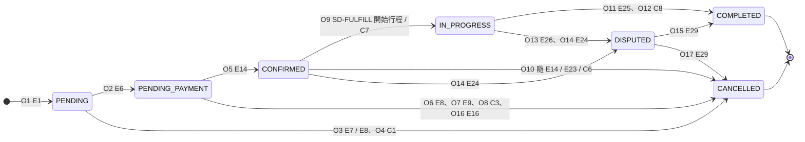

#### 3.1.1 轉移表

例外類別（`application/exception/`）：`OrderException`（帶 `OrderErrorCode`，`GlobalExceptionHandler` 依 code 對映 HTTP 狀態與 payload）、`OrderBusyException`（409 `ORDER_BUSY` + `Retry-After: 1`）、`IdempotencyException`（422 `IDEMPOTENCY_KEY_REUSED` / 409 `IDEMPOTENCY_IN_PROGRESS`）、`StorageUnavailableException`（503 `STORAGE_UNAVAILABLE`）。角色不符由 `@PreAuthorize` 擋下後 `GlobalExceptionHandler` 回 403 `ROLE_MISMATCH`；非當事人由 Service 拋 `OrderException(FORBIDDEN)` → 403 `FORBIDDEN`（§6.1）。下表「不符時」只列狀態 / 業務類錯誤碼，401 / 403 / 404 / 400 / 冪等類各端點共通，依 baseline §3.7 判斷順序。

| # | 轉移 | 觸發 | 鎖 | 同交易附帶 | 不符時（依判斷順序） |
|---|------|------|----|-----------|---------------------|
| O1 | → `PENDING` | E1（OWNER） | 無訂單鎖（新建；不做容量 / 檔期鎖）；冪等認領防重 | 建 `order_items`、`order_item_pets`、`order_answers`（需填時）；SD-FULFILL `createVisits`；`review_expires_at`、`first_service_date`；`ORDER_CREATED`；enqueue 保母「新預約申請」；commit 後我的最愛 | 422 `SELF_BOOKING_NOT_ALLOWED` → 403 `SITTER_NOT_BOOKABLE` → 422 `MONTHLY_QUOTA_REACHED` → 422 `PLAN_NOT_BOOKABLE` → 422 `INVALID_VISIT_DATE` → 409 `QUESTIONNAIRE_CHANGED` / 400（問卷長度）→ 400（`baseAmount` 上限）→ 409 `PRICE_CHANGED` → 403 `SUBSCRIPTION_LOCKED`（PRD-005 §4.4 步驟 3.8–3.9） |
| O2 | `PENDING → PENDING_PAYMENT` | E6（SITTER） | 訂單鎖 | 寫金額欄與 `quoted_at`；`order_plan_snapshots`、`order_snapshots`；建 INITIAL payment（`due_at`、`escalate_at`、`remind_at`、加密快照）；`ORDER_QUOTED`；enqueue 飼主報價通知（`quoted_at ≥ 首日 − 48h` 時併提醒、`mandatory`） | 409 `ORDER_STATE_CONFLICT` → 409 `DEADLINE_PASSED`（`REVIEW_EXPIRES_AT`）→ 409 `FIRST_VISIT_DATE_PASSED` → 422 `MONTHLY_QUOTA_REACHED` → 422 `PAYOUT_ACCOUNT_REQUIRED` → 409 `PRICE_CHANGED` → 422 `INVALID_QUOTE_AMOUNT` / 400 `totalAmount` → 403 `PLAN_REQUIRED` → 403 `SUBSCRIPTION_LOCKED`（PRD-006 §4.3） |
| O3 | `PENDING → CANCELLED` | E7（SITTER，原因必填）/ E8（OWNER，原因選填） | 訂單鎖 | 取消共同附帶動作（§3.1.2）；`ORDER_REJECTED` / `ORDER_WITHDRAWN`；enqueue 雙方 | 409 `ORDER_STATE_CONFLICT`（E8 另含 `expectedStatus` 不符）；不檢查 `review_expires_at`（CQ-61） |
| O4 | `PENDING → CANCELLED` | C1（SYSTEM） | 排程鎖 | 取消共同附帶動作；`cancel_reason_code=REVIEW_EXPIRED`；`ORDER_REVIEW_EXPIRED`；enqueue 雙方 | 鎖後重驗不符 → 略過（`skipped`） |
| O5 | `PENDING_PAYMENT → CONFIRMED` | E14（SITTER 確認 INITIAL） | 訂單鎖 | P2 / S2；`confirmed_at`（即月額度 +1）；OPEN 的 `INITIAL_PAYMENT_UNVERIFIED` 待辦 → RESOLVED（`SITTER_VERIFIED`）；`PAYMENT_VERIFIED`；enqueue 雙方「訂單啟動成功」；不檢查日期 | 409 `ORDER_STATE_CONFLICT`（`DISPUTED` 不會發生於此狀態，保留防線）→ 409 `PAYMENT_STATE_CONFLICT`（非 `SUBMITTED` / `submissionId` 不符 / `ADMIN_ADJUSTMENT`） |
| O6 | `PENDING_PAYMENT → CANCELLED` | E8（OWNER） | 訂單鎖 | 取消共同附帶動作（INITIAL `UNPAID → VOID`）；`ORDER_WITHDRAWN` | 409 `ORDER_STATE_CONFLICT` → 409 `PAYMENT_ALREADY_SUBMITTED`；不檢查 `due_at` |
| O7 | `PENDING_PAYMENT → CANCELLED` | E9（SITTER，原因必填） | 訂單鎖 | 同 O6；`ORDER_CANCELLED_BY_SITTER` | 同 O6 |
| O8 | `PENDING_PAYMENT → CANCELLED` | C3（SYSTEM） | 排程鎖 | 取消共同附帶動作；`cancel_reason_code=PAYMENT_EXPIRED`；`PAYMENT_EXPIRED`；enqueue 雙方（`mandatory`） | 重驗（`UNPAID` 且 `now ≥ due_at`）不符 → 略過 |
| O16 | `PENDING_PAYMENT → CANCELLED` | E16（ADMIN，原因 1–200 字） | 鎖前授權（payment 為 INITIAL 且有 OPEN 待辦，否則 403 `FORBIDDEN`）；訂單鎖後重驗 | payment `SUBMITTED → VOID`（submission 維持 `SUBMITTED`）；取消共同附帶動作；待辦 RESOLVED（`ADMIN_VOIDED`）；`PAYMENT_VOIDED_BY_ADMIN`；enqueue 雙方（`mandatory`） | 403 `FORBIDDEN`（鎖前）→ 409 `PAYMENT_STATE_CONFLICT`（鎖後重驗失敗） |
| O9 | `CONFIRMED → IN_PROGRESS` | SD-FULFILL 開始行程 / C7 殭屍清理 → `onVisitLeftPending` | 訂單鎖（由 SD-FULFILL 或 C7 取得） | `ORDER_STARTED`（payload 帶觸發行程與 cause）；因變更而 `CANCELLED` 不觸發 | 不適用（訂單非 `CONFIRMED` 時只更新行程） |
| O10 | `CONFIRMED → CANCELLED` | 隨 E23（差額 0）/ E14（T7、T10）/ C6（補款逾時且不需系統退款） | 沿用觸發者已持有的訂單鎖 | 取消共同附帶動作；`cancelled_by=SYSTEM`、`cancel_reason_code=MODIFICATION`；另寫一列 `ORDER_CANCELLED_BY_MODIFICATION`（payload `modificationId`、`initiatedBy`）；enqueue 雙方 | 不適用（條件不成立即維持 `CONFIRMED`） |
| O11 | `IN_PROGRESS → COMPLETED` | E25（OWNER） | 訂單鎖 | `completed_by=OWNER`、`completed_at`；`ORDER_COMPLETED` | 409 `ORDER_STATE_CONFLICT` → 409 `MODIFICATION_IN_PROGRESS` → 409 `VISITS_NOT_FINISHED`（CQ-6 已決） |
| O12 | `IN_PROGRESS → COMPLETED` | C8（SYSTEM） | 排程鎖 | `completed_by=SYSTEM`；`ORDER_COMPLETED` | 重驗不符 → 略過 |
| O13 | `IN_PROGRESS → DISPUTED` | E26（OWNER） | 訂單鎖 | `disputed_at`；建 `SERVICE_DISPUTE` 待辦（CQ-5 已決）；`SERVICE_DISPUTE_OPENED` | 409 `ORDER_STATE_CONFLICT` → 409 `MODIFICATION_IN_PROGRESS` → 409 `VISITS_NOT_FINISHED` → 409 `DEADLINE_PASSED`（`deadline=DISPUTE_WINDOW_ENDS_AT`） |
| O14 | `CONFIRMED` / `IN_PROGRESS → DISPUTED` | E24（OWNER / SITTER，說明 1–500 字） | 訂單鎖 | `disputed_at`；建 `MODIFICATION_PAYMENT_DISPUTE` 待辦（`payment_id` = 退款或補款 payment）；`PAYMENT_DISPUTE_OPENED`（payload 含說明）；enqueue 另一方；不通知 ADMIN | 409 `ORDER_STATE_CONFLICT` → 409 `MODIFICATION_STATE_CONFLICT`（無 `AWAITING_*`）→ 409 `PAYMENT_STATE_CONFLICT`（補款非 `SUBMITTED`；未滿 72h 帶 `disputeAvailableAt`） |
| O15 | `DISPUTED → COMPLETED` | E29（ADMIN） | 訂單鎖 | 剩餘 `PENDING` 行程取消；未結束變更 → `REJECTED` + `ended_at`；`UNPAID` payment → `VOID`；`SUBMITTED` 退款依 `exported` → `VOID`（+ 等額 `ADMIN_ADJUSTMENT`）；`SUBMITTED` 補款 → `VOID`；可登記一筆手動 `ADMIN_ADJUSTMENT`（≤ 已收淨額，附依據）；所有 OPEN 待辦 RESOLVED（`ADMIN_MEDIATED`）；`completed_by=ADMIN`；`ORDER_MEDIATED` | 409 `ORDER_STATE_CONFLICT` → 409 `VISITS_NOT_FINISHED`（有 `IN_PROGRESS` 行程，CQ-7 已決）→ 400（`SUBMITTED` 退款未標 `exported`）→ 422 `INVALID_ADJUSTMENT_AMOUNT`（CQ-7 已決） |
| O17 | `DISPUTED → CANCELLED` | E29（ADMIN） | 訂單鎖 | 同 O15；`cancelled_by=ADMIN`、`cancel_reason_code=ADMIN_MEDIATED` | 同 O15 |

- **O15 / O17 的終態由系統判斷**（baseline O15 / O17、CQ-57）：有任何 `DONE` / `CLOSED_BY_SYSTEM` 行程 → O15，否則 O17；E29 不收「要結成哪個狀態」的參數。
- **期限以時間判斷**（CQ-46）：需要期限的操作在鎖後以 `now`（注入的 `Clock`）比對；上傳憑證以伺服器收到請求的 `receivedAt` 比對（PRD-007 BR-12）。取消類操作（O3、O6、O7）不檢查期限（CQ-61）。
- **`DISPUTED` 凍結**（CQ-48）：所有 payment / 變更的使用者端點在判斷順序第 8 步回 409 `ORDER_STATE_CONFLICT`；排程候選查詢排除 `DISPUTED`，鎖後重驗亦排除（防線）。

#### 3.1.2 取消的共同附帶動作（baseline §3.2、CQ-65）

`OrderCancellationApplier.apply(order, cancelledBy, reasonCode, reason)`（`MANDATORY`，須持有訂單鎖）：

1. 訂單 → `CANCELLED`，寫 `cancelled_by`、`cancelled_at`、`cancel_reason_code`、`cancel_reason`。
2. 該訂單所有 `UNPAID` / `SUBMITTED` payment → `VOID`（`void_reason_code` 記取消來源）；submission 不改（PRD-007 BR-24）。
3. 呼叫 SD-FULFILL `cancelPendingVisits(orderId)`。
4. 不寫 `order_logs`（由呼叫端的轉移寫一列，payload `transitions[]` 列出上述附帶轉移）。

#### 3.1.3 `completion_basis_at` 維護

- 定義引用 baseline §5（CQ-17、CQ-40、CQ-69）。`CompletionBasisCalculator` 依有效行程與最後一筆 `SETTLED` 變更的 `ended_at` 計算。
- **儲存時點**：任何有效行程仍為 `PENDING` / `IN_PROGRESS` 時存 `NULL`（基準尚未成立）；全部有效行程皆 `DONE` / `CLOSED_BY_SYSTEM` 時存計算值。理由：O12 / O13 前置條件本來就要求行程全部結束，`NULL` 讓 C8 的部分索引只掃成立的訂單。
- **重算觸發**（與觸發轉移同交易）：行程轉 `DONE` / `CLOSED_BY_SYSTEM`（`onVisitFinished`）、行程因變更或調解轉 `CANCELLED`、變更 `SETTLED`（含新增行程使基準回到 `NULL`）。拒絕 / 撤回 / 逾時的變更不觸發重算。

### 3.2 付款（`payments`）與憑證（`payment_submissions`）

權威定義在 baseline §3.3；PRD-007 §5 的 P1–P5 / S1–S3。

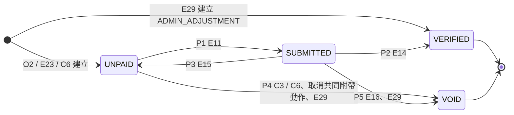

| # | 轉移 | 觸發 | 鎖 | 附帶 | 不符時 |
|---|------|------|----|------|-------|
| 建立 INITIAL | → `UNPAID` | O2（E6） | 訂單鎖 | `due_at`、`escalate_at`、`remind_at`、加密快照 | 由 O2 決定 |
| 建立 SUPPLEMENT | → `UNPAID` | E23 差額 > 0 | 訂單鎖 | `due_at = now + MODIFICATION_TIMEOUT_HOURS`、加密快照 | 由 E23 決定 |
| 建立 MODIFICATION_REFUND | → `UNPAID` | E23 差額 < 0 / C6 系統退款 | 訂單鎖 / 排程鎖 | `due_at = null`、無快照 | 由觸發者決定 |
| 建立 ADMIN_ADJUSTMENT | → `VERIFIED` | E29（手動一筆 / `exported` 補登） | 訂單鎖 | `adjustment_basis`；補登者帶 `source_payment_id` | 由 E29 決定 |
| P1 | `UNPAID → SUBMITTED` | E11（付款方） | 三段式：預檢不取鎖 → GCS → 訂單鎖重驗 | S1 建 submission；`PAYMENT_PROOF_SUBMITTED`；enqueue 收款方 | 403 `FORBIDDEN`（方向）→ 400 → 冪等 → 409 `ORDER_STATE_CONFLICT`（`DISPUTED`）→ 409 `PAYMENT_STATE_CONFLICT`（非 `UNPAID`、`ADMIN_ADJUSTMENT`、鎖後已 `VOID`）→ 409 `DEADLINE_PASSED`（`PAYMENT_DUE_AT`，`receivedAt ≥ due_at`）→ 422 `PROOF_FILE_TYPE_UNSUPPORTED` / `PROOF_FILE_TOO_LARGE`；GCS 失敗 503 `STORAGE_UNAVAILABLE` |
| P2 | `SUBMITTED → VERIFIED` | E14（收款方） | 訂單鎖 | S2；依 `purpose`：INITIAL → O5；SUPPLEMENT → 變更 T7 `SETTLED`；MODIFICATION_REFUND → 變更 T10 `SETTLED`；`SETTLED` 後檢查 O10；`PAYMENT_VERIFIED` | 403 `FORBIDDEN`（方向；ADMIN → `ROLE_MISMATCH`）→ 409 `ORDER_STATE_CONFLICT` → 409 `PAYMENT_STATE_CONFLICT` |
| P3 | `SUBMITTED → UNPAID` | E15（CHARGE 收款方，原因 1–200 字） | 訂單鎖 | S3；OPEN 的 INITIAL 待辦 → RESOLVED（`SITTER_REJECTED`）；`PAYMENT_REJECTED`；enqueue 付款方（`mandatory`）；不給寬限 | 403 `FORBIDDEN`（REFUND 不可駁回，先於凍結）→ 400 → 409 `ORDER_STATE_CONFLICT` → 409 `PAYMENT_STATE_CONFLICT` |
| P4 | `UNPAID → VOID` | C3（INITIAL）/ C6（SUPPLEMENT）/ 取消共同附帶動作 / E29 | 排程鎖 / 訂單鎖 | `voided_at`、`void_reason_code` | 排程重驗不符 → 略過 |
| P5 | `SUBMITTED → VOID` | E16（O16，INITIAL）/ E29（O15 / O17） | 訂單鎖 | submission 維持 `SUBMITTED`（畫面標「已作廢」） | 見 O16 / O15 |
| A1 | 待辦 → `OPEN` | C4（`now ≥ escalate_at` 且 INITIAL `SUBMITTED`） | 排程鎖 | `escalated_at`；`PAYMENT_ESCALATED`；enqueue 雙方 | `ux_admin_tasks_open` 保證不重建；重驗不符略過 |

- submission 狀態：`SUBMITTED` / `ACCEPTED` / `REJECTED`；同一 payment 同時最多一筆 `SUBMITTED`（`ux_submissions_open`）。
- `method=ADMIN_ADJUSTMENT` 的 payment 對任何當事人寫入一律 409 `PAYMENT_STATE_CONFLICT`（狀態檢查先於方向檢查，PRD-007 §3）。
- `ONLINE`（SD-BILLING）同實體，金流回呼 `UNPAID → VERIFIED`，不在本階段範圍。

### 3.3 變更請求（`modification_requests`）

權威定義在 baseline §3.4；PRD-016 T1–T6、PRD-023 T1–T11、PRD-024 T2。

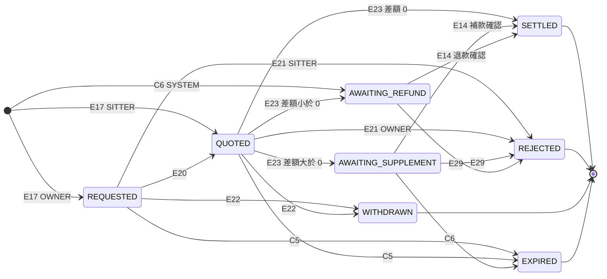

| # | 轉移 | 觸發 | 鎖 | 附帶 | 不符時（依 PRD-016 BR-28） |
|---|------|------|----|------|---------------------------|
| T1 | → `REQUESTED` | E17（OWNER） | 訂單鎖 | `expires_at = now + 72h`；`MODIFICATION_REQUESTED`；enqueue SITTER | 409 `ORDER_STATE_CONFLICT` → `MODIFICATION_IN_PROGRESS` → `MODIFICATION_NOT_ALLOWED` → 409 `VISIT_ALREADY_STARTED` → 422 `INVALID_VISIT_DATE` / `MODIFICATION_EMPTY` / `PLAN_NOT_IN_ORDER` |
| T2 | → `QUOTED` | E17（SITTER） | 訂單鎖 | 計價（`PlanPolicy.modificationPricing`，鎖定時依 FREE）；`quoted_net_paid`、`quoted_diff`；`MODIFICATION_PROPOSED`；enqueue OWNER | 同 T1；422 `INVALID_MODIFICATION_AMOUNT`；403 `PLAN_REQUIRED` |
| T3 | `REQUESTED → QUOTED` | E20（SITTER） | 訂單鎖 | `expires_at` 重設；`MODIFICATION_QUOTED`；enqueue OWNER | 409 `ORDER_STATE_CONFLICT` → `MODIFICATION_STATE_CONFLICT` → `DEADLINE_PASSED`（`MODIFICATION_EXPIRES_AT`）→ `VISIT_ALREADY_STARTED` → 422 `INVALID_VISIT_DATE` / `MODIFICATION_EMPTY` / `PLAN_NOT_IN_ORDER` / `INVALID_MODIFICATION_AMOUNT` → 403 `PLAN_REQUIRED` |
| T4（SITTER） | `REQUESTED → REJECTED` | E21（SITTER，原因 1–200 字） | 訂單鎖 | `ended_at`、`reject_reason`；`MODIFICATION_REJECTED`；enqueue OWNER（含原因） | 409 `ORDER_STATE_CONFLICT` → `MODIFICATION_STATE_CONFLICT`（含 SITTER 對 `QUOTED` 呼叫）→ `DEADLINE_PASSED` |
| T4（OWNER） | `QUOTED → REJECTED` | E21（OWNER） | 訂單鎖 | `ended_at`；`MODIFICATION_REJECTED`；enqueue SITTER | 同上 |
| T5 | `REQUESTED` / `QUOTED → WITHDRAWN` | E22（發起者） | 訂單鎖 | `ended_at`；`MODIFICATION_WITHDRAWN`；enqueue 對方 | 403 `FORBIDDEN`（非發起者，含 `initiated_by=SYSTEM`，CQ-1 已決）→ 409 `ORDER_STATE_CONFLICT` → `MODIFICATION_STATE_CONFLICT` → `DEADLINE_PASSED` |
| T6 | `REQUESTED` / `QUOTED → EXPIRED` | C5 | 排程鎖 | `ended_at`；`MODIFICATION_EXPIRED`；enqueue 雙方 | 重驗不符 → 略過 |
| 同意 | `QUOTED → SETTLED / AWAITING_SUPPLEMENT / AWAITING_REFUND` | E23（OWNER） | 訂單鎖 | 減少目標 → SD-FULFILL `cancelVisits`（不觸發 O9）；重算已收淨額寫 `agreed_net_paid` / `agreed_diff`；差額 0 → `SETTLED`（建 MODIFICATION `order_items` 與行程、`total_amount = new_total_amount`、重算 `completion_basis_at`、檢查 O10）；> 0 → 建 SUPPLEMENT payment；< 0 → 建 MODIFICATION_REFUND payment；`MODIFICATION_ACCEPTED`；不重驗方案 | 409 `ORDER_STATE_CONFLICT` → `MODIFICATION_STATE_CONFLICT` → `DEADLINE_PASSED` → `VISIT_ALREADY_STARTED`（整筆不生效） |
| T7 | `AWAITING_SUPPLEMENT → SETTLED` | E14（SUPPLEMENT 確認） | 訂單鎖 | 建新增行程（日期已過仍建）、`total_amount`、`ended_at`、重算基準、檢查 O10 | 見 P2 |
| T8 | `AWAITING_SUPPLEMENT → EXPIRED` | C6 | 排程鎖 | payment VOID；`total_amount = max(0, total_amount − Σ 本變更減少目標的快照單價)`；需要時 T9；不需退款時檢查 O10；`SUPPLEMENT_EXPIRED` | 重驗（payment 仍 `UNPAID` 且 `now ≥ due_at`）不符 → 略過 |
| T9 | → `AWAITING_REFUND`（SYSTEM） | 隨 T8 | 同 T8 | 先結束舊列並 flush，再建新列（避開 `ux_modreq_open_per_order`、`ux_payments_open_per_order`）與退款 payment。SYSTEM 列欄位（PRD-023 BR-9，全部必填以免撞 `ck_modreq_*`）：`type=CHANGE`、`initiated_by=SYSTEM`、`initiated_by_user_id=NULL`、`source_modification_id`=逾時的變更、`reason`=「補款逾期自動退款」、`requested_content=NULL`、`quoted_content`=空內容（無減少 / 新增）、`system_amount = new_total_amount` = 重算後 `total_amount`、`surcharge_amount = discount_amount = 0`、`adjustment_reason=NULL`、`quoted_net_paid = agreed_net_paid` = 建立當下已收淨額、`quoted_diff = agreed_diff = new_total_amount − 已收淨額`（< 0）、`quoted_at = agreed_at` = 建立時間、`expires_at=NULL`、`status=AWAITING_REFUND`；退款 payment `amount = −agreed_diff` | — |
| T10 | `AWAITING_REFUND → SETTLED` | E14（MODIFICATION_REFUND 確認） | 訂單鎖 | 一般變更：建新增行程、`total_amount`；SYSTEM 變更：不改 `total_amount`；`ended_at`；檢查 O10 | 見 P2 |
| 調解 | `AWAITING_* → REJECTED` | E29 | 訂單鎖 | `ended_at`；不推遲基準 | 見 O15 |

- **內容儲存**：OWNER 期望內容存 `requested_content`，SITTER 報價內容存 `quoted_content`（JSONB，結構：減少的行程 id 陣列 + 新增項目陣列〔日期、方案、每日次數、毛孩 id〕）；鎖內以 SD-FULFILL 行程狀態驗證減少目標。
- **計價**：`system_amount = Σ(新內容有效行程的 order_plan_snapshots.unit_price)`；PRO / ULTIMATE 未鎖定可加減（`PlanPolicy`），新總額 0–999,999。

### 3.4 事前問卷（只有 O1 寫入）

| 情境（O1 當下後端判斷，baseline §3.5） | `orders.questionnaire_status` | `orders.questionnaire_exempt_reason` | `order_answers` |
|------|------|------|------|
| 熟客（`ix_orders_owner_sitter_completed` 有列；兩種免填同時成立亦此列） | `NOT_REQUIRED` | `REGULAR_OWNER` | 不寫（送來的答案忽略） |
| 保母沒有啟用中題目 | `NOT_REQUIRED` | `NO_ACTIVE_QUESTIONS` | 不寫 |
| 其他 | `COMPLETED` | `NULL` | 每題一列：送單當下題目文字、題型、答案（非必填未答存 JSON `null`） |

- O1 之後無任何轉移；`ck_orders_questionnaire` 保證組合合法（§5.1.1 第 1 段）。
- 判斷所需的題目定義於 O1 交易內向 SD-SUPPLY 讀取一次，驗證（PRD-005 BR-22、BR-24）與快照使用同一份資料。

### 3.5 ADMIN 待辦（`admin_tasks`）

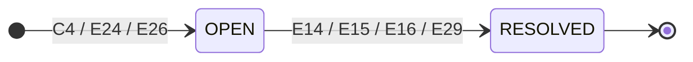

| type | 建立 | 關閉（`resolution`） |
|------|------|---------------------|
| `INITIAL_PAYMENT_UNVERIFIED` | C4（A1） | E14 O5（`SITTER_VERIFIED`）；E15 駁回（`SITTER_REJECTED`）；E16 O16（`ADMIN_VOIDED`） |
| `MODIFICATION_PAYMENT_DISPUTE` | E24（O14） | E29（`ADMIN_MEDIATED`） |
| `SERVICE_DISPUTE` | E26（O13，CQ-5 已決） | E29（`ADMIN_MEDIATED`） |

建立與關閉都與觸發轉移同交易（CQ-55）；`(type, order_id) WHERE status='OPEN'` 唯一。ADMIN 可讀範圍（baseline §1.2、CQ-18）= 訂單 `DISPUTED` 或該訂單有任一 OPEN 待辦，判斷由 `AdminOrderAccessPolicy` 統一提供給 E10、E12、E13、E16、E18、E19、E27，以及 `getOrderContexts` 的 `adminReadable`（SD-FULFILL 的 ADMIN 讀取用同一結果）。

- **`planTitles` 以 `planId` 為鍵的前提**：`order_plan_snapshots` 的 PK 是 `(order_id, plan_id)`，同一訂單同一方案只有一個報價快照名稱；變更新增的行程只能選訂單快照內的方案（422 `PLAN_NOT_IN_ORDER`），所以報價後任何行程的 `planId` 都在 map 內；報價前 map 為空，呼叫端改用 `visits.booking_plan_title`。

### 3.6 共用機制落地

#### 3.6.1 訂單鎖入口

| 項目 | 規則 |
|------|------|
| 實作 | `OrderLockService`（§2.3.1）。以 native SQL 執行 `SET LOCAL lock_timeout = '3s'` 與 `SELECT ... FROM orders WHERE id = :id FOR NO KEY UPDATE`，不依賴 JPA `PESSIMISTIC_WRITE` 產生的 SQL |
| 為何 `FOR NO KEY UPDATE` | 子表（payments、submissions、modification_requests、order_logs、visits）INSERT 時的 FK 檢查取 `FOR KEY SHARE`，與之相容，不會因鎖父列而互等 |
| 逾時 / 死結 | `lock_timeout` 對整個交易有效，鎖訂單後的語句也可能逾時；SQLSTATE `55P03`（lock_not_available）與 `40P01`（deadlock_detected），以及 Spring 轉換後的 `CannotAcquireLockException` / `PessimisticLockingFailureException` / `DeadlockLoserDataAccessException`，無論在 `OrderLockService` 內或交易後續語句拋出，一律對映 409 `ORDER_BUSY` + `Retry-After: 1`，冪等紀錄刪除（可重試，baseline §3.6） |
| 鎖後新鮮度 | 鎖成功後若該 `Order` 已受管（例：SD-FULFILL 先讀 visit，`Visit.order` 預設 EAGER 載入），`lockForTransition` 對其 `refresh`；重驗一律用鎖後的值 |
| 鎖順序 | 任何交易先鎖 `orders` 列，之後才讀寫 visits / payments / submissions / 變更 / 待辦列；取得 `orderId` 只能用不加鎖的查詢；鎖後重讀子列再判斷（§2.3.1） |
| 強制 | ArchUnit 測試 `OrderAggregateArchTest`：只有 `application/service/order/**` 可依賴訂單聚合的 Repository（`OrderRepository`、`PaymentRepository`、`PaymentSubmissionRepository`、`ModificationRequestRepository`、`OrderLogRepository`、`AdminTaskRepository` 等）；`IdempotencyRecordRepository` 只准共用冪等套件（`application/common/idempotency/**`）依賴，任何模組都可依賴 `IdempotencyService` 與 `@Idempotent`（SD-GLOBAL-SPEC §2.4）；`VisitCommandService` 的寫入方法只能由 order 套件與 SD-FULFILL 自身（已取鎖後）呼叫 |
| 範圍 | 所有改變訂單主狀態、payment、submission、變更、行程狀態的操作；SD-FULFILL 開始 / 完成行程也必須先呼叫 |
| 排程 | `tryLockForCron` 用 `SKIP LOCKED`，鎖不到計入 `skipped`，不等待 |
| `@Version` | `orders`、`payments`、`payment_submissions`、`modification_requests`、`admin_tasks` 保留 `version` 欄與 `@Version` 作最後防線；不接受客戶端 version；畫面過期以關鍵值比對（`expectedAmount`、`expectedStatus`、`submissionId`，CQ-35）。觸發時回 409 `ORDER_BUSY` + `Retry-After: 1`（baseline §3.7、CQ-2 已決） |
| Transaction Pooler | `SET LOCAL`、`FOR NO KEY UPDATE`、`pg_advisory_xact_lock` 在交易內可用；不使用 session 級 `SET` / `pg_advisory_lock` |
| 不做 | 容量 / 檔期鎖、月額度鎖（月額度只在 O5 隱含 +1，O1 / O2 只讀計數，baseline §2.2） |

#### 3.6.2 冪等（三段式）

**機制本身屬 SD-GLOBAL-SPEC §2.4**（共用套件 `application/common/idempotency`：`@Idempotent`、`IdempotencyBodyCachingFilter`、`IdempotencyInterceptor`、`IdempotencyService`），本節描述本 SD 的使用方式。冪等端點以 controller 方法上的 `@Idempotent` 宣告（不再維護寫死的端點清單）；本 SD 標註者：E1、E6–E9、E11、E14–E17、E20–E26、E29。`IdempotencyService`：`claim`（自行開短交易，傳播 `NEVER`：呼叫端不得已在交易中）、`complete`（`MANDATORY`，在呼叫端的業務交易內執行；**不要求持有訂單鎖**，只比對 `claim_token`）、`fail`（自行開短交易，`NEVER`）。範圍 = （token 使用者, HTTP method + 路由樣板, key），存在 `idempotency_records`（§5.1）。

| 段 | 交易 | 內容 | 佔連線 |
|----|------|------|-------|
| 0 回放查詢 | 唯讀 | `IdempotencyBodyCachingFilter` 在 handler mapping 之前執行、看不到 `@Idempotent`，以 `Content-Length` 判斷，**絕不讀超過上限的串流**：(a) 帶 `Idempotency-Key`、Content-Type 為 JSON、且 `Content-Length` 存在且 ≤ 64 KB → 讀成 byte[] 並包成可重讀 wrapper；(b) `Content-Length` > 64 KB → 不讀、不包裝，只設 request attribute `idempotency.bodyTooLarge`；(c) 無 `Content-Length`（chunked）→ 最多讀 64 KB + 1 位元組，未超過則照 (a)，超過則以「已讀前綴 + 剩餘原串流」的 wrapper 交回（非冪等 handler 仍拿到完整 body）並設同一 attribute。`IdempotencyInterceptor` 確認 handler 有 `@Idempotent` 後：有 `bodyTooLarge` → 400 `VALIDATION_FAILED`；Content-Type 既不是 JSON 也不是 multipart → 400 `VALIDATION_FAILED`，不讀 body；multipart 由 `MultipartFile` 重讀。未帶 header 的請求完全不經處理（SD-GLOBAL-SPEC §2.4）。`IdempotencyInterceptor`（handler 已解析路由樣板、`@PreAuthorize` 之前）計算 hash、以範圍查紀錄：`COMPLETED`、未過期、`request_hash` 相同 → 直接回放第一次的狀態碼與 body（判斷順序第 2 步）。其餘情況不在此回錯 | 1，毫秒級 |
| 1 認領 | 短交易 A | 角色 / 404 / 403 / 400 檢查通過後：產生新的 `claim_token`（UUID），`INSERT ... status='PROCESSING', claim_token=:mine, locked_until=now+30s, expires_at=now+24h ON CONFLICT (user_id, scope, idempotency_key) DO UPDATE ... WHERE 舊列已過期`；衝突時讀既有列：hash 不同 → 422 `IDEMPOTENCY_KEY_REUSED`；`PROCESSING` 且 `locked_until > now` → 409 `IDEMPOTENCY_IN_PROGRESS`；`PROCESSING` 且已過 `locked_until` → 條件式 UPDATE 接手（`SET claim_token=:mine, locked_until=now+30s WHERE id=:id AND status='PROCESSING' AND locked_until <= now`，只有一個請求能接手；**每次認領或接手都換新 token**） | 1，毫秒級 |
| 2 交易外 I/O | 無交易 | 只有 E11：GCS 上傳（物件鍵由認領紀錄 id 決定，`doesNotExist` precondition；接手的重試遇到已存在物件視為已上傳，內容由相同 hash 保證一致） | 0 |
| 3 鎖定寫入 | 交易 B | 訂單鎖 → 重驗狀態 → 業務寫入 → `order_logs` → `enqueue()` → `UPDATE idempotency_records SET status='COMPLETED', response_status, response_body, locked_until=NULL WHERE id=:id AND status='PROCESSING' AND claim_token=:mine`（0 列 → 回滾，表示已被接手，回 409 `IDEMPOTENCY_IN_PROGRESS`）→ commit | 1 |
| 失敗 | 短交易 C | 所有 UPDATE / DELETE 一律加 `WHERE id=:id AND status='PROCESSING' AND claim_token=:mine`，影響 0 列（已被接手或已完成）就不動任何東西。可記錄的業務錯誤（409 / 422，但不含 `ORDER_BUSY`、`IDEMPOTENCY_IN_PROGRESS`）→ 紀錄改 `COMPLETED` 並存錯誤回應；5xx、`ORDER_BUSY`、`STORAGE_UNAVAILABLE` → 刪除紀錄（允許同 key 重試）；409 `IDEMPOTENCY_IN_PROGRESS`（被接手）→ 不記錄、不刪除。commit 結果不明（連線在 commit 時中斷）時同樣只執行帶 token 的 DELETE：若交易 B 其實已提交，紀錄已是 `COMPLETED`，帶 `status='PROCESSING'` 條件的 DELETE 影響 0 列，同 key 重試會回放而不會重做。E11 只有在交易 C 確認「本請求仍持有 token」且 `NOT EXISTS (SELECT 1 FROM payment_submissions WHERE proof_object_key = :key)` 後才刪物件；任一不成立就留給 C10 | 1，毫秒級 |

- **request hash**：SHA-256（路由樣板 + 已解析的路徑變數 + 正規化後的 JSON body；multipart = 各欄位值（依欄位名排序）+ 檔案 SHA-256）。路徑變數必須入 hash，否則同一把 key 用在兩張訂單會互相回放。
- **JSON 正規化**：解析成樹 → 物件 key 依 Unicode 碼位排序 → 數字以十進位字串表示（整數不帶小數點；`1` 與 `1.0` 不同，後者本來就會被 400 擋下）→ 字串保持原樣（不 trim）→ 輸出無空白的緊湊格式；空 body 視為 `{}`。
- **回應 body** 不含簽名網址等時效性資料（E11 回應只含 submission id 與狀態）。
- 段 0 與段 1 分開的理由：判斷順序要求回放在 403 `ROLE_MISMATCH` 之前、`IDEMPOTENCY_KEY_REUSED` 在 400 之後（baseline §3.7）。
- 段 1 獨立成短交易的理由：各端點流程一致（E11 必須在 GCS 上傳前認領）；`ORDER_BUSY` 或 5xx 時交易 B 回滾，仍能在交易 C 以 token 刪紀錄讓客戶端重試；同 key 並行請求在認領時立即得到 409，不必等到取訂單鎖。代價是多一次短交易往返。
- 每個請求同一時間只佔 1 條連線；不使用 `REQUIRES_NEW` 巢狀交易（避免抽樣缺陷 #3）。

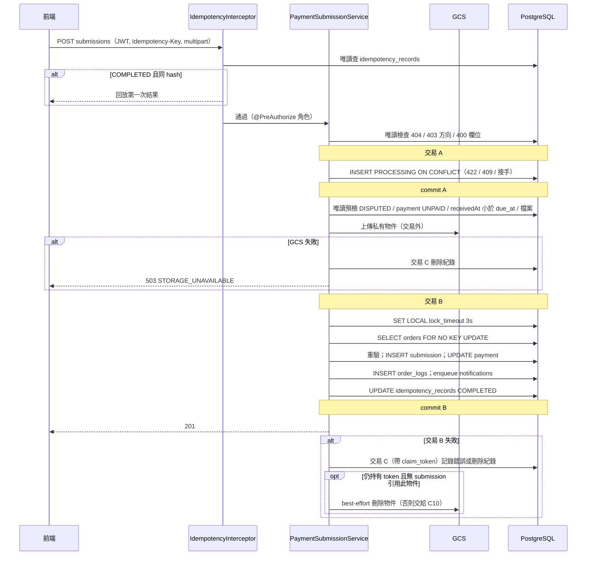

#### 3.6.3 `order_logs`（同交易稽核）

| 項目 | 規則 |
|------|------|
| 寫入者 | `OrderLogWriter`，傳播 `MANDATORY`，與狀態變更同交易；不得使用 `REQUIRES_NEW`（抽樣缺陷 #2）。舊 `AuditLogService.writeOrderLog` 不再用於訂單。對外提供給 SD-FULFILL 寫行程類 action（§2.3.1、§2.4.1） |
| 粒度 | **一個操作一列**；同一操作造成的附帶轉移（payment VOID、行程取消、待辦關閉、O5 等）列在該列 payload 的 `transitions[]`（PRD-026 §5、PRD-007 AC-2.1 的「一筆紀錄」）。例外（另寫一列）：O10 **一律**另寫一列 `ORDER_CANCELLED_BY_MODIFICATION`（PRD-023 AC-3.3 要求該列帶 `modificationId` / `initiatedBy`，不論觸發者是 OWNER、SITTER 或 C6 的 SYSTEM）；O9 由 C7 觸發時另寫 `ORDER_STARTED`（SYSTEM） |
| 欄位 | `order_id`、`action_type`、`operator_role`（OWNER / SITTER / ADMIN / SYSTEM）、`operator_user_id`（SYSTEM 為 NULL）、`payload`（JSONB）、`created_at` |
| payload 共通 | `transitions[]`（`entity`、`id`、`from`、`to`）、`idempotencyKey`（有則記）；各 action 的專屬欄位見 §7.1 |
| action_type | `ORDER_CREATED`、`ORDER_QUOTED`、`ORDER_REJECTED`、`ORDER_WITHDRAWN`、`ORDER_REVIEW_EXPIRED`、`ORDER_CANCELLED_BY_SITTER`、`PAYMENT_PROOF_SUBMITTED`、`PAYMENT_VERIFIED`、`PAYMENT_REJECTED`、`PAYMENT_EXPIRED`、`PAYMENT_ESCALATED`、`PAYMENT_VOIDED_BY_ADMIN`、`MODIFICATION_REQUESTED`、`MODIFICATION_PROPOSED`、`MODIFICATION_QUOTED`、`MODIFICATION_REJECTED`、`MODIFICATION_WITHDRAWN`、`MODIFICATION_EXPIRED`、`MODIFICATION_ACCEPTED`、`SUPPLEMENT_EXPIRED`、`ORDER_CANCELLED_BY_MODIFICATION`、`ORDER_STARTED`、`VISITS_CLOSED_BY_SYSTEM`、`ORDER_COMPLETED`、`SERVICE_DISPUTE_OPENED`、`PAYMENT_DISPUTE_OPENED`、`ORDER_MEDIATED` |
| 不寫 | 付款提醒（只寫 `reminded_at`，不是轉移）；排程重驗不符而略過者 |
| 失敗語意 | 主交易回滾 → log 一併不存在（整合測試必測） |

#### 3.6.4 Outbox（`notifications`，歸 SD-NOTIFY）

- 轉移交易內呼叫 `NotificationService.enqueue()`（§2.3.3）；本 SD 不直接呼叫 Resend、不註冊 `AFTER_COMMIT` 寄信 listener。
- Email 失敗的補送由 SD-NOTIFY 排程負責；狀態轉移已提交，不回滾（各 PRD「Resend 失敗」例外）。
- 唯一在主交易外的寫入副作用：O1 後的我的最愛 `addIfAbsent`（PRD-005 BR-14），由非交易的協調者在交易 B commit 後另開短交易呼叫（不用 `AFTER_COMMIT` listener，§4.1），失敗只記 log，不重試。

#### 3.6.5 `admin_tasks`

見 §3.5；DDL 見 §5.1。ADMIN 列表 E28 只讀此表（依 `created_at`，`ix_admin_tasks_open`）。

#### 3.6.6 GCS 上傳、簽名網址與孤兒檔清除

| 項目 | 規則 |
|------|------|
| 物件鍵 | `payment-proofs/{yyyy-MM-dd}/{orderId}/{paymentId}/{idempotencyRecordId}.{ext}`（日期 = 上傳時 UTC 日期；CHARGE 與 REFUND 共用此前綴，不再寫 `refund-proofs/`） |
| 前綴與 lifecycle | `payment-proofs/` 永久保存，必須排除於任何 GCS lifecycle 規則（SD-GLOBAL-SPEC §4.1）；2026-11-22 唯讀確認 `cat-sitter-media-bucket` 目前沒有任何 lifecycle 規則 |
| 存取 | 私有物件（`uploadPrivate`）；E13 每次授權後產生 V4 簽名網址，TTL 5 分鐘（`app.order.proof-url-ttl=PT5M`），不寫入 DB 與冪等回放 body |
| 檔案驗證 | GCS 前完成：恰好 1 檔、≤ 5 MB（`app.order.proof-max-bytes=5242880`）、以檔頭 magic bytes 判定 JPEG / PNG / WebP（不信任 `Content-Type`）；同時計算 SHA-256 供 hash 與 `proof_sha256` |
| 失敗 | 上傳失敗 → 503 `STORAGE_UNAVAILABLE`、刪冪等紀錄；交易 B 失敗 → 交易 C 確認仍持有 `claim_token` 且無 submission 引用該物件鍵後才 best-effort 刪除，否則（或刪不掉）由 C10 清除 |
| C10 權限 | Cloud Run runner SA（`cat-sitter-runner`）需 `storage.objects.list` 與 `storage.objects.delete`（`payment-proofs/` 前綴）；§8.3 D9 驗證 |
| Mock | 沿用現有 `MediaStorageService` 介面：`@Profile("local")` → `LocalMediaStorageServiceImpl`，其他 profile → GCS 實作；整合測試以 local 實作替身 |
| 孤兒檔清除 | C10（§8.1） |

---

## 4. 流程

> 所有寫入端點共通前段（§3.6.2）：`JwtAuthenticationFilter`（401）→ `IdempotencyInterceptor`（回放）→ `@PreAuthorize`（403 `ROLE_MISMATCH`）。下圖從 Service 開始畫；每張圖標出交易邊界，外部 I/O（GCS）一律在交易外。上傳憑證（E11）的三段式見 §3.6.2。

### 4.1 O1 送出預約（E1）

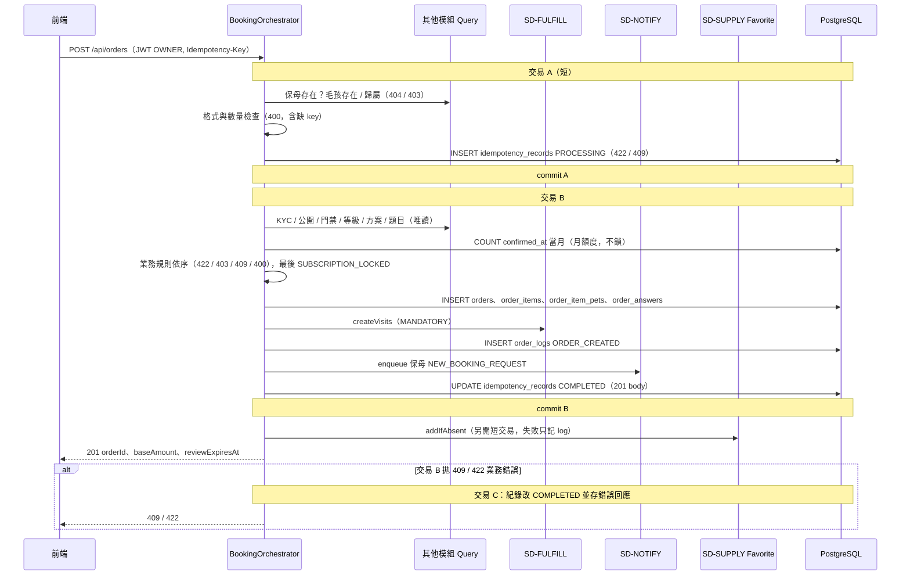

- 我的最愛不在 `AFTER_COMMIT` listener 內做：afterCommit 階段主交易的連線尚未釋放，listener 再開交易會同時佔 2 條連線（抽樣缺陷 #3）。改由非交易的協調者在交易 B 返回後依序呼叫。

### 4.2 O2 報價（E6）

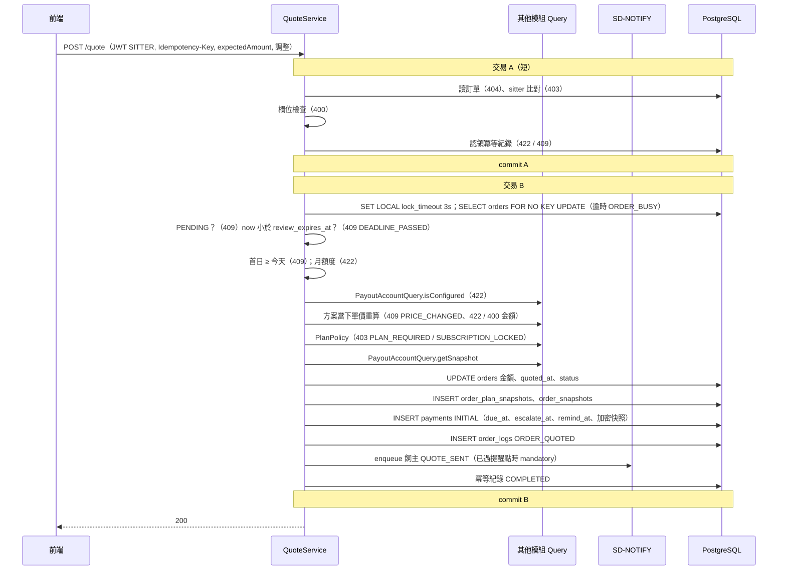

### 4.3 E23 飼主同意變更（三分支）

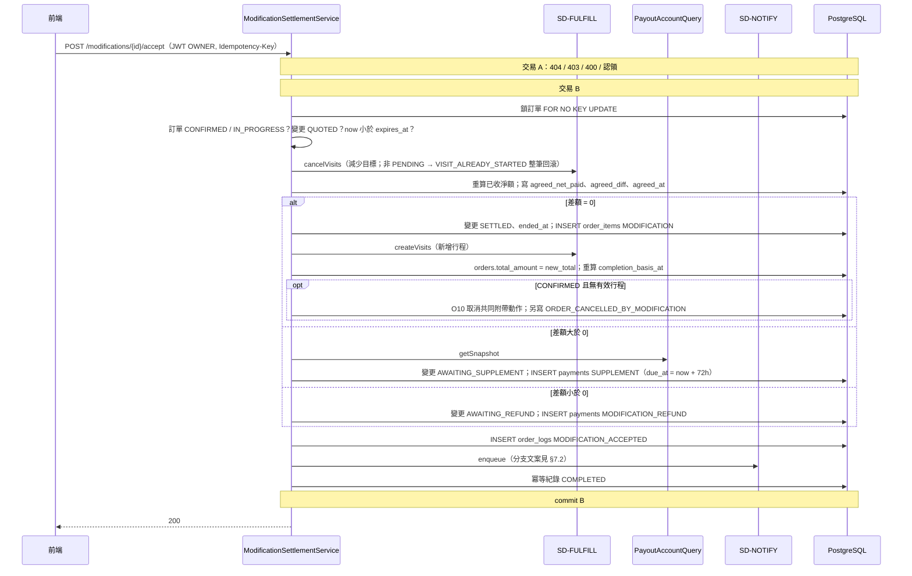

### 4.4 C6 補款逾時（T8 / T9 / O10）

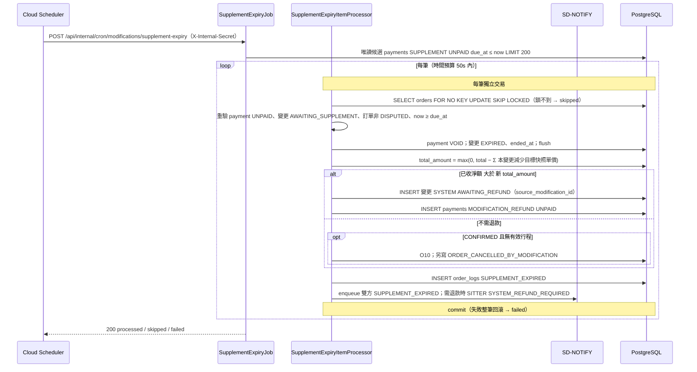

### 4.5 E29 ADMIN 調解（O15 / O17）

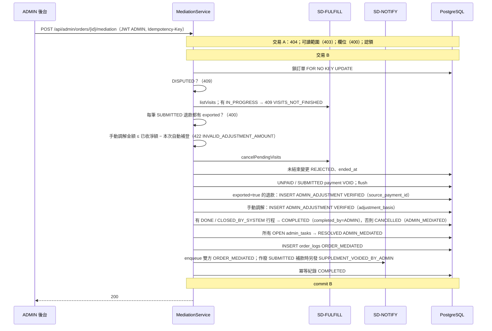

---

## 5. 資料模型

### 5.1 遷移

- 檔名：`V20261122_01__order_rebuild.sql`（現有最大版號 `V20261025_01`）。既有遷移檔一律不改。
- **一支到位、允許破壞性變更**（使用者決定 2026-11-22）：本專案未上線，baseline CQ-36 交易資料全清，不做雙階段部署。部署策略為「後端與前端連續部署，接受短暫空窗」（§11 技術決策 2）：新 revision 啟動跑 Flyway 後，仍在服務的舊 revision 與舊前端呼叫訂單 API 會失敗，直到切換完成。
- 順序：清空 → DROP 舊索引 / 舊欄位 → 加新欄位（表已空，直接 NOT NULL）→ 建新表 → CHECK / partial unique / 索引。
- 表內所有時間 `TIMESTAMPTZ`、所有金額 `INT`（TWD）。
- 舊 `idempotency_keys` 不動（KYC、照護記事 / 媒體、照護日誌仍使用，§11 技術決策 1）；C9 同時清除其過期列（§8.1）。
- 同時清空 `profiles.bank_account_info`（SD-SUPPLY 的表；全為以 repo 內公開預設金鑰加密的測試資料，換新金鑰後無法解密）。部署後測試保母重新設定收款帳號，不寫重新加密程式（CQ-20 已決）。
- 遷移第一行設 `lock_timeout = '10s'`：舊 revision 仍持有交易時，`TRUNCATE` / `ALTER` 不會無限等待；逾時則遷移失敗、新 revision 啟動失敗，舊 revision 照常服務，修正後重新部署。遷移一旦成功即不可回滾（forward fix only），舊 revision 不可再接流量（§8.3 D6）。

#### 5.1.1 `V20261122_01__order_rebuild.sql`

```sql
SET lock_timeout = '10s';   -- Flyway 在同一交易內執行，效果等同 LOCAL

-- ============================================================
-- 0. 清空交易資料（baseline CQ-36）。明列所有表、不用 CASCADE：
--    若有遺漏的 FK 參照表，TRUNCATE 直接失敗，不會靜默連帶清空。
--    referral_logs 以 FK 參照 orders，一併清空（CQ-3 已決）。
-- ============================================================
TRUNCATE TABLE service_report_media, visit_service_reports, visits,
               referral_logs, modification_requests, order_logs,
               order_snapshots, orders;
DELETE FROM notifications WHERE category IN ('ORDER_AFFAIR', 'SERVICE_RECORD');   -- CQ-3 已決
UPDATE profiles SET bank_account_info = NULL WHERE bank_account_info IS NOT NULL;   -- CQ-20 已決：舊密文以公開預設金鑰加密，直接清空

-- ============================================================
-- 1. orders：DROP 舊欄位（相依的 idx_orders_payment_idempotency、idempotency_key UNIQUE 隨欄位刪除）
-- ============================================================
ALTER TABLE orders
    DROP COLUMN items, DROP COLUMN adjustment_amount, DROP COLUMN adjustment_reason,
    DROP COLUMN paid_at, DROP COLUMN payout_at, DROP COLUMN waiting_for_owner_action,
    DROP COLUMN is_disputed, DROP COLUMN idempotency_key, DROP COLUMN plan_id,
    DROP COLUMN payment_proof_url, DROP COLUMN payment_proof_last_five,
    DROP COLUMN disclaimer_agreed, DROP COLUMN disclaimer_agreed_at,
    DROP COLUMN payment_idempotency_key, DROP COLUMN questionnaire_answers,
    DROP COLUMN is_deleted,   -- 訂單不做軟刪除，新查詢不過濾；E2E 清理為硬刪除（§10.4）
    DROP COLUMN created_by, DROP COLUMN updated_by;   -- 操作者記在 order_logs；不用 @CreatedBy（SD-GLOBAL-SPEC §2.5）

ALTER TABLE orders
    ADD COLUMN base_amount                 INT NOT NULL,
    ADD COLUMN surcharge_amount            INT,
    ADD COLUMN discount_amount             INT,
    ADD COLUMN pricing_notes               VARCHAR(200),
    ADD COLUMN quoted_at                   TIMESTAMPTZ,
    ADD COLUMN confirmed_at                TIMESTAMPTZ,      -- O5；月接單額度計數依據
    ADD COLUMN review_expires_at           TIMESTAMPTZ NOT NULL,
    ADD COLUMN first_service_date          DATE NOT NULL,    -- 首日（Asia/Taipei 日期），O1 寫入後不變
    ADD COLUMN questionnaire_status        VARCHAR(16) NOT NULL,
    ADD COLUMN questionnaire_exempt_reason VARCHAR(24),
    ADD COLUMN cancelled_at                TIMESTAMPTZ,
    ADD COLUMN cancel_reason_code          VARCHAR(24),
    ADD COLUMN cancel_reason               VARCHAR(200),
    ADD COLUMN completed_by                VARCHAR(8),
    ADD COLUMN completion_basis_at         TIMESTAMPTZ,
    ADD COLUMN disputed_at                 TIMESTAMPTZ;
ALTER TABLE orders ALTER COLUMN total_amount DROP NOT NULL,   -- 報價前為 NULL
                   ALTER COLUMN total_amount DROP DEFAULT;

ALTER TABLE orders
    ADD CONSTRAINT ck_orders_status CHECK (status IN
        ('PENDING','PENDING_PAYMENT','CONFIRMED','IN_PROGRESS','DISPUTED','COMPLETED','CANCELLED')),
    ADD CONSTRAINT ck_orders_base_amount CHECK (base_amount BETWEEN 0 AND 999999),
    ADD CONSTRAINT ck_orders_quote CHECK ((quoted_at IS NULL) = (total_amount IS NULL)),
    ADD CONSTRAINT ck_orders_total CHECK (total_amount IS NULL OR total_amount BETWEEN 0 AND 999999),
    ADD CONSTRAINT ck_orders_quote_parts CHECK (quoted_at IS NULL OR
        (surcharge_amount IS NOT NULL AND discount_amount IS NOT NULL
         AND surcharge_amount BETWEEN 0 AND 999999 AND discount_amount BETWEEN 0 AND 999999)),
    ADD CONSTRAINT ck_orders_pricing_notes CHECK (
        COALESCE(surcharge_amount, 0) + COALESCE(discount_amount, 0) = 0 OR pricing_notes IS NOT NULL),
    ADD CONSTRAINT ck_orders_questionnaire CHECK (
        (questionnaire_status = 'COMPLETED' AND questionnaire_exempt_reason IS NULL)
     OR (questionnaire_status = 'NOT_REQUIRED' AND questionnaire_exempt_reason IN ('REGULAR_OWNER','NO_ACTIVE_QUESTIONS'))),
    ADD CONSTRAINT ck_orders_cancelled CHECK (
        (status = 'CANCELLED') = (cancelled_by IS NOT NULL AND cancelled_at IS NOT NULL AND cancel_reason_code IS NOT NULL)),
    ADD CONSTRAINT ck_orders_cancelled_by CHECK (cancelled_by IS NULL OR cancelled_by IN ('OWNER','SITTER','SYSTEM','ADMIN')),
    ADD CONSTRAINT ck_orders_cancel_code CHECK (cancel_reason_code IS NULL OR cancel_reason_code IN
        ('OWNER_WITHDRAWN','SITTER_DECLINED','REVIEW_EXPIRED','SITTER_CANCELLED','PAYMENT_EXPIRED',
         'ADMIN_VOIDED','MODIFICATION','ADMIN_MEDIATED')),
    ADD CONSTRAINT ck_orders_completed CHECK (
        (status = 'COMPLETED') = (completed_at IS NOT NULL AND completed_by IS NOT NULL)),
    ADD CONSTRAINT ck_orders_completed_by CHECK (completed_by IS NULL OR completed_by IN ('OWNER','SYSTEM','ADMIN')),
    ADD CONSTRAINT ck_orders_confirmed CHECK (
        status NOT IN ('CONFIRMED','IN_PROGRESS','DISPUTED','COMPLETED') OR confirmed_at IS NOT NULL),
    ADD CONSTRAINT ck_orders_disputed CHECK (status <> 'DISPUTED' OR disputed_at IS NOT NULL);

-- O4 候選
CREATE INDEX ix_orders_review_expiry ON orders (review_expires_at) WHERE status = 'PENDING';
-- O12 候選（completion_basis_at 只在行程全部結束後非 NULL，§3.1.3）
CREATE INDEX ix_orders_auto_complete ON orders (completion_basis_at)
    WHERE status = 'IN_PROGRESS' AND completion_basis_at IS NOT NULL;
-- 月額度：保母當月進入 CONFIRMED 的筆數（取消不返還，confirmed_at 保留）
CREATE INDEX ix_orders_sitter_confirmed ON orders (sitter_id, confirmed_at) WHERE confirmed_at IS NOT NULL;
-- 熟客判斷
CREATE INDEX ix_orders_owner_sitter_completed ON orders (owner_id, sitter_id) WHERE status = 'COMPLETED';
-- 列表（雙方依狀態分頁、建立時間倒序）
CREATE INDEX ix_orders_owner_list  ON orders (owner_id, status, created_at DESC);
CREATE INDEX ix_orders_sitter_list ON orders (sitter_id, status, created_at DESC);
-- 帳務總覽（終態時間歸屬月份，CQ-8 已決）
CREATE INDEX ix_orders_sitter_terminal ON orders (sitter_id, COALESCE(completed_at, cancelled_at))
    WHERE status IN ('COMPLETED','CANCELLED');
-- 飼主歷史訂單（依終態時間排序 / 月份篩選，PRD-009 BR-23）
CREATE INDEX ix_orders_owner_terminal ON orders (owner_id, COALESCE(completed_at, cancelled_at))
    WHERE status IN ('COMPLETED','CANCELLED');

-- ============================================================
-- 2. modification_requests：DROP 舊欄位與舊索引，加新欄位（order_items、payments 會參照本表，先改）
-- ============================================================
DROP INDEX uk_active_modification;
DROP INDEX idx_mod_req_supplement_idempotency;
ALTER TABLE modification_requests
    DROP COLUMN previous_status, DROP COLUMN refund_proof_url, DROP COLUMN supplement_proof_key,
    DROP COLUMN supplement_proof_last_five, DROP COLUMN supplement_idempotency_key,
    DROP COLUMN supplement_submitted_at, DROP COLUMN supplement_verified_at,
    DROP COLUMN dates, DROP COLUMN payload, DROP COLUMN diff_amount, DROP COLUMN requested_by;
ALTER TABLE modification_requests ALTER COLUMN status DROP DEFAULT;
ALTER TABLE modification_requests DROP COLUMN is_deleted,   -- 變更不做軟刪除
                                  DROP COLUMN created_by, DROP COLUMN updated_by;   -- 發起者改記 initiated_by_user_id（SD-GLOBAL-SPEC §2.5）
ALTER TABLE modification_requests
    ADD COLUMN type                   VARCHAR(16) NOT NULL,
    ADD COLUMN initiated_by           VARCHAR(8)  NOT NULL,
    ADD COLUMN initiated_by_user_id   UUID REFERENCES users(id),
    ADD COLUMN reason                 VARCHAR(200) NOT NULL,
    ADD COLUMN requested_content      JSONB,       -- OWNER 期望內容
    ADD COLUMN quoted_content         JSONB,       -- SITTER 報價內容
    ADD COLUMN system_amount          INT,
    ADD COLUMN surcharge_amount       INT,
    ADD COLUMN discount_amount        INT,
    ADD COLUMN adjustment_reason      VARCHAR(200),
    -- new_total_amount 已存在（V20260717_01）
    ADD COLUMN quoted_net_paid        INT,
    ADD COLUMN quoted_diff            INT,
    ADD COLUMN agreed_net_paid        INT,
    ADD COLUMN agreed_diff            INT,
    ADD COLUMN quoted_at              TIMESTAMPTZ,
    ADD COLUMN agreed_at              TIMESTAMPTZ,
    ADD COLUMN expires_at             TIMESTAMPTZ,
    ADD COLUMN ended_at               TIMESTAMPTZ,
    ADD COLUMN reject_reason          VARCHAR(200),
    ADD COLUMN source_modification_id UUID REFERENCES modification_requests(id);
ALTER TABLE modification_requests
    ADD CONSTRAINT ck_modreq_status CHECK (status IN ('REQUESTED','QUOTED','AWAITING_SUPPLEMENT',
        'AWAITING_REFUND','SETTLED','REJECTED','WITHDRAWN','EXPIRED')),
    ADD CONSTRAINT ck_modreq_type CHECK (type IN ('CHANGE','CANCEL_ALL')),
    ADD CONSTRAINT ck_modreq_initiated_by CHECK (initiated_by IN ('OWNER','SITTER','SYSTEM')),
    ADD CONSTRAINT ck_modreq_system_user CHECK ((initiated_by = 'SYSTEM') = (initiated_by_user_id IS NULL)),
    ADD CONSTRAINT ck_modreq_system_source CHECK ((initiated_by = 'SYSTEM') = (source_modification_id IS NOT NULL)),
    ADD CONSTRAINT ck_modreq_expires CHECK (status NOT IN ('REQUESTED','QUOTED') OR expires_at IS NOT NULL),
    ADD CONSTRAINT ck_modreq_ended CHECK (
        (status IN ('SETTLED','REJECTED','WITHDRAWN','EXPIRED')) = (ended_at IS NOT NULL)),
    ADD CONSTRAINT ck_modreq_quoted CHECK (
        status = 'REQUESTED'
        OR (initiated_by = 'OWNER' AND status IN ('REJECTED','WITHDRAWN','EXPIRED'))
        OR new_total_amount IS NOT NULL),   -- 進入 QUOTED 之後必有新總額
    ADD CONSTRAINT ck_modreq_amounts CHECK (
        (new_total_amount IS NULL OR new_total_amount BETWEEN 0 AND 999999)
        AND (surcharge_amount IS NULL OR surcharge_amount BETWEEN 0 AND 999999)
        AND (discount_amount IS NULL OR discount_amount BETWEEN 0 AND 999999)
        AND (system_amount IS NULL OR system_amount >= 0)),
    ADD CONSTRAINT ck_modreq_adjustment_reason CHECK (
        COALESCE(surcharge_amount, 0) + COALESCE(discount_amount, 0) = 0 OR adjustment_reason IS NOT NULL);
-- 同訂單最多一筆未結束變更（baseline §3.4 可發起時機）
CREATE UNIQUE INDEX ux_modreq_open_per_order ON modification_requests (order_id)
    WHERE status IN ('REQUESTED', 'QUOTED', 'AWAITING_SUPPLEMENT', 'AWAITING_REFUND');
-- C5 候選
CREATE INDEX ix_modreq_expiry ON modification_requests (expires_at) WHERE status IN ('REQUESTED', 'QUOTED');
-- 歷史列表（created_at 倒序）
CREATE INDEX ix_modreq_order ON modification_requests (order_id, created_at DESC);

-- ============================================================
-- 3. order_items：預約群組（BOOKING）與變更新增項目（MODIFICATION），建立後不改
-- ============================================================
CREATE TABLE order_items (
    id                      UUID PRIMARY KEY DEFAULT gen_random_uuid(),
    order_id                UUID NOT NULL REFERENCES orders(id),
    source                  VARCHAR(16) NOT NULL,
    group_index             SMALLINT,              -- BOOKING 的群組序（0 起）
    modification_request_id UUID REFERENCES modification_requests(id),
    plan_id                 UUID NOT NULL REFERENCES service_plans(id),
    service_dates           DATE[] NOT NULL,       -- Asia/Taipei 日期
    daily_count             SMALLINT NOT NULL,
    booked_unit_price       INT NOT NULL,          -- 送單時單價，只用於 base_amount；報價後以 order_plan_snapshots 為準
    created_at              TIMESTAMPTZ NOT NULL DEFAULT now(),
    CONSTRAINT ck_order_items_source CHECK (
        (source = 'BOOKING' AND group_index IS NOT NULL AND modification_request_id IS NULL)
     OR (source = 'MODIFICATION' AND group_index IS NULL AND modification_request_id IS NOT NULL)),
    CONSTRAINT ck_order_items_daily_count CHECK (daily_count BETWEEN 1 AND 3),
    CONSTRAINT ck_order_items_dates CHECK (cardinality(service_dates) BETWEEN 1 AND 60),
    CONSTRAINT ck_order_items_price CHECK (booked_unit_price BETWEEN 0 AND 999999)
);
CREATE INDEX ix_order_items_order ON order_items (order_id);
CREATE UNIQUE INDEX ux_order_items_group ON order_items (order_id, group_index) WHERE source = 'BOOKING';

-- ============================================================
-- 4. order_item_pets：群組 × 毛孩綁定（CQ-60）
-- ============================================================
CREATE TABLE order_item_pets (
    order_item_id UUID NOT NULL REFERENCES order_items(id),
    pet_id        UUID NOT NULL REFERENCES pets(id),   -- 毛孩為邏輯刪除，FK 不受影響
    PRIMARY KEY (order_item_id, pet_id)
);

-- ============================================================
-- 5. order_answers：問卷答案快照（O1 寫入後不變）
-- ============================================================
CREATE TABLE order_answers (
    id            UUID PRIMARY KEY DEFAULT gen_random_uuid(),
    order_id      UUID NOT NULL REFERENCES orders(id),
    question_id   UUID NOT NULL,          -- 不設 FK：題目可被保母刪除，快照獨立（PRD-005 BR-19）
    sort_order    SMALLINT NOT NULL,
    question_text VARCHAR(200) NOT NULL,
    question_type VARCHAR(16) NOT NULL,   -- 沿用 sitter_questions 的題型值
    answer        JSONB NOT NULL,         -- 選擇題存選項文字陣列；簡答 / 詳答存字串；未答存 JSON null
    created_at    TIMESTAMPTZ NOT NULL DEFAULT now(),
    CONSTRAINT ux_order_answers_question UNIQUE (order_id, question_id)
);

-- ============================================================
-- 6. order_plan_snapshots：報價時各方案單價與名稱快照（CQ-20）
-- ============================================================
CREATE TABLE order_plan_snapshots (
    order_id       UUID NOT NULL REFERENCES orders(id),
    plan_id        UUID NOT NULL REFERENCES service_plans(id),
    plan_title     VARCHAR(255) NOT NULL,
    unit_price     INT NOT NULL,
    snapshotted_at TIMESTAMPTZ NOT NULL,
    PRIMARY KEY (order_id, plan_id),
    CONSTRAINT ck_order_plan_snapshots_price CHECK (unit_price BETWEEN 0 AND 999999)
);

-- ============================================================
-- 7. order_snapshots：只留訂單層媒體額度快照（plan_tier、max_photos、max_videos、
--    media_retention_days，-1 = 永久，沿用 SD-CARE 語意）
-- ============================================================
ALTER TABLE order_snapshots
    DROP COLUMN snapshot_original_total, DROP COLUMN adjustment_amount, DROP COLUMN snapshot_data,
    DROP COLUMN max_video_seconds, DROP COLUMN snapshot_unit_price, DROP COLUMN snapshot_plan_title,
    DROP COLUMN is_deleted, DROP COLUMN created_by, DROP COLUMN updated_by;   -- 保留 version（展延保留期限會改寫）

-- ============================================================
-- 8. payments
-- ============================================================
CREATE TABLE payments (
    id                         UUID PRIMARY KEY DEFAULT gen_random_uuid(),
    order_id                   UUID NOT NULL REFERENCES orders(id),
    modification_request_id    UUID REFERENCES modification_requests(id),
    source_payment_id          UUID REFERENCES payments(id),  -- ADMIN_ADJUSTMENT 補登被作廢的已匯出退款
    direction                  VARCHAR(8)  NOT NULL,
    purpose                    VARCHAR(24) NOT NULL,
    method                     VARCHAR(24) NOT NULL,
    amount                     INT NOT NULL,
    status                     VARCHAR(16) NOT NULL,
    due_at                     TIMESTAMPTZ,
    remind_at                  TIMESTAMPTZ,   -- 首日 − 48h；報價時已過提醒點則 NULL（隨報價通知提醒）
    reminded_at                TIMESTAMPTZ,
    escalate_at                TIMESTAMPTZ,
    escalated_at               TIMESTAMPTZ,
    payee_account_snapshot     TEXT,          -- AES-256-GCM 密文（四欄 JSON），CHARGE + OFFLINE_TRANSFER 必填
    payee_account_key_version  SMALLINT,
    adjustment_basis           VARCHAR(500),  -- ADMIN_ADJUSTMENT 依據
    verified_at                TIMESTAMPTZ,
    verified_by                UUID REFERENCES users(id),
    voided_at                  TIMESTAMPTZ,
    voided_by                  UUID REFERENCES users(id),
    void_reason_code           VARCHAR(24),
    void_reason                VARCHAR(200),
    created_by                 UUID REFERENCES users(id),
    version                    INT NOT NULL DEFAULT 0,
    created_at                 TIMESTAMPTZ NOT NULL DEFAULT now(),
    updated_at                 TIMESTAMPTZ NOT NULL DEFAULT now(),
    CONSTRAINT ck_payments_amount    CHECK (amount BETWEEN 1 AND 999999),
    CONSTRAINT ck_payments_status    CHECK (status IN ('UNPAID', 'SUBMITTED', 'VERIFIED', 'VOID')),
    CONSTRAINT ck_payments_direction CHECK (
        (direction = 'CHARGE' AND purpose IN ('INITIAL', 'SUPPLEMENT'))
     OR (direction = 'REFUND' AND purpose IN ('MODIFICATION_REFUND', 'ADMIN_ADJUSTMENT'))),
    CONSTRAINT ck_payments_method    CHECK (
        method IN ('OFFLINE_TRANSFER', 'ONLINE', 'ADMIN_ADJUSTMENT')
        AND (purpose = 'ADMIN_ADJUSTMENT') = (method = 'ADMIN_ADJUSTMENT')),
    CONSTRAINT ck_payments_adjustment CHECK (
        method <> 'ADMIN_ADJUSTMENT' OR (status = 'VERIFIED' AND adjustment_basis IS NOT NULL)),
    CONSTRAINT ck_payments_due       CHECK ((purpose IN ('INITIAL', 'SUPPLEMENT')) = (due_at IS NOT NULL)),
    CONSTRAINT ck_payments_escalate  CHECK ((purpose = 'INITIAL') = (escalate_at IS NOT NULL)),
    CONSTRAINT ck_payments_remind    CHECK (remind_at IS NULL OR purpose = 'INITIAL'),
    CONSTRAINT ck_payments_modreq    CHECK (
        (purpose IN ('SUPPLEMENT', 'MODIFICATION_REFUND')) = (modification_request_id IS NOT NULL)),
    CONSTRAINT ck_payments_source    CHECK (source_payment_id IS NULL OR purpose = 'ADMIN_ADJUSTMENT'),
    CONSTRAINT ck_payments_snapshot  CHECK (
        (direction = 'CHARGE' AND method = 'OFFLINE_TRANSFER') = (payee_account_snapshot IS NOT NULL)),
    CONSTRAINT ck_payments_snapshot_key CHECK (
        (payee_account_snapshot IS NULL) = (payee_account_key_version IS NULL)),
    CONSTRAINT ck_payments_verified  CHECK ((status = 'VERIFIED') = (verified_at IS NOT NULL)),
    CONSTRAINT ck_payments_voided    CHECK ((status = 'VOID') = (voided_at IS NOT NULL))
);
-- 同訂單同時最多一筆未結 payment：首次付款只在 PENDING_PAYMENT、補款 / 退款只在變更期間，
-- 而變更同時只有一筆且只能在 CONFIRMED 後發起；也涵蓋「每筆變更同時一筆」
CREATE UNIQUE INDEX ux_payments_open_per_order ON payments (order_id) WHERE status IN ('UNPAID', 'SUBMITTED');
-- 每張訂單一生最多一筆首次付款（訂單取消不重開）
CREATE UNIQUE INDEX ux_payments_initial ON payments (order_id) WHERE purpose = 'INITIAL';
-- 每筆變更一生最多一筆差額 payment（系統退款是新的變更列，不衝突）
CREATE UNIQUE INDEX ux_payments_per_modreq ON payments (modification_request_id)
    WHERE modification_request_id IS NOT NULL;
-- 調解時手動登記的 ADMIN_ADJUSTMENT 每單一筆（baseline O15）
CREATE UNIQUE INDEX ux_payments_adjustment_manual ON payments (order_id)
    WHERE purpose = 'ADMIN_ADJUSTMENT' AND source_payment_id IS NULL;
-- 每筆被作廢的已匯出退款最多補登一筆（PRD-024 BR-14）
CREATE UNIQUE INDEX ux_payments_adjustment_source ON payments (source_payment_id) WHERE source_payment_id IS NOT NULL;
-- C3 / C6 候選（due_at 只存在於 INITIAL / SUPPLEMENT）
CREATE INDEX ix_payments_due ON payments (due_at) WHERE status = 'UNPAID';
-- C2 候選
CREATE INDEX ix_payments_remind ON payments (remind_at) WHERE status = 'UNPAID' AND reminded_at IS NULL;
-- C4 候選
CREATE INDEX ix_payments_escalate ON payments (escalate_at) WHERE status = 'SUBMITTED' AND escalated_at IS NULL;
CREATE INDEX ix_payments_order ON payments (order_id, created_at);

-- ============================================================
-- 9. payment_submissions：每次上傳一列，駁回不清空
-- ============================================================
CREATE TABLE payment_submissions (
    id                   UUID PRIMARY KEY DEFAULT gen_random_uuid(),
    payment_id           UUID NOT NULL REFERENCES payments(id),
    submitted_by         UUID NOT NULL REFERENCES users(id),
    last_five            CHAR(5) NOT NULL,
    disclaimer_agreed_at TIMESTAMPTZ NOT NULL,
    proof_object_key     VARCHAR(512) NOT NULL,
    proof_sha256         CHAR(64) NOT NULL,
    proof_content_type   VARCHAR(16) NOT NULL,
    proof_size_bytes     INT NOT NULL,
    status               VARCHAR(16) NOT NULL,
    reject_reason        VARCHAR(200),
    reviewed_by          UUID REFERENCES users(id),
    reviewed_at          TIMESTAMPTZ,
    submitted_at         TIMESTAMPTZ NOT NULL,   -- O14「目前這筆 submission 上傳時間」起算點（CQ-64）
    version              INT NOT NULL DEFAULT 0,
    created_at           TIMESTAMPTZ NOT NULL DEFAULT now(),
    CONSTRAINT ux_submissions_object_key UNIQUE (proof_object_key),
    CONSTRAINT ck_submissions_last_five    CHECK (last_five ~ '^[0-9]{5}$'),
    CONSTRAINT ck_submissions_content_type CHECK (proof_content_type IN ('image/jpeg', 'image/png', 'image/webp')),
    CONSTRAINT ck_submissions_size         CHECK (proof_size_bytes BETWEEN 1 AND 5242880),
    CONSTRAINT ck_submissions_status       CHECK (status IN ('SUBMITTED', 'ACCEPTED', 'REJECTED')),
    CONSTRAINT ck_submissions_reject       CHECK ((status = 'REJECTED') = (reject_reason IS NOT NULL)),
    CONSTRAINT ck_submissions_reviewed     CHECK ((status = 'SUBMITTED') = (reviewed_at IS NULL))
);
-- 同一 payment 同時最多一筆待核對（baseline §3.3）
CREATE UNIQUE INDEX ux_submissions_open ON payment_submissions (payment_id) WHERE status = 'SUBMITTED';
CREATE INDEX ix_submissions_payment ON payment_submissions (payment_id, submitted_at);

-- ============================================================
-- 10. order_logs：以 operator_role + operator_user_id 取代 operator_id
-- ============================================================
ALTER TABLE order_logs DROP COLUMN operator_id;
ALTER TABLE order_logs ADD COLUMN operator_role    VARCHAR(8) NOT NULL,
                       ADD COLUMN operator_user_id UUID;
ALTER TABLE order_logs ADD CONSTRAINT ck_order_logs_role
    CHECK (operator_role IN ('OWNER','SITTER','ADMIN','SYSTEM'));
CREATE INDEX ix_order_logs_order ON order_logs (order_id, created_at);
-- PRD-010 轉介前置條件查詢（ORDER_REJECTED）
CREATE INDEX ix_order_logs_action ON order_logs (order_id, action_type);

-- ============================================================
-- 11. admin_tasks（baseline §3.6、CQ-55）
-- ============================================================
CREATE TABLE admin_tasks (
    id             UUID PRIMARY KEY DEFAULT gen_random_uuid(),
    type           VARCHAR(40) NOT NULL,
    order_id       UUID NOT NULL REFERENCES orders(id),
    payment_id     UUID REFERENCES payments(id),
    status         VARCHAR(16) NOT NULL,
    opened_by      UUID REFERENCES users(id),   -- SYSTEM 建立為 NULL
    opened_by_role VARCHAR(8) NOT NULL,
    resolution     VARCHAR(24),
    resolved_by    UUID REFERENCES users(id),
    resolved_at    TIMESTAMPTZ,
    version        INT NOT NULL DEFAULT 0,
    created_at     TIMESTAMPTZ NOT NULL DEFAULT now(),
    updated_at     TIMESTAMPTZ NOT NULL DEFAULT now(),
    CONSTRAINT ck_admin_tasks_type   CHECK (type IN ('INITIAL_PAYMENT_UNVERIFIED', 'MODIFICATION_PAYMENT_DISPUTE', 'SERVICE_DISPUTE')),
    CONSTRAINT ck_admin_tasks_status CHECK (status IN ('OPEN', 'RESOLVED')),
    CONSTRAINT ck_admin_tasks_role   CHECK (opened_by_role IN ('OWNER', 'SITTER', 'SYSTEM')),
    CONSTRAINT ck_admin_tasks_resolution CHECK (
        resolution IS NULL OR resolution IN ('SITTER_VERIFIED', 'SITTER_REJECTED', 'ADMIN_VOIDED', 'ADMIN_MEDIATED')),
    CONSTRAINT ck_admin_tasks_resolved CHECK ((status = 'RESOLVED') = (resolution IS NOT NULL AND resolved_at IS NOT NULL)),
    CONSTRAINT ck_admin_tasks_payment  CHECK (type = 'SERVICE_DISPUTE' OR payment_id IS NOT NULL)
);
CREATE UNIQUE INDEX ux_admin_tasks_open ON admin_tasks (type, order_id) WHERE status = 'OPEN';
CREATE INDEX ix_admin_tasks_open_list ON admin_tasks (created_at) WHERE status = 'OPEN';
CREATE INDEX ix_admin_tasks_order ON admin_tasks (order_id) WHERE status = 'OPEN';  -- ADMIN 可讀範圍判斷

-- ============================================================
-- 12. idempotency_records（§3.6.2；擁有者 SD-GLOBAL-SPEC §2.4，DDL 隨本遷移建立）
-- ============================================================
CREATE TABLE idempotency_records (
    id              UUID PRIMARY KEY DEFAULT gen_random_uuid(),
    user_id         UUID NOT NULL,
    scope           VARCHAR(160) NOT NULL,   -- HTTP method + 路由樣板
    idempotency_key VARCHAR(128) NOT NULL,
    request_hash    CHAR(64) NOT NULL,
    status          VARCHAR(16) NOT NULL,
    claim_token     UUID NOT NULL,           -- 每次認領 / 接手換新值；交易 B / C 的寫入都比對（§3.6.2）
    locked_until    TIMESTAMPTZ,
    response_status SMALLINT,
    response_body   JSONB,
    created_at      TIMESTAMPTZ NOT NULL DEFAULT now(),
    expires_at      TIMESTAMPTZ NOT NULL,
    CONSTRAINT ux_idempotency_scope UNIQUE (user_id, scope, idempotency_key),
    CONSTRAINT ck_idempotency_status    CHECK (status IN ('PROCESSING', 'COMPLETED')),
    CONSTRAINT ck_idempotency_lock      CHECK ((status = 'PROCESSING') = (locked_until IS NOT NULL)),
    CONSTRAINT ck_idempotency_response  CHECK ((status = 'COMPLETED') = (response_status IS NOT NULL))
);
CREATE INDEX ix_idempotency_expires ON idempotency_records (expires_at);

-- ============================================================
-- 13–16. visits、visit_service_reports、service_report_media、visit_checklist_items、
--        care_log_media_uploads：見 SD-FULFILL §5.1 第 13–16 段（同一支檔案，接在本段之後）。
--        finished_at → completed_at 更名、service_date / order_item_id / closed_at、
--        ix_visits_order_status / ix_visits_zombie 只在 SD-FULFILL 段落建立一次（CQ-3）。
-- ============================================================
```

#### 5.1.2 約束與索引理由摘要

| 約束 / 索引 | 保護的規則 | 出處 |
|------------|-----------|------|
| `ux_modreq_open_per_order` | 同訂單同時最多一筆未結束變更；作為 409 `MODIFICATION_IN_PROGRESS` 的最後防線 | baseline §3.4 |
| `ux_payments_open_per_order` | 同訂單同時最多一筆 `UNPAID` / `SUBMITTED` payment | baseline §3.3、§3.4 |
| `ux_payments_initial` / `ux_payments_per_modreq` | 首次付款一單一筆；每筆變更一筆差額 payment，冪等失效時重複建立會撞約束 | PRD-006 AC-2.6、PRD-023 AC-1.8 |
| `ux_payments_adjustment_manual` / `_source` | 手動調解退款一單一筆；每筆被作廢的已匯出退款補登一筆（評審稿只有每單一筆，與 PRD-024 BR-14 自動補登衝突，故拆兩條） | baseline O15、PRD-024 BR-14 |
| `ck_payments_direction` / `_method` / `_due` / `_escalate` / `_modreq` / `_snapshot` | payment 欄位組合合法（方向 × 用途 × 方式、期限、快照） | baseline §3.3 |
| `ux_submissions_open` | 同 payment 同時一筆待核對 | baseline §3.3 |
| `ux_admin_tasks_open` | `(type, order_id)` OPEN 唯一，C4 重跑不重建、O14 雙方同時申報只成功一筆 | baseline §3.6、PRD-024 AC-1.6 |
| `ux_idempotency_scope` | 冪等範圍唯一；認領以 `ON CONFLICT` 取代先查再寫（抽樣缺陷 #5 的競態） | baseline §3.6 |
| `idempotency_records.claim_token` | 每次認領 / 接手換新值；交易 B / C 的寫入比對 token，被接手的原請求無法完成或刪除紀錄，也不會刪掉已提交 submission 的物件 | §3.6.2 |
| `ck_orders_quote_parts`（含 `IS NOT NULL`） | 報價後加價 / 折扣不得為 NULL（`BETWEEN` 遇 NULL 視為通過） | PRD-006 BR-5 |
| `ck_payments_snapshot_key` | 快照密文與金鑰版本同時存在 | CQ-72 |
| `ck_orders_questionnaire` | 問卷狀態與免填原因組合 | baseline §3.5、CQ-67 |
| `ck_orders_cancelled` / `_completed` / `_confirmed` / `_disputed` | 終態與時間欄位一致 | baseline §3.1 |
| `ck_modreq_*` | 變更狀態、發起者、SYSTEM 列必有來源變更、終態必有 `ended_at` | baseline §3.4、PRD-023 BR-9、BR-15 |
| 「退款合計 ≤ 已收淨額」、`total_amount ≥ 1`（報價時） | 無法以 CHECK 表達（跨列 / 只在特定時點），於訂單鎖內由 Service 檢查 | baseline §4、CQ-26、CQ-53 |
| `ix_*`（部分索引） | 每支排程的候選查詢與月額度、熟客、列表、帳務查詢 | §8.1 |

- **Hibernate flush 順序**：同一交易「先把舊列改成終態、再建新列」時（T8 → T9、O15 作廢後建 `ADMIN_ADJUSTMENT` 前），必須在 UPDATE 後明確 flush 再 INSERT；Hibernate 預設 INSERT 先於 UPDATE，會撞 partial unique。整合測試必測。
### 5.2 ER

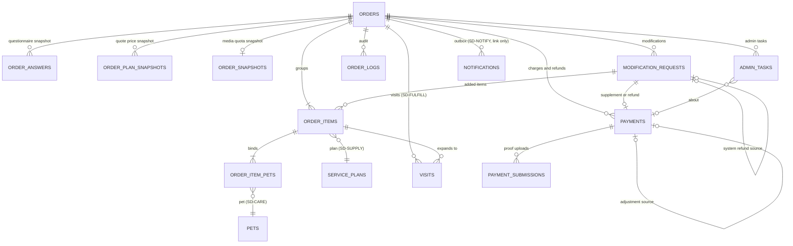

### 5.3 刪除 / 改名總表

| 表 | 刪除 | 新增 / 取代 |
|----|-----------------|------------|
| `orders` | `items`、`adjustment_amount`、`adjustment_reason`、`paid_at`、`payout_at`、`waiting_for_owner_action`、`is_disputed`、`idempotency_key`、`plan_id`、`payment_proof_url`、`payment_proof_last_five`、`disclaimer_agreed`、`disclaimer_agreed_at`、`payment_idempotency_key`、`questionnaire_answers`、`is_deleted`、`created_by`、`updated_by` | `base_amount`、`surcharge_amount`、`discount_amount`、`pricing_notes`、`quoted_at`、`confirmed_at`（取代 `paid_at`）、`review_expires_at`、`first_service_date`、`questionnaire_status`、`questionnaire_exempt_reason`、`cancelled_at`、`cancel_reason_code`、`cancel_reason`、`completed_by`、`completion_basis_at`、`disputed_at`；保留 `total_amount`（改可 NULL）、`cancelled_by`、`completed_at`、`media_expiry_warned`（SD-CARE 使用，搬遷另議） |
| `order_snapshots` | `snapshot_original_total`、`adjustment_amount`、`snapshot_data`、`max_video_seconds`、`snapshot_unit_price`、`snapshot_plan_title`、`is_deleted`、`created_by`、`updated_by` | 單價與方案名稱移到 `order_plan_snapshots` |
| `modification_requests` | `previous_status`、`refund_proof_url`、`supplement_*`（5 欄）、`dates`、`payload`、`diff_amount`、`requested_by`、`is_deleted`、`created_by`、`updated_by`；索引 `uk_active_modification`、`idx_mod_req_supplement_idempotency` | §5.1.1 第 2 段新欄位；憑證移到 `payment_submissions` |
| `order_logs` | `operator_id`（VARCHAR） | `operator_role`、`operator_user_id` |
| 新表 | — | `order_items`、`order_item_pets`、`order_answers`、`order_plan_snapshots`、`payments`、`payment_submissions`、`admin_tasks`、`idempotency_records` |
| 不動 | `idempotency_keys`（KYC、照護記事 / 媒體、照護日誌仍使用；改寫後由各自 SD 移除依賴，§11） | — |

---

## 6. API 契約

### 6.1 共通規則

| 項目 | 規則 |
|------|------|
| 身分 | 一律取自 token（`TokenContext.getUserId()`）；body / query 不收代表呼叫者的 `ownerId` / `sitterId`。E1 的 `sitterId` 與 E31 路徑的 `sitterId` 是「操作對象」（SD-GLOBAL-SPEC §3.4 允許的例外） |
| 角色 | `@PreAuthorize("hasRole(...)")` 標在 Controller；被拒時 Spring Security 拋 `AuthorizationDeniedException`（`AccessDeniedException` 子類），**全域** `GlobalExceptionHandler` 對映 403 `ROLE_MISMATCH`（CQ-42 已決：baseline §3.7 本為跨模組規則；其他模組 `@PreAuthorize` 被拒也改回 `ROLE_MISMATCH`，受影響測試列 §8.4）。歸屬不符由 Service 拋 `OrderException(FORBIDDEN)` → 403 `FORBIDDEN`；其他模組自行拋的一般 `AccessDeniedException` 仍對映 403 `FORBIDDEN`。混合角色端點另有 G4a（當事人錯角色）見下表 |
| 方案 | 不用 `@RequirePlan`；`PlanPolicy` 由 Service 在判斷順序第 13 步呼叫（§11 技術決策 5） |
| 欄位驗證 | Request DTO **不掛** `@Valid`、`Idempotency-Key` 以 `@RequestHeader(required = false)` 讀取：Bean Validation 與必填 header 會在進入方法前回 400，早於 404 / 403，違反判斷順序。改由 `OrderRequestValidator` 在第 6 步檢查並拋 `OrderException(VALIDATION_FAILED)`。為讓格式錯誤也能延後到第 6 步，訂單 DTO 型別規則：金額欄宣告為 `BigDecimal`，validator 要求為整數（`stripTrailingZeros().scale() <= 0` 且 JSON 字面值不含小數點；`100.5`、`100.0` 都 400）與範圍；enum 語意欄（`type`、`expectedStatus`）宣告為 `String`；body 內的 UUID 欄宣告為 `String`；`@RequestPart` / `@RequestParam` 一律 `required = false`。另全域設定 `spring.jackson.deserialization.accept-float-as-int=false`（其他模組的整數欄同樣拒絕小數，受影響測試列 §8.4）。無法延後、只能在進入方法前回 400 `VALIDATION_FAILED` 的情況（可接受，早於 404 / 403）：JSON 無法解析、路徑 UUID 格式錯（`MethodArgumentTypeMismatchException`）、非 multipart 卻打上傳端點、body 超過 64 KB |
| 伺服器資料相依的 400 | 需讀訂單快照或目前行程才能判斷的上限（E17 / E20 的新總額 > 999,999、同方案同日合計 > 3、變更後日期總數 > 60）依 PRD-016 BR-28 放在 G6（鎖外讀值），取鎖後**重驗一次**，不符仍回 400；E1 / E6 的 `baseAmount` / `totalAmount` 上限依 baseline §3.7 註記放在第 12 步 |
| null 欄位 | `spring.jackson.default-property-inclusion: non-null`：回應中值為 null 的欄位**不輸出**（含冪等回放 body）；本文件標 `\| null` 的欄位前端以「缺欄位」視為 null |
| 冪等 | 標註 `@Idempotent` 的端點必帶 `Idempotency-Key`（1–128 個可見 ASCII 字元），見 §6.2「冪等」欄；機制屬 SD-GLOBAL-SPEC §2.4，三段式見 §3.6.2 |
| 時間 / 金額 | ISO-8601（UTC，`Z` 結尾）；日期 `YYYY-MM-DD`（Asia/Taipei）；金額為整數 TWD（畫面與通知格式見 SD-FRONTEND-SPEC §6.4.1） |
| 去頭尾空白 | 本文件所有「去前後空白」「去頭尾空白」一律指 SD-GLOBAL-SPEC §2.7（等同 Java `String.strip()`，含 U+3000 全形空白、U+00A0）；字數以 strip 後的 Unicode code point 計；儲存 strip 後的值 |
| 分頁 | `page`（0 起）、`size`（預設 20，上限 50）；回應 `{ "content": [], "page", "size", "totalElements" }` |
| 錯誤回應 | `{ "code": "<錯誤碼>", "message": "<中文訊息>", "payload": { ... }, "traceId", "timestamp" }`，**全域採用**（CQ-42 已決，含 `authenticationEntryPoint` / `accessDeniedHandler`，§8.3 D7）；`payload` 欄位見 §6.5；比對「回應一致」時不含 `traceId` / `timestamp`（PRD-005 EX-5） |
| `ORDER_BUSY` | 另帶標頭 `Retry-After: 1` |
| multipart 上限 | 全域容器上限 `spring.servlet.multipart.max-file-size=20MB`、`max-request-size=21MB`、`server.tomcat.max-swallow-size=21MB`（Spring 預設單檔 1 MB 會讓 5 MB 憑證進不了 E11）；**5 MB 上限由 E11 自行檢查**回 422 `PROOF_FILE_TOO_LARGE`（CQ-42 已決）。超過 20 MB 的請求由全域 `MaxUploadSizeExceededException` 回 400 `VALIDATION_FAILED`（只發生在繞過前端直接呼叫，早於 404 / 403，可接受）。其他模組的上傳端點需自行檢查各自上限（列 §8.4） |

**判斷順序代號**（baseline §3.7；G4a 為 CQ-40 補充的混合角色步驟；以下各端點只寫 G6 之後的專屬檢查）：

| 代號 | 檢查 | 拋出位置 |
|------|------|---------|
| G1 | 401 `UNAUTHENTICATED` | 未帶 / 無效 token 打 `authenticated()` 路徑：`ExceptionTranslationFilter` → `authenticationEntryPoint`（改寫為 §6.1 格式，§8.3 D7）；permitAll 路徑上呼叫 `TokenContext.getUserId()` → `GlobalExceptionHandler` |
| G2 | 冪等回放 | `IdempotencyInterceptor` |
| G3 | 403 `ROLE_MISMATCH` | `@PreAuthorize` |
| G4 | 404 `NOT_FOUND`（訂單、路徑子資源；子資源不屬路徑訂單也是 404） | Service，`OrderException(NOT_FOUND)` |
| G4a | 403 `ROLE_MISMATCH`：token `userId` 是此訂單的 owner 或 sitter，但 `currentRole` 不是其在此訂單的當事人角色（例：該單保母以 OWNER token 呼叫 E14、E17）（CQ-40 已決） | Service，`OrderException(ROLE_MISMATCH)`；只在允許 OWNER 與 SITTER 兩種角色的端點（E2、E10–E15、E17–E19、E21、E22、E24）需要，單一角色端點已由 G3 擋下 |
| G5 | 403 `FORBIDDEN`（非當事人；ADMIN 不在可讀範圍；當事人且角色正確但非此動作的操作方，例：保母以 SITTER 上傳 CHARGE、飼主確認 CHARGE） | Service，`OrderException(FORBIDDEN)` |
| G6 | 400 `VALIDATION_FAILED`（含缺 `Idempotency-Key`） | `OrderRequestValidator` |
| G7 | 422 `IDEMPOTENCY_KEY_REUSED` / 409 `IDEMPOTENCY_IN_PROGRESS` | `IdempotencyService.claim`，`IdempotencyException` |
| L | 取訂單鎖；逾時 409 `ORDER_BUSY` | `OrderLockService`，`OrderBusyException` |

### 6.2 總表

| 代號 | Method | Path | `@PreAuthorize` | 方案 | 歸屬檢查 | 冪等 |
|------|--------|------|----------------|------|---------|------|
| E1 | POST | `/api/orders` | OWNER | 第 13 步 `SUBSCRIPTION_LOCKED` | 毛孩 `ownerId == token` | 必填 |
| E2 | GET | `/api/orders/{orderId}` | OWNER, SITTER | — | `order.owner == token`（OWNER）/ `order.sitter == token`（SITTER） | — |
| E3 | GET | `/api/orders/owner` | OWNER | — | 只查 `owner_id = token` | — |
| E4 | GET | `/api/orders/sitter` | SITTER | — | 只查 `sitter_id = token` | — |
| E5 | GET | `/api/orders/{orderId}/evaluation` | SITTER | 讀取不擋 | `order.sitter == token` | — |
| E6 | POST | `/api/orders/{orderId}/quote` | SITTER | 第 13 步 `PLAN_REQUIRED` / `SUBSCRIPTION_LOCKED` | `order.sitter == token` | 必填 |
| E7 | POST | `/api/orders/{orderId}/decline` | SITTER | 不擋 | `order.sitter == token` | 必填 |
| E8 | POST | `/api/orders/{orderId}/withdraw` | OWNER | 不擋 | `order.owner == token` | 必填 |
| E9 | POST | `/api/orders/{orderId}/sitter-cancel` | SITTER | 不擋 | `order.sitter == token` | 必填 |
| E10 | GET | `/api/orders/{orderId}/payments` | OWNER, SITTER, ADMIN | — | 當事人；ADMIN 依 `AdminOrderAccessPolicy` | — |
| E11 | POST | `/api/orders/{orderId}/payments/{paymentId}/submissions` | OWNER, SITTER | 不擋 | 當事人且為該 payment 付款方 | 必填（multipart hash） |
| E12 | GET | `/api/orders/{orderId}/payments/{paymentId}/submissions` | OWNER, SITTER, ADMIN | — | 同 E10 | — |
| E13 | GET | `/api/orders/{orderId}/payments/{paymentId}/submissions/{submissionId}/proof-url` | OWNER, SITTER, ADMIN | — | 同 E10 | — |
| E14 | POST | `/api/orders/{orderId}/payments/{paymentId}/verify` | OWNER, SITTER | 不擋 | 當事人且為該 payment 收款方 | 必填 |
| E15 | POST | `/api/orders/{orderId}/payments/{paymentId}/reject` | OWNER, SITTER | 不擋 | 當事人；僅 CHARGE 的收款方（SITTER） | 必填 |
| E16 | POST | `/api/admin/orders/{orderId}/payments/{paymentId}/void` | ADMIN | — | payment 為 INITIAL 且該訂單有 OPEN `INITIAL_PAYMENT_UNVERIFIED` 待辦 | 必填 |
| E17 | POST | `/api/orders/{orderId}/modifications` | OWNER, SITTER | SITTER 第 13 步 `PLAN_REQUIRED`（鎖定依 FREE） | 當事人 | 必填 |
| E18 | GET | `/api/orders/{orderId}/modifications` | OWNER, SITTER, ADMIN | — | 同 E10 | — |
| E19 | GET | `/api/orders/{orderId}/modifications/{modificationId}` | OWNER, SITTER, ADMIN | — | 同 E10 | — |
| E20 | POST | `/api/orders/{orderId}/modifications/{modificationId}/quote` | SITTER | 第 13 步 `PLAN_REQUIRED` | `order.sitter == token` | 必填 |
| E21 | POST | `/api/orders/{orderId}/modifications/{modificationId}/reject` | OWNER, SITTER | 不擋 | 當事人 | 必填 |
| E22 | POST | `/api/orders/{orderId}/modifications/{modificationId}/withdraw` | OWNER, SITTER | 不擋 | 當事人且為發起者 | 必填 |
| E23 | POST | `/api/orders/{orderId}/modifications/{modificationId}/accept` | OWNER | 不重驗 | `order.owner == token` | 必填 |
| E24 | POST | `/api/orders/{orderId}/payment-disputes` | OWNER, SITTER | 不擋 | 當事人 | 必填 |
| E25 | POST | `/api/orders/{orderId}/complete` | OWNER | — | `order.owner == token` | 必填 |
| E26 | POST | `/api/orders/{orderId}/service-disputes` | OWNER | — | `order.owner == token` | 必填 |
| E27 | GET | `/api/admin/orders/{orderId}` | ADMIN | — | `AdminOrderAccessPolicy` | — |
| E28 | GET | `/api/admin/tasks` | ADMIN | — | — | — |
| E29 | POST | `/api/admin/orders/{orderId}/mediation` | ADMIN | — | 訂單 `DISPUTED`（可讀範圍） | 必填 |
| E30 | GET | `/api/orders/sitter/ledger` | SITTER | — | 只查 `sitter_id = token` | — |
| E31 | GET | `/api/sitters/{sitterId}/booking-context` | 匿名可（Optional JWT） | — | — | — |
| C1–C10 | POST | `/api/internal/cron/...`（§8.1） | `ROLE_INTERNAL`（`InternalSecretFilter`） | — | — | 不適用（以重驗保證可重跑） |

共 **31 支使用者端點 + 10 支排程端點**。

- 混合角色端點的歸屬檢查一律：非當事人 → `FORBIDDEN`；當事人但 `currentRole` 不是其當事人角色 → `ROLE_MISMATCH`（G4a）；當事人且角色正確但方向 / 操作方不符 → `FORBIDDEN`（G5）。

### 6.3 端點契約

> 各端點的「錯誤」欄依判斷順序列 G6 之後的專屬項；G1–G7 依 §6.1 適用於所有寫入端點（GET 只有 G1、G3、G4、G5 與查詢參數 400）。錯誤碼 payload 見 §6.5。

#### E1 `POST /api/orders`（O1）

| 欄位 | 型別 | 必填 | 規則 |
|------|------|------|------|
| `sitterId` | UUID | ✓ | 預約對象 |
| `groups[]` | array | ✓ | 1–10 組（PRD-005 BR-18） |
| `groups[].planId` | UUID | ✓ | |
| `groups[].dates[]` | date[] | ✓ | 1 筆以上；全部群組日期合計 ≤ 60；同方案同日只能出現在一組 |
| `groups[].dailyCount` | int | ✓ | 1–3 |
| `groups[].petIds[]` | UUID[] | ✓ | ≥ 1（payload `groupIndex`） |
| `answers[]` | array | | 每題 `questionId` + `value`（字串或字串陣列）；同一 `questionId` 不得重複 |
| `expectedAmount` | int | ✓ | 畫面試算值 |

Response 201：`{ "orderId", "status": "PENDING", "baseAmount", "reviewExpiresAt", "questionnaireStatus" }`

錯誤（G4 起）：404 保母不存在 → 404 任一毛孩不存在或已刪除 → 403 毛孩非本人 → 400（`Idempotency-Key`、群組 / 日期 / `petIds` 空、`dailyCount`、群組數、日期總數、同方案同日、`questionId` 重複、日期格式）→ G7 → 422 `SELF_BOOKING_NOT_ALLOWED` → 403 `SITTER_NOT_BOOKABLE`（`reason` = `NOT_VERIFIED` / `UNAVAILABLE`）→ 422 `MONTHLY_QUOTA_REACHED` → 422 `PLAN_NOT_BOOKABLE` → 422 `INVALID_VISIT_DATE`（`dates`、`reason`）→ 409 `QUESTIONNAIRE_CHANGED`（`questions`）→ 400 答案長度（`questionId`）→ 400 `field=baseAmount`、`max=999999` → 409 `PRICE_CHANGED`（`baseAmount`）→ 403 `SUBSCRIPTION_LOCKED`。不取訂單鎖（新建）。

#### E2 `GET /api/orders/{orderId}`

Response 200：`{ "orderId", "status", "role": "OWNER|SITTER", "counterpart": { "userId", "displayName" }, "firstServiceDate", "lastServiceDate", "reviewExpiresAt", "baseAmount", "quote": { "surchargeAmount", "discountAmount", "pricingNotes", "totalAmount", "quotedAt" } | null, "groups": [ { "orderItemId", "source", "planId", "planTitle", "unitPrice", "dates", "dailyCount", "pets": [ { "petId", "name", "type", "deleted" } ] } ], "visits": [ { "visitId", "serviceDate", "planId", "status", "completedAt", "careLogSubmitted" } ], "questionnaireStatus", "questionnaireExemptReason", "payments": [ 摘要同 E10 但不含帳號快照 ], "openModification": { "modificationId", "status", "initiatedBy" } | null, "cancellation": { "cancelledBy", "reasonCode", "reason", "cancelledAt" } | null, "completedAt", "disputeWindowEndsAt", "netPaid", "serverTime", "completionHint": { "code", "autoCompleteAt" } | null, "allowedActions": [ "WITHDRAW", "DECLINE", "QUOTE", "SITTER_CANCEL", "REQUEST_MODIFICATION", "COMPLETE", "REPORT_SERVICE_ISSUE", "PAYMENT_DISPUTE" ] }`

- `quote.totalAmount` 為**目前生效**的 `orders.total_amount`（報價後；變更 `SETTLED` 或補款逾時重算後即為新值）；`groups[].unitPrice`：報價後取 `order_plan_snapshots.unit_price`，報價前取送單時的 `order_items.booked_unit_price`。
- `counterpart.displayName`：OWNER 呼叫時為保母名稱，SITTER 呼叫時為飼主顯示稱呼。`lastServiceDate` = 最後一個有效行程日期。
- `disputeWindowEndsAt` = `completion_basis_at + 48h`（飼主端「可回報問題至」、保母端「預計自動結案時間」，兩者同一時間點）；只在訂單 `IN_PROGRESS`、所有有效行程已結束且無未結束變更時回傳，否則為 null（不輸出）（PRD-009 BR-21）。
- `visits[].careLogSubmitted`：行程日誌是否已送出，取自 SD-FULFILL `VisitView.careLogSubmitted`（PRD-009 BR-24、§4.1）。
- `serverTime`：產生本回應時注入 `Clock` 的時間（ISO-8601）。`completionHint`、`allowedActions`、`disputeWindowEndsAt` 全部以這同一個時間點、同一次讀取的資料計算，畫面不得自行以瀏覽器時間或 HTTP `Date` 標頭判斷（SD-FULFILL CQ-10）。
- `completionHint`（只對 OWNER、訂單 `IN_PROGRESS` 時回傳；PRD-009 §4.1 依序取第一個成立者）：(i) 有未結束變更 → `MODIFICATION_IN_PROGRESS`；(ii) 有效行程有 `PENDING` / `IN_PROGRESS` → `VISITS_NOT_FINISHED`；(iii) 有效行程皆已結束、有 `DONE` 行程日誌未送出且 `serverTime ≥ completed_at + CARE_LOG_EDIT_HOURS` → `CARE_LOG_EXPIRED`（帶 `autoCompleteAt` = `completion_basis_at + AUTO_COMPLETE_HOURS`）；(iv) 有 `DONE` 行程日誌未送出但仍在編輯期 → `CARE_LOG_PENDING`；(v) 以上皆不成立 → `null`，且 `allowedActions` 含 `COMPLETE`。日誌送出狀態與期限取自 SD-FULFILL `VisitQueryService.listVisits`。
- `allowedActions` 只是畫面提示，由同一套前置條件計算；後端每個寫入端點仍各自檢查。錯誤：G1、G3（ADMIN → `ROLE_MISMATCH`，ADMIN 走 E27）、G4、G5。

#### E3 `GET /api/orders/owner`、E4 `GET /api/orders/sitter`

Query：`tab` = `EVALUATING`（`PENDING`、`PENDING_PAYMENT`）/ `ACTIVE`（`CONFIRMED`、`IN_PROGRESS`、`DISPUTED`）/ `HISTORY`（`COMPLETED`、`CANCELLED`），對應 baseline §3.1；`page`、`size`（預設 20，前端「載入更多」）。`tab=HISTORY` 另可帶：`status`（`COMPLETED` / `CANCELLED`，選填）、`month`（`YYYY-MM`，依終態時間 `completed_at` / `cancelled_at` 的 Asia/Taipei 自然月，選填；預設不篩月份）（PRD-009 BR-23）。

Response 200（分頁）：`content[]` = `{ "orderId", "status", "counterpartName", "firstServiceDate", "lastServiceDate", "baseAmount", "totalAmount", "hasOpenModification", "initialPaymentStatus", "createdAt", "terminalAt", "netPaid" }`。`terminalAt` = `completed_at` 或 `cancelled_at`、`netPaid` = 已收淨額，只在 `tab=HISTORY` 回傳。排序：`EVALUATING` / `ACTIVE` 依 `created_at` 倒序；`HISTORY` 依 `terminalAt` 新到舊（索引 `ix_orders_owner_terminal` / `ix_orders_sitter_terminal`）。`content` 為空時前端顯示 PRD-009 定義的空狀態。錯誤：G1、G3、400（`tab` / `status` / `month` / 分頁參數）。

#### E5 `GET /api/orders/{orderId}/evaluation`

Response 200：`{ "orderId", "status", "reviewExpiresAt", "baseAmount", "owner": { "displayName" }, "isRegularOwner", "groups": [ 同 E2，含毛孩與 deleted ], "questionnaire": { "status", "exemptReason", "answers": [ { "questionId", "questionText", "questionType", "answer" } ] }, "precheck": { "subscriptionLocked", "quotaReached", "payoutAccountMissing", "reviewExpired", "planAllowsAdjustment" }, "serverTime" }`

錯誤：G1、G3、G4、G5。`precheck` 只供畫面停用按鈕（PRD-006 AC-1.5），報價時仍強制檢查；`reviewExpired` = `serverTime ≥ review_expires_at`，與其他預檢以同一個注入 `Clock` 時間點計算。`subscriptionLocked` / `quotaReached` / `payoutAccountMissing` 任一為 true 時，畫面三顆報價按鈕（原價接單、調整價格、送出報價）**全部停用**，優先於 PRD-006 AC-3.2 的「FREE / BASIC 調價鈕可點並顯示升級提示」（使用者決定 2026-11-22，PRD-006 選 A）；`quotaReached` 時預檢提示附升級入口（§9.1）。

#### E6 `POST /api/orders/{orderId}/quote`（O2）

| 欄位 | 型別 | 必填 | 規則 |
|------|------|------|------|
| `expectedAmount` | int | ✓ | 畫面上的原始試算 |
| `surchargeAmount` | int | | 0–999,999，預設 0 |
| `discountAmount` | int | | 0–999,999，預設 0 |
| `pricingNotes` | string | 調整 > 0 時必填 | 去前後空白 1–200 字 |

Response 200：`{ "orderId", "status": "PENDING_PAYMENT", "baseAmount", "surchargeAmount", "discountAmount", "totalAmount", "quotedAt", "payment": { "paymentId", "amount", "dueAt", "escalateAt" } }`

錯誤：G6（`expectedAmount` 缺、調整範圍、原因）→ G7 → L → 409 `ORDER_STATE_CONFLICT` → 409 `DEADLINE_PASSED`（`REVIEW_EXPIRES_AT`）→ 409 `FIRST_VISIT_DATE_PASSED` → 422 `MONTHLY_QUOTA_REACHED` → 422 `PAYOUT_ACCOUNT_REQUIRED` → 409 `PRICE_CHANGED`（`baseAmount`、`totalAmount`）→ 422 `INVALID_QUOTE_AMOUNT` / 400 `field=totalAmount` → 403 `PLAN_REQUIRED`（帶調整且 FREE / BASIC）→ 403 `SUBSCRIPTION_LOCKED`。

#### E7 `POST /api/orders/{orderId}/decline`（O3 SITTER）

Request：`reason` string 必填，以 `String.strip()`（SD-GLOBAL-SPEC §2.7）去頭尾空白後以 Unicode code point 計 1–200 字，存 strip 後的值。Response 200：`{ "orderId", "status": "CANCELLED", "cancelledBy": "SITTER" }`

錯誤：G6（`reason`）→ G7 → L（逾時 409 `ORDER_BUSY`）→ 409 `ORDER_STATE_CONFLICT`（非 `PENDING`）。不檢查期限、鎖定、額度。

#### E8 `POST /api/orders/{orderId}/withdraw`（O3 OWNER / O6）

Request：`expectedStatus`（必填；缺少或不是七種主狀態之一 → 400 `VALIDATION_FAILED`，`field=expectedStatus`；是合法主狀態但不是 `PENDING` / `PENDING_PAYMENT` → 進入狀態檢查回 409 `ORDER_STATE_CONFLICT`）；`reason`（選填，`String.strip()` 後 ≤ 200 code point，strip 後為空 → null，存 strip 後的值）。Response 200：`{ "orderId", "status": "CANCELLED", "cancelledBy": "OWNER" }`

錯誤：G6（`expectedStatus`、`reason`）→ G7 → L → 409 `ORDER_STATE_CONFLICT`（非 `PENDING` / `PENDING_PAYMENT`，或 ≠ `expectedStatus`）→ 409 `PAYMENT_ALREADY_SUBMITTED`。不檢查期限。

#### E9 `POST /api/orders/{orderId}/sitter-cancel`（O7）

Request：`reason` 必填，`String.strip()` 後以 code point 計 1–200 字，存 strip 後的值。Response 200：`{ "orderId", "status": "CANCELLED", "cancelledBy": "SITTER" }`

錯誤：G6 → G7 → L（逾時 409 `ORDER_BUSY`）→ 409 `ORDER_STATE_CONFLICT`（非 `PENDING_PAYMENT`）→ 409 `PAYMENT_ALREADY_SUBMITTED`。

#### E10 `GET /api/orders/{orderId}/payments`

Response 200：`[ { "paymentId", "direction", "purpose", "method", "amount", "status", "dueAt", "escalateAt", "accountSnapshot": { "bankCode", "branch", "accountNumber", "accountName" } | null, "currentSubmissionId", "createdAt", "verifiedAt", "voidedAt", "allowedActions": [ "UPLOAD", "VERIFY", "REJECT" ] } ]`，`created_at` 由舊到新。

- `accountSnapshot` 只在 CHARGE 且呼叫者為付款方、收款方或可讀範圍 ADMIN 時解密回傳；REFUND 一律 null，畫面顯示「退款帳號請與飼主自行聯繫」。
- 錯誤：G1、G3、G4、G5（ADMIN 不在可讀範圍 → 403）。

#### E11 `POST /api/orders/{orderId}/payments/{paymentId}/submissions`（P1，multipart）

| part | 型別 | 必填 | 規則 |
|------|------|------|------|
| `disclaimerAgreed` | boolean | ✓ | 必須 `true` |
| `lastFive` | string | ✓ | `^[0-9]{5}$` |
| `file` | file | ✓ | 恰好 1 個；JPEG / PNG / WebP（magic bytes）；≤ 5 MB |

Response 201：`{ "submissionId", "paymentId", "paymentStatus": "SUBMITTED", "submittedAt" }`（不含簽名網址）

錯誤：G4a → G5（非當事人；非付款方，例：保母上傳 CHARGE。payment 為 `ADMIN_ADJUSTMENT` 時 G5 跳過方向檢查；G6、G7 照常；預檢第一步回 409 `PAYMENT_STATE_CONFLICT`，PRD-007 §3）→ G6（免責、後五碼、檔案數）→ G7 → 預檢（不取鎖）：409 `ORDER_STATE_CONFLICT`（`DISPUTED`）→ 409 `PAYMENT_STATE_CONFLICT`（非 `UNPAID`、`ADMIN_ADJUSTMENT`）→ 409 `DEADLINE_PASSED`（`PAYMENT_DUE_AT`，`receivedAt ≥ due_at`）→ 422 `PROOF_FILE_TYPE_UNSUPPORTED` / `PROOF_FILE_TOO_LARGE`（5 MB 由 E11 自行檢查）→ GCS 失敗 503 `STORAGE_UNAVAILABLE` → L → 鎖後重驗失敗 409 `ORDER_STATE_CONFLICT` / `PAYMENT_STATE_CONFLICT`（期限仍以 `receivedAt` 判斷）。

#### E12 `GET .../submissions`

Response 200：`[ { "submissionId", "status", "lastFive", "submittedAt", "disclaimerAgreedAt", "reviewedAt", "verifiedAt", "rejectReason", "voided" } ]`（`reviewedAt` = 確認或駁回時間；`verifiedAt` 只在 `ACCEPTED` 時回傳，= `reviewedAt`），`submitted_at` 倒序；`voided` = payment `VOID` 且 submission 仍 `SUBMITTED`（PRD-007 BR-24）。錯誤：G1、G3、G4（submission / payment 不屬路徑訂單 → 404）、G5。

#### E13 `GET .../submissions/{submissionId}/proof-url`

Response 200：`{ "url", "expiresAt" }`（V4 簽名網址，TTL 5 分鐘，每次重新產生）。錯誤：G1、G3、G4、G5；簽名失敗 503 `STORAGE_UNAVAILABLE`。

#### E14 `POST .../payments/{paymentId}/verify`（P2）

Request：`submissionId` UUID 必填。Response 200：`{ "paymentId", "paymentStatus": "VERIFIED", "orderStatus", "modification": { "modificationId", "status" } | null }`

錯誤：G4a → G5（非收款方；保母確認退款、飼主確認 CHARGE；`ADMIN_ADJUSTMENT` 跳過方向檢查，G6、G7 照常後回 409）→ G6 → G7 → L → 409 `ORDER_STATE_CONFLICT`（`DISPUTED`）→ 409 `PAYMENT_STATE_CONFLICT`（非 `SUBMITTED`、`submissionId` 非目前那筆、`ADMIN_ADJUSTMENT`）。不檢查日期、方案、鎖定。

#### E15 `POST .../payments/{paymentId}/reject`（P3）

Request：`submissionId` 必填；`reason` 必填 1–200 字。Response 200：`{ "paymentId", "paymentStatus": "UNPAID", "submissionId", "submissionStatus": "REJECTED" }`

錯誤：G4a → G5（REFUND 不可駁回、非收款方；先於凍結檢查）→ G6 → G7 → L → 409 `ORDER_STATE_CONFLICT` → 409 `PAYMENT_STATE_CONFLICT`。

#### E16 `POST /api/admin/orders/{orderId}/payments/{paymentId}/void`（O16）

Request：`reason` 必填 1–200 字。Response 200：`{ "orderId", "status": "CANCELLED", "cancelledBy": "ADMIN", "paymentStatus": "VOID" }`

錯誤：G4 → G5（payment 非 INITIAL、待辦非 OPEN；取鎖前）→ G6 → G7 → L → 409 `PAYMENT_STATE_CONFLICT`（鎖後 payment 非 `SUBMITTED` 或待辦已非 OPEN）。

#### E17 `POST /api/orders/{orderId}/modifications`（T1 OWNER / T2 SITTER）

| 欄位 | 型別 | 必填 | 規則 |
|------|------|------|------|
| `type` | `CHANGE` / `CANCEL_ALL` | ✓ | |
| `reason` | string | ✓ | 1–200 字 |
| `removeVisitIds[]` | UUID[] | | `CHANGE` 用；必須屬本訂單（否則 400） |
| `addItems[]` | array | | `CHANGE` 用；每筆 `date`、`planId`、`dailyCount` 1–3、`petIds[]` ≥ 1 且在本訂單毛孩範圍 |
| `surchargeAmount` / `discountAmount` / `adjustmentReason` | int / int / string | | 只有 SITTER 適用（OWNER 送出時忽略）；0–999,999；任一 > 0 時原因 1–200 字 |

Response 201：`{ "modificationId", "status": "REQUESTED|QUOTED", "initiatedBy", "expiresAt", "systemAmount", "newTotalAmount", "netPaid", "diff" }`（OWNER 發起時金額欄為 null）

錯誤：G6（含同方案同日合計 > 3、變更後日期總數 > 60、加減範圍、新總額 > 999,999）→ G7 → L → 409 `ORDER_STATE_CONFLICT` → `MODIFICATION_IN_PROGRESS` → `MODIFICATION_NOT_ALLOWED` → 409 `VISIT_ALREADY_STARTED`（`visitIds`）→ 422 `INVALID_VISIT_DATE`（`reason=PLAN_NOT_IN_RANGE` 時表方案區間）/ `MODIFICATION_EMPTY` / `PLAN_NOT_IN_ORDER` / `INVALID_MODIFICATION_AMOUNT` → 403 `PLAN_REQUIRED`（SITTER 帶加減且 FREE / BASIC / 鎖定）。

#### E18 `GET /api/orders/{orderId}/modifications`

Response 200：`[ { "modificationId", "type", "status", "initiatedBy", "reason", "newTotalAmount", "createdAt", "endedAt" } ]`，`created_at` 倒序；無變更回 `[]`。錯誤：G1、G3、G4、G5。

#### E19 `GET /api/orders/{orderId}/modifications/{modificationId}`

Response 200：`{ "modificationId", "type", "status", "initiatedBy", "reason", "requestedContent", "quotedContent", "systemAmount", "surchargeAmount", "discountAmount", "adjustmentReason", "newTotalAmount", "netPaid", "diff", "expiresAt", "endedAt", "rejectReason", "sourceModificationId", "payment": { "paymentId", "direction", "purpose", "amount", "status", "dueAt" } | null, "disputeAvailableAt", "allowedActions": [ "QUOTE", "REJECT", "WITHDRAW", "ACCEPT", "PAYMENT_DISPUTE" ] }`

- `netPaid` / `diff`：`QUOTED` 前為報價時值，同意後為 `agreed_*`；`allowedActions` 依 PRD-016 §4.6 表與 `now ≥ expires_at`（全部隱藏）計算。錯誤：G1、G3、G4、G5。

#### E20 `POST .../modifications/{modificationId}/quote`（T3）

Request：同 E17 的 `removeVisitIds`、`addItems`、`surchargeAmount`、`discountAmount`、`adjustmentReason`（`CANCEL_ALL` 忽略 `removeVisitIds`，固定為當下所有 `PENDING` 行程）。Response 200：`{ "modificationId", "status": "QUOTED", "systemAmount", "newTotalAmount", "netPaid", "diff", "expiresAt" }`

錯誤：G6 → G7 → L → 409 `ORDER_STATE_CONFLICT` → `MODIFICATION_STATE_CONFLICT` → `DEADLINE_PASSED`（`MODIFICATION_EXPIRES_AT`）→ `VISIT_ALREADY_STARTED` → 422 `INVALID_VISIT_DATE` / `MODIFICATION_EMPTY` / `PLAN_NOT_IN_ORDER` / `INVALID_MODIFICATION_AMOUNT` → 403 `PLAN_REQUIRED`。

#### E21 `POST .../modifications/{modificationId}/reject`

Request：`reason`（SITTER 必填 1–200 字；OWNER 不需要，送出則忽略）。Response 200：`{ "modificationId", "status": "REJECTED", "endedAt" }`

錯誤：G4a → G6 → G7 → L → 409 `ORDER_STATE_CONFLICT` → 409 `MODIFICATION_STATE_CONFLICT`（SITTER 只能拒絕 `REQUESTED`，OWNER 只能拒絕 `QUOTED`）→ 409 `DEADLINE_PASSED`。

- SITTER 對 OWNER 發起的 `QUOTED` 呼叫 → 409 `MODIFICATION_STATE_CONFLICT`（PRD-016 AC-2.6，CQ-41 已決）。PRD-023 §3 / EX-2 的「SITTER 呼叫 → `ROLE_MISMATCH`」只適用同意端點 E23（單一角色，由 G3 擋下），由主流程回寫 PRD-023。

#### E22 `POST .../modifications/{modificationId}/withdraw`（T5）

Request：無 body。Response 200：`{ "modificationId", "status": "WITHDRAWN", "endedAt" }`

錯誤：G4a → G5（非發起者，含 `initiated_by=SYSTEM`；CQ-1 已決）→ G6（缺 key）→ G7 → L → 409 `ORDER_STATE_CONFLICT` → 409 `MODIFICATION_STATE_CONFLICT`（`AWAITING_*`、終態）→ 409 `DEADLINE_PASSED`。

#### E23 `POST .../modifications/{modificationId}/accept`

Request：無 body。Response 200：`{ "modificationId", "status": "SETTLED|AWAITING_SUPPLEMENT|AWAITING_REFUND", "netPaid", "diff", "payment": { "paymentId", "direction", "purpose", "amount", "dueAt" } | null, "orderStatus", "totalAmount" }`

錯誤：G6 → G7 → L → 409 `ORDER_STATE_CONFLICT` → `MODIFICATION_STATE_CONFLICT` → `DEADLINE_PASSED` → `VISIT_ALREADY_STARTED`（整筆不生效）。不重驗方案與新增日期（PRD-023 BR-1、BR-12）。

- 差額 > 0 建補款時 `PayoutAccountQuery.getSnapshot` 回空：收款帳號不可刪除（PRD-025 BR-6）且 O2 時已存在，回空代表資料異常 → 拋 `PayoutAccountMissingException`（500、告警、整筆回滾、冪等紀錄刪除），不定義為業務錯誤。

#### E24 `POST /api/orders/{orderId}/payment-disputes`（O14）

Request：`description` 必填 1–500 字；不接受附件。Response 200：`{ "orderId", "status": "DISPUTED", "adminTaskId" }`

錯誤：G6 → G7 → L → 409 `ORDER_STATE_CONFLICT`（非 `CONFIRMED` / `IN_PROGRESS`）→ 409 `MODIFICATION_STATE_CONFLICT`（無 `AWAITING_*`）→ 409 `PAYMENT_STATE_CONFLICT`（補款 `UNPAID`；或 `SUBMITTED` 未滿 72h，payload `disputeAvailableAt`）。

#### E25 `POST /api/orders/{orderId}/complete`（O11）

Request：無 body。Response 200：`{ "orderId", "status": "COMPLETED", "completedAt" }`

錯誤：G6（缺 key）→ G7 → L → 409 `ORDER_STATE_CONFLICT` → 409 `MODIFICATION_IN_PROGRESS` → 409 `VISITS_NOT_FINISHED`（有效行程非全為 `DONE`〔日誌已送出〕/ `CLOSED_BY_SYSTEM`）（CQ-6 已決）。

#### E26 `POST /api/orders/{orderId}/service-disputes`（O13）

Request：`description` 必填，去除頭尾空白後以 Unicode code point 計 1–500 字（只有空白 → 400）、不附圖；`order_logs` payload 存去空白後的值（CQ-5 已決；PRD-009 CQ-13、CQ-17）。Response 200：`{ "orderId", "status": "DISPUTED", "adminTaskId" }`

錯誤：G6 → G7 → L → 409 `ORDER_STATE_CONFLICT` → 409 `MODIFICATION_IN_PROGRESS` → 409 `VISITS_NOT_FINISHED`（行程條件同 O12）→ 409 `DEADLINE_PASSED`（`deadline=DISPUTE_WINDOW_ENDS_AT`、`deadlineAt = completion_basis_at + 48h`）。

#### E27 `GET /api/admin/orders/{orderId}`

Response 200：E2 的全部欄位（`role`=`ADMIN`、`allowedActions` 只含 `VOID_INITIAL_PAYMENT` / `MEDIATE`）＋ `payments`（含 `accountSnapshot`）＋ `modifications`（同 E18）＋ `adminTasks[]`（`taskId`、`type`、`status`、`resolution`、`createdAt`）＋ `logs[]`（`actionType`、`operatorRole`、`operatorUserId`、`payload`、`createdAt`，時間正序）。錯誤：G1、G3、G4、G5（非 `DISPUTED` 且無 OPEN 待辦）。

#### E28 `GET /api/admin/tasks`

Query：`status`（預設 `OPEN`）、`type`（選填）、`page`、`size`。Response 200（分頁）：`content[]` = `{ "taskId", "type", "orderId", "paymentId", "status", "createdAt" }`，`created_at` 由舊到新。錯誤：G1、G3、400。

#### E29 `POST /api/admin/orders/{orderId}/mediation`（O15 / O17）

| 欄位 | 型別 | 必填 | 規則 |
|------|------|------|------|
| `refundDecisions[]` | array | 有 `SUBMITTED` 退款時必填 | 每筆 `paymentId` + `exported` boolean；必須涵蓋所有 `SUBMITTED` 退款（缺 → 400，payload `paymentIds`） |
| `adjustment` | object | | `amount` 1–999,999、`basis` 1–500 字（CQ-7 已決） |

Response 200：`{ "orderId", "status": "COMPLETED|CANCELLED", "adjustmentPaymentIds": [] }`

錯誤：G4 → G5（非可讀範圍）→ G6（`refundDecisions` 缺漏、`adjustment` 範圍）→ G7 → L → 409 `ORDER_STATE_CONFLICT`（非 `DISPUTED`）→ 409 `VISITS_NOT_FINISHED`（有 `IN_PROGRESS` 行程）→ 422 `INVALID_ADJUSTMENT_AMOUNT`（手動金額 > 已收淨額 − 本次自動補登）。終態由系統依行程判斷（CQ-57），不收參數。

#### E30 `GET /api/orders/sitter/ledger`

Query：`month`（`YYYY-MM`，Asia/Taipei，必填）。Response 200：`{ "month", "serverMonth", "totalIncome", "orders": [ { "orderId", "status", "ownerDisplayName", "firstServiceDate", "lastServiceDate", "terminalAt", "netPaid" } ] }`；收入 = 該月進入 `COMPLETED` / `CANCELLED` 的訂單的已收淨額（baseline §4、CQ-8 已決），由 payments 加總，不讀 `total_amount`。`orders[]` 排除已收淨額 0 的 `CANCELLED`（不影響 `totalIncome`），依 `terminalAt` 新到舊；不分頁，一次回傳該月全部；無資料時 `totalIncome = 0`、`orders = []`（PRD-009 BR-22）。`serverMonth` = 注入 `Clock` 換算 Asia/Taipei 的當下月份；前端首次進頁以瀏覽器月份呼叫，若與 `serverMonth` 不同則以 `serverMonth` 重新查詢一次並設為預設值（SD-FULFILL CQ-10、PRD-009 AC-3.4）。服務期間 = 首末有效行程日。錯誤：G1、G3、400（`month` 缺漏或格式錯）。

#### E31 `GET /api/sitters/{sitterId}/booking-context`

Response 200：`{ "sitterId", "bookability": "BOOKABLE|SELF|NOT_VERIFIED|UNAVAILABLE|PAUSED", "plans": [ { "planId", "title", "unitPrice", "petTypes", "bookableFrom", "bookableTo" } ], "questionnaire": { "required", "exemptReason", "questions": [ { "questionId", "text", "type", "options", "required", "sortOrder" } ] } | null, "serverTime" }`

- `serverTime`（注入 `Clock`）供前端計算日期選擇器的今天 / 今天 + 365 天與 `review_expires_at` 試算（Asia/Taipei），不以瀏覽器時間判斷。
- 判斷順序同 PRD-005 §4.1：`SELF` → `NOT_VERIFIED`（不回方案）→ `UNAVAILABLE`（隱藏、全域黑名單、全域白名單不在名單；不回方案，三者回應相同）→ `PAUSED`（月額度已滿、訂閱鎖定、停權共用一值，不揭露原因）→ `BOOKABLE`。
- `plans` 依門禁與當下等級過濾；`bookableFrom` / `bookableTo` 只在 PRO / ULTIMATE 且未鎖定時回傳，否則 null。
- `questionnaire` 只在 token 為 OWNER 時回傳（熟客或無題目 → `required=false`）。
- 錯誤：404 保母不存在。

#### C1–C10 排程端點

| 項目 | 契約 |
|------|------|
| Request | `POST`，無 body；標頭 `X-Internal-Secret`；可選 query `orderId`（UUID）：只處理該訂單，且該訂單的 owner 或 sitter 必須是 `@e2e-journey.test` 帳號，否則 404 `NOT_FOUND`、不處理任何資料（使用者決定 2026-11-22） |
| 自動觸發（無 `orderId`） | 候選查詢排除 owner 或 sitter 為 `@e2e-journey.test` 的訂單（以 `users.email` 網域判斷，唯讀 JOIN `users`，屬排程候選唯讀 JOIN 例外），避免 Cloud Scheduler 推進 E2E 正在操作的訂單 |
| Response 200 | `{ "job": "<端點名>", "processed": int, "skipped": int, "failed": int, "startedAt", "finishedAt" }`；帶 `orderId` 時計數只算該訂單；計數一律以訂單為單位（C7 同批關閉同一訂單多個行程仍計 `processed=1`）；C9 / C10 不接受 `orderId`，帶了 → 400） |
| 驗證失敗 | 標頭缺漏或不符 → 403 `FORBIDDEN`（`InternalSecretFilter` 直接回錯誤回應，不處理任何資料；比對用常數時間比較；不得 log 標頭值） |
| 一般使用者 token | 同上 403（`/api/internal/**` 只認 `ROLE_INTERNAL`） |

### 6.4 例外類別與 `GlobalExceptionHandler` 對映

**全域 `GlobalExceptionHandler`**（套所有模組；CQ-42 已決）：

| 例外 | 對映 |
|------|------|
| `AuthorizationDeniedException`（`@PreAuthorize`） | 403 `ROLE_MISMATCH` |
| `AccessDeniedException`（其他） | 403 `FORBIDDEN`（未登入時 401 `UNAUTHENTICATED`） |
| `AuthenticationCredentialsNotFoundException` | 401 `UNAUTHENTICATED`（沿用 GLOBAL §3.4） |
| `HttpMessageNotReadableException`、`MethodArgumentTypeMismatchException`、`MissingServletRequestPartException`、`MissingServletRequestParameterException`、`HttpMediaTypeNotSupportedException`、`MultipartException`、`MaxUploadSizeExceededException` | 400 `VALIDATION_FAILED`（§6.1 格式） |
| 未處理例外（含 `OrderLockNotHeldException`、`PayoutAccountMissingException`） | 500 `INTERNAL_ERROR`（§6.1 格式，不含堆疊） |

**訂單專屬 `OrderExceptionHandler`**（`@RestControllerAdvice(basePackageClasses = 訂單 controller 套件)` + `@Order(Ordered.HIGHEST_PRECEDENCE)`，只套 E1–E31；其他模組維持現行對映）：

| 例外（`application/exception/`） | 帶的資料 | 對映 |
|------|---------|------|
| `OrderException` | `OrderErrorCode code`、`Map payload` | 依 `code` 對映 HTTP 狀態（§6.5）；body 依 §6.1 格式 |
| `OrderBusyException` | — | 409 `ORDER_BUSY` + `Retry-After: 1` |
| `IdempotencyException` | `REUSED` / `IN_PROGRESS` | 422 `IDEMPOTENCY_KEY_REUSED` / 409 `IDEMPOTENCY_IN_PROGRESS` |
| `StorageUnavailableException` | — | 503 `STORAGE_UNAVAILABLE` |
| `VisitNotPendingException`（SD-FULFILL 拋，本 SD 轉換） | `visitIds` | 由本 SD 包成 `OrderException(VISIT_ALREADY_STARTED)` |
| `ObjectOptimisticLockingFailureException`（`@Version`） | — | 409 `ORDER_BUSY` + `Retry-After: 1`（baseline §3.7、CQ-2 已決） |
| `PessimisticLockingFailureException`、`CannotAcquireLockException`、`DeadlockLoserDataAccessException`（SQLSTATE 55P03 / 40P01，不論在 `OrderLockService` 內或交易後續語句拋出） | — | 409 `ORDER_BUSY` + `Retry-After: 1`；冪等紀錄刪除 |
| `DataIntegrityViolationException` | SQLSTATE、約束名 | 只有 SQLSTATE **23505**（unique violation，partial unique 被撞，屬防線）才對映 409：`ux_modreq_open_per_order` → `MODIFICATION_IN_PROGRESS`；`ux_admin_tasks_open` → `ORDER_STATE_CONFLICT`；其他 23505 → `ORDER_BUSY`（可重試，重試時重驗會回正確錯誤）。其餘（23514 CHECK、23502 NOT NULL、23503 FK 等確定性錯誤）→ 500 `INTERNAL_ERROR` 並記 ERROR log，冪等紀錄刪除（SD-GLOBAL-SPEC §2.6）。全域 handler 中舊的 `idx_orders_payment_idempotency` 等對映移除 |

### 6.5 錯誤碼總表（本 SD 使用，共 37 項）

| # | HTTP | code | 來源 | payload | 使用端點 |
|---|------|------|------|---------|---------|
| 1 | 400 | `VALIDATION_FAILED` | baseline | `field`；依情境 `groupIndex` / `questionId` / `max` / `paymentIds` | 全部寫入端點、查詢參數 |
| 2 | 401 | `UNAUTHENTICATED` | baseline | — | 全部（E31 除外） |
| 3 | 403 | `FORBIDDEN` | baseline | — | 全部（E31 除外）；C1–C10 驗證失敗 |
| 4 | 403 | `ROLE_MISMATCH` | baseline | — | 全部（E31 除外）；混合角色端點另於 G4a 判斷當事人錯角色 |
| 5 | 403 | `SUBSCRIPTION_LOCKED` | baseline | — | E1、E6 |
| 6 | 403 | `PLAN_REQUIRED` | baseline | — | E6、E17、E20 |
| 7 | 404 | `NOT_FOUND` | baseline | — | 全部 |
| 8 | 409 | `ORDER_STATE_CONFLICT` | baseline | `currentStatus` | E6–E9、E11、E14–E17、E20–E26、E29 |
| 9 | 409 | `PAYMENT_STATE_CONFLICT` | baseline | `currentStatus`；O14 未滿 72h 帶 `disputeAvailableAt` | E11、E14–E16、E24 |
| 10 | 409 | `MODIFICATION_IN_PROGRESS` | baseline | — | E17、E25、E26 |
| 11 | 409 | `MODIFICATION_STATE_CONFLICT` | baseline | `currentStatus` | E20–E24 |
| 12 | 409 | `MODIFICATION_NOT_ALLOWED` | baseline | — | E17 |
| 13 | 409 | `VISITS_NOT_FINISHED` | baseline | `visitIds` | E25、E26、E29 |
| 14 | 409 | `VISIT_ALREADY_STARTED` | baseline | `visitIds` | E17、E20、E23 |
| 15 | 409 | `PAYMENT_ALREADY_SUBMITTED` | baseline | — | E8、E9 |
| 16 | 409 | `DEADLINE_PASSED` | baseline | `deadline`（`REVIEW_EXPIRES_AT` / `PAYMENT_DUE_AT` / `MODIFICATION_EXPIRES_AT` / `DISPUTE_WINDOW_ENDS_AT`）、`deadlineAt` | E6、E11、E20–E23、E26 |
| 17 | 409 | `FIRST_VISIT_DATE_PASSED` | baseline | — | E6 |
| 18 | 409 | `PRICE_CHANGED` | baseline | E1 `baseAmount`；E6 `baseAmount`、`totalAmount` | E1、E6 |
| 19 | 409 | `ORDER_BUSY` | baseline | —（標頭 `Retry-After: 1`） | 所有取訂單鎖的端點 |
| 20 | 409 | `IDEMPOTENCY_IN_PROGRESS` | baseline | — | 所有冪等端點 |
| 21 | 422 | `IDEMPOTENCY_KEY_REUSED` | baseline | — | 所有冪等端點 |
| 22 | 422 | `SELF_BOOKING_NOT_ALLOWED` | baseline | — | E1 |
| 23 | 422 | `MONTHLY_QUOTA_REACHED` | baseline | — | E1、E6 |
| 24 | 422 | `INVALID_QUOTE_AMOUNT` | baseline | — | E6 |
| 25 | 422 | `INVALID_VISIT_DATE` | baseline | `dates`；變更時 `reason=PLAN_NOT_IN_RANGE` | E1、E17、E20 |
| 26 | 422 | `PAYOUT_ACCOUNT_REQUIRED` | baseline | — | E6 |
| 27 | 403 | `SITTER_NOT_BOOKABLE` | 模組（PRD-005） | `reason` = `NOT_VERIFIED` / `UNAVAILABLE` | E1 |
| 28 | 422 | `PLAN_NOT_BOOKABLE` | 模組（PRD-005） | — | E1 |
| 29 | 409 | `QUESTIONNAIRE_CHANGED` | 模組（PRD-005）：送出的答案與送單當下的問卷不符（含題目沒改、直接呼叫 API 缺答） | `questions[]`（`questionId`、`text`、`type`、`options`、`required`、`sortOrder`，與 E31 一致） | E1 |
| 30 | 422 | `PROOF_FILE_TYPE_UNSUPPORTED` | 模組（PRD-007） | — | E11 |
| 31 | 422 | `PROOF_FILE_TOO_LARGE` | 模組（PRD-007） | `maxBytes` | E11 |
| 32 | 503 | `STORAGE_UNAVAILABLE` | baseline（第 3 版 CQ-83 提升為跨模組碼） | — | E11、E13 |
| 33 | 422 | `MODIFICATION_EMPTY` | 模組（PRD-016） | — | E17、E20 |
| 34 | 422 | `PLAN_NOT_IN_ORDER` | 模組（PRD-016） | `planId` | E17、E20 |
| 35 | 422 | `INVALID_MODIFICATION_AMOUNT` | 模組（PRD-016） | — | E17、E20 |
| 36 | 422 | `INVALID_ADJUSTMENT_AMOUNT` | 模組（本 SD CQ-7） | `maxAmount` | E29 |
| 37 | 500 | `INTERNAL_ERROR` | 全域（§6.4，未處理例外的統一格式；非業務碼） | — | 全部 |

- 冪等回放只記錄 2xx 與 409 / 422 業務錯誤；`ORDER_BUSY`、`IDEMPOTENCY_IN_PROGRESS`、5xx 不記錄（baseline §3.6）。

---

## 7. 副作用

> 所有副作用與觸發轉移同一交易（`order_logs` 用 `OrderLogWriter`、通知用 `enqueue()`，皆 `MANDATORY`）。交易回滾 → log 與通知一併不存在。Email 寄送失敗不影響轉移，由 SD-NOTIFY 排程重試最多 5 次（4xx 直接失敗）。唯一在交易外的副作用：O1 後的我的最愛（§4.1）與 E11 失敗時刪 GCS 物件。

### 7.1 `order_logs` action 與 payload

共通 payload：`transitions[]`（`entity` = `ORDER` / `PAYMENT` / `SUBMISSION` / `MODIFICATION` / `VISIT` / `ADMIN_TASK`，`id`，`from`，`to`）、`idempotencyKey`（有則記）。下表只列專屬欄位。

| action_type | 觸發 | operator_role | 專屬 payload |
|-------------|------|---------------|-------------|
| `ORDER_CREATED` | O1（E1） | OWNER | `baseAmount`、`groupCount`、`visitCount`、`questionnaireStatus`、`questionnaireExemptReason`、`reviewExpiresAt` |
| `ORDER_QUOTED` | O2（E6） | SITTER | `baseAmount`、`surchargeAmount`、`discountAmount`、`totalAmount`、`pricingNotes`、`paymentId`、`dueAt`、`escalateAt`、`reminderMerged`（是否併入付款提醒） |
| `ORDER_REJECTED` | O3（E7） | SITTER | `reason` |
| `ORDER_WITHDRAWN` | O3 / O6（E8） | OWNER | `fromStatus`、`reason`（可為 null） |
| `ORDER_REVIEW_EXPIRED` | O4（C1） | SYSTEM | `reviewExpiresAt` |
| `ORDER_CANCELLED_BY_SITTER` | O7（E9） | SITTER | `reason`、`paymentId` |
| `PAYMENT_PROOF_SUBMITTED` | P1（E11） | 付款方 | `paymentId`、`purpose`、`submissionId`、`lastFive`、`receivedAt` |
| `PAYMENT_VERIFIED` | P2（E14） | 收款方 | `paymentId`、`purpose`、`submissionId`、`amount`；INITIAL 另帶 `confirmedAt`；SUPPLEMENT / REFUND 另帶 `modificationId`、`newTotalAmount` |
| `PAYMENT_REJECTED` | P3（E15） | SITTER | `paymentId`、`purpose`、`submissionId`、`reason`、`afterDueAt`（是否已過 `due_at`） |
| `PAYMENT_EXPIRED` | O8（C3） | SYSTEM | `paymentId`、`dueAt` |
| `PAYMENT_ESCALATED` | A1（C4） | SYSTEM | `paymentId`、`adminTaskId`、`escalateAt` |
| `PAYMENT_VOIDED_BY_ADMIN` | O16（E16） | ADMIN | `paymentId`、`submissionId`、`reason`、`adminTaskId` |
| `MODIFICATION_REQUESTED` | T1（E17） | OWNER | `modificationId`、`type`、`reason`、`requestedContent`、`expiresAt` |
| `MODIFICATION_PROPOSED` | T2（E17） | SITTER | `modificationId`、`type`、`reason`、`quotedContent`、`systemAmount`、`surchargeAmount`、`discountAmount`、`adjustmentReason`、`newTotalAmount`、`netPaid`、`diff`、`pricingMode`、`expiresAt` |
| `MODIFICATION_QUOTED` | T3（E20） | SITTER | 同 `MODIFICATION_PROPOSED`（不含 `reason`） |
| `MODIFICATION_REJECTED` | T4（E21） | SITTER / OWNER | `modificationId`、`reason`（SITTER） |
| `MODIFICATION_WITHDRAWN` | T5（E22） | 發起者 | `modificationId`、`fromStatus` |
| `MODIFICATION_EXPIRED` | T6（C5） | SYSTEM | `modificationId`、`fromStatus`、`expiresAt` |
| `MODIFICATION_ACCEPTED` | E23 | OWNER | `modificationId`、`branch`（`SETTLED` / `AWAITING_SUPPLEMENT` / `AWAITING_REFUND`）、`agreedNetPaid`、`agreedDiff`、`cancelledVisitIds`、`createdVisitIds`、`paymentId`、`newTotalAmount` |
| `SUPPLEMENT_EXPIRED` | T8（C6） | SYSTEM | `modificationId`、`paymentId`、`totalAmountBefore`、`totalAmountAfter`、`systemRefundModificationId`、`systemRefundPaymentId`、`refundAmount` |
| `ORDER_CANCELLED_BY_MODIFICATION` | O10 | SYSTEM | `modificationId`、`initiatedBy`（該變更的發起者，PRD-023 AC-3.3） |
| `ORDER_STARTED` | O9 | SITTER（開始行程）/ SYSTEM（C7） | `visitId`、`cause` |
| `VISITS_CLOSED_BY_SYSTEM` | C7 | SYSTEM | `visitIds`、`completionBasisAt`（殭屍關閉的通知由 SD-FULFILL `closeZombieVisits` 發送，本 SD 不負責） |
| `ORDER_COMPLETED` | O11（E25）/ O12（C8） | OWNER / SYSTEM | `completedBy`、`completionBasisAt` |
| `SERVICE_DISPUTE_OPENED` | O13（E26） | OWNER | `description`、`adminTaskId` |
| `PAYMENT_DISPUTE_OPENED` | O14（E24） | OWNER / SITTER | `description`、`modificationId`、`paymentId`、`adminTaskId` |
| `ORDER_MEDIATED` | O15 / O17（E29） | ADMIN | `outcome`（`COMPLETED` / `CANCELLED`）、`refundDecisions[]`（`paymentId`、`exported`）、`adjustmentPaymentIds`、`adjustmentAmount`、`basis`、`rejectedModificationIds`、`cancelledVisitIds`、`resolvedAdminTaskIds` |

### 7.2 通知（`NotificationService.enqueue()`）

金額格式：通知內文與畫面一律依 SD-FRONTEND-SPEC §6.4.1（`$ 1,800`，千分位、`$` 後一個空格），PRD 字面的「NT$」以此格式輸出（使用者決定 2026-11-22）。

管道規則：**站內一律寫入；Email 依收件人 PRD-014「訂單事務」偏好**（由 SD-NOTIFY 判斷）。`mandatory=true` 即 baseline CQ-73 不可關閉類別，Email 不受偏好影響。冪等回放、排程重跑、被略過的轉移不產生通知。類型代碼由本 SD 定義，範本由 SD-NOTIFY 管理；「文案」欄寫 PRD 已給的字面，PRD 未給字面者標「範本由 SD-NOTIFY 擬定」。

| 觸發 | type | 收件者 | mandatory | 文案出處 |
|------|------|--------|-----------|---------|
| O1 | `NEW_BOOKING_REQUEST` | SITTER | ✗ | 「新預約申請」（PRD-005 §4.4、BR-16） |
| O2 | `QUOTE_SENT` | OWNER | ✗ | 「保母已報價 $ {total}，請於 {due_at} 前完成付款」（PRD-006 BR-11；金額格式依 SD-FRONTEND-SPEC §6.4.1） |
| O2（`quoted_at ≥ 首日 − 48h`） | `QUOTE_SENT_WITH_PAYMENT_REMINDER` | OWNER | ✓ | 同上並附付款提醒（PRD-006 BR-11、AC-2.5） |
| O3 SITTER | `BOOKING_DECLINED` / `BOOKING_DECLINED_SELF` | OWNER / SITTER | ✗ | 「預約已婉拒」（含原因）/「您已婉拒 {飼主顯示名稱} 的預約」（PRD-027 BR-2） |
| O3 OWNER、O6 | `BOOKING_WITHDRAWN` / `BOOKING_WITHDRAWN_SELF` | SITTER / OWNER | ✗ | 「飼主已撤回預約（{首個行程日期}）」（有原因附「原因：…」）/「您已撤回預約」（PRD-026 BR-6） |
| O4 | `REVIEW_EXPIRED_OWNER` / `REVIEW_EXPIRED_SITTER` | OWNER / SITTER | ✗ | 「保母未於期限內回覆，預約已自動取消」/「預約已逾期自動取消」（PRD-027 BR-2） |
| O7 | `SITTER_CANCELLED` / `SITTER_CANCELLED_SELF` | OWNER / SITTER | ✗ | 「保母已取消訂單」（含原因）/「您已取消訂單」（PRD-027 BR-2） |
| P1 | `PAYMENT_PROOF_SUBMITTED` | 收款方 | ✗ | 範本由 SD-NOTIFY 擬定（PRD-007 §9） |
| P2 INITIAL（O5） | `ORDER_ACTIVATED` | 雙方 | ✗ | 「訂單啟動成功」（PRD-007 BR-9） |
| P2 SUPPLEMENT（T7） | `SUPPLEMENT_VERIFIED` | 雙方 | ✗ | 「補款已確認，變更已生效」（PRD-023 §4.3） |
| P2 MODIFICATION_REFUND（T10） | `REFUND_VERIFIED` | 雙方 | ✗ | 「退款已確認，變更已完成」（PRD-023 §4.4） |
| P3 | `PAYMENT_REJECTED` | 付款方 | ✓ | 含駁回原因（PRD-007 §4.2、BR-26） |
| C2 | `PAYMENT_REMINDER` | OWNER | ✓ | 範本由 SD-NOTIFY 擬定（PRD-007 BR-13） |
| O8 | `PAYMENT_EXPIRED` | 雙方 | ✓ | 範本由 SD-NOTIFY 擬定（PRD-007 BR-26） |
| A1 | `PAYMENT_ESCALATED` | 雙方 | ✗ | 範本由 SD-NOTIFY 擬定（PRD-007 BR-15） |
| O16 | `PAYMENT_VOIDED_BY_ADMIN` | 雙方 | ✓ | 「平台已作廢此筆付款，款項請由雙方自行處理」（PRD-007 §4.4） |
| T1 | `MODIFICATION_REQUESTED` | SITTER | ✗ | 「飼主提出訂單變更」（PRD-016 AC-1.1） |
| T2 | `MODIFICATION_PROPOSED` | OWNER | ✗ | 範本由 SD-NOTIFY 擬定（PRD-016 §4.2） |
| T3 | `MODIFICATION_QUOTED` | OWNER | ✗ | 「保母已回覆變更報價」（PRD-016 AC-2.1） |
| T4 SITTER | `MODIFICATION_REJECTED_BY_SITTER` | OWNER | ✗ | 含拒絕原因（PRD-016 §4.3、AC-2.6） |
| T4 OWNER | `MODIFICATION_REJECTED_BY_OWNER` | SITTER | ✗ | 「飼主已拒絕變更」（PRD-023 AC-1.6） |
| T5 | `MODIFICATION_WITHDRAWN` | 對方 | ✗ | 飼主撤回：「飼主已撤回變更請求」（PRD-016 AC-3.1）；保母撤回：範本由 SD-NOTIFY 擬定 |
| T6 | `MODIFICATION_EXPIRED` | 雙方 | ✗ | 「變更請求已逾期」（PRD-016 AC-3.3） |
| E23 差額 0 | `MODIFICATION_SETTLED` | 雙方 | ✗ | 「變更已生效」（PRD-023 AC-1.1） |
| E23 差額 > 0 | `MODIFICATION_ACCEPTED_SUPPLEMENT` / `SUPPLEMENT_REQUIRED` | SITTER / OWNER | ✗ | OWNER：含補款金額 $ X 與「請於 YYYY-MM-DD HH:mm 前完成」（PRD-023 §4.1、BR-20）；SITTER：範本由 SD-NOTIFY 擬定 |
| E23 差額 < 0 | `REFUND_REQUIRED` | SITTER | ✗ | 「請退還 $ X 並上傳退款憑證」（PRD-023 AC-1.3） |
| T8 | `SUPPLEMENT_EXPIRED` | 雙方 | ✗ | 「補款逾期，新增行程未生效」（PRD-023 §4.3） |
| T9 | `SYSTEM_REFUND_REQUIRED` | SITTER | ✗ | 「請退還 $ X」（PRD-023 §4.3） |
| O10 | `ORDER_CANCELLED_BY_MODIFICATION` | 雙方 | ✗ | 「訂單已取消」（PRD-023 §4.5） |
| O14 | `PAYMENT_DISPUTE_OPENED` | 另一方 | ✗ | 「訂單已進入爭議處理」（PRD-024 §4.1）；ADMIN 不通知 |
| O13 | `SERVICE_DISPUTE_OPENED` | SITTER | ✗ | 「飼主回報服務問題，訂單進入爭議處理」（PRD-009 BR-20、baseline CQ-82）；ADMIN 不通知（CQ-9 已決） |
| O15 / O17 | `ORDER_MEDIATED` | 雙方 | ✗ | 範本由 SD-NOTIFY 擬定（PRD-020 改寫時定義） |
| O15 / O17 作廢 `SUBMITTED` 補款 | `SUPPLEMENT_VOIDED_BY_ADMIN` | 雙方 | ✗ | 「此筆補款由雙方自行處理」（PRD-024 BR-15） |
| O11 | `ORDER_COMPLETED_BY_OWNER` | SITTER | ✗ | 「飼主已確認結案」（PRD-009 BR-20、baseline CQ-82） |
| O12 | `ORDER_AUTO_COMPLETED` | OWNER、SITTER（各一則） | ✗ | 「訂單已自動結案」（PRD-009 BR-20、baseline CQ-82） |
| O9 | 不通知 | — | — | baseline 未要求 |
| C7 殭屍關閉 | 由 SD-FULFILL `closeZombieVisits` 發送 | — | — | 本 SD 不負責（PRD-008 BR-11） |

- 連結：OWNER 收件 `/owner/orders/{orderId}`，SITTER 收件 `/sitter/orders/{orderId}`；變更類加 `/orders/{orderId}/modifications/{modificationId}`。
- 通知內容不得含收款帳號完整值（只在付款頁顯示）。

### 7.3 失敗處理

| 情境 | 處理 |
|------|------|
| Resend 失敗 | 轉移已提交；SD-NOTIFY 排程重試 5 次後標記失敗 |
| GCS 上傳失敗 | 503，刪冪等紀錄，payment 不變 |
| 交易 B 失敗（E11） | 交易 C 帶 `claim_token` 確認仍持有、且 `payment_submissions` 無引用該物件鍵才刪；否則或刪不掉由 C10 清除（避免接手情境刪掉已提交 submission 的憑證） |
| 我的最愛加入失敗 | 只記 log（含 `orderId`），訂單不受影響，不重試 |
| 排程單筆失敗 | 該筆回滾、記含 id 的錯誤 log、計 `failed`，下一輪重試 |

---

## 8. 排程與外部服務

### 8.1 排程

共通規則（baseline §3.6、§5）：

| 項目 | 規則 |
|------|------|
| 觸發 | Cloud Scheduler → `POST /api/internal/cron/*`，標頭 `X-Internal-Secret`；不符 → 403 `FORBIDDEN`、不處理任何資料（PRD-027 EX-20；現行 `InternalSecretFilter` 回 401，依 §8.3 D3 修改） |
| 頻率 | 狀態類每 15 分鐘（baseline §5）；清除類每日 |
| 候選 | 唯讀查詢、`LIMIT 200`、以注入 `Clock` 的 `:now` 比對（不用 DB `now()`，方便測試注入時間）；自動觸發時排除 owner 或 sitter 為 `@e2e-journey.test` 的訂單，帶 `orderId` 時只處理該測試訂單（§6.3 C1–C10，使用者決定 2026-11-22） |
| 逐筆 | 協調者本身不開交易；每筆呼叫另一個 bean 的 `@Transactional`（`REQUIRED`）方法 → `tryLockForCron` → 鎖不到計 `skipped` → 鎖後重驗條件（含訂單非 `DISPUTED` 防線）→ 不符計 `skipped`、不寫 log、不發通知 → 符合則轉移 + `order_logs` + `enqueue` → commit 計 `processed`；例外 → 該筆回滾、記含 id 的錯誤 log、計 `failed`，繼續下一筆 |
| 時間預算 | 單次請求處理至候選清空或 50 秒為止（`app.order.cron.time-budget=PT50S`），剩餘留待下一輪；條件仍成立的列下一輪會再被查出 |
| 回應 | 200，body `processed`、`skipped`、`failed` |
| 重跑 | 冪等：終態列不再被候選查出；重驗擋掉已處理者 |
| 連線 | 一次只佔 1 條連線（候選查詢結束後才開始逐筆） |

| 代號 | 端點 | 頻率 | 候選查詢（唯讀） | 逐筆處理（獨立交易，鎖後重驗） | 冪等 / 重跑 | 索引 |
|------|------|------|-----------------|------------------------------|-----------|------|
| C1 | `/api/internal/cron/orders/review-expiry` | 15 分 | `orders WHERE status='PENDING' AND review_expires_at <= :now` | 重驗仍 `PENDING` 且到期 → O4：取消共同附帶動作、`cancel_reason_code=REVIEW_EXPIRED`、原因「保母未於期限內回覆」、`ORDER_REVIEW_EXPIRED`、enqueue 雙方 | 已取消者不再被查出；撤回 / 婉拒先到者重驗略過 | `ix_orders_review_expiry` |
| C2 | `/api/internal/cron/payments/reminder` | 15 分 | `payments WHERE status='UNPAID' AND purpose='INITIAL' AND remind_at <= :now AND reminded_at IS NULL AND due_at > :now` | 重驗同條件 → 寫 `reminded_at`、enqueue OWNER 付款提醒（`mandatory`）；不寫 `order_logs` | `reminded_at` 與通知同交易，重跑不重發；`SUBMITTED` / 已過 `due_at` 不發 | `ix_payments_remind` |
| C3 | `/api/internal/cron/payments/initial-expiry` | 15 分 | `payments WHERE status='UNPAID' AND purpose='INITIAL' AND due_at <= :now` | 重驗 payment 仍 `UNPAID`、訂單仍 `PENDING_PAYMENT` → O8：取消共同附帶動作（payment VOID）、`PAYMENT_EXPIRED`、enqueue 雙方（`mandatory`） | 已 VOID 不再被查出；上傳先到者重驗為 `SUBMITTED` 略過 | `ix_payments_due` |
| C4 | `/api/internal/cron/payments/escalation` | 15 分 | `payments WHERE status='SUBMITTED' AND purpose='INITIAL' AND escalate_at <= :now AND escalated_at IS NULL` | 重驗仍 `SUBMITTED` → 建 `INITIAL_PAYMENT_UNVERIFIED` 待辦、寫 `escalated_at`、`PAYMENT_ESCALATED`、enqueue 雙方 | `escalated_at` + `ux_admin_tasks_open` | `ix_payments_escalate` |
| C5 | `/api/internal/cron/modifications/expiry` | 15 分 | `modification_requests WHERE status IN ('REQUESTED','QUOTED') AND expires_at <= :now` | 鎖訂單後重驗變更仍 `REQUESTED` / `QUOTED` 且到期 → `EXPIRED`、`ended_at`、`MODIFICATION_EXPIRED`、enqueue 雙方 | 終態不再被查出 | `ix_modreq_expiry` |
| C6 | `/api/internal/cron/modifications/supplement-expiry` | 15 分 | `payments WHERE status='UNPAID' AND purpose='SUPPLEMENT' AND due_at <= :now` | 重驗補款仍 `UNPAID`、變更仍 `AWAITING_SUPPLEMENT` → T8：payment VOID、變更 `EXPIRED` + `ended_at` → flush → `total_amount = max(0, total_amount − Σ 本變更 quoted_content 減少目標的快照單價)` → 已收淨額 > 新 `total_amount` 時 T9 建 SYSTEM 變更（`AWAITING_REFUND`、`source_modification_id`）與退款 payment；否則檢查 O10 → `SUPPLEMENT_EXPIRED`（O10 另一列）→ enqueue | 整筆同交易，失敗整筆回滾（PRD-023 EX-18）；`SUBMITTED` 不被查出 | `ix_payments_due` |
| C7 | `/api/internal/cron/visits/zombie` | 15 分 | 經 SD-FULFILL `VisitQueryService.findOrderIdsWithZombieVisits(maxServiceDate, {CONFIRMED, IN_PROGRESS, DISPUTED}, 200, cronScope)`（`cronScope` 由 C7 的 `orderId` 參數建立）：`visits.status='PENDING' AND service_date <= :maxServiceDate`，**唯讀 JOIN `orders`** 只取上述三種狀態（不含 `PENDING_PAYMENT`，CQ-56；JOIN 為排程候選的表擁有權例外，CQ-22 已決），依訂單分組 | 每張訂單一交易：排程鎖 → SD-FULFILL `closeZombieVisits(lockedOrder, now, VISIT_ZOMBIE_HOURS)`（簽名同 §2.4.2）→ `onVisitLeftPending`（`CONFIRMED` 則 O9，另寫 `ORDER_STARTED` 列）→ `onVisitFinished` 重算基準 → `VISITS_CLOSED_BY_SYSTEM`（payload 行程 id） | 已關閉者不再被查出 | `ix_visits_zombie` |
| C8 | `/api/internal/cron/orders/auto-complete` | 15 分 | `orders WHERE status='IN_PROGRESS' AND completion_basis_at <= :threshold AND NOT EXISTS 未結束變更`（`:threshold = now − AUTO_COMPLETE_HOURS`，在 Java 端計算，讓 `ix_orders_auto_complete` 可做範圍掃描） | 重驗：有效行程全為 `DONE` / `CLOSED_BY_SYSTEM`（不看日誌，CQ-40）、無未結束變更、基準時間條件 → O12：`completed_by=SYSTEM`、`completed_at`、`ORDER_COMPLETED` | 已完成者不再被查出 | `ix_orders_auto_complete`、`ux_modreq_open_per_order` |
| C9 | `/api/internal/cron/idempotency/cleanup` | 每日 | 分批 `DELETE FROM idempotency_records WHERE id IN (SELECT id ... WHERE expires_at < :now LIMIT 5000)`；同一支也分批清舊表 `idempotency_keys WHERE created_at < :now − 24h`（舊 `CleanIdempotencyKeysJob` 在 prod 從未執行），直到舊表移除 | 每批一個短交易，直到 0 列或時間預算用完；不鎖訂單 | 刪除天然冪等 | `ix_idempotency_expires` |
| C10 | `/api/internal/cron/storage/payment-proof-orphans` | 每日 | 列出 `payment-proofs/{d}/` 前綴（d = 今天往前 1–7 天，UTC），取建立時間 > 24h 的物件 | 物件鍵不在 `payment_submissions.proof_object_key`、且對應的 `idempotency_records` 不是 `PROCESSING` → 刪除；GCS 刪除失敗記 log 下次再試；不開 DB 寫入交易 | 只刪無引用物件；重跑天然冪等 | `ux_submissions_object_key` |
| C11 | `/api/internal/cron/notifications/email-dispatch` | 5 分 | 歸 SD-NOTIFY（CQ-52），本 SD 只依賴其存在 | — | — | — |

- 舊排程處置：`CleanIdempotencyKeysJob` 刪除（`@EnableScheduling` 只標在 `@Profile("local")` 的 `LocalCronSimulator`，prod 從未執行），其工作併入 C9；`LocalCronSimulator` 改為依序呼叫 C1–C10（§8.4）。
- 行程 `IN_PROGRESS` 逾時出口（baseline §6）歸 SD-FULFILL，與本 SD 同一次發布（§8.4）。
- Cloud Scheduler job 建立（10 支）與 Secret 注入見 §8.3。

### 8.2 外部服務與設定

| 服務 | 用途 | Mock 開關 | 失敗處理 | 設定 / Secret |
|------|------|----------|---------|--------------|
| GCS | 付款 / 退款憑證私有物件、V4 簽名網址 | `@Profile("local")` → `LocalMediaStorageServiceImpl` | 上傳失敗 503 `STORAGE_UNAVAILABLE`（不記冪等，可重試）；交易失敗時僅在仍持有 `claim_token` 且無 submission 引用時刪物件，其餘交 C10；簽名失敗 503 | `gcp.storage.bucket-name`；Cloud Run 以 attached service account 簽名 |
| Resend | Email | SD-NOTIFY 負責 | SD-NOTIFY 排程重試 5 次 | SD-NOTIFY |
| 收款帳號加密 | 快照加解密（AES-256-GCM） | 無（本地以本地金鑰） | 金鑰缺失 → 應用程式啟動失敗；解密失敗 → 500 並告警，不回傳部分欄位 | `APP_CRYPTO_KEY`：**不得有預設值**（移除 `application.yml` 現有預設，CQ-72、抽樣缺陷 #1）；`deploy.yml` 以 `--set-secrets` 自 Secret Manager 注入 |
| Cloud Scheduler | 觸發 C1–C10 | local 用 `LocalCronSimulator` | 單次失敗由下一輪補（條件以時間判斷） | `INTERNAL_CRON_SECRET`：prod 不得有預設值（現行 `application.yml` 有 `local-secret-123` 預設，需改為只在 local profile 提供） |

| 參數（`app.order.*`，皆可由環境變數覆寫） | 值 | 出處 |
|------|----|------|
| `urgent-window-hours` | 2 | baseline §5 |
| `payment-reminder-lead-hours` | 48 | baseline §5 |
| `modification-timeout-hours` | 72 | baseline §5 |
| `visit-zombie-hours` | 72 | baseline §5 |
| `auto-complete-hours` / `dispute-window-hours` | 48 / 48 | baseline §5 |
| `care-log-edit-hours` | 24（讀 SD-FULFILL 設定，不重複定義） | baseline §5 |
| `idempotency-ttl-hours` / `idempotency-lock-seconds` | 24 / 30 | baseline §3.6、§5 |
| `lock-timeout` | 3s | baseline §3.6 |
| `proof-max-bytes` / `proof-url-ttl` | 5242880 / PT5M | PRD-007 BR-5、BR-17 |
| `cron.batch-size` / `cron.time-budget` | 200 / PT50S | 技術決策 §11 |
| `max-amount` | 999999 | baseline §4、CQ-74 |

### 8.3 部署清單（只列，不在本文件執行）

| # | 項目 | 內容 | 驗證 |
|---|------|------|------|
| D1 | `APP_CRYPTO_KEY` | 移除 `application.yml` 的預設值（`${APP_CRYPTO_KEY}`，無 `:` 後備值）；Secret Manager 建立 `APP_CRYPTO_KEY`；`deploy.yml` 的 `--set-secrets` 加 `APP_CRYPTO_KEY=APP_CRYPTO_KEY:latest`；local profile 在 `application-local.yml` 提供本機用金鑰（該檔被 `.gitignore`）；**測試用金鑰放 `backend/src/test/resources/application.yml`**（只在測試 classpath，不進 prod image），讓 CI checkout 後 `mvn test` 不因 placeholder 無法解析而失敗。遷移同時清空 `profiles.bank_account_info`（CQ-20），部署後通知測試保母重設收款帳號 | prod 缺值時應用程式啟動失敗；`gcloud run services describe` 的 env 清單出現 `APP_CRYPTO_KEY`（只看名稱）；CI `mvn test` 綠燈 |
| D2 | `INTERNAL_CRON_SECRET` | 移除 `application.yml` 的 `local-secret-123` 預設值，只在 `application-local.yml` 與 `backend/src/test/resources/application.yml`（測試值）提供；prod 由現有 `--set-secrets` 注入；`deploy.yml` 的 E2E 步驟已用 secret | prod 缺值時啟動失敗；CI `mvn test` 綠燈 |
| D3 | `InternalSecretFilter` | 驗證失敗回 403 `FORBIDDEN`（§6.5 格式），不再回 401；移除 debug log 中的 header 值，失敗只記路徑；改用常數時間比較 | `InternalCronSecurityTest`：缺 / 錯 secret、一般使用者 token → 403，且 log 不含 secret |
| D4 | multipart 上限 | 全域 `spring.servlet.multipart.max-file-size=20MB`、`max-request-size=21MB`、`server.tomcat.max-swallow-size=21MB`；E11 自行檢查 5 MB（§6.1）；其他模組上傳端點須各自檢查上限（§8.4 影響清單） | E11 傳 5.5 MB → 422 `PROOF_FILE_TOO_LARGE`；KYC / 照護媒體上傳既有上限測試仍通過 |
| D5 | Cloud Scheduler | 建立下表 10 支 job 與 SD-NOTIFY 的 C11（`notification-email-dispatch`，`4-59/5 * * * *`，同發布；SD-NOTIFY 撰寫時沿用此分鐘）：HTTP POST 到 `https://{Cloud Run 網址}{path}`、標頭 `X-Internal-Secret`（值取 Secret Manager）、時區 `Asia/Taipei`、`attempt-deadline` 60s、重試 0 次（下一輪自然補） | 每支手動觸發一次回 200 與計數 |
| D6 | 部署順序 | 後端（含 `V20261122_01` 與 SD-NOTIFY 投遞欄位遷移，後者版號須早於或與 `V20261122_01` 同批）→ 前端，連續執行；接受短暫空窗（§11 技術決策 2）。遷移成功即不可回滾：失敗只能修正後重新部署（forward fix），遷移成功後舊 revision 不可再接流量 | 部署後 E2E journey 全綠 |
| D7 | `SecurityConfig` | (1) `GET /api/sitters/*/booking-context` 加入 `permitAll`（Optional JWT，帶 token 時仍解析身分）；(2) `authenticationEntryPoint` 改寫成 §6.1 格式 `401 {code: UNAUTHENTICATED}`；(3) `accessDeniedHandler`（含 `/api/internal/**` 的 `hasRole("INTERNAL")` 拒絕）改寫成 §6.1 格式 `403 {code: FORBIDDEN}`，不再回空 body。entryPoint / handler 為全域，影響其他模組的 401 / 403 斷言（§8.4） | 匿名 E31 → 200；無 token 打 E2 → 401 `UNAUTHENTICATED` §6.1 格式；一般 token 打 C1 → 403 §6.1 格式 |
| D8 | Hikari（prod） | `application-prod.yml` 明寫 `minimum-idle: 1`、`connection-timeout: 5000`（`maximum-pool-size: 3` 不變）：pool 滿時 5 秒內快速失敗，不排隊 30 秒；訂單鎖最多等 3 秒，總時間仍在 5 秒內 | 壓測或手動並行 4 個請求時第 4 個在 5 秒內回錯，不卡 30 秒 |
| D9 | GCS 權限 | 確認 Cloud Run runner SA（`cat-sitter-runner`）在 `cat-sitter-media-bucket` 有 `storage.objects.list` / `storage.objects.delete`（C10）與 `iam.serviceAccounts.signBlob`（V4 簽名）；只檢查不改 lifecycle | C10 手動觸發一次成功 |
| D10 | Jackson | 全域 `spring.jackson.deserialization.accept-float-as-int=false` | E6 加價 `100.5` → 400 |

| Job 名稱 | Path | Cron（Asia/Taipei） |
|---------|------|--------------------|
| `order-review-expiry` | `/api/internal/cron/orders/review-expiry` | `0-59/15 * * * *`（:00 / :15 / :30 / :45） |
| `payment-reminder` | `/api/internal/cron/payments/reminder` | `1-59/15 * * * *` |
| `payment-initial-expiry` | `/api/internal/cron/payments/initial-expiry` | `2-59/15 * * * *` |
| `payment-escalation` | `/api/internal/cron/payments/escalation` | `3-59/15 * * * *` |
| `modification-expiry` | `/api/internal/cron/modifications/expiry` | `5-59/15 * * * *` |
| `modification-supplement-expiry` | `/api/internal/cron/modifications/supplement-expiry` | `6-59/15 * * * *` |
| `visit-zombie` | `/api/internal/cron/visits/zombie` | `8-59/15 * * * *` |
| `order-auto-complete` | `/api/internal/cron/orders/auto-complete` | `10-59/15 * * * *`（取代現行同路徑 job 的排程設定） |
| `idempotency-cleanup` | `/api/internal/cron/idempotency/cleanup` | `12 3 * * *` |
| `payment-proof-orphans` | `/api/internal/cron/storage/payment-proof-orphans` | `13 4 * * *` |
| `notification-cleanup`（現有，SD-NOTIFY） | `/api/internal/cron/notifications/cleanup` | `11 2 * * *`（頻率沿用現行 job，只調分鐘） |
| `media-cleanup`（現有，PRD-013） | `/api/internal/cron/media/cleanup` | `26 3 * * *`（同上） |
| `media-expiry-warning`（現有，PRD-013；協調者依 M32 改寫） | `/api/internal/cron/media/expiry-warning` | `28 1 * * *`（同上） |
| `test-data-cleanup-e2e-journeys`（現有，測試） | `/api/internal/cron/test-data/cleanup-e2e-journeys` | `41 5 * * *`（同上） |
| `test-data-cleanup-seed-orders`（現有，測試） | `/api/internal/cron/test-data/cleanup-seed-orders` | **刪除 job**（端點依 §8.4.3 刪除，避免排程打到 404） |

部署前以 `gcloud scheduler jobs list --location=<region>` **唯讀**核對實際 job 清單與現行頻率，表外的 job 一律補排進空檔分鐘；建立 / 修改 / 刪除 job 須使用者當次同意。

**排程錯開與連線預算**（SD-FULFILL 資料審查 #6）：每支排程各佔不同分鐘，與 SD-FULFILL FC1 `7-59/15`（:07 / :22 / :37 / :52）、FC2 `27 * * * *` 及 C11 `4-59/5`（個位數 4 / 9）都不重疊。分鐘佔用：C1 0、C2 1、C3 2、C4 3、C11 4 / 9、C5 5、C6 6、FC1 7、C7 8、C8 10，各再 +15 / +30 / +45；FC2 27；每日 job 落在空檔（11–13、26、28、41–43、56–58 分）：notification-cleanup 02:11、media-expiry-warning 01:28、C9 03:12、media-cleanup 03:26、C10 04:13、test-data-cleanup-e2e-journeys 05:41。每支排程的時間預算 50 秒（§8.1，SD-FULFILL / SD-NOTIFY 與現有排程須採同一上限，自 controller 開始處理起算），在下一分鐘的排程開始前結束，因此實例已暖機時任何時刻最多只有 1 支排程佔用 1 條連線；prod pool 3 條中至少保留 2 條給使用者請求，配合 D8 `connection-timeout: 5000` 不會排隊。Cloud Scheduler 若延遲或重試造成重疊，排程協調者逐筆處理仍只用 1 條連線，最壞同時 2 支排程佔 2 條、使用者請求剩 1 條。**冷啟動（推測性）**：`min-instances: 0` 時冷啟動估計多 10–30 秒（未實測），預算自 controller 開始才起算，所以一支排程從 Scheduler 觸發到結束最長約 80 秒，可能與下一分鐘的排程重疊 → 最壞仍是 2 支排程各佔 1 條、使用者剩 1 條；冷啟動期間尚無使用者連線，實際影響更小。上線後以 Cloud Logging 的排程耗時核對，若常態超過 60 秒再調整預算或分鐘間隔。

### 8.4 同發布範圍與過渡改寫清單（CQ-21 已決：ORDER + FULFILL 一起實作、一起發布）

> SD-ORDER 核准後**不單獨實作**。接著重寫 PRD-008 / 009 / 022 與 SD-FULFILL，兩者同一次發布；同一次發布改寫下列所有未重建模組的呼叫點。行號為 2026-11-22 現況，實作時以 repo 為準。

#### 8.4.1 同發布的依賴

| 提供方 | 必須交付 | 本 SD 使用處 |
|--------|---------|-------------|
| SD-FULFILL | `VisitCommandService`（`createVisits`、`cancelPendingVisits`、`cancelVisits`、`closeZombieVisits`）、`VisitQueryService`（`listVisits`、`findOrderIdsWithZombieVisits`），契約見 §2.4.2；`FulfillTestInspectionQuery.inspect(orderId)`（§10.4 `inspect` 的行程 / 日誌區塊，內容由 SD-FULFILL 定義）；FC1 / FC2 同樣支援可選 `orderId` 並在自動觸發時跳過測試帳號；開始 / 結束行程改經 `OrderLockService`；`IN_PROGRESS` 行程逾時出口（baseline §6）；E2E 用的行程狀態造資料端點（§10.4） | O1、E23、T7、T10、C6、C7、E29、O9、`completion_basis_at` |
| SD-NOTIFY | `NotificationService.enqueue(NotificationCommand)`（`MANDATORY`，含 `relatedOrderId`）；`NotificationQueryForTest.findByRelatedOrderId(orderId)`（§10.4 `inspect` 用：`type`、收件者、`mandatory`、Email 投遞狀態）；C11 同樣支援可選 `orderId` 並在自動觸發時跳過測試帳號（§6.3 C1–C10 規則）；`notifications` 投遞欄位遷移（`email_status`、`email_attempts`、`email_next_attempt_at`、`email_last_error`，版號早於或與 `V20261122_01` 同批）；C11 排程端點與 Cloud Scheduler job；§7.2 類型代碼的範本 | 所有轉移 |
| SD-CARE | `PetQuery.findForBooking(Set<UUID>)` | E1 毛孩檢查 |
| SD-IDENTITY | `GatekeeperQuery.evaluate(sitterId, viewerId, tier)` | E1、E31 門禁 |
| SD-TRUST | `SitterStandingQuery.get(sitterId)` | E1、E31 KYC / 停權 |
| SD-SUPPLY（未重建，過渡實作） | `PayoutAccountQuery`、`ServicePlanQuery.findForBooking`、`SitterQuestionQuery.listActive`、`PublicProfileQuery.isVisible`、`FavoriteSitterService.addIfAbsent`：在現有 `PaymentService`（收款帳號部分）/ `ServicePlanService` / `SitterQuestionService` / `SitterPublicProfileService` / `FavoriteSitterService` 上新增介面方法，SD-SUPPLY 重建時接手 | E1、E5、E6、E23、E31 |
| SD-BILLING（未重建，過渡實作） | `SubscriptionQuery.current(sitterId)`：包裝現有訂閱查詢 | `PlanPolicy` |

#### 8.4.2 舊呼叫點改寫

| # | 檔案:行（現況） | 現況 | 處置（改呼叫的介面） |
|---|----------------|------|--------------------|
| M1 | `VisitReportService.java:518`、`:522`、`:524` | 開始行程直接 `visit.setStatus("IN_PROGRESS")`、`order.setStatus("IN_PROGRESS")` 並 save，不經鎖 | SD-FULFILL 改寫：不加鎖讀 visit 取 `orderId` → `OrderLockService.lockForTransition` → 重讀 visit → 改行程 → `OrderLifecycleService.onVisitLeftPending(STARTED)` |
| M2 | `VisitReportService.java:563`、`:565` | 結束行程直接設 `DONE` | 取鎖 → 改行程 → `OrderLifecycleService.onVisitFinished` |
| M3 | `VisitReportService.java:138、243、266、279、332、378、526、567` | `AuditLogService.writeOrderLog`（`REQUIRES_NEW`，寫已刪除的 `operator_id`） | 改用 `OrderLogWriter`（`MANDATORY`，`operator_role` / `operator_user_id`）；行程類 action 由 SD-FULFILL 定義 |
| M4 | `AuditLogService.writeOrderLog` | `REQUIRES_NEW` 寫 `order_logs` | 刪除方法；`writeLog` / `writeUserActionLog` 不屬訂單，保留 |
| M5 | `CompletionService.java:44`、`:47` | 殭屍行程 → `CLOSED_BY_SYSTEM` | 刪除，由 C7 取代 |
| M6 | `CompletionService.java:78、113、170、219` | 自動結案 / 結案 / 爭議 | 刪除，由 C8 / E25 / E26 取代；整個類別刪除 |
| M7 | `InternalCronController` `/orders/auto-complete` | 呼叫 `completionService.triggerAutoCompletion` | 改接 C8；新增 C1–C7、C9、C10 端點 |
| M8 | `ConfirmOrderService.java:46`、`:47`、`:62` | → `PENDING_PAYMENT`、寫快照 | 刪除類別（E6） |
| M9 | `EvaluationService.java:95–154` | 報價 / 婉拒、行程取消 | 刪除類別（E6 / E7） |
| M10 | `OwnerCancellationService.java:98–105` | 撤回、行程取消 | 刪除類別（E8） |
| M11 | `PaymentService.java:130、137、146、192、197、198、242、250、259` 與 3 處 `writeOrderLog` | 舊付款流程 | 刪除付款部分（E11 / E14 / E15）；收款帳號設定部分保留並包成 `PayoutAccountQuery`（SD-SUPPLY 過渡），`SitterProfileController` 依賴不變 |
| M12 | `ModificationService.java:75–387` | 舊變更狀態機（`MODIFYING` / `REFUND_VERIFY`） | 刪除類別（E17–E23、C5、C6） |
| M13 | `SupplementPaymentResolver.java`、`PaymentProofAccessService.java`、`PaymentProofAclMigrationService.java` | 舊補款 / 憑證網址 / ACL 遷移 | 刪除類別（E13）；`InternalMaintenanceController` 的 ACL 遷移端點一併刪除 |
| M14 | `BookingService.java:131`、`:139`、`:150` | 建訂單與 `Visit.builder` | 刪除類別（E1；行程經 `createVisits`） |
| M15 | `MediaExpiryWarningBatchProcessor.java:36` | `orderRepository.saveAndFlush(order)` 寫 `media_expiry_warned`（整列 UPDATE、不鎖） | 改呼叫 `OrderSnapshotService.markMediaExpiryWarned(orderId)`（單欄 UPDATE） |
| M16 | `MediaRetentionServiceImpl.java:89`、`:100` | `findActiveSnapshotsForUpgrade` + `orderSnapshotRepository.save` | 改呼叫 `OrderSnapshotService.extendMediaRetentionForSitter` |
| M17 | `MediaRetentionServiceImpl` / `VisitReportService:463–471` 讀 `order_snapshots` | 直接讀快照 | 改呼叫 `OrderQueryService.getMediaQuota` |
| M18 | `PetService.java:124`、`:250` | `findByOwnerIdAndStatusNotIn` 再讀已刪除的 `order.getItems()` | 改呼叫 `hasActiveOrderWithPet` / `hasActiveOrderBetween` |
| M19 | `AuthService.java:379` | `existsActiveOrderForParty` | 改呼叫 `OrderQueryService.hasActiveOrder` |
| M20 | `CareRelationshipGuard.java:43` | `existsOrderBetween`（過濾已刪除的 `is_deleted`） | 改呼叫 `hasAnyOrderBetween` |
| M21 | `ReferralService.java:70` | `orderRepository.findById` | 改呼叫 `getParticipants` / `isDeclinedBySitter`（PRD-027 BR-3） |
| M22 | `NotificationListener.java:46、68、90、117、141`（`@Async` + `AFTER_COMMIT`，讀 `orderRepository`） | 訂單事件通知 | 刪除訂單相關 handler 與 `PaymentVerifiedEvent`、`PaymentProofSubmittedEvent`、`OrderCancelledByOwnerEvent` 等事件類別；改由各轉移交易內 `enqueue()` |
| M23 | `GatekeeperService` 的 `NO_QUESTIONNAIRE` 規則判斷 | ULTIMATE 永久免填 | 移除判斷（baseline CQ-59、PRD-005 BR-20）；資料保留但無效果 |
| M24 | `TestDataCleanupService`、`OrderRepository.softDeleteByPartyEmails` | 軟刪除訂單 | 改用 §10.4 的硬刪除清單；刪除 repository 方法 |
| M25 | `E2eJourneyDataCleanupService.java:54–60` | 只刪 order_logs / order_snapshots / visits / orders | 依 §10.4 順序擴充 |
| M26 | `OrderRepository.java:28–30` `findByIdForUpdate`（`PESSIMISTIC_WRITE`）、`:51` `existsByPaymentIdempotencyKey`、`existsActiveOrderForParty`、`existsOrderBetween`、`findByOwnerIdAndStatusNotIn`、`softDeleteByPartyEmails`；`ModificationRequestRepository.java:14` `existsBySupplementIdempotencyKey`；`VisitRepository.java:16` `findByStatusAndScheduledAtBefore`；`OrderSnapshotRepository.findActiveSnapshotsForUpgrade`；`OrderRepository.java:32–35` `findOrdersReadyForAutoComplete`（JPQL 用 `v.order`、`scheduledAt`，SD-FULFILL 刪欄後啟動即失敗；與 M6 同發布刪除） | 舊鎖、舊冪等、跨模組查詢 | 刪除；訂單聚合 Repository 只准 order 套件依賴（`OrderAggregateArchTest`） |
| M27 | `infrastructure/cron/LocalCronSimulator.java:28`、`:37` | 呼叫舊 `triggerAutoCompletion`；`CleanIdempotencyKeysJob` 只在 local 執行 | 改為依序呼叫 C1–C10；刪除 `CleanIdempotencyKeysJob`（併入 C9） |
| M28 | `IdempotencyService.checkAndConsume`（KYC、照護記事 / 媒體、照護日誌使用） | 舊冪等（重複回 409） | **照護日誌**隨 SD-FULFILL 同發布改用共用 `idempotency_records`（`@Idempotent`）；KYC、照護記事 / 媒體本次不改、維持舊表，各自 SD 重建時改用；舊方法改名為 `LegacyIdempotencyService` 以免與共用 `IdempotencyService` 撞名 |
| M29 | `OrderController`、`OrderQueryServiceImpl`、`OrderDetailResponseDto`、`OrderSummaryDto`、`ModificationRequestDetailDto`、舊 `Order` / `ModificationRequest` entity 欄位 | 舊 API 與 DTO | 依 §6 重寫；舊 entity 欄位隨 §5.1 移除 |
| M30 | 前端 `OwnerOrderDetail`、`OrderEvalView`、`PublicBookingPage`、`SitterOrders`、`OwnerOrders`、`SitterModificationQuote`、`OwnerModificationConfirm`、`OrderModificationWizard`、`AdminResolvePanel`、`statusLabels`、`StatusBadge`、`modificationPhase`、`orderApi` 與 mock E2E fixture | 舊狀態、舊路徑、`{ error }` 格式 | 依 §9 重寫；錯誤一律經 `getApiError`（§9.2） |
| M31 | `domain/model/BaseEntity`（`id`、`@Version version`、`created_at`、`@CreatedBy created_by`、`updated_at`、`@LastModifiedBy updated_by`、`is_deleted`）與 `RequestAuditorAware` | 本 SD 刪除 `orders` / `modification_requests` / `order_snapshots` 的 `is_deleted`、`created_by`、`updated_by`，新表不含這些欄位；沿用 `BaseEntity` 會讓 local `ddl-auto: validate` 失敗、prod 執行期 SQL 錯誤 | 依 SD-GLOBAL-SPEC §2.5：訂單聚合實體改繼承 `AuditedEntity`（`id`、`created_at`、`updated_at`）或 `VersionedEntity`（再加 `@Version version`）；需要建立者的欄位（`payments.created_by`、`admin_tasks.opened_by`、`modification_requests.initiated_by_user_id`、`payment_submissions.submitted_by`）由 Service 明確寫入（SYSTEM 寫 NULL），不掛 `@CreatedBy`；舊 `BaseEntity` 保留給未重建模組。版本欄：`orders`、`payments`、`payment_submissions`、`modification_requests`、`admin_tasks`、`order_snapshots` 用 `VersionedEntity`；`order_items`、`order_item_pets`、`order_answers`、`order_plan_snapshots`、`order_logs`、`idempotency_records` 不繼承任何基底（不可變列或自管欄位） |
| M32 | `OrderRepository.java:69–85` `findOrdersPendingMediaExpiryWarning`（native SQL 讀 `service_report_media.is_deleted`，SD-FULFILL 刪該欄後每次排程 SQL 失敗；且是本 SD Repository 直讀 SD-FULFILL 的表） | PRD-013 媒體到期提醒候選 | 拆成兩步：本 SD 新增 `OrderQueryService.findCompletedOrdersPendingMediaExpiryWarning(OffsetDateTime from, OffsetDateTime to, int limit)`（只讀 `orders` / `order_snapshots`：`COMPLETED`、`media_expiry_warned=false`、`completed_at + media_retention_days` 落在提醒視窗）；是否仍有未清除媒體改呼叫 SD-FULFILL `CareLogMediaRetentionPort.hasUnpurgedMedia(Set<UUID> orderIds)`；協調者為 `MediaExpiryWarningBatchProcessor`（SD-CARE 範圍，同發布改寫；歸屬與 SD-FULFILL F-M22 協調，本列只負責 `orders` 部分） |
| M33 | `e2e/journeys/order-modification-negotiation.spec.ts`、`e2e/journeys/trust-gating-boundary.spec.ts` | 讀舊訂單 / 變更 / 付款 API 與狀態 | **本 SD 認領訂單相關步驟**（送單、報價、付款、變更協商、結案的 API 呼叫與斷言）依 §6 改寫；行程相關步驟（F1 回應形狀、`scheduledAt`、`/api/visits/{id}/start`）由 SD-FULFILL F-M25 改寫；同一支 spec 兩邊同一次 PR 修改 |

#### 8.4.3 刪除或改語意的 API

| 端點（現況） | 處置 |
|-------------|------|
| `POST /api/orders/booking` | 刪除 → E1 `POST /api/orders` |
| `POST /api/orders/{id}/confirm`、`/reject`、`/cancel` | 刪除 → E6 / E7 / E8 / E9 |
| `POST /api/orders/{id}/payment-proof`、`GET .../payment-proof/signed-url`、`POST /{id}/verify-payment`、`/{id}/reject-payment` | 刪除 → E11 / E13 / E14 / E15 |
| `POST /api/orders/{id}/modify`、`GET /{id}/modification`、`POST /{id}/modification/quote` / `reject` / `confirm` / `refund-proof` / `refund-confirm`、`GET .../refund-proof/signed-url` | 刪除 → E17–E23、E11 / E13 / E14 |
| `POST /api/orders/{id}/dispute`、`/{id}/admin-resolve` | 刪除 → E24 / E26 / E29 |
| `POST /api/orders/{id}/quote`、`/{id}/complete`、`GET /api/orders/sitter/ledger`、`GET /api/orders/{id}`、`GET /api/orders/owner`、`/sitter` | 同路徑、request / response 改為 §6.3 |
| `GET /api/orders/{orderId}/visits` | 歸 SD-FULFILL，本次隨 SD-FULFILL 重寫 |
| `POST /api/internal/cron/test-data/cleanup-seed-orders`、`POST /api/internal/maintenance/payment-proofs/revoke-public-acl` | 刪除（M13、M24） |

#### 8.4.4 全域變更影響的其他模組測試（CQ-42 已決）

| 變更 | 受影響 |
|------|--------|
| `@PreAuthorize` 被拒 → 403 `ROLE_MISMATCH`（原 `FORBIDDEN`）；錯誤格式改為 `{code, message, payload}` | 所有模組的 403 斷言與讀 `error` 欄位的測試（KYC、照護、毛孩、信任圈、通知、方案、問卷、公開頁、ADMIN）及前端 mock fixture |
| `authenticationEntryPoint` → 401 `UNAUTHENTICATED` §6.1 格式（原 `{"error":"UNAUTHORIZED"}`） | 所有 401 斷言；`TokenContextTest` 類測試 |
| `accept-float-as-int=false` | 其他模組以 JSON 小數送整數欄的測試 |
| multipart 全域上限 20 MB | `SitterKycController`、`CareMediaController`、`VisitReportController`（媒體）、`PetController`（大頭照）須確認各自已檢查檔案大小上限，否則補檢查與測試 |

---

## 9. 前端

### 9.1 路由

> 沿用現有路由檔 `frontend/src/routes.tsx` 的路徑；新增者標「新」。testid 優先採各 PRD §9 已定義的名稱（PRD-016 / 023 / 024 已由主流程補定義，CQ-10 已決）；PRD 未定義、TS 撰寫回饋需要的補充名稱見 §9.3（命名依 SD-FRONTEND-SPEC §4）。

| 路由 | 角色 | 呼叫端點 | 載入 | 空 | 錯誤 | 無權限 | 主要 testid（出處） |
|------|------|---------|------|----|------|-------|-------------------|
| `/booking/:sitterId` | 匿名 / OWNER | E31、E1 | 方案區骨架 | 無方案：`public-booking-unavailable-message` 顯示 E31 對應文案 | 404「找不到此保母」；送出錯誤依 §6.5 對應 PRD-005 §7 文案 | 非 OWNER 角色送單：「請切換為飼主身分後再預約」；未登入送單導向登入並保留內容 | `public-booking-unavailable-message`、`public-booking-plan-card-{planId}`、`public-booking-group-{index}`、`public-booking-group-{index}-pet-checkbox-{petId}`、`public-booking-no-pet-message`、`public-booking-pet-type-warning`、`public-booking-estimate-amount`、`public-booking-amount-limit-message`、`public-booking-question-{questionId}`、`public-booking-review-expires-at`、`public-booking-urgent-hint`、`public-booking-btn-submit`（PRD-005 §9） |
| `/owner/orders` | OWNER | E3 | 列表骨架 | 評估中 / 進行中分頁「尚無訂單」；歷史分頁（`owner-orders-history-empty`）未套用篩選且無資料 →「尚無歷史訂單」、套用篩選後無結果 →「沒有符合條件的訂單」；每批 20 筆，`owner-orders-history-btn-load-more` 載入下一批（PRD-009 BR-23） | 重試按鈕 | 角色不符導向角色切換 | `owner-orders-tab-evaluating`、`owner-orders-tab-active`、`owner-orders-tab-history`（PRD-009）、`owner-order-card-{orderId}`、`owner-orders-history-filter-status`、`owner-orders-history-select-month`、`owner-orders-history-btn-load-more`、`owner-orders-history-empty`（PRD-009）；分頁名稱見 §9.3（原：沿用現有列表 testid，SD-FRONTEND-SPEC §4 範例格式） |
| `/owner/orders/:orderId` | OWNER | E2、E10、E12、E13、E8、E11、E14、E25、E26 | 詳情骨架 | 尚無 payment 時不顯示付款區塊（PRD-007 AC-1.1） | 404「找不到此訂單」；`ORDER_BUSY` 自動重試一次後「系統忙碌，請稍後再試」 | 403「無權限操作此訂單」 | `owner-order-detail-quote-breakdown`（PRD-006）；`owner-order-detail-btn-withdraw`、`owner-order-withdraw-input-reason`、`owner-order-withdraw-btn-confirm`、`owner-order-detail-withdraw-blocked-message`（PRD-026）；`owner-order-detail-cancel-result`（PRD-027）；`payment-amount`、`payment-account-snapshot`、`payment-due-at`、`proof-disclaimer-checkbox`、`proof-last5-input`、`proof-file-input`、`proof-submit-btn`、`submission-history`、`btn-verify-payment`（退款確認）（PRD-007）；頁面不得出現 `order-total-amount` |
| `/sitter/orders` | SITTER | E4 | 列表骨架 | 各分頁「尚無訂單」 | 重試 | 角色不符導向角色切換 | `sitter-orders-tab-evaluating`、`sitter-orders-tab-active`、`sitter-orders-tab-history`、`sitter-order-card-{orderId}`（§9.3） |
| `/sitter/orders/:orderId`（新；`/sitter/eval/:orderId` 轉址至此） | SITTER | E2、E5、E6、E7、E9、E10、E12–E15 | 詳情骨架 | 同上 | 同上 | 同上 | `sitter-order-eval-review-expires-at`、`sitter-order-eval-pet-{petId}`、`sitter-order-eval-pet-deleted-label-{petId}`、`sitter-order-eval-regular-badge`、`sitter-order-eval-questionnaire-answers`、`sitter-order-eval-questionnaire-exempt-label`、`sitter-order-eval-precheck-banner`、`sitter-order-eval-btn-quote-original`、`sitter-order-eval-btn-quote-adjust`、`sitter-order-eval-input-surcharge`、`sitter-order-eval-input-discount`、`sitter-order-eval-input-pricing-notes`、`sitter-order-eval-btn-quote-submit`（PRD-006）；`sitter-order-eval-btn-decline`、`sitter-order-decline-input-reason`、`sitter-order-decline-btn-quick-reason-{n}`、`sitter-order-decline-btn-confirm`、`sitter-order-decline-btn-referral`、`sitter-order-detail-btn-cancel`、`sitter-order-cancel-input-reason`、`sitter-order-cancel-btn-quick-reason-{n}`、`sitter-order-cancel-btn-confirm`、`sitter-order-cancel-blocked-message`（PRD-027）；`btn-verify-payment`、`btn-reject-payment`、`reject-reason-input`、`submission-history`、`payment-amount`，退款上傳用 `proof-disclaimer-checkbox`、`proof-last5-input`、`proof-file-input`、`proof-submit-btn`（PRD-007 AC-1.2） |
| `/orders/:orderId/modify` | OWNER / SITTER | E2、E17 | 骨架 | 無 `PENDING` 行程時不顯示入口（PRD-016 §9） | 依 §6.5 對應 PRD-016 §7 文案 | 403 | `order-modify-type-{type}`、`order-modify-visit-checkbox-{visitId}`、`order-modify-add-item-{index}`、`order-modify-input-reason`、`order-modify-btn-submit`（PRD-016） |
| `/orders/:orderId/modifications/:modificationId`（新；取代 `/sitter/orders/:orderId/quote`、`/owner/orders/:orderId/modification-confirm`） | OWNER / SITTER | E19、E20–E24、E10、E11、E14 | 骨架 | — | 逾期：隱藏動作、顯示「此變更請求已逾期」 | 403 | `modification-detail-diff`、`modification-detail-expires-at`、`modification-btn-quote`、`modification-btn-reject`、`modification-input-reject-reason`、`modification-btn-withdraw`（PRD-016）；`modification-btn-accept`（PRD-023）；`modification-btn-payment-dispute`、`payment-dispute-input-description`、`payment-dispute-btn-submit`、`payment-dispute-available-at`（PRD-024）；補款 / 退款區塊沿用 `payment-amount`、`payment-account-snapshot`、`payment-due-at`、`proof-disclaimer-checkbox`、`proof-last5-input`、`proof-file-input`、`proof-submit-btn`、`submission-history`、`btn-verify-payment`、`btn-reject-payment`、`reject-reason-input`（PRD-007、PRD-023 §9） |
| 變更歷史（訂單詳情內區塊） | OWNER / SITTER | E18 | 骨架 | 「尚無變更紀錄」（PRD-016 §4.6） | 重試 | — | `modification-history-item-{modificationId}`、`modification-history-empty`（PRD-016） |
| `/sitter/ledger`（保母「收款」分頁，PRD-009 BR-22） | SITTER | E30 | 骨架 | 總收入 $ 0 並顯示「本月沒有已結束的訂單」（`sitter-ledger-empty`） | 重試 | 角色不符 | `sitter-ledger-select-month`、`sitter-ledger-total-income`、`sitter-ledger-item-{orderId}`、`sitter-ledger-empty`（PRD-009） |
| `/admin/tasks`（新） | ADMIN | E28 | 骨架 | 「目前沒有待辦」（文案待 PRD-020） | 重試 | 非 ADMIN 不顯示選單 | `admin-task-item-{taskId}`（§9.3）；其餘 PRD-020 改寫時定義 |
| `/admin/orders/:orderId`（新；取代 `/admin/resolve/:orderId`） | ADMIN | E27、E10、E12、E13、E16、E29 | 骨架 | — | 403「無權限檢視此訂單」 | 同左 | `btn-admin-void`、`payment-account-snapshot`、`submission-history`（PRD-007）；`admin-void-input-reason`、`admin-void-btn-confirm`（§9.3）；其餘 PRD-020 改寫時定義 |

### 9.2 共通行為

- `ORDER_BUSY`：以相同 `Idempotency-Key` 自動重試一次（依 `Retry-After`），仍失敗才提示。
- `IDEMPOTENCY_IN_PROGRESS`：同 key 自動重試，不提示（PRD-005 EX-13）。
- `Idempotency-Key` 由前端在使用者按下送出時產生（UUID），同一次送出的重試沿用同一把；使用者修改內容後重新送出產生新 key。
- 錯誤一律經 `frontend/src/api/` 新增的共用 `getApiError(e)` 解析（回 `code ?? error`、`message`、`payload` 型別），訂單頁不得自行讀 `data.error` / `data.message`；mock E2E fixture 一併改為 §6.1 格式。錯誤碼一律讀回應的 `code`；`DEADLINE_PASSED` 依 `deadline` 選文案；`ORDER_STATE_CONFLICT` 依 `currentStatus` 選文案（PRD-026 EX-5、PRD-027 EX-7）。
- 時間顯示一律 Asia/Taipei `YYYY-MM-DD HH:mm`；金額顯示依 SD-FRONTEND-SPEC §6.4.1。
- 付款頁只顯示 `amount`，不顯示訂單總額（PRD-007 BR-1）。
- 金額一律依 SD-FRONTEND-SPEC §6.4.1 格式（`$ 1,800`），PRD 字面的「NT$」與「3,000」都以此格式顯示（使用者決定 2026-11-22）。
- 「今天」、日期選擇器範圍、期限與預檢一律以後端回傳的 `serverTime`（E2 / E5 / E31）或 `serverMonth`（E30）為準。
- 文字欄位去頭尾空白一律依 SD-GLOBAL-SPEC §2.7（等同 Java `String.strip()`，含 U+3000、U+00A0），前端計數與後端一致。
- 回應中值為 null 的欄位不輸出（§6.1），前端型別以可選欄位表示。

### 9.3 本 SD 補定的 testid（PRD 未定義，TS 撰寫回饋，使用者 2026-11-22 同意）

| 畫面 / 元件 | testid | 說明 |
|------------|--------|------|
| 訂單詳情變更入口 | `owner-order-detail-btn-modify`、`sitter-order-detail-btn-modify` | 「申請變更」（OWNER）/「提出變更」（SITTER），依 E2 `allowedActions` 含 `REQUEST_MODIFICATION` 顯示；整筆取消在精靈內選 `order-modify-type-CANCEL_ALL` |
| 訂單分頁 | `owner-orders-tab-evaluating`、`owner-orders-tab-active`、`sitter-orders-tab-evaluating`、`sitter-orders-tab-active`、`sitter-orders-tab-history`、`sitter-order-card-{orderId}` | 飼主歷史分頁沿用 PRD-009 `owner-orders-tab-history` |
| 單筆 payment 區塊容器 | `payment-block-{paymentId}` | 多筆 payment 並存時定位；PRD-007 的 `payment-amount` 等元件位於此容器內 |
| 駁回送出 | `reject-submit-btn` | 搭配 PRD-007 `reject-reason-input` |
| 逾期駁回確認框 | `reject-overdue-dialog`、`reject-overdue-dialog-btn-confirm`、`reject-overdue-dialog-btn-cancel` | PRD-007 BR-22 兩種文案共用 |
| ADMIN 作廢 | `admin-void-input-reason`、`admin-void-btn-confirm` | 搭配 PRD-007 `btn-admin-void` |
| ADMIN 待辦列表項 | `admin-task-item-{taskId}` | E28 每列 |
| 退款頁爭議入口 | `payment-refund-dispute-link` | PRD-007 §4.2「如有異議，請申報款項爭議」，導向協商頁 `modification-btn-payment-dispute` |
| submission 歷史單筆 | `submission-history-item-{submissionId}`、`submission-history-image-{submissionId}` | 位於 PRD-007 `submission-history` 內 |
| 變更報價調整輸入 | `modification-input-surcharge`、`modification-input-discount`、`modification-input-adjustment-reason` | E17（SITTER）/ E20；FREE / BASIC 或鎖定時停用 |
| 新增項目子元件 | `order-modify-add-item-{index}-date`、`order-modify-add-item-{index}-plan`、`order-modify-add-item-{index}-daily-count`、`order-modify-add-item-{index}-pet-checkbox-{petId}` | 位於 PRD-016 `order-modify-add-item-{index}` 內 |
| 報價預檢升級入口 | `sitter-order-eval-precheck-upgrade-link` | `precheck.quotaReached` 時出現在 PRD-006 `sitter-order-eval-precheck-banner` 內（PRD-006 選 A） |
| 飼主取消結果標題 | 沿用 PRD-027 `owner-order-detail-cancel-result` | O3 婉拒「保母已婉拒此預約」（PRD-027）；O4 / O7 標題文案見 §12 CQ-24 |

- PRD-006 選 A（使用者 2026-11-22）：`precheck` 任一不過（鎖定 / 額度滿 / 無收款帳號）時 `sitter-order-eval-btn-quote-original`、`sitter-order-eval-btn-quote-adjust`、`sitter-order-eval-btn-quote-submit` 全部停用，優先於 PRD-006 AC-3.2。
- 以上補充名稱需由主流程回寫對應 PRD §9（PRD-006 / 007 / 009 / 016 / 027），回寫前以本表為準。

---

## 10. 測試設計

### 10.1 測試基礎設施（所有整合測試共用）

| 項目 | 規則 |
|------|------|
| 資料庫 | Testcontainers PostgreSQL（與 prod 同大版本），跑真 Flyway；不用 H2（`FOR NO KEY UPDATE`、`SKIP LOCKED`、partial unique、`DATE[]` 都要真 PostgreSQL） |
| 身分 | 真 JWT + 真 `SecurityConfig` filter chain（`MockMvc` 帶 Bearer token），不用 `@WithMockUser` |
| 時間 | 測試替換 `Clock` bean 為可設定時間的實作；所有期限案例以固定時間驗證邊界（剛好等於期限、差 1 秒） |
| 併發 | 兩條執行緒以 `CountDownLatch` 同時起跑、各自獨立交易真打 API；斷言恰一方成功、另一方得預期錯誤碼、`order_logs` 只有成功那筆 |
| 鎖逾時 | 測試執行緒先以獨立連線開交易鎖住訂單列超過 3 秒，再呼叫 API，斷言 409 `ORDER_BUSY` + `Retry-After: 1` 且資料不變 |
| 交易失敗 | 以測試替身讓交易 B 在寫完 `order_logs` 後拋例外，斷言主資料、`order_logs`、`notifications` 都不存在 |
| GCS | `LocalMediaStorageServiceImpl` + 可注入失敗的測試替身（上傳失敗、刪除失敗） |
| 通知 | 真 `NotificationService.enqueue()`，斷言 `notifications` 列數、`mandatory`、收件者；Resend 以 mock 驗證不在本 SD 交易內呼叫 |
| `@DisplayName` | 以 `PRD-NNN AC-x.y` 開頭 |

### 10.2 冪等共通必測（每支冪等端點至少一個代表案例，§1 已標）

同 key 同內容 → 回放相同狀態碼與 body、資料列數不變、通知不重複；同 key 不同內容 → 422；第一次處理中 → 409 `IDEMPOTENCY_IN_PROGRESS`；`locked_until` 過期後同 key → 接手成功；缺 key → 400 `field=Idempotency-Key`；換 key 重做已完成動作 → 依當下狀態 409；業務錯誤 409 / 422 被記錄並回放；`ORDER_BUSY` 不記錄、同 key 重試可成功；同 key 用在兩張訂單（路徑變數不同）→ 422；JSON key 順序不同、多空白 → 視為同內容回放；**接手後原請求完成**（原請求交易 B 的完成 UPDATE 因 `claim_token` 不符影響 0 列 → 回滾、回 409 `IDEMPOTENCY_IN_PROGRESS`，資料只有接手者那一份）；**commit 後出錯**（交易 B 已提交但回應前拋例外 → 交易 C 的帶 token DELETE 影響 0 列，同 key 重試回放，不重建訂單）；E11 接手情境：原請求已建 submission、接手者重驗 409 → 不刪物件，物件仍可經 E13 取得。

### 10.3 整合測試類別

| 類別 | 涵蓋 AC | 必測情境 |
|------|---------|---------|
| `OrderIdentitySecurityTest` | PRD-005 AC-1.8；PRD-006 AC-1.4、AC-3.1；PRD-007 AC-1.3、AC-2.5；PRD-016 AC-1.7；PRD-024 AC-1.5；PRD-026 AC-1.6 | 每支 E 端點：未登入 401、錯角色 403 `ROLE_MISMATCH`、他人 403 `FORBIDDEN`、不存在 404、子資源不屬路徑訂單 404、混合角色端點「當事人用錯角色」→ 403 `ROLE_MISMATCH`（G4a，例：該單保母以 OWNER token 呼叫 E14 / E17）、當事人角色正確但方向不符 → 403 `FORBIDDEN`、本人成功（多帶亂填的身分欄位被忽略） |
| `InternalCronSecurityTest` | PRD-027 AC-2.4 | C1–C10 缺 / 錯 secret、一般使用者 token → 403；log 不含 secret |
| `BookingContextIntegrationTest` | PRD-005 AC-1.1–1.8 | 匿名 / OWNER / SITTER 檢視；五種 `bookability`；門禁依等級過濾；`UNAVAILABLE` 三情境回應相同 |
| `BookingIntegrationTest` | PRD-005 AC-1.2–1.8、AC-2.1–2.3、AC-2.5–2.8、AC-3.1–3.3 | 業務規則逐條與先後順序；毛孩 403 先於 400；訂單、群組、毛孩綁定、行程、`ORDER_CREATED` 一次建立；`review_expires_at` 一般 / 緊急單；`PRICE_CHANGED`；金額上限邊界 999,999 |
| `BookingIdempotencyIntegrationTest` | PRD-005 AC-3.4 | §10.2 全部 |
| `BookingQuestionnaireIntegrationTest` | PRD-005 AC-3.5–3.7 | 快照內容；`QUESTIONNAIRE_CHANGED` 各情境；字數邊界；熟客 / 無題目 / 兩者並存的免填原因；舊 `NO_QUESTIONNAIRE` 規則無效 |
| `BookingSideEffectIntegrationTest` | PRD-005 AC-3.8 | 通知與偏好；我的最愛自動加入、已存在、50 位上限略過；加入失敗不回滾訂單 |
| `EvaluationQueryIntegrationTest` | PRD-006 AC-1.1–1.3、AC-1.5 | 已刪除毛孩標示；答案快照不受題目修改影響；熟客標記即時判定；預檢三種 |
| `QuoteIntegrationTest` | PRD-006 AC-2.1–2.5、AC-2.7、AC-3.2–3.8；PRD-007 AC-3.1 | 金額欄、快照、INITIAL payment 期限三欄、加密快照非明文且可解回四欄；報價通知是否併提醒；錯誤先後（`FIRST_VISIT_DATE_PASSED` 在 `DEADLINE_PASSED` 之後、`PLAN_REQUIRED` 最後） |
| `QuoteConcurrencyIntegrationTest` | PRD-006 AC-2.6 | 報價 vs 撤回兩執行緒；鎖逾時；冪等；`@Version` 衝突（測試替身繞過訂單鎖直接造版本不符）→ 409 `ORDER_BUSY` + `Retry-After: 1`、冪等紀錄刪除（PRD-006 EX-22，CQ-2） |
| `PaymentQueryIntegrationTest` | PRD-007 AC-1.1、AC-2.7 | 快照可讀者；REFUND 無帳號；簽名網址 5 分鐘；ADMIN 可讀範圍；回應不含簽名網址於冪等 body |
| `PaymentSubmissionIntegrationTest` | PRD-007 AC-1.2、AC-1.4、AC-1.5、AC-1.7 | 欄位 / magic bytes / 5 MB 邊界；`receivedAt` 判斷期限（進交易時已過仍成功）；`SUBMITTED` 且過期回 `PAYMENT_STATE_CONFLICT`；`ADMIN_ADJUSTMENT` 409；驗證失敗時 GCS 無物件 |
| `PaymentSubmissionIdempotencyIntegrationTest` | PRD-007 AC-1.6 | §10.2；回放不重傳 GCS；崩潰後接手遇到既有物件 |
| `PaymentSubmissionConcurrencyIntegrationTest` | PRD-007 AC-1.8；PRD-027 AC-3.5 | 上傳 vs 保母取消兩執行緒；取消先時物件被刪、無 submission；GCS 失敗 503 後同 key 重試成功 |
| `PaymentReviewIntegrationTest` | PRD-007 AC-2.1–2.6、AC-2.8 | O5 + 月額度計數 + 待辦關閉；補款 / 退款確認連動；駁回保留歷史；退款不可駁回 403 先於 409；`submissionId` 過期；Resend 失敗不回滾 |
| `PaymentCronIntegrationTest` | PRD-007 AC-3.2–3.5 | C2 條件（`SUBMITTED`、已過 `due_at`、緊急單不發）與重跑不重發；C3 O8 + 取消共同附帶動作；C3 略過 `SUBMITTED`；C4 建待辦、重跑不重建、保母先確認則不建 |
| `AdminVoidIntegrationTest` | PRD-007 AC-3.6、AC-3.7 | O16 全部附帶；待辦非 OPEN / 非 INITIAL → 403（不取鎖）；submission 維持 `SUBMITTED`、`voided=true` |
| `AdminVoidConcurrencyIntegrationTest` | PRD-007 AC-3.8 | 確認 / 駁回 vs 作廢兩執行緒；不會同時有 `CONFIRMED` 與 `CANCELLED` 的 log |
| `ModificationInitiateIntegrationTest` | PRD-016 AC-1.1–1.6、AC-1.8、AC-3.8 | OWNER `REQUESTED` / SITTER `QUOTED`；不可發起四種錯誤先後；毛孩範圍、數量上限；`PLAN_NOT_IN_ORDER` |
| `ModificationQuoteIntegrationTest` | PRD-016 AC-2.1–2.5、AC-2.7、AC-2.8 | 計價範圍含 `DONE` / `CLOSED_BY_SYSTEM`；FREE / BASIC / 鎖定依系統計算；PRO 加減；`INVALID_VISIT_DATE` 先於 `PLAN_REQUIRED`；方案區間依報價當下等級 |
| `ModificationLifecycleIntegrationTest` | PRD-016 AC-2.6、AC-3.1、AC-3.2、AC-3.4；PRD-023 AC-1.6 | 拒絕（雙方各自可拒絕的狀態）、撤回權限（SYSTEM 變更 403）、期限以時間判斷、`ended_at` |
| `ModificationCronIntegrationTest` | PRD-016 AC-3.3 | C5：同批 3 筆其中 1 筆處理拋例外 → 該筆回滾計 `failed`、其他照常、下一輪重試（PRD-016 EX-20）；`REQUESTED` / `QUOTED` 到期轉 `EXPIRED`、`ended_at`、SYSTEM log 與雙方通知；鎖後已是終態則略過、不重複 log；訂單 `DISPUTED` 略過 |
| `ModificationQueryIntegrationTest` | PRD-016 AC-3.5 | 歷史倒序、空清單、`allowedActions` 依 §4.6 表與逾期 |
| `ModificationConcurrencyIntegrationTest` | PRD-016 AC-3.6；PRD-023 AC-1.5 | 撤回 vs 報價；保母開始行程 vs 送出含該行程為減少目標的變更（E17 / E20）兩執行緒：開始先 → 變更 409 `VISIT_ALREADY_STARTED`，變更先 → 開始照常（變更未同意前行程仍 `PENDING`）（PRD-016 EX-13 第二種）；同意 vs 開始行程（O9 不因變更取消觸發）；同意 vs 撤回 |
| `ModificationIdempotencyIntegrationTest` | PRD-016 AC-3.7；PRD-023 AC-1.8 | §10.2；換 key 再同意不重建 payment（`ux_payments_per_modreq`） |
| `ModificationSettlementIntegrationTest` | PRD-023 AC-1.1–1.4、AC-1.7、AC-2.1–2.3、AC-3.1–3.5 | 三分支；同意時重算已收淨額；`VISIT_ALREADY_STARTED` 整筆回滾；新增日期已過仍建立；O10 與其獨立 log；`IN_PROGRESS` 整筆取消不轉 `CANCELLED`；`completion_basis_at` 重算 |
| `SupplementExpiryIntegrationTest` | PRD-023 AC-2.4–2.8、AC-3.6 | C6 vs 保母確認補款兩執行緒：確認先 → C6 鎖後重驗 payment 非 `UNPAID` 略過；C6 先 → 確認得 409 `PAYMENT_STATE_CONFLICT`（PRD-023 EX-9）；重算與下限 0；只扣本次取消；T9 系統退款列欄位逐一斷言（`type=CHANGE`、`reason`、`new_total_amount`、`system_amount`、`quoted_*` / `agreed_*`、`initiated_by_user_id=NULL`、`source_modification_id`）；flush 順序不撞 partial unique；`SUBMITTED` 不逾時；駁回後下一輪逾時；單筆失敗整筆回滾 |
| `PaymentDisputeIntegrationTest` | PRD-024 AC-1.1–1.4、AC-1.6–1.8 | 兩種申報條件；72h 自目前 submission 起算與駁回重傳重算；`disputeAvailableAt`；雙方同時申報只一筆待辦；申報 vs 確認併發 |
| `DisputeFreezeIntegrationTest` | PRD-024 AC-2.1、AC-2.2 | 所有 payment / 變更端點 409 `ORDER_STATE_CONFLICT`（撤回由發起者呼叫；另一例非發起者撤回 → 403 `FORBIDDEN`）（發起不回 `MODIFICATION_IN_PROGRESS`）；行程照常開始、主狀態不變 |
| `MediationIntegrationTest` | PRD-024 AC-2.3、AC-2.4 | `UNPAID` 退款作廢；`SUBMITTED` 退款已匯出 / 未匯出；未標示 400 且整筆不生效；補款作廢不登記金額；終態由行程判斷；`INVALID_ADJUSTMENT_AMOUNT` |
| `AdminOrderQueryIntegrationTest` | PRD-024 AC-2.5 | 可讀範圍三情境；回應含快照與 log |
| `CompletionIntegrationTest` | PRD-024 AC-2.6；PRD-009 AC-1.1–1.6、AC-2.5–2.8 | E25（O11）/ E26（O13）全部錯誤先後、冪等（同 key 換訂單 → 422）、併發（O11 vs C8、O13 vs C8 視窗邊界，鎖後時間判斷）、說明去空白與 code point 計數；O11 / O13 遇未結束變更 409；錯誤先後（CQ-6）；C8 排除有未結束變更的訂單；O11 通知 SITTER、O12 通知雙方、O13 通知 SITTER（站內必寫、Email 依偏好；回放與重跑不重複） |
| `CompletionBasisIntegrationTest` | PRD-024 AC-2.7；PRD-009 AC-1.6、AC-2.1–2.4、AC-2.6 | C8 / O12：時間點、不看日誌、略過條件、計數 / 失敗隔離 / 重跑 / 403、通知雙方；`DONE` = `completed_at + 24h`、`CLOSED_BY_SYSTEM` = 關閉時間、只有 `SETTLED` 推遲；行程未全結束為 NULL；O13 視窗 `DISPUTE_WINDOW_ENDS_AT` 邊界 |
| `SubscriptionLockedOrderIntegrationTest` | PRD-024 AC-2.8 | 鎖定保母的發起 / 報價 / 拒絕 / 撤回 / 確認 / 上傳退款 / 申報皆不回 `SUBSCRIPTION_LOCKED` |
| `OrderWithdrawIntegrationTest` | PRD-026 AC-1.1–1.5、AC-1.8 | O3 / O6、`expectedStatus`、原因空白存 null、期限後仍可撤回、排程後到略過 |
| `OrderWithdrawConcurrencyIntegrationTest` | PRD-026 AC-1.7 | 撤回 vs 報價、撤回 vs 婉拒；`cancelledBy` 為先到者；訂單列被持有 > 3 秒 → 409 `ORDER_BUSY` + `Retry-After: 1`（AC-1.7 情境 3） |
| `SitterDeclineIntegrationTest` | PRD-027 AC-1.1–1.4、AC-1.6、AC-1.7 | 訂單列被持有 > 3 秒 → 409 `ORDER_BUSY` + `Retry-After: 1`；原因含 U+3000 / U+00A0 的 strip 邊界；原因規則；鎖定 / 額度滿仍可婉拒；期限後仍可、C1 後到略過；`ORDER_REJECTED` 供轉介判斷 |
| `ReviewExpiryCronIntegrationTest` | PRD-027 AC-2.1–2.3 | 候選訂單被另一交易持有 → `SKIP LOCKED` 鎖不到計 `skipped`、下一輪處理；邊界（等於到期時間即處理）；重驗略過計 `skipped`；單筆例外計 `failed` 不影響其他筆；重跑時已取消者不再出現、`processed=0`（PRD-027 AC-2.4 情境 1） |
| `SitterCancelIntegrationTest` | PRD-027 AC-3.1–3.4、AC-3.6、AC-3.7 | 訂單列被持有 > 3 秒 → 409 `ORDER_BUSY` + `Retry-After: 1`；O7 + payment VOID；`PAYMENT_ALREADY_SUBMITTED`；駁回後可取消；期限後仍可、C3 後到略過 |
| `OrderLockServiceTest` | 共用（§3.6.1） | `lock_timeout` 3s → `OrderBusyException`；`SKIP LOCKED` 回空；`MANDATORY` 無交易時拋例外 |
| `OrderLogWriterTest` | 共用（§3.6.3） | 主交易回滾後 log 不存在；`transitions[]` 內容 |
| `OrphanProofSweepIntegrationTest` | 共用（C10） | 只刪無引用、> 24h、非 `PROCESSING` 的物件 |
| `OrderHistoryIntegrationTest` | PRD-009 AC-3.6、AC-3.7 | E3 `tab=HISTORY`：`status` / `month`（終態時間 Asia/Taipei 月）篩選、`terminalAt` 新到舊排序、每批 20 筆分頁、`netPaid` / `lastServiceDate`、空結果；評估中 / 進行中分頁歸屬 |
| `SitterLedgerIntegrationTest` | PRD-009 AC-3.1–3.5、AC-3.8 | E30：收入 = 已收淨額（計算例含 PRD-009 J / K / L）、月份邊界、非終態不計、淨額 0 的 `CANCELLED` 不列但 `COMPLETED` 列、排序、`serverMonth`（注入 `Clock`）、空狀態 `totalIncome = 0` / `orders = []`、`month` 缺漏或格式錯 400、權限 |
| `OrderDetailCompletionHintIntegrationTest` | PRD-009 AC-1.2、AC-1.3、AC-1.8、AC-2.2 | E2 `completionHint` i–v 各一例（含 iii 的 `autoCompleteAt`）、`serverTime` 與 `allowedActions` / `disputeWindowEndsAt` 為同一時間點同次計算（邊界：`serverTime = completed_at + 24h` 剛好轉 iii、`allowedActions` 同時無 `COMPLETE`）、`visits[].careLogSubmitted` |
| `InternalTestDataIntegrationTest` | 共用（§10.4） | `inspect` 只對測試帳號訂單回應、其他 404；回應含 `order_logs` / 通知 / 待辦 / payment 時間欄 / `completion_basis_at` / `totalAmount`；C1–C10 帶 `orderId` 只處理該訂單、計數只算該訂單、非測試訂單 404；自動觸發跳過測試帳號訂單；`sitter-setup` 重複呼叫覆寫；cleanup 後各表無殘留 |
| `OrderAggregateArchTest` | 共用（§3.6.1 強制） | ArchUnit：訂單聚合 Repository 只被 `application/service/order/**` 依賴；`IdempotencyRecordRepository` 只被共用冪等套件依賴；`VisitCommandService` 寫入方法的呼叫者限制 |
| `E2eJourneyCleanupIntegrationTest` | 共用（§10.4） | 建好全套訂單資料（含 SYSTEM 變更、`ADMIN_ADJUSTMENT`、待辦、submission）後跑 cleanup，斷言不違反 FK 且資料清空 |
| `LockFreshnessIntegrationTest` | 共用（§3.6.1） | 先載入 `Order`（經 `Visit.order`）再 `lockForTransition`，斷言回傳為鎖後的值；後續語句 55P03 / 40P01 對映 `ORDER_BUSY` 並刪除冪等紀錄 |

共 **49 個測試類別**（其中 `OrderLockServiceTest`、`OrderLogWriterTest`、`OrphanProofSweepIntegrationTest`、`OrderAggregateArchTest`、`E2eJourneyCleanupIntegrationTest`、`LockFreshnessIntegrationTest`、`InternalTestDataIntegrationTest` 7 個驗證共用機制，不直接對應 AC）。C7 殭屍清理的測試歸 SD-FULFILL `CloseZombieVisitsIntegrationTest`。PRD-009 的 AC 本體在 SD-FULFILL §1.4，後端測試對應見本 SD §1.9。前端互動類 AC（PRD-005 AC-2.4、PRD-006 AC-2.7 畫面部分、PRD-007 AC-2.3 確認框、PRD-016 AC-3.5 畫面、PRD-027 AC-1.2 / AC-1.5）另由 TS-005 / 006 / 007 / 016 / 027 的 E2E 驗證。

### 10.4 TS 需要的後端支援

> 全部端點在 `/api/internal/test-data/**`（`X-Internal-Secret`），只接受 `@e2e-journey.test` 帳號（訂單則要求 owner 或 sitter 為該網域，否則 404）；透過各模組 Service 寫入（不直寫他模組表）。提供方屬同一次發布的模組（§8.4.1），未重建模組以過渡方法實作。

| 項目 | 契約 | 提供方 |
|------|------|--------|
| 帳號 provision（擴充） | `POST /provision-account`：`email`、`password`、`displayName`、`roles[]`（`OWNER` / `SITTER` / `ADMIN`；可同時 `OWNER` + `SITTER` 的雙角色帳號，登入後以既有角色切換取得不同 `currentRole` 的 token）、`sitterProfile`（`true` 預設；`false` 建立「有 SITTER 角色但無保母 profile」的帳號）。回應 `userId` | SD-IDENTITY（過渡方法） |
| 保母設定（upsert） | `POST /sitter-setup`：同一 `userId` 重複呼叫時**覆寫**請求中出現的欄位，未出現者不變；陣列（`plans[]`、`questions[]` 等）依 `key` 逐項 upsert：已存在的 `key` 只覆寫該項出現的欄位，新 `key` 新建，請求未列出的既有項目不變（停用用 `active=false`，不以省略刪除）。欄位：`tier`、`subscriptionExpiresAt`、`suspended`、`kycStatus`（四值）、`profileVisible`、`payoutAccount`（四欄或 null）、`plans[]`（`key`、標題、單價、適用寵物、可預約區間、`active`、`defaultTasks`（字串陣列，可含空白或超過上限的字串，供 PRD-028 截斷測試））、`questions[]`（`key`、題型、選項、必填、啟用）、`gatekeeper`（全域黑 / 白名單、各方案黑 / 白名單）、`emailPreferences`（`ORDER_AFFAIR` 開 / 關）、`trustCirclePartnerIds[]`（PRD-010）。回應：`{ "plans": [ { "key", "planId" } ], "questions": [ { "key", "questionId" } ] }`（以請求的 `key` 對應） | SD-SUPPLY / BILLING / TRUST / IDENTITY / NOTIFY 過渡方法 |
| 飼主設定（upsert） | `POST /owner-setup`：`userId`、`pets[]`（`key`、名稱、種類、`deleted`）、`favoriteSitterIds[]`、`favoriteFillerCount`（自動建立占位保母帳號填入我的最愛，用於滿 50 位情境，避免真實 provision 50 位）、`emailPreferences`。回應：`{ "pets": [ { "key", "petId" } ], "fillerSitterIds": [] }` | SD-CARE / SUPPLY / NOTIFY |
| 唯讀檢查（新） | `GET /orders/{orderId}/inspect`：回 `{ "orderId", "status", "totalAmount", "completionBasisAt", "orderLogs": [ { "actionType", "operatorRole", "operatorUserId", "payload", "createdAt" } ], "notifications": [ { "type", "recipientUserId", "recipientRole", "mandatory", "emailStatus", "createdAt" } ], "adminTasks": [ { "taskId", "type", "status", "resolution", "createdAt", "resolvedAt" } ], "payments": [ { "paymentId", "purpose", "status", "remindAt", "remindedAt", "escalateAt", "escalatedAt", "verifiedAt", "voidedAt" } ], "fulfill": { ... } }`。`notifications` 經 SD-NOTIFY `NotificationQueryForTest.findByRelatedOrderId`；`fulfill` 區塊經 SD-FULFILL `FulfillTestInspectionQuery.inspect(orderId)`（`visits`、`careLogs`、`media`、`checklistItems`、`uploads`，欄位由 SD-FULFILL §2.3.3、§10.2 定義）。唯讀、不取鎖；不寫 log。`emailStatus` 列舉：`PENDING`（待寄）、`SENT`、`SKIPPED_PREFERENCE`（偏好關閉不寄）、`FAILED`（重試耗盡或 4xx）、`NOT_APPLICABLE`（無 Email 管道）；SD-NOTIFY 撰寫時沿用此值域 | SD-ORDER（掛點）、SD-NOTIFY、SD-FULFILL |
| 時間平移 | `POST /orders/{orderId}/shift-time`：`target` = `REVIEW_EXPIRES_AT` / `PAYMENT_DUE_AT` / `ESCALATE_AT` / `REMIND_AT` / `MODIFICATION_EXPIRES_AT` / `SUBMISSION_AT` / `COMPLETION_BASIS_AT`；`paymentId`（`PAYMENT_DUE_AT` / `ESCALATE_AT` / `REMIND_AT` 必填）、`submissionId`（`SUBMISSION_AT` 必填）、`modificationId`（`MODIFICATION_EXPIRES_AT` 必填）；`minutes`（負值 = 提前）。取訂單鎖；寫 `order_logs` `TEST_TIME_SHIFTED`（不列入 §3.6.3 業務 action） | SD-ORDER |
| 行程狀態造資料 / 行程時間平移 | 見 SD-FULFILL FT1（`force-status`）、FT2（`shift-time`）（§6.3） | SD-FULFILL（同發布） |
| 排程觸發 | 直接呼叫 C1–C10（帶 `X-Internal-Secret`），以 `?orderId=` 只處理測試訂單（§6.3）；C11、FC1、FC2 同規則 | SD-ORDER / SD-NOTIFY / SD-FULFILL |
| Cleanup 擴充 | `E2eJourneyDataCleanupService` 分三段：(1) 唯讀收集要刪的 GCS 物件鍵（`payment_submissions.proof_object_key`、`service_report_media.object_key`、`care_log_media_uploads.object_key`）；(2) 單一 DB 交易依 FK 順序硬刪除：`payment_submissions` → `admin_tasks`（參照 payments）→ `payments`（先刪帶 `source_payment_id` 的列）→ `service_report_media` → `care_log_media_uploads` → `visit_service_reports` → `visit_checklist_items` → `visits`（日誌段順序依 SD-FULFILL §10.2）→ `order_item_pets` → `order_items` → `modification_requests`（先刪 `initiated_by=SYSTEM` 的列）→ `order_answers` → `order_plan_snapshots` → `order_snapshots` → `order_logs` → `referral_logs` → `orders` → `idempotency_records`（`user_id`）；(3) commit 後在交易外逐一刪除 (1) 的 GCS 物件，失敗只記 log（測試資料殘檔不影響功能）。以上 DB 刪除全部必須在現有的 `service_plans`、`pets` 刪除步驟**之前**（`order_items`、`order_item_pets`、`order_plan_snapshots` 以 FK 參照這兩張表）。新增任何參照訂單的表時必須同步加入；`E2eJourneyCleanupIntegrationTest` 守護 | SD-ORDER |
| Cleanup 跨模組範圍 | `cleanup-e2e-journeys` 依序呼叫各模組提供的清除方法（皆以 `@e2e-journey.test` 帳號為範圍、硬刪除）：SD-SUPPLY（方案、方案門禁、問卷題目、我的最愛、收款帳號與其稽核紀錄、公開檔案）、SD-IDENTITY（全域門禁名單、帳號、角色、refresh token）、SD-TRUST（KYC、信任圈）、SD-NOTIFY（通知、通知偏好、Email 投遞紀錄）、SD-CARE（毛孩、照護記事）、SD-BILLING（訂閱）。順序：訂單（上一列）→ 我的最愛 / 信任圈 / 通知 → 方案與題目 → 毛孩 → 帳號。各模組未重建前由 `E2eJourneyDataCleanupService` 以過渡 SQL 執行並在 §8.4 M25 登記 | 各模組提供清除方法 |
| `TestDataCleanupService`（soft delete） | 不再處理訂單相關表（訂單已無 `is_deleted`）；改呼叫上列硬刪除邏輯的同一份清單；刪除 `OrderRepository.softDeleteByPartyEmails` | SD-ORDER |

---

## 11. 技術決策

### 11.1 抽樣缺陷（`reports/rereview/00-sample-SD-007.md`）的避開方式

| 缺陷 | 新設計怎麼避開 | 捨棄方案與理由 |
|------|--------------|---------------|
| #1 AES 金鑰有 repo 內預設值、正式站未注入 | `APP_CRYPTO_KEY` 移除預設值，缺值啟動失敗；`deploy.yml` 以 Secret Manager 注入、測試金鑰只放 test resources（§8.3 D1）；**既有以公開預設金鑰加密的 `profiles.bank_account_info` 在遷移中清空**，測試保母重設（CQ-20 已決）；快照與即時帳號同一金鑰管理，密文帶 `payee_account_key_version` 供日後輪替 | 保留預設值但正式站覆寫：只要漏設一次就以公開金鑰加密，且無從察覺 |
| #2 `order_logs` 用 `REQUIRES_NEW`，主交易失敗仍留下假紀錄 | `OrderLogWriter` 傳播 `MANDATORY`，與狀態變更同交易；整合測試驗證回滾後無 log；`VisitReportService` 等舊呼叫點同發布改寫、`AuditLogService.writeOrderLog` 刪除（§8.4 M3、M4） | 交易後補寫（AFTER_COMMIT）：commit 與寫 log 之間崩潰會漏稽核 |
| #3 同一請求佔 2 條連線 | 每請求同一時間 1 條：不用 `REQUIRES_NEW`；冪等三段為依序的短交易；排程協調者不開交易、逐筆另起交易；我的最愛由協調者在 commit 後呼叫，不用 `AFTER_COMMIT` listener | 調大 Hikari pool：Supabase Transaction Pooler 連線數有限，且掩蓋設計問題 |
| #4 GCS 上傳在 DB 交易內 | 三段式第 2 段：上傳在交易外、先於交易 B；失敗刪物件 + C10 兜底 | 交易內上傳：上傳期間佔連線、持有訂單鎖，其他當事人被 `ORDER_BUSY` |
| #5 冪等回 409 而非回放；先查再寫有競態 | `idempotency_records` 存 hash 與回應，同 key 同內容回放；認領用 `INSERT ... ON CONFLICT`；處理中 `locked_until` 30 秒可接手；`claim_token` 讓被接手的原請求無法完成、刪紀錄或刪物件 | 只存 key 回 409：網路重試的客戶端看到錯誤 |
| #6 verify / reject 不加鎖、各 Service 鎖策略不一 | 單一入口 `OrderLockService`，所有改訂單 / payment / 變更 / 行程的操作（含 SD-FULFILL）都經它；鎖後 refresh 與「先鎖 orders」的鎖順序規則；`OrderAggregateArchTest` 強制；`VisitReportService` 繞過鎖的路徑同發布改寫（§8.4 M1）；`orders` 等實體保留 `@Version` 防線 | 各 Service 自行 `findByIdForUpdate`：容易漏鎖、鎖子列而非父列會讓跨實體轉移互相看不到 |
| #12 無錯誤碼表與 AC 對應表、貼實作程式碼 | §1 列 156 條 AC；§6.5 錯誤碼總表 37 項；§3 / §6.3 每個轉移與端點列錯誤碼與例外類別；全文不貼 Entity / Converter / Listener | — |
| #13 一份 SD 混付款憑證、收款帳號設定、訂單詳情端點 | 收款帳號設定歸 SD-SUPPLY（PRD-025），本 SD 只依賴 `PayoutAccountQuery`；訂單詳情是訂單聚合的一部分，與付款同屬本 SD | — |

### 11.2 使用者決策（2026-11-22 全部採用建議）

| # | 決策 | 選擇（已採用） | 捨棄方案與理由 |
|---|------|--------------|---------------|
| 1 | 冪等表 | 新表 `idempotency_records`，機制與表擁有權移到 SD-GLOBAL-SPEC §2.4（共用套件、`@Idempotent` 宣告，SD-FULFILL CQ-2）；舊 `idempotency_keys` 保留給 KYC、照護記事 / 媒體，待各 SD 改寫後移除（照護日誌隨 SD-FULFILL 改用新表） | 原地改 `idempotency_keys` 的 PK 與欄位：牽動 4 個未重建模組，舊程式以 `(key, user_id)` 查詢可能查到多列 |
| 2 | 部署與舊 API 路徑 | 遷移一支到位（破壞性）；不保留 `/booking`、`/payment-proof`、`/modify`、`/admin-resolve` 等舊路徑；後端與前端連續部署，接受短暫空窗 | 雙階段 expand / contract 或保留舊路徑轉接：未上線、交易資料全清，舊狀態機（`PAID`、`MODIFYING`）語意已不存在，轉接層等於重寫一次舊邏輯 |
| 3 | `visits` 新欄位的遷移歸屬 | 同一支 `V20261122_01`，但 `visits` 與日誌表的 DDL 只寫在 SD-FULFILL §5.1 第 13–16 段；本 SD §5.1.1 第 13 段改為指向（SD-FULFILL CQ-3） | 等 SD-FULFILL 完成再加：O1、C7、變更計價都要 `service_date` / `order_item_id`，無法先行實作 |
| 4 | SD-NOTIFY outbox 的先後 | `NotificationService.enqueue()`（`MANDATORY`）與 `notifications` 的 Email 投遞欄位隨 SD-ORDER 同一次發布交付（SD-NOTIFY 先寫這一小段設計） | 過渡期沿用現行 `createNotification` + AFTER_COMMIT 寄信：Email 失敗無補送，違反各 PRD「Resend 失敗由排程重試 5 次」的 AC |
| 5 | 方案判斷位置 | `PlanPolicy`（讀 SD-BILLING 即時等級）由 Service 在判斷順序第 13 步呼叫；不使用 `@RequirePlan`。**此為對 SD-GLOBAL-SPEC §3.1 的刻意偏離；SD-ORDER 核准後由主流程回寫 GLOBAL §3.1**（本 SD 不改 GLOBAL） | `@RequirePlan` 在 Controller 進入前攔截，會讓 403 `PLAN_REQUIRED` 早於 404 / 409 / 422，違反 baseline §3.7；且報價只有「帶調整」時才需 PRO、變更計價在鎖定時改依 FREE，屬條件式判斷 |

### 11.3 SD-ORDER 核准後由主流程回寫 SD-GLOBAL-SPEC 的項目（本 SD 不改 GLOBAL）

| GLOBAL 段落 | 回寫內容 |
|------------|---------|
| §2.3 併發控制 | 改為 baseline §3.6 版本：鎖父訂單 `FOR NO KEY UPDATE` + `lock_timeout 3s`、先鎖 orders 的鎖順序、`@Version` 衝突回 `ORDER_BUSY`、55P03 / 40P01 → `ORDER_BUSY` |
| §3.1 SaaS Gating | 條件式 / 需依判斷順序的方案檢查改由 Service 呼叫 `PlanPolicy`（技術決策 5） |
| §3.4 身分與歸屬 | 歸屬不符可拋模組例外對映 403 `FORBIDDEN`；`@PreAuthorize` 拒絕 → `ROLE_MISMATCH`；混合角色端點的 G4a（當事人錯角色 → `ROLE_MISMATCH`，CQ-40）；`authenticationEntryPoint` → 401 `UNAUTHENTICATED` |
| §4.1 GCS | `payment-proofs/{日期}/{orderId}/{paymentId}/{recordId}` 路徑、不再寫 `refund-proofs/`；runner SA 權限 |
| §4.2 快照 | 快照時點為報價時，單價存 `order_plan_snapshots`、媒體額度存 `order_snapshots` |
| §2.6 錯誤回應與例外對映 | **已寫入（2026-11-22）**：格式、全域 / 模組 advice 分工、23505 才可對映 409、其餘 500、`accept-float-as-int=false`、DTO 不掛 `@Valid` 的時機規則 |
| §2.5 實體基底 | **已寫入（2026-11-22）**：`AuditedEntity` / `VersionedEntity`、不做軟刪除、建立者由 Service 明確寫入、系統建立資料不由 `RequestAuditorAware` 填 `created_by` |
| §2.4 冪等 | **已寫入（2026-11-22）**：共用套件、`@Idempotent`、表擁有權、三段式、`claim_token`、body caching filter 辨識方式與 JSON 正規化 |
| 新增「排程候選唯讀 JOIN」 | 排程候選查詢可唯讀 JOIN 他模組的表（CQ-22），寫入仍走擁有者 Service |

### 11.4 其他技術決策

| 決策 | 選擇 | 捨棄方案與理由 |
|------|------|---------------|
| 清空方式 | `TRUNCATE` 明列所有表、不加 `CASCADE` | `TRUNCATE orders CASCADE`：會靜默清掉任何新增的 FK 參照表 |
| 鎖 SQL | native `SET LOCAL lock_timeout` + `FOR NO KEY UPDATE`；SQLSTATE 55P03 / 40P01 → `ORDER_BUSY` | JPA `PESSIMISTIC_WRITE`：產生的鎖模式依 dialect 版本而異，可能變成 `FOR UPDATE`，與子表 FK 的 `FOR KEY SHARE` 互斥 |
| `@Version` 衝突 | 409 `ORDER_BUSY` + `Retry-After: 1`（baseline §3.7，CQ-2 已決） | 409 `ORDER_STATE_CONFLICT`：防線觸發時狀態未必改變，回狀態錯誤會誤導前端 |
| 角色不符與非當事人分開對映 | `@PreAuthorize` 拒絕（`AuthorizationDeniedException`）→ `ROLE_MISMATCH`；歸屬不符由 Service 拋 `OrderException(FORBIDDEN)` | 兩者都用 `AccessDeniedException`：`GlobalExceptionHandler` 無法分辨，PRD 的 AC 要求兩種碼 |
| 欄位驗證時點 | DTO 不掛 `@Valid`，`OrderRequestValidator` 在第 6 步驗證；`Idempotency-Key` header 非必填宣告 | Bean Validation：在進入方法前回 400，早於 404 / 403，違反判斷順序（PRD-005 AC-2.5 情境 4 會失敗） |
| 錯誤回應格式 | `{ code, message, payload, traceId, timestamp }`，全域採用（CQ-42 已決）；訂單專屬對映放獨立 advice | 沿用現有 `{ error, message }`：沒有 payload 欄位，`currentStatus`、`deadline` 等共通欄位無處可放 |
| 金額欄型別 | DTO 用 `BigDecimal` + validator 判整數；全域 `accept-float-as-int=false` | `int` / `Integer`：Jackson 預設把 `100.5` 截成 100，PRD-006 AC-3.3 會誤過 |
| 冪等 body 讀取 | `IdempotencyBodyCachingFilter` 先讀成 byte[]（≤ 64 KB）再包可重讀 wrapper；JSON 正規化（key 排序、緊湊格式） | `ContentCachingRequestWrapper`：讀過才快取，攔截器讀完後 `@RequestBody` 拿到空串流 |
| 冪等接手保護 | `claim_token`，所有完成 / 失敗寫入比對 token | 只比對 `status='PROCESSING'`：接手只改 `locked_until`，原請求仍能完成或刪紀錄，E11 會刪掉已提交 submission 的物件 |
| C7 候選 | SD-FULFILL 唯讀 JOIN `orders` 過濾狀態（排程候選的表擁有權例外，CQ-22 已決） | 先取行程再由本 SD 過濾：`PENDING_PAYMENT` 長期滯留的單會佔滿 `LIMIT 200`，真正的殭屍單排不到 |
| 收款帳號快照儲存 | 四欄 JSON 整體以 AES-256-GCM 加密成單一欄 `payee_account_snapshot` | 四欄各自加密：可能分次讀寫組出不一致的帳號（PRD-025 BR-12），且欄位多一倍 |
| 報價單價快照 | 新表 `order_plan_snapshots`（每訂單每方案一列）；`order_snapshots` 只留訂單層媒體額度 | 沿用 `order_snapshots.snapshot_unit_price` 單一欄：多方案訂單無法表示 |
| 預約群組與變更新增 | 同一張 `order_items`（`source = BOOKING / MODIFICATION`），行程以 `order_item_id` 回指，毛孩綁定一律在 `order_item_pets` | 變更新增的毛孩綁定掛在行程上：評估頁與變更計價要合併兩種來源 |
| 變更內容儲存 | `requested_content` / `quoted_content` JSONB；減少目標於鎖內以 SD-FULFILL 行程狀態驗證 | 子表 `modification_request_visits`：內容只在協商期間讀寫、無獨立查詢需求，子表只增加 join 與 flush 順序問題 |
| 稽核粒度 | 一個操作一列，附帶轉移列在 `transitions[]`；O10 一律另寫一列、C7 觸發的 O9 另寫一列 | 每個實體轉移一列：一次同意變更會產生 5–8 列，ADMIN 判讀困難；PRD-026 / PRD-007 AC 也以「一筆紀錄」驗收 |
| 付款提醒時點 | O2 建立 payment 時預先算 `remind_at`（報價時已過提醒點則 NULL），C2 只比對 `remind_at` | C2 每次 join 訂單首日即時計算：查詢無法用部分索引；`remind_at` 是排程時點而非「已提醒」標記，不違反 PRD-006 BR-11 |
| 月額度計數 | 由 `orders.confirmed_at` 即時計數（Asia/Taipei 自然月） | `subscriptions.monthly_order_count` 計數器：需要跨訂單鎖、月初歸零排程，且取消不返還的語意靠 `confirmed_at` 保留就自然成立 |
| `completion_basis_at` | 儲存欄位，行程未全部結束時為 NULL（§3.1.3） | 查詢時即時計算：C8 無法用索引，且 O13 視窗判斷要重複同一段計算 |
| 時間來源 | 注入 `Clock`，所有 `now` 由 `OffsetDateTime.now(clock)` 取得；排程以 `:now` 參數查詢 | `LocalDateTime.now()` / DB `now()`：時區錯誤、整合測試無法注入時間 |
| 憑證物件鍵 | `payment-proofs/{UTC 日期}/{orderId}/{paymentId}/{idempotencyRecordId}.{ext}`；CHARGE / REFUND 共用前綴 | 舊 `payment-proofs/{date}/{orderId}_{uuid}` + `refund-proofs/`：重試會重複上傳；兩個前綴讓 lifecycle 排除與孤兒掃描都要寫兩次 |
| 檔案格式驗證 | 檔頭 magic bytes | 信任 multipart `Content-Type`：可被任意偽造 |
| ADMIN 讀取端點 | 付款 / 變更讀取端點（E10、E12、E13、E18、E19）同時允許 ADMIN，以 `AdminOrderAccessPolicy` 限制範圍；寫入端點 ADMIN 一律 `ROLE_MISMATCH` | 另開一套 `/api/admin/...` 讀取端點：重複 DTO 與授權邏輯 |
| 排程協調 | 協調者不開交易，逐筆呼叫另一 bean 的 `REQUIRED` 交易方法 | 協調者開交易再對每筆 `REQUIRES_NEW`：同時佔 2 條連線（抽樣缺陷 #3） |
| 冪等回放查詢位置 | `IdempotencyInterceptor`（handler mapping 之後、method security 之前） | 放在 Service：`@PreAuthorize` 已先擋，違反「回放先於 `ROLE_MISMATCH`」 |
| 可預約狀態不揭露 | E31 以單一值 `PAUSED` 表示月額度已滿 / 訂閱鎖定 / 停權 | 分開回傳：前端拿得到保母的訂閱與額度狀況，違反 PRD-005 BR-23 |
| Hikari | 設計保證每請求 1 條連線；prod `maximum-pool-size: 3` 不變，明寫 `minimum-idle: 1`、`connection-timeout: 5000`（§8.3 D8） | 維持繼承的 `minimum-idle: 2`、timeout 30s：pool 滿時請求排隊 30 秒才失敗 |
| 遷移鎖等待 | 遷移第一行 `SET lock_timeout = '10s'`；失敗只能 forward fix | 不設：舊 revision 持有交易時 `TRUNCATE` / `ALTER` 無限等待，啟動逾時 |
| 訂單軟刪除 | DROP `orders.is_deleted`、`modification_requests.is_deleted` | 保留恆為 false：語意不明，舊查詢的過濾條件會被誤以為有效 |
| 發布範圍 | ORDER + FULFILL 同一次發布，未重建模組的呼叫點同次改寫（CQ-21 已決，§8.4） | 本 SD 先行實作 FULFILL 介面的最小版：等於先寫一份 SD-FULFILL 再被重寫 |

---

## 12. 待釐清事項

| CQ | 問題 | 決定 | 狀態 |
|----|------|------|------|
| CQ-1 | PRD-023 BR-21 與同卡 EX-15、AC-3.6 矛盾（撤回 SYSTEM 變更的錯誤碼） | 403 `FORBIDDEN`（baseline CQ-76）；PRD-023 BR-21 已由主流程修正（commit 2f20426）；寫入 §3.3 T5、§6.3 E22 | 已決（使用者 2026-11-22） |
| CQ-2 | `@Version` 衝突的錯誤碼（PRD-006 EX-22 vs PRD-007 EX-24） | 409 `ORDER_BUSY` + `Retry-After: 1`；baseline §3.7 與 PRD-006 EX-22 已修正；寫入 §3.6.1、§6.4 | 已決（使用者 2026-11-22） |
| CQ-3 | 清空交易資料的連帶範圍 | 一併清空 `referral_logs`；刪除 `category IN ('ORDER_AFFAIR','SERVICE_RECORD')` 的通知；寫入 §5.1.1 第 0 段 | 已決（使用者 2026-11-22） |
| CQ-4 | 既有 GCS 物件成為無引用檔 | 不主動刪除舊物件；C10 只掃最近 7 天的日期前綴；寫入 §8.1 C10 | 已決（使用者 2026-11-22） |
| CQ-5 | O13 的待辦類型、說明長度、視窗已過錯誤碼 | `admin_tasks.type=SERVICE_DISPUTE`；說明 1–500 字、不附圖；視窗已過 409 `DEADLINE_PASSED`（`deadline=DISPUTE_WINDOW_ENDS_AT`）；寫入 §3.1.1、§3.5、§6.3 E26 | 已決（使用者 2026-11-22） |
| CQ-6 | O11 / O13 同時有未結束變更與行程未結束時的錯誤碼先後 | 先 `MODIFICATION_IN_PROGRESS`，再 `VISITS_NOT_FINISHED`；寫入 §6.3 E25、E26 | 已決（使用者 2026-11-22） |
| CQ-7 | E29 調解的 request 與錯誤碼 | 有 `IN_PROGRESS` 行程 → 409 `VISITS_NOT_FINISHED`；手動 `ADMIN_ADJUSTMENT` > 已收淨額（扣除本次自動補登後）→ 422 `INVALID_ADJUSTMENT_AMOUNT`；依據 1–500 字；終態由系統判斷；寫入 §6.3 E29、§6.5 | 已決（使用者 2026-11-22） |
| CQ-8 | 帳務總覽收入的月份歸屬 | 依 `completed_at` / `cancelled_at`（Asia/Taipei 自然月）；寫入 §6.3 E30、`ix_orders_sitter_terminal` | 已決（使用者 2026-11-22） |
| CQ-9 | O13 是否通知 ADMIN | 不通知，只出現在待辦清單；寫入 §7.2 | 已決（使用者 2026-11-22） |
| CQ-10 | PRD-016 / 023 / 024 §9 沒有 testid | 主流程已補進三張 PRD §9（commit 97868af）；§9.1 改用 PRD 名稱 | 已決（使用者 2026-11-22） |
| CQ-20 | 既有 `profiles.bank_account_info` 以公開預設金鑰加密，換金鑰後解不開 | 遷移直接清空（測試資料），部署後測試保母重設；不寫重新加密程式；寫入 §5.1、§8.3 D1、§11.1 #1 | 已決（使用者 2026-11-22） |
| CQ-21 | SD-FULFILL 介面不存在、未重建模組依賴舊 schema，發布方式 | B：SD-ORDER 核准後不單獨實作；重寫 PRD-008 / 009 / 022 與 SD-FULFILL 後，ORDER + FULFILL 一起實作、一起發布，同次改寫所有未重建模組呼叫點；寫入表頭、§2.3.1、§8.4 | 已決（使用者 2026-11-22） |
| CQ-22 | C7 候選如何排除 `PENDING_PAYMENT` 等非目標訂單 | `findOrderIdsWithZombieVisits(maxServiceDate, orderStatuses, limit)` 由 SD-FULFILL 以唯讀 JOIN `orders` 過濾，只查 `CONFIRMED` / `IN_PROGRESS` / `DISPUTED`；明訂為排程候選查詢的表擁有權例外；寫入 §2.4.2、§8.1 C7、§11.3 | 已決（使用者 2026-11-22） |
| CQ-23 | `visits.scheduled_at`、`snapshot_plan_title` 在新設計中怎麼處理 | 由 SD-FULFILL 決定（其 CQ-3）：同發布刪除 `scheduled_at`、`snapshot_plan_title` 更名 `booking_plan_title`；`createVisits` 只寫 `booking_plan_title`；DDL 見 SD-FULFILL §5.1；本 SD §5.1.1 第 13 段只留指向 | 已決（使用者 2026-11-22） |
| CQ-40 | 混合角色端點中「當事人錯角色」在哪一步回 `ROLE_MISMATCH` | G4（404）之後、G5 之前新增 G4a：當事人錯角色 → 403 `ROLE_MISMATCH`；非當事人 → 403 `FORBIDDEN`；寫入 §6.1、§6.2、§6.3、§10.3 | 已決（使用者 2026-11-22） |
| CQ-41 | SITTER 拒絕 OWNER 發起的 `QUOTED`（E21）用哪個碼 | 409 `MODIFICATION_STATE_CONFLICT`（PRD-016 AC-2.6）；PRD-023 §3 / EX-2 的 `ROLE_MISMATCH` 限縮到同意端點 E23，由主流程回寫 PRD-023；寫入 §2.3.4、§6.3 E21 | 已決（使用者 2026-11-22） |
| CQ-24 | PRD-027 只定 O3 婉拒的飼主結果標題「保母已婉拒此預約」，O4（評估逾期）、O7（付款前保母取消）在 `owner-order-detail-cancel-result` 的標題未定（TS-027 §5 #10） | 建議：O7「保母已取消此訂單」、O4「保母未於期限內回覆，預約已自動取消」（與 §7.2 通知文案同語意）；確認後由主流程回寫 PRD-027 | 已決（使用者 2026-11-22，採建議；PRD-027 同步回寫） |
| CQ-42 | 新例外對映與錯誤格式的生效範圍 | `ROLE_MISMATCH`、401 `UNAUTHENTICATED`、§6.1 錯誤格式全域採用（受影響的其他模組測試列 §8.3 D7、§8.4.4）；`ORDER_BUSY`、`PROOF_FILE_TOO_LARGE`、`STORAGE_UNAVAILABLE`、約束名對映只套訂單 controller 的獨立 advice；5 MB 上限由 E11 自行檢查；寫入 §6.1、§6.4 | 已決（使用者 2026-11-22） |

依賴（同一次發布，§8.4.1）：SD-FULFILL（visit 介面、開始 / 結束行程經鎖、`IN_PROGRESS` 逾時出口、行程造資料端點）、SD-NOTIFY（`enqueue()`、投遞欄位遷移、C11）、SD-CARE / IDENTITY / TRUST 各一個查詢方法、SD-SUPPLY / BILLING 的過渡查詢方法。非同發布：SD-BILLING 重寫時移除 `subscriptions.monthly_order_count`；PRD-009（O11–O13 文案與畫面）與 PRD-020（ADMIN 待辦 / 調解畫面）改寫時對齊 §6.3 E25–E30；PRD-023 §3 / EX-2 依 CQ-41 回寫。

---

## 13. 變更紀錄

| 日期 | 變更 | 原因 |
|------|------|------|
| 2026-11-22 | 狀態改 Approved | 使用者核准 |
| 2026-11-22 | 建立第一階段：§1 AC 對應（156 條）、§2 模組邊界、§3 狀態機與共用機制、§5 資料模型、§8 排程與外部服務、§11 技術決策、§12 待釐清 | 全面重建第 2 步（baseline 第 2 版與 8 張訂單 PRD 核准後） |
| 2026-11-22 | 第二階段：§2.4 跨模組介面簽名、§4 序列圖、§6 API 契約（31 + 10 端點、錯誤碼總表 36 項）、§7 副作用、§8.3 部署清單、§9 前端、§10 測試設計；遷移合併為單一 `V20261122_01__order_rebuild.sql`（破壞性，不做雙階段）；CQ-1~9 已決、技術決策 1–5 已採用；新增 CQ-10；狀態改 In Review | 使用者 2026-11-22 決定（全部採建議、遷移併成一支） |
| 2026-11-22 | 第 1 輪審查修正（`docs/reviews/SD-ORDER.data.review.md` 19 項、`SD-ORDER.api.review.md` 20 項，全數處理）。資料面：#1 冪等 `claim_token` 與 E11 刪物件條件（§3.6.2、§5.1.1、§3.6.6、§7.3）；#2 發布範圍 → 新增 §8.4 同發布範圍與過渡改寫清單；#3 鎖後 refresh、先鎖 orders 的鎖順序、55P03 / 40P01 → `ORDER_BUSY`（§2.3.1、§3.6.1、§6.4）；#4 C7 候選唯讀 JOIN orders（§2.4.2、§8.1）；#5 `scheduled_at DROP NOT NULL`、`VisitSpec.planTitle`、`completedAt`↔`finished_at`；#6 測試金鑰放 test resources（§8.3 D1、D2）；#7 遷移清空 `profiles.bank_account_info`；#8 cleanup FK 順序（§10.4）；#9 SYSTEM 變更列欄位（§3.3 T9）；#10 C11 job 與 SD-NOTIFY 遷移（§8.3 D5、D6）；#11 新增 4 個查詢方法（§2.3.5、§2.4.1）；#12 `ck_orders_quote_parts` 處理 NULL、`ck_payments_snapshot_key`；#13 C8 改 `:threshold`；#14 Hikari（D8）；#15 遷移 `lock_timeout 10s` 與 forward fix；#16 DROP `is_deleted`；#17 C9 兼清舊 `idempotency_keys`；#18 `OrderAggregateArchTest`；#19 E31 permitAll、runner SA 權限（D7、D9）。API 面：B1 G4a 當事人錯角色 → `ROLE_MISMATCH`；I1 `SecurityConfig` 三項（D7）、G1 拋出位置；I2 全域 / 訂單專屬 advice 拆分、程式錯誤改自訂例外；I3 body caching filter 與 JSON 正規化；I4 DTO 型別規則、`accept-float-as-int=false`、進方法前 400 的對映；I5 E15 角色統一；I6 §9.1 改用 PRD testid、補保母退款上傳 testid；I7 E21 註記；I8 provision 擴充（`sitter-setup` / `owner-setup` / `shift-time` / 行程造資料）；S1 null 欄位不輸出；S2 `getApiError`；S3 E11 措辭；S4 / S5 測試補強；S6 `sortOrder`；S7 補款快照為空 → 500；S8 刪除 / 改語意 API 表（§8.4.3）；S9 `max-swallow-size`；S10 伺服器資料相依 400 鎖內重驗；S11 O10 一律另寫一列。CQ-20~23、CQ-40~42 依使用者決定（CQ-21 = B，其餘採建議）改已決；新增 §11.3 GLOBAL 回寫清單；錯誤碼總表 37 項、測試類別 46 個；狀態改回 In Review | 第 1 輪審查（Needs Clarification）與使用者 2026-11-22 決定 |
| 2026-11-22 | 使用者同意之核准後修訂 2026-11-22（狀態維持 Approved）：E26 `description` 去頭尾空白後以 code point 計字數、存去空白值（PRD-009 CQ-13、CQ-17）；§7.2 O11 `ORDER_COMPLETED_BY_OWNER`、O12 `ORDER_AUTO_COMPLETED` 改為通知，O13 文案出處改 PRD-009 BR-20，通知管道統一「站內必寫、Email 依偏好」；E2 補 `lastServiceDate`、`disputeWindowEndsAt`、`visits[].completedAt` / `careLogSubmitted`；E3 歷史分頁補 `status` / `month` 篩選、終態時間排序、`lastServiceDate` / `terminalAt` / `netPaid`，新增 `ix_orders_owner_terminal`；E30 補 `ownerDisplayName`、服務期間、排除淨額 0 的取消單、排序、不分頁、空狀態；§9.1 帳務路由對齊 PRD-009；殭屍關閉通知註明由 SD-FULFILL `closeZombieVisits` 發送；`OrderLogWriter` 列為對外提供；`visits.finished_at` 更名 `completed_at`；`STORAGE_UNAVAILABLE` 來源改 baseline CQ-83；`LockedOrder` 不變 | PRD-008 / 009 / 022 / 028 審查與 baseline 第 3 版（CQ-78~83） |
| 2026-11-22 | 配合 SD-FULFILL 第 1 輪審查同批修訂（狀態依使用者決定退回 In Review）：新增 `OrderQueryService.getOrderContexts`（§2.3.5、§2.4.1，`adminReadable` 與 E27 共用 `AdminOrderAccessPolicy`、`planTitles` 以 `planId` 為鍵的前提寫於 §3.5）；冪等機制與 `idempotency_records` 擁有權移至 SD-GLOBAL-SPEC §2.4（`@Idempotent` 宣告、body caching filter 以 header 辨識、`complete` 不要求訂單鎖、ArchUnit 調整、M28 改寫）；§5.1.1 第 13 段改指向 SD-FULFILL §5.1 第 13–16 段，`createVisits` 改寫 `booking_plan_title`、不寫 `scheduled_at`，C7 `closeZombieVisits` 簽名與 §2.4.2 一致；遷移刪除 `orders` / `modification_requests` / `order_snapshots` 的 `created_by`、`updated_by`（與 `is_deleted`），M31 `BaseEntity` 改寫；§10.4 cleanup 補日誌表與 GCS 物件（交易外刪除）、`plans[].defaultTasks`、行程造資料改指 SD-FULFILL FT1 / FT2；E2 新增 `serverTime`、`completionHint`，E30 新增 `serverMonth`；§6.4 只有 SQLSTATE 23505 對映 409，其餘 500；D5 排程錯開分鐘並說明連線預算；§8.4 補 M26 `findOrdersReadyForAutoComplete`、M32 `findOrdersPendingMediaExpiryWarning`、M33 兩支 journey spec 認領；§9.1 `/owner/orders` 歷史空狀態依 PRD-009 BR-23；SD-GLOBAL-SPEC 新增 §2.4 冪等、§2.5 實體基底、§2.6 錯誤回應與例外對映 | SD-FULFILL §12 CQ-1~4、CQ-10，`SD-FULFILL.data.review.md` 跨 SD 衝突 1–7、`SD-FULFILL.api.review.md` I3、I4、I6 |
| 2026-11-22 | 配合 SD-FULFILL 第 2 輪審查修訂（狀態維持 In Review）：新增 §1.9 PRD-009 後端測試對應（24 條）；§10.3 新增 `OrderHistoryIntegrationTest`、`SitterLedgerIntegrationTest`、`OrderDetailCompletionHintIntegrationTest`，`CompletionIntegrationTest` / `CompletionBasisIntegrationTest` 擴及 PRD-009，刪除 `ZombieVisitCronIntegrationTest`（歸 SD-FULFILL `CloseZombieVisitsIntegrationTest`），類別數 48；§8.3 D5 分鐘表補現有 5 支排程（`cleanup-seed-orders` 刪 job）、FC2 改 27 分、連線預算納入冷啟動（推測性）與 `gcloud scheduler jobs list` 唯讀核對；§5.3 補 `created_by` / `updated_by`；表頭「核准」列改為尚未核准；SD-GLOBAL-SPEC §2.4 補 body caching filter 不讀壞串流的規則 | `SD-FULFILL.api.review.md` 第 2 輪 B2、I13、S14b 殘留矛盾；`SD-FULFILL.data.review.md` 第 2 輪 N3、S1、S3、S5 |
| 2026-11-22 | 使用者核准（與 SD-FULFILL 同批再核准）：狀態 In Review → Approved | 使用者 2026-11-22 |
| 2026-11-22 | 使用者同意之核准後修訂：TS 撰寫回饋（狀態維持 Approved）。新增唯讀測試端點 `GET /api/internal/test-data/orders/{orderId}/inspect`（掛 SD-NOTIFY `NotificationQueryForTest`、SD-FULFILL `FulfillTestInspectionQuery`；`NotificationCommand` 加 `relatedOrderId`）；C1–C10 加可選 `orderId`、自動觸發跳過測試帳號，C7 改用 `findOrderIdsWithZombieVisits(..., CronScope, limit)`；金額格式統一 SD-FRONTEND-SPEC §6.4.1（通知內文同）；PRD-006 選 A（預檢不過三顆報價鈕全停用、額度滿附升級入口）；去頭尾空白統一 `String.strip()`（GLOBAL §2.7）；§10.4 provision-account 多角色 / ADMIN / 無 profile / displayName，sitter-setup / owner-setup upsert 並回傳 id，加 `emailPreferences`、`trustCirclePartnerIds`、`favoriteFillerCount`，cleanup 跨模組範圍；契約：E2 目前 `totalAmount` 與快照單價、E10 / E12 `verifiedAt`、E5 / E31 `serverTime`、E5 `reviewExpired`、E7 / E9 strip、E8 `expectedStatus` 400 / 409 分界；§10.3 補 PRD-006 EX-22、E7 / E9 `ORDER_BUSY`、C1 skipped、PRD-016 EX-13 第二種、EX-20、PRD-023 EX-9，修 `BookingContextIntegrationTest` 涵蓋，新增 `InternalTestDataIntegrationTest`（類別數 49）；新增 §9.3 補定 testid；新增 CQ-24 | TS-005 / 006 / 007 / 009 / 016 / 023 / 024 / 026 / 027 §5 回饋；使用者 2026-11-22 決定 |
| 2026-11-22 | TS 更新回饋小修（狀態維持 Approved）：排程計數以訂單為單位；sitter-setup 陣列依 key 逐項 upsert | TS-006 §5、TS-008 §5 L-13 |
| 2026-11-22 | TS 更新回饋小修（狀態維持 Approved）：inspect `emailStatus` 列舉定義 | TS-009 / TS-022 §5 |
