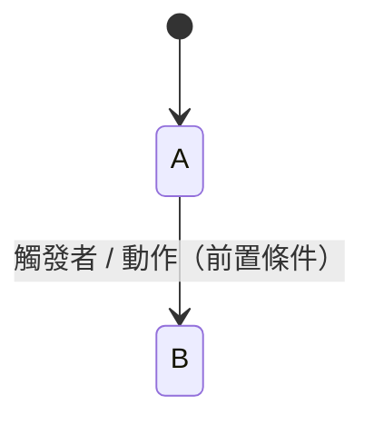
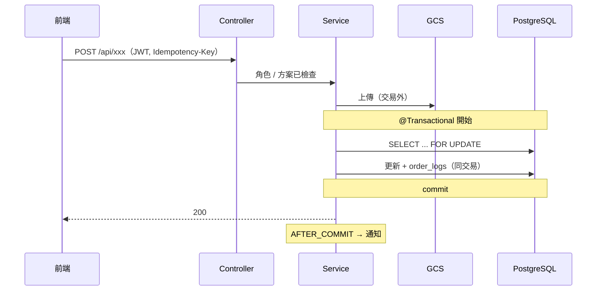
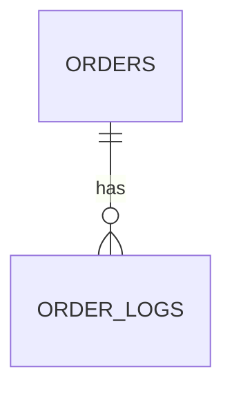

# SD-XXX: [模組名稱] 設計文件

| 項目 | 內容 |
|------|------|
| 狀態 | Draft |
| 建立日期 | YYYY-MM-DD |
| 涵蓋 PRD | PRD-NNN、PRD-NNN（每張有效 PRD 恰好屬於一份 SD，對應表見 `00-SD-PLAN.md`） |
| 擁有的 Table | `xxx`、`yyy`（只有本 SD 能寫；其他 SD 要用就走本 SD 的 Service） |
| 依賴的 SD | SD-XXX（用到它的哪個 Service / API） |
| 遵守 | `SD-GLOBAL-SPEC.md`、`SD-FRONTEND-SPEC.md`、`docs/sa/00-DOMAIN-BASELINE.md` |

> SD 依**業務模組**撰寫，一份涵蓋同一個聚合 / 狀態機的多張 PRD。
> **禁止貼實作程式碼**（Entity、Converter、Listener 全文）。只寫契約、規則、邊界；程式碼以 repo 為準。需要說明時寫類別名 + 一句責任。

---

## 1. AC 對應實作

> 涵蓋 PRD 的每一條 AC 都要出現。

| PRD | AC | API / 畫面 | Table / 欄位 | 鎖 / 交易 | 測試 |
|-----|----|-----------|-------------|----------|------|
| PRD-NNN | AC-1.1 | `POST /api/xxx` | `orders.status` | `FOR UPDATE` | `XxxIntegrationTest` |

## 2. 模組邊界

- **負責**：（本模組做什麼）
- **不負責**：（容易被誤塞進來、但屬於別的 SD 的東西）
- **對外提供**：（其他 SD 會呼叫的 Service 方法 / 事件）

## 3. 狀態機

> 本模組擁有的實體有狀態時必畫。訂單狀態機的權威版本在 DOMAIN-BASELINE，這裡只畫本模組負責的轉移並標出鎖。



| 轉移 | API | 鎖 | 不符時 |
|------|-----|----|-------|
| A → B | `POST /api/xxx` | `findByIdForUpdate` | 409 `XXX_STATE_CONFLICT` |

## 4. 流程

> 跨層、呼叫外部服務或有非同步處理的才畫序列圖；單純 CRUD 不畫。必須標出交易邊界，**外部 I/O（GCS、Resend、第三方）不得在 DB 交易內**。



## 5. 資料模型

### 5.1 遷移

- 檔名：`V{現有最大號 + 1}__{snake_case}.sql`
- 只寫 DDL（CREATE / ALTER / INDEX / CONSTRAINT），附每個索引與約束的理由。

```sql
ALTER TABLE xxx ADD COLUMN yyy INT NOT NULL DEFAULT 0;  -- 金額一律 INT（TWD）
CREATE UNIQUE INDEX ux_xxx ON xxx (a) WHERE b IS NOT NULL;  -- 理由：
```

### 5.2 ER（有新增 table 或關聯時）



## 6. API 契約

### 6.1 總表

| Method | Path | 角色 | 方案 | 歸屬檢查 | 冪等 |
|--------|------|------|------|---------|------|
| POST | `/api/xxx/{id}/yyy` | OWNER | — | `order.owner == token` | `Idempotency-Key` 必填，重送回放第一次結果 |

### 6.2 `POST /api/xxx/{id}/yyy`

**Request**

| 欄位 | 型別 | 必填 | 規則 |
|------|------|------|------|
| | | | |

**Response 200**

```json
{}
```

### 6.3 錯誤碼

| HTTP | code | 情境（對應 PRD EX-n） | 拋出位置 |
|------|------|----------------------|---------|
| 400 | `VALIDATION_FAILED` | | `XxxException` |
| 403 | `FORBIDDEN` | 非本人 | Service 歸屬檢查 |
| 404 | `NOT_FOUND` | 資源不存在 | |
| 409 | `XXX_STATE_CONFLICT` | 狀態不允許 | |

## 7. 副作用

| 觸發 | 稽核（`order_logs` action / payload，與主交易同交易） | 事件（AFTER_COMMIT） | 通知（收件者 / 管道 / 文案） | 失敗處理 |
|------|------------------------------------------------------|--------------------|---------------------------|---------|
| | | | | 通知失敗不影響主流程，記 log |

## 8. 外部服務與設定

| 服務 | 用途 | Mock 開關 | 失敗處理 | 設定 / Secret |
|------|------|----------|---------|--------------|
| GCS | | `app.storage.mock` | | Secret 不得有預設值 |

## 9. 前端

| 路由 | 角色 | 狀態（載入 / 空 / 錯誤 / 無權限） | 主要 testid |
|------|------|--------------------------------|------------|
| | | | `[role]-[screen]-[element]` |

## 10. 測試設計

| 層 | 必測 |
|----|------|
| 整合測試 | 每條 AC；越權（真 JWT filter chain）；狀態不允許；冪等重送；併發轉移（兩條執行緒真打）；交易失敗時 `order_logs` 不存在 |
| E2E | 見 TS-NNN |
| TS 需要的後端支援 | provision 參數、internal test-data 端點、cleanup |

## 11. 技術決策

| 決策 | 選擇 | 捨棄方案與理由 |
|------|------|---------------|

## 12. 待釐清事項

| CQ | 問題 | 建議預設值 | 狀態 |
|----|------|-----------|------|

## 13. 變更紀錄

| 日期 | 變更 | 原因 |
|------|------|------|
